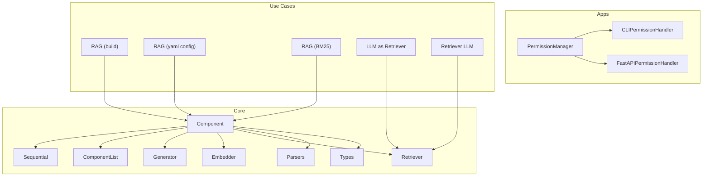
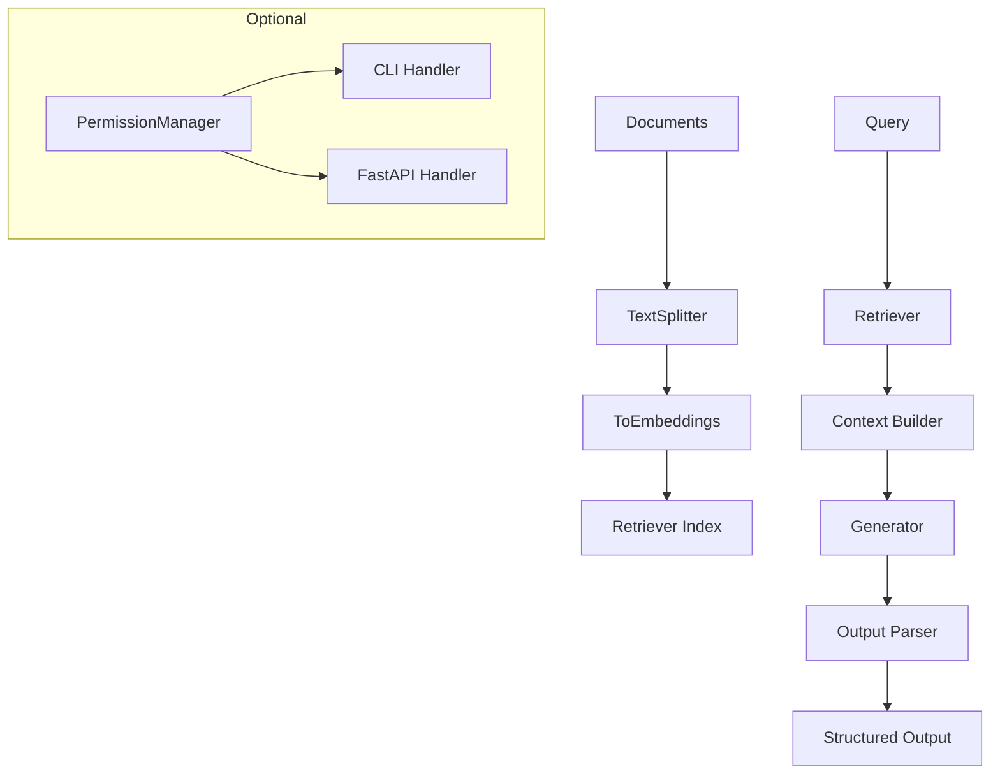
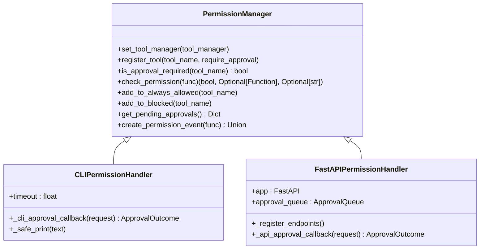
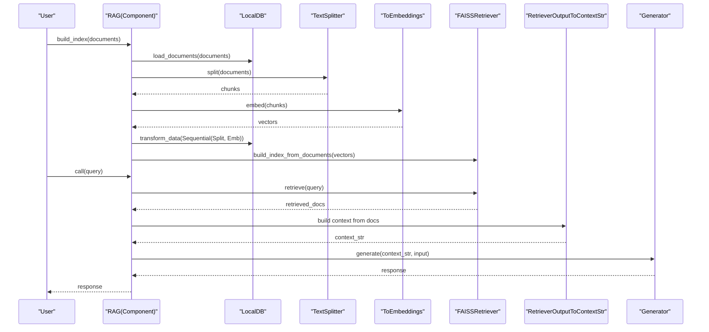
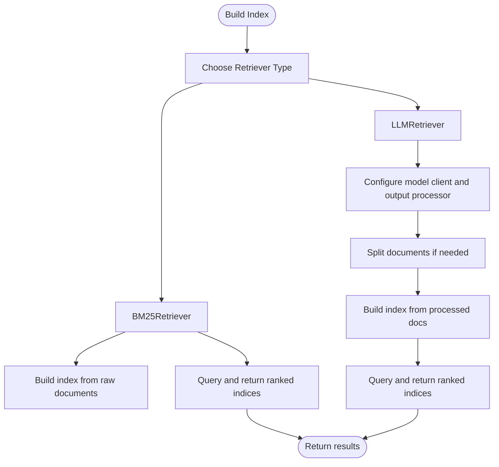
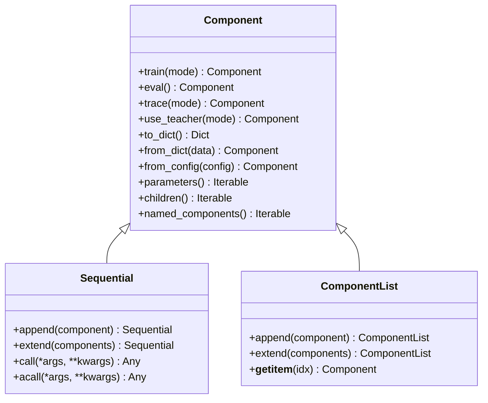

# Custom Applications

<cite>
**Referenced Files in This Document**
- [__init__.py](file://adalflow/adalflow/__init__.py)
- [core/__init__.py](file://adalflow/adalflow/core/__init__.py)
- [apps/permission_manager.py](file://adalflow/adalflow/apps/permission_manager.py)
- [apps/cli_permission_handler.py](file://adalflow/adalflow/apps/cli_permission_handler.py)
- [apps/fastapi_permission_handler.py](file://adalflow/adalflow/apps/fastapi_permission_handler.py)
- [core/component.py](file://adalflow/adalflow/core/component.py)
- [core/container.py](file://adalflow/adalflow/core/container.py)
- [use_cases/rag/build/rag.py](file://use_cases/rag/build/rag.py)
- [use_cases/unsorted/rag_yaml_config.py](file://use_cases/unsorted/rag_yaml_config.py)
- [use_cases/unsorted/simple_rag_bm_25.py](file://use_cases/unsorted/simple_rag_bm_25.py)
- [use_cases/unsorted/llm_as_retriever.py](file://use_cases/unsorted/llm_as_retriever.py)
- [use_cases/unsorted/retriever_llm.py](file://use_cases/unsorted/retriever_llm.py)
- [use_cases/configs/rag.yaml](file://use_cases/configs/rag.yaml)
- [use_cases/configs/rag_hotpotqa.yaml](file://use_cases/configs/rag_hotpotqa.yaml)
- [tutorials/rag/rag.py](file://tutorials/rag/rag.py)
</cite>

## Table of Contents
1. [Introduction](#introduction)
2. [Project Structure](#project-structure)
3. [Core Components](#core-components)
4. [Architecture Overview](#architecture-overview)
5. [Detailed Component Analysis](#detailed-component-analysis)
6. [Dependency Analysis](#dependency-analysis)
7. [Performance Considerations](#performance-considerations)
8. [Troubleshooting Guide](#troubleshooting-guide)
9. [Conclusion](#conclusion)
10. [Appendices](#appendices)

## Introduction
This document explains how to build Custom Applications with AdalFlow by extending existing examples, customizing configurations, and integrating multiple modalities. It focuses on:
- Recognizing extension patterns from unsorted use cases
- Managing configurations via YAML and programmatic settings
- Integrating external tools and model clients
- Adapting examples across domains (RAG, retrieval-as-a-LLM, classification)
- Scaling implementations and optimizing performance
- Providing templates and boilerplate for rapid application development

## Project Structure
AdalFlow organizes capabilities into cohesive modules:
- Core abstractions: Component, Container (Sequential, ComponentList), Generators, Embedders, Retrievers, Parsers, and Types
- Apps: Permission management and handlers for CLI and FastAPI
- Use cases: Practical RAG pipelines, retriever variants, and configuration-driven setups
- Tutorials: Simplified RAG examples and data processing patterns

**Diagram sources**
- [core/component.py](file://adalflow/adalflow/core/component.py#L51-L120)
- [core/container.py](file://adalflow/adalflow/core/container.py#L62-L147)
- [apps/permission_manager.py](file://adalflow/adalflow/apps/permission_manager.py#L33-L90)
- [apps/cli_permission_handler.py](file://adalflow/adalflow/apps/cli_permission_handler.py#L13-L34)
- [apps/fastapi_permission_handler.py](file://adalflow/adalflow/apps/fastapi_permission_handler.py#L139-L176)
- [use_cases/rag/build/rag.py](file://use_cases/rag/build/rag.py#L104-L149)
- [use_cases/unsorted/rag_yaml_config.py](file://use_cases/unsorted/rag_yaml_config.py#L34-L75)
- [use_cases/unsorted/simple_rag_bm_25.py](file://use_cases/unsorted/simple_rag_bm_25.py#L18-L36)
- [use_cases/unsorted/llm_as_retriever.py](file://use_cases/unsorted/llm_as_retriever.py#L7-L13)
- [use_cases/unsorted/retriever_llm.py](file://use_cases/unsorted/retriever_llm.py#L47-L52)

**Section sources**
- [__init__.py](file://adalflow/adalflow/__init__.py#L1-L154)
- [core/__init__.py](file://adalflow/adalflow/core/__init__.py#L1-L134)

## Core Components
Key building blocks for custom applications:
- Component: Base class for all pipeline units with training, tracing, and serialization support
- Sequential and ComponentList: Containers to compose pipelines and lists of components
- Generator, Embedder, Retriever: Task-specific components with model client integration
- Parsers: Structured output parsing (YAML, JSON, lists, booleans, integers, floats)
- Types: Strongly typed data structures for prompts, documents, and model outputs

Extension patterns:
- Subclass Component to define domain-specific tasks
- Compose components with Sequential for linear pipelines
- Use ComponentList for heterogeneous collections
- Swap model clients and output processors to adapt to providers and output formats

**Section sources**
- [core/component.py](file://adalflow/adalflow/core/component.py#L51-L120)
- [core/container.py](file://adalflow/adalflow/core/container.py#L62-L147)
- [core/__init__.py](file://adalflow/adalflow/core/__init__.py#L6-L26)

## Architecture Overview
The system supports a layered architecture:
- Data ingestion and preprocessing (TextSplitter, ToEmbeddings)
- Indexing and retrieval (FAISS, BM25, LLMRetriever)
- Generation with structured output parsing
- Optional permission gating for tool execution
- Configurable pipelines via YAML or programmatic settings

**Diagram sources**
- [use_cases/rag/build/rag.py](file://use_cases/rag/build/rag.py#L53-L63)
- [use_cases/unsorted/rag_yaml_config.py](file://use_cases/unsorted/rag_yaml_config.py#L49-L75)
- [use_cases/unsorted/simple_rag_bm_25.py](file://use_cases/unsorted/simple_rag_bm_25.py#L32-L36)
- [use_cases/unsorted/llm_as_retriever.py](file://use_cases/unsorted/llm_as_retriever.py#L10-L12)
- [apps/permission_manager.py](file://adalflow/adalflow/apps/permission_manager.py#L33-L90)

## Detailed Component Analysis

### Permission Management and Handlers
AdalFlow provides a flexible permission system to gate tool execution:
- PermissionManager centralizes approval logic with three categories: always allowed, blocked, and requiring approval
- CLIPermissionHandler: interactive CLI-based approval with timeouts and safe output handling
- FastAPIPermissionHandler: REST endpoints to manage pending approvals, with optional timeouts and stats

**Diagram sources**
- [apps/permission_manager.py](file://adalflow/adalflow/apps/permission_manager.py#L33-L248)
- [apps/cli_permission_handler.py](file://adalflow/adalflow/apps/cli_permission_handler.py#L13-L141)
- [apps/fastapi_permission_handler.py](file://adalflow/adalflow/apps/fastapi_permission_handler.py#L139-L308)

**Section sources**
- [apps/permission_manager.py](file://adalflow/adalflow/apps/permission_manager.py#L33-L248)
- [apps/cli_permission_handler.py](file://adalflow/adalflow/apps/cli_permission_handler.py#L13-L141)
- [apps/fastapi_permission_handler.py](file://adalflow/adalflow/apps/fastapi_permission_handler.py#L139-L308)

### RAG Pipelines: YAML Config and Programmatic Setup
Two complementary patterns demonstrate RAG customization:
- YAML-driven setup: Load settings from rag.yaml and construct RAG with Embedder, TextSplitter, ToEmbeddings, FAISSRetriever, and Generator
- Programmatic setup: Build index, persist state, and query with FAISSRetriever and a Generator using structured JSON output

**Diagram sources**
- [use_cases/unsorted/rag_yaml_config.py](file://use_cases/unsorted/rag_yaml_config.py#L96-L131)
- [use_cases/rag/build/rag.py](file://use_cases/rag/build/rag.py#L165-L205)

**Section sources**
- [use_cases/configs/rag.yaml](file://use_cases/configs/rag.yaml#L1-L20)
- [use_cases/configs/rag_hotpotqa.yaml](file://use_cases/configs/rag_hotpotqa.yaml#L1-L25)
- [use_cases/unsorted/rag_yaml_config.py](file://use_cases/unsorted/rag_yaml_config.py#L34-L131)
- [use_cases/rag/build/rag.py](file://use_cases/rag/build/rag.py#L104-L206)
- [tutorials/rag/rag.py](file://tutorials/rag/rag.py#L48-L106)

### Retrieval Variants: BM25 and LLM as Retriever
- BM25Retriever: classic lexical retrieval without embeddings; suitable for small datasets or when embeddings are unnecessary
- LLMRetriever: use a language model to rank candidate documents; supports output processors for structured indices

**Diagram sources**
- [use_cases/unsorted/simple_rag_bm_25.py](file://use_cases/unsorted/simple_rag_bm_25.py#L59-L85)
- [use_cases/unsorted/llm_as_retriever.py](file://use_cases/unsorted/llm_as_retriever.py#L7-L23)
- [use_cases/unsorted/retriever_llm.py](file://use_cases/unsorted/retriever_llm.py#L47-L82)

**Section sources**
- [use_cases/unsorted/simple_rag_bm_25.py](file://use_cases/unsorted/simple_rag_bm_25.py#L18-L85)
- [use_cases/unsorted/llm_as_retriever.py](file://use_cases/unsorted/llm_as_retriever.py#L7-L23)
- [use_cases/unsorted/retriever_llm.py](file://use_cases/unsorted/retriever_llm.py#L1-L82)

### Configuration Management Patterns
- YAML-based configuration: Centralize model settings, chunking, and retrieval parameters
- Programmatic overrides: Dynamically adjust top-k, model kwargs, and prompt templates
- Environment variables: Load secrets and provider keys via dotenv

Common configuration keys:
- vectorizer: batch_size, model_kwargs (model, dimensions, encoding_format)
- retriever: top_k
- generator: model, temperature, stream
- text_splitter: split_by, chunk_size, chunk_overlap
- llm_evaluator (optional): model, temperature, stream

**Section sources**
- [use_cases/configs/rag.yaml](file://use_cases/configs/rag.yaml#L1-L20)
- [use_cases/configs/rag_hotpotqa.yaml](file://use_cases/configs/rag_hotpotqa.yaml#L1-L25)
- [use_cases/unsorted/rag_yaml_config.py](file://use_cases/unsorted/rag_yaml_config.py#L36-L42)

### Multi-Modal Integration Approaches
- Text-only pipelines: Use TextSplitter and Embedder with FAISSRetriever
- Structured outputs: Use parsers (JSON, YAML, ListParser) to constrain generator outputs
- Streaming and async: Use acall in Sequential for concurrent component execution
- Human-in-the-loop: PermissionManager integrates with CLI and FastAPI handlers for controlled tool execution

**Section sources**
- [core/container.py](file://adalflow/adalflow/core/container.py#L314-L333)
- [apps/permission_manager.py](file://adalflow/adalflow/apps/permission_manager.py#L123-L201)
- [apps/cli_permission_handler.py](file://adalflow/adalflow/apps/cli_permission_handler.py#L73-L140)
- [apps/fastapi_permission_handler.py](file://adalflow/adalflow/apps/fastapi_permission_handler.py#L283-L308)

## Dependency Analysis
The core Component class enables composition and recursion:
- Parameters and subcomponents are tracked and serialized
- Training, tracing, and teacher modes propagate to nested components
- Serialization supports complex nested structures and fallbacks

**Diagram sources**
- [core/component.py](file://adalflow/adalflow/core/component.py#L145-L176)
- [core/component.py](file://adalflow/adalflow/core/component.py#L294-L316)
- [core/container.py](file://adalflow/adalflow/core/container.py#L62-L147)
- [core/container.py](file://adalflow/adalflow/core/container.py#L377-L534)

**Section sources**
- [core/component.py](file://adalflow/adalflow/core/component.py#L51-L120)
- [core/container.py](file://adalflow/adalflow/core/container.py#L62-L147)

## Performance Considerations
- Use Sequential.acall for concurrent execution when components perform I/O
- Tune chunk_size and chunk_overlap to balance recall and latency
- Adjust top_k to trade off precision and compute cost
- Persist and reuse indices to avoid recomputation
- Prefer batching in Embedder and ToEmbeddings for throughput
- Control streaming and temperature for latency-sensitive workflows

[No sources needed since this section provides general guidance]

## Troubleshooting Guide
Common issues and resolutions:
- Permission denied: Verify approval_mode and tool registration; use CLI or FastAPI endpoints to approve
- Missing model credentials: Ensure environment variables are loaded via dotenv
- Serialization errors: Confirm component state is serializable; fallbacks are used but may degrade fidelity
- Index rebuild: Clear persisted index and re-run preparation when schema or settings change

**Section sources**
- [apps/permission_manager.py](file://adalflow/adalflow/apps/permission_manager.py#L123-L201)
- [apps/cli_permission_handler.py](file://adalflow/adalflow/apps/cli_permission_handler.py#L189-L209)
- [apps/fastapi_permission_handler.py](file://adalflow/adalflow/apps/fastapi_permission_handler.py#L311-L330)
- [use_cases/rag/build/rag.py](file://use_cases/rag/build/rag.py#L222-L223)

## Conclusion
AdalFlow offers a robust foundation for building custom applications:
- Extend Component to encapsulate domain logic
- Compose pipelines with Sequential and ComponentList
- Switch model clients and output processors for provider flexibility
- Manage configurations via YAML or programmatic settings
- Integrate permission systems for safe tool execution
- Scale by persisting indices, batching, and leveraging async execution

[No sources needed since this section summarizes without analyzing specific files]

## Appendices

### Templates and Boilerplate

- RAG with YAML configuration
  - Load settings from rag.yaml
  - Build index with TextSplitter and ToEmbeddings
  - Query with FAISSRetriever and Generator using structured output parsing

  **Section sources**
  - [use_cases/unsorted/rag_yaml_config.py](file://use_cases/unsorted/rag_yaml_config.py#L34-L131)
  - [use_cases/configs/rag.yaml](file://use_cases/configs/rag.yaml#L1-L20)

- RAG with programmatic setup
  - Prepare data pipeline (TextSplitter + ToEmbeddings)
  - Persist index state and reload for subsequent runs
  - Add documents dynamically and rebuild retriever index

  **Section sources**
  - [use_cases/rag/build/rag.py](file://use_cases/rag/build/rag.py#L53-L81)
  - [use_cases/rag/build/rag.py](file://use_cases/rag/build/rag.py#L104-L206)

- Retrieval variants
  - BM25Retriever for lexical matching
  - LLMRetriever for semantic ranking with structured output processors

  **Section sources**
  - [use_cases/unsorted/simple_rag_bm_25.py](file://use_cases/unsorted/simple_rag_bm_25.py#L18-L85)
  - [use_cases/unsorted/llm_as_retriever.py](file://use_cases/unsorted/llm_as_retriever.py#L7-L23)
  - [use_cases/unsorted/retriever_llm.py](file://use_cases/unsorted/retriever_llm.py#L47-L82)

- Permission gating
  - CLI handler for interactive approval
  - FastAPI handler for REST-based approval management

  **Section sources**
  - [apps/cli_permission_handler.py](file://adalflow/adalflow/apps/cli_permission_handler.py#L13-L141)
  - [apps/fastapi_permission_handler.py](file://adalflow/adalflow/apps/fastapi_permission_handler.py#L139-L308)