# Examples and Use Cases

<cite>
**Referenced Files in This Document**
- [README.md](file://README.md)
- [use_cases/README.md](file://use_cases/README.md)
- [use_cases/rag/build/rag.py](file://use_cases/rag/build/rag.py)
- [use_cases/question_answering/simple_qa.ipynb](file://use_cases/question_answering/simple_qa.ipynb)
- [use_cases/classification/train.py](file://use_cases/classification/train.py)
- [use_cases/question_answering/bbh/object_count/train_new.py](file://use_cases/question_answering/bbh/object_count/train_new.py)
- [use_cases/agent/react_agent_hotpot_qa.ipynb](file://use_cases/agent/react_agent_hotpot_qa.ipynb)
- [tutorials/agent/tutorial_agent_basic.py](file://tutorials/agent/tutorial_agent_basic.py)
- [notebooks/use_cases/adalflow_rag_optimization.ipynb](file://notebooks/use_cases/adalflow_rag_optimization.ipynb)
- [benchmarks/hotpot_qa/adal_exp/train_multi_hop_rag.py](file://benchmarks/hotpot_qa/adal_exp/train_multi_hop_rag.py)
- [docs/source/use_cases/index.rst](file://docs/source/use_cases/index.rst)
</cite>

## Table of Contents
1. [Introduction](#introduction)
2. [Project Structure](#project-structure)
3. [Core Components](#core-components)
4. [Architecture Overview](#architecture-overview)
5. [Detailed Component Analysis](#detailed-component-analysis)
6. [Dependency Analysis](#dependency-analysis)
7. [Performance Considerations](#performance-considerations)
8. [Troubleshooting Guide](#troubleshooting-guide)
9. [Conclusion](#conclusion)
10. [Appendices](#appendices)

## Introduction
This section presents a comprehensive collection of examples and use cases for AdalFlow, showcasing end-to-end implementations across practical domains: question answering, classification, retrieval-augmented generation (RAG), and agent applications. It consolidates runnable examples, tutorials, and benchmark-style training scripts to help you progress from simple tasks to advanced, multi-component pipelines. Each example highlights best practices, common patterns, and advanced techniques such as auto-optimization, few-shot bootstrap optimization, and multi-hop reasoning.

## Project Structure
The repository organizes examples and use cases across three primary areas:
- use_cases: End-to-end implementations and curated datasets for QA, classification, RAG, and agent workflows.
- tutorials: Step-by-step Python scripts and Jupyter notebooks demonstrating core components and patterns.
- notebooks: Interactive tutorials and optimization-focused notebooks for RAG and evaluation.

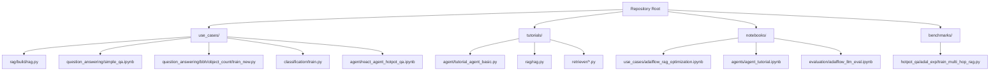

**Diagram sources**
- [use_cases/rag/build/rag.py](file://use_cases/rag/build/rag.py#L1-L252)
- [use_cases/question_answering/simple_qa.ipynb](file://use_cases/question_answering/simple_qa.ipynb#L1-L178)
- [use_cases/question_answering/bbh/object_count/train_new.py](file://use_cases/question_answering/bbh/object_count/train_new.py#L1-L211)
- [use_cases/classification/train.py](file://use_cases/classification/train.py#L1-L197)
- [use_cases/agent/react_agent_hotpot_qa.ipynb](file://use_cases/agent/react_agent_hotpot_qa.ipynb#L1-L800)
- [tutorials/agent/tutorial_agent_basic.py](file://tutorials/agent/tutorial_agent_basic.py#L1-L319)
- [notebooks/use_cases/adalflow_rag_optimization.ipynb](file://notebooks/use_cases/adalflow_rag_optimization.ipynb#L1-L800)
- [benchmarks/hotpot_qa/adal_exp/train_multi_hop_rag.py](file://benchmarks/hotpot_qa/adal_exp/train_multi_hop_rag.py#L1-L168)

**Section sources**
- [README.md](file://README.md#L110-L240)
- [docs/source/use_cases/index.rst](file://docs/source/use_cases/index.rst#L1-L69)

## Core Components
AdalFlow’s examples leverage core building blocks:
- Component: Base class for task pipelines.
- Generator: LLM call abstraction with templating, output parsing, and caching.
- Retriever: Embedding-based or external retrievers integrated into RAG.
- DataProcessors: Text splitting, embedding, and context assembly.
- Trainer and AdalComponent: Auto-optimization harness for prompts and demonstrations.
- Agent and Runner: Tool-enabled agents with streaming and tracing.

These components are demonstrated across examples ranging from simple question answering to multi-hop RAG and ReAct agents.

**Section sources**
- [use_cases/rag/build/rag.py](file://use_cases/rag/build/rag.py#L104-L206)
- [use_cases/question_answering/simple_qa.ipynb](file://use_cases/question_answering/simple_qa.ipynb#L120-L134)
- [use_cases/classification/train.py](file://use_cases/classification/train.py#L17-L76)
- [use_cases/question_answering/bbh/object_count/train_new.py](file://use_cases/question_answering/bbh/object_count/train_new.py#L18-L61)
- [use_cases/agent/react_agent_hotpot_qa.ipynb](file://use_cases/agent/react_agent_hotpot_qa.ipynb#L500-L510)
- [tutorials/agent/tutorial_agent_basic.py](file://tutorials/agent/tutorial_agent_basic.py#L101-L127)

## Architecture Overview
The examples illustrate a consistent architecture:
- Data ingestion and preprocessing (text splitting, embeddings).
- Retrieval of relevant chunks.
- Prompt composition and LLM generation with structured output parsing.
- Evaluation and optional auto-optimization.

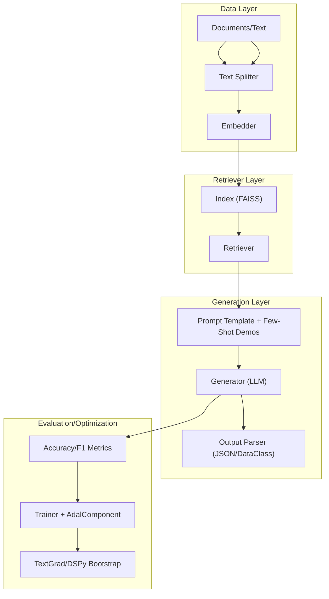

**Diagram sources**
- [use_cases/rag/build/rag.py](file://use_cases/rag/build/rag.py#L53-L82)
- [use_cases/rag/build/rag.py](file://use_cases/rag/build/rag.py#L134-L148)
- [use_cases/question_answering/bbh/object_count/train_new.py](file://use_cases/question_answering/bbh/object_count/train_new.py#L18-L61)
- [notebooks/use_cases/adalflow_rag_optimization.ipynb](file://notebooks/use_cases/adalflow_rag_optimization.ipynb#L223-L285)

## Detailed Component Analysis

### RAG: Simple Pipeline
A minimal RAG pipeline demonstrates:
- Text preprocessing and embedding.
- FAISS index creation and persistence.
- Retrieval and context assembly.
- JSON-structured generation with a task-desc prompt.

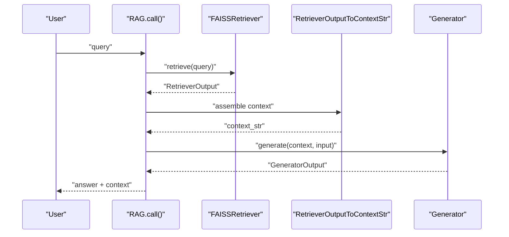

**Diagram sources**
- [use_cases/rag/build/rag.py](file://use_cases/rag/build/rag.py#L190-L206)

**Section sources**
- [use_cases/rag/build/rag.py](file://use_cases/rag/build/rag.py#L24-L49)
- [use_cases/rag/build/rag.py](file://use_cases/rag/build/rag.py#L104-L148)
- [use_cases/rag/build/rag.py](file://use_cases/rag/build/rag.py#L179-L206)

### RAG: End-to-End with Optimization
This notebook demonstrates:
- Wrapping an external retriever into AdalFlow’s API.
- Structured output with a DataClass parser.
- Training and evaluation on HotPotQA with multiple models.
- Diagnostics and optimization hooks.

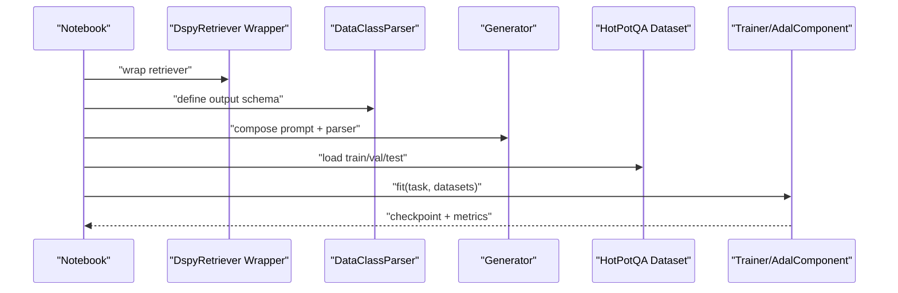

**Diagram sources**
- [notebooks/use_cases/adalflow_rag_optimization.ipynb](file://notebooks/use_cases/adalflow_rag_optimization.ipynb#L151-L175)
- [notebooks/use_cases/adalflow_rag_optimization.ipynb](file://notebooks/use_cases/adalflow_rag_optimization.ipynb#L223-L285)
- [notebooks/use_cases/adalflow_rag_optimization.ipynb](file://notebooks/use_cases/adalflow_rag_optimization.ipynb#L491-L556)

**Section sources**
- [notebooks/use_cases/adalflow_rag_optimization.ipynb](file://notebooks/use_cases/adalflow_rag_optimization.ipynb#L137-L176)
- [notebooks/use_cases/adalflow_rag_optimization.ipynb](file://notebooks/use_cases/adalflow_rag_optimization.ipynb#L223-L285)
- [notebooks/use_cases/adalflow_rag_optimization.ipynb](file://notebooks/use_cases/adalflow_rag_optimization.ipynb#L491-L556)

### Question Answering: Simple QA
A minimal question answering pipeline built with a Component and Generator, demonstrating:
- Prompt composition with task description and input.
- Direct LLM call and response handling.

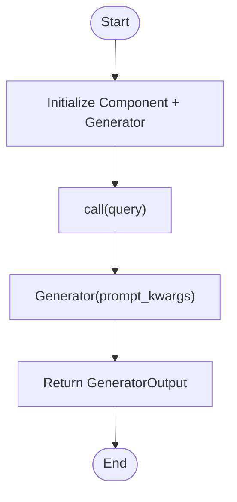

**Diagram sources**
- [use_cases/question_answering/simple_qa.ipynb](file://use_cases/question_answering/simple_qa.ipynb#L120-L134)

**Section sources**
- [use_cases/question_answering/simple_qa.ipynb](file://use_cases/question_answering/simple_qa.ipynb#L1-L178)

### Question Answering: BBH Object Count (Auto-Optimization)
This example trains a task pipeline with:
- AdalComponent to orchestrate forward/eval/loss computation.
- Trainer with bootstrap few-shot optimization.
- Evaluation via exact-match accuracy.

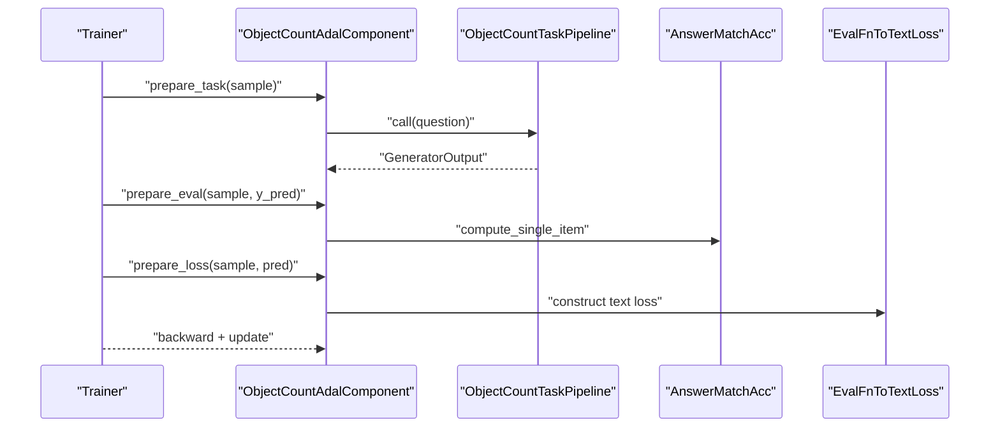

**Diagram sources**
- [use_cases/question_answering/bbh/object_count/train_new.py](file://use_cases/question_answering/bbh/object_count/train_new.py#L18-L61)
- [use_cases/question_answering/bbh/object_count/train_new.py](file://use_cases/question_answering/bbh/object_count/train_new.py#L95-L159)

**Section sources**
- [use_cases/question_answering/bbh/object_count/train_new.py](file://use_cases/question_answering/bbh/object_count/train_new.py#L1-L211)

### Classification: TREC (Structured Output and Optimization)
This example demonstrates:
- Structured output using a DataClass.
- AdalComponent with evaluation and loss setup.
- Trainer configuration for bootstrap optimization and diagnostics.

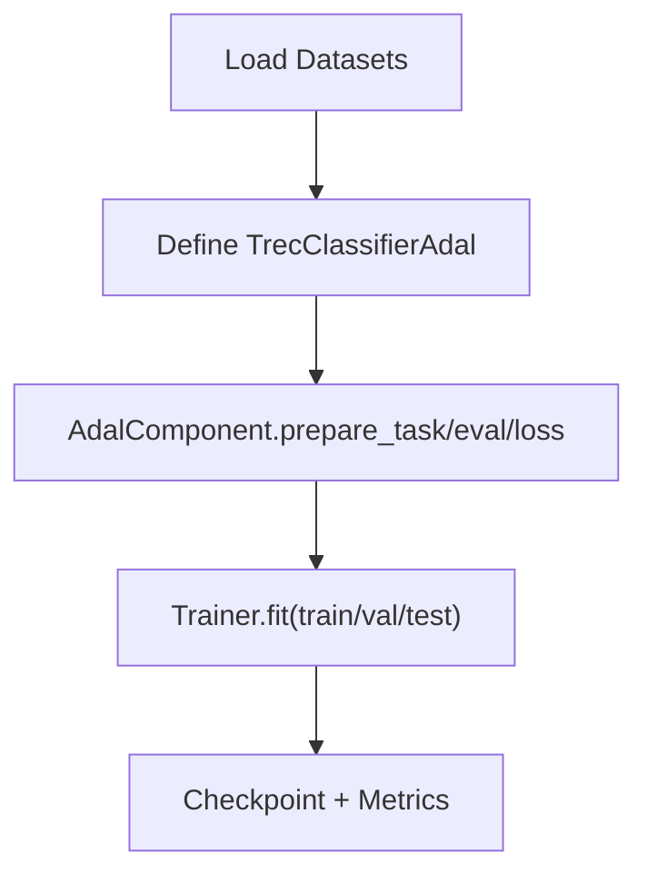

**Diagram sources**
- [use_cases/classification/train.py](file://use_cases/classification/train.py#L17-L76)
- [use_cases/classification/train.py](file://use_cases/classification/train.py#L78-L139)

**Section sources**
- [use_cases/classification/train.py](file://use_cases/classification/train.py#L1-L197)

### Agent: ReAct on HotPotQA
This notebook implements a ReAct agent that:
- Uses FunctionTool wrappers for search and lookup.
- Leverages few-shot examples and a structured output schema.
- Executes multi-step reasoning with streaming logs and evaluation.

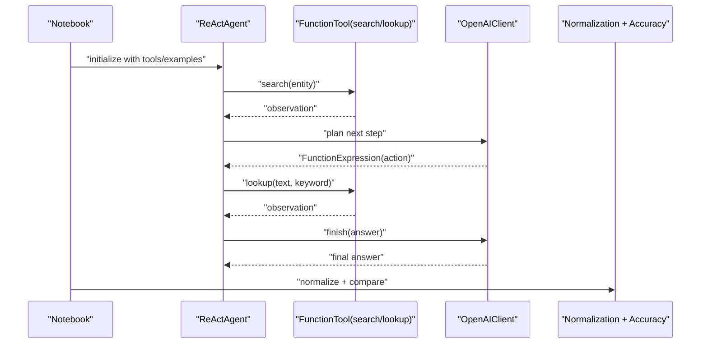

**Diagram sources**
- [use_cases/agent/react_agent_hotpot_qa.ipynb](file://use_cases/agent/react_agent_hotpot_qa.ipynb#L134-L252)
- [use_cases/agent/react_agent_hotpot_qa.ipynb](file://use_cases/agent/react_agent_hotpot_qa.ipynb#L500-L510)

**Section sources**
- [use_cases/agent/react_agent_hotpot_qa.ipynb](file://use_cases/agent/react_agent_hotpot_qa.ipynb#L1-L800)

### Agent: Basic Tutorial (Python Script)
A modular tutorial covering:
- Environment checks and client initialization.
- Basic and multi-tool agents.
- Structured outputs and custom roles.
- Runner configuration overrides.

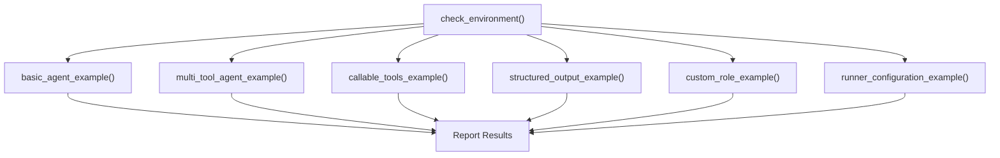

**Diagram sources**
- [tutorials/agent/tutorial_agent_basic.py](file://tutorials/agent/tutorial_agent_basic.py#L27-L62)
- [tutorials/agent/tutorial_agent_basic.py](file://tutorials/agent/tutorial_agent_basic.py#L101-L127)

**Section sources**
- [tutorials/agent/tutorial_agent_basic.py](file://tutorials/agent/tutorial_agent_basic.py#L1-L319)

### Benchmark: Multi-Hop RAG Training
This script trains a multi-hop RAG on HotPotQA with:
- MultiHopRAG task.
- AdalComponent with evaluation and loss.
- Trainer configuration for constrained strategy and sequential optimization.

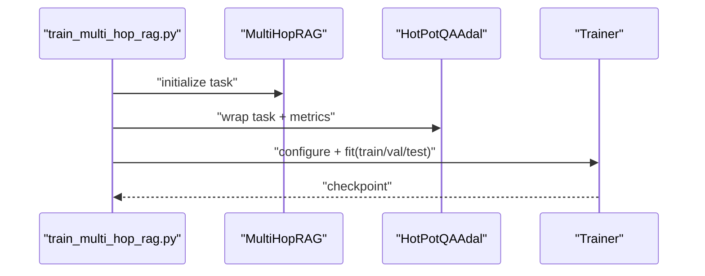

**Diagram sources**
- [benchmarks/hotpot_qa/adal_exp/train_multi_hop_rag.py](file://benchmarks/hotpot_qa/adal_exp/train_multi_hop_rag.py#L41-L104)

**Section sources**
- [benchmarks/hotpot_qa/adal_exp/train_multi_hop_rag.py](file://benchmarks/hotpot_qa/adal_exp/train_multi_hop_rag.py#L1-L168)

## Dependency Analysis
Key dependencies and relationships across examples:
- use_cases/rag/build/rag.py depends on FAISSRetriever, TextSplitter, ToEmbeddings, and JsonParser.
- notebooks/use_cases/adalflow_rag_optimization.ipynb wraps external retrievers and uses DataClassParser for structured outputs.
- use_cases/question_answering/bbh/object_count/train_new.py and use_cases/classification/train.py both rely on AdalComponent and Trainer for optimization.
- use_cases/agent/react_agent_hotpot_qa.ipynb integrates FunctionTool and ReActAgent with OpenAIClient.

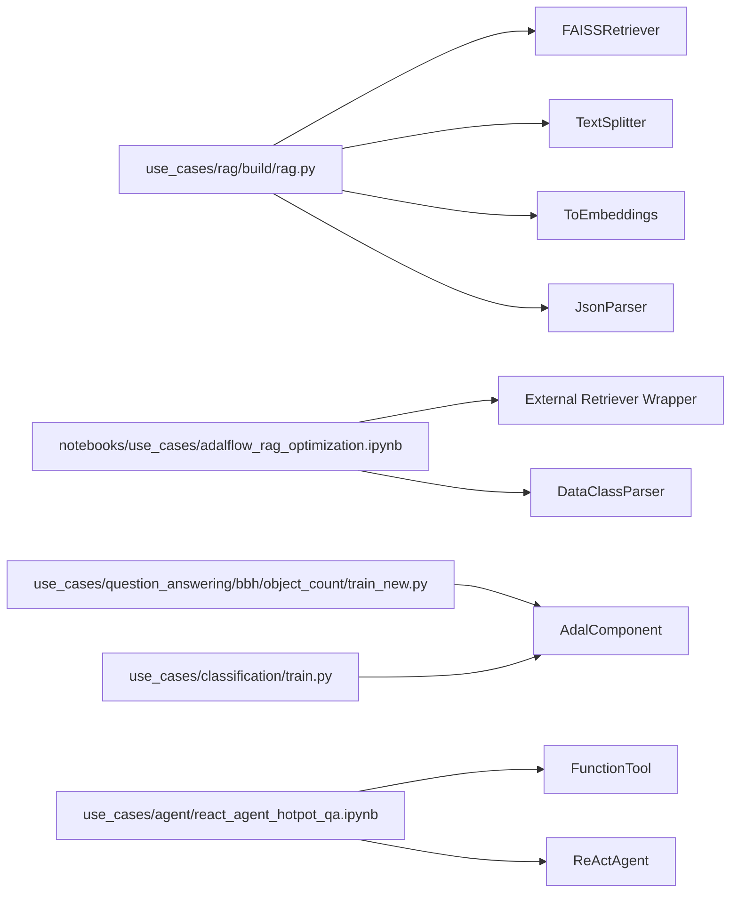

**Diagram sources**
- [use_cases/rag/build/rag.py](file://use_cases/rag/build/rag.py#L10-L17)
- [notebooks/use_cases/adalflow_rag_optimization.ipynb](file://notebooks/use_cases/adalflow_rag_optimization.ipynb#L151-L175)
- [use_cases/question_answering/bbh/object_count/train_new.py](file://use_cases/question_answering/bbh/object_count/train_new.py#L18-L34)
- [use_cases/classification/train.py](file://use_cases/classification/train.py#L17-L39)
- [use_cases/agent/react_agent_hotpot_qa.ipynb](file://use_cases/agent/react_agent_hotpot_qa.ipynb#L134-L252)

**Section sources**
- [use_cases/rag/build/rag.py](file://use_cases/rag/build/rag.py#L10-L17)
- [notebooks/use_cases/adalflow_rag_optimization.ipynb](file://notebooks/use_cases/adalflow_rag_optimization.ipynb#L151-L175)
- [use_cases/question_answering/bbh/object_count/train_new.py](file://use_cases/question_answering/bbh/object_count/train_new.py#L18-L34)
- [use_cases/classification/train.py](file://use_cases/classification/train.py#L17-L39)
- [use_cases/agent/react_agent_hotpot_qa.ipynb](file://use_cases/agent/react_agent_hotpot_qa.ipynb#L134-L252)

## Performance Considerations
- Batch sizes and sampling: Some examples note diminishing returns with larger training batches due to LLM “lost in the middle” phenomena.
- Model selection: Using stronger models (e.g., GPT-4o) as optimizers and backward engines often yields better results than weaker models.
- Few-shot bootstrap: Strategic use of bootstrap demonstrations improves accuracy on complex tasks.
- Indexing and retrieval: Efficient chunking and embedding strategies reduce latency and improve recall.
- Structured outputs: Using DataClass parsers reduces parsing overhead and improves downstream evaluation reliability.

[No sources needed since this section provides general guidance]

## Troubleshooting Guide
Common issues and resolutions:
- Missing environment variables: Ensure API keys are configured before running agent or RAG examples.
- Network connectivity: Agents and retrievers require outbound access; verify firewall and proxy settings.
- Output parsing failures: For notebooks using JSON outputs, confirm the model returns valid JSON and adjust the parser accordingly.
- Dataset caching: Some notebooks and benchmarks rely on cached datasets; clear caches if encountering stale data.
- Model availability: Some notebooks depend on external providers; confirm provider quotas and model aliases.

**Section sources**
- [tutorials/agent/tutorial_agent_basic.py](file://tutorials/agent/tutorial_agent_basic.py#L27-L62)
- [notebooks/use_cases/adalflow_rag_optimization.ipynb](file://notebooks/use_cases/adalflow_rag_optimization.ipynb#L87-L100)

## Conclusion
AdalFlow’s examples provide a practical pathway from simple question answering to advanced RAG and agent systems. By combining modular components—Generators, Retrievers, DataProcessors, and Trainers—you can build, evaluate, and auto-optimize LLM workflows. Progress from the simple QA notebook to multi-hop RAG training and ReAct agents, adapting patterns and configurations to your domain and data.

[No sources needed since this section summarizes without analyzing specific files]

## Appendices
- Getting started: Follow the quickstart and agent tutorial to configure environment variables and run your first agent.
- Learning progression:
  - Start with the simple QA notebook.
  - Move to the RAG build script and the RAG optimization notebook.
  - Explore classification training and BBH optimization.
  - Advance to ReAct agents and multi-hop training.

**Section sources**
- [README.md](file://README.md#L110-L240)
- [docs/source/use_cases/index.rst](file://docs/source/use_cases/index.rst#L1-L69)