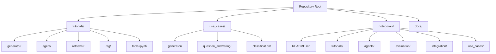
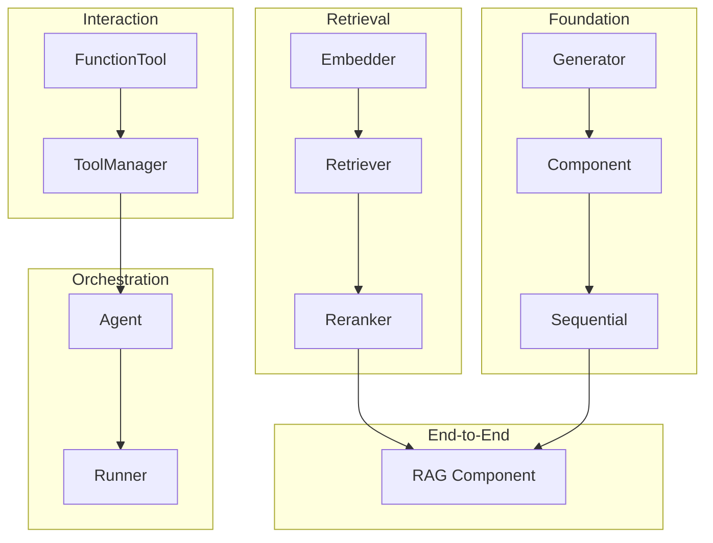
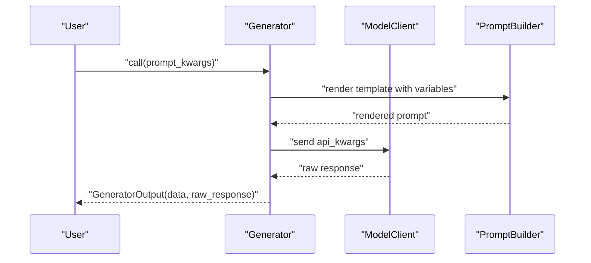
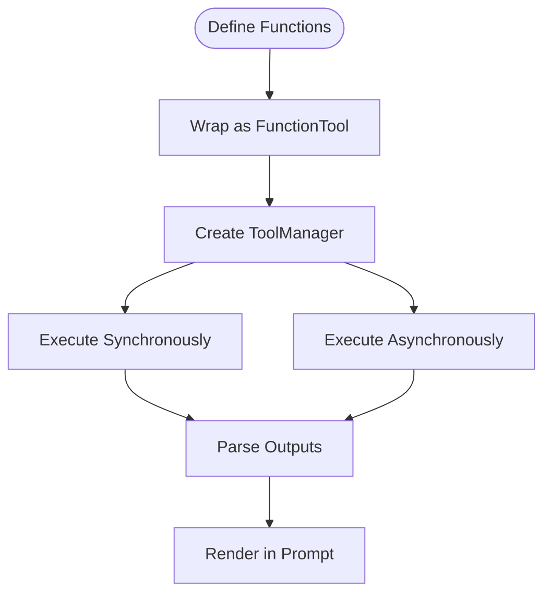
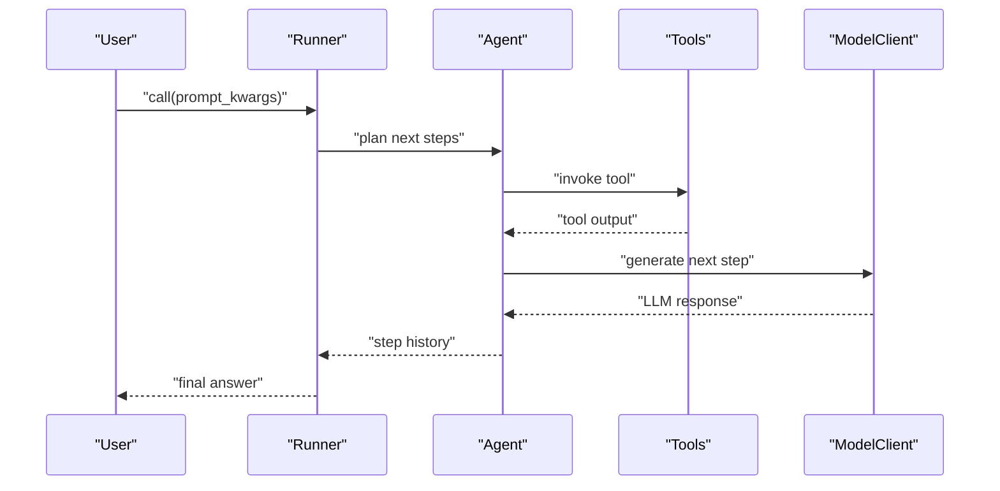
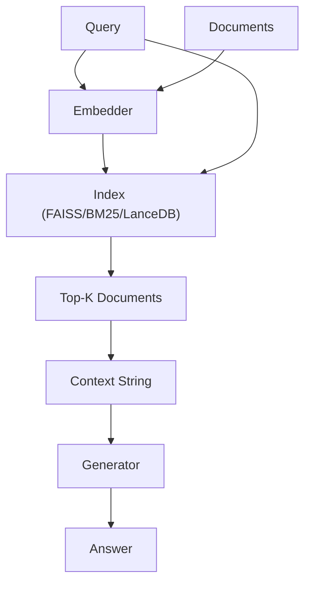
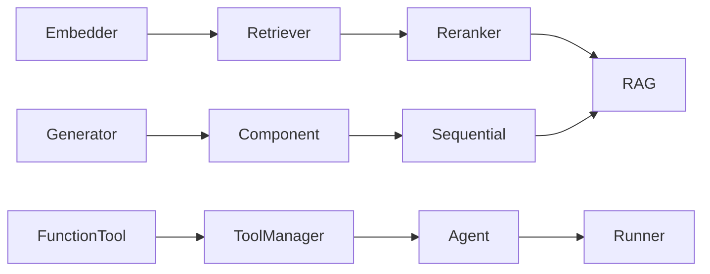

# Tutorial Materials

<cite>
**Referenced Files in This Document**
- [README.md](file://README.md)
- [notebooks/README.md](file://notebooks/README.md)
- [tutorials/adalflow_dataclasses.py](file://tutorials/adalflow_dataclasses.py)
- [tutorials/generator.ipynb](file://tutorials/generator.ipynb)
- [tutorials/model_client.ipynb](file://tutorials/model_client.ipynb)
- [tutorials/retriever.ipynb](file://tutorials/retriever.ipynb)
- [tutorials/tools.ipynb](file://tutorials/tools.ipynb)
- [tutorials/generator_note.py](file://tutorials/generator_note.py)
- [tutorials/agent/tutorial_agent_basic.py](file://tutorials/agent/tutorial_agent_basic.py)
- [tutorials/react_note.py](file://tutorials/react_note.py)
- [tutorials/rag/rag.py](file://tutorials/rag/rag.py)
- [tutorials/rag/config.py](file://tutorials/rag/config.py)
- [tutorials/retriever/adalflow_lancedb.py](file://tutorials/retriever/adalflow_lancedb.py)
- [use_cases/question_answering/simple_qa.ipynb](file://use_cases/question_answering/simple_qa.ipynb)
- [use_cases/generator/basic.ipynb](file://use_cases/generator/basic.ipynb)
- [use_cases/generator/intermediate.ipynb](file://use_cases/generator/intermediate.ipynb)
</cite>

## Table of Contents
1. [Introduction](#introduction)
2. [Project Structure](#project-structure)
3. [Core Components](#core-components)
4. [Architecture Overview](#architecture-overview)
5. [Detailed Component Analysis](#detailed-component-analysis)
6. [Dependency Analysis](#dependency-analysis)
7. [Performance Considerations](#performance-considerations)
8. [Troubleshooting Guide](#troubleshooting-guide)
9. [Conclusion](#conclusion)
10. [Appendices](#appendices)

## Introduction
This document presents a structured, progressive tutorial curriculum for mastering AdalFlow. It organizes hands-on learning resources—Python scripts, Jupyter notebooks, and interactive examples—by skill level and learning goals. The pedagogy emphasizes building intuition through small, guided experiments, then scaling up to end-to-end workflows such as Generators, Agents, Retrievers, and Retrieval-Augmented Generation (RAG). Each section includes:
- Learning objectives
- Recommended sequence
- Interactive exercises
- Visual and textual explanations
- Assessment opportunities and practice exercises

## Project Structure
AdalFlow’s tutorial ecosystem is organized into:
- Tutorials: Python scripts and notebooks demonstrating core concepts
- Use Cases: End-to-end examples for common scenarios
- Notebooks: Colab-friendly notebooks for quick experimentation
- READMEs: Guidance for environment setup and kernel usage

**Diagram sources**
- [README.md](file://README.md#L1-L392)
- [notebooks/README.md](file://notebooks/README.md#L1-L53)

**Section sources**
- [README.md](file://README.md#L1-L392)
- [notebooks/README.md](file://notebooks/README.md#L1-L53)

## Core Components
AdalFlow’s tutorials cover the foundational building blocks you will use across all skill levels:
- Generator: Templated prompting, model client switching, structured output parsing
- Component: Composable units for building pipelines
- Sequential: Chain components into pipelines
- Tools and ToolManager: Wrap functions as tools with automatic parsing
- Agent and Runner: Orchestrate tools and LLMs with step histories
- Retriever: Embedding-based and lexical retrieval with reranking
- RAG: End-to-end retrieval-augmented generation with configurable components

Recommended first steps:
- Start with generator basics and structured outputs
- Move to tools and tool management
- Explore agents and runners
- Practice retrievers and RAG pipelines
- Evaluate and iterate with built-in evaluators

**Section sources**
- [tutorials/generator_note.py](file://tutorials/generator_note.py#L1-L386)
- [tutorials/tools.ipynb](file://tutorials/tools.ipynb#L1-L800)
- [tutorials/agent/tutorial_agent_basic.py](file://tutorials/agent/tutorial_agent_basic.py#L1-L319)
- [tutorials/retriever.ipynb](file://tutorials/retriever.ipynb#L1-L800)
- [tutorials/rag/rag.py](file://tutorials/rag/rag.py#L1-L106)

## Architecture Overview
The tutorials illustrate a layered learning architecture:
- Foundation: Generator and Component
- Composition: Sequential pipelines
- Interaction: Tools and ToolManager
- Orchestration: Agent and Runner
- Retrieval: Embedders, retrievers, rerankers
- End-to-end: RAG with configurable components

**Diagram sources**
- [tutorials/generator_note.py](file://tutorials/generator_note.py#L1-L386)
- [tutorials/tools.ipynb](file://tutorials/tools.ipynb#L1-L800)
- [tutorials/agent/tutorial_agent_basic.py](file://tutorials/agent/tutorial_agent_basic.py#L1-L319)
- [tutorials/retriever.ipynb](file://tutorials/retriever.ipynb#L1-L800)
- [tutorials/rag/rag.py](file://tutorials/rag/rag.py#L1-L106)

## Detailed Component Analysis

### Generator Tutorials
Learning objectives:
- Understand templating and prompt variables
- Switch model clients and models
- Parse structured outputs
- Use async calls for throughput

Recommended sequence:
1. Minimal generator usage and prompt inspection
2. Custom templates and model switching
3. Structured output parsing with JSON/DataClass parsers
4. Async batching for performance

Interactive exercises:
- Build a minimal generator and print the rendered prompt
- Swap model clients and compare outputs
- Parse numeric answers and structured dataclasses
- Run multiple async calls concurrently

Assessment opportunities:
- Write a generator that enforces a specific output format
- Compare synchronous vs. asynchronous performance
- Validate structured output correctness with a parser

**Diagram sources**
- [tutorials/generator_note.py](file://tutorials/generator_note.py#L72-L188)
- [tutorials/generator.ipynb](file://tutorials/generator.ipynb#L1-L137)

**Section sources**
- [tutorials/generator_note.py](file://tutorials/generator_note.py#L1-L386)
- [tutorials/generator.ipynb](file://tutorials/generator.ipynb#L1-L137)
- [use_cases/generator/basic.ipynb](file://use_cases/generator/basic.ipynb#L1-L316)
- [use_cases/generator/intermediate.ipynb](file://use_cases/generator/intermediate.ipynb#L1-L583)

### Tools and Tool Management
Learning objectives:
- Wrap functions as tools
- Manage tool definitions and signatures
- Execute synchronous and asynchronous tools
- Integrate tools into generators and agents

Recommended sequence:
1. Define tools and inspect their signatures
2. Use ToolManager to orchestrate tools
3. Execute tools synchronously and asynchronously
4. Render tool lists and output formats in prompts

Interactive exercises:
- Convert a math function into a tool and call it
- Build a tool manager and execute multiple tools concurrently
- Render a tool list into a generator prompt
- Enforce JSON output schemas for tool calls

Assessment opportunities:
- Design a tool that validates inputs and returns structured outputs
- Benchmark synchronous vs. asynchronous tool execution
- Verify tool signature rendering and output parsing

**Diagram sources**
- [tutorials/tools.ipynb](file://tutorials/tools.ipynb#L1-L800)

**Section sources**
- [tutorials/tools.ipynb](file://tutorials/tools.ipynb#L1-L800)

### Agent Development
Learning objectives:
- Create agents with tools
- Configure roles and max steps
- Use Runner for synchronous, asynchronous, and streaming modes
- Build agents with structured outputs

Recommended sequence:
1. Basic agent with a calculator tool
2. Multi-tool agents and advanced search
3. Structured outputs with Pydantic models
4. Custom roles and runner configuration

Interactive exercises:
- Build an agent that calculates expressions
- Add web search and email tools
- Enforce structured output types
- Configure runner overrides and observe step history

Assessment opportunities:
- Implement a multi-step agent that solves a reasoning task
- Compare synchronous and streaming execution modes
- Validate tool invocation and step history

**Diagram sources**
- [tutorials/agent/tutorial_agent_basic.py](file://tutorials/agent/tutorial_agent_basic.py#L101-L263)

**Section sources**
- [tutorials/agent/tutorial_agent_basic.py](file://tutorials/agent/tutorial_agent_basic.py#L1-L319)
- [tutorials/react_note.py](file://tutorials/react_note.py#L1-L162)

### Retrievers and RAG
Learning objectives:
- Use FAISS, BM25, and reranker retrievers
- Build LanceDB-backed retrievers
- Construct RAG pipelines with configurable components
- Tune chunking, embeddings, and retrieval parameters

Recommended sequence:
1. Embedding and FAISS retriever basics
2. BM25 and reranker retrievers
3. LanceDB-backed retriever
4. Full RAG pipeline with configurable components

Interactive exercises:
- Prepare documents, embed, and retrieve with FAISS
- Compare BM25 and reranker scores
- Persist and query LanceDB retriever
- Build a RAG component with a generator and retriever

Assessment opportunities:
- Evaluate retrieval quality with different retrievers
- Tune chunk sizes and overlaps for downstream tasks
- Validate RAG context construction and answer quality

**Diagram sources**
- [tutorials/retriever.ipynb](file://tutorials/retriever.ipynb#L1-L800)
- [tutorials/retriever/adalflow_lancedb.py](file://tutorials/retriever/adalflow_lancedb.py#L1-L51)
- [tutorials/rag/rag.py](file://tutorials/rag/rag.py#L1-L106)
- [tutorials/rag/config.py](file://tutorials/rag/config.py#L1-L24)

**Section sources**
- [tutorials/retriever.ipynb](file://tutorials/retriever.ipynb#L1-L800)
- [tutorials/retriever/adalflow_lancedb.py](file://tutorials/retriever/adalflow_lancedb.py#L1-L51)
- [tutorials/rag/rag.py](file://tutorials/rag/rag.py#L1-L106)
- [tutorials/rag/config.py](file://tutorials/rag/config.py#L1-L24)

### Evaluation Techniques
Learning objectives:
- Use built-in evaluators for answer matching and recall
- Apply LLM-as-a-judge evaluations
- Integrate evaluation into RAG pipelines

Recommended sequence:
1. Answer matching accuracy
2. Retriever recall metrics
3. LLM-as-a-judge scoring
4. Integrating evaluation into RAG workflows

Interactive exercises:
- Evaluate generated answers against ground truth
- Measure retriever recall at different top-k values
- Implement a judge prompt for quality scoring

Assessment opportunities:
- Build an evaluation pipeline for a RAG system
- Compare multiple evaluation strategies
- Interpret evaluator outputs and tune retrieval accordingly

**Section sources**
- [use_cases/generator/basic.ipynb](file://use_cases/generator/basic.ipynb#L1-L316)
- [use_cases/generator/intermediate.ipynb](file://use_cases/generator/intermediate.ipynb#L1-L583)

### Provider Integrations
Learning objectives:
- Use model clients for different providers
- Switch providers without changing code
- Embed and rerank with various clients

Recommended sequence:
1. Direct model client usage
2. Embedding and reranking with different providers
3. Provider-agnostic configuration

Interactive exercises:
- Initialize OpenAI client and run LLM and embedding calls
- Use Groq and other providers interchangeably
- Configure rerankers locally and via APIs

Assessment opportunities:
- Compare provider latency and cost
- Validate consistent output formats across providers
- Benchmark reranking quality

**Section sources**
- [tutorials/model_client.ipynb](file://tutorials/model_client.ipynb#L1-L96)
- [tutorials/generator_note.py](file://tutorials/generator_note.py#L143-L188)

## Dependency Analysis
The tutorials demonstrate a clear dependency chain:
- Foundation: Generator and Component
- Composition: Sequential
- Interaction: Tools and ToolManager
- Orchestration: Agent and Runner
- Retrieval: Embedder → Retriever → Reranker
- End-to-end: RAG composes retriever and generator

**Diagram sources**
- [tutorials/generator_note.py](file://tutorials/generator_note.py#L1-L386)
- [tutorials/tools.ipynb](file://tutorials/tools.ipynb#L1-L800)
- [tutorials/agent/tutorial_agent_basic.py](file://tutorials/agent/tutorial_agent_basic.py#L1-L319)
- [tutorials/retriever.ipynb](file://tutorials/retriever.ipynb#L1-L800)
- [tutorials/rag/rag.py](file://tutorials/rag/rag.py#L1-L106)

**Section sources**
- [tutorials/generator_note.py](file://tutorials/generator_note.py#L1-L386)
- [tutorials/tools.ipynb](file://tutorials/tools.ipynb#L1-L800)
- [tutorials/agent/tutorial_agent_basic.py](file://tutorials/agent/tutorial_agent_basic.py#L1-L319)
- [tutorials/retriever.ipynb](file://tutorials/retriever.ipynb#L1-L800)
- [tutorials/rag/rag.py](file://tutorials/rag/rag.py#L1-L106)

## Performance Considerations
- Use async calls for throughput when invoking multiple requests
- Tune chunk sizes and overlaps for retrieval to balance recall and latency
- Prefer rerankers judiciously due to latency and cost
- Cache embeddings and indices for repeated queries
- Monitor provider rate limits and retry policies

## Troubleshooting Guide
Common issues and resolutions:
- Missing API keys: Ensure environment variables are set before running tutorials
- Kernel setup: Use the provided template to install and register a kernel for notebooks
- Provider-specific errors: Verify credentials and model availability
- Async execution in notebooks: Apply nest_asyncio to run asyncio loops

**Section sources**
- [notebooks/README.md](file://notebooks/README.md#L22-L53)
- [tutorials/agent/tutorial_agent_basic.py](file://tutorials/agent/tutorial_agent_basic.py#L27-L62)

## Conclusion
This tutorial series progresses from simple generators to complex RAG pipelines, integrating tools, agents, retrievers, and evaluation. Learners can choose between textual explanations and visual diagrams, and practice with hands-on exercises and assessments. The recommended sequence ensures a smooth learning curve while enabling rapid iteration and experimentation.

## Appendices
- Quick-start example: See the repository README for a concise hello-world agent example
- Colab notebooks: Use the notebooks directory for interactive, shareable tutorials
- Environment setup: Follow the notebook README for kernel and package installation guidance

**Section sources**
- [README.md](file://README.md#L119-L236)
- [notebooks/README.md](file://notebooks/README.md#L1-L53)