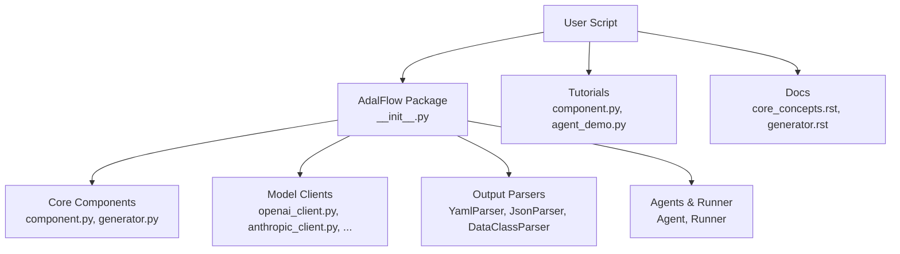
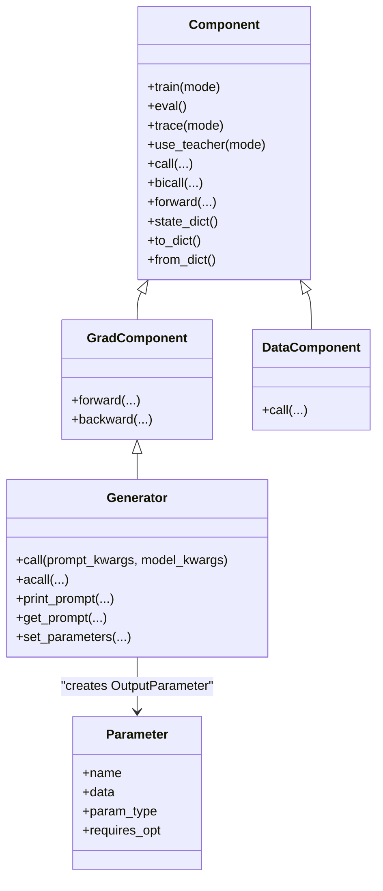
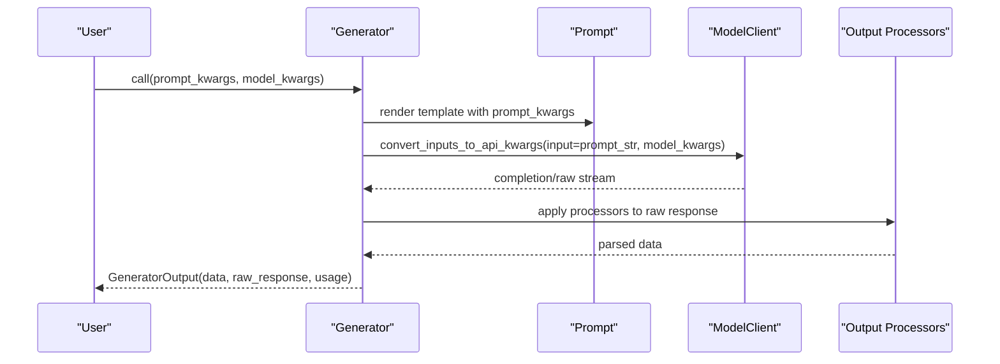
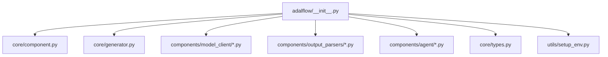

# Getting Started

<cite>
**Referenced Files in This Document**
- [README.md](file://README.md)
- [pyproject.toml](file://pyproject.toml)
- [adalflow/__init__.py](file://adalflow/adalflow/__init__.py)
- [core/component.py](file://adalflow/adalflow/core/component.py)
- [core/generator.py](file://adalflow/adalflow/core/generator.py)
- [.env_example](file://.env_example)
- [utils/setup_env.py](file://adalflow/adalflow/utils/setup_env.py)
- [tutorials/component.py](file://tutorials/component.py)
- [tutorials/agent/agent_demo.py](file://tutorials/agent/agent_demo.py)
- [docs/source/new_tutorials/core_concepts.rst](file://docs/source/new_tutorials/core_concepts.rst)
- [docs/source/new_tutorials/generator.rst](file://docs/source/new_tutorials/generator.rst)
</cite>

## Table of Contents
1. [Introduction](#introduction)
2. [Project Structure](#project-structure)
3. [Core Components](#core-components)
4. [Architecture Overview](#architecture-overview)
5. [Detailed Component Analysis](#detailed-component-analysis)
6. [Dependency Analysis](#dependency-analysis)
7. [Performance Considerations](#performance-considerations)
8. [Troubleshooting Guide](#troubleshooting-guide)
9. [Conclusion](#conclusion)
10. [Appendices](#appendices)

## Introduction
AdalFlow is a PyTorch-like library to build and auto-optimize any LM workflows, from chatbots, retrieval-augmented generation (RAG), to agents. It provides a unified, model-agnostic framework for composing LLM pipelines with prompts, model clients, and output processors. You can define trainable prompts and demonstrations, and leverage auto-differentiation through LLMs to optimize workflows end-to-end.

This Getting Started guide walks you through installation, environment setup, and initial usage. You will learn the fundamental concepts of Components, Generators, and Parameters, and follow step-by-step tutorials to create your first Generator, build simple components, and run basic LLM interactions.

## Project Structure
At a high level, AdalFlow exposes a cohesive API surface through its package initializer, while core building blocks live under core and components. The tutorials and documentation demonstrate practical usage patterns.

**Diagram sources**
- [adalflow/__init__.py](file://adalflow/adalflow/__init__.py#L1-L154)
- [core/component.py](file://adalflow/adalflow/core/component.py#L51-L113)
- [core/generator.py](file://adalflow/adalflow/core/generator.py#L82-L106)
- [tutorials/component.py](file://tutorials/component.py#L1-L77)
- [tutorials/agent/agent_demo.py](file://tutorials/agent/agent_demo.py#L1-L203)
- [docs/source/new_tutorials/core_concepts.rst](file://docs/source/new_tutorials/core_concepts.rst#L21-L84)
- [docs/source/new_tutorials/generator.rst](file://docs/source/new_tutorials/generator.rst#L16-L40)

**Section sources**
- [adalflow/__init__.py](file://adalflow/adalflow/__init__.py#L1-L154)
- [README.md](file://README.md#L110-L118)

## Core Components
AdalFlow’s core revolves around three pillars:

- Components: The base class for all pipeline units. It supports training/inference modes, composition of subcomponents, and serialization.
- Generators: Orchestrate prompts, model clients, and output processors to unify LLM interactions, structured outputs, and tool usage.
- Parameters: Specialized objects representing trainable prompt text and demonstrations, enabling gradient-based optimization.

**Diagram sources**
- [core/component.py](file://adalflow/adalflow/core/component.py#L51-L113)
- [core/generator.py](file://adalflow/adalflow/core/generator.py#L82-L106)
- [docs/source/new_tutorials/core_concepts.rst](file://docs/source/new_tutorials/core_concepts.rst#L86-L90)

**Section sources**
- [docs/source/new_tutorials/core_concepts.rst](file://docs/source/new_tutorials/core_concepts.rst#L21-L90)
- [core/component.py](file://adalflow/adalflow/core/component.py#L51-L113)
- [core/generator.py](file://adalflow/adalflow/core/generator.py#L82-L106)

## Architecture Overview
The typical flow for a Generator call is:
- Prepare prompt from template and prompt_kwargs.
- Compose model kwargs and convert inputs to API-specific kwargs.
- Invoke model client (sync or async).
- Post-process raw response via output processors (optional).
- Wrap output into a standardized GeneratorOutput.

**Diagram sources**
- [core/generator.py](file://adalflow/adalflow/core/generator.py#L463-L494)
- [core/generator.py](file://adalflow/adalflow/core/generator.py#L496-L543)
- [core/generator.py](file://adalflow/adalflow/core/generator.py#L357-L379)
- [core/generator.py](file://adalflow/adalflow/core/generator.py#L420-L461)

**Section sources**
- [core/generator.py](file://adalflow/adalflow/core/generator.py#L463-L543)
- [core/generator.py](file://adalflow/adalflow/core/generator.py#L357-L461)

## Detailed Component Analysis

### Installation and Setup
- Install via pip using the documented command.
- Set environment variables for your chosen provider(s). The repository includes a .env.example with common keys.
- Optionally load environment variables from a .env file using the provided setup_env utility.

Key references:
- [Installation command](file://README.md#L113-L117)
- [Environment variables example](file://.env_example#L1-L8)
- [Environment loader](file://adalflow/adalflow/utils/setup_env.py#L8-L19)

**Section sources**
- [README.md](file://README.md#L113-L117)
- [.env_example](file://.env_example#L1-L8)
- [utils/setup_env.py](file://adalflow/adalflow/utils/setup_env.py#L8-L19)

### First Generator: Hello World
Follow the quickstart example to create a Generator with a model client and run a basic call. The README demonstrates synchronous, asynchronous, and streaming modes.

Steps:
1. Import Generator and a model client.
2. Initialize a Generator with a model client and model kwargs.
3. Call the generator with prompt_kwargs.
4. Inspect the GeneratorOutput.

References:
- [README quickstart](file://README.md#L119-L231)
- [Generator API](file://adalflow/adalflow/core/generator.py#L120-L210)

**Section sources**
- [README.md](file://README.md#L119-L231)
- [core/generator.py](file://adalflow/adalflow/core/generator.py#L120-L210)

### Building Your First Component
Create a custom Component that composes a Generator. The tutorial shows subclassing Component, adding a Generator as a subcomponent, and implementing call for inference.

References:
- [Component tutorial](file://tutorials/component.py#L7-L30)
- [Component base class](file://adalflow/adalflow/core/component.py#L51-L113)

**Section sources**
- [tutorials/component.py](file://tutorials/component.py#L7-L30)
- [core/component.py](file://adalflow/adalflow/core/component.py#L51-L113)

### Structured Outputs and Parameters
- Structured outputs: Use output_processors (e.g., parsers or DataClassParser) to convert raw LLM text into typed data.
- Trainable prompts: Wrap prompt text or few-shot demonstrations as Parameters with appropriate types to enable optimization.

References:
- [Generator structured output](file://docs/source/new_tutorials/generator.rst#L143-L281)
- [Parameter concept](file://docs/source/new_tutorials/core_concepts.rst#L86-L90)
- [Generator parameter wiring](file://docs/source/new_tutorials/generator.rst#L283-L322)

**Section sources**
- [docs/source/new_tutorials/generator.rst](file://docs/source/new_tutorials/generator.rst#L143-L281)
- [docs/source/new_tutorials/core_concepts.rst](file://docs/source/new_tutorials/core_concepts.rst#L86-L90)
- [docs/source/new_tutorials/generator.rst](file://docs/source/new_tutorials/generator.rst#L283-L322)

### Agents and Runner
Agents orchestrate tools and LLM planning. The tutorial demonstrates creating an Agent with tools, a Runner, and running call, acall, and astream modes.

References:
- [Agent demo](file://tutorials/agent/agent_demo.py#L85-L164)

**Section sources**
- [tutorials/agent/agent_demo.py](file://tutorials/agent/agent_demo.py#L85-L164)

## Dependency Analysis
AdalFlow’s public API is exposed via the package initializer, which re-exports core components, generators, optimizers, parsers, and agents. This centralizes imports for users.

**Diagram sources**
- [adalflow/__init__.py](file://adalflow/adalflow/__init__.py#L1-L154)

**Section sources**
- [adalflow/__init__.py](file://adalflow/adalflow/__init__.py#L1-L154)

## Performance Considerations
- Prompt truncation: The Generator estimates token counts and can truncate long prompts to respect max_tokens.
- Caching: The Generator supports caching completions to avoid repeated API calls when identical inputs are seen again.
- Streaming: Prefer streaming for long-running responses; output processors run after the final text is available.

References:
- [Token estimation and truncation](file://adalflow/adalflow/core/generator.py#L475-L486)
- [Caching logic](file://adalflow/adalflow/core/generator.py#L500-L515)
- [Streaming handling](file://adalflow/adalflow/core/generator.py#L381-L461)

**Section sources**
- [core/generator.py](file://adalflow/adalflow/core/generator.py#L475-L515)
- [core/generator.py](file://adalflow/adalflow/core/generator.py#L381-L461)

## Troubleshooting Guide
Common setup and usage issues:

- Missing OPENAI_API_KEY or other provider keys:
  - Ensure environment variables are set. See the example .env file and the environment loader.
  - Reference: [.env_example](file://.env_example#L1-L8), [setup_env](file://adalflow/adalflow/utils/setup_env.py#L8-L19)

- Generator initialization errors:
  - The Generator requires a ModelClient instance. Ensure you pass a proper client (e.g., OpenAIClient).
  - Reference: [Generator constructor](file://adalflow/adalflow/core/generator.py#L148-L152)

- Output processors not applied:
  - Verify output_processors is a DataComponent and that raw_response is available for non-streaming calls.
  - Reference: [Post-call processing](file://adalflow/adalflow/core/generator.py#L357-L379)

- Serialization/Deserialization:
  - Use Component.to_dict/from_dict for saving/loading component states.
  - Reference: [Component serialization](file://adalflow/adalflow/core/component.py#L230-L306)

**Section sources**
- [.env_example](file://.env_example#L1-L8)
- [utils/setup_env.py](file://adalflow/adalflow/utils/setup_env.py#L8-L19)
- [core/generator.py](file://adalflow/adalflow/core/generator.py#L148-L152)
- [core/generator.py](file://adalflow/adalflow/core/generator.py#L357-L379)
- [core/component.py](file://adalflow/adalflow/core/component.py#L230-L306)

## Conclusion
You are ready to install AdalFlow, configure environment variables, and start building LLM workflows. Use Components to structure your pipelines, Generators to orchestrate prompts and model calls, and Parameters to enable prompt and demonstration optimization. Explore the tutorials and documentation to deepen your understanding and unlock advanced capabilities like agents, structured outputs, and auto-optimization.

## Appendices

### Quick Links and Next Steps
- [Installation](file://README.md#L113-L117)
- [Core Concepts](file://docs/source/new_tutorials/core_concepts.rst#L10-L90)
- [Generator Basics](file://docs/source/new_tutorials/generator.rst#L16-L141)
- [Component Tutorial](file://tutorials/component.py#L1-L77)
- [Agent Demo](file://tutorials/agent/agent_demo.py#L1-L203)