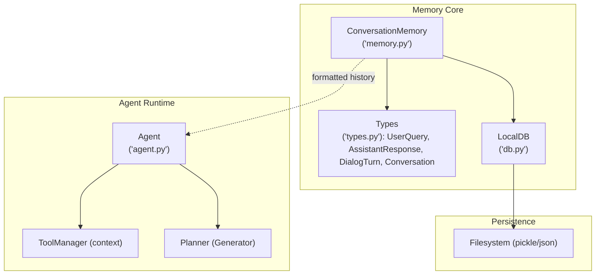
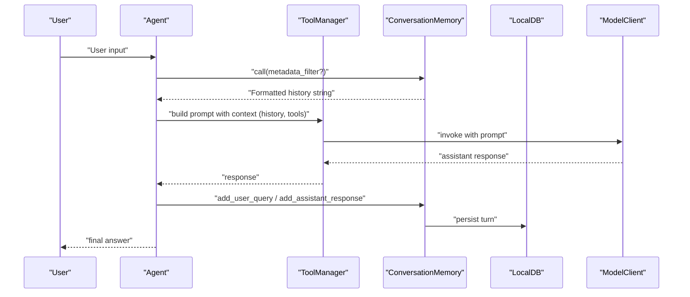
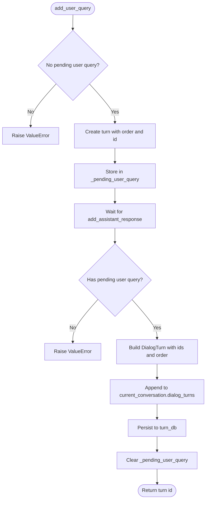
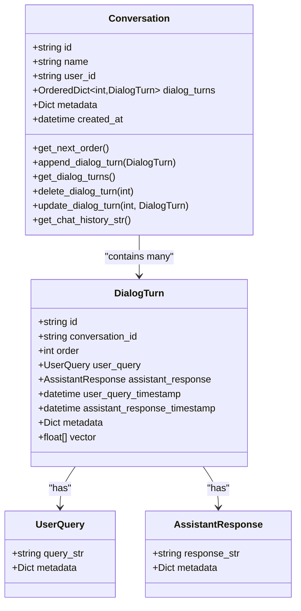
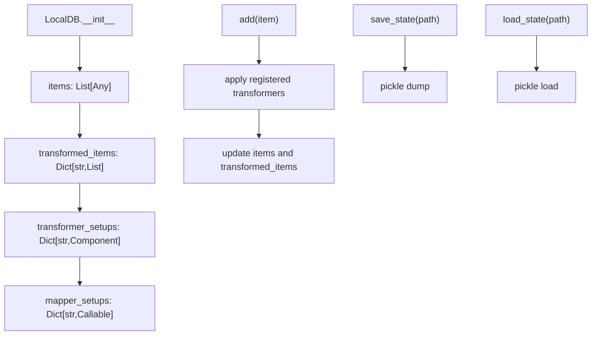
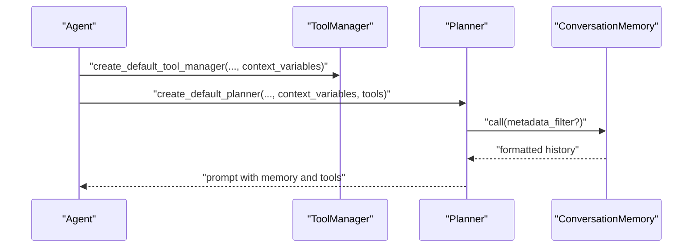
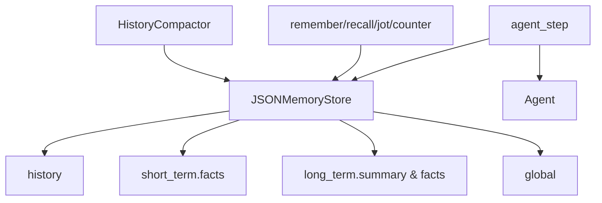
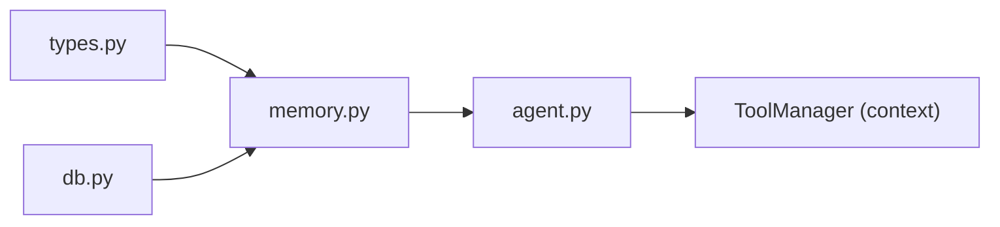

# Memory System

<cite>
**Referenced Files in This Document**
- [memory.py](file://adalflow/adalflow/components/memory/memory.py)
- [types.py](file://adalflow/adalflow/core/types.py)
- [db.py](file://adalflow/adalflow/core/db.py)
- [agent.py](file://adalflow/adalflow/components/agent/agent.py)
- [test_memory.py](file://adalflow/tests/test_memory.py)
- [adalflow_agent_memory.ipynb](file://notebooks/tutorials/adalflow_agent_memory.ipynb)
</cite>

## Table of Contents
1. [Introduction](#introduction)
2. [Project Structure](#project-structure)
3. [Core Components](#core-components)
4. [Architecture Overview](#architecture-overview)
5. [Detailed Component Analysis](#detailed-component-analysis)
6. [Dependency Analysis](#dependency-analysis)
7. [Performance Considerations](#performance-considerations)
8. [Troubleshooting Guide](#troubleshooting-guide)
9. [Conclusion](#conclusion)
10. [Appendices](#appendices)

## Introduction
This document explains AdalFlow’s memory system with a focus on agent memory and state persistence. It covers how conversation history is modeled, stored, and injected into agent prompts; how state is preserved across agent executions; and how memory integrates with agents, tools, and conversation flows. It also provides guidance on performance optimization, storage backends, scalability, debugging, and best practices for memory-intensive applications.

## Project Structure
The memory system centers around a lightweight conversation memory component and supporting data types and persistence primitives:
- ConversationMemory: in-memory conversation history management with optional persistent backing
- Types: UserQuery, AssistantResponse, DialogTurn, and Conversation data models
- LocalDB: in-memory CRUD and persistence layer for dialog turns and other items
- Agent integration: Agents consume memory via context variables and tool-managed state
- Tests: comprehensive coverage of memory behavior, ordering, metadata filtering, and persistence semantics
- Notebook tutorial: demonstrates a production-style persistent memory layer (JSON-backed) integrated with an Agent

**Diagram sources**
- [memory.py](file://adalflow/adalflow/components/memory/memory.py#L52-L226)
- [types.py](file://adalflow/adalflow/core/types.py#L977-L1161)
- [db.py](file://adalflow/adalflow/core/db.py#L24-L391)
- [agent.py](file://adalflow/adalflow/components/agent/agent.py#L216-L387)

**Section sources**
- [memory.py](file://adalflow/adalflow/components/memory/memory.py#L1-L226)
- [types.py](file://adalflow/adalflow/core/types.py#L977-L1161)
- [db.py](file://adalflow/adalflow/core/db.py#L24-L391)
- [agent.py](file://adalflow/adalflow/components/agent/agent.py#L216-L387)

## Core Components
- ConversationMemory: Manages a current active conversation, stores dialog turns, supports incremental turn addition, metadata filtering, and clearing/resetting of turns. It exposes a call() method that renders a formatted conversation history string suitable for injection into prompts.
- Types: Define the canonical structures for user queries, assistant responses, individual dialog turns, and full conversations, including ordering, timestamps, and optional metadata.
- LocalDB: Provides in-memory storage with optional persistence to disk via pickle, enabling turn-level persistence and retrieval across sessions.

Key responsibilities:
- ConversationMemory: orchestrate turn lifecycle, enforce turn completion, and produce a templated history string
- Types: ensure consistent structure and ordering for dialog turns and conversations
- LocalDB: persist and restore dialog turns and other items

**Section sources**
- [memory.py](file://adalflow/adalflow/components/memory/memory.py#L52-L226)
- [types.py](file://adalflow/adalflow/core/types.py#L977-L1161)
- [db.py](file://adalflow/adalflow/core/db.py#L24-L391)

## Architecture Overview
The memory system integrates with agents through two primary pathways:
- Context variables: Agents accept additional context (including memory snapshots) via ToolManager, which can include formatted conversation history.
- Tool usage tracking: Tools can be used to write/read facts and notes, enabling explicit, auditable state changes that agents can leverage.

**Diagram sources**
- [memory.py](file://adalflow/adalflow/components/memory/memory.py#L77-L98)
- [agent.py](file://adalflow/adalflow/components/agent/agent.py#L59-L121)
- [db.py](file://adalflow/adalflow/core/db.py#L333-L391)

## Detailed Component Analysis

### ConversationMemory
- Purpose: Manage a single active conversation, track dialog turns, and render a formatted history string for LLM consumption.
- Key behaviors:
  - Incremental turn construction: add_user_query() initializes a pending turn; add_assistant_response() completes it and appends to the current conversation
  - Metadata inclusion: call() supports metadata_filter to selectively include metadata keys
  - Persistence: stores dialog turns in LocalDB; supports clearing and resetting
  - Conversation lifecycle: new_conversation() persists current conversation and starts a new one; clear_conversation_turns() clears in-memory turns while preserving conversation identity

**Diagram sources**
- [memory.py](file://adalflow/adalflow/components/memory/memory.py#L137-L221)

**Section sources**
- [memory.py](file://adalflow/adalflow/components/memory/memory.py#L52-L226)

### Types: UserQuery, AssistantResponse, DialogTurn, Conversation
- UserQuery and AssistantResponse: encapsulate query/response text and optional metadata for richer context
- DialogTurn: captures a single turn with ordering, timestamps, and optional vectors/metadata
- Conversation: maintains an ordered collection of DialogTurn objects, supports appending, deletion, and history rendering

**Diagram sources**
- [types.py](file://adalflow/adalflow/core/types.py#L977-L1161)

**Section sources**
- [types.py](file://adalflow/adalflow/core/types.py#L977-L1161)

### LocalDB
- Purpose: Lightweight in-memory storage with optional persistence to disk via pickle
- Capabilities:
  - CRUD: add, extend, delete, reset
  - Transformations: register and apply transformers keyed by name
  - Persistence: save_state/load_state for restoring state across runs
- Used by ConversationMemory to persist dialog turns

**Diagram sources**
- [db.py](file://adalflow/adalflow/core/db.py#L24-L391)

**Section sources**
- [db.py](file://adalflow/adalflow/core/db.py#L24-L391)

### Agent Integration
- ToolManager context: Agents can receive additional context variables, including formatted memory history, via ToolManager.additional_context
- Planner prompt: The planner’s prompt template can incorporate memory context and tool definitions
- Execution loop: Agents iterate with tools and can call memory-related tools to update state

**Diagram sources**
- [agent.py](file://adalflow/adalflow/components/agent/agent.py#L59-L121)
- [agent.py](file://adalflow/adalflow/components/agent/agent.py#L123-L213)

**Section sources**
- [agent.py](file://adalflow/adalflow/components/agent/agent.py#L59-L213)

### Persistent Memory Tutorial (JSON-backed)
The tutorial demonstrates a production-grade persistent memory layer:
- JSONMemoryStore: thread-safe, file-backed store with global/session-scoped buckets
- HistoryCompactor: summarizes older history to control prompt bloat
- Tool integration: remember/recall/jot/counter tools backed by the store
- Agent orchestration: agent_step builds a unified system prompt from memory and executes the Agent

**Diagram sources**
- [adalflow_agent_memory.ipynb](file://notebooks/tutorials/adalflow_agent_memory.ipynb#L133-L222)
- [adalflow_agent_memory.ipynb](file://notebooks/tutorials/adalflow_agent_memory.ipynb#L267-L318)
- [adalflow_agent_memory.ipynb](file://notebooks/tutorials/adalflow_agent_memory.ipynb#L430-L468)
- [adalflow_agent_memory.ipynb](file://notebooks/tutorials/adalflow_agent_memory.ipynb#L540-L576)

**Section sources**
- [adalflow_agent_memory.ipynb](file://notebooks/tutorials/adalflow_agent_memory.ipynb#L133-L222)
- [adalflow_agent_memory.ipynb](file://notebooks/tutorials/adalflow_agent_memory.ipynb#L267-L318)
- [adalflow_agent_memory.ipynb](file://notebooks/tutorials/adalflow_agent_memory.ipynb#L430-L468)
- [adalflow_agent_memory.ipynb](file://notebooks/tutorials/adalflow_agent_memory.ipynb#L540-L576)

## Dependency Analysis
- ConversationMemory depends on:
  - LocalDB for persistence of dialog turns
  - Types for structured dialog turn representation
  - Prompt for formatting history
- Agent depends on:
  - ToolManager for context and tool definitions
  - Planner for constructing prompts with memory and tools

**Diagram sources**
- [memory.py](file://adalflow/adalflow/components/memory/memory.py#L13-L19)
- [types.py](file://adalflow/adalflow/core/types.py#L977-L1161)
- [db.py](file://adalflow/adalflow/core/db.py#L24-L391)
- [agent.py](file://adalflow/adalflow/components/agent/agent.py#L59-L121)

**Section sources**
- [memory.py](file://adalflow/adalflow/components/memory/memory.py#L13-L19)
- [types.py](file://adalflow/adalflow/core/types.py#L977-L1161)
- [db.py](file://adalflow/adalflow/core/db.py#L24-L391)
- [agent.py](file://adalflow/adalflow/components/agent/agent.py#L59-L121)

## Performance Considerations
- Prompt size control:
  - Use metadata_filter to limit metadata verbosity in rendered history
  - Implement summarization or compaction for long histories (see tutorial compactor)
- Storage backends:
  - LocalDB supports pickle-based persistence; for production, consider replacing LocalDB with a scalable backend (e.g., SQL/NoSQL) and plugging into the same interface
- Memory footprint:
  - Limit stored metadata to necessary fields
  - Periodically prune or summarize old turns to reduce in-memory and serialized sizes
- Concurrency:
  - The tutorial JSONMemoryStore uses a lock; adopt similar patterns for thread-safe access to persistent stores

[No sources needed since this section provides general guidance]

## Troubleshooting Guide
Common issues and resolutions:
- Adding a second user query before completing the assistant response:
  - Symptom: ValueError indicating a pending user query exists
  - Resolution: Complete the current assistant response before adding a new user query
- Adding an assistant response without a pending user query:
  - Symptom: ValueError indicating no pending user query
  - Resolution: Call add_user_query() first to initialize a turn
- Clearing conversation turns:
  - Behavior: clear_conversation_turns() removes in-memory turns and resets pending state; does not affect the turn database
  - Validation: Tests confirm clearing empties the current conversation while preserving conversation ID and leaving turn_db intact
- Metadata filtering:
  - Use metadata_filter in call() to restrict which metadata keys appear in the rendered history
- Ordering:
  - DialogTurn order is enforced; tests verify ascending order and consistent turn IDs across add_user_query and add_assistant_response

**Section sources**
- [memory.py](file://adalflow/adalflow/components/memory/memory.py#L147-L188)
- [test_memory.py](file://adalflow/tests/test_memory.py#L88-L107)
- [test_memory.py](file://adalflow/tests/test_memory.py#L323-L371)
- [test_memory.py](file://adalflow/tests/test_memory.py#L226-L254)
- [test_memory.py](file://adalflow/tests/test_memory.py#L138-L163)

## Conclusion
AdalFlow’s memory system provides a clear separation between in-memory conversation state and persistent storage, with explicit APIs for incremental turn construction and metadata-aware history rendering. Agents integrate memory through context variables and tools, enabling auditable state changes. For production deployments, augment the in-memory ConversationMemory with a persistent store (as shown in the tutorial) and implement summarization and pruning to control prompt size and resource usage.

[No sources needed since this section summarizes without analyzing specific files]

## Appendices

### Memory Configuration and Usage Patterns
- Initialize ConversationMemory with optional LocalDB for persistence
- Use add_user_query() followed by add_assistant_response() to construct turns
- Render formatted history via call() and inject into agent prompts
- Use metadata_filter to tailor verbosity
- For long-running sessions, periodically compact history and persist summaries

**Section sources**
- [memory.py](file://adalflow/adalflow/components/memory/memory.py#L52-L98)
- [types.py](file://adalflow/adalflow/core/types.py#L977-L1161)
- [db.py](file://adalflow/adalflow/core/db.py#L24-L391)
- [agent.py](file://adalflow/adalflow/components/agent/agent.py#L59-L121)
- [test_memory.py](file://adalflow/tests/test_memory.py#L11-L31)