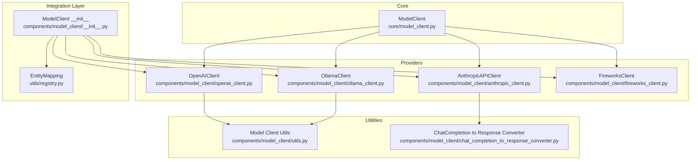
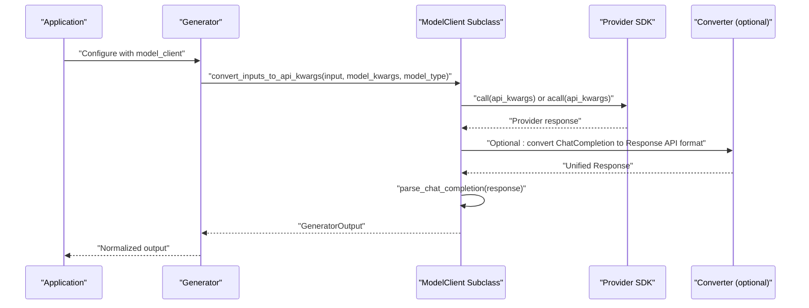
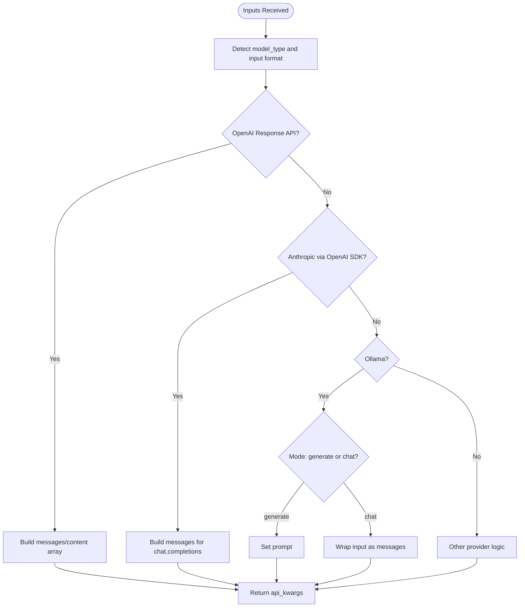
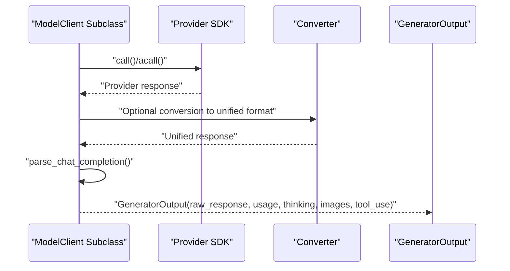
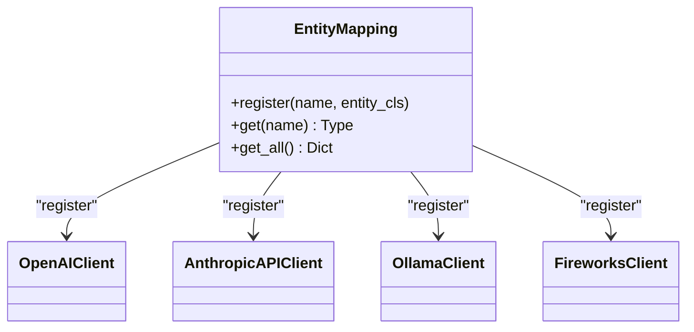
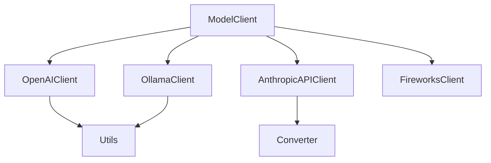

# Custom Provider Development

<cite>
**Referenced Files in This Document**
- [model_client.py](file://adalflow/adalflow/core/model_client.py)
- [__init__.py](file://adalflow/adalflow/components/model_client/__init__.py)
- [openai_client.py](file://adalflow/adalflow/components/model_client/openai_client.py)
- [anthropic_client.py](file://adalflow/adalflow/components/model_client/anthropic_client.py)
- [chat_completion_to_response_converter.py](file://adalflow/adalflow/components/model_client/chat_completion_to_response_converter.py)
- [ollama_client.py](file://adalflow/adalflow/components/model_client/ollama_client.py)
- [fireworks_client.py](file://adalflow/adalflow/components/model_client/fireworks_client.py)
- [utils.py](file://adalflow/adalflow/components/model_client/utils.py)
- [registry.py](file://adalflow/adalflow/utils/registry.py)
- [test_model_client.py](file://adalflow/tests/test_model_client.py)
- [test_openai_client.py](file://adalflow/tests/test_openai_client.py)
- [test_ollama_client.py](file://adalflow/tests/test_ollama_client.py)
</cite>

## Table of Contents
1. [Introduction](#introduction)
2. [Project Structure](#project-structure)
3. [Core Components](#core-components)
4. [Architecture Overview](#architecture-overview)
5. [Detailed Component Analysis](#detailed-component-analysis)
6. [Dependency Analysis](#dependency-analysis)
7. [Performance Considerations](#performance-considerations)
8. [Troubleshooting Guide](#troubleshooting-guide)
9. [Conclusion](#conclusion)
10. [Appendices](#appendices)

## Introduction
This guide explains how to extend AdalFlow with new Large Language Model (LLM) provider integrations by implementing a new ModelClient subclass. It covers the required method implementations, interface compliance, input conversion strategies, response parsing patterns, error handling best practices, and testing approaches. The document references concrete implementations from the repository to illustrate patterns and anti-patterns, ensuring both beginners and experienced developers can build robust, production-ready custom providers.

## Project Structure
AdalFlow’s model client ecosystem is organized around a shared base class and a set of provider-specific implementations. Providers are lazily imported and registered centrally for discoverability and clean dependency management.

**Diagram sources**
- [model_client.py](file://adalflow/adalflow/core/model_client.py#L16-L128)
- [openai_client.py](file://adalflow/adalflow/components/model_client/openai_client.py#L411-L800)
- [anthropic_client.py](file://adalflow/adalflow/components/model_client/anthropic_client.py#L314-L642)
- [ollama_client.py](file://adalflow/adalflow/components/model_client/ollama_client.py#L138-L516)
- [fireworks_client.py](file://adalflow/adalflow/components/model_client/fireworks_client.py#L8-L56)
- [__init__.py](file://adalflow/adalflow/components/model_client/__init__.py#L1-L135)
- [registry.py](file://adalflow/adalflow/utils/registry.py#L4-L22)
- [utils.py](file://adalflow/adalflow/components/model_client/utils.py#L1-L278)
- [chat_completion_to_response_converter.py](file://adalflow/adalflow/components/model_client/chat_completion_to_response_converter.py#L65-L622)

**Section sources**
- [model_client.py](file://adalflow/adalflow/core/model_client.py#L1-L128)
- [__init__.py](file://adalflow/adalflow/components/model_client/__init__.py#L1-L135)
- [registry.py](file://adalflow/adalflow/utils/registry.py#L1-L22)

## Core Components
- ModelClient: The abstract base class defining the contract for all model clients. It enforces initialization of sync/async clients, conversion of inputs to API kwargs, synchronous/asynchronous calls, parsing of chat completion and embeddings, usage tracking, and model listing.
- Provider Clients: Specialized subclasses that implement provider-specific logic for initialization, input conversion, API calls, response parsing, and error handling. Examples include OpenAIClient, AnthropicAPIClient, OllamaClient, and FireworksClient.

Key responsibilities:
- Initialization: Implement init_sync_client and init_async_client to create provider SDK clients.
- Input conversion: Implement convert_inputs_to_api_kwargs to translate AdalFlow inputs and model_kwargs into provider-specific API parameters.
- API invocation: Implement call and acall to perform synchronous and asynchronous requests.
- Parsing: Implement parse_chat_completion and parse_embedding_response to normalize provider outputs into AdalFlow data structures.
- Usage tracking: Implement track_completion_usage to record token usage consistently.
- Listing models: Implement list_models to expose available models from the provider.

**Section sources**
- [model_client.py](file://adalflow/adalflow/core/model_client.py#L41-L128)

## Architecture Overview
The provider architecture centers on ModelClient and a flexible integration layer. Providers can either:
- Use a unified Response API (OpenAI-style) and parse outputs into a consistent structure.
- Wrap provider-specific SDKs and convert their outputs to the AdalFlow format.

**Diagram sources**
- [openai_client.py](file://adalflow/adalflow/components/model_client/openai_client.py#L779-L800)
- [anthropic_client.py](file://adalflow/adalflow/components/model_client/anthropic_client.py#L392-L502)
- [chat_completion_to_response_converter.py](file://adalflow/adalflow/components/model_client/chat_completion_to_response_converter.py#L69-L342)

## Detailed Component Analysis

### Step-by-Step: Implementing a New ModelClient Subclass
Follow these steps to add a new provider:

1. Create a new file under components/model_client/<provider>_client.py and define a class that inherits from ModelClient.
2. Implement required methods:
   - init_sync_client and init_async_client
   - convert_inputs_to_api_kwargs
   - call and acall
   - parse_chat_completion and parse_embedding_response
   - track_completion_usage
   - list_models
3. Add lazy imports and registration:
   - Add a LazyImport entry in components/model_client/__init__.py.
   - Register the class in the EntityMapping via __all__ and registration loop.
4. Provide input conversion strategies:
   - Map AdalFlow inputs and model_kwargs to provider-specific parameters.
   - Support multimodal inputs (e.g., images) using utilities where applicable.
5. Implement response parsing:
   - Normalize provider outputs into GeneratorOutput and EmbedderOutput.
   - Preserve usage, thinking, tool_use, and images when available.
6. Error handling and retries:
   - Use exponential backoff for transient errors.
   - Raise clear exceptions with actionable messages.
7. Testing:
   - Write unit tests mirroring existing patterns.
   - Mock provider SDKs and validate conversion, parsing, and streaming behavior.

Concrete examples to study:
- OpenAI-style Response API: [openai_client.py](file://adalflow/adalflow/components/model_client/openai_client.py#L411-L800)
- Anthropic via OpenAI SDK compatibility: [anthropic_client.py](file://adalflow/adalflow/components/model_client/anthropic_client.py#L314-L642)
- Ollama with tool calls and streaming: [ollama_client.py](file://adalflow/adalflow/components/model_client/ollama_client.py#L138-L516)
- Fireworks extending OpenAI compatibility: [fireworks_client.py](file://adalflow/adalflow/components/model_client/fireworks_client.py#L8-L56)

Common pitfalls to avoid:
- Not registering the provider in the central registry.
- Incorrectly subclassing LazyImport targets (subclassing the proxy class causes runtime errors).
- Failing to handle streaming vs non-streaming responses consistently.
- Skipping usage tracking or returning inconsistent data types.

**Section sources**
- [model_client.py](file://adalflow/adalflow/core/model_client.py#L41-L128)
- [__init__.py](file://adalflow/adalflow/components/model_client/__init__.py#L1-L135)
- [openai_client.py](file://adalflow/adalflow/components/model_client/openai_client.py#L411-L800)
- [anthropic_client.py](file://adalflow/adalflow/components/model_client/anthropic_client.py#L314-L642)
- [ollama_client.py](file://adalflow/adalflow/components/model_client/ollama_client.py#L138-L516)
- [fireworks_client.py](file://adalflow/adalflow/components/model_client/fireworks_client.py#L8-L56)
- [test_model_client.py](file://adalflow/tests/test_model_client.py#L10-L53)

### Input Conversion Strategies
- OpenAI Response API: Use format_content_for_response_api and process_images_for_response_api to construct content arrays with input_text and input_image parts.
- Anthropic via OpenAI SDK: Convert inputs to messages format expected by chat.completions.create.
- Ollama: Support both generate (prompt) and chat (messages) modes; detect streaming generators and preserve them in raw_response.

**Diagram sources**
- [utils.py](file://adalflow/adalflow/components/model_client/utils.py#L153-L195)
- [openai_client.py](file://adalflow/adalflow/components/model_client/openai_client.py#L161-L165)
- [anthropic_client.py](file://adalflow/adalflow/components/model_client/anthropic_client.py#L518-L560)
- [ollama_client.py](file://adalflow/adalflow/components/model_client/ollama_client.py#L376-L414)

**Section sources**
- [utils.py](file://adalflow/adalflow/components/model_client/utils.py#L33-L195)
- [openai_client.py](file://adalflow/adalflow/components/model_client/openai_client.py#L161-L165)
- [anthropic_client.py](file://adalflow/adalflow/components/model_client/anthropic_client.py#L518-L560)
- [ollama_client.py](file://adalflow/adalflow/components/model_client/ollama_client.py#L376-L414)

### Response Parsing Patterns
- OpenAI Response API: Parse output arrays to extract text, images, tool calls, reasoning, and code outputs; populate GeneratorOutput fields accordingly.
- Anthropic via OpenAI SDK: Convert ChatCompletion to Response API-compatible events using a converter; maintain usage tracking.
- Ollama: Extract tool calls and thinking from message responses; handle both streaming and non-streaming cases.

**Diagram sources**
- [openai_client.py](file://adalflow/adalflow/components/model_client/openai_client.py#L779-L800)
- [anthropic_client.py](file://adalflow/adalflow/components/model_client/anthropic_client.py#L392-L502)
- [chat_completion_to_response_converter.py](file://adalflow/adalflow/components/model_client/chat_completion_to_response_converter.py#L69-L342)
- [ollama_client.py](file://adalflow/adalflow/components/model_client/ollama_client.py#L325-L362)

**Section sources**
- [openai_client.py](file://adalflow/adalflow/components/model_client/openai_client.py#L779-L800)
- [anthropic_client.py](file://adalflow/adalflow/components/model_client/anthropic_client.py#L392-L502)
- [chat_completion_to_response_converter.py](file://adalflow/adalflow/components/model_client/chat_completion_to_response_converter.py#L69-L342)
- [ollama_client.py](file://adalflow/adalflow/components/model_client/ollama_client.py#L325-L362)

### Error Handling Best Practices
- Use exponential backoff for transient errors (e.g., rate limits, timeouts).
- Raise clear exceptions with actionable messages; avoid swallowing errors silently.
- Validate inputs early (e.g., required model identifiers).
- Track usage even when errors occur to maintain observability.

Examples to reference:
- Backoff usage in OpenAI and Anthropic clients.
- Validation of API key presence and environment variables.
- Error handling in Ollama client for request/response errors.

**Section sources**
- [openai_client.py](file://adalflow/adalflow/components/model_client/openai_client.py#L752-L777)
- [anthropic_client.py](file://adalflow/adalflow/components/model_client/anthropic_client.py#L376-L391)
- [ollama_client.py](file://adalflow/adalflow/components/model_client/ollama_client.py#L415-L466)

### Registration System for Custom Providers
Providers are lazily imported and registered centrally for easy discovery and dependency isolation.

**Diagram sources**
- [registry.py](file://adalflow/adalflow/utils/registry.py#L4-L22)
- [__init__.py](file://adalflow/adalflow/components/model_client/__init__.py#L108-L135)

Implementation notes:
- Add LazyImport entries for your provider in components/model_client/__init__.py.
- Append your provider to __all__ and rely on the registration loop to register it in EntityMapping.

**Section sources**
- [__init__.py](file://adalflow/adalflow/components/model_client/__init__.py#L1-L135)
- [registry.py](file://adalflow/adalflow/utils/registry.py#L1-L22)

### Integration Patterns with Existing Framework
- Generator and Embedder components consume ModelClient instances transparently.
- Use the Response API pattern (OpenAI) to unify multimodal and tool-call handling.
- For providers without a Response API, convert their outputs to a unified format using converters.

References:
- OpenAI Response API parsing and streaming helpers.
- Anthropic compatibility via OpenAI SDK and converter.
- Ollama tool call extraction and streaming.

**Section sources**
- [openai_client.py](file://adalflow/adalflow/components/model_client/openai_client.py#L779-L800)
- [anthropic_client.py](file://adalflow/adalflow/components/model_client/anthropic_client.py#L392-L502)
- [chat_completion_to_response_converter.py](file://adalflow/adalflow/components/model_client/chat_completion_to_response_converter.py#L69-L342)
- [ollama_client.py](file://adalflow/adalflow/components/model_client/ollama_client.py#L46-L135)

### Concrete Examples from the Codebase
- OpenAI: Demonstrates Response API usage, multimodal inputs, reasoning models, and streaming.
- Anthropic: Shows compatibility via OpenAI SDK and conversion to Response API events.
- Ollama: Illustrates tool call extraction, thinking capture, and streaming support.
- Fireworks: Extends OpenAI compatibility with a custom base URL and environment variable.

**Section sources**
- [openai_client.py](file://adalflow/adalflow/components/model_client/openai_client.py#L411-L800)
- [anthropic_client.py](file://adalflow/adalflow/components/model_client/anthropic_client.py#L314-L642)
- [ollama_client.py](file://adalflow/adalflow/components/model_client/ollama_client.py#L138-L516)
- [fireworks_client.py](file://adalflow/adalflow/components/model_client/fireworks_client.py#L8-L56)

## Dependency Analysis
Providers depend on:
- ModelClient for the core interface.
- Provider SDKs (e.g., OpenAI, Ollama) via lazy imports to avoid hard dependencies.
- Utilities for multimodal input formatting and streaming helpers.
- Optional converters for cross-API compatibility.

**Diagram sources**
- [model_client.py](file://adalflow/adalflow/core/model_client.py#L16-L128)
- [openai_client.py](file://adalflow/adalflow/components/model_client/openai_client.py#L411-L800)
- [anthropic_client.py](file://adalflow/adalflow/components/model_client/anthropic_client.py#L314-L642)
- [ollama_client.py](file://adalflow/adalflow/components/model_client/ollama_client.py#L138-L516)
- [fireworks_client.py](file://adalflow/adalflow/components/model_client/fireworks_client.py#L8-L56)
- [utils.py](file://adalflow/adalflow/components/model_client/utils.py#L1-L278)
- [chat_completion_to_response_converter.py](file://adalflow/adalflow/components/model_client/chat_completion_to_response_converter.py#L65-L622)

**Section sources**
- [model_client.py](file://adalflow/adalflow/core/model_client.py#L16-L128)
- [openai_client.py](file://adalflow/adalflow/components/model_client/openai_client.py#L411-L800)
- [anthropic_client.py](file://adalflow/adalflow/components/model_client/anthropic_client.py#L314-L642)
- [ollama_client.py](file://adalflow/adalflow/components/model_client/ollama_client.py#L138-L516)
- [fireworks_client.py](file://adalflow/adalflow/components/model_client/fireworks_client.py#L8-L56)
- [utils.py](file://adalflow/adalflow/components/model_client/utils.py#L1-L278)
- [chat_completion_to_response_converter.py](file://adalflow/adalflow/components/model_client/chat_completion_to_response_converter.py#L65-L622)

## Performance Considerations
- Prefer Response API patterns for multimodal and tool-call scenarios to reduce conversion overhead.
- Minimize unnecessary conversions between API formats; leverage converters only when required.
- Use streaming where supported to improve latency and memory efficiency.
- Cache provider clients per process/thread to avoid repeated initialization costs.

[No sources needed since this section provides general guidance]

## Troubleshooting Guide
Common issues and resolutions:
- Lazy import subclassing errors: Do not subclass LazyImport targets directly; import the underlying class and extend it.
- Missing API keys or incorrect environment variables: Ensure environment variables are set before initializing clients.
- Streaming vs non-streaming confusion: Verify that streaming responses are preserved in raw_response and parsed appropriately.
- Usage tracking discrepancies: Implement track_completion_usage consistently across providers.

Validation references:
- Tests for lazy import subclassing and correct subclassing patterns.
- OpenAI client tests covering multimodal inputs, streaming, and reasoning models.
- Ollama client tests for tool call extraction and streaming behavior.

**Section sources**
- [test_model_client.py](file://adalflow/tests/test_model_client.py#L10-L53)
- [test_openai_client.py](file://adalflow/tests/test_openai_client.py#L26-L53)
- [test_ollama_client.py](file://adalflow/tests/test_ollama_client.py#L52-L452)

## Conclusion
By following the ModelClient interface and adopting the patterns demonstrated by existing providers, you can implement robust, enterprise-grade custom LLM integrations. Focus on correct input conversion, unified response parsing, resilient error handling, and comprehensive testing. Use the central registry and lazy imports to keep dependencies manageable and avoid breaking changes.

[No sources needed since this section summarizes without analyzing specific files]

## Appendices

### A. Required Methods Checklist
- init_sync_client
- init_async_client
- convert_inputs_to_api_kwargs
- call
- acall
- parse_chat_completion
- parse_embedding_response
- track_completion_usage
- list_models

**Section sources**
- [model_client.py](file://adalflow/adalflow/core/model_client.py#L41-L128)

### B. Testing Strategies
- Mock provider SDKs and validate conversion and parsing.
- Test both streaming and non-streaming paths.
- Validate usage tracking and error propagation.
- Use existing test patterns as templates.

**Section sources**
- [test_openai_client.py](file://adalflow/tests/test_openai_client.py#L26-L53)
- [test_ollama_client.py](file://adalflow/tests/test_ollama_client.py#L52-L452)

### C. Contribution Guidelines
- Keep provider SDKs optional via lazy imports.
- Register providers in the central registry.
- Provide clear docstrings and examples.
- Include comprehensive tests and update documentation.

**Section sources**
- [__init__.py](file://adalflow/adalflow/components/model_client/__init__.py#L1-L135)
- [registry.py](file://adalflow/adalflow/utils/registry.py#L1-L22)