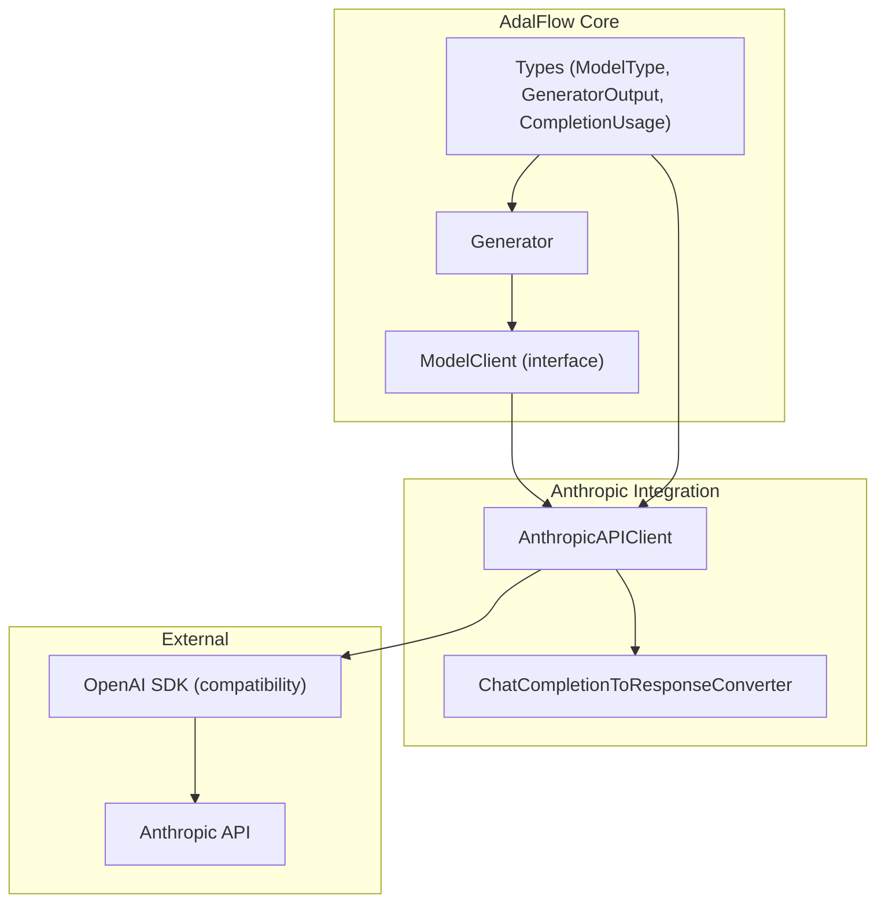
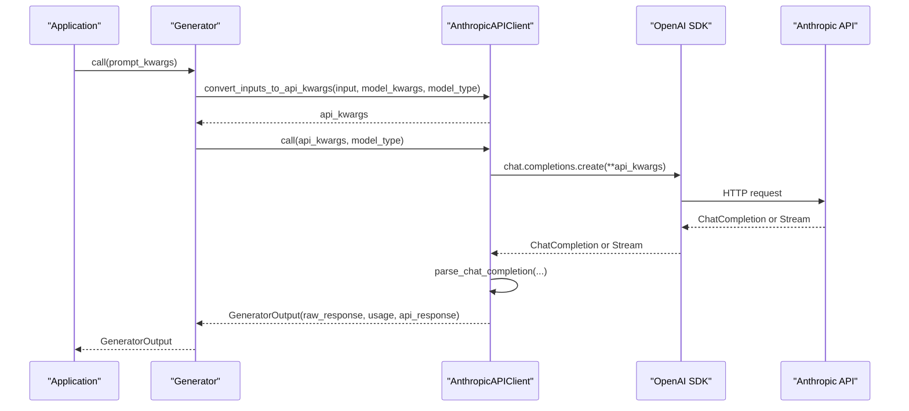
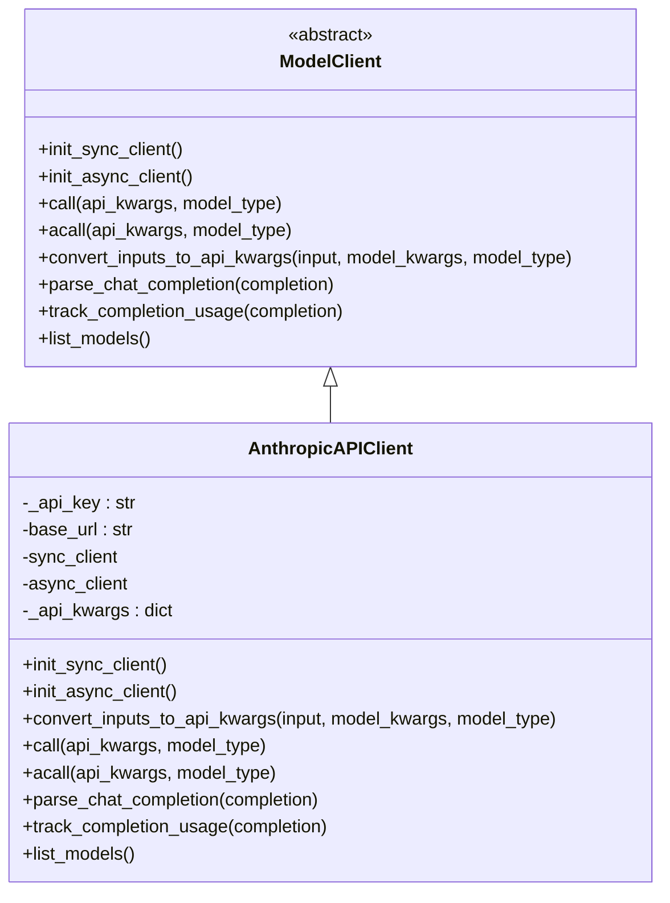
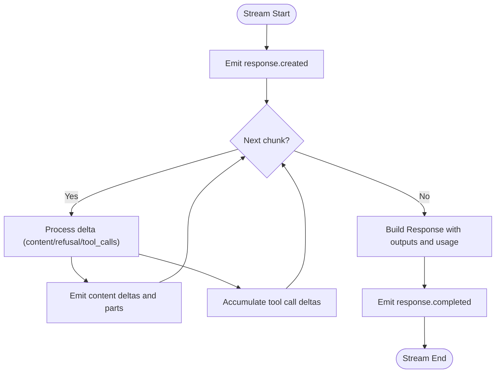
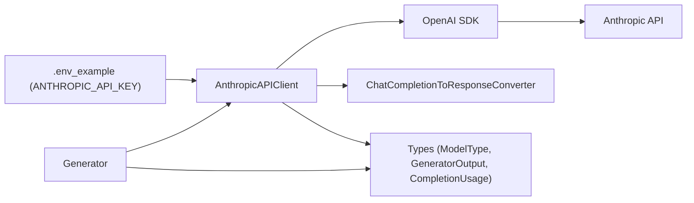

# Anthropic Integration

<cite>
**Referenced Files in This Document**
- [anthropic_client.py](file://adalflow/adalflow/components/model_client/anthropic_client.py)
- [chat_completion_to_response_converter.py](file://adalflow/adalflow/components/model_client/chat_completion_to_response_converter.py)
- [model_client.py](file://adalflow/adalflow/core/model_client.py)
- [types.py](file://adalflow/adalflow/core/types.py)
- [generator.py](file://adalflow/adalflow/core/generator.py)
- [anthropic.rst](file://docs/source/integrations/anthropic.rst)
- [anthropic_models.py](file://tutorials/models/anthropic_models.py)
- [anthropic_streaming_tutorial.py](file://tutorials/v1_agent_runner/anthropic_streaming_tutorial.py)
- [.env_example](file://.env_example)
</cite>

## Table of Contents
1. [Introduction](#introduction)
2. [Project Structure](#project-structure)
3. [Core Components](#core-components)
4. [Architecture Overview](#architecture-overview)
5. [Detailed Component Analysis](#detailed-component-analysis)
6. [Dependency Analysis](#dependency-analysis)
7. [Performance Considerations](#performance-considerations)
8. [Troubleshooting Guide](#troubleshooting-guide)
9. [Conclusion](#conclusion)
10. [Appendices](#appendices)

## Introduction
This document explains the Anthropic Claude integration in AdalFlow, focusing on the AnthropicAPIClient implementation. It covers API authentication, model selection, provider-specific features, configuration, rate-limit handling, error management, and practical examples for text generation, streaming responses, and model-specific parameters. It also describes client initialization, environment-based authentication, and integration with AdalFlow’s component system (Generator, Agent, Runner). Provider-specific limitations, best practices, migration guidance, and performance optimization tips are included.

## Project Structure
The Anthropic integration centers around the AnthropicAPIClient, which implements the ModelClient interface and adapts Anthropic’s API to AdalFlow’s internal types and workflows. Supporting utilities convert OpenAI-compatible ChatCompletion streams into Response API events for consistent downstream consumption.

**Diagram sources**
- [anthropic_client.py](file://adalflow/adalflow/components/model_client/anthropic_client.py#L314-L642)
- [chat_completion_to_response_converter.py](file://adalflow/adalflow/components/model_client/chat_completion_to_response_converter.py#L65-L622)
- [model_client.py](file://adalflow/adalflow/core/model_client.py#L16-L128)
- [types.py](file://adalflow/adalflow/core/types.py#L55-L135)
- [generator.py](file://adalflow/adalflow/core/generator.py#L82-L200)

**Section sources**
- [anthropic_client.py](file://adalflow/adalflow/components/model_client/anthropic_client.py#L1-L642)
- [chat_completion_to_response_converter.py](file://adalflow/adalflow/components/model_client/chat_completion_to_response_converter.py#L1-L622)
- [model_client.py](file://adalflow/adalflow/core/model_client.py#L1-L128)
- [types.py](file://adalflow/adalflow/core/types.py#L1-L200)
- [generator.py](file://adalflow/adalflow/core/generator.py#L1-L200)

## Core Components
- AnthropicAPIClient: Implements ModelClient to call Anthropic via OpenAI SDK compatibility. Handles both streaming and non-streaming, converts ChatCompletion to GeneratorOutput, tracks usage, and supports reasoning and tool use via model_kwargs.
- ChatCompletionToResponseConverter: Converts OpenAI ChatCompletion streams into Response API events for consistent event-driven processing across providers.
- ModelClient: Base interface defining init_sync_client, init_async_client, call/acall, convert_inputs_to_api_kwargs, parse_chat_completion, track_completion_usage, and list_models.
- Types: Defines ModelType (LLM, LLM_REASONING), GeneratorOutput (with fields for data, thinking, tool_use, usage, raw_response, api_response), and CompletionUsage.
- Generator: Orchestrates prompt building, model invocation, and post-processing; integrates with ModelClient and supports caching and streaming.

**Section sources**
- [anthropic_client.py](file://adalflow/adalflow/components/model_client/anthropic_client.py#L314-L642)
- [chat_completion_to_response_converter.py](file://adalflow/adalflow/components/model_client/chat_completion_to_response_converter.py#L65-L622)
- [model_client.py](file://adalflow/adalflow/core/model_client.py#L16-L128)
- [types.py](file://adalflow/adalflow/core/types.py#L55-L135)
- [generator.py](file://adalflow/adalflow/core/generator.py#L82-L200)

## Architecture Overview
The Anthropic integration leverages Anthropic’s OpenAI SDK compatibility endpoint. The client initializes OpenAI SDK clients with Anthropic’s base URL, converts AdalFlow inputs to OpenAI-style chat.completions.create parameters, and parses responses into AdalFlow’s GeneratorOutput. Streaming responses are transformed into Response API events for uniform downstream processing.

**Diagram sources**
- [anthropic_client.py](file://adalflow/adalflow/components/model_client/anthropic_client.py#L518-L601)
- [generator.py](file://adalflow/adalflow/core/generator.py#L82-L200)
- [types.py](file://adalflow/adalflow/core/types.py#L486-L541)

## Detailed Component Analysis

### AnthropicAPIClient
- Authentication and initialization:
  - Reads ANTHROPIC_API_KEY from environment if not provided.
  - Initializes both sync and async OpenAI SDK clients pointing to Anthropic’s base URL.
- Input conversion:
  - Accepts either a plain input string or a messages array; wraps into OpenAI-style messages.
  - Ensures max_tokens is set if not provided.
- Calls:
  - Synchronous and asynchronous chat.completions.create calls.
  - Supports both streaming and non-streaming modes.
- Parsing and usage:
  - Converts ChatCompletion to GeneratorOutput with raw_response, thinking, tool_use, and usage.
  - Tracks usage via get_chat_completion_usage.
- Error handling and retries:
  - Uses exponential backoff for APITimeoutError, InternalServerError, RateLimitError, UnprocessableEntityError, BadRequestError.

**Diagram sources**
- [model_client.py](file://adalflow/adalflow/core/model_client.py#L16-L128)
- [anthropic_client.py](file://adalflow/adalflow/components/model_client/anthropic_client.py#L314-L642)

**Section sources**
- [anthropic_client.py](file://adalflow/adalflow/components/model_client/anthropic_client.py#L342-L391)
- [anthropic_client.py](file://adalflow/adalflow/components/model_client/anthropic_client.py#L518-L601)
- [anthropic_client.py](file://adalflow/adalflow/components/model_client/anthropic_client.py#L392-L502)
- [anthropic_client.py](file://adalflow/adalflow/components/model_client/anthropic_client.py#L100-L131)

### ChatCompletionToResponseConverter
- Converts OpenAI ChatCompletion streams into Response API events:
  - Emits response.created, response.output_item.added, response.content_part.added, response.output_text.delta, response.content_part.done, response.output_item.done, and response.completed.
  - Handles text content, refusal, and function/tool-call deltas.
  - Builds Response objects with usage details (input/output tokens, reasoning tokens, cached tokens).
- Provides both sync and async stream handlers.

**Diagram sources**
- [chat_completion_to_response_converter.py](file://adalflow/adalflow/components/model_client/chat_completion_to_response_converter.py#L69-L342)
- [chat_completion_to_response_converter.py](file://adalflow/adalflow/components/model_client/chat_completion_to_response_converter.py#L344-L616)

**Section sources**
- [chat_completion_to_response_converter.py](file://adalflow/adalflow/components/model_client/chat_completion_to_response_converter.py#L65-L622)

### Usage and Examples
- Basic text generation with a Claude model via Generator.
- Reasoning-enabled models with interleaved thinking and extra headers.
- Tool use with reasoning models and ReActAgent.
- Streaming vs non-streaming comparisons and agent-based streaming workflows.

Practical references:
- Basic generation: [anthropic.rst](file://docs/source/integrations/anthropic.rst#L28-L53)
- Reasoning with thinking: [anthropic.rst](file://docs/source/integrations/anthropic.rst#L54-L83)
- Tool usage with reasoning: [anthropic.rst](file://docs/source/integrations/anthropic.rst#L86-L154)
- ReAct agent with thinking: [anthropic.rst](file://docs/source/integrations/anthropic.rst#L156-L206)
- Streaming tutorial: [anthropic_streaming_tutorial.py](file://tutorials/v1_agent_runner/anthropic_streaming_tutorial.py#L127-L162)
- Async streaming with Generator: [anthropic_streaming_tutorial.py](file://tutorials/v1_agent_runner/anthropic_streaming_tutorial.py#L90-L126)
- Agent-based streaming with Runner: [anthropic_streaming_tutorial.py](file://tutorials/v1_agent_runner/anthropic_streaming_tutorial.py#L216-L274)
- Model-specific parameters and tools: [anthropic_models.py](file://tutorials/models/anthropic_models.py#L8-L121)

**Section sources**
- [anthropic.rst](file://docs/source/integrations/anthropic.rst#L28-L206)
- [anthropic_streaming_tutorial.py](file://tutorials/v1_agent_runner/anthropic_streaming_tutorial.py#L42-L162)
- [anthropic_streaming_tutorial.py](file://tutorials/v1_agent_runner/anthropic_streaming_tutorial.py#L216-L274)
- [anthropic_models.py](file://tutorials/models/anthropic_models.py#L8-L121)

## Dependency Analysis
- AnthropicAPIClient depends on:
  - OpenAI SDK for compatibility with Anthropic’s API.
  - ChatCompletionToResponseConverter for stream event emission.
  - AdalFlow types for ModelType, GeneratorOutput, CompletionUsage.
- Generator composes ModelClient and orchestrates prompt building, caching, and output processing.
- Environment variables supply credentials.

**Diagram sources**
- [.env_example](file://.env_example#L3-L3)
- [anthropic_client.py](file://adalflow/adalflow/components/model_client/anthropic_client.py#L376-L390)
- [chat_completion_to_response_converter.py](file://adalflow/adalflow/components/model_client/chat_completion_to_response_converter.py#L65-L622)
- [types.py](file://adalflow/adalflow/core/types.py#L55-L135)
- [generator.py](file://adalflow/adalflow/core/generator.py#L82-L200)

**Section sources**
- [.env_example](file://.env_example#L1-L8)
- [anthropic_client.py](file://adalflow/adalflow/components/model_client/anthropic_client.py#L3-L58)
- [types.py](file://adalflow/adalflow/core/types.py#L55-L135)
- [generator.py](file://adalflow/adalflow/core/generator.py#L82-L200)

## Performance Considerations
- Streaming vs non-streaming:
  - Streaming reduces latency to first token and enables real-time processing; non-streaming simplifies post-processing.
  - Use streaming for interactive agents and long-form generation where early feedback improves UX.
- Token limits and cost:
  - Set max_tokens appropriately to control output size and cost.
  - Monitor CompletionUsage to estimate costs and optimize prompts.
- Retry and backoff:
  - Exponential backoff mitigates transient failures; tune timeouts and retry budgets per workload.
- Caching:
  - Generator supports caching to reduce repeated calls for identical inputs.

[No sources needed since this section provides general guidance]

## Troubleshooting Guide
Common issues and resolutions:
- Missing environment variable:
  - Ensure ANTHROPIC_API_KEY is set in the environment.
- Rate limits:
  - Expect RateLimitError; the client retries with exponential backoff. Consider reducing concurrency or increasing backoff parameters.
- Streaming parsing:
  - For tool use and reasoning, confirm model_kwargs include thinking configuration and extra_headers when required.
- Unexpected response types:
  - The parser handles ChatCompletion, sync/async streams, and falls back gracefully; check raw_response and error fields for diagnostics.

**Section sources**
- [anthropic_client.py](file://adalflow/adalflow/components/model_client/anthropic_client.py#L376-L382)
- [anthropic_client.py](file://adalflow/adalflow/components/model_client/anthropic_client.py#L561-L601)
- [anthropic_client.py](file://adalflow/adalflow/components/model_client/anthropic_client.py#L454-L501)

## Conclusion
AdalFlow’s Anthropic integration provides a robust, provider-agnostic interface to Anthropic Claude models. By leveraging OpenAI SDK compatibility, it maintains a consistent API surface across providers while enabling advanced features like reasoning, interleaved thinking, and tool use. The integration supports both streaming and non-streaming workflows, offers strong error handling with retries, and integrates seamlessly with AdalFlow’s Generator, Agent, and Runner components.

[No sources needed since this section summarizes without analyzing specific files]

## Appendices

### Configuration and Authentication
- Environment variable:
  - ANTHROPIC_API_KEY must be set; the client reads it if not provided during initialization.
- Initialization parameters:
  - api_key, base_url, and optional parsers for legacy compatibility.

**Section sources**
- [.env_example](file://.env_example#L3-L3)
- [anthropic_client.py](file://adalflow/adalflow/components/model_client/anthropic_client.py#L342-L357)

### Practical Examples Index
- Basic generation: [anthropic.rst](file://docs/source/integrations/anthropic.rst#L28-L53)
- Reasoning with thinking: [anthropic.rst](file://docs/source/integrations/anthropic.rst#L54-L83)
- Tool use with reasoning: [anthropic.rst](file://docs/source/integrations/anthropic.rst#L86-L154)
- ReAct agent with thinking: [anthropic.rst](file://docs/source/integrations/anthropic.rst#L156-L206)
- Streaming (non-streaming comparison): [anthropic_streaming_tutorial.py](file://tutorials/v1_agent_runner/anthropic_streaming_tutorial.py#L127-L162)
- Async streaming with Generator: [anthropic_streaming_tutorial.py](file://tutorials/v1_agent_runner/anthropic_streaming_tutorial.py#L90-L126)
- Agent-based streaming with Runner: [anthropic_streaming_tutorial.py](file://tutorials/v1_agent_runner/anthropic_streaming_tutorial.py#L216-L274)
- Model-specific parameters and tools: [anthropic_models.py](file://tutorials/models/anthropic_models.py#L8-L121)

**Section sources**
- [anthropic.rst](file://docs/source/integrations/anthropic.rst#L28-L206)
- [anthropic_streaming_tutorial.py](file://tutorials/v1_agent_runner/anthropic_streaming_tutorial.py#L90-L162)
- [anthropic_streaming_tutorial.py](file://tutorials/v1_agent_runner/anthropic_streaming_tutorial.py#L216-L274)
- [anthropic_models.py](file://tutorials/models/anthropic_models.py#L8-L121)