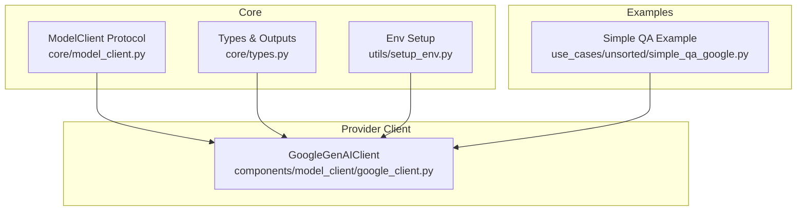
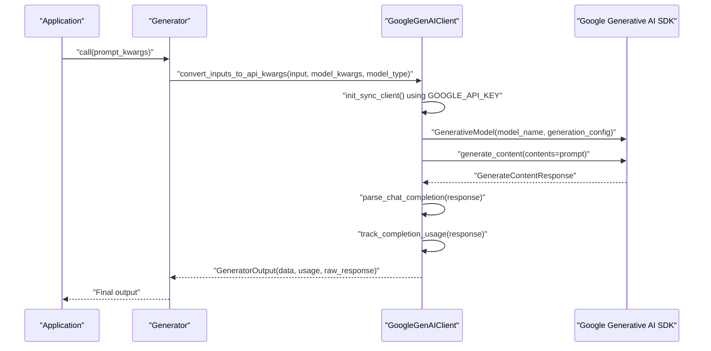
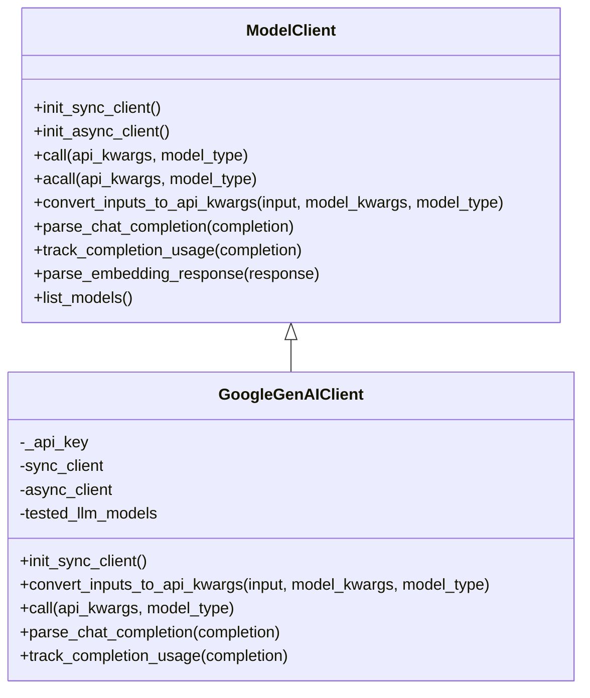
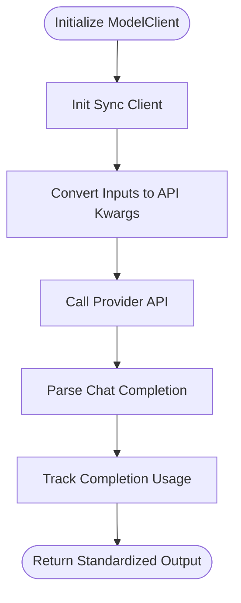
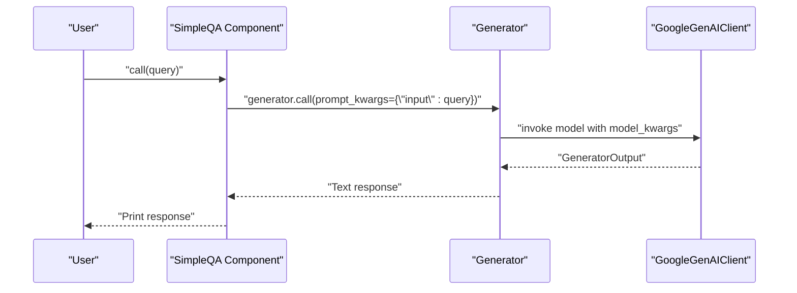
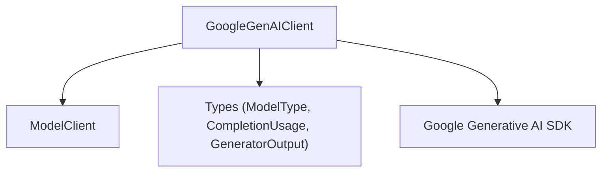

# Google Generative AI Integration

<cite>
**Referenced Files in This Document**
- [google_client.py](file://adalflow/adalflow/components/model_client/google_client.py)
- [model_client.py](file://adalflow/adalflow/core/model_client.py)
- [types.py](file://adalflow/adalflow/core/types.py)
- [setup_env.py](file://adalflow/adalflow/utils/setup_env.py)
- [.env_example](file://.env_example)
- [simple_qa_google.py](file://use_cases/unsorted/simple_qa_google.py)
</cite>

## Table of Contents
1. [Introduction](#introduction)
2. [Project Structure](#project-structure)
3. [Core Components](#core-components)
4. [Architecture Overview](#architecture-overview)
5. [Detailed Component Analysis](#detailed-component-analysis)
6. [Dependency Analysis](#dependency-analysis)
7. [Performance Considerations](#performance-considerations)
8. [Troubleshooting Guide](#troubleshooting-guide)
9. [Conclusion](#conclusion)
10. [Appendices](#appendices)

## Introduction
This document explains the Google Generative AI integration in AdalFlow with a focus on the Google client implementation for Gemini models. It covers authentication via environment variables, API configuration, model selection, usage tracking, and practical examples for text generation. It also outlines provider-specific considerations such as multimodal capabilities, safety settings, and generation parameters, along with best practices for rate limiting, error handling, and optimization techniques for different Gemini model variants.

## Project Structure
The Google integration centers around a dedicated model client that adheres to AdalFlow’s ModelClient protocol. Supporting components include shared types for standardized outputs and usage metrics, environment setup utilities, and example use cases.

**Diagram sources**
- [model_client.py](file://adalflow/adalflow/core/model_client.py#L16-L128)
- [types.py](file://adalflow/adalflow/core/types.py#L55-L135)
- [setup_env.py](file://adalflow/adalflow/utils/setup_env.py#L8-L19)
- [google_client.py](file://adalflow/adalflow/components/model_client/google_client.py#L30-L160)
- [simple_qa_google.py](file://use_cases/unsorted/simple_qa_google.py#L11-L32)

**Section sources**
- [google_client.py](file://adalflow/adalflow/components/model_client/google_client.py#L1-L160)
- [model_client.py](file://adalflow/adalflow/core/model_client.py#L1-L128)
- [types.py](file://adalflow/adalflow/core/types.py#L55-L135)
- [setup_env.py](file://adalflow/adalflow/utils/setup_env.py#L1-L19)
- [.env_example](file://.env_example#L1-L8)
- [simple_qa_google.py](file://use_cases/unsorted/simple_qa_google.py#L1-L32)

## Core Components
- GoogleGenAIClient: Implements the ModelClient protocol for Google’s GenAI SDK, supporting text generation via Gemini models. It initializes the client using an API key from environment variables, converts inputs to API-specific arguments, executes synchronous calls, parses responses, and tracks usage.
- ModelClient Protocol: Defines the contract for all model clients, including initialization, input conversion, API invocation, response parsing, and usage tracking.
- Types and Outputs: Provides standardized data structures for model outputs, usage metrics, and model type enumeration used across providers.

Key responsibilities:
- Authentication: Requires GOOGLE_API_KEY via environment variable or constructor.
- API Configuration: Uses GenerationConfig and GenerativeModel for model invocation.
- Input Conversion: Maps standard inputs to provider-specific arguments for LLM and Embeddings.
- Parsing and Usage Tracking: Converts raw provider responses into GeneratorOutput and CompletionUsage.

**Section sources**
- [google_client.py](file://adalflow/adalflow/components/model_client/google_client.py#L30-L160)
- [model_client.py](file://adalflow/adalflow/core/model_client.py#L16-L128)
- [types.py](file://adalflow/adalflow/core/types.py#L55-L135)

## Architecture Overview
The Google integration follows a layered architecture:
- Application Layer: Components and Generators that consume the model client.
- Provider Client Layer: GoogleGenAIClient implementing ModelClient.
- Provider SDK Layer: Google Generative AI SDK for model invocation.
- Environment Layer: Environment variables and optional .env loading.

**Diagram sources**
- [google_client.py](file://adalflow/adalflow/components/model_client/google_client.py#L60-L153)
- [types.py](file://adalflow/adalflow/core/types.py#L486-L541)

## Detailed Component Analysis

### GoogleGenAIClient
Implements the ModelClient protocol for Google’s GenAI SDK:
- Initialization: Accepts an optional API key; otherwise reads GOOGLE_API_KEY from environment variables. Raises an error if the key is missing.
- Sync Client: Configures the GenAI SDK with the API key.
- Input Conversion: Supports LLM and Embeddings model types. For LLM, maps the input prompt to the provider’s expected format; for Embeddings, ensures the input is a sequence of texts.
- Invocation: Creates a GenerativeModel with a GenerationConfig and invokes generate_content with the prepared prompt.
- Parsing: Extracts the text response and usage metadata, returning a standardized GeneratorOutput.
- Usage Tracking: Maps provider usage metadata to CompletionUsage.

Provider-specific notes:
- Multimodal Inputs: The current implementation focuses on text prompts. Multimodal inputs (text + images) are not implemented in the current client.
- Safety Settings and Generation Parameters: The client constructs a GenerationConfig from model_kwargs. Ensure model_kwargs align with GenerationConfig fields supported by the GenAI SDK.
- Tested Models: The client lists tested Gemini models for compatibility verification.

**Diagram sources**
- [model_client.py](file://adalflow/adalflow/core/model_client.py#L16-L128)
- [google_client.py](file://adalflow/adalflow/components/model_client/google_client.py#L30-L160)

**Section sources**
- [google_client.py](file://adalflow/adalflow/components/model_client/google_client.py#L30-L160)

### ModelClient Protocol
Defines the interface that all model clients must implement:
- Initialization: Both sync and async clients must be initialized.
- Input Conversion: Convert standard inputs and model kwargs into provider-specific arguments.
- Invocation: Provide call and acall methods for synchronous and asynchronous invocations.
- Parsing: Parse provider responses into standardized output types.
- Usage Tracking: Track token usage consistently across providers.
- Listing Models: Provide a method to list available models.

**Diagram sources**
- [model_client.py](file://adalflow/adalflow/core/model_client.py#L41-L128)

**Section sources**
- [model_client.py](file://adalflow/adalflow/core/model_client.py#L1-L128)

### Types and Outputs
Standardized data structures used across providers:
- ModelType: Enumerates supported model categories (LLM, Embedder, Reranker, etc.).
- CompletionUsage: Tracks prompt, completion, and total tokens.
- GeneratorOutput: Holds final data, error messages, usage, raw response, and metadata.

These types enable consistent behavior across providers and simplify integration.

**Section sources**
- [types.py](file://adalflow/adalflow/core/types.py#L55-L135)
- [types.py](file://adalflow/adalflow/core/types.py#L229-L275)
- [types.py](file://adalflow/adalflow/core/types.py#L486-L541)

### Environment and Credentials
- Environment Variables: GOOGLE_API_KEY must be set. The .env_example file demonstrates the expected variable name.
- Environment Loading: The setup_env utility loads variables from a .env file and raises an error if the file is missing.

Best practices:
- Store credentials securely and avoid committing secrets to version control.
- Use setup_env during development to load variables from a .env file.

**Section sources**
- [google_client.py](file://adalflow/adalflow/components/model_client/google_client.py#L60-L73)
- [.env_example](file://.env_example#L4-L4)
- [setup_env.py](file://adalflow/adalflow/utils/setup_env.py#L8-L19)

### Practical Examples

#### Text Generation with Google Client
A minimal example demonstrates initializing a Generator with GoogleGenAIClient and invoking it with a prompt.

**Diagram sources**
- [simple_qa_google.py](file://use_cases/unsorted/simple_qa_google.py#L11-L32)
- [google_client.py](file://adalflow/adalflow/components/model_client/google_client.py#L101-L153)

**Section sources**
- [simple_qa_google.py](file://use_cases/unsorted/simple_qa_google.py#L1-L32)

#### Multimodal Inputs
Multimodal inputs (e.g., combining text with images) are not implemented in the current GoogleGenAIClient. To support multimodal scenarios, extend the input conversion logic to handle image inputs and map them to the provider’s expected format.

[No sources needed since this section provides conceptual guidance]

#### Streaming Responses
The current GoogleGenAIClient performs synchronous generation and does not expose a streaming interface. To enable streaming:
- Add an acall method that leverages the provider’s async capabilities.
- Implement a streaming parser that yields chunks and updates usage incrementally.

[No sources needed since this section provides conceptual guidance]

#### Safety Settings and Generation Parameters
Safety settings and generation parameters are configured via GenerationConfig. Ensure model_kwargs passed to the client align with GenerationConfig fields supported by the GenAI SDK. Adjust temperature, max_output_tokens, top_p, and other parameters as needed for your use case.

**Section sources**
- [google_client.py](file://adalflow/adalflow/components/model_client/google_client.py#L148-L150)

## Dependency Analysis
The Google client depends on:
- ModelClient protocol for consistent behavior across providers.
- Google Generative AI SDK for model invocation and response handling.
- Standardized types for outputs and usage tracking.

**Diagram sources**
- [google_client.py](file://adalflow/adalflow/components/model_client/google_client.py#L9-L25)
- [model_client.py](file://adalflow/adalflow/core/model_client.py#L16-L128)
- [types.py](file://adalflow/adalflow/core/types.py#L55-L135)

**Section sources**
- [google_client.py](file://adalflow/adalflow/components/model_client/google_client.py#L1-L25)
- [model_client.py](file://adalflow/adalflow/core/model_client.py#L1-L128)
- [types.py](file://adalflow/adalflow/core/types.py#L55-L135)

## Performance Considerations
- Token Efficiency: Use appropriate generation parameters (e.g., max_output_tokens, temperature) to balance quality and cost.
- Model Selection: Choose Gemini models aligned with your workload. The client lists tested models for compatibility verification.
- Retry Strategy: The client applies exponential backoff for transient errors. Tune max_time and consider adding jitter for production workloads.
- Usage Tracking: Monitor CompletionUsage to optimize prompts and reduce unnecessary token consumption.

[No sources needed since this section provides general guidance]

## Troubleshooting Guide
Common issues and resolutions:
- Missing API Key: Ensure GOOGLE_API_KEY is set in the environment or passed to the client constructor. The client raises an error if the key is absent.
- Invalid Model Type: Only LLM and Embeddings are supported in the current implementation. Passing other types raises an error.
- Provider Exceptions: Transient errors (e.g., internal server errors) are retried using exponential backoff. Review logs for transient failures and adjust retry parameters as needed.
- Input Validation: For LLM, ensure prompt and model are specified. For Embeddings, ensure input is a sequence of texts.

**Section sources**
- [google_client.py](file://adalflow/adalflow/components/model_client/google_client.py#L60-L73)
- [google_client.py](file://adalflow/adalflow/components/model_client/google_client.py#L119-L124)
- [google_client.py](file://adalflow/adalflow/components/model_client/google_client.py#L126-L134)

## Conclusion
The Google Generative AI integration in AdalFlow provides a clean, standardized interface for Gemini model invocation through GoogleGenAIClient. By adhering to the ModelClient protocol, it enables consistent behavior across providers while leveraging Google’s GenAI SDK for robust text generation. Future enhancements can include multimodal support, streaming responses, and expanded safety and generation parameter controls.

[No sources needed since this section summarizes without analyzing specific files]

## Appendices

### Authentication Setup
- Set GOOGLE_API_KEY in your environment or .env file.
- Load environment variables using setup_env during development.

**Section sources**
- [.env_example](file://.env_example#L4-L4)
- [setup_env.py](file://adalflow/adalflow/utils/setup_env.py#L8-L19)

### Model Selection and Parameter Tuning
- Tested Models: The client lists tested Gemini models for compatibility verification.
- Generation Parameters: Configure via model_kwargs mapped to GenerationConfig fields.

**Section sources**
- [google_client.py](file://adalflow/adalflow/components/model_client/google_client.py#L66-L66)
- [google_client.py](file://adalflow/adalflow/components/model_client/google_client.py#L148-L150)