# Major Provider Integrations

<cite>
**Referenced Files in This Document**
- [__init__.py](file://adalflow/adalflow/components/model_client/__init__.py)
- [model_client.py](file://adalflow/adalflow/core/model_client.py)
- [openai_client.py](file://adalflow/adalflow/components/model_client/openai_client.py)
- [anthropic_client.py](file://adalflow/adalflow/components/model_client/anthropic_client.py)
- [google_client.py](file://adalflow/adalflow/components/model_client/google_client.py)
- [groq_client.py](file://adalflow/adalflow/components/model_client/groq_client.py)
- [azureai_client.py](file://adalflow/adalflow/components/model_client/azureai_client.py)
- [utils.py](file://adalflow/adalflow/components/model_client/utils.py)
- [chat_completion_to_response_converter.py](file://adalflow/adalflow/components/model_client/chat_completion_to_response_converter.py)
- [mistral_client.py](file://adalflow/adalflow/components/model_client/mistral_client.py)
- [ollama_client.py](file://adalflow/adalflow/components/model_client/ollama_client.py)
- [bedrock_client.py](file://adalflow/adalflow/components/model_client/bedrock_client.py)
</cite>

## Table of Contents
1. [Introduction](#introduction)
2. [Project Structure](#project-structure)
3. [Core Components](#core-components)
4. [Architecture Overview](#architecture-overview)
5. [Detailed Component Analysis](#detailed-component-analysis)
6. [Dependency Analysis](#dependency-analysis)
7. [Performance Considerations](#performance-considerations)
8. [Troubleshooting Guide](#troubleshooting-guide)
9. [Conclusion](#conclusion)

## Introduction
This document explains AdalFlow’s provider integrations for major LLM providers. It covers how the framework abstracts model clients behind a unified interface, and how each provider client implements initialization, authentication, input conversion, response parsing, usage tracking, streaming, and error handling. It includes practical configuration notes, provider-specific parameters, and best practices for production-grade deployments.

## Project Structure
Provider integrations live under the model client package. A central base class defines the contract; each provider implements a specialized client that adheres to the contract and adapts to provider-specific APIs.

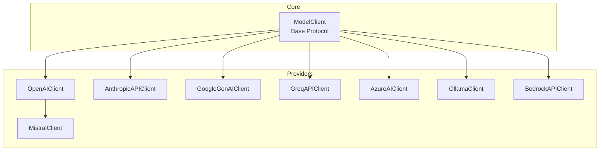

**Diagram sources**
- [model_client.py](file://adalflow/adalflow/core/model_client.py#L16-L128)
- [openai_client.py](file://adalflow/adalflow/components/model_client/openai_client.py#L411-L800)
- [anthropic_client.py](file://adalflow/adalflow/components/model_client/anthropic_client.py#L314-L642)
- [google_client.py](file://adalflow/adalflow/components/model_client/google_client.py#L30-L160)
- [groq_client.py](file://adalflow/adalflow/components/model_client/groq_client.py#L31-L179)
- [azureai_client.py](file://adalflow/adalflow/components/model_client/azureai_client.py#L118-L489)
- [mistral_client.py](file://adalflow/adalflow/components/model_client/mistral_client.py#L8-L70)
- [ollama_client.py](file://adalflow/adalflow/components/model_client/ollama_client.py#L138-L200)
- [bedrock_client.py](file://adalflow/adalflow/components/model_client/bedrock_client.py#L48-L200)

**Section sources**
- [__init__.py](file://adalflow/adalflow/components/model_client/__init__.py#L1-L135)
- [model_client.py](file://adalflow/adalflow/core/model_client.py#L16-L128)

## Core Components
- ModelClient: Defines the protocol for all model clients. It enforces:
  - Initialization of sync and async clients
  - Input conversion to provider-specific kwargs
  - API call and response parsing
  - Usage tracking and model listing
  - Streaming support via async/sync generators

Key responsibilities:
- Unified input conversion and output parsing
- Standardized usage tracking across providers
- Pluggable retry/backoff via decorator patterns
- Optional multimodal support via shared utilities

**Section sources**
- [model_client.py](file://adalflow/adalflow/core/model_client.py#L16-L128)

## Architecture Overview
AdalFlow’s model client architecture centers on a single base class that all providers inherit. Providers encapsulate:
- Authentication and client creation
- Input normalization to provider-specific formats
- Response parsing and usage extraction
- Streaming handling and error/backoff policies

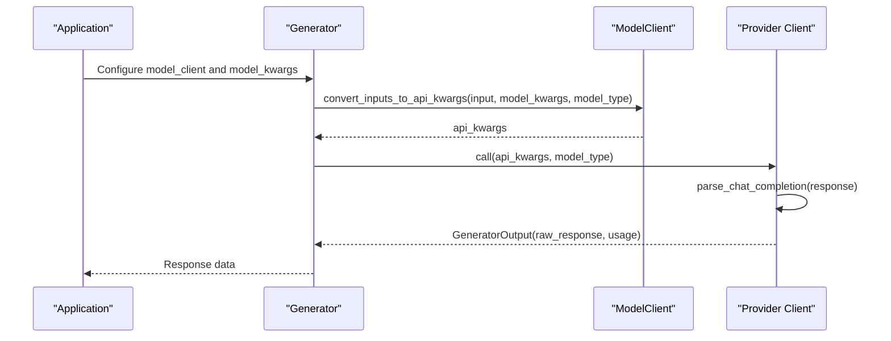

**Diagram sources**
- [model_client.py](file://adalflow/adalflow/core/model_client.py#L73-L127)
- [openai_client.py](file://adalflow/adalflow/components/model_client/openai_client.py#L779-L800)
- [anthropic_client.py](file://adalflow/adalflow/components/model_client/anthropic_client.py#L392-L502)
- [google_client.py](file://adalflow/adalflow/components/model_client/google_client.py#L75-L90)
- [groq_client.py](file://adalflow/adalflow/components/model_client/groq_client.py#L68-L82)
- [azureai_client.py](file://adalflow/adalflow/components/model_client/azureai_client.py#L303-L318)

## Detailed Component Analysis

### OpenAI Integration
- Purpose: Full-featured client supporting chat, embeddings, multimodal inputs, and image generation via Response API.
- Authentication: Environment variable or explicit key; optional base_url for third-party endpoints.
- Input conversion: Supports “text” or “messages”; multimodal via shared utilities.
- Parsing: Response API output parsing with structured content extraction; streaming via Response API events.
- Usage tracking: Uses Response API usage metadata.
- Backoff: Decorated with exponential backoff for timeouts, rate limits, and server errors.
- Best practices:
  - Prefer Response API for multimodal and tool-call scenarios.
  - Use environment variables for API keys.
  - For multimodal, leverage shared image processing utilities.

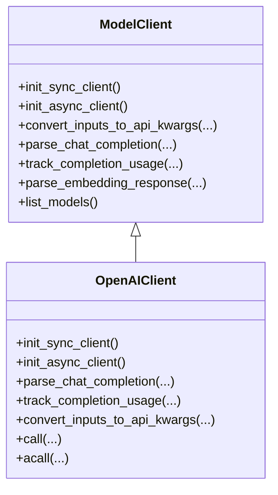

**Diagram sources**
- [model_client.py](file://adalflow/adalflow/core/model_client.py#L16-L128)
- [openai_client.py](file://adalflow/adalflow/components/model_client/openai_client.py#L411-L800)

**Section sources**
- [openai_client.py](file://adalflow/adalflow/components/model_client/openai_client.py#L411-L800)
- [utils.py](file://adalflow/adalflow/components/model_client/utils.py#L33-L195)

### Anthropic Integration
- Purpose: Provides OpenAI SDK-compatible access to Anthropic models via the Chat Completions API.
- Authentication: Uses environment variable or explicit key; base_url points to Anthropic’s compatibility endpoint.
- Input conversion: Converts single text input to messages format; respects max_tokens defaults.
- Parsing: Converts ChatCompletion to Response API-compatible text; supports both sync and async streams.
- Usage tracking: Maps usage fields to AdalFlow format.
- Backoff: Exponential backoff for provider errors.
- Best practices:
  - Use “messages” input type for richer prompting.
  - Leverage the converter utilities for consistent output handling.

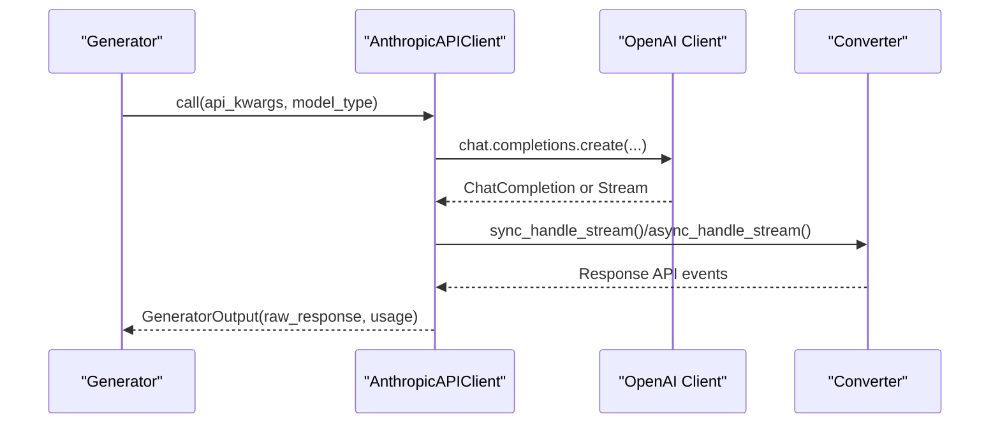

**Diagram sources**
- [anthropic_client.py](file://adalflow/adalflow/components/model_client/anthropic_client.py#L314-L642)
- [chat_completion_to_response_converter.py](file://adalflow/adalflow/components/model_client/chat_completion_to_response_converter.py#L65-L342)

**Section sources**
- [anthropic_client.py](file://adalflow/adalflow/components/model_client/anthropic_client.py#L314-L642)
- [chat_completion_to_response_converter.py](file://adalflow/adalflow/components/model_client/chat_completion_to_response_converter.py#L65-L342)

### Google Generative AI Integration
- Purpose: Client for Google Gemini models via the official GenAI SDK.
- Authentication: Environment variable for API key; client configured globally.
- Input conversion: Supports LLM prompts and embeddings; transforms inputs to SDK-specific formats.
- Parsing: Extracts text and usage metadata; wraps into GeneratorOutput.
- Backoff: Exponential backoff for server and request errors.
- Best practices:
  - Use environment variables for API keys.
  - Verify model availability and usage metadata fields.

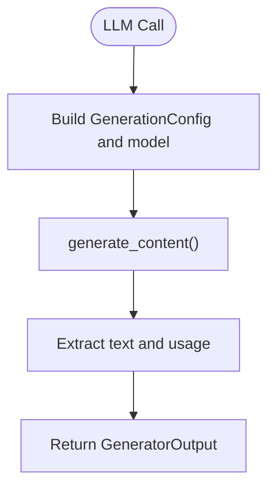

**Diagram sources**
- [google_client.py](file://adalflow/adalflow/components/model_client/google_client.py#L30-L160)

**Section sources**
- [google_client.py](file://adalflow/adalflow/components/model_client/google_client.py#L30-L160)

### Groq Integration
- Purpose: Lightweight client for Groq’s high-performance inference API.
- Authentication: Environment variable for API key.
- Input conversion: Builds messages array from input text; sets model.
- Parsing: Extracts first message content and usage; wraps into GeneratorOutput.
- Backoff: Exponential backoff for provider errors.
- Best practices:
  - Provide model name explicitly.
  - Use streaming for latency-sensitive applications.

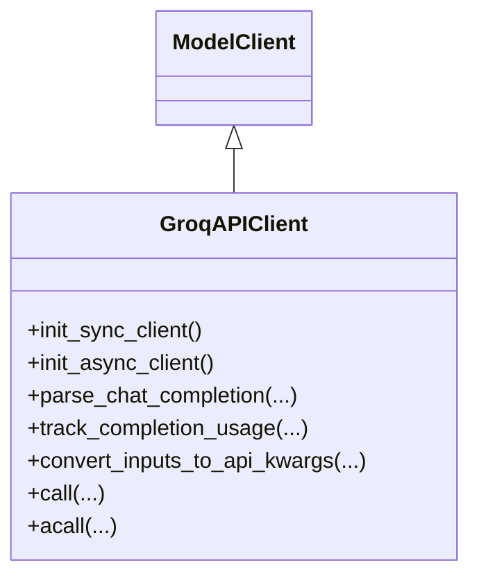

**Diagram sources**
- [model_client.py](file://adalflow/adalflow/core/model_client.py#L16-L128)
- [groq_client.py](file://adalflow/adalflow/components/model_client/groq_client.py#L31-L179)

**Section sources**
- [groq_client.py](file://adalflow/adalflow/components/model_client/groq_client.py#L31-L179)

### Azure AI (OpenAI) Integration
- Purpose: Azure OpenAI client using the OpenAI SDK with Azure-specific endpoints and credentials.
- Authentication: Supports API key or Azure AD token via DefaultAzureCredential.
- Input conversion: Normalizes text to messages; supports special system/user prompt tags for structured inputs.
- Parsing: Parses chat completion and tracks usage; streaming supported.
- Backoff: Exponential backoff for provider errors.
- Best practices:
  - Set endpoint and API version via environment variables.
  - Use Azure AD tokens for managed environments.

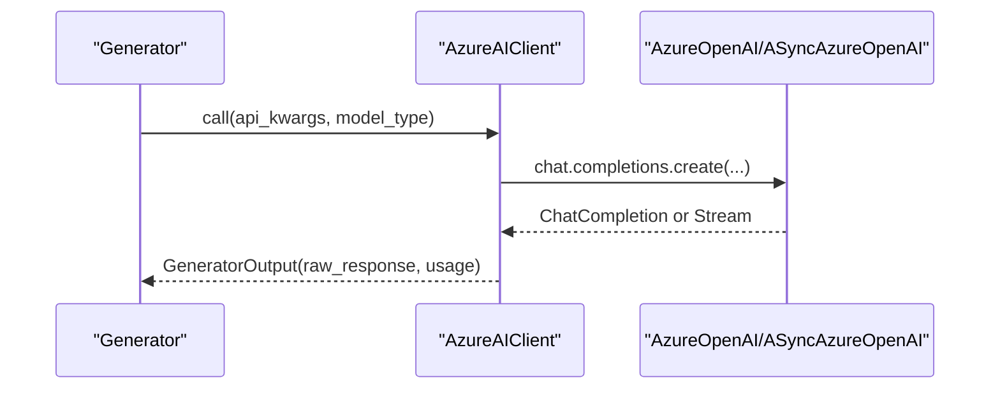

**Diagram sources**
- [azureai_client.py](file://adalflow/adalflow/components/model_client/azureai_client.py#L118-L489)

**Section sources**
- [azureai_client.py](file://adalflow/adalflow/components/model_client/azureai_client.py#L118-L489)

### Mistral Integration
- Purpose: Minimal client inheriting from OpenAIClient to target Mistral’s API via OpenAI-compatible endpoint.
- Authentication: Environment variable for API key; base_url overridden to Mistral’s endpoint.
- Input conversion: Inherits OpenAI-style input handling.
- Parsing: Reuses OpenAI client parsing logic.
- Best practices:
  - Provide model name and generation parameters via model_kwargs.
  - Use environment variables for API key.

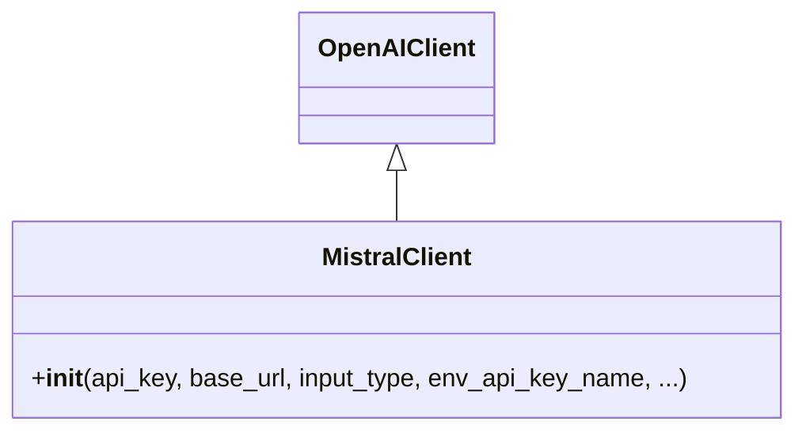

**Diagram sources**
- [openai_client.py](file://adalflow/adalflow/components/model_client/openai_client.py#L411-L800)
- [mistral_client.py](file://adalflow/adalflow/components/model_client/mistral_client.py#L8-L70)

**Section sources**
- [mistral_client.py](file://adalflow/adalflow/components/model_client/mistral_client.py#L8-L70)

### Ollama Integration
- Purpose: Client for self-hosted models via Ollama’s local API.
- Authentication: No API key required; connects to local runtime.
- Input conversion: Supports generate and chat modes; parses tool calls and thinking outputs.
- Parsing: Extracts raw response and optional tool_use/thinking; streaming chunks exposed via raw_response.
- Best practices:
  - Ensure Ollama is running locally.
  - Pull desired models before use.

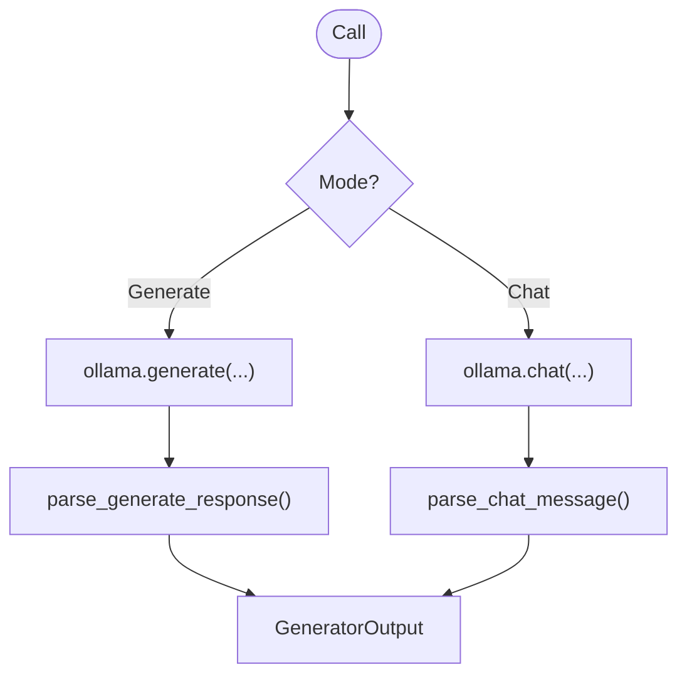

**Diagram sources**
- [ollama_client.py](file://adalflow/adalflow/components/model_client/ollama_client.py#L138-L200)

**Section sources**
- [ollama_client.py](file://adalflow/adalflow/components/model_client/ollama_client.py#L138-L200)

### AWS Bedrock Integration
- Purpose: Client for Amazon Bedrock models via the Bedrock Runtime API.
- Authentication: Uses boto3 Session with profile, region, and optional credentials.
- Input conversion: Uses Bedrock Runtime Converse API; handles streaming via generator.
- Parsing: Extracts first message content or streams chunks; exposes raw response for streaming.
- Best practices:
  - Configure AWS credentials and region via environment variables or profiles.
  - Ensure IAM permissions for Bedrock access.

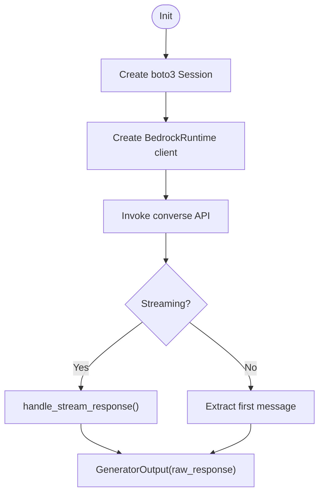

**Diagram sources**
- [bedrock_client.py](file://adalflow/adalflow/components/model_client/bedrock_client.py#L48-L200)

**Section sources**
- [bedrock_client.py](file://adalflow/adalflow/components/model_client/bedrock_client.py#L48-L200)

## Dependency Analysis
Provider clients depend on:
- Shared utilities for multimodal inputs and response parsing
- Provider SDKs (OpenAI, Anthropic compatibility, Google GenAI, Groq, Azure OpenAI, Ollama, boto3)
- Base ModelClient contract for consistent behavior

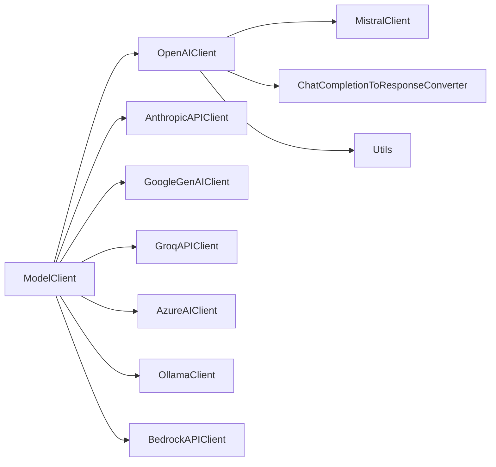

**Diagram sources**
- [model_client.py](file://adalflow/adalflow/core/model_client.py#L16-L128)
- [openai_client.py](file://adalflow/adalflow/components/model_client/openai_client.py#L411-L800)
- [anthropic_client.py](file://adalflow/adalflow/components/model_client/anthropic_client.py#L314-L642)
- [chat_completion_to_response_converter.py](file://adalflow/adalflow/components/model_client/chat_completion_to_response_converter.py#L65-L342)
- [utils.py](file://adalflow/adalflow/components/model_client/utils.py#L1-L278)

**Section sources**
- [__init__.py](file://adalflow/adalflow/components/model_client/__init__.py#L1-L135)

## Performance Considerations
- Use environment variables for API keys to avoid repeated initialization overhead.
- Prefer Response API for multimodal and tool-call scenarios to reduce parsing complexity.
- Enable streaming for latency-sensitive workflows; ensure proper chunk handling.
- Apply backoff and retries judiciously to balance resilience and cost.
- For embeddings, batch inputs where supported by the provider.

## Troubleshooting Guide
Common issues and remedies:
- Missing API keys:
  - Ensure environment variables are set or pass keys explicitly.
- Authentication failures:
  - Verify endpoint URLs and credentials (especially for Azure AD and AWS).
- Streaming anomalies:
  - Confirm provider supports streaming and use the correct parser/event extraction utilities.
- Usage tracking:
  - Some providers do not expose usage in streaming mode; fall back to non-streaming calls when measuring tokens.
- Model not found:
  - Validate model names and availability; use list_models() where supported.

**Section sources**
- [openai_client.py](file://adalflow/adalflow/components/model_client/openai_client.py#L752-L777)
- [azureai_client.py](file://adalflow/adalflow/components/model_client/azureai_client.py#L233-L290)
- [google_client.py](file://adalflow/adalflow/components/model_client/google_client.py#L68-L74)
- [groq_client.py](file://adalflow/adalflow/components/model_client/groq_client.py#L56-L67)
- [anthropic_client.py](file://adalflow/adalflow/components/model_client/anthropic_client.py#L376-L391)
- [mistral_client.py](file://adalflow/adalflow/components/model_client/mistral_client.py#L44-L69)
- [ollama_client.py](file://adalflow/adalflow/components/model_client/ollama_client.py#L138-L200)
- [bedrock_client.py](file://adalflow/adalflow/components/model_client/bedrock_client.py#L136-L167)

## Conclusion
AdalFlow’s provider integrations offer a consistent interface across diverse LLM providers. By leveraging a shared base class, provider-specific clients encapsulate authentication, input conversion, parsing, and usage tracking, enabling straightforward switching and composition of models. Use the provider-specific configuration notes and best practices to deploy reliably and efficiently.