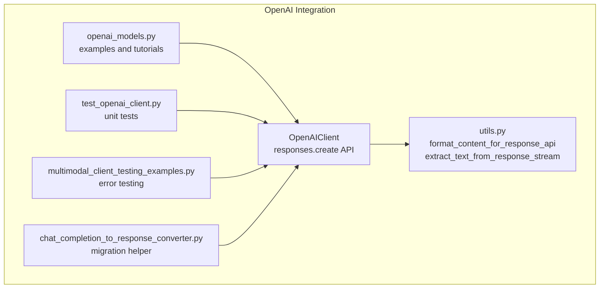
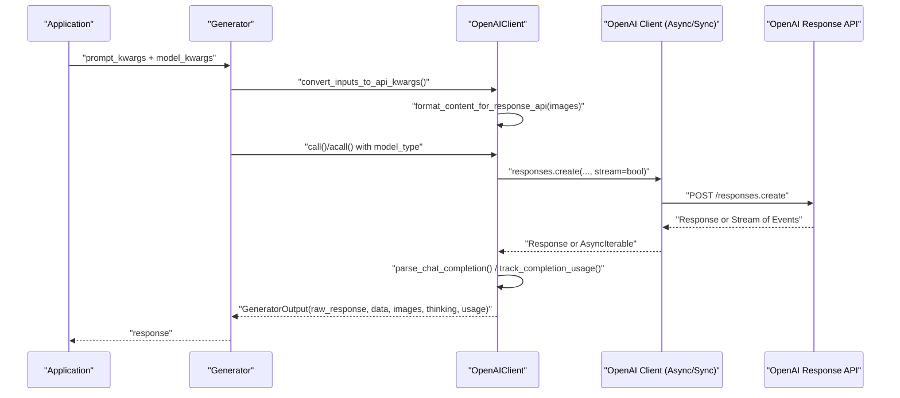
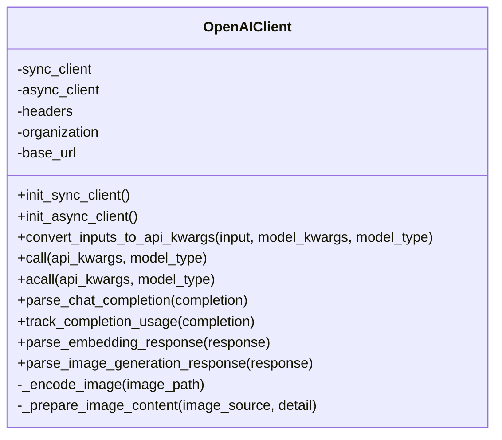
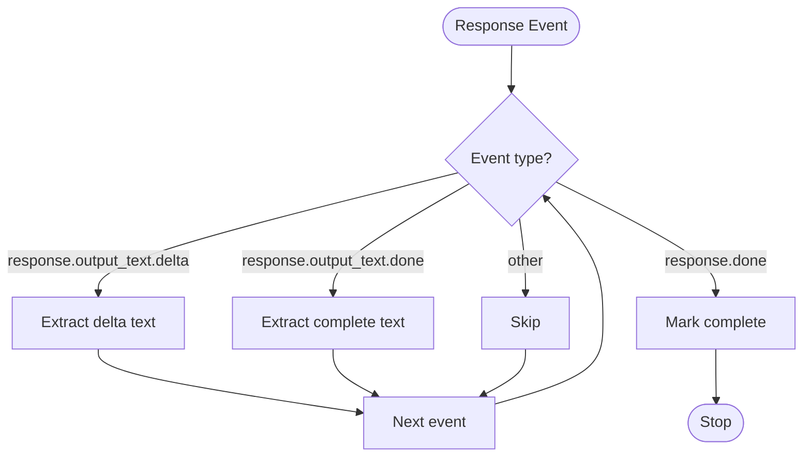
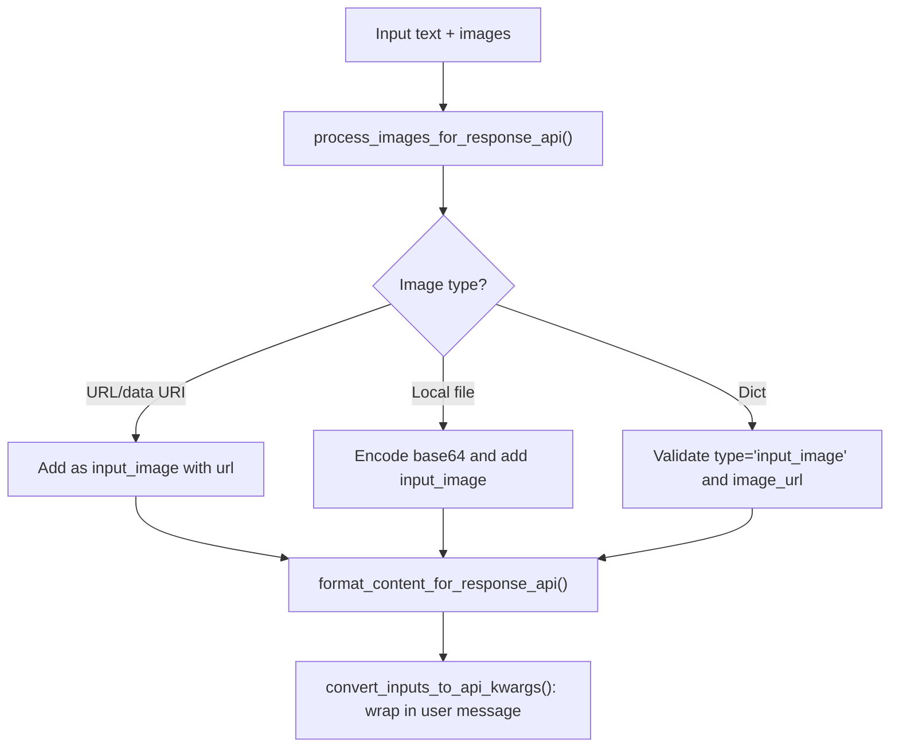
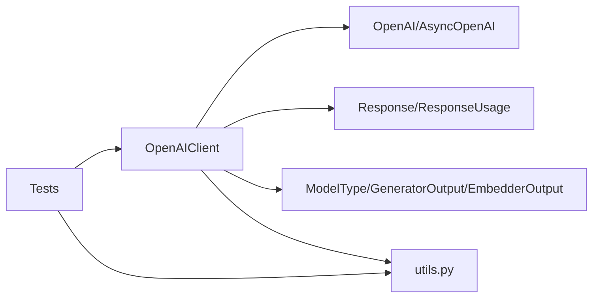

# OpenAI Integration

<cite>
**Referenced Files in This Document**
- [openai_client.py](file://adalflow/adalflow/components/model_client/openai_client.py)
- [utils.py](file://adalflow/adalflow/components/model_client/utils.py)
- [openai.rst](file://docs/source/integrations/openai.rst)
- [openai_models.py](file://tutorials/models/openai_models.py)
- [multimodal_client_testing_examples.py](file://tutorials/multimodal_client_testing_examples.py)
- [test_openai_client.py](file://adalflow/tests/test_openai_client.py)
- [chat_completion_to_response_converter.py](file://adalflow/adalflow/components/model_client/chat_completion_to_response_converter.py)
</cite>

## Table of Contents
1. [Introduction](#introduction)
2. [Project Structure](#project-structure)
3. [Core Components](#core-components)
4. [Architecture Overview](#architecture-overview)
5. [Detailed Component Analysis](#detailed-component-analysis)
6. [Dependency Analysis](#dependency-analysis)
7. [Performance Considerations](#performance-considerations)
8. [Troubleshooting Guide](#troubleshooting-guide)
9. [Conclusion](#conclusion)
10. [Appendices](#appendices)

## Introduction
This document explains the OpenAI integration in AdalFlow with a focus on the OpenAIClient implementation. It covers Response API usage, multimodal capabilities, streaming support, authentication, base URL customization, organization keys, provider-specific features (reasoning models, image generation, tools), configuration parameters, rate limits, error handling, and best practices. It also provides migration guidance from the legacy ChatCompletion API to the Response API.

## Project Structure
The OpenAI integration centers around the OpenAIClient class and supporting utilities. The key files are:
- OpenAIClient: Implements Response API calls, multimodal input handling, streaming, and usage tracking.
- Utilities: Provide helpers for image processing, content formatting, and streaming text extraction.
- Tutorials and Tests: Demonstrate usage patterns, streaming, multimodal inputs, and reasoning models.
- Migration helper: Converter for adapting ChatCompletion streams to Response API events.

**Diagram sources**
- [openai_client.py](file://adalflow/adalflow/components/model_client/openai_client.py#L411-L1256)
- [utils.py](file://adalflow/adalflow/components/model_client/utils.py#L153-L278)
- [openai_models.py](file://tutorials/models/openai_models.py#L1-L386)
- [test_openai_client.py](file://adalflow/tests/test_openai_client.py#L1-L767)
- [multimodal_client_testing_examples.py](file://tutorials/multimodal_client_testing_examples.py#L1-L122)
- [chat_completion_to_response_converter.py](file://adalflow/adalflow/components/model_client/chat_completion_to_response_converter.py#L65-L622)

**Section sources**
- [openai_client.py](file://adalflow/adalflow/components/model_client/openai_client.py#L411-L1256)
- [utils.py](file://adalflow/adalflow/components/model_client/utils.py#L153-L278)
- [openai.rst](file://docs/source/integrations/openai.rst#L1-L290)

## Core Components
- OpenAIClient: Unified client for text generation, multimodal inputs, reasoning, image generation, embeddings, and streaming via the Response API. Handles authentication, base URL customization, organization keys, and headers.
- Response API Parsing: Converts Response API outputs into structured GeneratorOutput, including text, images, tool calls, reasoning, and code interpreter outputs.
- Streaming Helpers: Utilities to extract text deltas and detect completion from Response API streaming events.
- Multimodal Formatting: Helpers to format text plus images into the Response API content array and to process images from URLs, local files, or base64.
- Migration Helper: Converter to transform ChatCompletion streams into Response API events for compatibility.

**Section sources**
- [openai_client.py](file://adalflow/adalflow/components/model_client/openai_client.py#L411-L1256)
- [utils.py](file://adalflow/adalflow/components/model_client/utils.py#L153-L278)
- [chat_completion_to_response_converter.py](file://adalflow/adalflow/components/model_client/chat_completion_to_response_converter.py#L65-L622)

## Architecture Overview
The OpenAI integration uses the Response API as the single entry point for all model interactions. The client supports:
- Non-streaming and streaming calls
- Multimodal inputs (text + images)
- Reasoning model configuration
- Image generation via tools
- Embeddings
- Usage tracking and token accounting

**Diagram sources**
- [openai_client.py](file://adalflow/adalflow/components/model_client/openai_client.py#L926-L1118)
- [utils.py](file://adalflow/adalflow/components/model_client/utils.py#L153-L231)

## Detailed Component Analysis

### OpenAIClient
- Responsibilities:
  - Initialize sync and async OpenAI clients with API key, base URL, organization, and headers.
  - Convert inputs to Response API-compatible kwargs (including multimodal content).
  - Call responses.create for non-streaming and streaming scenarios.
  - Parse Response API outputs into structured GeneratorOutput.
  - Track usage via ResponseUsage.
  - Support image generation via tools and legacy image endpoints.
- Key methods:
  - convert_inputs_to_api_kwargs: Formats text and images into content array for multimodal inputs.
  - call/acall: Invokes responses.create with model_type routing.
  - parse_chat_completion: Parses Response objects and streams into GeneratorOutput.
  - track_completion_usage: Maps ResponseUsage to internal usage model.
  - parse_image_generation_response: Parses legacy image generation responses.
  - _encode_image/_prepare_image_content: Encodes local images and prepares image content dicts.
- Authentication and customization:
  - API key via environment variable or constructor parameter.
  - base_url for third-party providers or self-hosted endpoints.
  - organization and default headers for enterprise/custom deployments.

**Diagram sources**
- [openai_client.py](file://adalflow/adalflow/components/model_client/openai_client.py#L411-L1256)

**Section sources**
- [openai_client.py](file://adalflow/adalflow/components/model_client/openai_client.py#L678-L1118)

### Response API Parsing and Streaming
- parse_response_output: Parses Response.output arrays to extract text, images, tool calls, reasoning, and code interpreter outputs.
- get_response_output_text: Convenience accessor for output_text.
- handle_streaming_response/handle_streaming_response_sync: Iterates over Response API streaming events.
- extract_text_from_response_stream: Extracts text deltas from ResponseTextDeltaEvent.
- extract_complete_text_from_response_stream: Extracts complete text from ResponseTextDoneEvent or Response.output_text.
- is_response_complete: Detects completion events or statuses.

**Diagram sources**
- [utils.py](file://adalflow/adalflow/components/model_client/utils.py#L197-L278)

**Section sources**
- [openai_client.py](file://adalflow/adalflow/components/model_client/openai_client.py#L113-L154)
- [utils.py](file://adalflow/adalflow/components/model_client/utils.py#L197-L278)

### Multimodal Inputs and Image Handling
- format_content_for_response_api: Builds content array with input_text and input_image entries.
- process_images_for_response_api: Validates and normalizes image inputs (URL, local file, data URI, pre-formatted dict).
- _prepare_image_content: Encodes local images and builds image_url entries with detail level.
- convert_inputs_to_api_kwargs: Wraps multimodal content into a user message for the Response API.

**Diagram sources**
- [utils.py](file://adalflow/adalflow/components/model_client/utils.py#L33-L194)
- [openai_client.py](file://adalflow/adalflow/components/model_client/openai_client.py#L869-L979)

**Section sources**
- [utils.py](file://adalflow/adalflow/components/model_client/utils.py#L33-L194)
- [openai_client.py](file://adalflow/adalflow/components/model_client/openai_client.py#L869-L979)

### Reasoning Models and Tools
- Reasoning configuration: Pass reasoning effort and summary mode via model_kwargs for reasoning models.
- Tools API: Use tools parameter (e.g., image_generation) to generate images alongside text.
- Parsed outputs: Reasoning steps and tool outputs are included in the parsed response structure.

**Section sources**
- [openai_client.py](file://adalflow/adalflow/components/model_client/openai_client.py#L113-L154)
- [openai_models.py](file://tutorials/models/openai_models.py#L214-L296)

### Authentication, Base URL, Organization, Headers
- API key: Environment variable or constructor parameter; validated during client initialization.
- base_url: Customize for third-party providers or self-hosted endpoints.
- organization: Optional organization key for enterprise accounts.
- headers: Additional default headers for provider-specific authentication or routing.

**Section sources**
- [openai_client.py](file://adalflow/adalflow/components/model_client/openai_client.py#L752-L776)
- [test_openai_client.py](file://adalflow/tests/test_openai_client.py#L330-L380)

### Migration from ChatCompletion API to Response API
- The OpenAIClient now exclusively uses responses.create and Response API events.
- A converter module exists to translate ChatCompletion streams into Response API events for compatibility scenarios.
- Backward compatibility: Old chat completion parsers are deprecated and ignored.

**Section sources**
- [openai_client.py](file://adalflow/adalflow/components/model_client/openai_client.py#L31-L50)
- [chat_completion_to_response_converter.py](file://adalflow/adalflow/components/model_client/chat_completion_to_response_converter.py#L65-L622)

## Dependency Analysis
- OpenAIClient depends on:
  - OpenAI SDK clients (OpenAI, AsyncOpenAI) for API calls.
  - Response API types (Response, ResponseUsage) for structured outputs.
  - AdalFlow core types (ModelType, GeneratorOutput, EmbedderOutput, ResponseUsage) for unified interfaces.
  - Utilities for image processing and content formatting.
- Tests validate:
  - Sync and async call flows.
  - Multimodal input conversion.
  - Streaming parsing and completion detection.
  - Usage tracking and reasoning model parsing.

**Diagram sources**
- [openai_client.py](file://adalflow/adalflow/components/model_client/openai_client.py#L29-L64)
- [test_openai_client.py](file://adalflow/tests/test_openai_client.py#L1-L18)

**Section sources**
- [openai_client.py](file://adalflow/adalflow/components/model_client/openai_client.py#L29-L64)
- [test_openai_client.py](file://adalflow/tests/test_openai_client.py#L1-L18)

## Performance Considerations
- Prefer streaming for better user experience and latency; use extract_text_from_response_stream to render incremental text.
- Use appropriate max_tokens to control output length and cost.
- For multimodal inputs, URLs are more efficient than base64-encoded local images; local files are auto-encoded.
- Monitor usage via response.usage to optimize token consumption.
- Use backoff retries for transient errors (timeouts, internal server errors, rate limits).

[No sources needed since this section provides general guidance]

## Troubleshooting Guide
Common issues and resolutions:
- Missing API key: Ensure the environment variable is set or pass api_key explicitly.
- Invalid image inputs: Validate URLs, local file paths, or base64 data URIs; check permissions for local files.
- Streaming parsing: Use extract_text_from_response_stream to extract deltas; rely on is_response_complete to detect termination.
- Usage tracking: For streamed responses, usage tracking occurs per event; aggregate as needed.
- Rate limits and timeouts: The client applies exponential backoff; consider retry policies and reduce concurrency.

**Section sources**
- [openai_client.py](file://adalflow/adalflow/components/model_client/openai_client.py#L997-L1007)
- [utils.py](file://adalflow/adalflow/components/model_client/utils.py#L197-L278)
- [test_openai_client.py](file://adalflow/tests/test_openai_client.py#L115-L136)

## Conclusion
AdalFlow’s OpenAI integration leverages the Response API to unify text generation, multimodal inputs, reasoning, and image generation under a single client interface. The OpenAIClient provides robust parsing, streaming, usage tracking, and customization for diverse deployment scenarios. The migration path from ChatCompletion to Response API is supported, and comprehensive utilities and tests facilitate reliable integration.

[No sources needed since this section summarizes without analyzing specific files]

## Appendices

### Configuration Parameters
- api_key: OpenAI API key (environment variable or constructor).
- base_url: API endpoint base URL for third-party providers.
- organization: Organization key for enterprise accounts.
- headers: Additional default headers.
- input_type: "text" or "messages" for input format.
- model_kwargs: Model-specific parameters (e.g., reasoning, tools, images).

**Section sources**
- [openai_client.py](file://adalflow/adalflow/components/model_client/openai_client.py#L678-L750)

### Provider-Specific Features
- Reasoning models: Configure reasoning effort and summary mode.
- Image generation: Via tools API or legacy endpoints.
- Multimodal: Vision models with images from URLs, local files, or base64.

**Section sources**
- [openai_client.py](file://adalflow/adalflow/components/model_client/openai_client.py#L113-L154)
- [openai_models.py](file://tutorials/models/openai_models.py#L183-L296)

### Concrete Examples
- Text generation, multimodal inputs, streaming, custom endpoints, and image generation are demonstrated in the tutorial and tests.

**Section sources**
- [openai_models.py](file://tutorials/models/openai_models.py#L17-L386)
- [multimodal_client_testing_examples.py](file://tutorials/multimodal_client_testing_examples.py#L28-L122)
- [test_openai_client.py](file://adalflow/tests/test_openai_client.py#L161-L213)