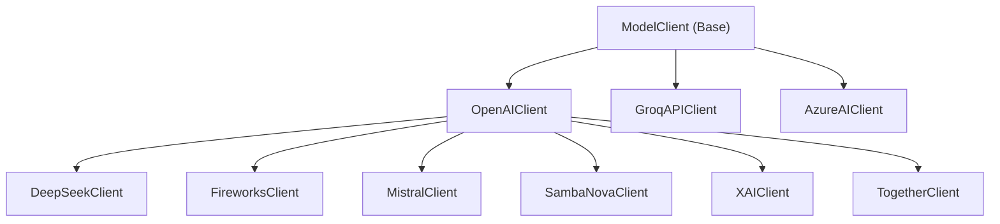
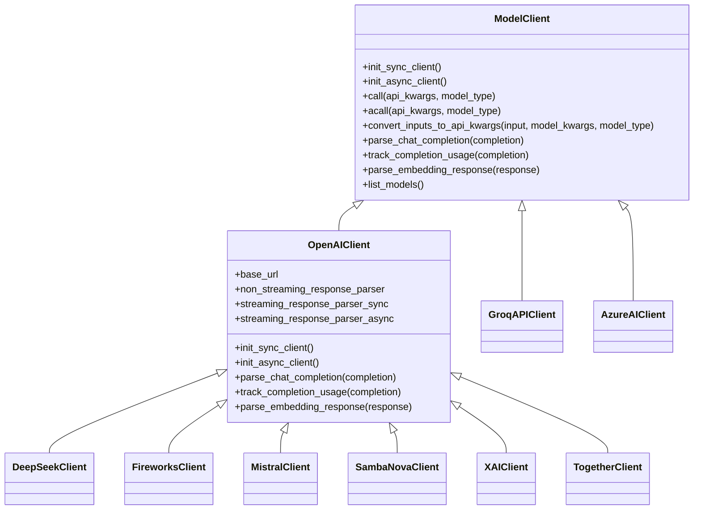
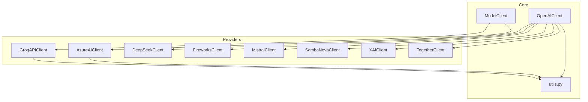

# Other Provider Integrations

<cite>
**Referenced Files in This Document**
- [groq_client.py](file://adalflow/adalflow/components/model_client/groq_client.py)
- [azureai_client.py](file://adalflow/adalflow/components/model_client/azureai_client.py)
- [deepseek_client.py](file://adalflow/adalflow/components/model_client/deepseek_client.py)
- [fireworks_client.py](file://adalflow/adalflow/components/model_client/fireworks_client.py)
- [mistral_client.py](file://adalflow/adalflow/components/model_client/mistral_client.py)
- [sambanova_client.py](file://adalflow/adalflow/components/model_client/sambanova_client.py)
- [together_client.py](file://adalflow/adalflow/components/model_client/together_client.py)
- [xai_client.py](file://adalflow/adalflow/components/model_client/xai_client.py)
- [openai_client.py](file://adalflow/adalflow/components/model_client/openai_client.py)
- [model_client.py](file://adalflow/adalflow/core/model_client.py)
- [utils.py](file://adalflow/adalflow/components/model_client/utils.py)
</cite>

## Table of Contents
1. [Introduction](#introduction)
2. [Project Structure](#project-structure)
3. [Core Components](#core-components)
4. [Architecture Overview](#architecture-overview)
5. [Detailed Component Analysis](#detailed-component-analysis)
6. [Dependency Analysis](#dependency-analysis)
7. [Performance Considerations](#performance-considerations)
8. [Troubleshooting Guide](#troubleshooting-guide)
9. [Conclusion](#conclusion)

## Introduction
This document explains how AdalFlow integrates additional provider clients beyond OpenAI, focusing on Groq, Azure AI, DeepSeek, Fireworks, Mistral AI, SambaNova, Together AI, and xAI. It highlights the common patterns used across providers, their unique authentication and endpoint configurations, and practical usage patterns. It also covers rate limiting, error handling, enterprise considerations, cost optimization, regional availability, and migration strategies between providers.

## Project Structure
The model client implementations live under the model_client package. Each provider is implemented as a subclass of the base ModelClient, with most OpenAI-compatible providers inheriting from OpenAIClient to reuse Response API handling, streaming utilities, and usage tracking.

**Diagram sources**
- [model_client.py](file://adalflow/adalflow/core/model_client.py#L16-L128)
- [openai_client.py](file://adalflow/adalflow/components/model_client/openai_client.py#L411-L800)
- [groq_client.py](file://adalflow/adalflow/components/model_client/groq_client.py#L31-L179)
- [azureai_client.py](file://adalflow/adalflow/components/model_client/azureai_client.py#L118-L489)
- [deepseek_client.py](file://adalflow/adalflow/components/model_client/deepseek_client.py#L15-L75)
- [fireworks_client.py](file://adalflow/adalflow/components/model_client/fireworks_client.py#L8-L56)
- [mistral_client.py](file://adalflow/adalflow/components/model_client/mistral_client.py#L8-L104)
- [sambanova_client.py](file://adalflow/adalflow/components/model_client/sambanova_client.py#L9-L65)
- [together_client.py](file://adalflow/adalflow/components/model_client/together_client.py#L21-L159)
- [xai_client.py](file://adalflow/adalflow/components/model_client/xai_client.py#L10-L57)

**Section sources**
- [model_client.py](file://adalflow/adalflow/core/model_client.py#L16-L128)
- [openai_client.py](file://adalflow/adalflow/components/model_client/openai_client.py#L411-L800)

## Core Components
- ModelClient (base): Defines the contract for all model clients, including initialization, input conversion, API calls, parsing, usage tracking, and model listing.
- OpenAIClient: Implements OpenAI-compatible behavior, including Response API parsing, multimodal support, streaming helpers, and usage tracking. Many providers inherit from this to reuse these capabilities.
- Provider-specific clients:
  - GroqAPIClient: Groq API client with backoff retries and usage tracking.
  - AzureAIClient: Azure OpenAI client supporting API key and Azure AD token authentication, with streaming and embedding support.
  - DeepSeekClient, FireworksClient, MistralClient, SambaNovaClient, TogetherClient, XAIClient: OpenAI-compatible providers that override base URL and environment variable names.

Key shared patterns:
- Environment-variable-driven authentication (e.g., PROVIDER_API_KEY).
- Base URL customization for third-party OpenAI-compatible endpoints.
- Standardized input conversion to API kwargs and standardized output parsing.
- Backoff-based retry for transient errors.
- Usage tracking via CompletionUsage.

**Section sources**
- [model_client.py](file://adalflow/adalflow/core/model_client.py#L41-L128)
- [openai_client.py](file://adalflow/adalflow/components/model_client/openai_client.py#L411-L800)
- [groq_client.py](file://adalflow/adalflow/components/model_client/groq_client.py#L31-L179)
- [azureai_client.py](file://adalflow/adalflow/components/model_client/azureai_client.py#L118-L489)
- [deepseek_client.py](file://adalflow/adalflow/components/model_client/deepseek_client.py#L15-L75)
- [fireworks_client.py](file://adalflow/adalflow/components/model_client/fireworks_client.py#L8-L56)
- [mistral_client.py](file://adalflow/adalflow/components/model_client/mistral_client.py#L8-L104)
- [sambanova_client.py](file://adalflow/adalflow/components/model_client/sambanova_client.py#L9-L65)
- [together_client.py](file://adalflow/adalflow/components/model_client/together_client.py#L21-L159)
- [xai_client.py](file://adalflow/adalflow/components/model_client/xai_client.py#L10-L57)

## Architecture Overview
The provider clients follow a layered architecture:
- Base layer: ModelClient defines the interface.
- OpenAI-compatible layer: OpenAIClient provides Response API parsing, multimodal support, and streaming helpers.
- Provider-specific layer: Each provider implements provider-specific authentication, base URL, and input conversion.

**Diagram sources**
- [model_client.py](file://adalflow/adalflow/core/model_client.py#L16-L128)
- [openai_client.py](file://adalflow/adalflow/components/model_client/openai_client.py#L411-L800)
- [groq_client.py](file://adalflow/adalflow/components/model_client/groq_client.py#L31-L179)
- [azureai_client.py](file://adalflow/adalflow/components/model_client/azureai_client.py#L118-L489)
- [deepseek_client.py](file://adalflow/adalflow/components/model_client/deepseek_client.py#L15-L75)
- [fireworks_client.py](file://adalflow/adalflow/components/model_client/fireworks_client.py#L8-L56)
- [mistral_client.py](file://adalflow/adalflow/components/model_client/mistral_client.py#L8-L104)
- [sambanova_client.py](file://adalflow/adalflow/components/model_client/sambanova_client.py#L9-L65)
- [together_client.py](file://adalflow/adalflow/components/model_client/together_client.py#L21-L159)
- [xai_client.py](file://adalflow/adalflow/components/model_client/xai_client.py#L10-L57)

## Detailed Component Analysis

### Groq Integration
- Authentication: Requires GROQ_API_KEY via environment variable or constructor.
- Endpoint: Uses Groq SDK client; base URL is implicit in the SDK.
- Input conversion: Converts system input to messages for LLM calls.
- Parsing: Parses chat completion to raw response and usage tracking.
- Retries: Exponential backoff for timeouts, internal server errors, rate limits, and unprocessable entity.
- Usage: Tracks prompt/completion/total tokens.

Practical usage pattern:
- Initialize client with environment variable set.
- Build model kwargs with model name and parameters.
- Call with model_type LLM and messages.

Common configuration parameters:
- api_key (optional)
- model (required)
- temperature, max_tokens, etc. (provider-specific)

Rate limiting and error handling:
- Backoff on transient errors; raises on missing model key.

**Section sources**
- [groq_client.py](file://adalflow/adalflow/components/model_client/groq_client.py#L31-L179)

### Azure AI Integration
- Authentication: Supports API key or Azure AD token via DefaultAzureCredential with bearer token provider.
- Endpoint: Requires AZURE_OPENAI_ENDPOINT and AZURE_OPENAI_VERSION environment variables.
- Input conversion: Supports "messages" or "text" input types; can parse structured prompts with tags.
- Parsing: Handles both non-streaming and streaming chat completions; tracks usage.
- Embeddings: Supports embeddings.create for EMBEDDER model type.
- Retries: Backoff for timeouts, internal server errors, rate limits, unprocessable entity, and bad request.

Practical usage pattern:
- Initialize with API key or credential and endpoint/version.
- For streaming, set stream=True; for embeddings, set model_type=EMBEDDER.

Common configuration parameters:
- api_key (optional)
- credential (DefaultAzureCredential)
- azure_endpoint (required)
- api_version (required)
- model (required)
- stream (optional)
- input_type ("text" or "messages")

Rate limiting and error handling:
- Validates endpoint and version presence; raises if missing; backoff on errors.

**Section sources**
- [azureai_client.py](file://adalflow/adalflow/components/model_client/azureai_client.py#L118-L489)

### DeepSeek Integration
- Compatibility: DeepSeek API is OpenAI-compatible.
- Endpoint: Overrides base URL to DeepSeek's API.
- Authentication: Uses DEEPSEEK_API_KEY environment variable by default.
- Input: Defaults to "messages" input type for compatibility with DeepSeek reasoner models.

Practical usage pattern:
- Initialize DeepSeekClient; set model to a DeepSeek model (e.g., reasoning model).
- Pass model kwargs including model name and parameters.

Common configuration parameters:
- api_key (optional)
- base_url (overridden)
- env_api_key_name (DEEPSEEK_API_KEY)
- input_type ("messages" by default)
- model (required)

Migration note:
- Swap base_url and env variable to switch to another OpenAI-compatible provider.

**Section sources**
- [deepseek_client.py](file://adalflow/adalflow/components/model_client/deepseek_client.py#L15-L75)

### Fireworks Integration
- Compatibility: OpenAI-compatible API.
- Endpoint: Uses Fireworks base URL.
- Authentication: FIREWORKS_API_KEY environment variable.
- Input: Defaults to "text" input type.

Practical usage pattern:
- Initialize FireworksClient; select a Fireworks model identifier.
- Configure temperature, max_tokens, etc.

Common configuration parameters:
- api_key (optional)
- base_url (overridden)
- env_api_key_name (FIREWORKS_API_KEY)
- input_type ("text" by default)
- model (required)

**Section sources**
- [fireworks_client.py](file://adalflow/adalflow/components/model_client/fireworks_client.py#L8-L56)

### Mistral Integration
- Compatibility: OpenAI-compatible API.
- Endpoint: Uses Mistral base URL.
- Authentication: MISTRAL_API_KEY environment variable.
- Input: Supports "text" or "messages".

Practical usage pattern:
- Initialize MistralClient; choose a Mistral model.
- Provide model kwargs like temperature and max_tokens.

Common configuration parameters:
- api_key (optional)
- base_url (overridden)
- env_api_key_name (MISTRAL_API_KEY)
- input_type ("text" by default)
- model (required)

**Section sources**
- [mistral_client.py](file://adalflow/adalflow/components/model_client/mistral_client.py#L8-L104)

### SambaNova Integration
- Compatibility: OpenAI-compatible API.
- Endpoint: Uses SambaNova base URL.
- Authentication: SAMBANOVA_API_KEY environment variable.
- Input: Defaults to "text" input type.

Practical usage pattern:
- Initialize SambaNovaClient; select a SambaNova model.
- Configure model kwargs.

Common configuration parameters:
- api_key (optional)
- base_url (overridden)
- env_api_key_name (SAMBANOVA_API_KEY)
- input_type ("text" by default)
- model (required)

**Section sources**
- [sambanova_client.py](file://adalflow/adalflow/components/model_client/sambanova_client.py#L9-L65)

### Together AI Integration
- Compatibility: OpenAI-compatible API.
- Endpoint: Uses Together SDK; base_url can be None (uses SDK default).
- Authentication: TOGETHER_API_KEY environment variable.
- Initialization: Overrides init_sync_client and init_async_client to use Together SDK clients.

Practical usage pattern:
- Initialize TogetherClient; select a Together model (including hosted models).
- Configure model kwargs.

Common configuration parameters:
- api_key (optional)
- base_url (optional)
- env_api_key_name (TOGETHER_API_KEY)
- input_type ("text" by default)
- model (required)

**Section sources**
- [together_client.py](file://adalflow/adalflow/components/model_client/together_client.py#L21-L159)

### xAI Integration
- Compatibility: OpenAI-compatible API.
- Endpoint: Uses xAI base URL.
- Authentication: XAI_API_KEY environment variable.
- Input: Defaults to "text" input type.

Practical usage pattern:
- Initialize XAIClient; choose an xAI model.
- Configure model kwargs.

Common configuration parameters:
- api_key (optional)
- base_url (overridden)
- env_api_key_name (XAI_API_KEY)
- input_type ("text" by default)
- model (required)

**Section sources**
- [xai_client.py](file://adalflow/adalflow/components/model_client/xai_client.py#L10-L57)

### Shared Patterns Across Providers
- Base class: All providers inherit from ModelClient or OpenAIClient.
- Environment variables: Each provider defines a specific env var name for API keys.
- Base URL customization: OpenAI-compatible providers override base_url.
- Input conversion: convert_inputs_to_api_kwargs adapts inputs to provider-specific message formats.
- Parsing: parse_chat_completion and track_completion_usage ensure consistent output and usage reporting.
- Retries: Backoff on transient errors for resilience.
- Usage tracking: Standardized CompletionUsage for billing insights.

**Section sources**
- [model_client.py](file://adalflow/adalflow/core/model_client.py#L41-L128)
- [openai_client.py](file://adalflow/adalflow/components/model_client/openai_client.py#L411-L800)
- [utils.py](file://adalflow/adalflow/components/model_client/utils.py#L9-L31)

## Dependency Analysis
Provider clients depend on:
- ModelClient for the interface contract.
- OpenAIClient for OpenAI-compatible behavior (when applicable).
- Provider SDKs (e.g., Groq, Together) or OpenAI SDK for API calls.
- backoff for retry logic.
- Environment variables for authentication.

**Diagram sources**
- [model_client.py](file://adalflow/adalflow/core/model_client.py#L16-L128)
- [openai_client.py](file://adalflow/adalflow/components/model_client/openai_client.py#L411-L800)
- [utils.py](file://adalflow/adalflow/components/model_client/utils.py#L1-L278)
- [groq_client.py](file://adalflow/adalflow/components/model_client/groq_client.py#L31-L179)
- [azureai_client.py](file://adalflow/adalflow/components/model_client/azureai_client.py#L118-L489)
- [deepseek_client.py](file://adalflow/adalflow/components/model_client/deepseek_client.py#L15-L75)
- [fireworks_client.py](file://adalflow/adalflow/components/model_client/fireworks_client.py#L8-L56)
- [mistral_client.py](file://adalflow/adalflow/components/model_client/mistral_client.py#L8-L104)
- [sambanova_client.py](file://adalflow/adalflow/components/model_client/sambanova_client.py#L9-L65)
- [together_client.py](file://adalflow/adalflow/components/model_client/together_client.py#L21-L159)
- [xai_client.py](file://adalflow/adalflow/components/model_client/xai_client.py#L10-L57)

**Section sources**
- [model_client.py](file://adalflow/adalflow/core/model_client.py#L16-L128)
- [openai_client.py](file://adalflow/adalflow/components/model_client/openai_client.py#L411-L800)
- [utils.py](file://adalflow/adalflow/components/model_client/utils.py#L1-L278)

## Performance Considerations
- Streaming: Prefer streaming for long responses to reduce latency and improve UX. OpenAIClient provides streaming helpers; AzureAIClient supports streaming chat completions.
- Usage tracking: Use track_completion_usage to monitor token consumption and optimize prompts.
- Retry strategy: Backoff reduces retry storms; tune provider-side throttling and consider batching when appropriate.
- Cost optimization:
  - Select smaller models for simple tasks.
  - Use temperature and max_tokens judiciously.
  - Monitor usage via CompletionUsage to identify overuse.
- Regional availability: Some providers may offer regional endpoints; configure base_url accordingly.

[No sources needed since this section provides general guidance]

## Troubleshooting Guide
Common issues and resolutions:
- Missing API key:
  - Ensure the provider-specific environment variable is set (e.g., GROQ_API_KEY, AZURE_OPENAI_API_KEY, DEEPSEEK_API_KEY, etc.).
- Missing endpoint/version for Azure:
  - Set AZURE_OPENAI_ENDPOINT and AZURE_OPENAI_VERSION.
- Unsupported model type:
  - Verify model_type matches provider capabilities (e.g., LLM vs EMBEDDER).
- Streaming errors:
  - Confirm stream flag is set appropriately; ensure parser compatibility.
- Transient failures:
  - Backoff is applied; check network connectivity and provider quotas.

**Section sources**
- [groq_client.py](file://adalflow/adalflow/components/model_client/groq_client.py#L56-L66)
- [azureai_client.py](file://adalflow/adalflow/components/model_client/azureai_client.py#L233-L260)
- [openai_client.py](file://adalflow/adalflow/components/model_client/openai_client.py#L752-L776)

## Conclusion
AdalFlow’s provider integrations share a consistent architecture: a base ModelClient interface, OpenAI-compatible OpenAIClient for shared functionality, and provider-specific overrides for authentication, endpoints, and input formats. This design enables rapid integration of new providers, robust error handling with backoff, and standardized usage tracking. Choose providers based on model availability, pricing, and regional support, and leverage the shared patterns to migrate between providers with minimal code changes.