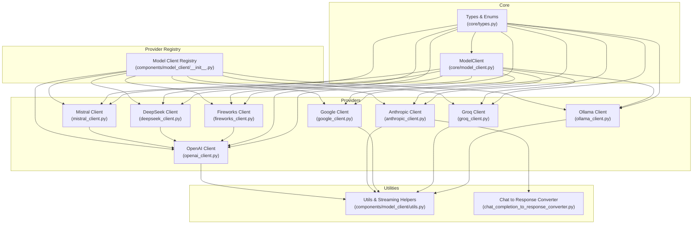
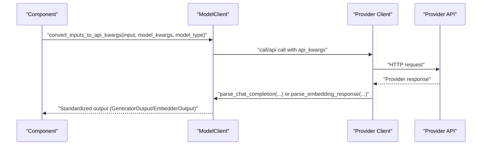
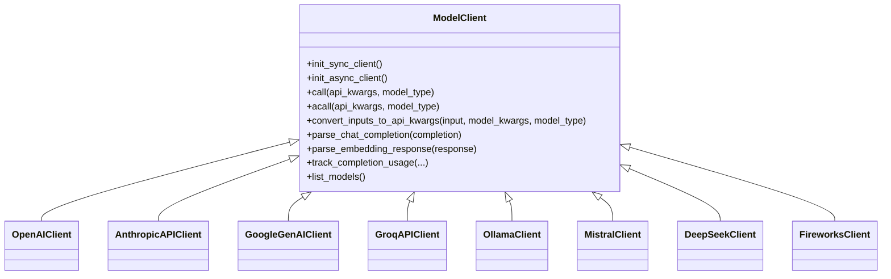
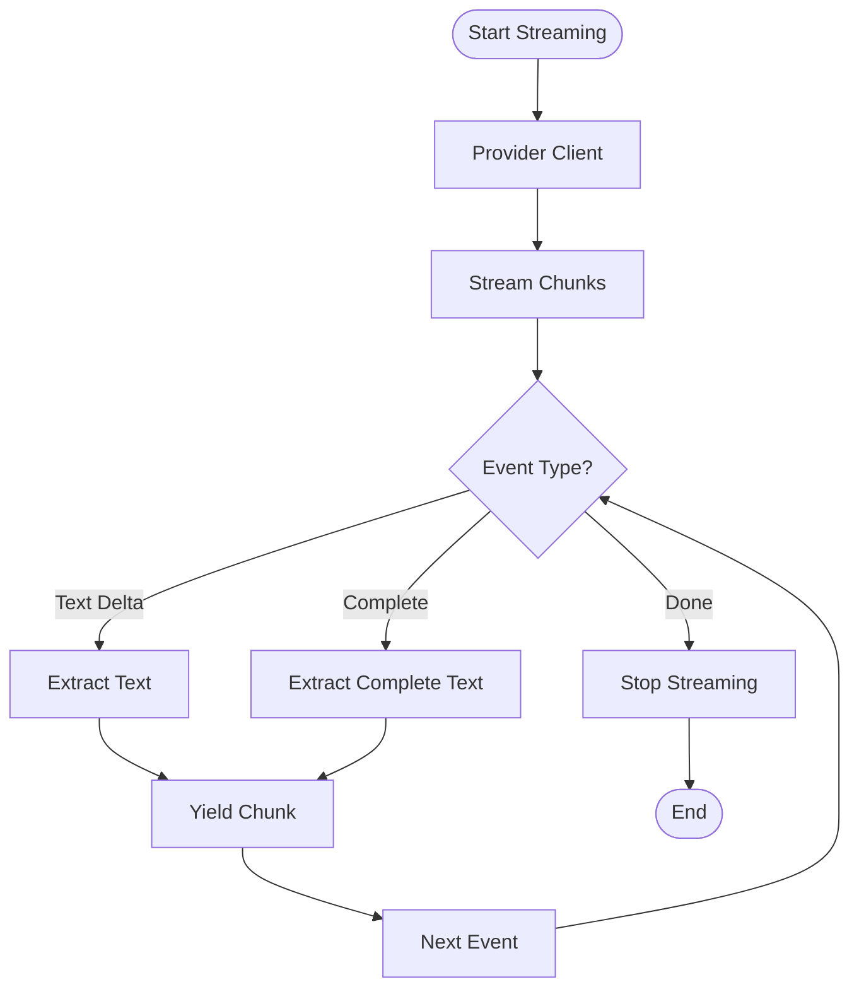
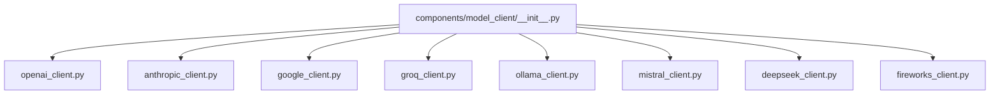

# Model Clients

<cite>
**Referenced Files in This Document**
- [model_client.py](file://adalflow/adalflow/core/model_client.py)
- [types.py](file://adalflow/adalflow/core/types.py)
- [__init__.py](file://adalflow/adalflow/components/model_client/__init__.py)
- [utils.py](file://adalflow/adalflow/components/model_client/utils.py)
- [chat_completion_to_response_converter.py](file://adalflow/adalflow/components/model_client/chat_completion_to_response_converter.py)
- [openai_client.py](file://adalflow/adalflow/components/model_client/openai_client.py)
- [anthropic_client.py](file://adalflow/adalflow/components/model_client/anthropic_client.py)
- [google_client.py](file://adalflow/adalflow/components/model_client/google_client.py)
- [groq_client.py](file://adalflow/adalflow/components/model_client/groq_client.py)
- [ollama_client.py](file://adalflow/adalflow/components/model_client/ollama_client.py)
- [mistral_client.py](file://adalflow/adalflow/components/model_client/mistral_client.py)
- [deepseek_client.py](file://adalflow/adalflow/components/model_client/deepseek_client.py)
- [fireworks_client.py](file://adalflow/adalflow/components/model_client/fireworks_client.py)
</cite>

## Table of Contents
1. [Introduction](#introduction)
2. [Project Structure](#project-structure)
3. [Core Components](#core-components)
4. [Architecture Overview](#architecture-overview)
5. [Detailed Component Analysis](#detailed-component-analysis)
6. [Dependency Analysis](#dependency-analysis)
7. [Performance Considerations](#performance-considerations)
8. [Troubleshooting Guide](#troubleshooting-guide)
9. [Conclusion](#conclusion)

## Introduction
This document explains AdalFlow’s provider-agnostic model client architecture and integration patterns. It focuses on the unified ModelClient interface, the provider abstraction layer, and the standardized API surface across multiple LLM providers. You will learn how to instantiate and configure clients, how streaming and usage tracking are handled, and how to integrate major providers such as OpenAI, Anthropic, Google, Groq, and others. The guide includes concrete examples from the codebase and highlights provider-specific features, limitations, and best practices.

## Project Structure
The model client ecosystem is organized around a shared core interface and a set of provider-specific adapters. Providers are lazily imported to avoid hard dependencies, and a central registry exposes convenient imports for users.

**Diagram sources**
- [model_client.py](file://adalflow/adalflow/core/model_client.py#L15-L128)
- [types.py](file://adalflow/adalflow/core/types.py#L55-L112)
- [__init__.py](file://adalflow/adalflow/components/model_client/__init__.py#L1-L135)
- [utils.py](file://adalflow/adalflow/components/model_client/utils.py#L1-L278)
- [chat_completion_to_response_converter.py](file://adalflow/adalflow/components/model_client/chat_completion_to_response_converter.py#L65-L622)
- [openai_client.py](file://adalflow/adalflow/components/model_client/openai_client.py#L1-L200)
- [anthropic_client.py](file://adalflow/adalflow/components/model_client/anthropic_client.py#L1-L200)
- [google_client.py](file://adalflow/adalflow/components/model_client/google_client.py#L1-L160)
- [groq_client.py](file://adalflow/adalflow/components/model_client/groq_client.py#L1-L179)
- [ollama_client.py](file://adalflow/adalflow/components/model_client/ollama_client.py#L1-L200)
- [mistral_client.py](file://adalflow/adalflow/components/model_client/mistral_client.py#L1-L104)
- [deepseek_client.py](file://adalflow/adalflow/components/model_client/deepseek_client.py#L1-L75)
- [fireworks_client.py](file://adalflow/adalflow/components/model_client/fireworks_client.py#L1-L56)

**Section sources**
- [model_client.py](file://adalflow/adalflow/core/model_client.py#L15-L128)
- [types.py](file://adalflow/adalflow/core/types.py#L55-L112)
- [__init__.py](file://adalflow/adalflow/components/model_client/__init__.py#L1-L135)

## Core Components
- Unified ModelClient interface: Defines the contract for initialization, input conversion, API calls, response parsing, usage tracking, and model listing. Subclasses implement provider-specific logic while adhering to this interface.
- Standardized types: ModelType enumerates supported model families (e.g., EMBEDDER, LLM, LLM_REASONING, RERANKER, IMAGE_GENERATION), and dataclasses standardize outputs and usage metrics.
- Provider registry: Centralized imports and lazy loading of provider clients and utilities, enabling optional installation of provider SDKs.

Key responsibilities of ModelClient:
- Initialize sync and async clients
- Convert component inputs to provider-specific API kwargs
- Execute API calls and parse responses
- Track usage and handle retries
- List available models

**Section sources**
- [model_client.py](file://adalflow/adalflow/core/model_client.py#L41-L128)
- [types.py](file://adalflow/adalflow/core/types.py#L55-L135)
- [__init__.py](file://adalflow/adalflow/components/model_client/__init__.py#L1-L135)

## Architecture Overview
AdalFlow’s model client architecture enforces a strict separation between components and providers. Components (e.g., Generator, Embedder) depend on the ModelClient interface, not on specific provider SDKs. This enables swapping providers transparently and supports both synchronous and asynchronous execution.

**Diagram sources**
- [model_client.py](file://adalflow/adalflow/core/model_client.py#L73-L128)
- [openai_client.py](file://adalflow/adalflow/components/model_client/openai_client.py#L119-L154)
- [google_client.py](file://adalflow/adalflow/components/model_client/google_client.py#L101-L153)

## Detailed Component Analysis

### Unified ModelClient Interface
The ModelClient base class defines the canonical API that all provider clients must implement. It standardizes:
- Initialization: sync and async client creation
- Input conversion: mapping component inputs to provider-specific kwargs
- Execution: call and acall methods
- Parsing: chat completion and embedding response parsing
- Usage tracking: standard CompletionUsage and ResponseUsage
- Model discovery: list_models

**Diagram sources**
- [model_client.py](file://adalflow/adalflow/core/model_client.py#L41-L128)
- [openai_client.py](file://adalflow/adalflow/components/model_client/openai_client.py#L1-L200)
- [anthropic_client.py](file://adalflow/adalflow/components/model_client/anthropic_client.py#L1-L200)
- [google_client.py](file://adalflow/adalflow/components/model_client/google_client.py#L1-L160)
- [groq_client.py](file://adalflow/adalflow/components/model_client/groq_client.py#L1-L179)
- [ollama_client.py](file://adalflow/adalflow/components/model_client/ollama_client.py#L1-L200)
- [mistral_client.py](file://adalflow/adalflow/components/model_client/mistral_client.py#L1-L104)
- [deepseek_client.py](file://adalflow/adalflow/components/model_client/deepseek_client.py#L1-L75)
- [fireworks_client.py](file://adalflow/adalflow/components/model_client/fireworks_client.py#L1-L56)

**Section sources**
- [model_client.py](file://adalflow/adalflow/core/model_client.py#L41-L128)

### Provider Abstraction Layer
Providers implement ModelClient and adapt their SDKs to the unified interface. They:
- Initialize provider clients (sync/async)
- Convert inputs to provider-specific kwargs
- Execute API calls and parse standardized outputs
- Track usage consistently

Examples:
- OpenAI client: Implements Response API parsing, usage extraction, and streaming helpers.
- Anthropic client: Bridges Anthropic responses to OpenAI SDK-compatible formats using a converter.
- Google client: Maps Gemini responses to standardized outputs and tracks usage metadata.
- Groq client: Uses Groq SDK to call chat completions and standardizes usage.
- Ollama client: Parses generate and chat responses, supports tool calls, and streaming.
- Mistral, DeepSeek, Fireworks clients: Extend OpenAI-compatible client with provider-specific base URLs and environment variables.

**Section sources**
- [openai_client.py](file://adalflow/adalflow/components/model_client/openai_client.py#L1-L200)
- [anthropic_client.py](file://adalflow/adalflow/components/model_client/anthropic_client.py#L1-L200)
- [google_client.py](file://adalflow/adalflow/components/model_client/google_client.py#L1-L160)
- [groq_client.py](file://adalflow/adalflow/components/model_client/groq_client.py#L1-L179)
- [ollama_client.py](file://adalflow/adalflow/components/model_client/ollama_client.py#L1-L200)
- [mistral_client.py](file://adalflow/adalflow/components/model_client/mistral_client.py#L1-L104)
- [deepseek_client.py](file://adalflow/adalflow/components/model_client/deepseek_client.py#L1-L75)
- [fireworks_client.py](file://adalflow/adalflow/components/model_client/fireworks_client.py#L1-L56)

### Standardized API Across Providers
All providers share a common API surface:
- convert_inputs_to_api_kwargs: Translates component inputs and model_kwargs into provider-specific parameters.
- call/acall: Executes the provider API call and returns a standardized output.
- parse_chat_completion/parse_embedding_response: Converts provider responses into AdalFlow dataclasses.
- track_completion_usage: Normalizes usage metrics to a standard format.
- list_models: Returns the provider’s available models.

This ensures interchangeable usage across providers.

**Section sources**
- [model_client.py](file://adalflow/adalflow/core/model_client.py#L58-L128)
- [types.py](file://adalflow/adalflow/core/types.py#L229-L275)

### Streaming Support
AdalFlow supports streaming across providers:
- OpenAI: Uses Response API and includes helpers to extract deltas and completion events.
- Anthropic: Converts ChatCompletion streams to Response API events via a dedicated converter.
- Ollama: Provides raw streaming chunks accessible through the output’s raw_response for both sync and async modes.
- Utilities: Helper functions extract text deltas, complete text, and completion signals from streaming events.

**Diagram sources**
- [utils.py](file://adalflow/adalflow/components/model_client/utils.py#L197-L278)
- [chat_completion_to_response_converter.py](file://adalflow/adalflow/components/model_client/chat_completion_to_response_converter.py#L65-L622)
- [ollama_client.py](file://adalflow/adalflow/components/model_client/ollama_client.py#L138-L200)

**Section sources**
- [utils.py](file://adalflow/adalflow/components/model_client/utils.py#L197-L278)
- [chat_completion_to_response_converter.py](file://adalflow/adalflow/components/model_client/chat_completion_to_response_converter.py#L65-L622)
- [openai_client.py](file://adalflow/adalflow/components/model_client/openai_client.py#L1-L200)
- [anthropic_client.py](file://adalflow/adalflow/components/model_client/anthropic_client.py#L1-L200)
- [ollama_client.py](file://adalflow/adalflow/components/model_client/ollama_client.py#L138-L200)

### Caching Mechanisms
- OpenAI embeddings: The base ModelClient includes a helper to normalize text inputs (e.g., replacing newlines) to improve embedding performance.
- Provider usage tracking: Providers standardize usage reporting via CompletionUsage or ResponseUsage, enabling downstream components to track token consumption consistently.

**Section sources**
- [model_client.py](file://adalflow/adalflow/core/model_client.py#L111-L119)
- [types.py](file://adalflow/adalflow/core/types.py#L229-L275)

### Error Handling Strategies
- Backoff retries: Many providers decorate API calls with exponential backoff for transient errors (e.g., timeouts, rate limits).
- Provider-specific exceptions: Clients catch provider SDK exceptions and return standardized error outputs.
- Logging: Extensive logging is used to capture raw responses and errors for debugging.

**Section sources**
- [google_client.py](file://adalflow/adalflow/components/model_client/google_client.py#L126-L135)
- [groq_client.py](file://adalflow/adalflow/components/model_client/groq_client.py#L107-L147)
- [anthropic_client.py](file://adalflow/adalflow/components/model_client/anthropic_client.py#L100-L132)

### Provider-Specific Features, Limitations, and Best Practices
- OpenAI:
  - Supports Response API and legacy Chat Completions; includes a converter to unify event streams.
  - Usage tracking leverages provider usage fields.
  - Best practice: Use Response API for consistent streaming and structured outputs.
- Anthropic:
  - Uses OpenAI SDK compatibility; relies on a converter to emit Response API events.
  - Best practice: Align input formats with OpenAI SDK expectations for interoperability.
- Google:
  - Gemini usage metadata differs from OpenAI; mapped to standard usage fields.
  - Best practice: Configure GenerationConfig via model_kwargs.
- Groq:
  - OpenAI-compatible chat completions; supports async calls.
  - Best practice: Provide model name and other parameters in model_kwargs.
- Ollama:
  - Local inference; supports tool calls and streaming.
  - Best practice: Access raw streaming chunks via output.raw_response for async/sync modes.
- Mistral, DeepSeek, Fireworks:
  - OpenAI-compatible clients with provider-specific base URLs and environment variables.
  - Best practice: Set the appropriate environment variable and pass model parameters in model_kwargs.

**Section sources**
- [openai_client.py](file://adalflow/adalflow/components/model_client/openai_client.py#L1-L200)
- [anthropic_client.py](file://adalflow/adalflow/components/model_client/anthropic_client.py#L1-L200)
- [google_client.py](file://adalflow/adalflow/components/model_client/google_client.py#L1-L160)
- [groq_client.py](file://adalflow/adalflow/components/model_client/groq_client.py#L1-L179)
- [ollama_client.py](file://adalflow/adalflow/components/model_client/ollama_client.py#L1-L200)
- [mistral_client.py](file://adalflow/adalflow/components/model_client/mistral_client.py#L1-L104)
- [deepseek_client.py](file://adalflow/adalflow/components/model_client/deepseek_client.py#L1-L75)
- [fireworks_client.py](file://adalflow/adalflow/components/model_client/fireworks_client.py#L1-L56)

## Dependency Analysis
The provider registry centralizes imports and lazy loads provider SDKs. This reduces startup overhead and allows optional installation of provider packages.

**Diagram sources**
- [__init__.py](file://adalflow/adalflow/components/model_client/__init__.py#L1-L135)

**Section sources**
- [__init__.py](file://adalflow/adalflow/components/model_client/__init__.py#L1-L135)

## Performance Considerations
- Prefer Response API where available for consistent streaming and structured outputs.
- Normalize inputs (e.g., replace newlines in embeddings) to improve performance.
- Use backoff retries judiciously to balance resilience and latency.
- Leverage provider usage tracking to monitor token consumption and optimize prompts.

## Troubleshooting Guide
Common issues and resolutions:
- Missing environment variables: Ensure provider API keys are configured (e.g., OPENAI_API_KEY, ANTHROPIC_API_KEY, GOOGLE_API_KEY, GROQ_API_KEY, MISTRAL_API_KEY, DEEPSEEK_API_KEY, FIREWORKS_API_KEY).
- Streaming not working: Verify the provider supports streaming and use the correct client; for Ollama, access raw streaming chunks via output.raw_response.
- Usage tracking discrepancies: Confirm the provider’s usage fields are mapped to standard CompletionUsage or ResponseUsage.
- Provider SDK not installed: Install optional packages for the desired provider to enable lazy loading.

**Section sources**
- [google_client.py](file://adalflow/adalflow/components/model_client/google_client.py#L60-L73)
- [groq_client.py](file://adalflow/adalflow/components/model_client/groq_client.py#L56-L60)
- [mistral_client.py](file://adalflow/adalflow/components/model_client/mistral_client.py#L44-L69)
- [deepseek_client.py](file://adalflow/adalflow/components/model_client/deepseek_client.py#L34-L51)
- [fireworks_client.py](file://adalflow/adalflow/components/model_client/fireworks_client.py#L39-L55)
- [ollama_client.py](file://adalflow/adalflow/components/model_client/ollama_client.py#L138-L200)

## Conclusion
AdalFlow’s ModelClient architecture provides a robust, provider-agnostic foundation for interacting with diverse LLM providers. By adhering to a unified interface, standardizing types, and offering streaming and usage abstractions, it simplifies integration, improves portability, and accelerates development. Provider-specific clients encapsulate SDK differences while exposing a consistent API surface, enabling seamless switching and scaling across providers.