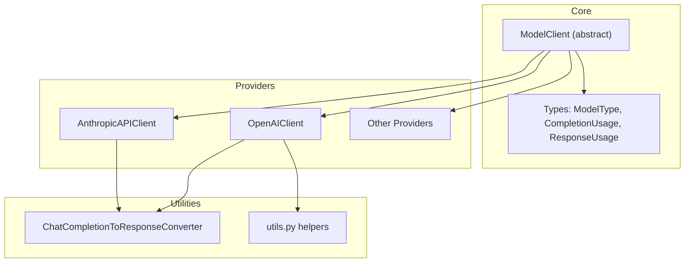
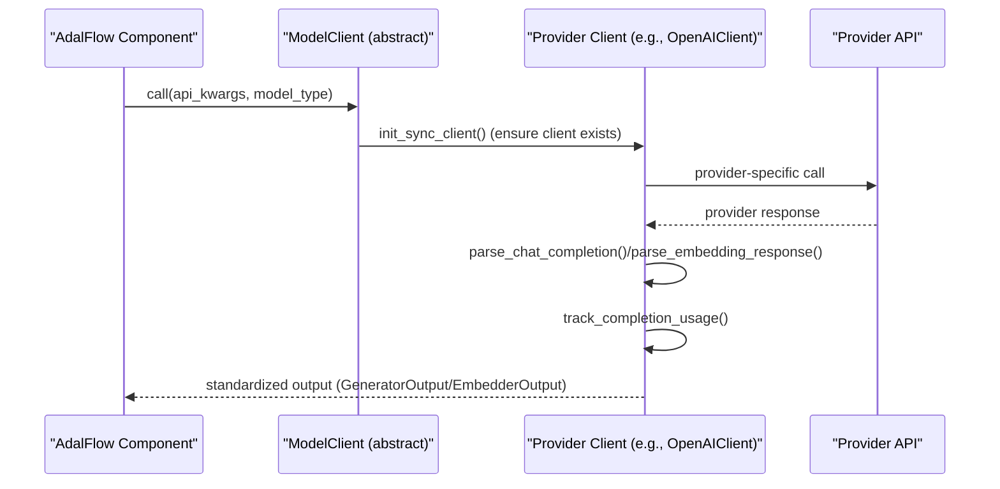
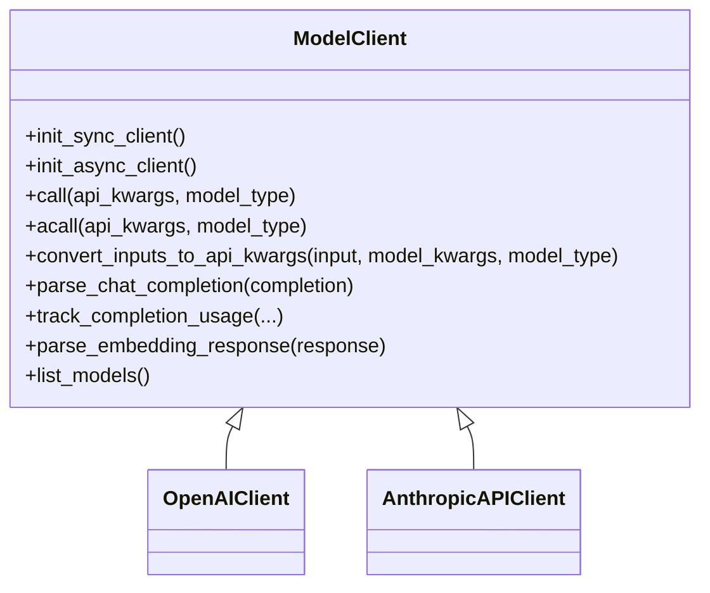
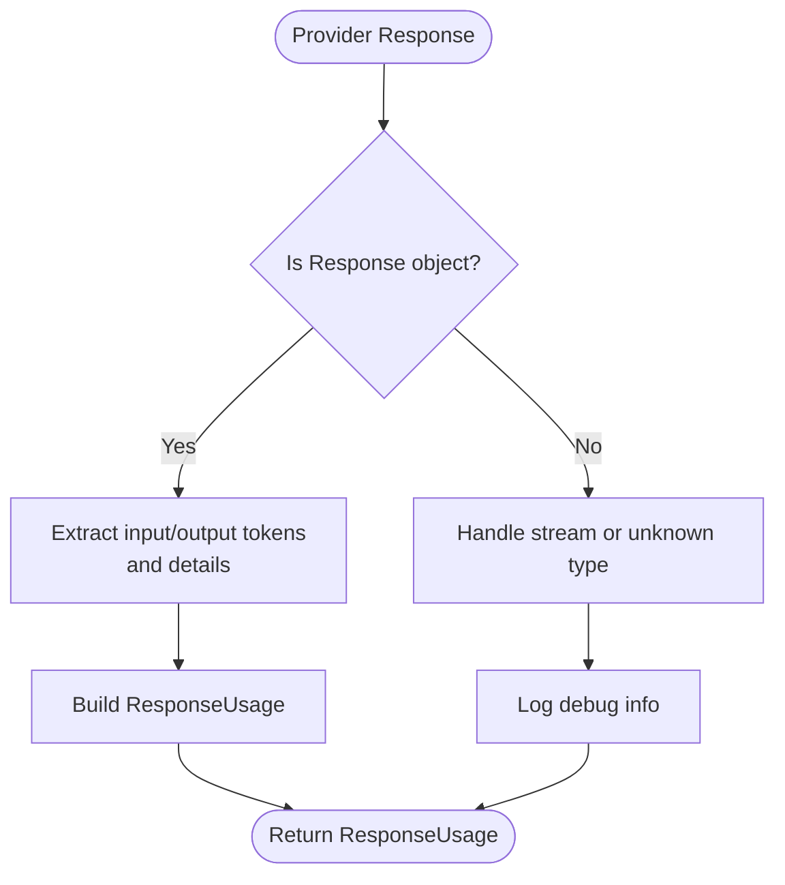
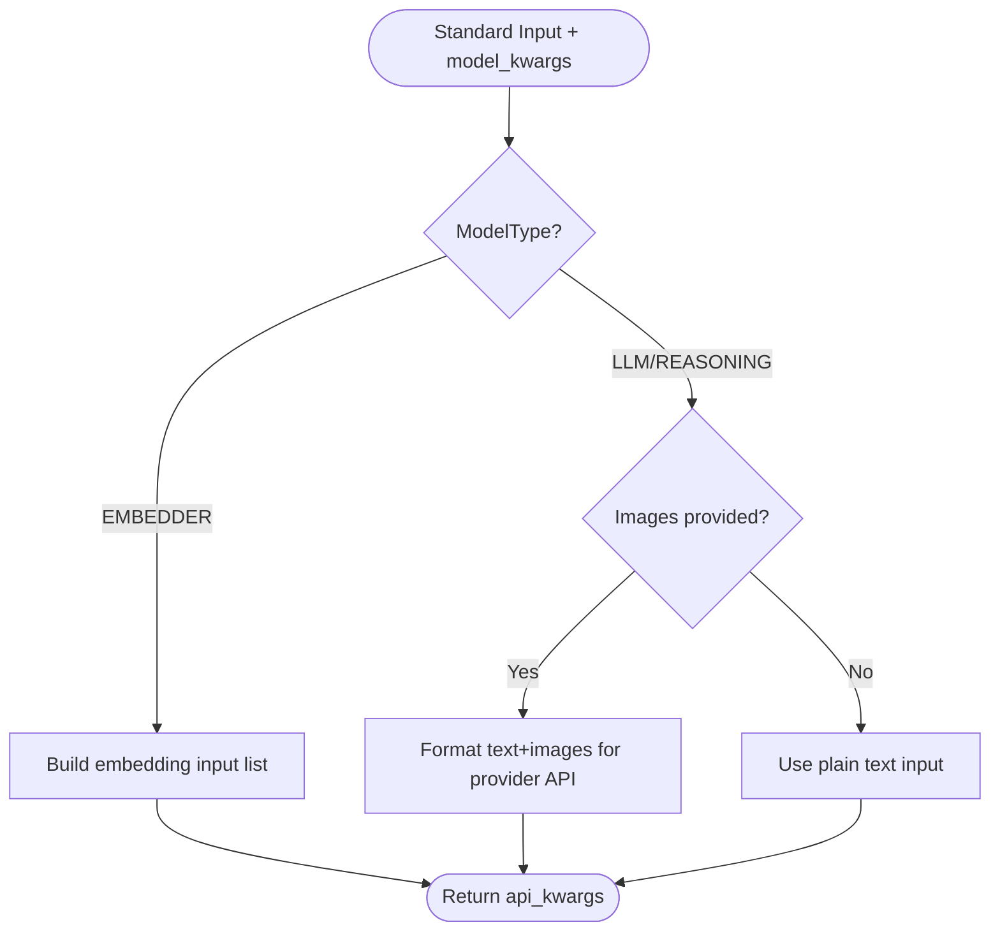
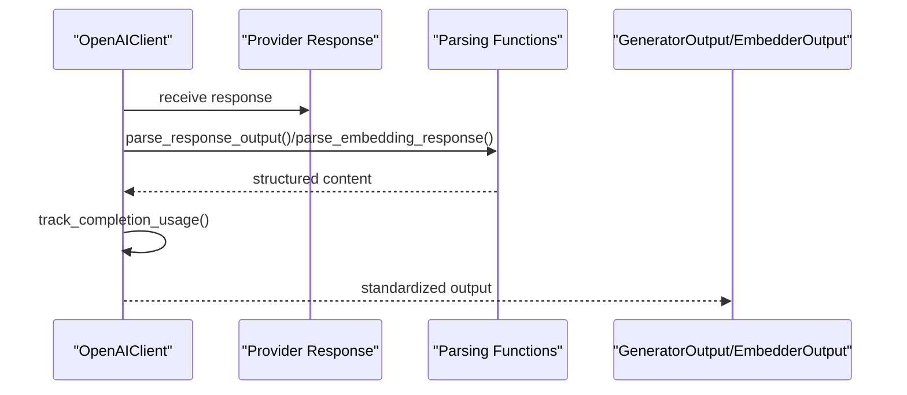
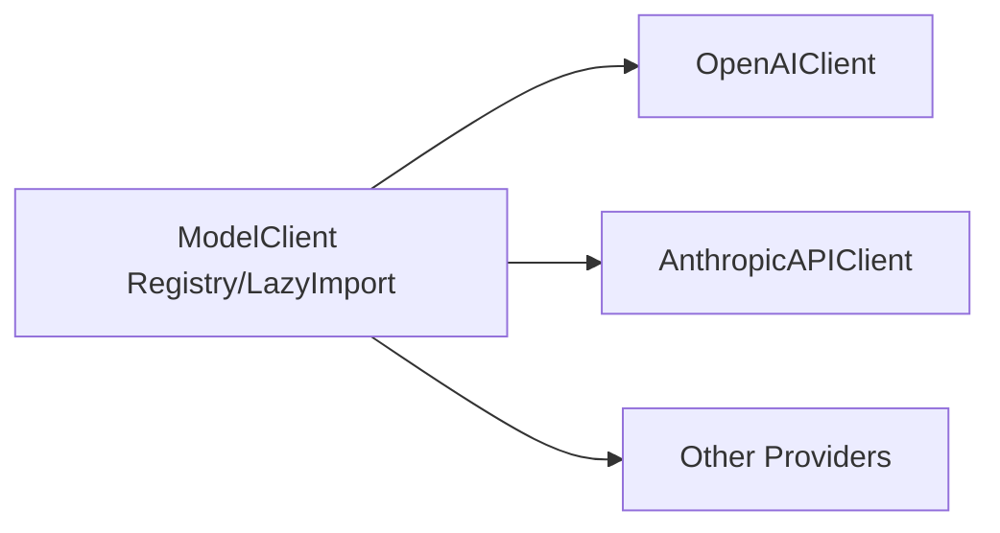
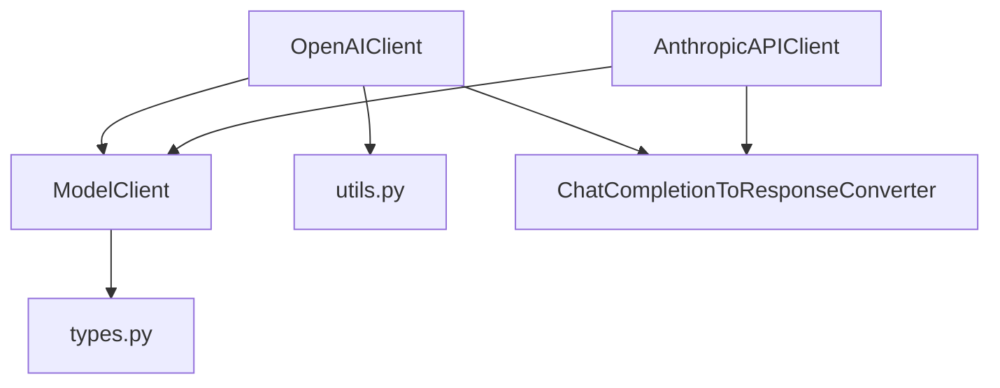

# Provider Abstraction

<cite>
**Referenced Files in This Document**
- [model_client.py](file://adalflow/adalflow/core/model_client.py)
- [types.py](file://adalflow/adalflow/core/types.py)
- [__init__.py](file://adalflow/adalflow/components/model_client/__init__.py)
- [openai_client.py](file://adalflow/adalflow/components/model_client/openai_client.py)
- [anthropic_client.py](file://adalflow/adalflow/components/model_client/anthropic_client.py)
- [chat_completion_to_response_converter.py](file://adalflow/adalflow/components/model_client/chat_completion_to_response_converter.py)
- [utils.py](file://adalflow/adalflow/components/model_client/utils.py)
- [test_model_client.py](file://adalflow/tests/test_model_client.py)
</cite>

## Table of Contents
1. [Introduction](#introduction)
2. [Project Structure](#project-structure)
3. [Core Components](#core-components)
4. [Architecture Overview](#architecture-overview)
5. [Detailed Component Analysis](#detailed-component-analysis)
6. [Dependency Analysis](#dependency-analysis)
7. [Performance Considerations](#performance-considerations)
8. [Troubleshooting Guide](#troubleshooting-guide)
9. [Conclusion](#conclusion)

## Introduction
This document explains AdalFlow’s Provider Abstraction centered around the unified ModelClient interface and its abstract base class design. The goal is to standardize API interactions across different Large Language Model (LLM) providers, ensuring provider independence and consistent behavior for chat completions, embeddings, and multimodal inputs. The ModelClient protocol defines a minimal contract that subclasses implement to initialize clients, convert inputs to provider-specific API arguments, call the model, parse responses, and track usage. Supporting types and enumerations (ModelType, CompletionUsage, ResponseUsage) ensure consistent data models across providers.

## Project Structure
The provider abstraction lives primarily in:
- Core interface and types: core/model_client.py and core/types.py
- Provider implementations: components/model_client/*.py
- Shared utilities: components/model_client/utils.py
- Lazy loading and registry: components/model_client/__init__.py
- Tests validating behavior: tests/test_model_client.py

**Diagram sources**
- [model_client.py](file://adalflow/adalflow/core/model_client.py#L16-L128)
- [types.py](file://adalflow/adalflow/core/types.py#L55-L64)
- [openai_client.py](file://adalflow/adalflow/components/model_client/openai_client.py#L1-L200)
- [anthropic_client.py](file://adalflow/adalflow/components/model_client/anthropic_client.py#L1-L200)
- [chat_completion_to_response_converter.py](file://adalflow/adalflow/components/model_client/chat_completion_to_response_converter.py#L65-L120)
- [utils.py](file://adalflow/adalflow/components/model_client/utils.py#L1-L278)

**Section sources**
- [model_client.py](file://adalflow/adalflow/core/model_client.py#L1-L128)
- [types.py](file://adalflow/adalflow/core/types.py#L55-L64)
- [__init__.py](file://adalflow/adalflow/components/model_client/__init__.py#L1-L135)

## Core Components
- ModelClient (abstract base class): Defines the protocol for provider clients, including initialization, input conversion, API calls, response parsing, usage tracking, and model listing. Subclasses implement provider-specific logic while adhering to this interface.
- ModelType (enum): Standardizes model categories (EMBEDDER, LLM, LLM_REASONING, RERANKER, IMAGE_GENERATION, UNDEFINED) to guide input conversion and API selection.
- CompletionUsage and ResponseUsage (dataclasses): Provide structured token usage tracking aligned with OpenAI’s API specs, enabling consistent cost and performance monitoring across providers.
- Provider clients: Implementations such as OpenAIClient and AnthropicAPIClient inherit ModelClient and translate AdalFlow inputs to provider-specific API calls, parse provider-specific responses into AdalFlow outputs, and manage retries and error handling.

Key interface methods:
- init_sync_client and init_async_client: Initialize synchronous and asynchronous clients.
- call and acall: Execute provider API calls with model_type-driven routing.
- convert_inputs_to_api_kwargs: Bridge standard inputs and model_kwargs to provider-specific arguments.
- parse_chat_completion and parse_embedding_response: Convert provider responses into standardized output containers.
- track_completion_usage: Extract and normalize usage metrics.
- list_models: Enumerate available models from the provider.

**Section sources**
- [model_client.py](file://adalflow/adalflow/core/model_client.py#L41-L128)
- [types.py](file://adalflow/adalflow/core/types.py#L55-L64)
- [types.py](file://adalflow/adalflow/core/types.py#L229-L275)
- [types.py](file://adalflow/adalflow/core/types.py#L486-L541)

## Architecture Overview
The ModelClient protocol decouples AdalFlow components from provider-specific SDKs. Providers implement the interface and use shared utilities to normalize inputs and outputs. The design supports:
- Provider independence: Components consume a unified interface regardless of provider.
- Extensibility: New providers subclass ModelClient and implement required methods.
- Consistency: Standardized data models (GeneratorOutput, EmbedderOutput, CompletionUsage) unify downstream processing.

**Diagram sources**
- [model_client.py](file://adalflow/adalflow/core/model_client.py#L48-L109)
- [openai_client.py](file://adalflow/adalflow/components/model_client/openai_client.py#L816-L855)

## Detailed Component Analysis

### ModelClient Protocol and Abstract Base Class
ModelClient establishes the contract that all providers must fulfill. It centralizes:
- Initialization: Ensures subclasses initialize sync and async clients.
- Input conversion: convert_inputs_to_api_kwargs maps standard inputs to provider-specific arguments.
- Execution: call and acall encapsulate provider API invocation.
- Parsing: parse_chat_completion and parse_embedding_response standardize outputs.
- Usage: track_completion_usage normalizes token usage metrics.
- Discovery: list_models exposes provider capabilities.

**Diagram sources**
- [model_client.py](file://adalflow/adalflow/core/model_client.py#L48-L128)
- [openai_client.py](file://adalflow/adalflow/components/model_client/openai_client.py#L927-L980)
- [anthropic_client.py](file://adalflow/adalflow/components/model_client/anthropic_client.py#L314-L400)

**Section sources**
- [model_client.py](file://adalflow/adalflow/core/model_client.py#L16-L128)

### ModelType Enumeration
ModelType standardizes model categories to guide input conversion and API routing:
- EMBEDDER: Embedding generation
- LLM: Text generation
- LLM_REASONING: Reasoning-capable models (responses API)
- RERANKER: Document ranking
- IMAGE_GENERATION: Image generation
- UNDEFINED: Default/fallback

This enum is used across providers to select the appropriate API call and to validate required model_kwargs.

**Section sources**
- [types.py](file://adalflow/adalflow/core/types.py#L55-L64)

### Usage Tracking: CompletionUsage and ResponseUsage
Two closely related dataclasses capture token usage:
- CompletionUsage: OpenAI-style fields for completion tokens, prompt tokens, and total tokens.
- ResponseUsage: Extended usage with input/output token details and reasoning/cached token breakdowns.

Providers implement track_completion_usage to extract usage from provider responses and return a normalized ResponseUsage object.

**Diagram sources**
- [openai_client.py](file://adalflow/adalflow/components/model_client/openai_client.py#L817-L855)
- [types.py](file://adalflow/adalflow/core/types.py#L229-L275)

**Section sources**
- [types.py](file://adalflow/adalflow/core/types.py#L229-L275)

### Input Conversion Patterns
Providers implement convert_inputs_to_api_kwargs to transform AdalFlow inputs and model_kwargs into provider-specific arguments. For example:
- OpenAIClient supports multimodal inputs by converting text and images into a provider-compatible content array and wrapping it appropriately for the responses API.
- AnthropicAPIClient leverages OpenAI SDK compatibility to route requests through OpenAI endpoints while preserving AdalFlow’s output structure.

**Diagram sources**
- [openai_client.py](file://adalflow/adalflow/components/model_client/openai_client.py#L927-L980)
- [utils.py](file://adalflow/adalflow/components/model_client/utils.py#L153-L195)

**Section sources**
- [openai_client.py](file://adalflow/adalflow/components/model_client/openai_client.py#L927-L980)
- [utils.py](file://adalflow/adalflow/components/model_client/utils.py#L153-L195)

### Response Parsing Patterns
Providers implement parse_chat_completion and parse_embedding_response to normalize provider-specific outputs into AdalFlow’s standardized containers:
- OpenAIClient parses Response API outputs, extracting text, images, tool calls, reasoning, and code interpreter outputs, then constructs a GeneratorOutput with usage tracking.
- utils.parse_embedding_response follows OpenAI’s embedding response pattern to produce EmbedderOutput.

**Diagram sources**
- [openai_client.py](file://adalflow/adalflow/components/model_client/openai_client.py#L119-L154)
- [openai_client.py](file://adalflow/adalflow/components/model_client/openai_client.py#L856-L868)
- [utils.py](file://adalflow/adalflow/components/model_client/utils.py#L9-L31)

**Section sources**
- [openai_client.py](file://adalflow/adalflow/components/model_client/openai_client.py#L119-L154)
- [openai_client.py](file://adalflow/adalflow/components/model_client/openai_client.py#L856-L868)
- [utils.py](file://adalflow/adalflow/components/model_client/utils.py#L9-L31)

### Error Handling and Backoff
Providers commonly decorate their call/acall methods with exponential backoff to handle transient errors (timeouts, rate limits, server errors). This pattern ensures resilience and robustness across providers.

Examples of backoff decoration locations:
- OpenAIClient call/acall methods
- AnthropicAPIClient call/acall methods
- Other providers (e.g., AzureAI, Bedrock, Cohere, Google, Groq, Ollama)

These decorators apply exponential backoff to API exceptions and retry failed calls automatically.

**Section sources**
- [openai_client.py](file://adalflow/adalflow/components/model_client/openai_client.py#L997-L1048)
- [anthropic_client.py](file://adalflow/adalflow/components/model_client/anthropic_client.py#L560-L601)

### Provider Independence Through Lazy Imports and Registry
The components/model_client/__init__.py file uses lazy imports to load provider clients only when needed, reducing startup overhead and allowing optional dependencies per provider. This enables seamless switching between providers without hard dependencies.

**Diagram sources**
- [__init__.py](file://adalflow/adalflow/components/model_client/__init__.py#L11-L131)

**Section sources**
- [__init__.py](file://adalflow/adalflow/components/model_client/__init__.py#L1-L135)

### Concrete Examples from the Codebase
- OpenAIClient demonstrates multimodal input conversion, Response API parsing, and usage tracking.
- AnthropicAPIClient shows OpenAI SDK compatibility and streaming conversion to Response API events.
- utils provides shared helpers for image processing and content formatting.

Implementation references:
- [OpenAI input conversion](file://adalflow/adalflow/components/model_client/openai_client.py#L927-L980)
- [OpenAI response parsing](file://adalflow/adalflow/components/model_client/openai_client.py#L119-L154)
- [OpenAI usage tracking](file://adalflow/adalflow/components/model_client/openai_client.py#L817-L855)
- [Anthropic streaming conversion](file://adalflow/adalflow/components/model_client/chat_completion_to_response_converter.py#L65-L120)
- [Shared utilities](file://adalflow/adalflow/components/model_client/utils.py#L153-L195)

**Section sources**
- [openai_client.py](file://adalflow/adalflow/components/model_client/openai_client.py#L927-L980)
- [openai_client.py](file://adalflow/adalflow/components/model_client/openai_client.py#L119-L154)
- [openai_client.py](file://adalflow/adalflow/components/model_client/openai_client.py#L817-L855)
- [chat_completion_to_response_converter.py](file://adalflow/adalflow/components/model_client/chat_completion_to_response_converter.py#L65-L120)
- [utils.py](file://adalflow/adalflow/components/model_client/utils.py#L153-L195)

## Dependency Analysis
- ModelClient depends on core types (ModelType, CompletionUsage, ResponseUsage) to maintain consistent data models.
- Provider clients depend on their respective SDKs and share utilities for input formatting and embedding parsing.
- Lazy imports decouple provider availability from core components, enabling optional provider support.

**Diagram sources**
- [model_client.py](file://adalflow/adalflow/core/model_client.py#L7-L12)
- [types.py](file://adalflow/adalflow/core/types.py#L55-L64)
- [openai_client.py](file://adalflow/adalflow/components/model_client/openai_client.py#L61-L64)
- [chat_completion_to_response_converter.py](file://adalflow/adalflow/components/model_client/chat_completion_to_response_converter.py#L16-L34)
- [utils.py](file://adalflow/adalflow/components/model_client/utils.py#L1-L7)

**Section sources**
- [model_client.py](file://adalflow/adalflow/core/model_client.py#L7-L12)
- [types.py](file://adalflow/adalflow/core/types.py#L55-L64)
- [openai_client.py](file://adalflow/adalflow/components/model_client/openai_client.py#L61-L64)
- [chat_completion_to_response_converter.py](file://adalflow/adalflow/components/model_client/chat_completion_to_response_converter.py#L16-L34)
- [utils.py](file://adalflow/adalflow/components/model_client/utils.py#L1-L7)

## Performance Considerations
- Lazy imports reduce startup time and memory footprint by loading provider SDKs only when needed.
- Usage tracking enables cost-aware operations and budgeting across providers.
- Multimodal input conversion avoids unnecessary preprocessing overhead by leveraging provider-native content arrays.
- Backoff strategies improve reliability under transient failures without manual intervention.

## Troubleshooting Guide
Common issues and resolutions:
- Missing provider credentials: Ensure environment variables are set before initializing provider clients.
- Incorrect model type: Verify ModelType aligns with the intended API (e.g., EMBEDDER vs LLM).
- Unsupported model_kwargs: Confirm required keys per ModelType and provider-specific constraints.
- Usage tracking limitations: For streaming responses, usage may be tracked upon consumption; ensure proper handling of iterators.

Validation references:
- Lazy import and subclassing behavior tested in tests/test_model_client.py
- Provider-specific backoff and error handling patterns in provider client files

**Section sources**
- [test_model_client.py](file://adalflow/tests/test_model_client.py#L10-L53)
- [openai_client.py](file://adalflow/adalflow/components/model_client/openai_client.py#L997-L1048)
- [anthropic_client.py](file://adalflow/adalflow/components/model_client/anthropic_client.py#L560-L601)

## Conclusion
AdalFlow’s Provider Abstraction centers on a robust ModelClient protocol that standardizes provider interactions while preserving provider-specific capabilities. Through ModelType, CompletionUsage/ResponseUsage, and shared utilities, the framework achieves provider independence, consistent outputs, and reliable error handling. Implementing a new provider involves subclassing ModelClient, mapping inputs to provider arguments, parsing provider responses, and normalizing usage metrics—ensuring seamless integration with AdalFlow components.