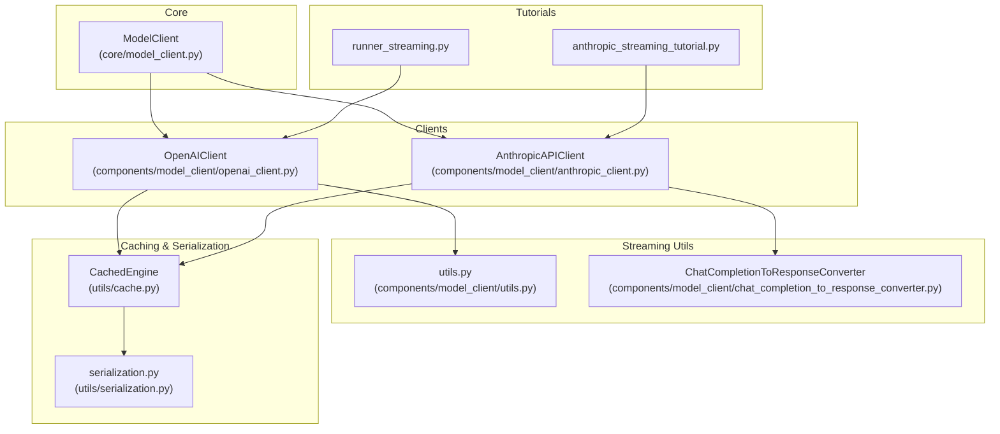
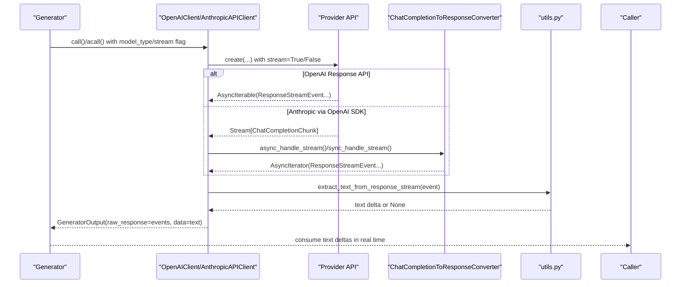
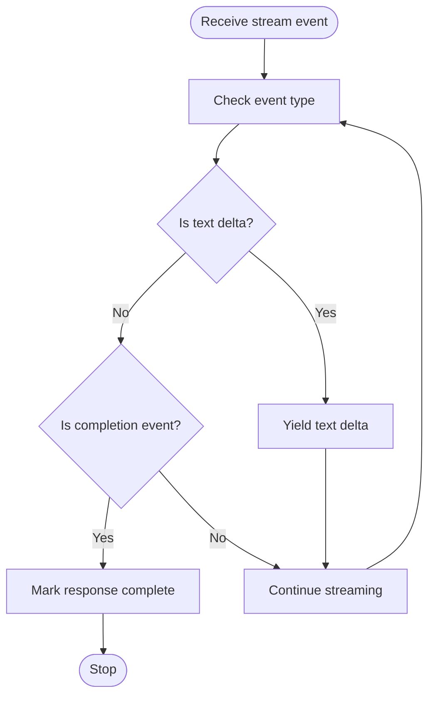
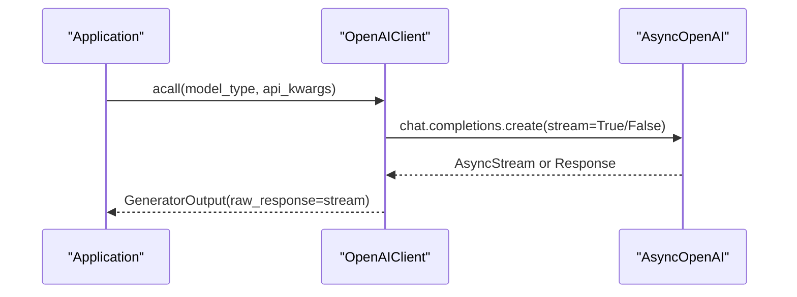
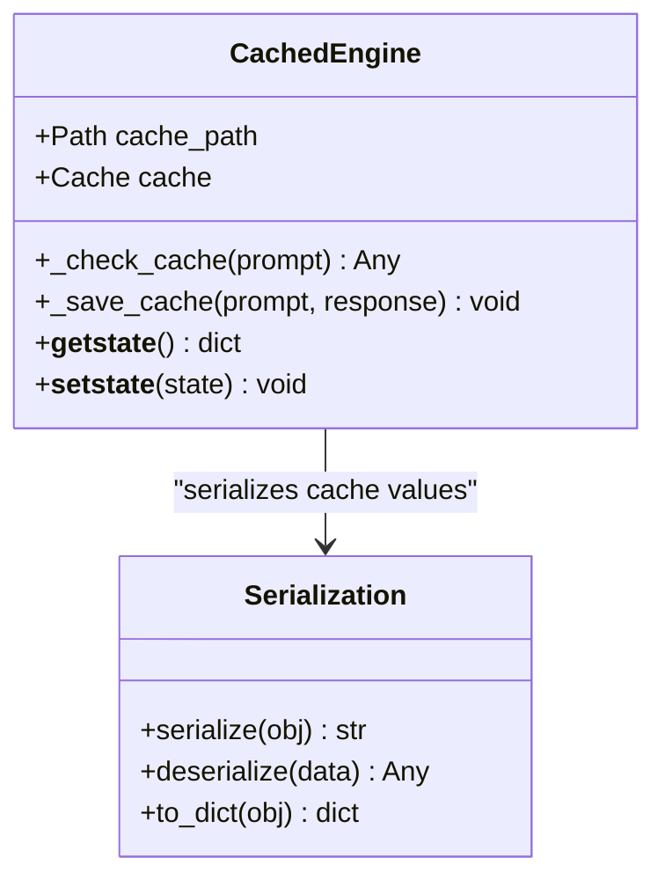
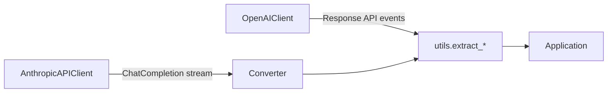
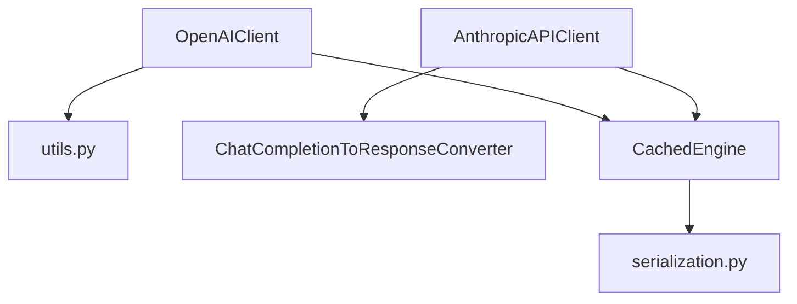

# Streaming and Caching

<cite>
**Referenced Files in This Document**
- [cache.py](file://adalflow/adalflow/utils/cache.py)
- [serialization.py](file://adalflow/adalflow/utils/serialization.py)
- [model_client.py](file://adalflow/adalflow/core/model_client.py)
- [openai_client.py](file://adalflow/adalflow/components/model_client/openai_client.py)
- [anthropic_client.py](file://adalflow/adalflow/components/model_client/anthropic_client.py)
- [utils.py](file://adalflow/adalflow/components/model_client/utils.py)
- [chat_completion_to_response_converter.py](file://adalflow/adalflow/components/model_client/chat_completion_to_response_converter.py)
- [runner_streaming.py](file://tutorials/v1_agent_runner/runner_streaming.py)
- [anthropic_streaming_tutorial.py](file://tutorials/v1_agent_runner/anthropic_streaming_tutorial.py)
</cite>

## Table of Contents
1. [Introduction](#introduction)
2. [Project Structure](#project-structure)
3. [Core Components](#core-components)
4. [Architecture Overview](#architecture-overview)
5. [Detailed Component Analysis](#detailed-component-analysis)
6. [Dependency Analysis](#dependency-analysis)
7. [Performance Considerations](#performance-considerations)
8. [Troubleshooting Guide](#troubleshooting-guide)
9. [Conclusion](#conclusion)

## Introduction
This document explains AdalFlow’s performance optimization features for model client interactions with a focus on streaming and caching. It covers:
- Streaming response handling and real-time token processing
- Asynchronous client support
- Response caching, serialization strategies, and cache invalidation
- Practical examples from the codebase
- Trade-offs among streaming latency, throughput, cache hit rates, and memory usage
- Provider-specific streaming capabilities, chunk processing, and error recovery

## Project Structure
The streaming and caching features are implemented across:
- Core abstractions for model clients
- Provider-specific clients (OpenAI, Anthropic)
- Utilities for streaming event extraction and content formatting
- Serialization and caching utilities
- Tutorials demonstrating streaming usage

**Diagram sources**
- [model_client.py](file://adalflow/adalflow/core/model_client.py#L16-L128)
- [openai_client.py](file://adalflow/adalflow/components/model_client/openai_client.py#L411-L800)
- [anthropic_client.py](file://adalflow/adalflow/components/model_client/anthropic_client.py#L314-L642)
- [utils.py](file://adalflow/adalflow/components/model_client/utils.py#L197-L278)
- [chat_completion_to_response_converter.py](file://adalflow/adalflow/components/model_client/chat_completion_to_response_converter.py#L65-L622)
- [cache.py](file://adalflow/adalflow/utils/cache.py#L19-L48)
- [serialization.py](file://adalflow/adalflow/utils/serialization.py#L90-L138)
- [runner_streaming.py](file://tutorials/v1_agent_runner/runner_streaming.py)
- [anthropic_streaming_tutorial.py](file://tutorials/v1_agent_runner/anthropic_streaming_tutorial.py)

**Section sources**
- [model_client.py](file://adalflow/adalflow/core/model_client.py#L16-L128)
- [openai_client.py](file://adalflow/adalflow/components/model_client/openai_client.py#L411-L800)
- [anthropic_client.py](file://adalflow/adalflow/components/model_client/anthropic_client.py#L314-L642)
- [utils.py](file://adalflow/adalflow/components/model_client/utils.py#L197-L278)
- [chat_completion_to_response_converter.py](file://adalflow/adalflow/components/model_client/chat_completion_to_response_converter.py#L65-L622)
- [cache.py](file://adalflow/adalflow/utils/cache.py#L19-L48)
- [serialization.py](file://adalflow/adalflow/utils/serialization.py#L90-L138)
- [runner_streaming.py](file://tutorials/v1_agent_runner/runner_streaming.py)
- [anthropic_streaming_tutorial.py](file://tutorials/v1_agent_runner/anthropic_streaming_tutorial.py)

## Core Components
- ModelClient: Defines the contract for model clients, including sync/async calls, input conversion, response parsing, and usage tracking.
- OpenAIClient: Implements Response API-based streaming and parsing, plus multimodal support and token estimation helpers.
- AnthropicAPIClient: Bridges Anthropic via OpenAI SDK compatibility, converting ChatCompletion streams to Response API-compatible events.
- Streaming utilities: Provide helpers to extract text deltas, detect completion, and format content for the Response API.
- ChatCompletionToResponseConverter: Translates OpenAI ChatCompletion streams into standardized Response API events for unified consumption.
- Cache and serialization: Disk-backed caching engine and robust JSON serialization/deserialization for persisted artifacts.

**Section sources**
- [model_client.py](file://adalflow/adalflow/core/model_client.py#L16-L128)
- [openai_client.py](file://adalflow/adalflow/components/model_client/openai_client.py#L411-L800)
- [anthropic_client.py](file://adalflow/adalflow/components/model_client/anthropic_client.py#L314-L642)
- [utils.py](file://adalflow/adalflow/components/model_client/utils.py#L197-L278)
- [chat_completion_to_response_converter.py](file://adalflow/adalflow/components/model_client/chat_completion_to_response_converter.py#L65-L622)
- [cache.py](file://adalflow/adalflow/utils/cache.py#L19-L48)
- [serialization.py](file://adalflow/adalflow/utils/serialization.py#L90-L138)

## Architecture Overview
The streaming pipeline converges on a unified Response API event stream, enabling consistent handling across providers. Anthropic uses a compatibility layer to emit Response API events from ChatCompletion streams. OpenAI clients expose Response API streaming directly. Both paths feed into shared utilities for text extraction and completion detection.

**Diagram sources**
- [openai_client.py](file://adalflow/adalflow/components/model_client/openai_client.py#L383-L407)
- [anthropic_client.py](file://adalflow/adalflow/components/model_client/anthropic_client.py#L463-L491)
- [chat_completion_to_response_converter.py](file://adalflow/adalflow/components/model_client/chat_completion_to_response_converter.py#L69-L342)
- [utils.py](file://adalflow/adalflow/components/model_client/utils.py#L197-L278)

## Detailed Component Analysis

### Streaming Response Handling and Real-Time Token Processing
- OpenAI Response API streaming:
  - The client exposes async and sync streaming handlers that iterate over SSE-like events and yield raw events for downstream processing.
  - Utilities extract text deltas and detect completion from Response API events.
- Anthropic via OpenAI SDK compatibility:
  - Streams from Anthropic are converted to Response API events, enabling a single parsing path.
  - The converter tracks text, refusals, and function/tool call arguments across chunks and emits structured events.

**Diagram sources**
- [utils.py](file://adalflow/adalflow/components/model_client/utils.py#L197-L278)
- [chat_completion_to_response_converter.py](file://adalflow/adalflow/components/model_client/chat_completion_to_response_converter.py#L69-L342)

**Section sources**
- [openai_client.py](file://adalflow/adalflow/components/model_client/openai_client.py#L383-L407)
- [utils.py](file://adalflow/adalflow/components/model_client/utils.py#L197-L278)
- [chat_completion_to_response_converter.py](file://adalflow/adalflow/components/model_client/chat_completion_to_response_converter.py#L69-L342)

### Asynchronous Client Support
- Both OpenAI and Anthropic clients support async calls and lazy initialization of async clients.
- OpenAI client maintains separate sync and async streaming parsers and defaults to async streaming behavior.
- Anthropic client routes both sync and async calls through OpenAI SDK chat.completions.create with streaming enabled when requested.

**Diagram sources**
- [openai_client.py](file://adalflow/adalflow/components/model_client/openai_client.py#L613-L642)
- [anthropic_client.py](file://adalflow/adalflow/components/model_client/anthropic_client.py#L613-L642)

**Section sources**
- [openai_client.py](file://adalflow/adalflow/components/model_client/openai_client.py#L613-L642)
- [anthropic_client.py](file://adalflow/adalflow/components/model_client/anthropic_client.py#L613-L642)

### Caching Mechanisms: Response Caching, Serialization, and Invalidation
- CachedEngine:
  - Uses disk-backed caching keyed by SHA-256 hashes of prompts.
  - Provides pickle-friendly lifecycle hooks (__getstate__/__setstate__) to safely serialize/deserialize caches across processes.
- Serialization:
  - Robust JSON serialization/deserialization supporting internal dataclasses, sets, and arbitrary types with fallbacks.
  - Enables persisting complex objects and restoring them reliably.
- Cache Invalidation:
  - The current engine does not implement automatic TTL or LRU eviction; invalidation is manual via cache key removal or directory cleanup.

**Diagram sources**
- [cache.py](file://adalflow/adalflow/utils/cache.py#L19-L48)
- [serialization.py](file://adalflow/adalflow/utils/serialization.py#L90-L138)

**Section sources**
- [cache.py](file://adalflow/adalflow/utils/cache.py#L19-L48)
- [serialization.py](file://adalflow/adalflow/utils/serialization.py#L90-L138)

### Provider-Specific Streaming Capabilities and Chunk Processing
- OpenAI:
  - Response API streaming yields structured events; utilities extract deltas and completion markers.
  - Multimodal content formatting helpers prepare text and images for the Response API.
- Anthropic:
  - Via OpenAI SDK compatibility, ChatCompletion streams are converted to Response API events for unified handling.
  - Usage tracking is adapted from ChatCompletion usage fields.

**Diagram sources**
- [openai_client.py](file://adalflow/adalflow/components/model_client/openai_client.py#L411-L800)
- [anthropic_client.py](file://adalflow/adalflow/components/model_client/anthropic_client.py#L314-L642)
- [utils.py](file://adalflow/adalflow/components/model_client/utils.py#L197-L278)
- [chat_completion_to_response_converter.py](file://adalflow/adalflow/components/model_client/chat_completion_to_response_converter.py#L65-L622)

**Section sources**
- [openai_client.py](file://adalflow/adalflow/components/model_client/openai_client.py#L411-L800)
- [anthropic_client.py](file://adalflow/adalflow/components/model_client/anthropic_client.py#L314-L642)
- [utils.py](file://adalflow/adalflow/components/model_client/utils.py#L197-L278)
- [chat_completion_to_response_converter.py](file://adalflow/adalflow/components/model_client/chat_completion_to_response_converter.py#L65-L622)

### Error Recovery in Streaming Scenarios
- Backoff retries are applied around provider API calls for transient errors (timeout, rate limit, server error, etc.).
- Streaming parsers return structured GeneratorOutput with error fields when parsing fails, allowing callers to recover gracefully.

**Section sources**
- [openai_client.py](file://adalflow/adalflow/components/model_client/openai_client.py#L572-L600)
- [anthropic_client.py](file://adalflow/adalflow/components/model_client/anthropic_client.py#L561-L600)

### Concrete Examples from the Codebase
- OpenAI streaming with Response API:
  - Demonstrates enabling stream mode and iterating over raw_response events to extract text deltas.
  - Example path: [runner_streaming.py](file://tutorials/v1_agent_runner/runner_streaming.py)
- Anthropic streaming via OpenAI SDK compatibility:
  - Shows how to configure Anthropic client and consume streams through the unified event interface.
  - Example path: [anthropic_streaming_tutorial.py](file://tutorials/v1_agent_runner/anthropic_streaming_tutorial.py)

**Section sources**
- [runner_streaming.py](file://tutorials/v1_agent_runner/runner_streaming.py)
- [anthropic_streaming_tutorial.py](file://tutorials/v1_agent_runner/anthropic_streaming_tutorial.py)

## Dependency Analysis
- Cohesion:
  - Streaming logic is cohesive within provider clients and shared utilities.
  - Serialization and caching are orthogonal concerns implemented in dedicated modules.
- Coupling:
  - Clients depend on shared utilities for event extraction and content formatting.
  - Anthropic client depends on the Response API converter to unify event formats.
- External Dependencies:
  - OpenAI SDK for async/sync clients and streaming.
  - diskcache for persistent caching.

**Diagram sources**
- [openai_client.py](file://adalflow/adalflow/components/model_client/openai_client.py#L411-L800)
- [anthropic_client.py](file://adalflow/adalflow/components/model_client/anthropic_client.py#L314-L642)
- [utils.py](file://adalflow/adalflow/components/model_client/utils.py#L197-L278)
- [chat_completion_to_response_converter.py](file://adalflow/adalflow/components/model_client/chat_completion_to_response_converter.py#L65-L622)
- [cache.py](file://adalflow/adalflow/utils/cache.py#L19-L48)
- [serialization.py](file://adalflow/adalflow/utils/serialization.py#L90-L138)

**Section sources**
- [openai_client.py](file://adalflow/adalflow/components/model_client/openai_client.py#L411-L800)
- [anthropic_client.py](file://adalflow/adalflow/components/model_client/anthropic_client.py#L314-L642)
- [utils.py](file://adalflow/adalflow/components/model_client/utils.py#L197-L278)
- [chat_completion_to_response_converter.py](file://adalflow/adalflow/components/model_client/chat_completion_to_response_converter.py#L65-L622)
- [cache.py](file://adalflow/adalflow/utils/cache.py#L19-L48)
- [serialization.py](file://adalflow/adalflow/utils/serialization.py#L90-L138)

## Performance Considerations
- Streaming latency vs. throughput:
  - Smaller, frequent text deltas reduce perceived latency but increase overhead. Tune model parameters (e.g., max_tokens) to balance responsiveness and total tokens.
  - Response API deltas are emitted per content part; downstream batching can improve throughput at the cost of latency.
- Cache hit rates and memory usage:
  - Prompt hashing enables reuse across runs; however, cache size and eviction policy are not configured by default. Monitor disk usage and prune stale entries periodically.
  - Serialization overhead is minimal for small responses; avoid caching very large binary payloads.
- Provider-specific nuances:
  - OpenAI Response API provides structured deltas; Anthropic via compatibility emits equivalent events, ensuring consistent downstream processing.
  - Usage tracking differs by provider; ensure accurate accounting for billing and quotas.

[No sources needed since this section provides general guidance]

## Troubleshooting Guide
- Streaming stalls or no text deltas:
  - Verify stream flag is enabled and that the event type is a text delta. Use completion detection helpers to confirm end-of-response.
- Parsing failures:
  - Inspect GeneratorOutput.error and raw_response to identify malformed events or unsupported types.
- Cache not loading:
  - Ensure cache directory exists and is writable; verify __getstate__/__setstate__ behavior when serializing clients across processes.
- Serialization errors:
  - Confirm objects are serializable or provide to_dict/to_dict_class methods; fallbacks are logged and may raise if unsupported.

**Section sources**
- [utils.py](file://adalflow/adalflow/components/model_client/utils.py#L197-L278)
- [cache.py](file://adalflow/adalflow/utils/cache.py#L38-L48)
- [serialization.py](file://adalflow/adalflow/utils/serialization.py#L90-L138)

## Conclusion
AdalFlow’s streaming and caching stack provides a unified, extensible foundation for high-performance model interactions:
- Streaming is standardized via Response API events, with provider-specific adapters for OpenAI and Anthropic.
- Utilities enable robust, real-time token processing and completion detection.
- Persistent caching and serialization offer practical ways to optimize repeated workloads.
- For advanced tuning, consider adjusting model parameters, batching strategies, and cache policies to meet latency and throughput goals.