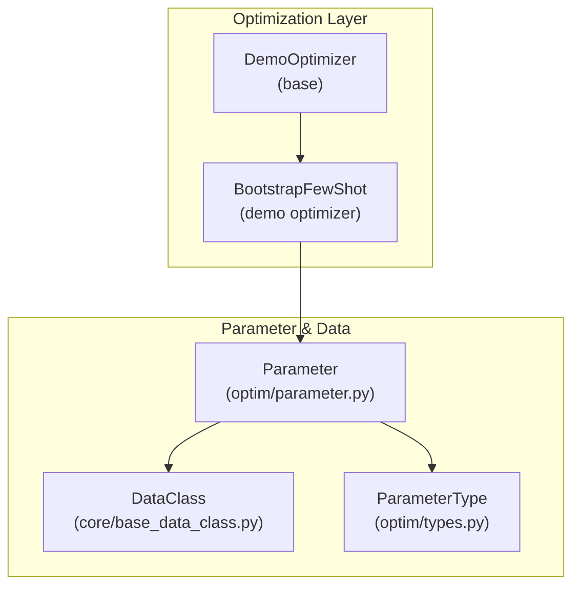
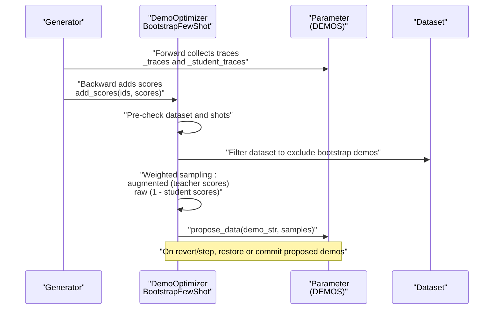
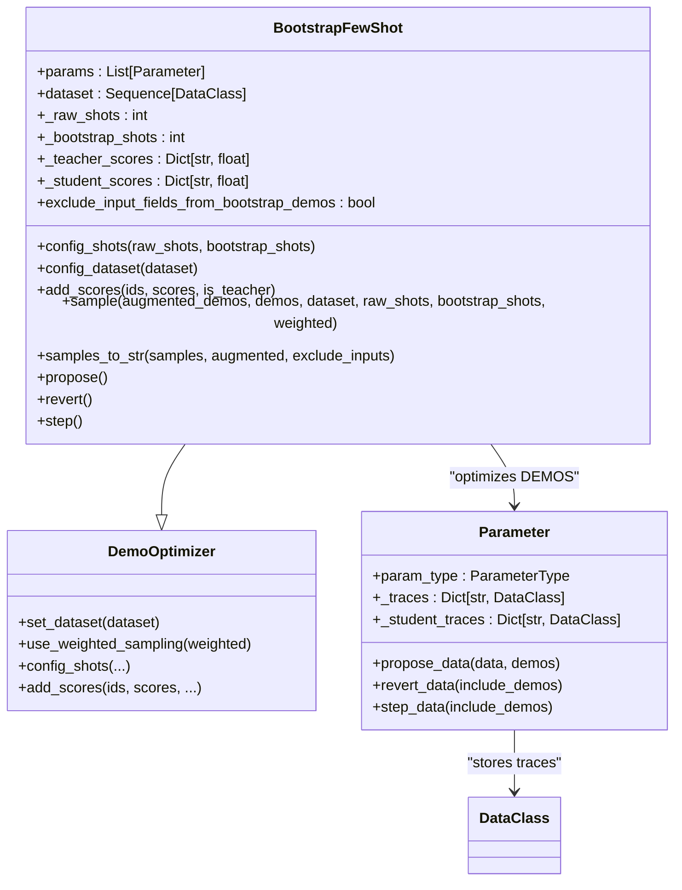
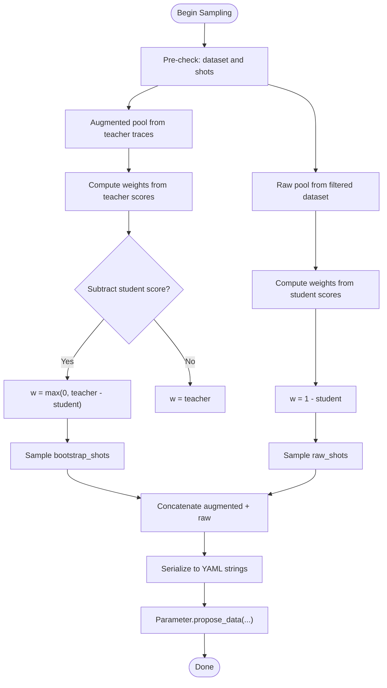
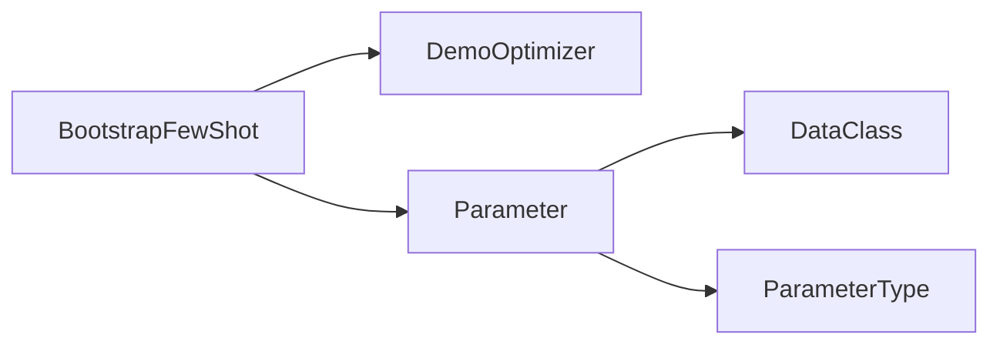

# Few-Shot Learning

<cite>
**Referenced Files in This Document**
- [bootstrap_optimizer.py](file://adalflow/adalflow/optim/few_shot/bootstrap_optimizer.py)
- [optimizer.py](file://adalflow/adalflow/optim/optimizer.py)
- [types.py](file://adalflow/adalflow/optim/types.py)
- [parameter.py](file://adalflow/adalflow/optim/parameter.py)
- [base_data_class.py](file://adalflow/adalflow/core/base_data_class.py)
- [few_shot_optimizer.rst](file://docs/source/tutorials/few_shot_optimizer.rst)
</cite>

## Table of Contents
1. [Introduction](#introduction)
2. [Project Structure](#project-structure)
3. [Core Components](#core-components)
4. [Architecture Overview](#architecture-overview)
5. [Detailed Component Analysis](#detailed-component-analysis)
6. [Dependency Analysis](#dependency-analysis)
7. [Performance Considerations](#performance-considerations)
8. [Troubleshooting Guide](#troubleshooting-guide)
9. [Conclusion](#conclusion)
10. [Appendices](#appendices)

## Introduction
This document explains the Few-Shot Learning optimization framework in AdalFlow with a focus on the Learn-to-Reason in-context learning approach and how bootstrap optimization improves demonstration selection. It documents the DemoOptimizer base class, the BootstrapFewShot implementation, shot configuration, weighted sampling strategies, and practical guidance for configuring few-shot optimizers, managing demonstration datasets, and optimizing example selection. It also covers the theoretical foundations of in-context learning optimization, bootstrapping techniques, demonstration quality assessment, best practices for few-shot prompt engineering and dataset curation, and performance optimization.

## Project Structure
The few-shot optimization capability is centered around:
- A DemoOptimizer base class that defines the interface for demonstration-based optimization
- A BootstrapFewShot optimizer that performs weighted sampling from raw and bootstrap demonstrations
- Parameter and DataClass utilities that enable trace collection, scoring, and demonstration serialization
- Types that define parameter categories and evaluation results

**Diagram sources**
- [bootstrap_optimizer.py](file://adalflow/adalflow/optim/few_shot/bootstrap_optimizer.py#L22-L308)
- [optimizer.py](file://adalflow/adalflow/optim/optimizer.py#L49-L92)
- [parameter.py](file://adalflow/adalflow/optim/parameter.py#L119-L254)
- [base_data_class.py](file://adalflow/adalflow/core/base_data_class.py#L97-L190)
- [types.py](file://adalflow/adalflow/optim/types.py#L13-L60)

**Section sources**
- [bootstrap_optimizer.py](file://adalflow/adalflow/optim/few_shot/bootstrap_optimizer.py#L1-L308)
- [optimizer.py](file://adalflow/adalflow/optim/optimizer.py#L1-L92)
- [parameter.py](file://adalflow/adalflow/optim/parameter.py#L1-L800)
- [base_data_class.py](file://adalflow/adalflow/core/base_data_class.py#L1-L820)
- [types.py](file://adalflow/adalflow/optim/types.py#L1-L163)

## Core Components
- DemoOptimizer: Base class for demonstration-based optimization. Provides dataset configuration, weighted sampling toggle, and hooks for adding scores and initializing shots.
- BootstrapFewShot: Implements weighted sampling from two pools:
  - Augmented demonstrations (teacher traces) with scores
  - Raw demonstrations (filtered dataset) with student scores
- Parameter: Holds demonstration traces, scores, and proposes/reverts/steps demonstration content.
- DataClass: Provides YAML/JSON serialization and field ordering for examples, enabling compact and readable demonstrations.
- ParameterType: Enumerates parameter categories including DEMOS for demonstration optimization.

Key responsibilities:
- Shot configuration: raw_shots and bootstrap_shots
- Weighted sampling: scores drive weights; supports subtracting student scores from teacher scores to favor failed examples that succeed in bootstrap
- Demonstration serialization: converts samples to YAML strings, optionally excluding input fields from bootstrap demos

**Section sources**
- [optimizer.py](file://adalflow/adalflow/optim/optimizer.py#L49-L92)
- [bootstrap_optimizer.py](file://adalflow/adalflow/optim/few_shot/bootstrap_optimizer.py#L22-L308)
- [parameter.py](file://adalflow/adalflow/optim/parameter.py#L119-L254)
- [base_data_class.py](file://adalflow/adalflow/core/base_data_class.py#L97-L190)
- [types.py](file://adalflow/adalflow/optim/types.py#L13-L60)

## Architecture Overview
The few-shot optimization pipeline integrates with the generator’s forward/backward passes to collect traces and scores, then proposes new demonstration sets via weighted sampling.

**Diagram sources**
- [bootstrap_optimizer.py](file://adalflow/adalflow/optim/few_shot/bootstrap_optimizer.py#L73-L92)
- [bootstrap_optimizer.py](file://adalflow/adalflow/optim/few_shot/bootstrap_optimizer.py#L114-L205)
- [bootstrap_optimizer.py](file://adalflow/adalflow/optim/few_shot/bootstrap_optimizer.py#L233-L299)
- [parameter.py](file://adalflow/adalflow/optim/parameter.py#L580-L645)

## Detailed Component Analysis

### BootstrapFewShot Implementation
BootstrapFewShot extends DemoOptimizer to:
- Filter parameters to only those requiring optimization and marked as DEMOS
- Maintain teacher and student score maps keyed by demonstration ID
- Sample demonstrations with weighted probabilities derived from scores
- Serialize demonstrations to strings for insertion into prompts

Key behaviors:
- Weighted sampling for augmented demos uses teacher scores; optional subtraction of student scores to emphasize failed examples that succeed in bootstrap
- Weighted sampling for raw demos uses 1 - student scores to emphasize failed examples
- Serialization excludes input fields from bootstrap demos when configured, reducing token overhead and focusing on reasoning/output

**Diagram sources**
- [optimizer.py](file://adalflow/adalflow/optim/optimizer.py#L49-L92)
- [bootstrap_optimizer.py](file://adalflow/adalflow/optim/few_shot/bootstrap_optimizer.py#L22-L308)
- [parameter.py](file://adalflow/adalflow/optim/parameter.py#L119-L254)
- [base_data_class.py](file://adalflow/adalflow/core/base_data_class.py#L97-L190)

**Section sources**
- [bootstrap_optimizer.py](file://adalflow/adalflow/optim/few_shot/bootstrap_optimizer.py#L22-L308)
- [optimizer.py](file://adalflow/adalflow/optim/optimizer.py#L49-L92)
- [parameter.py](file://adalflow/adalflow/optim/parameter.py#L119-L254)

### Shot Configuration and Weighted Sampling Strategies
- Shot configuration: raw_shots and bootstrap_shots are set via constructor or config_shots
- Weighted sampling:
  - Augmented pool: weights equal teacher scores; optional adjustment by subtracting student scores to prioritize failed examples that succeed in bootstrap
  - Raw pool: weights equal 1 - student scores to prioritize failed examples
- Serialization strategy:
  - Bootstrap demos: optional exclusion of input fields to reduce tokens and focus on reasoning/output
  - Raw demos: include input and output fields for full context

**Diagram sources**
- [bootstrap_optimizer.py](file://adalflow/adalflow/optim/few_shot/bootstrap_optimizer.py#L93-L205)
- [parameter.py](file://adalflow/adalflow/optim/parameter.py#L610-L645)

**Section sources**
- [bootstrap_optimizer.py](file://adalflow/adalflow/optim/few_shot/bootstrap_optimizer.py#L93-L205)
- [parameter.py](file://adalflow/adalflow/optim/parameter.py#L610-L645)

### Practical Configuration and Usage Patterns
- Configure shots and dataset:
  - Set raw_shots and bootstrap_shots
  - Provide a dataset of DataClass instances
- Add scores:
  - Provide teacher and student scores per demonstration ID
- Propose and iterate:
  - Call propose to sample and propose new demonstrations
  - On improvement, step to commit; otherwise revert to previous

Reference tutorial for few-shot optimizer usage and end-to-end examples:
- [few_shot_optimizer.rst](file://docs/source/tutorials/few_shot_optimizer.rst)

**Section sources**
- [bootstrap_optimizer.py](file://adalflow/adalflow/optim/few_shot/bootstrap_optimizer.py#L93-L205)
- [bootstrap_optimizer.py](file://adalflow/adalflow/optim/few_shot/bootstrap_optimizer.py#L233-L299)
- [few_shot_optimizer.rst](file://docs/source/tutorials/few_shot_optimizer.rst)

## Dependency Analysis
- BootstrapFewShot depends on:
  - DemoOptimizer for base interface and dataset handling
  - Parameter for trace storage, scoring, and proposal lifecycle
  - DataClass for demonstration serialization and field ordering
  - ParameterType for identifying DEMOS parameters

**Diagram sources**
- [bootstrap_optimizer.py](file://adalflow/adalflow/optim/few_shot/bootstrap_optimizer.py#L22-L308)
- [optimizer.py](file://adalflow/adalflow/optim/optimizer.py#L49-L92)
- [parameter.py](file://adalflow/adalflow/optim/parameter.py#L119-L254)
- [types.py](file://adalflow/adalflow/optim/types.py#L13-L60)

**Section sources**
- [bootstrap_optimizer.py](file://adalflow/adalflow/optim/few_shot/bootstrap_optimizer.py#L22-L308)
- [optimizer.py](file://adalflow/adalflow/optim/optimizer.py#L49-L92)
- [parameter.py](file://adalflow/adalflow/optim/parameter.py#L119-L254)
- [types.py](file://adalflow/adalflow/optim/types.py#L13-L60)

## Performance Considerations
- Token efficiency:
  - Exclude input fields from bootstrap demos to reduce prompt size and improve throughput
- Sampling diversity:
  - Use weighted sampling to continuously prioritize underperforming examples
- Dataset filtering:
  - Ensure unique IDs and filtered datasets to avoid sampling overlap between augmented and raw pools
- Serialization:
  - Prefer YAML serialization for compactness and readability in prompts

[No sources needed since this section provides general guidance]

## Troubleshooting Guide
Common issues and resolutions:
- Missing dataset or shots:
  - Ensure dataset and raw_shots/bootstrap_shots are configured before propose
- Score validation:
  - Scores must be floats in [0, 1]; mismatches raise errors
- Trace mismatch:
  - Ensure teacher and student traces have the same length; warnings logged if not
- Proposal state:
  - Cannot propose while already proposing or revert without a prior proposal

**Section sources**
- [bootstrap_optimizer.py](file://adalflow/adalflow/optim/few_shot/bootstrap_optimizer.py#L100-L105)
- [bootstrap_optimizer.py](file://adalflow/adalflow/optim/few_shot/bootstrap_optimizer.py#L135-L144)
- [bootstrap_optimizer.py](file://adalflow/adalflow/optim/few_shot/bootstrap_optimizer.py#L233-L289)

## Conclusion
The BootstrapFewShot optimizer implements a robust, weighted sampling strategy for demonstration selection in in-context learning. By leveraging teacher and student scores, it focuses on underperforming examples and reduces token overhead by selectively excluding inputs from bootstrap demonstrations. Combined with the Parameter and DataClass utilities, it enables iterative optimization of few-shot prompts through propose/revert/step cycles.

[No sources needed since this section summarizes without analyzing specific files]

## Appendices

### Best Practices for Few-Shot Prompt Engineering and Dataset Curation
- Curate high-quality demonstrations:
  - Prefer diverse, representative examples; remove duplicates and near-duplicates
  - Ensure clear input/output separation and consistent formatting
- Prompt engineering:
  - Keep demonstrations concise; leverage YAML for readability
  - Include minimal context for bootstrap demos to reduce token usage
- Scoring:
  - Use reliable evaluators to produce stable scores in [0, 1]
  - Track both teacher and student scores to guide sampling

[No sources needed since this section provides general guidance]

### When to Apply Few-Shot Learning Techniques
- Use few-shot optimization when:
  - Task complexity benefits from example-driven guidance
  - Demonstrations are available and diverse
  - Iterative refinement of examples improves downstream performance
- Scenario-specific tips:
  - RAG-style tasks: bootstrap weak model outputs as augmented demos; keep raw demos for ground-truth examples
  - Classification/regression: mix strong and weak examples; emphasize failures for correction

[No sources needed since this section provides general guidance]