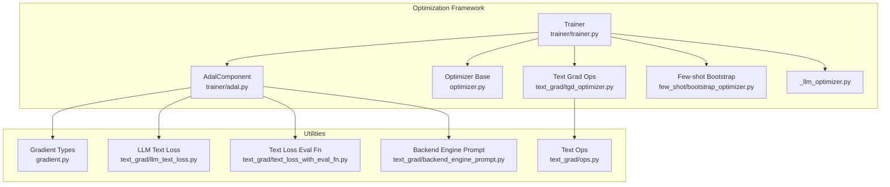
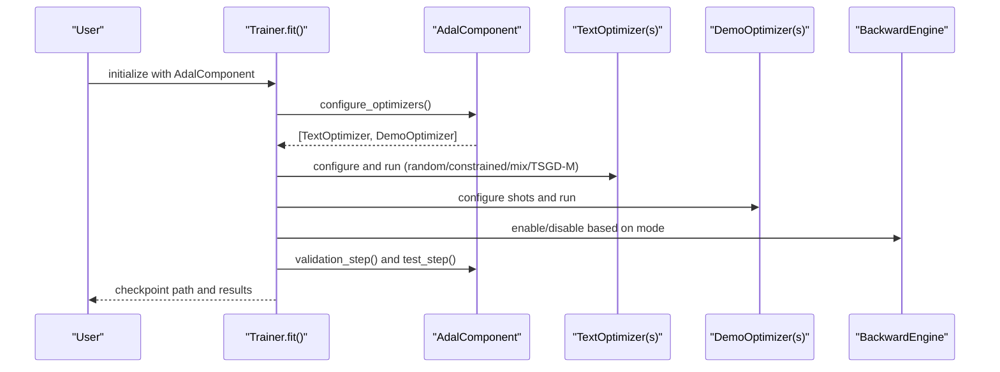
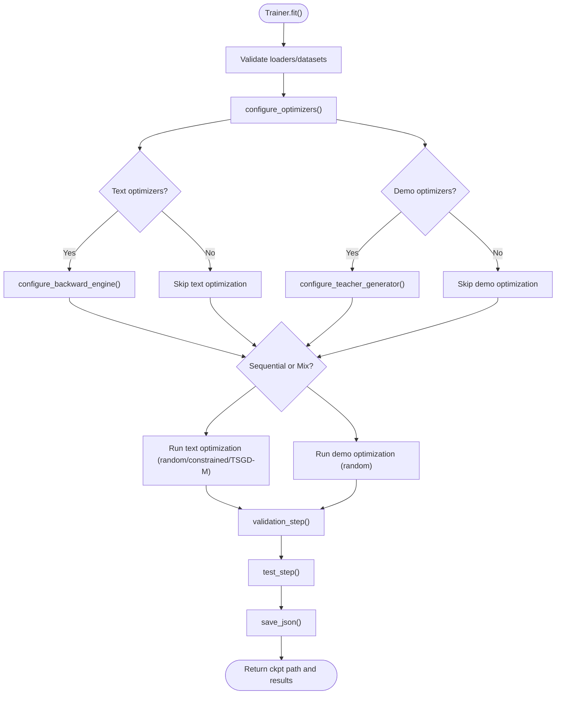
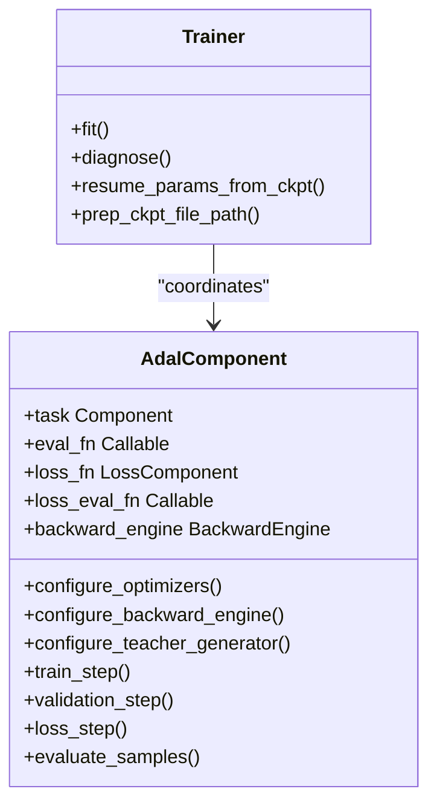
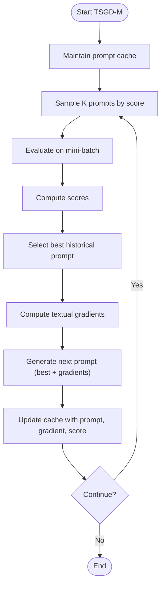
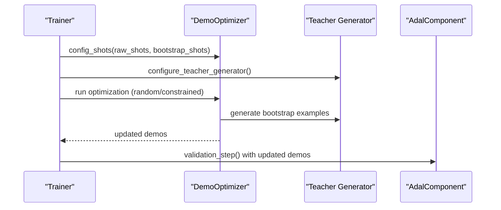
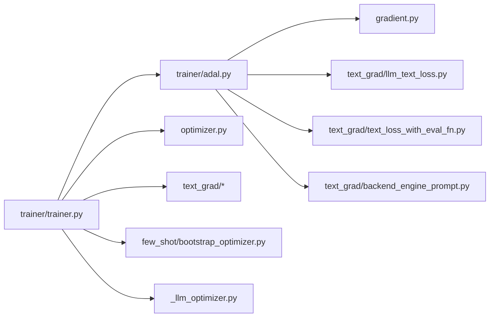

# Optimization Framework

<cite>
**Referenced Files in This Document**
- [optim/README.md](file://adalflow/adalflow/optim/README.md)
- [trainer/trainer.py](file://adalflow/adalflow/optim/trainer/trainer.py)
- [trainer/adal.py](file://adalflow/adalflow/optim/trainer/adal.py)
- [_llm_optimizer.py](file://adalflow/adalflow/optim/_llm_optimizer.py)
- [optimizer.py](file://adalflow/adalflow/optim/optimizer.py)
- [gradient.py](file://adalflow/adalflow/optim/gradient.py)
- [text_grad/tgd_optimizer.py](file://adalflow/adalflow/optim/text_grad/tgd_optimizer.py)
- [text_grad/backend_engine_prompt.py](file://adalflow/adalflow/optim/text_grad/backend_engine_prompt.py)
- [text_grad/llm_text_loss.py](file://adalflow/adalflow/optim/text_grad/llm_text_loss.py)
- [text_grad/ops.py](file://adalflow/adalflow/optim/text_grad/ops.py)
- [text_grad/text_loss_with_eval_fn.py](file://adalflow/adalflow/optim/text_grad/text_loss_with_eval_fn.py)
- [few_shot/bootstrap_optimizer.py](file://adalflow/adalflow/optim/few_shot/bootstrap_optimizer.py)
- [tests/test_trainer.py](file://adalflow/tests/test_trainer.py)
- [tutorials/trainer.rst](file://docs/source/tutorials/trainer.rst)
- [tutorials/auto_text_grad.rst](file://docs/source/tutorials/auto_text_grad.rst)
- [tutorials/few_shot_optimizer.rst](file://docs/source/tutorials/few_shot_optimizer.rst)
- [notebooks/use_cases/adalflow_rag_optimization.ipynb](file://notebooks/use_cases/adalflow_rag_optimization.ipynb)
- [notebooks/tutorials/adalflow_rag_opt_playbook.ipynb](file://notebooks/tutorials/adalflow_rag_playbook.ipynb)
</cite>

## Table of Contents
1. [Introduction](#introduction)
2. [Project Structure](#project-structure)
3. [Core Components](#core-components)
4. [Architecture Overview](#architecture-overview)
5. [Detailed Component Analysis](#detailed-component-analysis)
6. [Dependency Analysis](#dependency-analysis)
7. [Performance Considerations](#performance-considerations)
8. [Troubleshooting Guide](#troubleshooting-guide)
9. [Conclusion](#conclusion)
10. [Appendices](#appendices)

## Introduction
This document explains AdalFlow’s Optimization Framework with a focus on auto-optimization capabilities and training systems. It covers the Trainer component, textual gradient descent optimization, few-shot learning techniques, and automated hyperparameter tuning. It documents the AdalComponent integration, training loops, and evaluation metrics. Practical examples demonstrate optimization workflows, parameter tuning, and performance improvement strategies. Research-backed algorithms such as LLM-AutoDiff and Learn-to-Reason In-Context Learning are contextualized within the framework. Best practices, convergence criteria, and troubleshooting guidance are included to help practitioners apply the right techniques at the right time.

## Project Structure
The Optimization Framework resides primarily under the optim/ directory and integrates with Trainer and AdalComponent to orchestrate end-to-end training. Key areas:
- Trainer: orchestrates training, validation, and testing loops, manages optimizers, and handles checkpoints.
- AdalComponent: defines task pipelines, evaluation functions, and backward engines for gradient computation.
- Textual Gradients: textual gradient descent with momentum (TSGD-M), Gumbel-top-k sampling, and related utilities.
- Few-shot Optimization: bootstrap-based demonstration optimization with sampling strategies.
- LLM-based Optimization: instruction optimization via LLM prompts.

**Diagram sources**
- [trainer/trainer.py](file://adalflow/adalflow/optim/trainer/trainer.py#L42-L192)
- [trainer/adal.py](file://adalflow/adalflow/optim/trainer/adal.py#L30-L213)
- [optimizer.py](file://adalflow/adalflow/optim/optimizer.py#L12-L92)
- [_llm_optimizer.py](file://adalflow/adalflow/optim/_llm_optimizer.py#L95-L188)
- [text_grad/tgd_optimizer.py](file://adalflow/adalflow/optim/text_grad/tgd_optimizer.py)
- [few_shot/bootstrap_optimizer.py](file://adalflow/adalflow/optim/few_shot/bootstrap_optimizer.py)
- [gradient.py](file://adalflow/adalflow/optim/gradient.py#L14-L133)
- [text_grad/ops.py](file://adalflow/adalflow/optim/text_grad/ops.py)
- [text_grad/llm_text_loss.py](file://adalflow/adalflow/optim/text_grad/llm_text_loss.py)
- [text_grad/text_loss_with_eval_fn.py](file://adalflow/adalflow/optim/text_grad/text_loss_with_eval_fn.py)
- [text_grad/backend_engine_prompt.py](file://adalflow/adalflow/optim/text_grad/backend_engine_prompt.py)

**Section sources**
- [optim/README.md](file://adalflow/adalflow/optim/README.md#L1-L122)
- [trainer/trainer.py](file://adalflow/adalflow/optim/trainer/trainer.py#L42-L192)
- [trainer/adal.py](file://adalflow/adalflow/optim/trainer/adal.py#L30-L213)

## Core Components
- Trainer: Manages training/validation/testing loops, optimizer configuration, checkpointing, and mixed/sequential optimization orders. Supports debug modes, traces, and resume from checkpoints.
- AdalComponent: Encapsulates the task pipeline, evaluation functions, loss functions, backward engine, and teacher generator. Provides training, prediction, validation, and loss steps with parallel execution.
- Optimizer Base: Defines the base interfaces for generic, text, and demonstration optimizers.
- Textual Gradients: Implements textual gradient descent with momentum (TSGD-M), Gumbel-top-k sampling, and related utilities for prompt caching and evaluation.
- Few-shot Optimization: Bootstraps demonstrations from model outputs and samples from training sets with configurable strategies.
- LLM-based Optimization: Generates improved instructions using an LLM optimizer with history and training samples.

**Section sources**
- [trainer/trainer.py](file://adalflow/adalflow/optim/trainer/trainer.py#L42-L192)
- [trainer/adal.py](file://adalflow/adalflow/optim/trainer/adal.py#L30-L213)
- [optimizer.py](file://adalflow/adalflow/optim/optimizer.py#L12-L92)
- [optim/README.md](file://adalflow/adalflow/optim/README.md#L14-L53)

## Architecture Overview
The Trainer coordinates AdalComponent and optimizers. AdalComponent exposes prepare_task, prepare_loss, prepare_eval, and prepare_loss_eval hooks. The Trainer configures optimizers, runs training/validation loops, and persists results. Textual gradients rely on a backward engine to compute parameter-specific gradients, while few-shot demos are optimized via sampling strategies.

**Diagram sources**
- [trainer/trainer.py](file://adalflow/adalflow/optim/trainer/trainer.py#L512-L698)
- [trainer/adal.py](file://adalflow/adalflow/optim/trainer/adal.py#L175-L213)

## Detailed Component Analysis

### Trainer Component
- Responsibilities:
  - Configure optimizers and backward engine.
  - Manage training/validation/test loops.
  - Handle mixed vs sequential optimization order.
  - Support debug and trace saving.
  - Resume from checkpoints and manage histories.
- Key behaviors:
  - Validates input loaders/datasets and raises explicit errors for invalid types.
  - Supports TSGD-M training when enabled.
  - Writes checkpoints with trainer states and results.

**Diagram sources**
- [trainer/trainer.py](file://adalflow/adalflow/optim/trainer/trainer.py#L418-L698)

**Section sources**
- [trainer/trainer.py](file://adalflow/adalflow/optim/trainer/trainer.py#L418-L798)

### AdalComponent Integration
- Provides:
  - prepare_task, prepare_loss, prepare_eval, prepare_loss_eval hooks.
  - evaluate_samples and pred_step with parallel execution.
  - configure_optimizers, configure_backward_engine, configure_teacher_generator.
  - loss_step and validation_step wrappers.
- Enables:
  - Multi-threaded training and evaluation.
  - Backward engine integration for gradient computation.
  - Automatic discovery of generators and grad components.

**Diagram sources**
- [trainer/adal.py](file://adalflow/adalflow/optim/trainer/adal.py#L30-L213)
- [trainer/trainer.py](file://adalflow/adalflow/optim/trainer/trainer.py#L42-L192)

**Section sources**
- [trainer/adal.py](file://adalflow/adalflow/optim/trainer/adal.py#L175-L213)
- [trainer/adal.py](file://adalflow/adalflow/optim/trainer/adal.py#L217-L334)
- [trainer/adal.py](file://adalflow/adalflow/optim/trainer/adal.py#L336-L502)
- [trainer/adal.py](file://adalflow/adalflow/optim/trainer/adal.py#L508-L576)
- [trainer/adal.py](file://adalflow/adalflow/optim/trainer/adal.py#L578-L606)
- [trainer/adal.py](file://adalflow/adalflow/optim/trainer/adal.py#L618-L651)

### Text Gradient Descent Optimization
- TSGD-M (Textual Gradient Descent with Momentum):
  - Maintains a prompt cache across iterations.
  - Samples K prompts from historical cache based on scores.
  - Evaluates sampled prompts on mini-batches before gradient computation.
  - Generates next prompt using best historical prompt + gradients.
  - History update strategies: improvement_only, always, epsilon_greedy, confidence_based.
- Gumbel-Top-K Sampling:
  - Implements probabilistic prompt selection using Gumbel-Max trick.
  - Supports temperature scaling and optional UCB bonuses.
- Related utilities:
  - Backend engine prompt templates.
  - LLM-based text loss and evaluation-based loss.
  - Summation operations for combining gradients.

**Diagram sources**
- [optim/README.md](file://adalflow/adalflow/optim/README.md#L16-L53)
- [text_grad/tgd_optimizer.py](file://adalflow/adalflow/optim/text_grad/tgd_optimizer.py)
- [text_grad/backend_engine_prompt.py](file://adalflow/adalflow/optim/text_grad/backend_engine_prompt.py)
- [text_grad/llm_text_loss.py](file://adalflow/adalflow/optim/text_grad/llm_text_loss.py)
- [text_grad/text_loss_with_eval_fn.py](file://adalflow/adalflow/optim/text_grad/text_loss_with_eval_fn.py)
- [text_grad/ops.py](file://adalflow/adalflow/optim/text_grad/ops.py)

**Section sources**
- [optim/README.md](file://adalflow/adalflow/optim/README.md#L14-L53)
- [trainer/trainer.py](file://adalflow/adalflow/optim/trainer/trainer.py#L628-L682)

### Few-Shot Learning Techniques
- Bootstrap-based optimization:
  - Samples demonstrations from training data or bootstraps from model outputs.
  - Supports weighted sampling and exclusion of input fields from bootstrap demos.
  - Integrates with a teacher generator to produce bootstrapped examples.
- Strategies:
  - Random and constrained strategies for demo optimization.
  - Mixed vs sequential optimization order with configurable sequential order.

**Diagram sources**
- [trainer/trainer.py](file://adalflow/adalflow/optim/trainer/trainer.py#L512-L540)
- [trainer/adal.py](file://adalflow/adalflow/optim/trainer/adal.py#L618-L651)
- [few_shot/bootstrap_optimizer.py](file://adalflow/adalflow/optim/few_shot/bootstrap_optimizer.py)

**Section sources**
- [trainer/trainer.py](file://adalflow/adalflow/optim/trainer/trainer.py#L512-L540)
- [trainer/adal.py](file://adalflow/adalflow/optim/trainer/adal.py#L618-L651)
- [few_shot/bootstrap_optimizer.py](file://adalflow/adalflow/optim/few_shot/bootstrap_optimizer.py)

### Automated Hyperparameter Tuning
- Trainer exposes configuration kwargs for text optimizers and supports:
  - Strategy selection (random vs constrained).
  - Optimization order (sequential vs mix).
  - Batch thresholds and sample limits for validation.
  - Debug and trace saving toggles.
- Checkpointing and resume:
  - Prepares unique checkpoint paths and resumes from best validation scores.
  - Restores parameter values from checkpoints.

**Section sources**
- [trainer/trainer.py](file://adalflow/adalflow/optim/trainer/trainer.py#L734-L800)
- [trainer/trainer.py](file://adalflow/adalflow/optim/trainer/trainer.py#L391-L417)

### Evaluation Metrics and Validation
- AdalComponent provides:
  - validation_step with running evaluation and early stopping via minimum score.
  - evaluate_samples with parallel execution and loss-based evaluation.
  - loss_step for computing parameterized loss values.
- Trainer records:
  - Initial validation scores.
  - Per-step validation/test scores.
  - Full training results written to JSON checkpoints.

**Section sources**
- [trainer/adal.py](file://adalflow/adalflow/optim/trainer/adal.py#L508-L576)
- [trainer/adal.py](file://adalflow/adalflow/optim/trainer/adal.py#L217-L334)
- [trainer/adal.py](file://adalflow/adalflow/optim/trainer/adal.py#L578-L606)
- [trainer/trainer.py](file://adalflow/adalflow/optim/trainer/trainer.py#L705-L732)

### Research-Backed Algorithms
- LLM-AutoDiff:
  - Uses textual gradients computed via a backward engine to optimize prompts and parameters.
  - Integrates with AdalComponent’s backward engine and gradient types.
- Learn-to-Reason In-Context Learning:
  - Few-shot bootstrap optimization leverages demonstrations to improve reasoning quality.
  - Combines teacher generators and sampling strategies to refine examples.

**Section sources**
- [trainer/adal.py](file://adalflow/adalflow/optim/trainer/adal.py#L670-L704)
- [gradient.py](file://adalflow/adalflow/optim/gradient.py#L44-L133)
- [few_shot/bootstrap_optimizer.py](file://adalflow/adalflow/optim/few_shot/bootstrap_optimizer.py)

## Dependency Analysis
- Trainer depends on AdalComponent for task orchestration and on Optimizer subclasses for parameter updates.
- Textual gradients depend on a backward engine and gradient types.
- Few-shot optimization depends on a teacher generator and sampling utilities.
- LLM-based optimization depends on a Generator with a structured prompt template.

**Diagram sources**
- [trainer/trainer.py](file://adalflow/adalflow/optim/trainer/trainer.py#L11-L36)
- [trainer/adal.py](file://adalflow/adalflow/optim/trainer/adal.py#L15-L24)
- [optimizer.py](file://adalflow/adalflow/optim/optimizer.py#L12-L92)
- [gradient.py](file://adalflow/adalflow/optim/gradient.py#L14-L133)
- [text_grad/llm_text_loss.py](file://adalflow/adalflow/optim/text_grad/llm_text_loss.py)
- [text_grad/text_loss_with_eval_fn.py](file://adalflow/adalflow/optim/text_grad/text_loss_with_eval_fn.py)
- [text_grad/backend_engine_prompt.py](file://adalflow/adalflow/optim/text_grad/backend_engine_prompt.py)
- [_llm_optimizer.py](file://adalflow/adalflow/optim/_llm_optimizer.py#L95-L188)

**Section sources**
- [trainer/trainer.py](file://adalflow/adalflow/optim/trainer/trainer.py#L11-L36)
- [trainer/adal.py](file://adalflow/adalflow/optim/trainer/adal.py#L15-L24)
- [optimizer.py](file://adalflow/adalflow/optim/optimizer.py#L12-L92)

## Performance Considerations
- Parallelism:
  - Use num_workers in evaluation and training steps to speed up throughput.
- Batch and Thresholds:
  - Tune batch_val_score_threshold and correct_val_score_threshold to skip easy batches and reduce compute.
- Sampling and Caching:
  - For TSGD-M, adjust momentum window (K) and history update strategies to balance exploration and exploitation.
- Early Stopping:
  - Use minimum_score in validation to cut short evaluations when potential max score is below threshold.
- Checkpointing:
  - Resume from best validation checkpoints to avoid re-computation and maintain progress.

[No sources needed since this section provides general guidance]

## Troubleshooting Guide
- Invalid loader/dataset types:
  - Trainer raises explicit errors if loaders/datasets return tuples instead of dicts or dataclasses.
- Missing configurations:
  - AdalComponent requires eval_fn, loss_fn, and appropriate model configs for backward engine and teacher generator.
- ID mismatches:
  - AdalComponent enforces id alignment between predictions and samples to prevent silent errors.
- Empty logs:
  - Diagnose reports empty logs when generators are not invoked; ensure callbacks are registered and traces saved.
- Checkpoint restoration:
  - Trainer restores prompts from the best validation score; confirm checkpoint JSON contains step results.

**Section sources**
- [trainer/trainer.py](file://adalflow/adalflow/optim/trainer/trainer.py#L462-L500)
- [trainer/adal.py](file://adalflow/adalflow/optim/trainer/adal.py#L444-L447)
- [trainer/trainer.py](file://adalflow/adalflow/optim/trainer/trainer.py#L262-L274)
- [trainer/trainer.py](file://adalflow/adalflow/optim/trainer/trainer.py#L391-L417)

## Conclusion
AdalFlow’s Optimization Framework provides a cohesive system for auto-optimizing LLM pipelines. The Trainer coordinates AdalComponent and optimizers, enabling textual gradient descent with momentum, few-shot bootstrap optimization, and LLM-based instruction refinement. With robust evaluation, parallel execution, and checkpointing, practitioners can iteratively improve prompts and demonstrations. By applying the right techniques—text gradients for prompt tuning, bootstrap demos for example selection, and LLM-based instruction optimization—teams can achieve strong performance gains across diverse tasks.

[No sources needed since this section summarizes without analyzing specific files]

## Appendices

### Practical Examples and Tutorials
- Trainer usage and workflows:
  - See the Trainer tutorial for end-to-end training and evaluation.
- Textual gradient optimization:
  - Refer to the Auto Text Grad tutorial for textual gradient descent examples.
- Few-shot optimization:
  - Consult the Few-shot Optimizer tutorial for bootstrap and sampling strategies.
- Use cases:
  - RAG optimization notebooks demonstrate practical optimization workflows.

**Section sources**
- [tutorials/trainer.rst](file://docs/source/tutorials/trainer.rst)
- [tutorials/auto_text_grad.rst](file://docs/source/tutorials/auto_text_grad.rst)
- [tutorials/few_shot_optimizer.rst](file://docs/source/tutorials/few_shot_optimizer.rst)
- [notebooks/use_cases/adalflow_rag_optimization.ipynb](file://notebooks/use_cases/adalflow_rag_optimization.ipynb)
- [notebooks/tutorials/adalflow_rag_playbook.ipynb](file://notebooks/tutorials/adalflow_rag_playbook.ipynb)