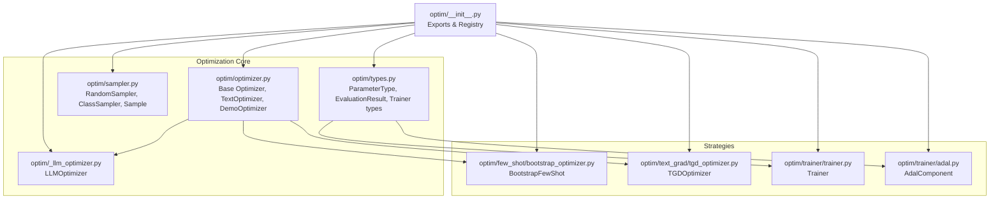
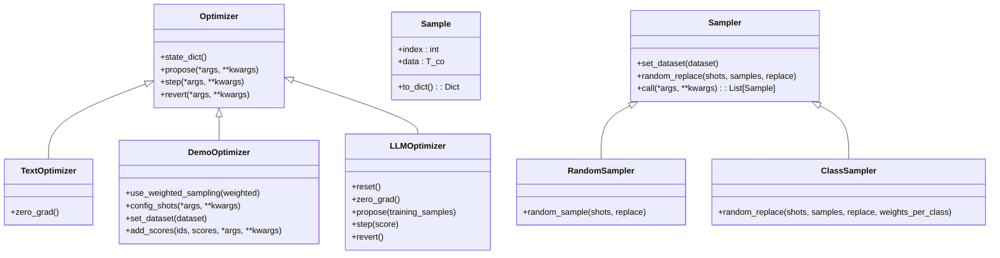
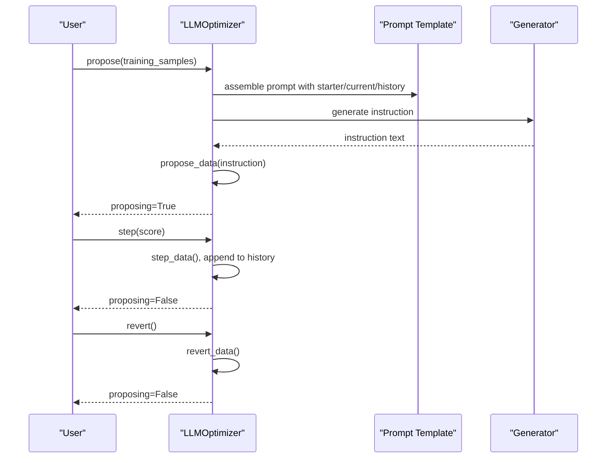
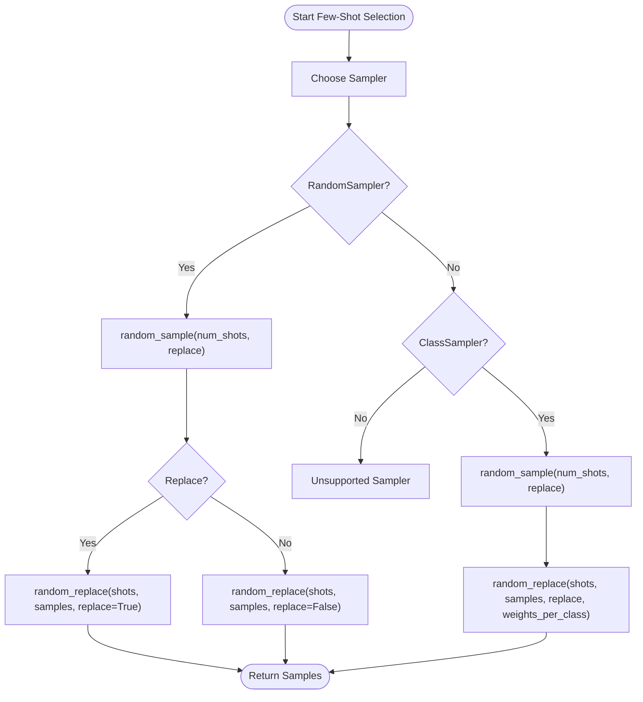
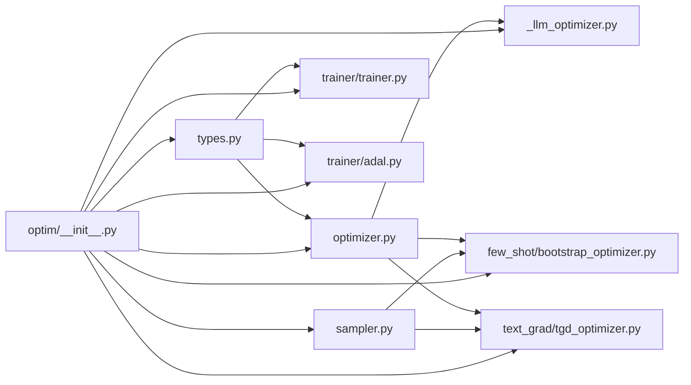

# Optimization Strategies

<cite>
**Referenced Files in This Document**
- [optim/__init__.py](file://adalflow/adalflow/optim/__init__.py)
- [optim/optimizer.py](file://adalflow/adalflow/optim/optimizer.py)
- [optim/sampler.py](file://adalflow/adalflow/optim/sampler.py)
- [optim/types.py](file://adalflow/adalflow/optim/types.py)
- [optim/_llm_optimizer.py](file://adalflow/adalflow/optim/_llm_optimizer.py)
- [optim/few_shot/bootstrap_optimizer.py](file://adalflow/adalflow/optim/few_shot/bootstrap_optimizer.py)
- [optim/text_grad/tgd_optimizer.py](file://adalflow/adalflow/optim/text_grad/tgd_optimizer.py)
- [optim/trainer/trainer.py](file://adalflow/adalflow/optim/trainer/trainer.py)
- [optim/trainer/adal.py](file://adalflow/adalflow/optim/trainer/adal.py)
- [tests/_test_optimizer.py](file://adalflow/tests/_test_optimizer.py)
- [tests/_test_sampler.py](file://adalflow/tests/_test_sampler.py)
- [notebooks/tutorials/adalflow_text_grad_optimization.ipynb](file://notebooks/tutorials/adalflow_text_grad_optimization.ipynb)
- [notebooks/use_cases/adalflow_rag_optimization.ipynb](file://notebooks/use_cases/adalflow_rag_optimization.ipynb)
</cite>

## Table of Contents
1. [Introduction](#introduction)
2. [Project Structure](#project-structure)
3. [Core Components](#core-components)
4. [Architecture Overview](#architecture-overview)
5. [Detailed Component Analysis](#detailed-component-analysis)
6. [Dependency Analysis](#dependency-analysis)
7. [Performance Considerations](#performance-considerations)
8. [Troubleshooting Guide](#troubleshooting-guide)
9. [Conclusion](#conclusion)
10. [Appendices](#appendices)

## Introduction
This document explains the optimization strategies and techniques implemented in the framework, focusing on random search, constrained optimization, and mixed strategies. It documents optimizer types, parameter sampling methods, and search space exploration techniques. Practical examples demonstrate selecting appropriate strategies for different problems, configuring search parameters, and implementing custom optimization approaches. Theoretical foundations, computational complexity, applicability conditions, best practices, convergence acceleration techniques, and performance comparisons are covered alongside guidance for strategy selection and hybrid optimization approaches.

## Project Structure
The optimization subsystem centers around a base optimizer interface, parameter abstractions, sampling strategies, specialized optimizers (e.g., LLM-based instruction optimization), few-shot bootstrapping, textual gradient descent, and training orchestration.

**Diagram sources**
- [optim/__init__.py](file://adalflow/adalflow/optim/__init__.py#L1-L39)
- [optim/optimizer.py](file://adalflow/adalflow/optim/optimizer.py#L12-L92)
- [optim/sampler.py](file://adalflow/adalflow/optim/sampler.py#L41-L305)
- [optim/types.py](file://adalflow/adalflow/optim/types.py#L12-L163)
- [optim/_llm_optimizer.py](file://adalflow/adalflow/optim/_llm_optimizer.py#L95-L188)
- [optim/few_shot/bootstrap_optimizer.py](file://adalflow/adalflow/optim/few_shot/bootstrap_optimizer.py)
- [optim/text_grad/tgd_optimizer.py](file://adalflow/adalflow/optim/text_grad/tgd_optimizer.py)
- [optim/trainer/trainer.py](file://adalflow/adalflow/optim/trainer/trainer.py)
- [optim/trainer/adal.py](file://adalflow/adalflow/optim/trainer/adal.py)

**Section sources**
- [optim/__init__.py](file://adalflow/adalflow/optim/__init__.py#L1-L39)

## Core Components
- Base Optimizer interface defines the contract for proposing, stepping, reverting, and state management.
- TextOptimizer extends the base for textual gradient-based optimization.
- DemoOptimizer supports few-shot optimization with dataset-backed sampling and scoring hooks.
- ParameterType enumerates parameter categories (trainable vs non-trainable) and output subtypes.
- EvaluationResult and Trainer types define evaluation and training result structures.
- LLMOptimizer implements LLM-as-a-reviewer instruction optimization with iterative proposal/step/revert cycles.
- Samplers provide random and class-balanced sampling for few-shot demonstrations.

Key responsibilities:
- Propose: generate candidate parameter values or prompts.
- Step: accept a proposal and update internal state.
- Revert: discard a proposal if it underperforms.
- Sampling: draw demonstrations to condition model inference.

**Section sources**
- [optim/optimizer.py](file://adalflow/adalflow/optim/optimizer.py#L12-L92)
- [optim/types.py](file://adalflow/adalflow/optim/types.py#L12-L163)
- [optim/_llm_optimizer.py](file://adalflow/adalflow/optim/_llm_optimizer.py#L95-L188)
- [optim/sampler.py](file://adalflow/adalflow/optim/sampler.py#L41-L305)

## Architecture Overview
The optimization architecture integrates parameter abstraction, sampling, and strategy-specific optimizers. Training orchestrators coordinate evaluation and updates.

**Diagram sources**
- [optim/optimizer.py](file://adalflow/adalflow/optim/optimizer.py#L12-L92)
- [optim/_llm_optimizer.py](file://adalflow/adalflow/optim/_llm_optimizer.py#L95-L188)
- [optim/sampler.py](file://adalflow/adalflow/optim/sampler.py#L41-L305)

## Detailed Component Analysis

### Base Optimizer and Strategy Contracts
- Optimizer defines the lifecycle: propose generates candidates; step commits them; revert discards; state_dict persists state.
- TextOptimizer adds zero_grad semantics for gradient-like contexts.
- DemoOptimizer encapsulates dataset-backed sampling and scoring hooks for few-shot optimization.

Implementation highlights:
- Propose/step/revert enforce strict ordering and guard against misuse.
- DemoOptimizer exposes configuration for weighted sampling and dataset binding.

**Section sources**
- [optim/optimizer.py](file://adalflow/adalflow/optim/optimizer.py#L12-L92)

### LLM Instruction Optimizer (LLMOptimizer)
LLMOptimizer frames instruction tuning as an iterative process:
- Initialization captures a starter instruction and maintains a history of scored instructions.
- Propose queries a generator with a structured prompt containing historical context and training samples.
- Step accepts the proposed instruction and appends it to history; revert discards it.
- Temperature is clamped to ensure diversity during proposal.

**Diagram sources**
- [optim/_llm_optimizer.py](file://adalflow/adalflow/optim/_llm_optimizer.py#L95-L188)

**Section sources**
- [optim/_llm_optimizer.py](file://adalflow/adalflow/optim/_llm_optimizer.py#L95-L188)

### Few-Shot Bootstrapping Optimizer
Bootstrapping draws demonstrations from a dataset or model-generated outputs to improve downstream performance. The DemoOptimizer base supports:
- Weighted sampling toggles.
- Dataset binding and per-parameter shot configuration.
- Scoring hooks to rank demonstrations.

Sampling strategies:
- RandomSampler: uniform random selection with optional replacement; supports random replacement within a pool.
- ClassSampler: stratified sampling across class labels; supports weighted replacement based on per-class weights.

**Diagram sources**
- [optim/sampler.py](file://adalflow/adalflow/optim/sampler.py#L68-L305)

**Section sources**
- [optim/sampler.py](file://adalflow/adalflow/optim/sampler.py#L41-L305)
- [optim/optimizer.py](file://adalflow/adalflow/optim/optimizer.py#L49-L92)

### Textual Gradient Descent (TGD)
TextGrad optimizes prompts by estimating textual gradients and performing gradient-like updates. While the TGD optimizer module exists, the base textual optimization contract is defined by TextOptimizer. Typical workflow:
- Compute text loss with respect to prompts.
- Estimate gradient direction.
- Update prompt text in the direction of improvement.
- Zero gradients between iterations.

Applicability:
- Effective when textual perturbations yield smooth loss surfaces.
- Computationally efficient compared to finite-difference approximations.

**Section sources**
- [optim/optimizer.py](file://adalflow/adalflow/optim/optimizer.py#L31-L47)
- [optim/text_grad/tgd_optimizer.py](file://adalflow/adalflow/optim/text_grad/tgd_optimizer.py)

### Parameter Types and Training Orchestration
ParameterType categorizes parameters:
- Trainable: PROMPT, DEMOS, GENERATOR_OUTPUT, RETRIEVER_OUTPUT, LOSS_OUTPUT, SUM_OUTPUT.
- Non-trainable: INPUT, OUTPUT, HYPERPARAM.
- Subtypes of OUTPUT include GENERATOR_OUTPUT and others.

Training orchestration:
- Trainer and AdalComponent manage evaluation loops, validation/test splits, and result aggregation.
- TrainerResult and related types capture validation/test metrics and timing.

**Section sources**
- [optim/types.py](file://adalflow/adalflow/optim/types.py#L12-L163)
- [optim/trainer/trainer.py](file://adalflow/adalflow/optim/trainer/trainer.py)
- [optim/trainer/adal.py](file://adalflow/adalflow/optim/trainer/adal.py)

## Dependency Analysis
The optimization module composes several layers:
- Core abstractions (Optimizer, types) underpin strategy implementations.
- Samplers depend on dataset sequences and produce Sample objects.
- LLMOptimizer depends on a generator and prompt template.
- Trainer relies on evaluation results and parameter types.

**Diagram sources**
- [optim/__init__.py](file://adalflow/adalflow/optim/__init__.py#L1-L39)
- [optim/optimizer.py](file://adalflow/adalflow/optim/optimizer.py#L12-L92)
- [optim/sampler.py](file://adalflow/adalflow/optim/sampler.py#L41-L305)
- [optim/types.py](file://adalflow/adalflow/optim/types.py#L12-L163)
- [optim/_llm_optimizer.py](file://adalflow/adalflow/optim/_llm_optimizer.py#L95-L188)
- [optim/few_shot/bootstrap_optimizer.py](file://adalflow/adalflow/optim/few_shot/bootstrap_optimizer.py)
- [optim/text_grad/tgd_optimizer.py](file://adalflow/adalflow/optim/text_grad/tgd_optimizer.py)
- [optim/trainer/trainer.py](file://adalflow/adalflow/optim/trainer/trainer.py)
- [optim/trainer/adal.py](file://adalflow/adalflow/optim/trainer/adal.py)

**Section sources**
- [optim/__init__.py](file://adalflow/adalflow/optim/__init__.py#L1-L39)

## Performance Considerations
- Computational complexity:
  - RandomSampler: O(n) to sample uniformly; random_replace is O(k) for k replacements.
  - ClassSampler: O(n) to build class indices plus O(k) replacement per class; balancing overhead increases with num_classes.
  - LLMOptimizer: Each propose/step cycle incurs a generation cost proportional to prompt length and model_kwargs; temperature clamping avoids excessive entropy.
  - TGD: Depends on text loss computation and gradient estimation; typically linear in prompt length and number of tokens.
- Convergence acceleration:
  - Use ClassSampler to maintain label balance and reduce variance in few-shot settings.
  - For LLM instruction optimization, seed with a strong starter instruction and track historical scores to bias toward improvements.
  - Zero gradients between TGD updates to avoid accumulating stale signals.
- Practical tips:
  - Prefer weighted sampling in DemoOptimizer when some demonstrations are more informative.
  - Limit shots to prevent overfitting to demonstrations.
  - Use validation/test split tracking to detect over-optimization.

[No sources needed since this section provides general guidance]

## Troubleshooting Guide
Common issues and resolutions:
- Calling step without an active proposal in LLMOptimizer raises an error; ensure propose was called and succeeded before step.
- Calling revert without a proposal also raises an error; check proposing flag.
- RandomSampler.random_replace requires shots <= number of samples; ensure num_shots is valid.
- ClassSampler.random_replace requires weights_per_class aligned with class indices; mismatch leads to assertion failures.
- DemoOptimizer.add_scores expects ids and scores aligned with configured shots; misalignment causes errors.

**Section sources**
- [optim/_llm_optimizer.py](file://adalflow/adalflow/optim/_llm_optimizer.py#L170-L188)
- [optim/sampler.py](file://adalflow/adalflow/optim/sampler.py#L109-L128)
- [optim/optimizer.py](file://adalflow/adalflow/optim/optimizer.py#L89-L91)

## Conclusion
The framework offers a flexible optimization stack: base contracts for lifecycle management, sampling strategies for demonstration selection, LLM-driven instruction optimization, and textual gradient descent. By combining these components—random search for exploration, constrained optimization for guided refinement, and mixed strategies for robustness—you can tailor approaches to diverse problem domains. Use validation/test tracking, balanced sampling, and careful proposal/step/revert discipline to achieve reliable convergence and strong performance.

[No sources needed since this section summarizes without analyzing specific files]

## Appendices

### Strategy Selection Guidelines
- Random Search:
  - Use when the search space is large and gradient information is unavailable.
  - Pair with RandomSampler to explore diverse demonstrations; tune num_shots and replace policy.
- Constrained Optimization:
  - Use when you have a strong baseline (starter instruction) and want to refine it systematically.
  - Apply LLMOptimizer with a structured prompt template and historical context.
- Mixed Strategies:
  - Combine ClassSampler for balanced demonstrations with LLM instruction refinement.
  - Use TGD for rapid textual updates and LLMOptimizer for high-level instruction search.

**Section sources**
- [optim/_llm_optimizer.py](file://adalflow/adalflow/optim/_llm_optimizer.py#L95-L188)
- [optim/sampler.py](file://adalflow/adalflow/optim/sampler.py#L152-L295)

### Practical Examples and References
- Few-shot optimization with bootstrapping and sampling:
  - See test coverage for sampler and optimizer usage patterns.
  - Notebook tutorials demonstrate RAG optimization and text gradient workflows.
- Implementation references:
  - Sampler usage patterns and assertions are documented in the sampler module.
  - Optimizer lifecycle and error guards are defined in the optimizer base.

**Section sources**
- [tests/_test_sampler.py](file://adalflow/tests/_test_sampler.py)
- [tests/_test_optimizer.py](file://adalflow/tests/_test_optimizer.py)
- [notebooks/tutorials/adalflow_text_grad_optimization.ipynb](file://notebooks/tutorials/adalflow_text_grad_optimization.ipynb)
- [notebooks/use_cases/adalflow_rag_optimization.ipynb](file://notebooks/use_cases/adalflow_rag_optimization.ipynb)