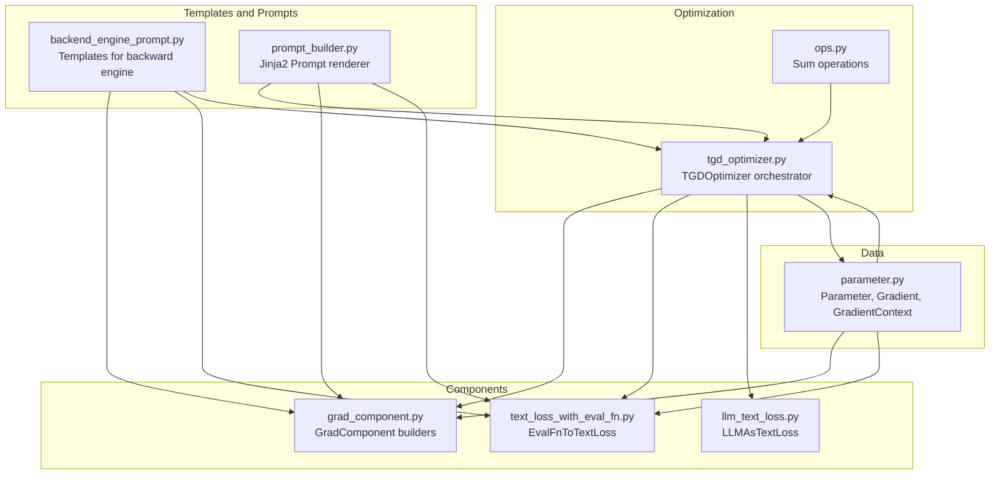
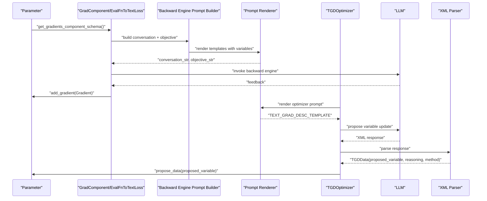
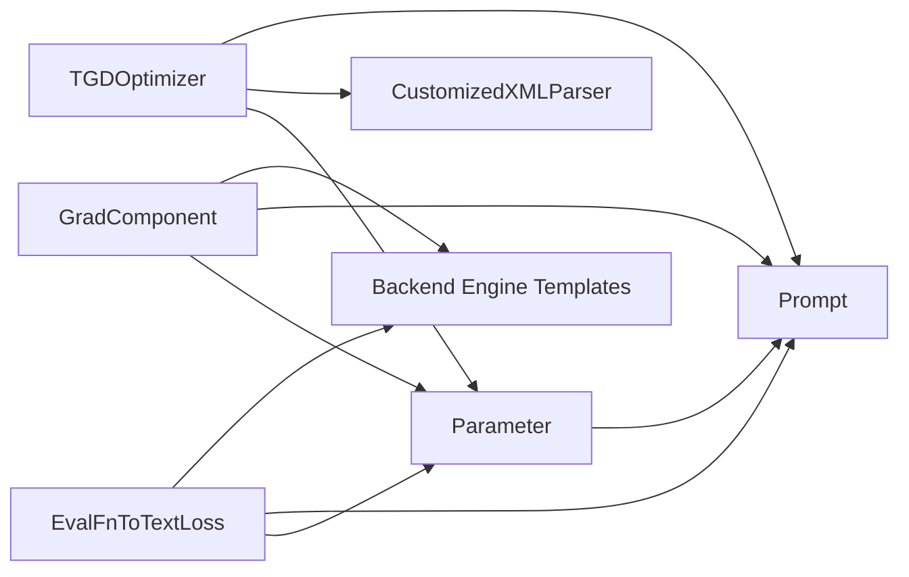

# Backend Engine Prompt Construction

<cite>
**Referenced Files in This Document**
- [backend_engine_prompt.py](file://adalflow/adalflow/optim/text_grad/backend_engine_prompt.py)
- [tgd_optimizer.py](file://adalflow/adalflow/optim/text_grad/tgd_optimizer.py)
- [grad_component.py](file://adalflow/adalflow/optim/grad_component.py)
- [text_loss_with_eval_fn.py](file://adalflow/adalflow/optim/text_grad/text_loss_with_eval_fn.py)
- [ops.py](file://adalflow/adalflow/optim/text_grad/ops.py)
- [parameter.py](file://adalflow/adalflow/optim/parameter.py)
- [prompt_builder.py](file://adalflow/adalflow/core/prompt_builder.py)
- [llm_text_loss.py](file://adalflow/adalflow/optim/text_grad/llm_text_loss.py)
- [test_parameter_text_grad.py](file://tests/test_parameter_text_grad.py)
</cite>

## Table of Contents
1. [Introduction](#introduction)
2. [Project Structure](#project-structure)
3. [Core Components](#core-components)
4. [Architecture Overview](#architecture-overview)
5. [Detailed Component Analysis](#detailed-component-analysis)
6. [Dependency Analysis](#dependency-analysis)
7. [Performance Considerations](#performance-considerations)
8. [Troubleshooting Guide](#troubleshooting-guide)
9. [Conclusion](#conclusion)
10. [Appendices](#appendices)

## Introduction
This document explains the backend engine prompt construction system used by the textual gradient descent optimizer. It focuses on how optimized prompts are built for text gradient computation, including:
- Variable and peer information formatting
- System variable coordination
- Contextual feedback integration
- Prompt templates and variable substitution
- Dynamic prompt generation based on optimization state
- XML parsing for extracting proposed variable updates
- Constraint handling and example injection
- Examples for different optimization scenarios
- Troubleshooting common formatting issues
- Best practices for prompt engineering in text gradient descent

## Project Structure
The prompt construction system spans several modules:
- Text gradient templates and backward-engine prompts
- Optimizer orchestrating prompt assembly and LLM calls
- Gradient components building conversation context and objective instructions
- Parameter utilities aggregating gradients and generating combined feedback
- Prompt builder rendering Jinja2 templates with safe variable substitution
- XML parsing utilities for extracting structured outputs

**Diagram sources**
- [backend_engine_prompt.py](file://adalflow/adalflow/optim/text_grad/backend_engine_prompt.py#L1-L233)
- [tgd_optimizer.py](file://adalflow/adalflow/optim/text_grad/tgd_optimizer.py#L1-L948)
- [grad_component.py](file://adalflow/adalflow/optim/grad_component.py#L1-L628)
- [text_loss_with_eval_fn.py](file://adalflow/adalflow/optim/text_grad/text_loss_with_eval_fn.py#L1-L502)
- [llm_text_loss.py](file://adalflow/adalflow/optim/text_grad/llm_text_loss.py#L1-L75)
- [parameter.py](file://adalflow/adalflow/optim/parameter.py#L1-L1712)
- [prompt_builder.py](file://adalflow/adalflow/core/prompt_builder.py#L1-L352)
- [ops.py](file://adalflow/adalflow/optim/text_grad/ops.py#L1-L140)

**Section sources**
- [backend_engine_prompt.py](file://adalflow/adalflow/optim/text_grad/backend_engine_prompt.py#L1-L233)
- [tgd_optimizer.py](file://adalflow/adalflow/optim/text_grad/tgd_optimizer.py#L1-L948)
- [grad_component.py](file://adalflow/adalflow/optim/grad_component.py#L1-L628)
- [text_loss_with_eval_fn.py](file://adalflow/adalflow/optim/text_grad/text_loss_with_eval_fn.py#L1-L502)
- [llm_text_loss.py](file://adalflow/adalflow/optim/text_grad/llm_text_loss.py#L1-L75)
- [parameter.py](file://adalflow/adalflow/optim/parameter.py#L1-L1712)
- [prompt_builder.py](file://adalflow/adalflow/core/prompt_builder.py#L1-L352)
- [ops.py](file://adalflow/adalflow/optim/text_grad/ops.py#L1-L140)

## Core Components
- Backward engine templates: Define system and user prompts for the backward engine, including objective instructions, conversation context, and variable/peer information.
- TGDOptimizer: Assembles the optimizer prompt with system variables, peers, constraints, examples, history, and feedback; invokes the LLM; parses XML output.
- GradComponent and EvalFnToTextLoss: Build conversation context and objective instructions for gradient computation; coordinate with backward engine prompts.
- Parameter: Aggregates gradients, computes combined feedback, and formats component schemas for the backward engine.
- Prompt: Renders Jinja2 templates safely, converting Parameter objects to strings and handling nested templates.
- XML parsing: Extracts proposed variable updates and reasoning from LLM outputs.

**Section sources**
- [backend_engine_prompt.py](file://adalflow/adalflow/optim/text_grad/backend_engine_prompt.py#L1-L233)
- [tgd_optimizer.py](file://adalflow/adalflow/optim/text_grad/tgd_optimizer.py#L1-L948)
- [grad_component.py](file://adalflow/adalflow/optim/grad_component.py#L1-L628)
- [text_loss_with_eval_fn.py](file://adalflow/adalflow/optim/text_grad/text_loss_with_eval_fn.py#L1-L502)
- [parameter.py](file://adalflow/adalflow/optim/parameter.py#L1-L1712)
- [prompt_builder.py](file://adalflow/adalflow/core/prompt_builder.py#L1-L352)

## Architecture Overview
The system composes prompts in stages:
1. Templates define backward-engine prompts and conversation/objective instructions.
2. Parameter aggregates gradients and produces combined feedback.
3. Prompt renders templates with variable substitution.
4. TGDOptimizer composes the final optimizer prompt with constraints, examples, history, and feedback.
5. LLM generates a structured response (XML).
6. XML parser extracts proposed variable updates and reasoning.

**Diagram sources**
- [grad_component.py](file://adalflow/adalflow/optim/grad_component.py#L313-L421)
- [text_loss_with_eval_fn.py](file://adalflow/adalflow/optim/text_grad/text_loss_with_eval_fn.py#L220-L322)
- [parameter.py](file://adalflow/adalflow/optim/parameter.py#L394-L487)
- [backend_engine_prompt.py](file://adalflow/adalflow/optim/text_grad/backend_engine_prompt.py#L77-L157)
- [prompt_builder.py](file://adalflow/adalflow/core/prompt_builder.py#L181-L258)
- [tgd_optimizer.py](file://adalflow/adalflow/optim/text_grad/tgd_optimizer.py#L545-L684)
- [tgd_optimizer.py](file://adalflow/adalflow/optim/text_grad/tgd_optimizer.py#L270-L340)

## Detailed Component Analysis

### Backward Engine Prompt Templates
- FEEDBACK_ENGINE_TEMPLATE: Defines the backward engine system prompt and user sections for root cause investigation.
- OBJECTIVE_INSTRUCTION_BASE and OBJECTIVE_INSTRUCTION_CHAIN: Objective instructions tailored for loss components and intermediate nodes.
- LOSS_CONVERSATION_START_INSTRUCTION_STRING_FN and LOSS_CONVERSATION_TEMPLATE_STRING: Build conversation context for loss evaluation.
- GRAD_COMPONENT_CONVERSATION_TEMPLATE_STRING: Build conversation context for gradient components.
- CONVERSATION_START_INSTRUCTION_CHAIN and OBJECTIVE_INSTRUCTION_CHAIN: Chain-aware instructions for LM components.
- VARIABLE_AND_PEERS_INFO and ALL_PRED_INFO: Format variable and peer information for the backward engine.
- LLM_CONVERSATION_TEMPLATE and OUTPUT_INSTRUCTION: Format LLM input/output and output instruction for multi-variable feedback.

Key behaviors:
- Uses Jinja2 templating with conditionals and loops to adapt to variable counts and scopes.
- Ensures peer awareness and predecessor awareness for consistent scope control.

**Section sources**
- [backend_engine_prompt.py](file://adalflow/adalflow/optim/text_grad/backend_engine_prompt.py#L12-L233)

### TGDOptimizer Prompt Assembly
Responsibilities:
- Compose optimizer system prompt and user prompt with:
  - Variable and peers info
  - System variables (non-peers)
  - Past history (top N)
  - Failed proposals (current iteration)
  - Context feedback (combined gradients)
  - Constraints
  - In-context examples
- Render final prompt via Prompt and send to Generator.
- Parse XML output into TGDData and update Parameter with proposed variable.

Dynamic prompt generation:
- Iterates over parameters requiring optimization.
- Builds variable_and_peers_info using Parameter.get_param_info() and peer sets.
- Aggregates gradients via Parameter.get_gradients_component_schema().
- Applies constraints and examples only when enabled.

XML parsing:
- CustomizedXMLParser extracts reasoning, method, and proposed_variable from XML.
- Falls back to raw response if parsing fails.

**Section sources**
- [tgd_optimizer.py](file://adalflow/adalflow/optim/text_grad/tgd_optimizer.py#L357-L713)
- [tgd_optimizer.py](file://adalflow/adalflow/optim/text_grad/tgd_optimizer.py#L270-L340)
- [tgd_optimizer.py](file://adalflow/adalflow/optim/text_grad/tgd_optimizer.py#L342-L355)

### Gradient Components and Conversation Builders
GradComponent:
- Builds conversation context using GRAD_COMPONENT_CONVERSATION_TEMPLATE_STRING.
- Selects appropriate objective instruction (base vs chain).
- Calls backward engine with conversation_sec and objective_instruction_sec.
- Creates Gradient with GradientContext and attaches to predecessors.

EvalFnToTextLoss:
- Builds conversation context using LOSS_CONVERSATION_TEMPLATE_STRING.
- Uses LOSS_CONVERSATION_START_INSTRUCTION_STRING_FN and OBJECTIVE_INSTRUCTION_BASE.
- Attaches gradient to predecessors and passes end-to-end score.

Both rely on Prompt to render templates and Parameter.get_param_info() for variable data.

**Section sources**
- [grad_component.py](file://adalflow/adalflow/optim/grad_component.py#L313-L421)
- [text_loss_with_eval_fn.py](file://adalflow/adalflow/optim/text_grad/text_loss_with_eval_fn.py#L220-L322)
- [backend_engine_prompt.py](file://adalflow/adalflow/optim/text_grad/backend_engine_prompt.py#L86-L121)

### Parameter Gradient Aggregation and Combined Feedback
Parameter methods:
- get_gradients_component_schema(): Groups gradients by data_id, computes average scores, and renders COMBINED_GRADIENTS_TEMPLATE.
- get_gradient_and_context_text(): Similar grouping and rendering for lower-scoring samples.
- get_param_info(): Provides structured info for templates (name, role_desc, prompt_data, param_type, requires_opt, eval_input).

These outputs feed into backward engine prompts to guide feedback.

**Section sources**
- [parameter.py](file://adalflow/adalflow/optim/parameter.py#L394-L487)
- [parameter.py](file://adalflow/adalflow/optim/parameter.py#L321-L393)
- [parameter.py](file://adalflow/adalflow/optim/parameter.py#L526-L535)

### Prompt Rendering and Variable Substitution
Prompt:
- Validates and parses template variables.
- Converts Parameter objects to strings via data or data_in_prompt.
- Recursively renders nested Prompt/Template objects.
- Supports composition of prompt kwargs at call time.

This ensures robust substitution of variable and peer information, constraints, examples, and feedback into templates.

**Section sources**
- [prompt_builder.py](file://adalflow/adalflow/core/prompt_builder.py#L181-L258)

### XML Parsing for Proposed Updates
CustomizedXMLParser:
- Extracts reasoning, method, and proposed_variable from XML.
- Handles malformed XML by falling back to raw response.
- Returns TGDData for downstream use.

extract_new_variable:
- Utility to extract content between <VARIABLE> tags if present.

**Section sources**
- [tgd_optimizer.py](file://adalflow/adalflow/optim/text_grad/tgd_optimizer.py#L270-L340)
- [tgd_optimizer.py](file://adalflow/adalflow/optim/text_grad/tgd_optimizer.py#L342-L355)

### Example Scenarios and Prompt Construction
- Loss evaluation scenario:
  - Conversation context built with system_question, inputs, eval_fn_desc, response_value, and metadata.
  - Objective instruction guides feedback on low scores.
  - Backward engine invoked to produce feedback attached as Gradient.
- Intermediate component scenario:
  - Uses OBJECTIVE_INSTRUCTION_CHAIN to explain how the component contributes to a later evaluation.
  - Conversation context includes component_desc and inputs/outputs.
- Optimizer prompt scenario:
  - Includes variable_and_peers_info, system_variables, past_history, failed_proposals, best_score, steps, constraints, and examples.
  - LLM proposes a new variable value wrapped in XML.

**Section sources**
- [text_loss_with_eval_fn.py](file://adalflow/adalflow/optim/text_grad/text_loss_with_eval_fn.py#L220-L322)
- [grad_component.py](file://adalflow/adalflow/optim/grad_component.py#L313-L421)
- [tgd_optimizer.py](file://adalflow/adalflow/optim/text_grad/tgd_optimizer.py#L545-L684)
- [backend_engine_prompt.py](file://adalflow/adalflow/optim/text_grad/backend_engine_prompt.py#L77-L157)

## Dependency Analysis
Key dependencies:
- TGDOptimizer depends on:
  - Prompt for system and user templates
  - CustomizedXMLParser for output extraction
  - Parameter for gradient aggregation and peer/system variable info
- GradComponent and EvalFnToTextLoss depend on:
  - Backend engine templates for conversation and objective instructions
  - Prompt for rendering
  - Parameter for variable info and gradient attachment
- Parameter depends on:
  - Prompt for rendering combined gradients
  - GradientContext for structured context

**Diagram sources**
- [tgd_optimizer.py](file://adalflow/adalflow/optim/text_grad/tgd_optimizer.py#L382-L411)
- [grad_component.py](file://adalflow/adalflow/optim/grad_component.py#L313-L421)
- [text_loss_with_eval_fn.py](file://adalflow/adalflow/optim/text_grad/text_loss_with_eval_fn.py#L220-L322)
- [parameter.py](file://adalflow/adalflow/optim/parameter.py#L376-L483)
- [prompt_builder.py](file://adalflow/adalflow/core/prompt_builder.py#L181-L258)
- [backend_engine_prompt.py](file://adalflow/adalflow/optim/text_grad/backend_engine_prompt.py#L77-L157)

**Section sources**
- [tgd_optimizer.py](file://adalflow/adalflow/optim/text_grad/tgd_optimizer.py#L357-L713)
- [grad_component.py](file://adalflow/adalflow/optim/grad_component.py#L313-L421)
- [text_loss_with_eval_fn.py](file://adalflow/adalflow/optim/text_grad/text_loss_with_eval_fn.py#L220-L322)
- [parameter.py](file://adalflow/adalflow/optim/parameter.py#L376-L483)
- [prompt_builder.py](file://adalflow/adalflow/core/prompt_builder.py#L181-L258)
- [backend_engine_prompt.py](file://adalflow/adalflow/optim/text_grad/backend_engine_prompt.py#L77-L157)

## Performance Considerations
- Minimizing redundant gradient computation:
  - Parameter.check_if_already_computed_gradient_respect_to prevents repeated backward passes.
- Efficient gradient aggregation:
  - Grouping by data_id and computing average scores reduces verbosity in backward engine prompts.
- Token economy:
  - Parameter.get_short_value truncates long values to reduce prompt size.
- Caching and recomputation:
  - TGDOptimizer disables cache during propose to ensure fresh proposals.

[No sources needed since this section provides general guidance]

## Troubleshooting Guide
Common issues and resolutions:
- Missing backward engine:
  - Symptom: ValueError indicating backward_engine is required.
  - Resolution: Ensure backward_engine is configured in GradComponent or EvalFnToTextLoss.
- Empty or missing gradients:
  - Symptom: Backward pass raises error for missing gradient.
  - Resolution: Verify response.get_gradient_and_context_text() is populated; ensure predecessors exist and gradients were added.
- XML parsing failures:
  - Symptom: CustomizedXMLParser logs errors and falls back to raw response.
  - Resolution: Ensure LLM output adheres to the expected XML structure; validate output_format_str in optimizer system prompt.
- Template rendering errors:
  - Symptom: ValueError on invalid Jinja2 template or undefined variables.
  - Resolution: Confirm all template variables are provided via prompt_kwargs; use Prompt.is_key_in_template to validate.
- Constraint and example injection:
  - Symptom: Constraints/examples not appearing in prompt.
  - Resolution: Enable constraints/do_in_context_examples and populate constraints/in_context_examples in TGDOptimizer.

**Section sources**
- [grad_component.py](file://adalflow/adalflow/optim/grad_component.py#L305-L312)
- [text_loss_with_eval_fn.py](file://adalflow/adalflow/optim/text_grad/text_loss_with_eval_fn.py#L213-L219)
- [tgd_optimizer.py](file://adalflow/adalflow/optim/text_grad/tgd_optimizer.py#L270-L340)
- [prompt_builder.py](file://adalflow/adalflow/core/prompt_builder.py#L134-L135)

## Conclusion
The backend engine prompt construction system integrates templated prompts, gradient aggregation, and structured LLM outputs to drive text gradient descent. By coordinating variable and peer information, contextual feedback, constraints, and examples, it enables precise, iterative refinement of text-based variables. Robust XML parsing and safe template rendering ensure reliable extraction of proposed updates and reasoning.

[No sources needed since this section summarizes without analyzing specific files]

## Appendices

### Appendix A: Prompt Template Reference
- Backward engine templates:
  - FEEDBACK_ENGINE_TEMPLATE
  - OBJECTIVE_INSTRUCTION_BASE/CHAIN
  - LOSS_CONVERSATION_START_INSTRUCTION_STRING_FN
  - LOSS_CONVERSATION_TEMPLATE_STRING
  - GRAD_COMPONENT_CONVERSATION_TEMPLATE_STRING
  - CONVERSATION_START_INSTRUCTION_CHAIN/OBJECTIVE_INSTRUCTION_CHAIN
  - VARIABLE_AND_PEERS_INFO/ALL_PRED_INFO
  - LLM_CONVERSATION_TEMPLATE/OUTPUT_INSTRUCTION

- Optimizer templates:
  - TEXT_GRAD_DESC_TEMPLATE
  - OPTIMIZER_SYSTEM_PROMPT

**Section sources**
- [backend_engine_prompt.py](file://adalflow/adalflow/optim/text_grad/backend_engine_prompt.py#L12-L233)
- [tgd_optimizer.py](file://adalflow/adalflow/optim/text_grad/tgd_optimizer.py#L46-L224)

### Appendix B: Example Injection and Constraint Handling
- In-context examples:
  - TGDOptimizer supports injecting examples via in_context_examples.
  - Examples are included in the optimizer prompt when enabled.
- Constraints:
  - Constraints are formatted and injected into the optimizer prompt when do_constrained is true.

**Section sources**
- [tgd_optimizer.py](file://adalflow/adalflow/optim/text_grad/tgd_optimizer.py#L426-L437)
- [tgd_optimizer.py](file://adalflow/adalflow/optim/text_grad/tgd_optimizer.py#L545-L590)

### Appendix C: Validation and Testing
- Tests demonstrate that constraints and examples are included in the rendered optimizer prompt.
- Use cases validate expected presence of example strings and constraint text.

**Section sources**
- [test_parameter_text_grad.py](file://tests/test_parameter_text_grad.py#L39-L71)