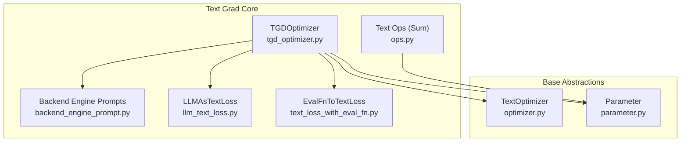
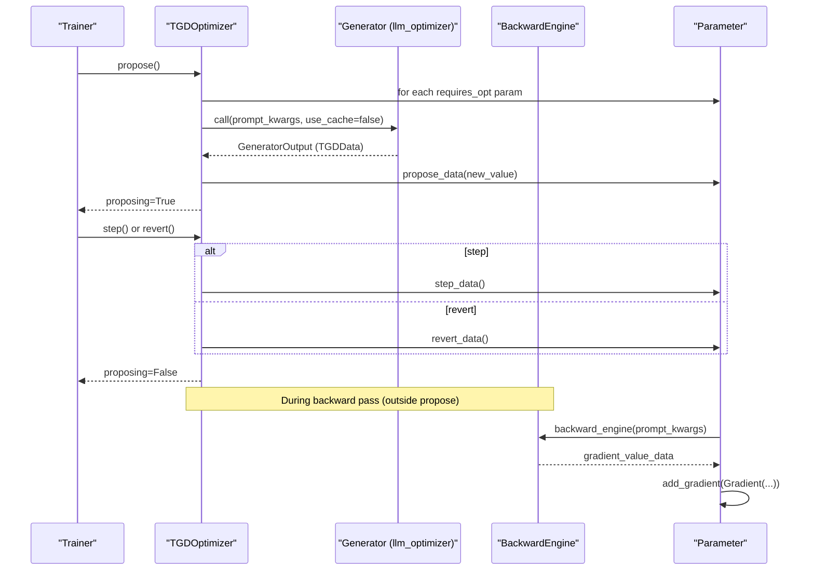
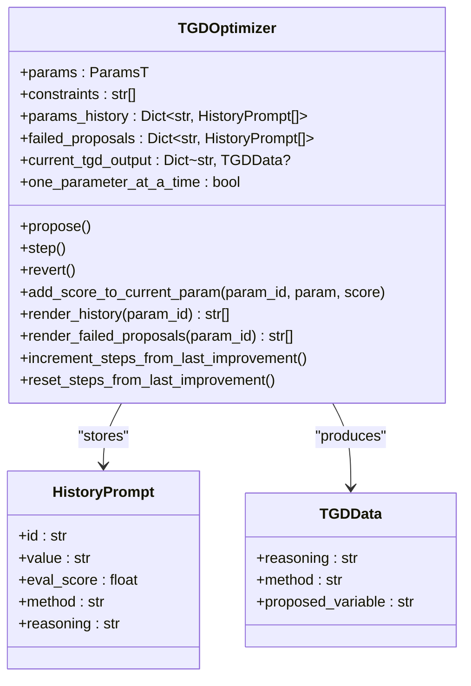
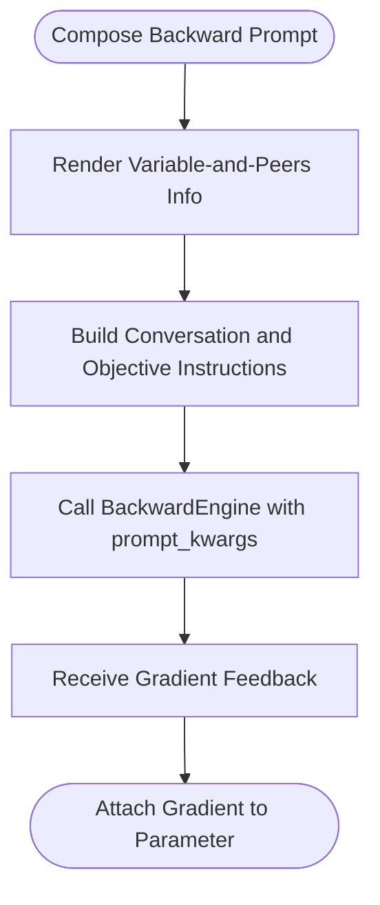
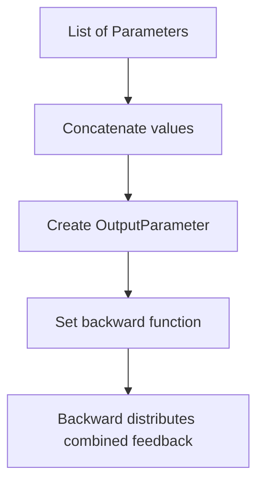
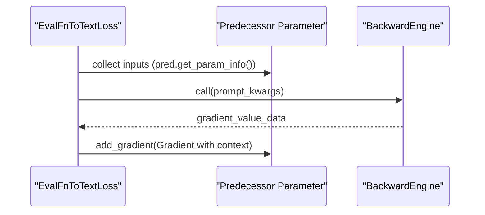
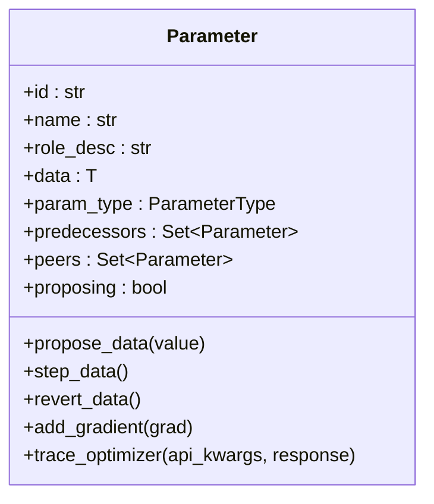
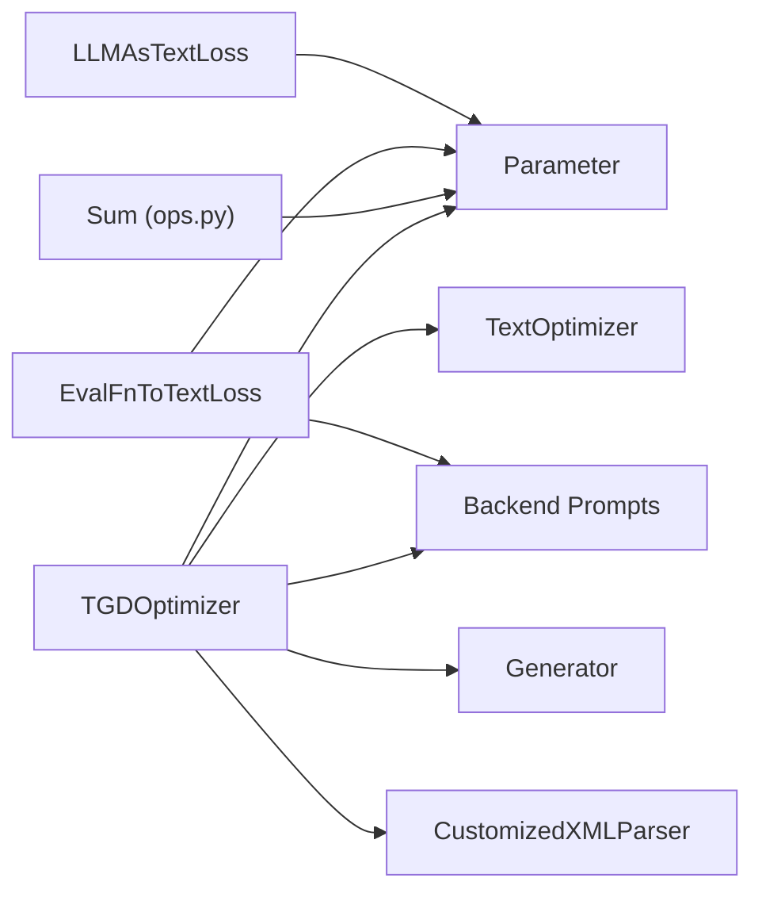

# Core Algorithm Implementation

<cite>
**Referenced Files in This Document**
- [tgd_optimizer.py](file://adalflow/adalflow/optim/text_grad/tgd_optimizer.py)
- [backend_engine_prompt.py](file://adalflow/adalflow/optim/text_grad/backend_engine_prompt.py)
- [ops.py](file://adalflow/adalflow/optim/text_grad/ops.py)
- [llm_text_loss.py](file://adalflow/adalflow/optim/text_grad/llm_text_loss.py)
- [text_loss_with_eval_fn.py](file://adalflow/adalflow/optim/text_grad/text_loss_with_eval_fn.py)
- [optimizer.py](file://adalflow/adalflow/optim/optimizer.py)
- [parameter.py](file://adalflow/adalflow/optim/parameter.py)
- [__init__.py](file://adalflow/adalflow/optim/text_grad/__init__.py)
</cite>

## Table of Contents
1. [Introduction](#introduction)
2. [Project Structure](#project-structure)
3. [Core Components](#core-components)
4. [Architecture Overview](#architecture-overview)
5. [Detailed Component Analysis](#detailed-component-analysis)
6. [Dependency Analysis](#dependency-analysis)
7. [Performance Considerations](#performance-considerations)
8. [Troubleshooting Guide](#troubleshooting-guide)
9. [Conclusion](#conclusion)
10. [Appendices](#appendices)

## Introduction
This document explains the core Text Gradient Descent (TGD) algorithm implementation in AdalFlow. It covers the mathematical foundations of computing gradients through textual prompt parameters, how automatic differentiation is performed on text, and the TGDOptimizer class architecture. It documents parameter tracking, gradient computation, optimization loops, proposing and stepping mechanisms, history management, and constraint handling. Practical examples show initialization, parameter configuration, and running optimization cycles. Finally, it compares text gradients to numerical gradients, discusses computational complexity, and outlines memory management strategies.

## Project Structure
The TGD implementation resides under the optimization subsystem for text gradients. Key modules include:
- TGDOptimizer: orchestrates proposing, stepping, reverting, and history management
- Backend prompts: templates for the backward engine and peer-aware variable context
- Operations: text-based sum aggregation of gradients
- Loss components: conversion of evaluation functions to text-based losses with gradient feedback
- Base classes: optimizer and parameter abstractions

**Diagram sources**
- [tgd_optimizer.py](file://adalflow/adalflow/optim/text_grad/tgd_optimizer.py#L357-L948)
- [backend_engine_prompt.py](file://adalflow/adalflow/optim/text_grad/backend_engine_prompt.py#L1-L233)
- [ops.py](file://adalflow/adalflow/optim/text_grad/ops.py#L1-L140)
- [llm_text_loss.py](file://adalflow/adalflow/optim/text_grad/llm_text_loss.py#L1-L75)
- [text_loss_with_eval_fn.py](file://adalflow/adalflow/optim/text_grad/text_loss_with_eval_fn.py#L1-L502)
- [optimizer.py](file://adalflow/adalflow/optim/optimizer.py#L1-L92)
- [parameter.py](file://adalflow/adalflow/optim/parameter.py#L1-L200)

**Section sources**
- [tgd_optimizer.py](file://adalflow/adalflow/optim/text_grad/tgd_optimizer.py#L1-L120)
- [backend_engine_prompt.py](file://adalflow/adalflow/optim/text_grad/backend_engine_prompt.py#L1-L60)
- [ops.py](file://adalflow/adalflow/optim/text_grad/ops.py#L1-L40)
- [text_loss_with_eval_fn.py](file://adalflow/adalflow/optim/text_grad/text_loss_with_eval_fn.py#L1-L60)
- [optimizer.py](file://adalflow/adalflow/optim/optimizer.py#L1-L40)
- [parameter.py](file://adalflow/adalflow/optim/parameter.py#L119-L200)

## Core Components
- TGDOptimizer: Implements textual gradient descent with proposing, stepping, reverting, and history management. It composes system prompts, renders variable-and-peers context, and invokes a Generator to produce new text values guided by gradient feedback.
- Backend prompts: Provide structured conversation and objective instructions for the backward engine to produce textual feedback for each parameter.
- Operations: Sum aggregates multiple parameters into a combined output parameter with a combined gradient context.
- Loss components: Convert evaluation functions into text-based losses and backpropagate gradient feedback via a backward engine.
- Base classes: TextOptimizer defines the interface for text-based optimization; Parameter encapsulates data, roles, gradients, and tracing.

**Section sources**
- [tgd_optimizer.py](file://adalflow/adalflow/optim/text_grad/tgd_optimizer.py#L357-L424)
- [backend_engine_prompt.py](file://adalflow/adalflow/optim/text_grad/backend_engine_prompt.py#L160-L183)
- [ops.py](file://adalflow/adalflow/optim/text_grad/ops.py#L32-L90)
- [text_loss_with_eval_fn.py](file://adalflow/adalflow/optim/text_grad/text_loss_with_eval_fn.py#L36-L160)
- [optimizer.py](file://adalflow/adalflow/optim/optimizer.py#L31-L46)
- [parameter.py](file://adalflow/adalflow/optim/parameter.py#L119-L177)

## Architecture Overview
The TGD algorithm couples a forward pass that computes scores and a backward pass that produces textual feedback. The optimizer proposes new parameter values conditioned on:
- Variable and peers context
- Past history and failed proposals
- Constraints and in-context examples
- Feedback from the backward engine

**Diagram sources**
- [tgd_optimizer.py](file://adalflow/adalflow/optim/text_grad/tgd_optimizer.py#L614-L713)
- [text_loss_with_eval_fn.py](file://adalflow/adalflow/optim/text_grad/text_loss_with_eval_fn.py#L267-L323)
- [parameter.py](file://adalflow/adalflow/optim/parameter.py#L119-L177)

## Detailed Component Analysis

### TGDOptimizer: Textual Gradient Descent Orchestrator
- Responsibilities:
  - Track parameters and their histories
  - Build prompts with variable-and-peers context, constraints, examples, and past/failed proposals
  - Propose new values via a Generator and apply them to parameters
  - Step or revert based on evaluation outcomes
  - Manage gradient memory and peer awareness
- Key mechanisms:
  - Proposing: iterates trainable parameters, constructs system and user prompts, calls the Generator, parses XML output, and proposes new values
  - Stepping/Reverting: commits or discards proposed values atomically across parameters
  - History management: maintains top-k past iterations and recent failed proposals
  - Constraint handling: renders constraints into the user prompt
  - Peer-awareness: builds variable-and-peers context for each parameter

**Diagram sources**
- [tgd_optimizer.py](file://adalflow/adalflow/optim/text_grad/tgd_optimizer.py#L32-L39)
- [tgd_optimizer.py](file://adalflow/adalflow/optim/text_grad/tgd_optimizer.py#L357-L424)
- [tgd_optimizer.py](file://adalflow/adalflow/optim/text_grad/tgd_optimizer.py#L614-L713)

**Section sources**
- [tgd_optimizer.py](file://adalflow/adalflow/optim/text_grad/tgd_optimizer.py#L357-L424)
- [tgd_optimizer.py](file://adalflow/adalflow/optim/text_grad/tgd_optimizer.py#L445-L543)
- [tgd_optimizer.py](file://adalflow/adalflow/optim/text_grad/tgd_optimizer.py#L614-L713)
- [tgd_optimizer.py](file://adalflow/adalflow/optim/text_grad/tgd_optimizer.py#L714-L816)
- [tgd_optimizer.py](file://adalflow/adalflow/optim/text_grad/tgd_optimizer.py#L818-L899)

### Backend Engine Prompts: Peer-Aware Gradient Context
- Purpose: Provide structured conversation and objective instructions for the backward engine to produce textual feedback for a target variable, considering peers and predecessors.
- Templates:
  - Variable-and-peers info: describes the target variable, its peers, and roles
  - Conversation and objective instructions: describe how the variable is used and how feedback should be produced
- Integration: TGDOptimizer composes these into user prompts for the Generator.

**Diagram sources**
- [backend_engine_prompt.py](file://adalflow/adalflow/optim/text_grad/backend_engine_prompt.py#L160-L183)
- [backend_engine_prompt.py](file://adalflow/adalflow/optim/text_grad/backend_engine_prompt.py#L207-L233)
- [text_loss_with_eval_fn.py](file://adalflow/adalflow/optim/text_grad/text_loss_with_eval_fn.py#L267-L323)

**Section sources**
- [backend_engine_prompt.py](file://adalflow/adalflow/optim/text_grad/backend_engine_prompt.py#L160-L183)
- [backend_engine_prompt.py](file://adalflow/adalflow/optim/text_grad/backend_engine_prompt.py#L207-L233)
- [text_loss_with_eval_fn.py](file://adalflow/adalflow/optim/text_grad/text_loss_with_eval_fn.py#L220-L323)

### Operations: Text-Based Sum Aggregation
- Sum operation concatenates parameter values and propagates combined feedback downstream.
- Forward creates an OutputParameter with aggregated data and sets a backward function.
- Backward distributes combined feedback to predecessors if not already computed.

**Diagram sources**
- [ops.py](file://adalflow/adalflow/optim/text_grad/ops.py#L46-L90)
- [ops.py](file://adalflow/adalflow/optim/text_grad/ops.py#L92-L132)

**Section sources**
- [ops.py](file://adalflow/adalflow/optim/text_grad/ops.py#L14-L29)
- [ops.py](file://adalflow/adalflow/optim/text_grad/ops.py#L46-L90)
- [ops.py](file://adalflow/adalflow/optim/text_grad/ops.py#L92-L132)

### Loss Components: Evaluation Functions to Text Gradients
- EvalFnToTextLoss converts an evaluation function into a text-based loss parameter and backpropagates gradient feedback using a backward engine.
- It constructs conversation and objective instructions, calls the backward engine, and attaches a Gradient to the predecessor parameters.

**Diagram sources**
- [text_loss_with_eval_fn.py](file://adalflow/adalflow/optim/text_grad/text_loss_with_eval_fn.py#L93-L160)
- [text_loss_with_eval_fn.py](file://adalflow/adalflow/optim/text_grad/text_loss_with_eval_fn.py#L183-L323)

**Section sources**
- [text_loss_with_eval_fn.py](file://adalflow/adalflow/optim/text_grad/text_loss_with_eval_fn.py#L36-L160)
- [text_loss_with_eval_fn.py](file://adalflow/adalflow/optim/text_grad/text_loss_with_eval_fn.py#L183-L323)

### Parameter Abstractions: Roles, Gradients, and Traces
- Parameter carries data, role description, optimization requirement, peers, and gradients.
- It supports proposing, stepping, reverting, adding gradients, and tracing optimizer interactions.

**Diagram sources**
- [parameter.py](file://adalflow/adalflow/optim/parameter.py#L119-L177)
- [parameter.py](file://adalflow/adalflow/optim/parameter.py#L552-L556)

**Section sources**
- [parameter.py](file://adalflow/adalflow/optim/parameter.py#L119-L177)
- [parameter.py](file://adalflow/adalflow/optim/parameter.py#L552-L556)

## Dependency Analysis
- TGDOptimizer depends on:
  - TextOptimizer base class for the optimization interface
  - Parameter for data, gradients, and tracing
  - Backend prompts for variable-and-peers context
  - Generator for proposing new values
  - Customized XML parser for extracting TGDData
- Operations depend on Parameter and GradComponent to aggregate and propagate gradients
- Loss components depend on BackwardEngine to produce textual feedback

**Diagram sources**
- [tgd_optimizer.py](file://adalflow/adalflow/optim/text_grad/tgd_optimizer.py#L357-L424)
- [ops.py](file://adalflow/adalflow/optim/text_grad/ops.py#L32-L90)
- [text_loss_with_eval_fn.py](file://adalflow/adalflow/optim/text_grad/text_loss_with_eval_fn.py#L36-L160)
- [llm_text_loss.py](file://adalflow/adalflow/optim/text_grad/llm_text_loss.py#L29-L75)
- [optimizer.py](file://adalflow/adalflow/optim/optimizer.py#L31-L46)
- [parameter.py](file://adalflow/adalflow/optim/parameter.py#L119-L177)

**Section sources**
- [tgd_optimizer.py](file://adalflow/adalflow/optim/text_grad/tgd_optimizer.py#L357-L424)
- [ops.py](file://adalflow/adalflow/optim/text_grad/ops.py#L32-L90)
- [text_loss_with_eval_fn.py](file://adalflow/adalflow/optim/text_grad/text_loss_with_eval_fn.py#L36-L160)
- [llm_text_loss.py](file://adalflow/adalflow/optim/text_grad/llm_text_loss.py#L29-L75)
- [optimizer.py](file://adalflow/adalflow/optim/optimizer.py#L31-L46)
- [parameter.py](file://adalflow/adalflow/optim/parameter.py#L119-L177)

## Performance Considerations
- Computational complexity:
  - Proposing loop: O(P) per iteration where P is the number of trainable parameters
  - History management: maintaining top-k histories adds O(H log H) per insertion for sorting by score
  - Backward pass: depends on backward engine invocation cost; text prompts can be longer than numerical gradients
- Memory management:
  - Limit max_past_history and max_failed_proposals to cap storage
  - Disable caching during proposing to ensure fresh proposals
  - Use lightweight HistoryPrompt entries; avoid storing redundant raw responses
- Practical tips:
  - Keep in-context examples concise
  - Use one-parameter-at-a-time mode for large parameter sets to reduce contention
  - Monitor gradient memory growth and periodically prune if needed

[No sources needed since this section provides general guidance]

## Troubleshooting Guide
- Symptom: Error in optimizer call
  - Cause: Generator call failure or wrong response type
  - Action: Inspect prompt kwargs composition and response type; ensure TGDData is parsed correctly
- Symptom: No improvement after step
  - Cause: Proposed value equals current value or empty
  - Action: Verify proposed_variable extraction and parameter.update
- Symptom: History not updating
  - Cause: Parameter ID mismatch or missing history entry
  - Action: Validate param.id and ensure add_score_to_current_param is called with correct ID
- Symptom: Excessive memory usage
  - Cause: Unlimited history or failed proposals accumulation
  - Action: Reduce max_past_history and max_failed_proposals; monitor sizes

**Section sources**
- [tgd_optimizer.py](file://adalflow/adalflow/optim/text_grad/tgd_optimizer.py#L644-L652)
- [tgd_optimizer.py](file://adalflow/adalflow/optim/text_grad/tgd_optimizer.py#L674-L682)
- [tgd_optimizer.py](file://adalflow/adalflow/optim/text_grad/tgd_optimizer.py#L449-L462)
- [tgd_optimizer.py](file://adalflow/adalflow/optim/text_grad/tgd_optimizer.py#L478-L481)

## Conclusion
The TGD algorithm in AdalFlow integrates textual gradient computation with a structured proposing-stepping framework. By composing variable-and-peers context, constraints, and past experiences, TGDOptimizer steers iterative improvements to prompt parameters. The backward engine supplies textual feedback, while Parameter and Operation abstractions manage gradient propagation and aggregation. Proper configuration of history limits, caching, and peer awareness ensures efficient and reliable optimization.

[No sources needed since this section summarizes without analyzing specific files]

## Appendices

### Mathematical Foundations and Relationship to Numerical Gradients
- Text gradients are discrete approximations derived from textual feedback rather than closed-form derivatives. They approximate the effect of small changes in text on the evaluation score.
- Numerical gradients operate on continuous vector spaces; text gradients operate on discrete text spaces, using LLMs to simulate derivative-like signals.
- In practice, text gradients enable optimization of prompts, demonstrations, and other textual components without explicit numerical derivatives.

[No sources needed since this section provides general guidance]

### Practical Examples: Initialization, Configuration, and Optimization Cycles
- Initialize parameters with requires_opt=True for trainable components and appropriate role_desc
- Configure TGDOptimizer with model_client, model_kwargs, constraints, in-context examples, and history limits
- Run optimization cycles:
  - propose(): generates new values for trainable parameters
  - step(): commits proposed values
  - revert(): discards proposed values
- Use add_score_to_current_param() to record evaluation scores for history management

**Section sources**
- [tgd_optimizer.py](file://adalflow/adalflow/optim/text_grad/tgd_optimizer.py#L370-L424)
- [tgd_optimizer.py](file://adalflow/adalflow/optim/text_grad/tgd_optimizer.py#L614-L713)
- [tgd_optimizer.py](file://adalflow/adalflow/optim/text_grad/tgd_optimizer.py#L445-L462)