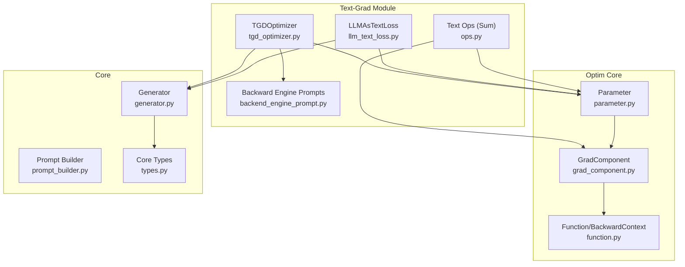
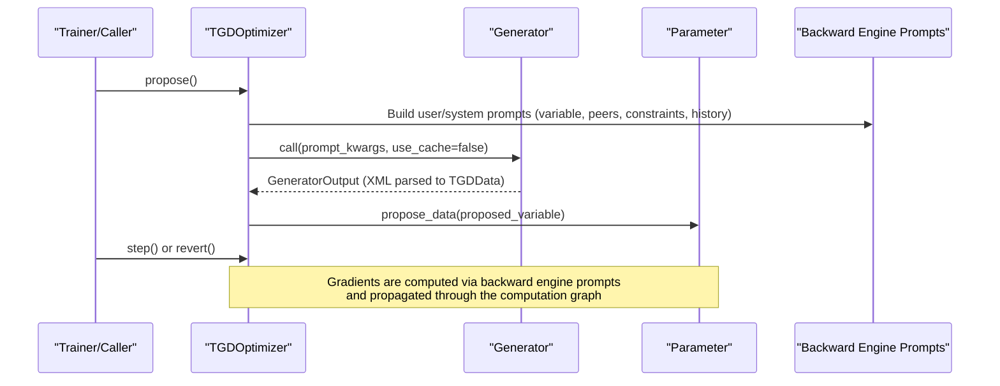
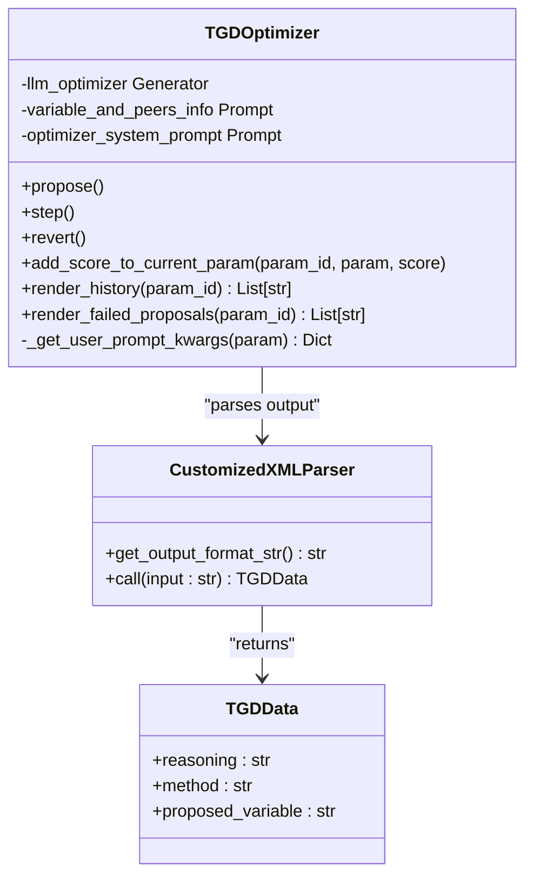
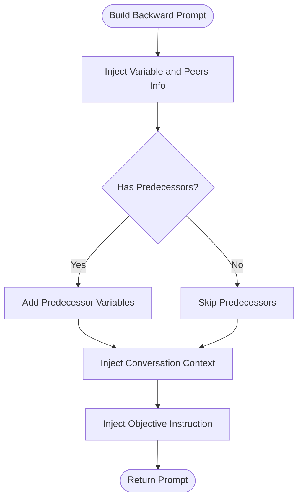
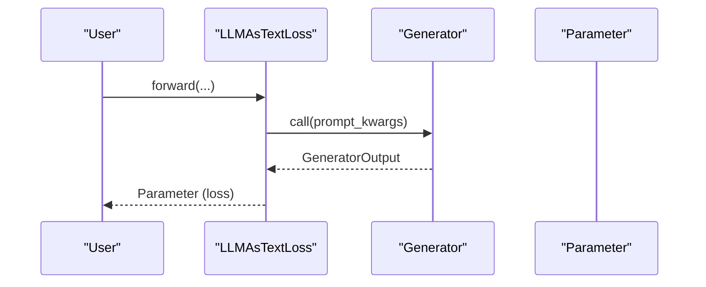
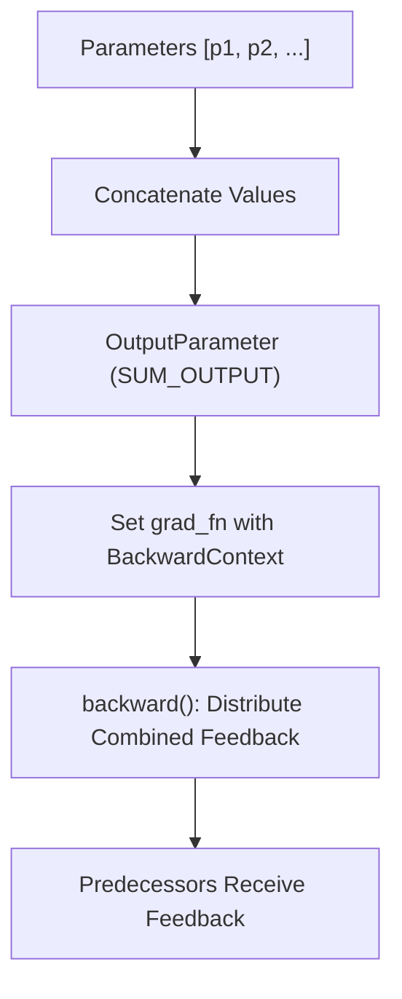
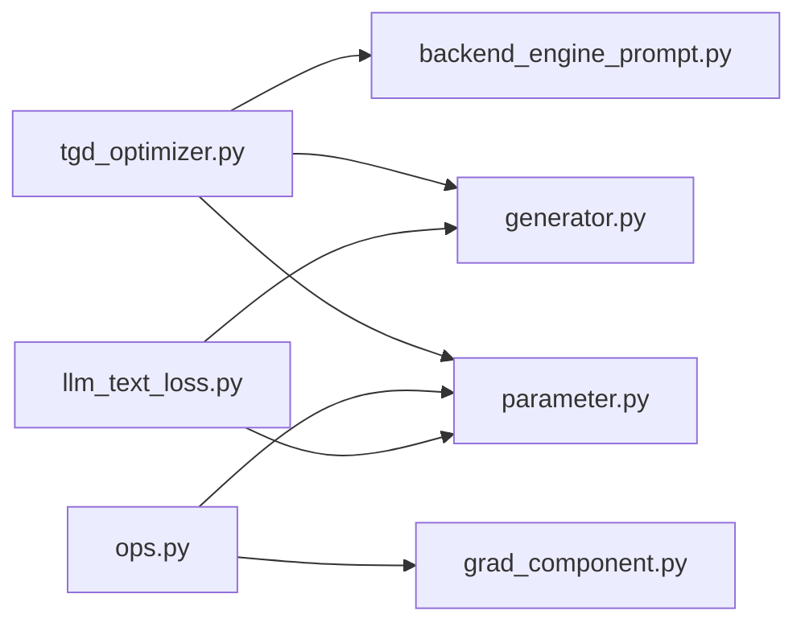
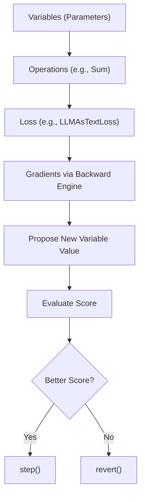

# Text Gradient Descent

<cite>
**Referenced Files in This Document**
- [tgd_optimizer.py](file://adalflow/adalflow/optim/text_grad/tgd_optimizer.py)
- [backend_engine_prompt.py](file://adalflow/adalflow/optim/text_grad/backend_engine_prompt.py)
- [llm_text_loss.py](file://adalflow/adalflow/optim/text_grad/llm_text_loss.py)
- [ops.py](file://adalflow/adalflow/optim/text_grad/ops.py)
- [__init__.py](file://adalflow/adalflow/optim/text_grad/__init__.py)
- [parameter.py](file://adalflow/adalflow/optim/parameter.py)
- [grad_component.py](file://adalflow/adalflow/optim/grad_component.py)
- [generator.py](file://adalflow/adalflow/core/generator.py)
- [prompt_builder.py](file://adalflow/adalflow/core/prompt_builder.py)
- [types.py](file://adalflow/adalflow/core/types.py)
- [test_parameter_text_grad.py](file://tests/test_parameter_text_grad.py)
- [auto_text_grad.rst](file://docs/source/tutorials/auto_text_grad.rst)
- [rag_opt.rst](file://docs/source/use_cases/rag_opt.rst)
</cite>

## Table of Contents
1. [Introduction](#introduction)
2. [Project Structure](#project-structure)
3. [Core Components](#core-components)
4. [Architecture Overview](#architecture-overview)
5. [Detailed Component Analysis](#detailed-component-analysis)
6. [Dependency Analysis](#dependency-analysis)
7. [Performance Considerations](#performance-considerations)
8. [Troubleshooting Guide](#troubleshooting-guide)
9. [Conclusion](#conclusion)
10. [Appendices](#appendices)

## Introduction
This document explains the Text Gradient Descent (TGD) optimization technique implemented in the repository. TGD enables optimizing textual prompt parameters by computing gradients through natural language using an LLM-based backward engine. It builds on the concept of automatic differentiation via text, where gradients are derived not from numeric tensors but from textual feedback supplied by an LLM. The core idea is to:
- Represent each text parameter as a Parameter with associated gradients.
- Build a computation graph of operations (including sum aggregation) and loss components.
- Compute gradients by prompting an LLM to provide feedback on how changes to a variable affect the evaluation score.
- Use the LLM-driven feedback to propose improved text values and iteratively descend toward better performance.

This document covers the mathematical intuition, the computational graph construction, the backward pass mechanism, the TGD optimizer implementation, backend prompt construction, and practical guidance for configuring text optimizers, defining text loss functions, and troubleshooting common issues.

## Project Structure
The TGD module resides under optim/text_grad and integrates with the broader optimization and core systems:
- Optim core: parameter, grad_component, loss_component, optimizer, function, gradient, sampler, types.
- Core components: generator, prompt_builder, types.
- Text-grad module: tgd_optimizer, backend_engine_prompt, llm_text_loss, ops, text_loss_with_eval_fn.

**Diagram sources**
- [tgd_optimizer.py](file://adalflow/adalflow/optim/text_grad/tgd_optimizer.py#L357-L713)
- [backend_engine_prompt.py](file://adalflow/adalflow/optim/text_grad/backend_engine_prompt.py#L1-L233)
- [llm_text_loss.py](file://adalflow/adalflow/optim/text_grad/llm_text_loss.py#L29-L75)
- [ops.py](file://adalflow/adalflow/optim/text_grad/ops.py#L32-L91)
- [parameter.py](file://adalflow/adalflow/optim/parameter.py)
- [grad_component.py](file://adalflow/adalflow/optim/grad_component.py)
- [generator.py](file://adalflow/adalflow/core/generator.py)
- [prompt_builder.py](file://adalflow/adalflow/core/prompt_builder.py)
- [types.py](file://adalflow/adalflow/core/types.py)

**Section sources**
- [__init__.py](file://adalflow/adalflow/optim/text_grad/__init__.py#L1-L18)

## Core Components
- TGDOptimizer: Orchestrates text optimization by proposing new variable values using an LLM, managing history and failed proposals, and stepping or reverting changes.
- Backward Engine Prompts: Templates that construct the system and user prompts for the LLM backward engine to produce gradient-like feedback.
- LLMAsTextLoss: Wraps an LLM as a judge to produce a Parameter-backed loss for downstream gradient computation.
- Sum Operation: A text-based aggregation that concatenates parameter values and propagates feedback to predecessors during backward passes.

Key responsibilities:
- Build prompts with variable and peer context, constraints, examples, and past history.
- Call a Generator to produce a structured response containing reasoning, method, and proposed variable.
- Update Parameter gradients via a backward engine prompt and propagate feedback through the computation graph.

**Section sources**
- [tgd_optimizer.py](file://adalflow/adalflow/optim/text_grad/tgd_optimizer.py#L357-L713)
- [backend_engine_prompt.py](file://adalflow/adalflow/optim/text_grad/backend_engine_prompt.py#L160-L233)
- [llm_text_loss.py](file://adalflow/adalflow/optim/text_grad/llm_text_loss.py#L29-L75)
- [ops.py](file://adalflow/adalflow/optim/text_grad/ops.py#L32-L91)

## Architecture Overview
The TGD architecture couples a text optimizer with a backward engine to compute textual gradients. The optimizer proposes new variable values and the backward engine produces feedback that guides improvements.

**Diagram sources**
- [tgd_optimizer.py](file://adalflow/adalflow/optim/text_grad/tgd_optimizer.py#L614-L713)
- [backend_engine_prompt.py](file://adalflow/adalflow/optim/text_grad/backend_engine_prompt.py#L12-L44)
- [generator.py](file://adalflow/adalflow/core/generator.py)

## Detailed Component Analysis

### TGDOptimizer
The TGDOptimizer manages iterative text optimization:
- Maintains histories of evaluated variables and failed proposals.
- Builds prompts that include variable and peer context, constraints, examples, and past performance.
- Calls a Generator to produce a structured response with reasoning, method, and proposed variable.
- Updates Parameter values conditionally and supports stepping or reverting.

**Diagram sources**
- [tgd_optimizer.py](file://adalflow/adalflow/optim/text_grad/tgd_optimizer.py#L270-L340)
- [tgd_optimizer.py](file://adalflow/adalflow/optim/text_grad/tgd_optimizer.py#L357-L713)

**Section sources**
- [tgd_optimizer.py](file://adalflow/adalflow/optim/text_grad/tgd_optimizer.py#L357-L713)

### Backward Engine Prompts
The backward engine templates define how to prompt an LLM to produce gradient-like feedback:
- Conversation context for the component and variable.
- Objective instructions to explain how the variable contributes to the score.
- Peer-awareness to constrain the scope of feedback to the target variable and its peers.
- Support for predecessor variables when the variable participates in a chain.

**Diagram sources**
- [backend_engine_prompt.py](file://adalflow/adalflow/optim/text_grad/backend_engine_prompt.py#L127-L157)
- [backend_engine_prompt.py](file://adalflow/adalflow/optim/text_grad/backend_engine_prompt.py#L160-L183)

**Section sources**
- [backend_engine_prompt.py](file://adalflow/adalflow/optim/text_grad/backend_engine_prompt.py#L12-L233)

### LLMAsTextLoss
This component wraps an LLM as a judge to produce a Parameter-backed loss. While the module docstring notes that a non-optimizable LLM judge is preferred, this component demonstrates how an LLM can be integrated into the computation graph to yield a differentiable loss.

**Diagram sources**
- [llm_text_loss.py](file://adalflow/adalflow/optim/text_grad/llm_text_loss.py#L69-L75)
- [llm_text_loss.py](file://adalflow/adalflow/optim/text_grad/llm_text_loss.py#L42-L67)

**Section sources**
- [llm_text_loss.py](file://adalflow/adalflow/optim/text_grad/llm_text_loss.py#L29-L75)

### Sum Operation (Text Aggregation)
The Sum operation aggregates multiple Parameters into a single OutputParameter. During backward, it distributes combined feedback to predecessors, enabling batch-level gradient propagation.

**Diagram sources**
- [ops.py](file://adalflow/adalflow/optim/text_grad/ops.py#L46-L91)
- [ops.py](file://adalflow/adalflow/optim/text_grad/ops.py#L92-L132)

**Section sources**
- [ops.py](file://adalflow/adalflow/optim/text_grad/ops.py#L14-L91)

## Dependency Analysis
The TGD module depends on:
- Optim core: Parameter, GradComponent, BackwardContext, and related types.
- Core: Generator for LLM calls and Prompt for templating.
- Internal prompts: VARIABLE_AND_PEERS_INFO and other backward-engine templates.

**Diagram sources**
- [tgd_optimizer.py](file://adalflow/adalflow/optim/text_grad/tgd_optimizer.py#L15-L411)
- [ops.py](file://adalflow/adalflow/optim/text_grad/ops.py#L6-L9)
- [llm_text_loss.py](file://adalflow/adalflow/optim/text_grad/llm_text_loss.py#L12-L15)
- [parameter.py](file://adalflow/adalflow/optim/parameter.py)
- [grad_component.py](file://adalflow/adalflow/optim/grad_component.py)
- [generator.py](file://adalflow/adalflow/core/generator.py)

**Section sources**
- [tgd_optimizer.py](file://adalflow/adalflow/optim/text_grad/tgd_optimizer.py#L15-L411)
- [ops.py](file://adalflow/adalflow/optim/text_grad/ops.py#L6-L9)
- [llm_text_loss.py](file://adalflow/adalflow/optim/text_grad/llm_text_loss.py#L12-L15)

## Performance Considerations
- Cache control: Proposals intentionally bypass cache to ensure fresh LLM feedback for each iteration.
- Batch awareness: The optimizer targets either all trainable parameters or one parameter at a time, controlled by a flag, to balance exploration and speed.
- History and failed proposals: Limiting stored histories and failed attempts reduces prompt size and improves responsiveness.
- Prompt construction: Including only necessary context (constraints, examples, peers) keeps prompts concise and focused.
- Backward engine scope: Peer-aware prompts prevent cross-variable interference and reduce noise in feedback.

[No sources needed since this section provides general guidance]

## Troubleshooting Guide
Common issues and remedies:
- Wrong response type from the optimizer: Ensure the output parser returns the expected data type and that the Generator is configured with the correct output processors.
- Parsing failures: The customized XML parser logs errors and falls back to returning raw input; verify the LLM adheres to the expected XML format.
- No improvement after propose: Review constraints, examples, and history to avoid repeating failed patterns; consider increasing failed proposal limits or adjusting steps-from-last-improvement.
- Incorrect peer or predecessor context: Verify that peers and predecessors are correctly populated in the Parameter graph to avoid misdirected feedback.
- Excessive prompt size: Reduce max_past_history or max_failed_proposals to keep prompts manageable.

**Section sources**
- [tgd_optimizer.py](file://adalflow/adalflow/optim/text_grad/tgd_optimizer.py#L270-L340)
- [tgd_optimizer.py](file://adalflow/adalflow/optim/text_grad/tgd_optimizer.py#L614-L713)

## Conclusion
Text Gradient Descent extends traditional optimization to the textual domain by computing gradients through an LLM-based backward engine. The TGD optimizer coordinates prompt construction, proposal generation, and iterative refinement, while the backward engine ensures feedback remains scoped to the target variable and its peers. The Sum operation and Parameter-based computation graph enable batch-level aggregation and gradient propagation. Proper configuration of constraints, examples, and history, along with careful prompt engineering, yields robust and efficient text optimization.

[No sources needed since this section summarizes without analyzing specific files]

## Appendices

### Mathematical Foundations and Computational Graph Construction
- Textual gradients: Instead of numeric derivatives, gradients are represented as textual feedback describing how to modify a variable to improve the score.
- Computation graph: Parameters form nodes; operations like Sum attach backward functions that propagate feedback to predecessors.
- Backward pass: The backward engine receives the current variable, its peers, predecessors, and evaluation context, then returns feedback that is attached to the Parameter’s gradient.

[No sources needed since this diagram shows conceptual workflow, not actual code structure]

### Practical Examples and Usage Patterns
- Configuring a text optimizer:
  - Initialize TGDOptimizer with parameters, model client, and model kwargs.
  - Optionally set constraints, in-context examples, and flags for one-parameter-at-a-time optimization.
- Defining a text loss function:
  - Use LLMAsTextLoss to wrap an LLM judge with appropriate prompt kwargs.
  - Alternatively, integrate an evaluation function that returns a Parameter-backed score.
- Computing gradients through natural language parameters:
  - Build prompts with variable and peer context.
  - Call the backward engine via the computation graph to obtain feedback.
  - Apply the feedback to propose a new variable and iterate.

**Section sources**
- [llm_text_loss.py](file://adalflow/adalflow/optim/text_grad/llm_text_loss.py#L29-L75)
- [ops.py](file://adalflow/adalflow/optim/text_grad/ops.py#L32-L91)
- [tgd_optimizer.py](file://adalflow/adalflow/optim/text_grad/tgd_optimizer.py#L357-L713)

### When to Use Text Gradient Descent vs. Other Methods
- Use TGD when:
  - The optimization objective is best expressed through natural language feedback.
  - Prompt parameters (e.g., instructions, demonstrations, constraints) are the primary tunables.
  - You benefit from iterative refinement guided by an LLM.
- Prefer numeric gradient methods when:
  - The parameter space is continuous and numeric derivatives are available.
  - Training data is abundant and standard optimizers converge quickly.

[No sources needed since this section provides general guidance]