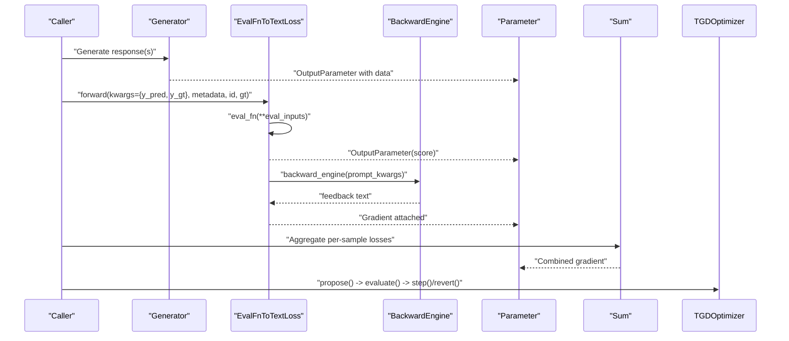
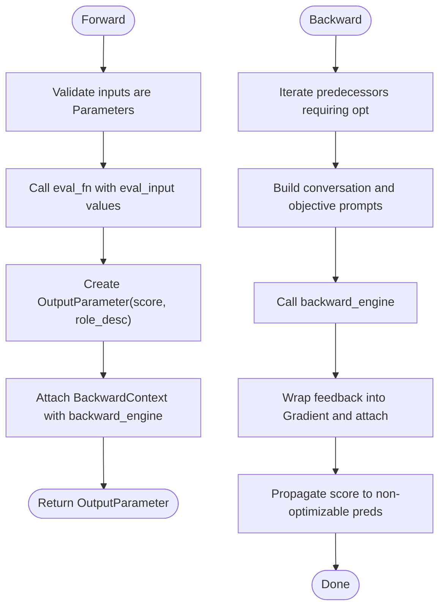
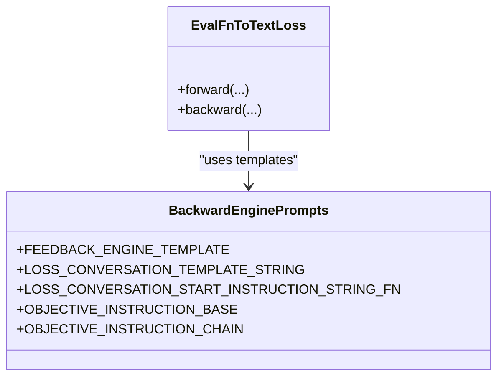
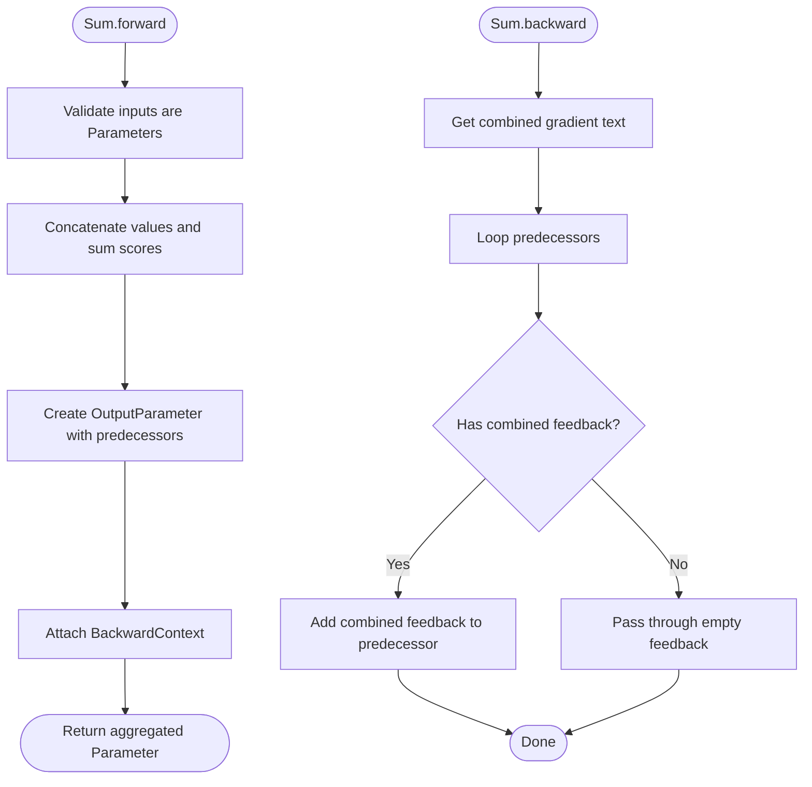
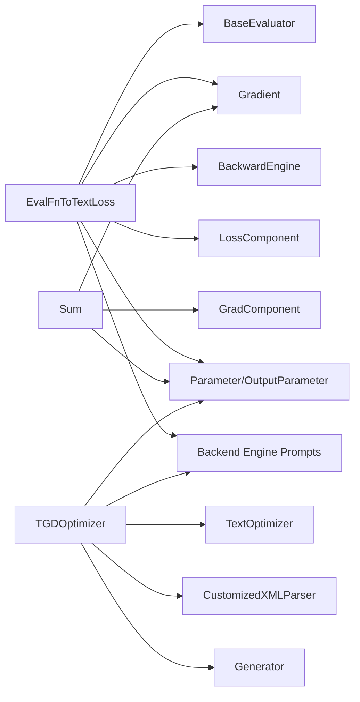

# Text Loss Computation and Evaluation

<cite>
**Referenced Files in This Document**
- [llm_text_loss.py](file://adalflow/adalflow/optim/text_grad/llm_text_loss.py)
- [text_loss_with_eval_fn.py](file://adalflow/adalflow/optim/text_grad/text_loss_with_eval_fn.py)
- [backend_engine_prompt.py](file://adalflow/adalflow/optim/text_grad/backend_engine_prompt.py)
- [ops.py](file://adalflow/adalflow/optim/text_grad/ops.py)
- [tgd_optimizer.py](file://adalflow/adalflow/optim/text_grad/tgd_optimizer.py)
- [README.md](file://adalflow/adalflow/optim/README.md)
- [eval/base.py](file://adalflow/adalflow/eval/base.py)
- [eval/functional.py](file://adalflow/adalflow/eval/functional.py)
- [eval/utils.py](file://adalflow/adalflow/eval/utils.py)
- [eval/answer_match_acc.py](file://adalflow/adalflow/eval/answer_match_acc.py)
- [core/generator.py](file://adalflow/adalflow/core/generator.py)
- [core/types.py](file://adalflow/adalflow/core/types.py)
- [optim/parameter.py](file://adalflow/adalflow/optim/parameter.py)
- [optim/gradient.py](file://adalflow/adalflow/optim/gradient.py)
- [optim/loss_component.py](file://adalflow/adalflow/optim/loss_component.py)
- [optim/grad_component.py](file://adalflow/adalflow/optim/grad_component.py)
- [optim/optimizer.py](file://adalflow/adalflow/optim/optimizer.py)
- [tests/test_parameter_text_grad.py](file://adalflow/tests/test_parameter_text_grad.py)
</cite>

## Table of Contents
1. [Introduction](#introduction)
2. [Project Structure](#project-structure)
3. [Core Components](#core-components)
4. [Architecture Overview](#architecture-overview)
5. [Detailed Component Analysis](#detailed-component-analysis)
6. [Dependency Analysis](#dependency-analysis)
7. [Performance Considerations](#performance-considerations)
8. [Troubleshooting Guide](#troubleshooting-guide)
9. [Conclusion](#conclusion)
10. [Appendices](#appendices)

## Introduction
This document explains how text loss computation and evaluation are implemented for textual gradient descent in the repository. It focuses on constructing evaluation functions, converting them into text-based losses, computing gradients via a backward engine, and applying these within an optimizer loop. It also covers batch evaluation strategies, performance optimization, handling noisy or inconsistent evaluation results, and building robust loss computation that remains stable under varying conditions.

## Project Structure
The text gradient descent implementation resides under the optim/text_grad package and integrates with evaluation utilities and core components for generators and parameters.

```mermaid
graph TB
subgraph "Text Gradient Core"
TE["text_loss_with_eval_fn.py"]
BE["backend_engine_prompt.py"]
OPS["ops.py"]
TGD["tgd_optimizer.py"]
LLMJ["llm_text_loss.py"]
end
subgraph "Evaluation"
EVALBASE["eval/base.py"]
EVALFN["eval/functional.py"]
EVALUTIL["eval/utils.py"]
ANSWERACC["eval/answer_match_acc.py"]
end
subgraph "Core"
GEN["core/generator.py"]
PARAM["optim/parameter.py"]
GRAD["optim/gradient.py"]
LC["optim/loss_component.py"]
GC["optim/grad_component.py"]
OPT["optim/optimizer.py"]
TYPES["core/types.py"]
end
TE --> BE
TE --> PARAM
TE --> GRAD
TE --> LC
TE --> EVALBASE
TE --> EVALFN
TE --> EVALUTIL
TE --> ANSWERACC
TGD --> GEN
TGD --> PARAM
TGD --> BE
TGD --> OPT
OPS --> PARAM
OPS --> GRAD
OPS --> GC
LLMJ --> GEN
LLMJ --> PARAM
LLMJ --> LC
```



**Diagram sources**
- [text_loss_with_eval_fn.py](file://adalflow/adalflow/optim/text_grad/text_loss_with_eval_fn.py#L36-L160)
- [backend_engine_prompt.py](file://adalflow/adalflow/optim/text_grad/backend_engine_prompt.py#L12-L233)
- [ops.py](file://adalflow/adalflow/optim/text_grad/ops.py#L14-L90)
- [tgd_optimizer.py](file://adalflow/adalflow/optim/text_grad/tgd_optimizer.py#L357-L713)
- [llm_text_loss.py](file://adalflow/adalflow/optim/text_grad/llm_text_loss.py#L29-L75)
- [eval/base.py](file://adalflow/adalflow/eval/base.py)
- [eval/functional.py](file://adalflow/adalflow/eval/functional.py)
- [eval/utils.py](file://adalflow/adalflow/eval/utils.py)
- [eval/answer_match_acc.py](file://adalflow/adalflow/eval/answer_match_acc.py)
- [core/generator.py](file://adalflow/adalflow/core/generator.py)
- [optim/parameter.py](file://adalflow/adalflow/optim/parameter.py)
- [optim/gradient.py](file://adalflow/adalflow/optim/gradient.py)
- [optim/loss_component.py](file://adalflow/adalflow/optim/loss_component.py)
- [optim/grad_component.py](file://adalflow/adalflow/optim/grad_component.py)
- [optim/optimizer.py](file://adalflow/adalflow/optim/optimizer.py)
- [core/types.py](file://adalflow/adalflow/core/types.py)

**Section sources**
- [README.md](file://adalflow/adalflow/optim/README.md)
- [text_loss_with_eval_fn.py](file://adalflow/adalflow/optim/text_grad/text_loss_with_eval_fn.py#L36-L160)
- [backend_engine_prompt.py](file://adalflow/adalflow/optim/text_grad/backend_engine_prompt.py#L12-L233)
- [ops.py](file://adalflow/adalflow/optim/text_grad/ops.py#L14-L90)
- [tgd_optimizer.py](file://adalflow/adalflow/optim/text_grad/tgd_optimizer.py#L357-L713)
- [llm_text_loss.py](file://adalflow/adalflow/optim/text_grad/llm_text_loss.py#L29-L75)

## Core Components
- EvalFnToTextLoss: Converts an evaluation function into a text-based loss that produces a scalar score and attaches a backward function to compute textual gradients.
- Backward Engine Prompts: Templates that structure conversation context and objective instructions for the backward engine to produce feedback.
- Sum Operation: Aggregates multiple parameters (e.g., batch losses) into a single parameter for combined gradient computation.
- TGDOptimizer: Orchestrates proposing improved text variables, evaluating them, and stepping or reverting based on score comparisons.
- LLMAsTextLoss: Alternative path using an LLM as a judge to produce a loss-like score (non-optimized path in current implementation).

Key responsibilities:
- Build evaluation inputs from Parameter nodes.
- Compute a scalar score via eval_fn.
- Attach a backward function that constructs prompts for the backward engine.
- Accumulate gradients across a batch using Sum.
- Drive iterative optimization with TGDOptimizer.

**Section sources**
- [text_loss_with_eval_fn.py](file://adalflow/adalflow/optim/text_grad/text_loss_with_eval_fn.py#L36-L160)
- [backend_engine_prompt.py](file://adalflow/adalflow/optim/text_grad/backend_engine_prompt.py#L52-L121)
- [ops.py](file://adalflow/adalflow/optim/text_grad/ops.py#L32-L90)
- [tgd_optimizer.py](file://adalflow/adalflow/optim/text_grad/tgd_optimizer.py#L357-L713)
- [llm_text_loss.py](file://adalflow/adalflow/optim/text_grad/llm_text_loss.py#L29-L75)

## Architecture Overview
The system composes evaluation functions into text-based losses, computes gradients via a backward engine, and updates text parameters through an optimizer loop. Batch evaluation is supported by aggregating per-sample losses.



**Diagram sources**
- [text_loss_with_eval_fn.py](file://adalflow/adalflow/optim/text_grad/text_loss_with_eval_fn.py#L93-L160)
- [backend_engine_prompt.py](file://adalflow/adalflow/optim/text_grad/backend_engine_prompt.py#L12-L44)
- [ops.py](file://adalflow/adalflow/optim/text_grad/ops.py#L46-L90)
- [tgd_optimizer.py](file://adalflow/adalflow/optim/text_grad/tgd_optimizer.py#L614-L713)

## Detailed Component Analysis

### EvalFnToTextLoss: Evaluation Function to Text Loss
- Purpose: Wrap an eval_fn to produce a scalar score and attach a backward function that generates textual feedback for gradient computation.
- Forward:
  - Validates inputs are Parameters.
  - Calls eval_fn with eval_input values extracted from Parameters.
  - Creates an OutputParameter with score, role_desc, and predecessors.
  - Attaches a BackwardContext with backward_engine and conversation context.
- Backward:
  - Iterates over predecessors requiring optimization.
  - Builds conversation and objective instructions using templates.
  - Invokes backward_engine to obtain feedback text.
  - Wraps feedback into a Gradient parameter and attaches it to predecessors.
  - Propagates the score to non-optimizable predecessors.



**Diagram sources**
- [text_loss_with_eval_fn.py](file://adalflow/adalflow/optim/text_grad/text_loss_with_eval_fn.py#L93-L160)
- [text_loss_with_eval_fn.py](file://adalflow/adalflow/optim/text_grad/text_loss_with_eval_fn.py#L324-L386)
- [backend_engine_prompt.py](file://adalflow/adalflow/optim/text_grad/backend_engine_prompt.py#L77-L121)

**Section sources**
- [text_loss_with_eval_fn.py](file://adalflow/adalflow/optim/text_grad/text_loss_with_eval_fn.py#L36-L160)
- [text_loss_with_eval_fn.py](file://adalflow/adalflow/optim/text_grad/text_loss_with_eval_fn.py#L162-L386)
- [backend_engine_prompt.py](file://adalflow/adalflow/optim/text_grad/backend_engine_prompt.py#L77-L121)

### Backward Engine Prompts: Structuring Feedback
- Templates define:
  - FEEDBACK_ENGINE_TEMPLATE: System prompt for root cause analysis and feedback generation.
  - LOSS_CONVERSATION_TEMPLATE_STRING: Context of how the variable is used in the evaluation function.
  - LOSS_CONVERSATION_START_INSTRUCTION_STRING_FN: Target variable framing for feedback.
  - OBJECTIVE_INSTRUCTION_BASE and OBJECTIVE_INSTRUCTION_CHAIN: Objective instructions for low-score cases and intermediate nodes.
- These templates are assembled inside EvalFnToTextLoss backward to guide the backward engine in generating precise, concise feedback.



**Diagram sources**
- [backend_engine_prompt.py](file://adalflow/adalflow/optim/text_grad/backend_engine_prompt.py#L12-L121)
- [text_loss_with_eval_fn.py](file://adalflow/adalflow/optim/text_grad/text_loss_with_eval_fn.py#L224-L261)

**Section sources**
- [backend_engine_prompt.py](file://adalflow/adalflow/optim/text_grad/backend_engine_prompt.py#L12-L121)

### Sum Operation: Batch Aggregation
- Purpose: Combine multiple parameters (e.g., per-sample losses) into a single parameter for gradient computation.
- Forward: Concatenates values and sums scores; marks requires_opt if any predecessor requires optimization.
- Backward: Distributes combined feedback to predecessors or passes through empty feedback when appropriate.



**Diagram sources**
- [ops.py](file://adalflow/adalflow/optim/text_grad/ops.py#L46-L90)
- [ops.py](file://adalflow/adalflow/optim/text_grad/ops.py#L92-L132)

**Section sources**
- [ops.py](file://adalflow/adalflow/optim/text_grad/ops.py#L14-L132)

### TGDOptimizer: Iterative Textual Gradient Descent
- Responsibilities:
  - Maintain histories of evaluated parameters and failed proposals.
  - Construct optimizer prompts with variable and peer information, constraints, in-context examples, and past history.
  - Propose improved text variables via a Generator configured with a custom output parser.
  - Step to accept or revert proposed changes based on evaluation outcomes.
  - Support constrained optimization and optional one-parameter-at-a-time scheduling.
- Sampling and exploration:
  - Provides a Gumbel Top-k sampling utility to balance exploration and exploitation across candidate proposals.

```mermaid
sequenceDiagram
participant Opt as "TGDOptimizer"
participant Gen as "Generator"
participant Param as "Parameter"
participant Hist as "History/Failure Tracking"
Opt->>Gen : "call(prompt_kwargs, use_cache=false)"
Gen-->>Opt : "TGDData (reasoning, method, proposed_variable)"
Opt->>Param : "propose_data(proposed_variable)"
Opt->>Hist : "record current TGDData"
Opt->>Opt : "evaluate()"
alt "improvement"
Opt->>Param : "step_data()"
else "no improvement"
Opt->>Param : "revert_data()"
end
```

**Diagram sources**
- [tgd_optimizer.py](file://adalflow/adalflow/optim/text_grad/tgd_optimizer.py#L614-L713)
- [tgd_optimizer.py](file://adalflow/adalflow/optim/text_grad/tgd_optimizer.py#L270-L340)

**Section sources**
- [tgd_optimizer.py](file://adalflow/adalflow/optim/text_grad/tgd_optimizer.py#L357-L713)
- [tgd_optimizer.py](file://adalflow/adalflow/optim/text_grad/tgd_optimizer.py#L270-L340)

### LLMAsTextLoss: LLM Judge as Loss
- Purpose: Evaluate responses using an LLM judge and return a Parameter for gradient computation via the Generator’s backward mechanism.
- Notes: The module indicates this path is not actively used; the EvalFnToTextLoss approach is preferred for text gradients.

**Section sources**
- [llm_text_loss.py](file://adalflow/adalflow/optim/text_grad/llm_text_loss.py#L29-L75)

## Dependency Analysis
- EvalFnToTextLoss depends on:
  - LossComponent base class for lifecycle hooks.
  - BackwardEngine for gradient feedback generation.
  - Prompt templates for conversation and objective construction.
  - Parameter and Gradient types for graph construction and backpropagation.
  - Evaluation utilities (BaseEvaluator, functional evaluators) for building eval_fn.
- TGDOptimizer depends on:
  - Generator for proposing new variable values.
  - Custom output parser to extract structured TGDData.
  - Backend engine prompts for context and objectives.
  - Parameter graph for gradient memory and peer awareness.



**Diagram sources**
- [text_loss_with_eval_fn.py](file://adalflow/adalflow/optim/text_grad/text_loss_with_eval_fn.py#L62-L92)
- [ops.py](file://adalflow/adalflow/optim/text_grad/ops.py#L32-L90)
- [tgd_optimizer.py](file://adalflow/adalflow/optim/text_grad/tgd_optimizer.py#L357-L411)
- [backend_engine_prompt.py](file://adalflow/adalflow/optim/text_grad/backend_engine_prompt.py#L12-L44)

**Section sources**
- [text_loss_with_eval_fn.py](file://adalflow/adalflow/optim/text_grad/text_loss_with_eval_fn.py#L62-L92)
- [ops.py](file://adalflow/adalflow/optim/text_grad/ops.py#L32-L90)
- [tgd_optimizer.py](file://adalflow/adalflow/optim/text_grad/tgd_optimizer.py#L357-L411)

## Performance Considerations
- Batch aggregation:
  - Use Sum to combine per-sample losses efficiently and avoid repeated backward passes.
- Backward engine caching:
  - Disable cache during proposal to ensure fresh feedback; re-enable after evaluation to reduce redundant calls.
- Exploration-exploitation:
  - Gumbel Top-k sampling can help diversify proposals while still favoring high-scoring candidates.
- Constraint-aware prompts:
  - Incorporate constraints and peer awareness to reduce wasted evaluations on invalid regions.
- Output processors:
  - Use structured output parsers to minimize post-processing overhead and parsing errors.

[No sources needed since this section provides general guidance]

## Troubleshooting Guide
Common issues and remedies:
- Backward engine not provided:
  - Ensure a BackwardEngine is configured; otherwise, backward computation will fail.
- Non-Parameter inputs:
  - Verify all inputs to EvalFnToTextLoss.forward are Parameters; otherwise, a TypeError is raised.
- Empty or malformed feedback:
  - The backward engine can return failure messages; the loss wrapper augments feedback with expected answers to stabilize gradients.
- Parsing failures in TGDOptimizer:
  - The customized XML parser extracts structured fields and logs errors; ensure the model output conforms to the expected XML format.
- No improvement after proposal:
  - Revert changes and record failed proposals; leverage past history and failed proposal context to guide future proposals.

**Section sources**
- [text_loss_with_eval_fn.py](file://adalflow/adalflow/optim/text_grad/text_loss_with_eval_fn.py#L162-L181)
- [text_loss_with_eval_fn.py](file://adalflow/adalflow/optim/text_grad/text_loss_with_eval_fn.py#L213-L219)
- [tgd_optimizer.py](file://adalflow/adalflow/optim/text_grad/tgd_optimizer.py#L270-L340)
- [tgd_optimizer.py](file://adalflow/adalflow/optim/text_grad/tgd_optimizer.py#L687-L698)

## Conclusion
The repository implements a robust framework for text loss computation and evaluation in textual gradient descent. By wrapping evaluation functions into text-based losses, structuring feedback via backward engine prompts, and orchestrating iterative optimization with TGDOptimizer, it supports batch evaluation, exploration strategies, and stable dynamics even with noisy or inconsistent evaluation results. Integrations with external evaluators and custom scoring functions are straightforward through EvalFnToTextLoss and the evaluation utilities.

[No sources needed since this section summarizes without analyzing specific files]

## Appendices

### Defining Custom Evaluation Functions
- Use BaseEvaluator or functional evaluators to implement eval_fn.
- Ensure eval_fn returns a scalar score suitable for optimization direction.
- Integrate with EvalFnToTextLoss.forward to obtain a Parameter with attached gradients.

**Section sources**
- [eval/base.py](file://adalflow/adalflow/eval/base.py)
- [eval/functional.py](file://adalflow/adalflow/eval/functional.py)
- [text_loss_with_eval_fn.py](file://adalflow/adalflow/optim/text_grad/text_loss_with_eval_fn.py#L93-L160)

### Integrating External Evaluation APIs
- Wrap external APIs behind eval_fn to maintain a unified interface.
- Handle rate limits and retries at the eval_fn level.
- Pass metadata and ground truth via EvalFnToTextLoss.forward to enrich backward context.

**Section sources**
- [text_loss_with_eval_fn.py](file://adalflow/adalflow/optim/text_grad/text_loss_with_eval_fn.py#L93-L160)
- [eval/utils.py](file://adalflow/adalflow/eval/utils.py)

### Robust Loss Computation and Stable Dynamics
- Augment backward feedback with expected answers to mitigate noisy signals.
- Use Sum to aggregate batch losses and distribute combined feedback.
- Monitor and cap history sizes to prevent stale information from dominating proposals.

**Section sources**
- [text_loss_with_eval_fn.py](file://adalflow/adalflow/optim/text_grad/text_loss_with_eval_fn.py#L283-L295)
- [ops.py](file://adalflow/adalflow/optim/text_grad/ops.py#L92-L132)
- [tgd_optimizer.py](file://adalflow/adalflow/optim/text_grad/tgd_optimizer.py#L477-L515)