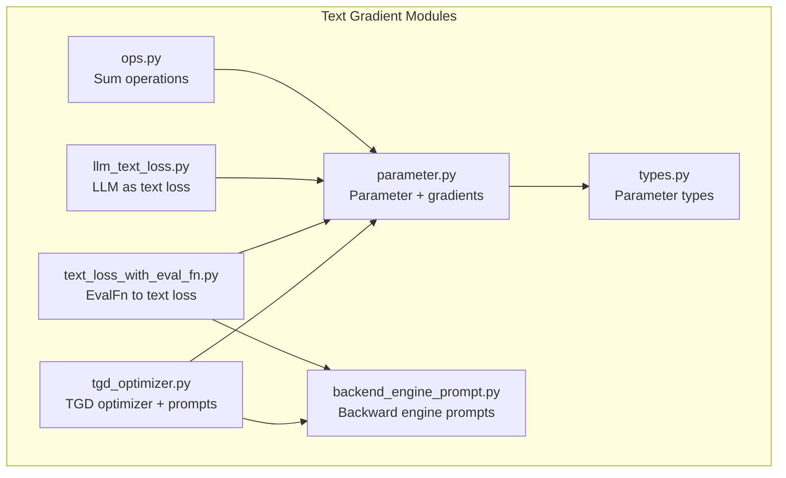
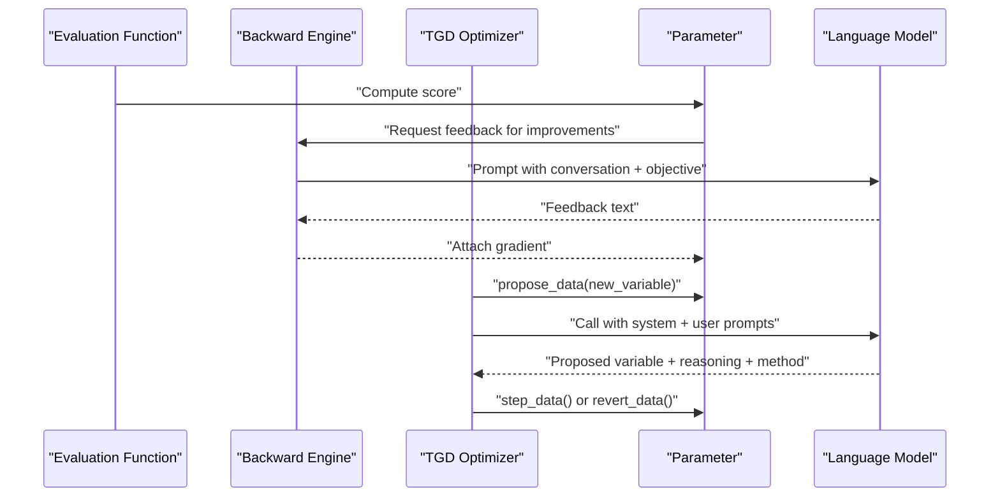
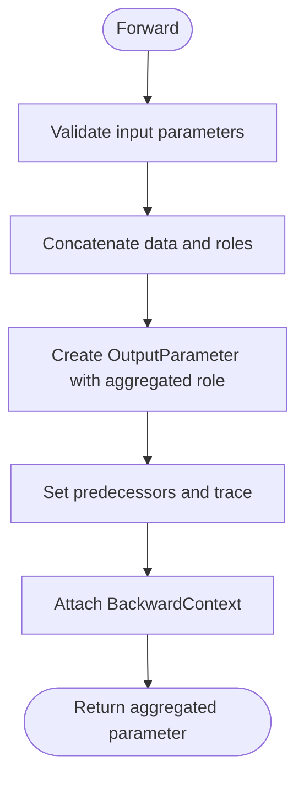
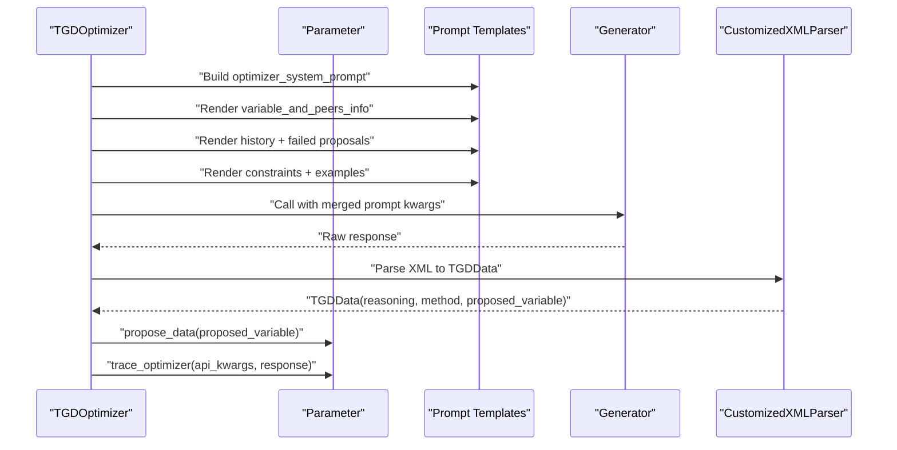
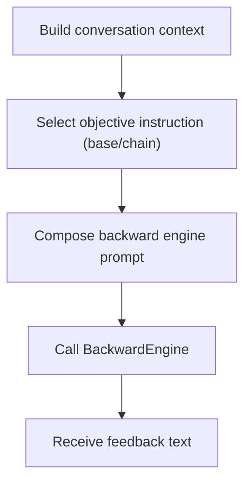
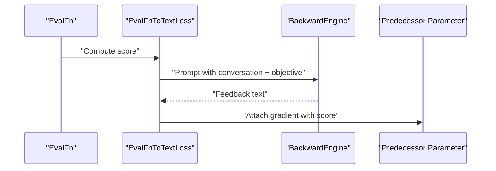
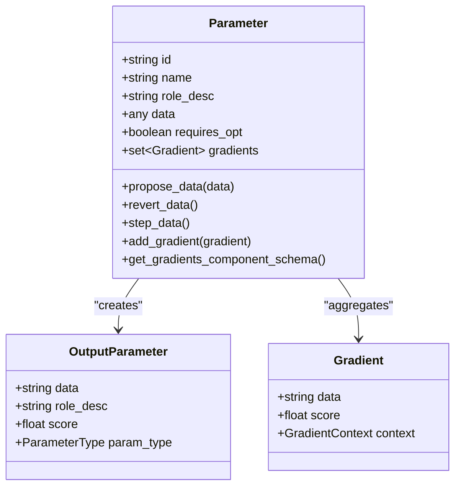
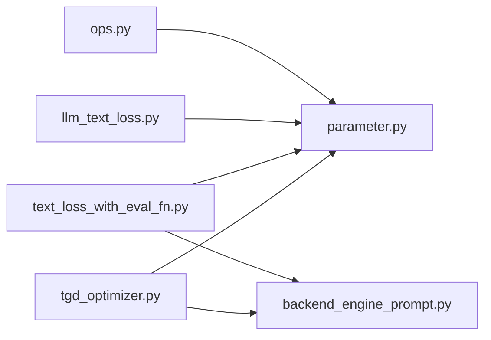

# Text Operations and Manipulation

<cite>
**Referenced Files in This Document**
- [ops.py](file://adalflow/adalflow/optim/text_grad/ops.py)
- [tgd_optimizer.py](file://adalflow/adalflow/optim/text_grad/tgd_optimizer.py)
- [backend_engine_prompt.py](file://adalflow/adalflow/optim/text_grad/backend_engine_prompt.py)
- [llm_text_loss.py](file://adalflow/adalflow/optim/text_grad/llm_text_loss.py)
- [text_loss_with_eval_fn.py](file://adalflow/adalflow/optim/text_grad/text_loss_with_eval_fn.py)
- [parameter.py](file://adalflow/adalflow/optim/parameter.py)
- [types.py](file://adalflow/adalflow/optim/types.py)
</cite>

## Table of Contents
1. [Introduction](#introduction)
2. [Project Structure](#project-structure)
3. [Core Components](#core-components)
4. [Architecture Overview](#architecture-overview)
5. [Detailed Component Analysis](#detailed-component-analysis)
6. [Dependency Analysis](#dependency-analysis)
7. [Performance Considerations](#performance-considerations)
8. [Troubleshooting Guide](#troubleshooting-guide)
9. [Conclusion](#conclusion)

## Introduction
This document explains the text operations and manipulation capabilities used in textual gradient descent (TGD). It focuses on how the system supports four core editing methods—ADD new elements, ADD examples, rephrase or replacement, and DELETE unnecessary words—and how these are integrated with prompting techniques and gradient feedback. It also covers operation selection strategies, context preservation, safety checks, and practical guidance for combining operations effectively during optimization.

## Project Structure
The TGD text operations are implemented across several modules:
- Text operations and aggregation: sum operations on parameters
- Textual gradient descent optimizer: orchestrating proposals, feedback, and updates
- Backward engine prompts: structuring feedback for text gradients
- Evaluation-to-text loss conversion: computing feedback from evaluation functions
- Parameter and types: data containers, gradients, and optimization metadata

**Diagram sources**
- [ops.py](file://adalflow/adalflow/optim/text_grad/ops.py#L14-L90)
- [tgd_optimizer.py](file://adalflow/adalflow/optim/text_grad/tgd_optimizer.py#L357-L713)
- [backend_engine_prompt.py](file://adalflow/adalflow/optim/text_grad/backend_engine_prompt.py#L12-L233)
- [llm_text_loss.py](file://adalflow/adalflow/optim/text_grad/llm_text_loss.py#L29-L75)
- [text_loss_with_eval_fn.py](file://adalflow/adalflow/optim/text_grad/text_loss_with_eval_fn.py#L36-L386)
- [parameter.py](file://adalflow/adalflow/optim/parameter.py#L119-L750)
- [types.py](file://adalflow/adalflow/optim/types.py#L13-L67)

**Section sources**
- [ops.py](file://adalflow/adalflow/optim/text_grad/ops.py#L1-L140)
- [tgd_optimizer.py](file://adalflow/adalflow/optim/text_grad/tgd_optimizer.py#L1-L224)
- [backend_engine_prompt.py](file://adalflow/adalflow/optim/text_grad/backend_engine_prompt.py#L1-L233)
- [llm_text_loss.py](file://adalflow/adalflow/optim/text_grad/llm_text_loss.py#L1-L75)
- [text_loss_with_eval_fn.py](file://adalflow/adalflow/optim/text_grad/text_loss_with_eval_fn.py#L1-L120)
- [parameter.py](file://adalflow/adalflow/optim/parameter.py#L1-L200)
- [types.py](file://adalflow/adalflow/optim/types.py#L1-L80)

## Core Components
- Sum operations: Concatenate parameter values and aggregate roles, supporting gradient propagation across batches.
- TGD optimizer: Generates proposals using a structured system prompt and user message template, integrating past history, peer awareness, and constraints.
- Backward engine prompts: Provide structured feedback to the language model for text gradients, including conversation context and objective instructions.
- EvalFn to text loss: Converts evaluation functions into text-based losses and computes feedback via a backward engine.
- Parameter and types: Define parameter roles, gradients, and optimization metadata; support proposing, reverting, and stepping updates.

**Section sources**
- [ops.py](file://adalflow/adalflow/optim/text_grad/ops.py#L14-L90)
- [tgd_optimizer.py](file://adalflow/adalflow/optim/text_grad/tgd_optimizer.py#L357-L713)
- [backend_engine_prompt.py](file://adalflow/adalflow/optim/text_grad/backend_engine_prompt.py#L12-L233)
- [text_loss_with_eval_fn.py](file://adalflow/adalflow/optim/text_grad/text_loss_with_eval_fn.py#L36-L160)
- [parameter.py](file://adalflow/adalflow/optim/parameter.py#L119-L250)
- [types.py](file://adalflow/adalflow/optim/types.py#L13-L67)

## Architecture Overview
The TGD system integrates evaluation feedback with text prompts to iteratively improve text variables. At a high level:
- An evaluation function produces a score.
- A backward engine generates feedback (gradient) text describing how to improve.
- The TGD optimizer proposes edits to the text variable using the four editing methods and prompting techniques.
- The process repeats, guided by history and peer awareness.

**Diagram sources**
- [text_loss_with_eval_fn.py](file://adalflow/adalflow/optim/text_grad/text_loss_with_eval_fn.py#L182-L386)
- [tgd_optimizer.py](file://adalflow/adalflow/optim/text_grad/tgd_optimizer.py#L545-L713)
- [parameter.py](file://adalflow/adalflow/optim/parameter.py#L610-L645)

## Detailed Component Analysis

### Sum Operations
Sum aggregates multiple parameters into a single output parameter by concatenating values and roles, enabling batch-level gradient combination.

**Diagram sources**
- [ops.py](file://adalflow/adalflow/optim/text_grad/ops.py#L46-L90)

**Section sources**
- [ops.py](file://adalflow/adalflow/optim/text_grad/ops.py#L14-L90)
- [types.py](file://adalflow/adalflow/optim/types.py#L44-L54)

### TGD Optimizer: Editing Methods and Prompting Integration
The TGD optimizer defines four editing methods and six prompting techniques. It constructs a user message template that includes:
- Variable and peers information
- System variables
- Past history
- Failed proposals
- Context feedback
- Constraints
- In-context examples

Key behaviors:
- Operation selection: The system prompt instructs the model to choose one of the four editing methods and one of the six prompting techniques.
- Context preservation: Peers and system variables are included to maintain scope and avoid cross-variable interference.
- Safety and validation: The optimizer compares proposed and current values and only applies updates if different and non-empty.

**Diagram sources**
- [tgd_optimizer.py](file://adalflow/adalflow/optim/text_grad/tgd_optimizer.py#L357-L713)
- [tgd_optimizer.py](file://adalflow/adalflow/optim/text_grad/tgd_optimizer.py#L270-L340)

Practical examples and guidance:
- ADD new elements: Insert clarifications or constraints when feedback indicates missing specificity.
- ADD examples: Include input-reasoning-answer demonstrations for reasoning-heavy tasks.
- Rephrase/Replace: Improve clarity or swap problematic phrasing when feedback highlights ambiguity.
- DELETE unnecessary words: Remove redundant or confusing text to improve focus and readability.
- Prompting techniques: Role-setting, specificity, chain-of-thought, examples, constraints/formatting, self-consistency/verification.

Operation selection strategies:
- Choose ADD when feedback indicates missing information or insufficient guidance.
- Choose Rephrase/Replace when feedback highlights unclear or contradictory phrasing.
- Choose DELETE when feedback emphasizes verbosity or irrelevant content.
- Combine with a prompting technique that aligns with the task (e.g., CoT for reasoning, constraints for formatting).

Context preservation techniques:
- Include peers and system variables to keep edits scoped and coherent.
- Use past history to retain successful patterns and avoid repeating failed attempts.
- Leverage failed proposals to diversify approaches.

Integration with prompting:
- The system prompt enumerates editing methods and techniques.
- The user message template organizes context, feedback, constraints, and examples.

**Section sources**
- [tgd_optimizer.py](file://adalflow/adalflow/optim/text_grad/tgd_optimizer.py#L46-L224)
- [tgd_optimizer.py](file://adalflow/adalflow/optim/text_grad/tgd_optimizer.py#L545-L713)
- [backend_engine_prompt.py](file://adalflow/adalflow/optim/text_grad/backend_engine_prompt.py#L160-L183)

### Backward Engine Prompts: Structured Feedback
The backward engine templates structure feedback to guide text improvements:
- Conversation context: Inputs, outputs, and evaluation details.
- Objective instructions: Guidance tailored to the response and evaluation function.
- Peer/system awareness: Ensures feedback respects inter-variable relationships.

**Diagram sources**
- [backend_engine_prompt.py](file://adalflow/adalflow/optim/text_grad/backend_engine_prompt.py#L53-L157)
- [text_loss_with_eval_fn.py](file://adalflow/adalflow/optim/text_grad/text_loss_with_eval_fn.py#L225-L315)

**Section sources**
- [backend_engine_prompt.py](file://adalflow/adalflow/optim/text_grad/backend_engine_prompt.py#L12-L233)
- [text_loss_with_eval_fn.py](file://adalflow/adalflow/optim/text_grad/text_loss_with_eval_fn.py#L182-L386)

### Evaluation-to-Text Loss: Feedback Generation
The EvalFnToTextLoss component converts evaluation functions into text-based losses and triggers backward engine prompts to produce feedback.

**Diagram sources**
- [text_loss_with_eval_fn.py](file://adalflow/adalflow/optim/text_grad/text_loss_with_eval_fn.py#L93-L160)
- [text_loss_with_eval_fn.py](file://adalflow/adalflow/optim/text_grad/text_loss_with_eval_fn.py#L324-L386)

**Section sources**
- [text_loss_with_eval_fn.py](file://adalflow/adalflow/optim/text_grad/text_loss_with_eval_fn.py#L36-L160)
- [llm_text_loss.py](file://adalflow/adalflow/optim/text_grad/llm_text_loss.py#L29-L75)

### Parameter and Gradient Management
Parameters encapsulate data, roles, gradients, and optimization state. They support proposing, reverting, and stepping updates, and aggregate gradients with context.

**Diagram sources**
- [parameter.py](file://adalflow/adalflow/optim/parameter.py#L119-L250)
- [parameter.py](file://adalflow/adalflow/optim/parameter.py#L286-L320)
- [parameter.py](file://adalflow/adalflow/optim/parameter.py#L610-L645)
- [types.py](file://adalflow/adalflow/optim/types.py#L44-L54)

**Section sources**
- [parameter.py](file://adalflow/adalflow/optim/parameter.py#L119-L250)
- [parameter.py](file://adalflow/adalflow/optim/parameter.py#L321-L487)
- [parameter.py](file://adalflow/adalflow/optim/parameter.py#L610-L645)
- [types.py](file://adalflow/adalflow/optim/types.py#L13-L67)

## Dependency Analysis
- TGD optimizer depends on:
  - Parameter for state and gradient management
  - Backward engine prompts for structured feedback
  - XML parser for extracting proposed variables
- EvalFn to text loss depends on:
  - Backward engine for feedback generation
  - Parameter for gradient attachment
- Sum operations depend on Parameter for aggregation

**Diagram sources**
- [tgd_optimizer.py](file://adalflow/adalflow/optim/text_grad/tgd_optimizer.py#L357-L713)
- [text_loss_with_eval_fn.py](file://adalflow/adalflow/optim/text_grad/text_loss_with_eval_fn.py#L36-L160)
- [llm_text_loss.py](file://adalflow/adalflow/optim/text_grad/llm_text_loss.py#L29-L75)
- [ops.py](file://adalflow/adalflow/optim/text_grad/ops.py#L14-L90)
- [parameter.py](file://adalflow/adalflow/optim/parameter.py#L119-L250)

**Section sources**
- [tgd_optimizer.py](file://adalflow/adalflow/optim/text_grad/tgd_optimizer.py#L357-L713)
- [text_loss_with_eval_fn.py](file://adalflow/adalflow/optim/text_grad/text_loss_with_eval_fn.py#L36-L160)
- [ops.py](file://adalflow/adalflow/optim/text_grad/ops.py#L14-L90)
- [parameter.py](file://adalflow/adalflow/optim/parameter.py#L119-L250)

## Performance Considerations
- Batch-awareness: The system encourages applying changes across the batch (except demonstrations) to reduce per-item overhead.
- Peer awareness: Limiting scope to peers and system variables reduces cross-interference and improves convergence stability.
- History utilization: Past iterations and failed proposals help diversify and accelerate improvement.
- Token economy: Short-value helpers can truncate long text to reduce prompt size when appropriate.

[No sources needed since this section provides general guidance]

## Troubleshooting Guide
Common issues and safeguards:
- No improvement detected: Verify that proposed variables differ from current values and are non-empty before applying updates.
- Repeated failures: Use failed proposals to diversify approaches; leverage past history to avoid repeating unsuccessful patterns.
- Excessive verbosity: Prefer DELETE operations to trim redundant content; combine with constraints/formatting techniques.
- Ambiguity or unclear phrasing: Use Rephrase/Replace guided by feedback; incorporate examples and chain-of-thought techniques.
- Gradient already computed: The system tracks response IDs to avoid redundant backward passes.

**Section sources**
- [tgd_optimizer.py](file://adalflow/adalflow/optim/text_grad/tgd_optimizer.py#L674-L683)
- [parameter.py](file://adalflow/adalflow/optim/parameter.py#L269-L272)
- [parameter.py](file://adalflow/adalflow/optim/parameter.py#L321-L393)

## Conclusion
The TGD system provides a robust framework for text manipulation through four editing methods and six prompting techniques. By structuring feedback, preserving context via peers and system variables, and validating changes, it enables safe and effective optimization of text variables. Combining operations strategically—adding clarity, examples, or constraints, and removing redundancy—yields stronger outcomes aligned with evaluation feedback.