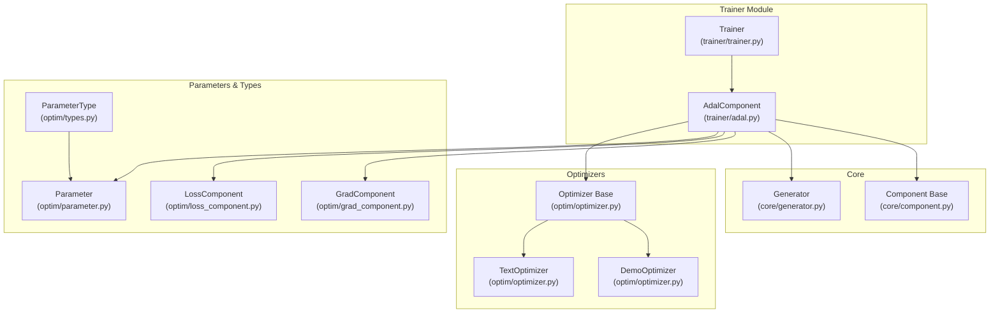
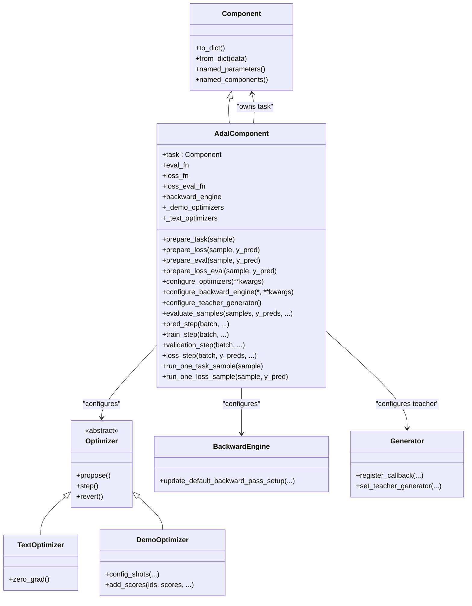
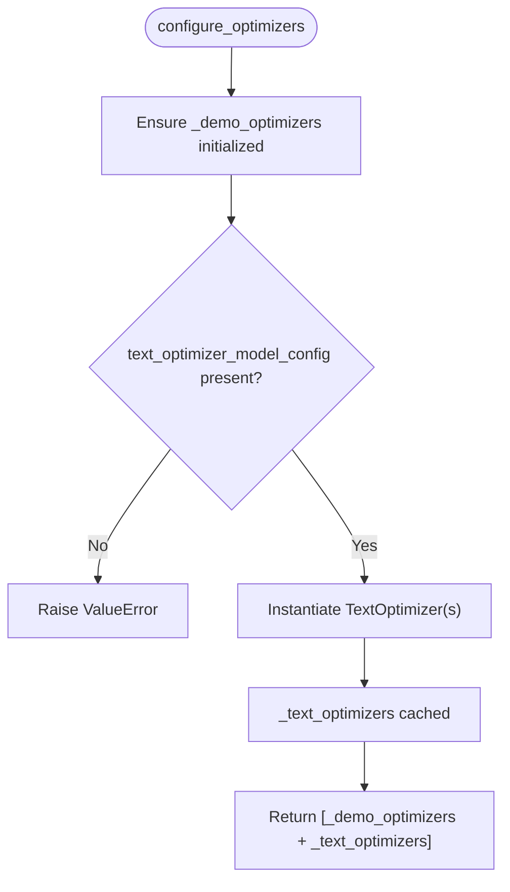
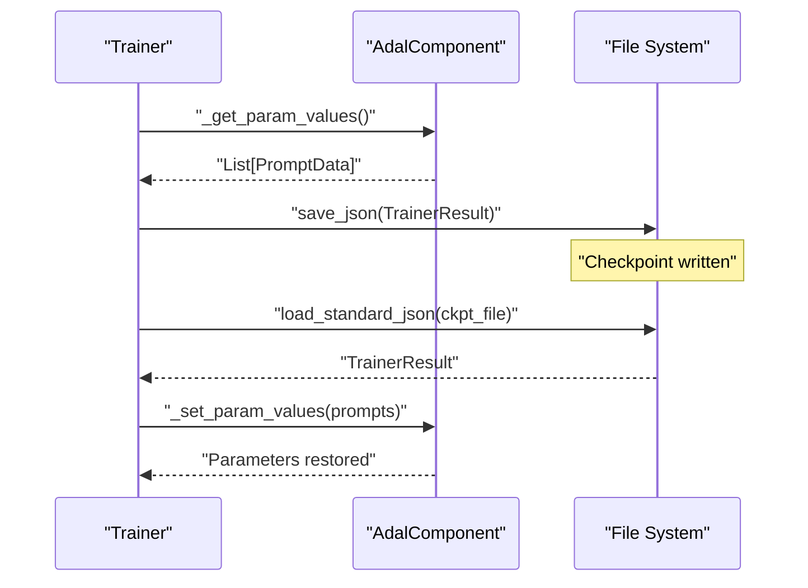
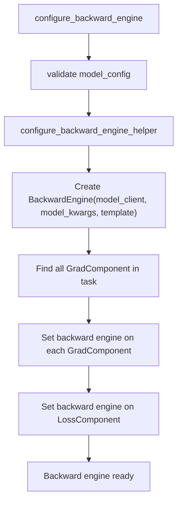
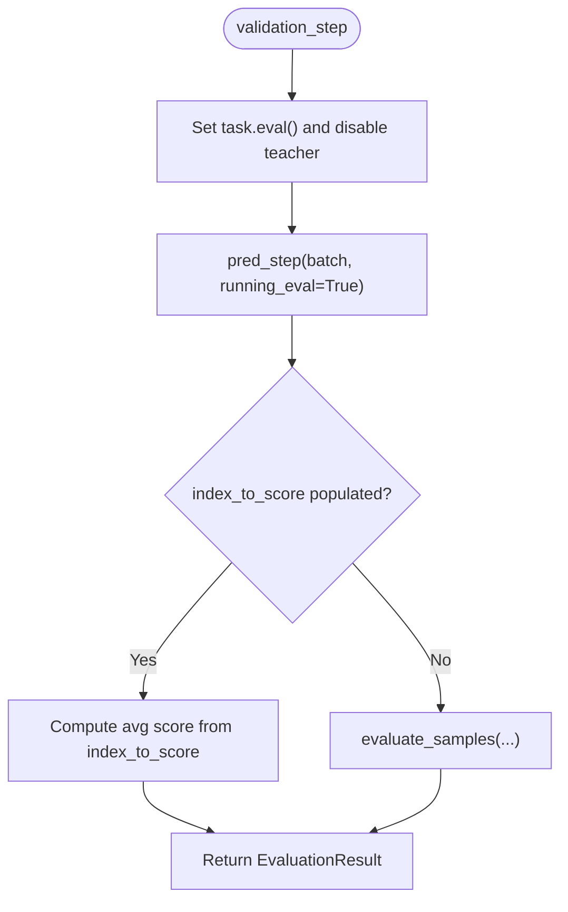
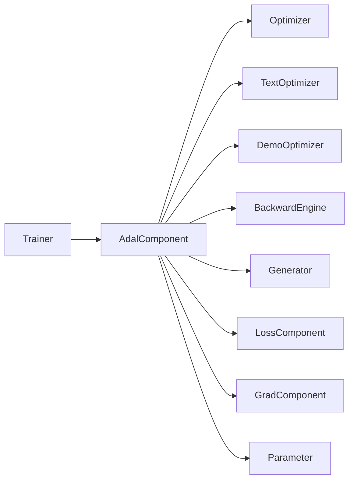

# AdalComponent Integration

<cite>
**Referenced Files in This Document**
- [adal.py](file://adalflow/adalflow/optim/trainer/adal.py)
- [trainer.py](file://adalflow/adalflow/optim/trainer/trainer.py)
- [optimizer.py](file://adalflow/adalflow/optim/optimizer.py)
- [types.py](file://adalflow/adalflow/optim/types.py)
- [parameter.py](file://adalflow/adalflow/optim/parameter.py)
- [grad_component.py](file://adalflow/adalflow/optim/grad_component.py)
- [loss_component.py](file://adalflow/adalflow/optim/loss_component.py)
- [generator.py](file://adalflow/adalflow/core/generator.py)
- [component.py](file://adalflow/adalflow/core/component.py)
- [test_trainer.py](file://adalflow/tests/test_trainer.py)
</cite>

## Table of Contents
1. [Introduction](#introduction)
2. [Project Structure](#project-structure)
3. [Core Components](#core-components)
4. [Architecture Overview](#architecture-overview)
5. [Detailed Component Analysis](#detailed-component-analysis)
6. [Dependency Analysis](#dependency-analysis)
7. [Performance Considerations](#performance-considerations)
8. [Troubleshooting Guide](#troubleshooting-guide)
9. [Conclusion](#conclusion)
10. [Appendices](#appendices)

## Introduction
This document explains the AdalComponent integration within the training framework. AdalComponent acts as a task pipeline wrapper that orchestrates training, evaluation, and validation for LLM-based tasks. It integrates tightly with the Trainer system to coordinate optimizers (TextOptimizer and DemoOptimizer), backward pass setup, parameter tracking, and checkpointing. The document covers class design, configuration, optimization setup, serialization, debugging workflows, and extension patterns for building custom training scenarios.

## Project Structure
The AdalComponent resides in the trainer module alongside the Trainer orchestration class. Supporting modules include optimizer abstractions, parameter types, gradient components, and loss components. The core Component base class provides shared capabilities for serialization and component composition.



**Diagram sources**
- [adal.py](file://adalflow/adalflow/optim/trainer/adal.py#L30-L80)
- [trainer.py](file://adalflow/adalflow/optim/trainer/trainer.py#L42-L192)
- [optimizer.py](file://adalflow/adalflow/optim/optimizer.py#L12-L92)
- [types.py](file://adalflow/adalflow/optim/types.py#L13-L68)
- [parameter.py](file://adalflow/adalflow/optim/parameter.py)
- [grad_component.py](file://adalflow/adalflow/optim/grad_component.py)
- [loss_component.py](file://adalflow/adalflow/optim/loss_component.py)
- [generator.py](file://adalflow/adalflow/core/generator.py)
- [component.py](file://adalflow/adalflow/core/component.py)

**Section sources**
- [adal.py](file://adalflow/adalflow/optim/trainer/adal.py#L1-L80)
- [trainer.py](file://adalflow/adalflow/optim/trainer/trainer.py#L1-L120)

## Core Components
- AdalComponent: Task pipeline wrapper that defines prepare_task, prepare_loss, prepare_eval, prepare_loss_eval, and exposes evaluation and training steps. It manages parameter tracking, backward engine configuration, and callback registration for tracing.
- Trainer: Orchestrates training loops, selects optimization strategies, coordinates optimizers, handles validation, and manages checkpoints and diagnostics.
- Optimizer family: Base Optimizer, TextOptimizer (textual gradient descent), and DemoOptimizer (few-shot examples optimization).
- Parameter and types: ParameterType enumerates parameter categories (PROMPT, DEMOS, INPUT, OUTPUT, etc.), and PromptData carries serialized parameter state.
- Gradient and loss components: GradComponent and LossComponent integrate with backward engines and parameterized loss computation.

Key responsibilities:
- AdalComponent: Encapsulates the task, prepares callables for training/inference, evaluates predictions, configures optimizers/backward engine, and manages parameter serialization.
- Trainer: Manages lifecycle, validation thresholds, proposal cycles, and checkpoint persistence.

**Section sources**
- [adal.py](file://adalflow/adalflow/optim/trainer/adal.py#L30-L190)
- [trainer.py](file://adalflow/adalflow/optim/trainer/trainer.py#L42-L192)
- [optimizer.py](file://adalflow/adalflow/optim/optimizer.py#L12-L92)
- [types.py](file://adalflow/adalflow/optim/types.py#L85-L163)

## Architecture Overview
The AdalComponent sits at the center of the training pipeline, receiving a task Component and coordinating with Trainer. Trainer configures optimizers, sets up backward engines for gradient computation, and drives training/validation loops. AdalComponent exposes hooks for preparing task calls, loss computation, and evaluation, while managing parameter tracking and tracing.

```mermaid
sequenceDiagram
participant User as "User Code"
participant Trainer as "Trainer.fit()"
participant Adal as "AdalComponent"
participant Opt as "Optimizers"
participant Back as "Backward Engine"
participant Task as "Task Component"
User->>Trainer : "fit(...)"
Trainer->>Adal : "configure_optimizers(**kwargs)"
Adal-->>Opt : "returns [DemoOptimizer, TextOptimizer]"
Trainer->>Adal : "configure_backward_engine(...)"
Adal->>Back : "configure_backward_engine_helper(...)"
Trainer->>Adal : "train_step(batch)"
Adal->>Task : "prepare_task(sample)"
Task-->>Adal : "Parameter or output"
Adal-->>Trainer : "List[Parameter]"
Trainer->>Adal : "loss_step(batch, y_preds)"
Adal->>Task : "prepare_loss(sample, y_pred)"
Task-->>Adal : "Loss Parameter"
Adal-->>Trainer : "List[Loss Parameter]"
Trainer->>Adal : "validation_step(val_dataset)"
Adal->>Task : "prepare_eval(...)/prepare_loss_eval(...)"
Task-->>Adal : "score(s)"
Adal-->>Trainer : "EvaluationResult"
Trainer->>Adal : "checkpoint/save"
```

**Diagram sources**
- [trainer.py](file://adalflow/adalflow/optim/trainer/trainer.py#L418-L698)
- [adal.py](file://adalflow/adalflow/optim/trainer/adal.py#L175-L207)
- [generator.py](file://adalflow/adalflow/core/generator.py)

## Detailed Component Analysis

### AdalComponent Class Design
AdalComponent extends the base Component and centralizes:
- Task encapsulation (task Component)
- Callable preparation (prepare_task, prepare_loss, prepare_eval, prepare_loss_eval)
- Parameter management (_set_param_values, _get_param_values)
- Multi-threaded training/prediction/validation
- Backward engine configuration and disabling
- Teacher generator configuration
- Callback registration for tracing

Notable behaviors:
- Enforces that training outputs are Parameters and evaluation outputs are raw predictions.
- Supports parallel evaluation and prediction with thread pools.
- Provides hooks for debugging and tracing via callbacks.



**Diagram sources**
- [adal.py](file://adalflow/adalflow/optim/trainer/adal.py#L30-L800)
- [optimizer.py](file://adalflow/adalflow/optim/optimizer.py#L12-L92)
- [generator.py](file://adalflow/adalflow/core/generator.py)

**Section sources**
- [adal.py](file://adalflow/adalflow/optim/trainer/adal.py#L30-L800)

### Optimizer Integration and Configuration
- configure_optimizers returns a list combining DemoOptimizer and TextOptimizer instances. It validates required configurations for text optimizers and caches instantiated optimizers.
- configure_backward_engine sets up a BackwardEngine for all GradComponent instances in the task and for the loss function.
- configure_teacher_generator attaches teacher generators to all Generator components in the task.

Practical configuration keys:
- text_optimizer_model_config: model_client and model_kwargs are mandatory for text optimizers.
- backward_engine_model_config: model_client, model_kwargs, and optional template/backward_pass_setup.
- teacher_model_config: model_client, model_kwargs, and optional template.



**Diagram sources**
- [adal.py](file://adalflow/adalflow/optim/trainer/adal.py#L175-L190)

**Section sources**
- [adal.py](file://adalflow/adalflow/optim/trainer/adal.py#L175-L207)
- [optimizer.py](file://adalflow/adalflow/optim/optimizer.py#L31-L92)

### Parameter Tracking and Serialization
- _get_param_values serializes trainable parameters into PromptData for checkpointing and restoration.
- _set_param_values restores parameter values from a list of PromptData.
- Trainer persists and loads checkpoints via JSON, restoring the best validation score’s prompts and reapplying them to AdalComponent.



**Diagram sources**
- [trainer.py](file://adalflow/adalflow/optim/trainer/trainer.py#L391-L417)
- [types.py](file://adalflow/adalflow/optim/types.py#L85-L93)
- [adal.py](file://adalflow/adalflow/optim/trainer/adal.py#L81-L96)

**Section sources**
- [trainer.py](file://adalflow/adalflow/optim/trainer/trainer.py#L391-L417)
- [types.py](file://adalflow/adalflow/optim/types.py#L85-L93)
- [adal.py](file://adalflow/adalflow/optim/trainer/adal.py#L81-L96)

### Backward Pass Setup and Gradient Computation
- configure_backward_engine_helper creates a BackwardEngine and propagates it to all GradComponent instances and the LossComponent.
- disable_backward_engine_helper disables backward engines for GradComponent and LossComponent.
- Trainer orchestrates backward passes during training and validation, optionally disabling gradients for specific modes.



**Diagram sources**
- [adal.py](file://adalflow/adalflow/optim/trainer/adal.py#L192-L207)
- [adal.py](file://adalflow/adalflow/optim/trainer/adal.py#L670-L704)

**Section sources**
- [adal.py](file://adalflow/adalflow/optim/trainer/adal.py#L192-L207)
- [adal.py](file://adalflow/adalflow/optim/trainer/adal.py#L670-L704)

### Evaluation and Validation Pipelines
- evaluate_samples runs evaluation in parallel using ThreadPoolExecutor, supporting both standard eval_fn and loss_eval_fn.
- pred_step performs prediction in evaluation mode, optionally enabling running evaluation with early stopping based on a minimum score bound.
- validation_step delegates to evaluate_samples or running evaluation depending on configuration.



**Diagram sources**
- [adal.py](file://adalflow/adalflow/optim/trainer/adal.py#L508-L576)
- [adal.py](file://adalflow/adalflow/optim/trainer/adal.py#L400-L490)

**Section sources**
- [adal.py](file://adalflow/adalflow/optim/trainer/adal.py#L508-L576)
- [adal.py](file://adalflow/adalflow/optim/trainer/adal.py#L400-L490)

### Practical Examples and Workflows
- Creating a custom AdalComponent:
  - Subclass AdalComponent and implement prepare_task, prepare_loss, prepare_eval, and optionally prepare_loss_eval.
  - Configure optimizers via configure_optimizers and backward engine via configure_backward_engine.
  - Use configure_teacher_generator for DemoOptimizer scenarios requiring bootstrap examples.
- Configuring optimizers:
  - Provide text_optimizer_model_config with model_client and model_kwargs.
  - Trainer will split returned optimizers into TextOptimizer and DemoOptimizer lists.
- Setting up training pipelines:
  - Build a task Component with Generators, GradComponent, and LossComponent.
  - Instantiate Trainer with AdalComponent and datasets; Trainer will orchestrate steps and checkpoints.

[No sources needed since this section aggregates usage patterns without quoting specific code]

### Extending AdalComponent for Custom Scenarios
- Override training-specific hooks:
  - train_step to enforce task.train() before training.
  - validation_step to customize evaluation thresholds or metrics.
- Integrate external components:
  - Use configure_teacher_generator to attach teacher generators to Generators.
  - Use configure_backward_engine to enable gradient computation for GradComponent.
- Manage complex pipelines:
  - Use named_components and named_parameters to discover and configure subcomponents dynamically.
  - Leverage callbacks via configure_callbacks for tracing and debugging.

[No sources needed since this section provides extension guidance]

## Dependency Analysis
AdalComponent depends on:
- Optimizer family for parameter updates
- BackwardEngine for gradient computation
- Generator for tracing and teacher generation
- Parameter and LossComponent for structured computation and gradients
- Trainer for orchestration and checkpointing



**Diagram sources**
- [trainer.py](file://adalflow/adalflow/optim/trainer/trainer.py#L42-L192)
- [adal.py](file://adalflow/adalflow/optim/trainer/adal.py#L30-L800)
- [optimizer.py](file://adalflow/adalflow/optim/optimizer.py#L12-L92)

**Section sources**
- [trainer.py](file://adalflow/adalflow/optim/trainer/trainer.py#L42-L192)
- [adal.py](file://adalflow/adalflow/optim/trainer/adal.py#L30-L800)
- [optimizer.py](file://adalflow/adalflow/optim/optimizer.py#L12-L92)

## Performance Considerations
- Parallelism: AdalComponent uses ThreadPoolExecutor for training, prediction, and evaluation to improve throughput.
- Batch strategies: Trainer supports constrained and random strategies, with moving batches and subset sampling to balance error and correct examples.
- Backward control: Trainer can disable backward gradients or entire backward engines for specific modes to reduce overhead.
- Checkpointing: Periodic checkpoint writes capture validation/test scores and parameter states for recovery.

[No sources needed since this section provides general guidance]

## Troubleshooting Guide
Common issues and resolutions:
- Missing configurations:
  - Text optimizer model config or model kwargs missing raises explicit errors in configure_optimizers.
  - Backward engine and teacher generator require complete model_client/model_kwargs.
- Parameter mismatches:
  - Training outputs must be Parameters; evaluation outputs must be raw predictions.
  - ID checks ensure prediction alignment with samples.
- Evaluation failures:
  - evaluate_samples raises exceptions on worker errors; inspect futures and logs.
- Checkpoint restoration:
  - Trainer selects the best validation score and restores prompts via AdalComponent._set_param_values.

**Section sources**
- [adal.py](file://adalflow/adalflow/optim/trainer/adal.py#L175-L207)
- [adal.py](file://adalflow/adalflow/optim/trainer/adal.py#L336-L390)
- [trainer.py](file://adalflow/adalflow/optim/trainer/trainer.py#L391-L417)

## Conclusion
AdalComponent provides a cohesive abstraction for composing training pipelines around a task Component. It integrates seamlessly with Trainer to manage optimizers, backward engines, and evaluation, while offering robust parameter tracking, serialization, and debugging capabilities. By following the configuration patterns and extension guidelines, developers can build flexible, scalable training systems tailored to diverse LLM tasks.

[No sources needed since this section summarizes without analyzing specific files]

## Appendices

### API Reference Highlights
- AdalComponent methods:
  - prepare_task, prepare_loss, prepare_eval, prepare_loss_eval
  - configure_optimizers, configure_backward_engine, configure_teacher_generator
  - evaluate_samples, pred_step, train_step, validation_step, loss_step
  - run_one_task_sample, run_one_loss_sample
- Trainer methods:
  - fit, diagnose, initial_validation, gather_trainer_states, prep_ckpt_file_path
  - _fit_text_grad_random, _fit_text_grad_constraint, _fit_demos_random
  - _text_grad_constraint_propose_step, _random_propose_step

**Section sources**
- [adal.py](file://adalflow/adalflow/optim/trainer/adal.py#L98-L576)
- [trainer.py](file://adalflow/adalflow/optim/trainer/trainer.py#L418-L2384)