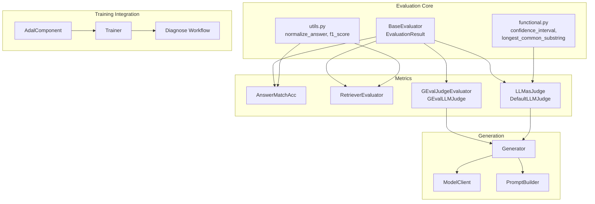
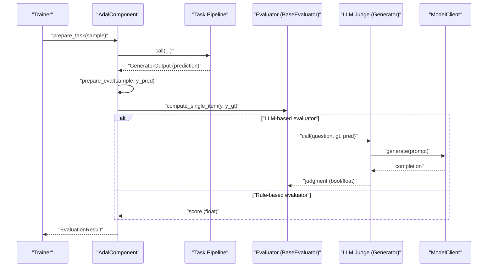
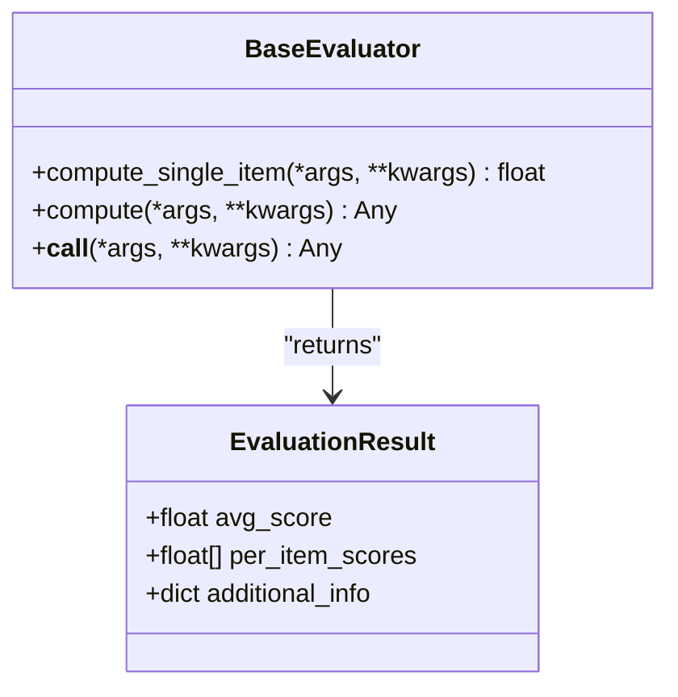
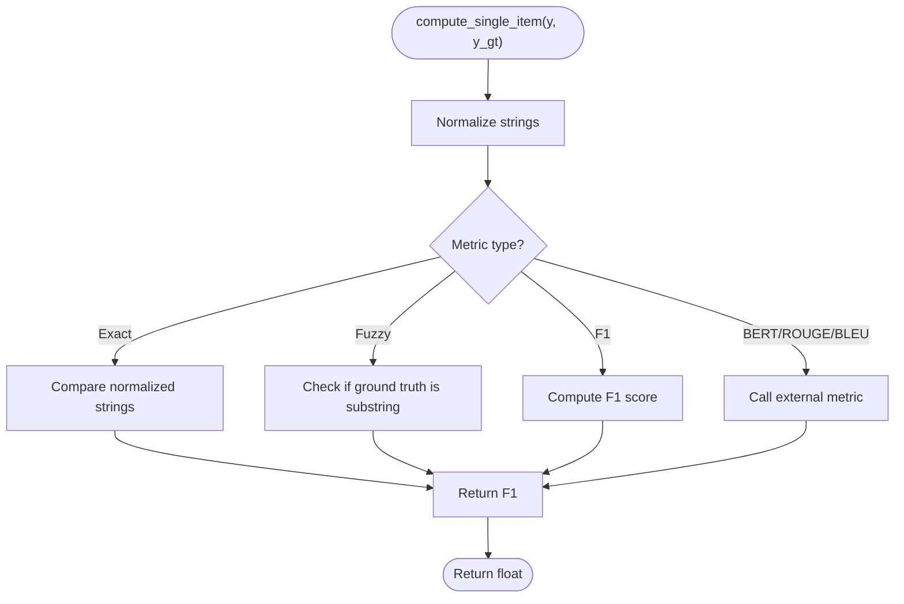
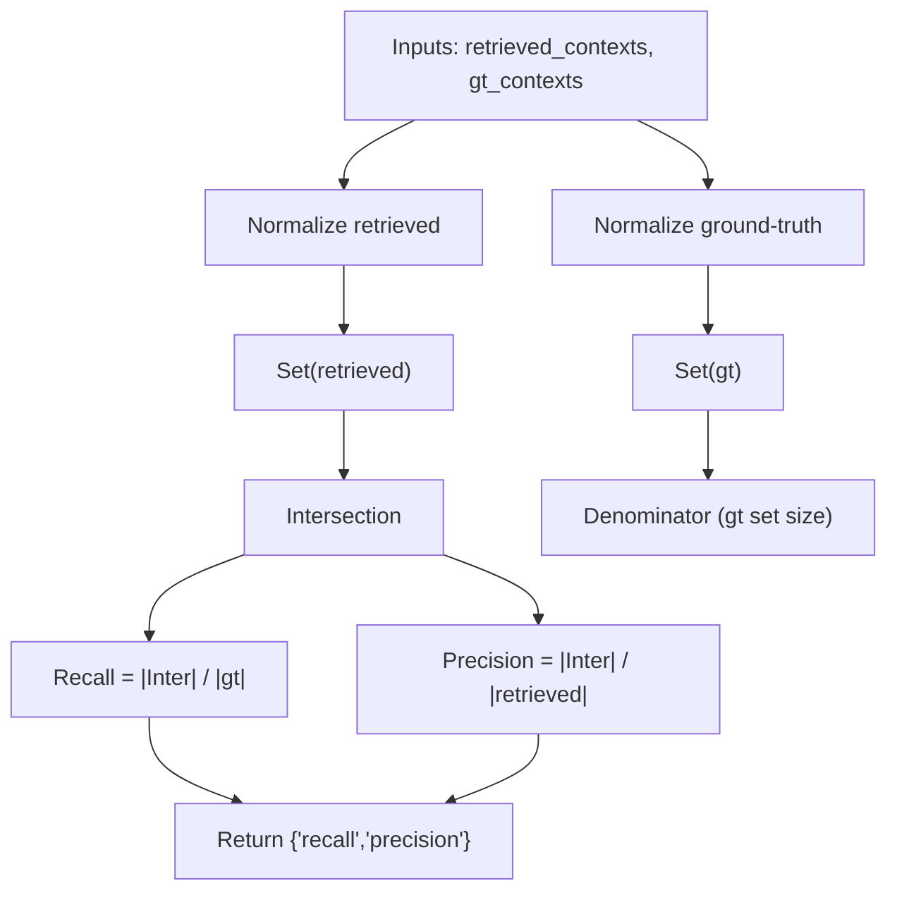
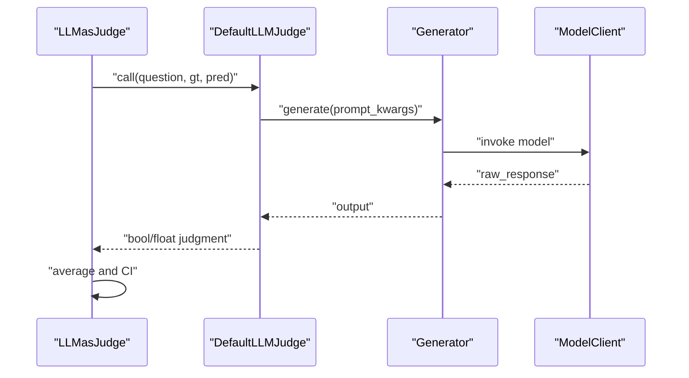
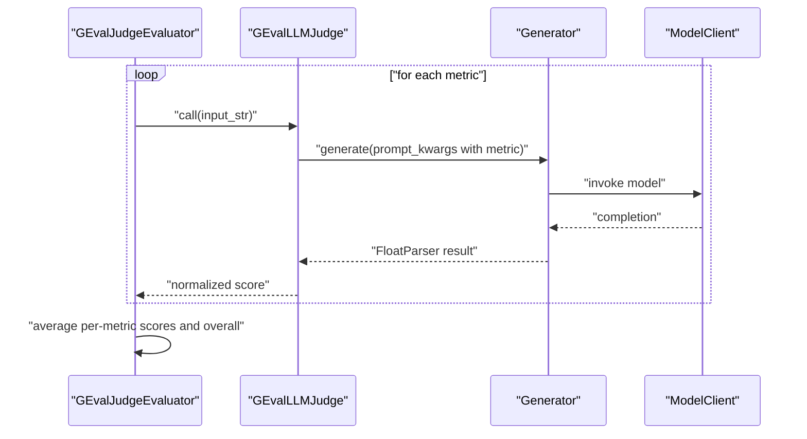
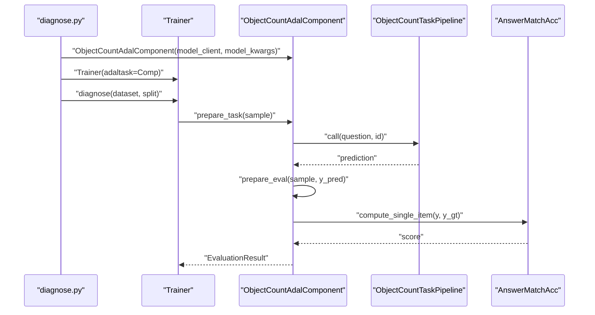
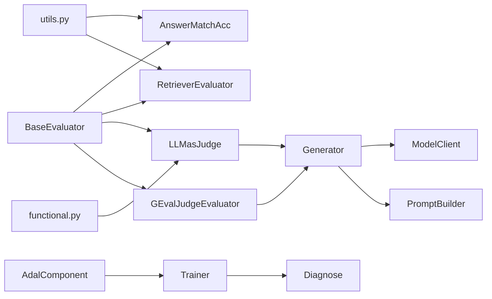

# Evaluation and Validation

<cite>
**Referenced Files in This Document**
- [base.py](file://adalflow/adalflow/eval/base.py)
- [answer_match_acc.py](file://adalflow/adalflow/eval/answer_match_acc.py)
- [retriever_recall.py](file://adalflow/adalflow/eval/retriever_recall.py)
- [llm_as_judge.py](file://adalflow/adalflow/eval/llm_as_judge.py)
- [g_eval.py](file://adalflow/adalflow/eval/g_eval.py)
- [utils.py](file://adalflow/adalflow/eval/utils.py)
- [functional.py](file://adalflow/adalflow/eval/functional.py)
- [diagnose.py](file://use_cases/question_answering/bbh/object_count/diagnose.py)
- [trainer.py](file://adalflow/adalflow/optim/trainer/trainer.py)
- [AdalComponent](file://adalflow/adalflow/core/component.py)
- [Generator](file://adalflow/adalflow/core/generator.py)
- [ModelClient](file://adalflow/adalflow/core/model_client.py)
- [Prompt Builder](file://adalflow/adalflow/core/prompt_builder.py)
- [Trainer Diagnostics](file://adalflow/adalflow/optim/trainer/trainer.py)
</cite>

## Table of Contents
1. [Introduction](#introduction)
2. [Project Structure](#project-structure)
3. [Core Components](#core-components)
4. [Architecture Overview](#architecture-overview)
5. [Detailed Component Analysis](#detailed-component-analysis)
6. [Dependency Analysis](#dependency-analysis)
7. [Performance Considerations](#performance-considerations)
8. [Troubleshooting Guide](#troubleshooting-guide)
9. [Conclusion](#conclusion)
10. [Appendices](#appendices)

## Introduction
This document explains the evaluation and validation systems integrated into the training framework. It focuses on validation procedures, scoring mechanisms, performance measurement techniques, and error analysis workflows. It documents how to set up evaluation metrics, interpret validation results, and analyze training performance. It also covers integration with external evaluators, custom scoring functions, automated evaluation pipelines, best practices for detecting overfitting, and continuous performance monitoring strategies.

## Project Structure
The evaluation subsystem centers around a small set of modules under the evaluation namespace, plus supporting utilities and integration points with the training and component systems.

**Diagram sources**
- [base.py](file://adalflow/adalflow/eval/base.py#L17-L31)
- [answer_match_acc.py](file://adalflow/adalflow/eval/answer_match_acc.py#L9-L157)
- [retriever_recall.py](file://adalflow/adalflow/eval/retriever_recall.py#L9-L125)
- [llm_as_judge.py](file://adalflow/adalflow/eval/llm_as_judge.py#L61-L249)
- [g_eval.py](file://adalflow/adalflow/eval/g_eval.py#L92-L259)
- [utils.py](file://adalflow/adalflow/eval/utils.py#L8-L48)
- [functional.py](file://adalflow/adalflow/eval/functional.py#L5-L95)
- [AdalComponent](file://adalflow/adalflow/core/component.py)
- [trainer.py](file://adalflow/adalflow/optim/trainer/trainer.py)
- [Generator](file://adalflow/adalflow/core/generator.py)
- [ModelClient](file://adalflow/adalflow/core/model_client.py)
- [Prompt Builder](file://adalflow/adalflow/core/prompt_builder.py)

**Section sources**
- [base.py](file://adalflow/adalflow/eval/base.py#L1-L32)
- [answer_match_acc.py](file://adalflow/adalflow/eval/answer_match_acc.py#L1-L158)
- [retriever_recall.py](file://adalflow/adalflow/eval/retriever_recall.py#L1-L148)
- [llm_as_judge.py](file://adalflow/adalflow/eval/llm_as_judge.py#L1-L250)
- [g_eval.py](file://adalflow/adalflow/eval/g_eval.py#L1-L264)
- [utils.py](file://adalflow/adalflow/eval/utils.py#L1-L49)
- [functional.py](file://adalflow/adalflow/eval/functional.py#L1-L96)

## Core Components
- BaseEvaluator and EvaluationResult define the contract for all evaluators: a compute method for batch evaluation and a compute_single_item for per-item scoring, returning an EvaluationResult with average and per-item scores plus optional metadata.
- AnswerMatchAcc supports exact, fuzzy, F1, BLEU, ROUGE, and BERTScore-based matching for QA answer correctness.
- RetrieverEvaluator computes recall and precision for retrieval contexts against ground-truth contexts using normalized string matching.
- LLMasJudge and DefaultLLMJudge integrate an LLM via Generator to judge whether predicted answers contain ground-truth answers, returning a boolean or float judgment and computing a confidence interval across judgments.
- GEvalJudgeEvaluator and GEvalLLMJudge use an LLM to score natural language generation along four axes (Relevance, Fluency, Consistency, Coherence), normalizing scores to [0, 1] and aggregating an overall score.

**Section sources**
- [base.py](file://adalflow/adalflow/eval/base.py#L8-L31)
- [answer_match_acc.py](file://adalflow/adalflow/eval/answer_match_acc.py#L9-L157)
- [retriever_recall.py](file://adalflow/adalflow/eval/retriever_recall.py#L9-L125)
- [llm_as_judge.py](file://adalflow/adalflow/eval/llm_as_judge.py#L61-L249)
- [g_eval.py](file://adalflow/adalflow/eval/g_eval.py#L92-L259)

## Architecture Overview
The evaluation architecture is modular and composable:
- Metrics implement BaseEvaluator and operate on predictions and ground truths.
- LLM-based evaluators compose a Generator with a ModelClient and a prompt template to produce numeric or boolean judgments.
- Utilities provide normalization and scoring helpers shared across metrics.
- Training integration uses AdalComponent to pair a task with an eval_fn, and Trainer.diagnose orchestrates diagnostic runs across splits.

**Diagram sources**
- [diagnose.py](file://use_cases/question_answering/bbh/object_count/diagnose.py#L27-L41)
- [llm_as_judge.py](file://adalflow/adalflow/eval/llm_as_judge.py#L61-L164)
- [g_eval.py](file://adalflow/adalflow/eval/g_eval.py#L92-L196)
- [Generator](file://adalflow/adalflow/core/generator.py)
- [ModelClient](file://adalflow/adalflow/core/model_client.py)

## Detailed Component Analysis

### BaseEvaluator and EvaluationResult
- Contract: compute_single_item returns a scalar score; compute returns either a scalar average or a structured result containing per-item scores and optional metadata.
- Design: encourages consistent evaluation interfaces across rule-based and LLM-based metrics.

**Diagram sources**
- [base.py](file://adalflow/adalflow/eval/base.py#L17-L31)

**Section sources**
- [base.py](file://adalflow/adalflow/eval/base.py#L8-L31)

### AnswerMatchAcc (QA Answer Matching)
- Supports exact_match, fuzzy_match, f1_score, and optionally BERTScore, ROUGE, BLEU via optional dependencies.
- Normalizes strings before comparison; per-item scoring is robust to Parameter wrappers.
- Aggregates to an EvaluationResult with average and per-item scores.

**Diagram sources**
- [answer_match_acc.py](file://adalflow/adalflow/eval/answer_match_acc.py#L63-L132)
- [utils.py](file://adalflow/adalflow/eval/utils.py#L8-L48)

**Section sources**
- [answer_match_acc.py](file://adalflow/adalflow/eval/answer_match_acc.py#L9-L157)
- [utils.py](file://adalflow/adalflow/eval/utils.py#L8-L48)

### RetrieverEvaluator (Retrieval Metrics)
- Computes recall and precision at top-k by normalized string matching between retrieved and ground-truth contexts.
- Returns a dictionary with averages and per-query lists for diagnostics.

**Diagram sources**
- [retriever_recall.py](file://adalflow/adalflow/eval/retriever_recall.py#L53-L81)
- [utils.py](file://adalflow/adalflow/eval/utils.py#L8-L23)

**Section sources**
- [retriever_recall.py](file://adalflow/adalflow/eval/retriever_recall.py#L9-L125)
- [utils.py](file://adalflow/adalflow/eval/utils.py#L8-L23)

### LLMasJudge and DefaultLLMJudge (Judgment-based Metrics)
- DefaultLLMJudge wraps a Generator with a configurable prompt template and model kwargs, returning a boolean or float judgment.
- LLMasJudge orchestrates batch evaluation, collects per-item judgments, computes an average, and estimates a confidence interval using functional.confidence_interval.

**Diagram sources**
- [llm_as_judge.py](file://adalflow/adalflow/eval/llm_as_judge.py#L61-L164)
- [functional.py](file://adalflow/adalflow/eval/functional.py#L5-L49)
- [Generator](file://adalflow/adalflow/core/generator.py)
- [ModelClient](file://adalflow/adalflow/core/model_client.py)

**Section sources**
- [llm_as_judge.py](file://adalflow/adalflow/eval/llm_as_judge.py#L61-L249)
- [functional.py](file://adalflow/adalflow/eval/functional.py#L5-L49)

### GEvalJudgeEvaluator and GEvalLLMJudge (Multi-dimension NLG Evaluation)
- GEvalLLMJudge evaluates a single input across multiple dimensions (Relevance, Fluency, Consistency, Coherence) using a fixed prompt template and a Generator configured with a FloatParser to extract numeric scores normalized to [0, 1].
- GEvalJudgeEvaluator aggregates per-item scores into per-metric averages and an overall average.

**Diagram sources**
- [g_eval.py](file://adalflow/adalflow/eval/g_eval.py#L92-L196)
- [Generator](file://adalflow/adalflow/core/generator.py)
- [ModelClient](file://adalflow/adalflow/core/model_client.py)

**Section sources**
- [g_eval.py](file://adalflow/adalflow/eval/g_eval.py#L92-L259)

### Diagnose() Method and Validation Workflows
- The diagnose workflow ties an AdalComponent (task + eval_fn) into a Trainer to run diagnostics across train/val/test splits.
- It demonstrates how to plug in a rule-based evaluator (AnswerMatchAcc) and how to capture inputs/outputs for inspection.

**Diagram sources**
- [diagnose.py](file://use_cases/question_answering/bbh/object_count/diagnose.py#L27-L41)
- [answer_match_acc.py](file://adalflow/adalflow/eval/answer_match_acc.py#L63-L132)
- [AdalComponent](file://adalflow/adalflow/core/component.py)
- [trainer.py](file://adalflow/adalflow/optim/trainer/trainer.py)

**Section sources**
- [diagnose.py](file://use_cases/question_answering/bbh/object_count/diagnose.py#L27-L41)

## Dependency Analysis
- Metrics depend on BaseEvaluator and optionally on external libraries for advanced text metrics.
- LLM-based evaluators depend on Generator and ModelClient; they rely on prompt templates and output processors.
- Utilities are shared across metrics for normalization and scoring.
- Training integration depends on AdalComponent and Trainer to orchestrate diagnostics.

**Diagram sources**
- [base.py](file://adalflow/adalflow/eval/base.py#L17-L31)
- [answer_match_acc.py](file://adalflow/adalflow/eval/answer_match_acc.py#L9-L157)
- [retriever_recall.py](file://adalflow/adalflow/eval/retriever_recall.py#L9-L125)
- [llm_as_judge.py](file://adalflow/adalflow/eval/llm_as_judge.py#L61-L249)
- [g_eval.py](file://adalflow/adalflow/eval/g_eval.py#L92-L259)
- [utils.py](file://adalflow/adalflow/eval/utils.py#L8-L48)
- [functional.py](file://adalflow/adalflow/eval/functional.py#L5-L49)
- [Generator](file://adalflow/adalflow/core/generator.py)
- [ModelClient](file://adalflow/adalflow/core/model_client.py)
- [Prompt Builder](file://adalflow/adalflow/core/prompt_builder.py)
- [AdalComponent](file://adalflow/adalflow/core/component.py)
- [trainer.py](file://adalflow/adalflow/optim/trainer/trainer.py)

**Section sources**
- [base.py](file://adalflow/adalflow/eval/base.py#L17-L31)
- [llm_as_judge.py](file://adalflow/adalflow/eval/llm_as_judge.py#L61-L249)
- [g_eval.py](file://adalflow/adalflow/eval/g_eval.py#L92-L259)
- [utils.py](file://adalflow/adalflow/eval/utils.py#L8-L48)
- [functional.py](file://adalflow/adalflow/eval/functional.py#L5-L49)

## Performance Considerations
- Batch evaluation: Prefer compute over compute_single_item for throughput; metrics like AnswerMatchAcc and RetrieverEvaluator process entire batches efficiently.
- LLM cost and latency: LLM-based evaluators are slower and more expensive; consider caching and smaller batch sizes. Adjust model kwargs (temperature, stream) to balance quality and speed.
- Confidence intervals: Use confidence_interval to quantify uncertainty in judgment-based metrics, aiding statistical interpretation of validation results.
- Normalization: Use normalize_answer to reduce noise from casing, punctuation, and articles in string-based metrics.

[No sources needed since this section provides general guidance]

## Troubleshooting Guide
- LLM judge invalid output: DefaultLLMJudge tolerates ambiguous outputs by default and falls back to a neutral judgment; ensure prompts require explicit True/False to avoid ambiguity.
- Metric exceptions: AnswerMatchAcc raises errors on conversion to string; sanitize inputs before evaluation.
- Retrieval mismatch: RetrieverEvaluator expects aligned lists of retrieved and ground-truth contexts; mismatches raise explicit errors.
- Overfitting detection: Monitor per-item scores and confidence intervals; sudden shifts in averages or widening intervals may indicate overfitting or dataset drift.
- Diagnostics: Use Trainer.diagnose to capture inputs/outputs and inspect failures; correlate low scores with prompt or data issues.

**Section sources**
- [llm_as_judge.py](file://adalflow/adalflow/eval/llm_as_judge.py#L124-L160)
- [answer_match_acc.py](file://adalflow/adalflow/eval/answer_match_acc.py#L81-L91)
- [retriever_recall.py](file://adalflow/adalflow/eval/retriever_recall.py#L99-L102)

## Conclusion
The evaluation and validation systems provide a cohesive, extensible framework for measuring training performance across QA, retrieval, and NLG tasks. By composing BaseEvaluator implementations with LLM-based judges and integrating them into AdalComponent and Trainer, teams can establish automated, interpretable, and statistically grounded validation pipelines. Use confidence intervals, normalization utilities, and diagnostics to monitor progress, detect overfitting, and drive iterative improvements.

[No sources needed since this section summarizes without analyzing specific files]

## Appendices

### Practical Setup Examples
- QA answer matching:
  - Choose AnswerMatchAcc with desired type ("exact_match", "fuzzy_match", "f1_score", or external metrics).
  - Integrate with AdalComponent and Trainer to compute per-item and average scores.
- Retrieval evaluation:
  - Use RetrieverEvaluator to compute recall and precision at top-k; inspect per-query lists for targeted fixes.
- Judgment-based evaluation:
  - Configure LLMasJudge with a clear judgment query and model kwargs; collect confidence intervals for statistical reliability.
- NLG evaluation:
  - Use GEvalJudgeEvaluator to score generated text across Relevance, Fluency, Consistency, and Coherence; interpret normalized averages and overall scores.

[No sources needed since this section provides general guidance]