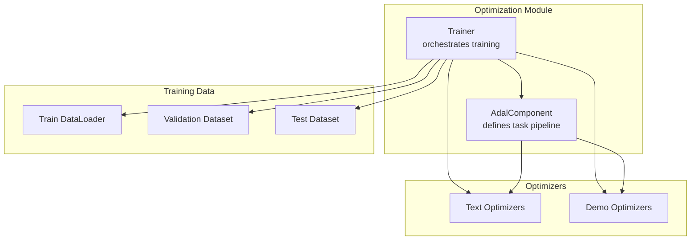
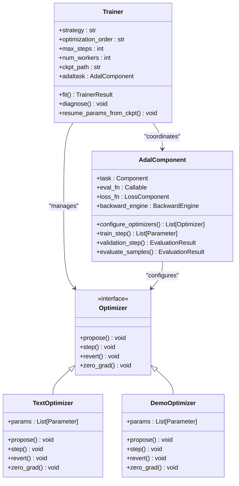
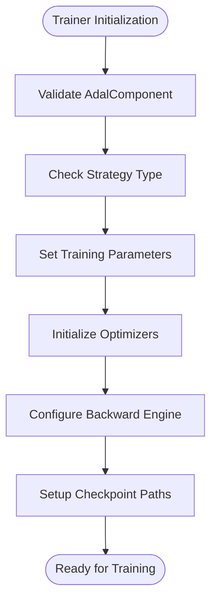
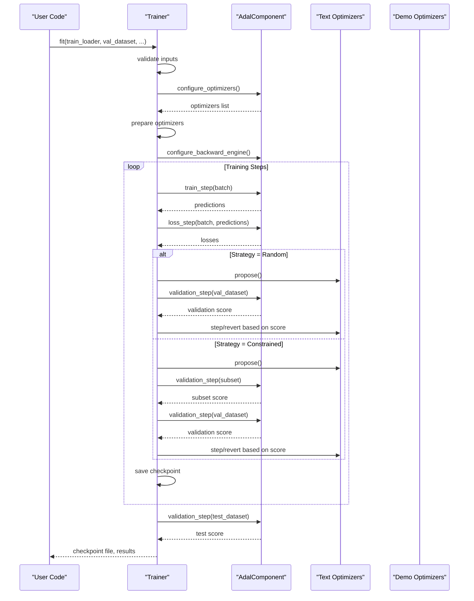
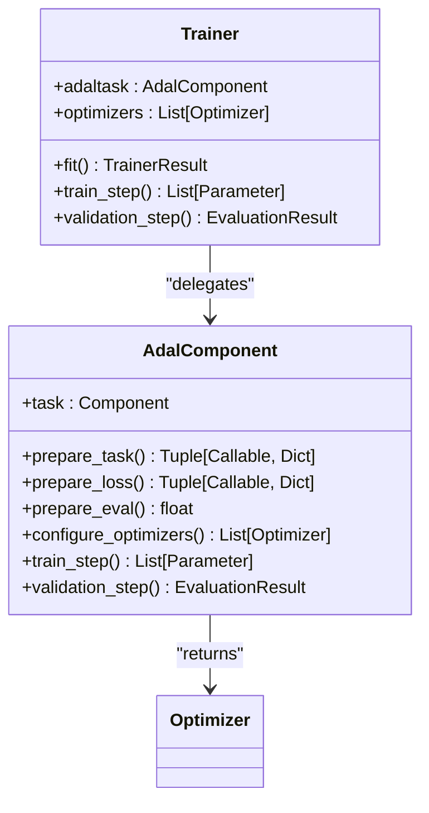
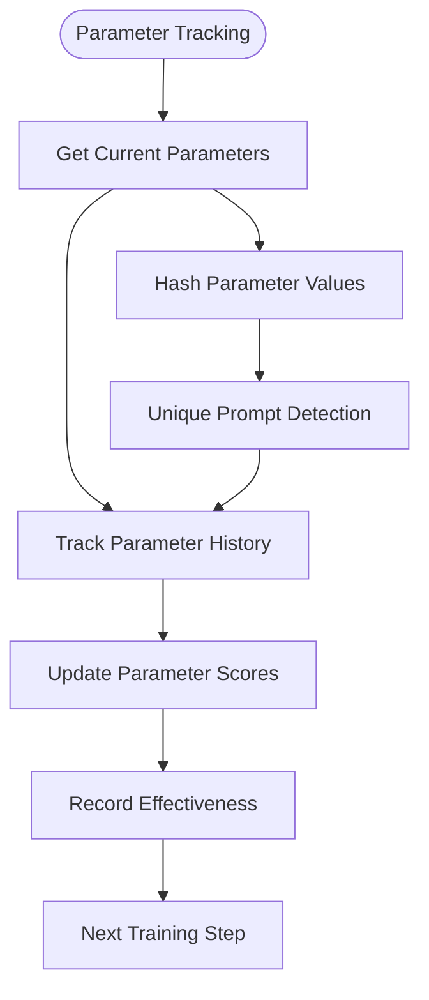
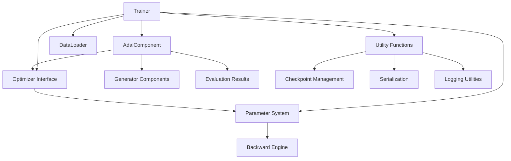

# Trainer Core Component

<cite>
**Referenced Files in This Document**
- [trainer.py](file://adalflow/adalflow/optim/trainer/trainer.py)
- [adal.py](file://adalflow/adalflow/optim/trainer/adal.py)
- [test_trainer.py](file://adalflow/tests/test_trainer.py)
</cite>

## Table of Contents
1. [Introduction](#introduction)
2. [Project Structure](#project-structure)
3. [Core Components](#core-components)
4. [Architecture Overview](#architecture-overview)
5. [Detailed Component Analysis](#detailed-component-analysis)
6. [Dependency Analysis](#dependency-analysis)
7. [Performance Considerations](#performance-considerations)
8. [Troubleshooting Guide](#troubleshooting-guide)
9. [Conclusion](#conclusion)

## Introduction
This document provides comprehensive documentation for the Trainer core component, which serves as the main training orchestrator in the AdalFlow system. The Trainer coordinates training loops, manages optimization strategies, handles checkpointing, and integrates with the AdalComponent task pipeline. It supports multiple training modes including random and constrained strategies, sequential and mixed optimization orders, and advanced features like momentum-based text gradient descent (TSGD-M) and Gumbel-top-K selection.

## Project Structure
The Trainer resides in the optimization module alongside the AdalComponent, which defines the task pipeline and evaluation logic. The Trainer orchestrates training, validation, and checkpointing while delegating task execution to the AdalComponent.



**Diagram sources**
- [trainer.py](file://adalflow/adalflow/optim/trainer/trainer.py#L42-L192)
- [adal.py](file://adalflow/adalflow/optim/trainer/adal.py#L30-L80)

**Section sources**
- [trainer.py](file://adalflow/adalflow/optim/trainer/trainer.py#L1-L120)
- [adal.py](file://adalflow/adalflow/optim/trainer/adal.py#L1-L80)

## Core Components
The Trainer class is the central orchestrator responsible for:
- Managing training configuration and parameters
- Executing training loops with configurable strategies
- Coordinating text and demo optimizers
- Handling validation and checkpointing
- Supporting advanced training modes like TSGD-M and Gumbel-top-K

Key initialization parameters include:
- Strategy selection: random vs constrained
- Optimization order: sequential vs mix
- Training parameters: max_steps, num_workers, batch sizes
- Checkpoint management: ckpt_path, resume_from_ckpt
- Debugging and tracing options

**Section sources**
- [trainer.py](file://adalflow/adalflow/optim/trainer/trainer.py#L112-L192)

## Architecture Overview
The Trainer architecture integrates with the AdalComponent to form a complete training pipeline. The AdalComponent encapsulates the task definition, evaluation functions, and optimizer configuration, while the Trainer manages the training orchestration.



**Diagram sources**
- [trainer.py](file://adalflow/adalflow/optim/trainer/trainer.py#L42-L192)
- [adal.py](file://adalflow/adalflow/optim/trainer/adal.py#L30-L190)

## Detailed Component Analysis

### Trainer Class Architecture
The Trainer class extends the Component base class and provides comprehensive training orchestration capabilities. It maintains references to the AdalComponent task, optimizers, and training configuration.

Key architectural features:
- Strategy-based optimization (random/constrained)
- Mixed vs sequential optimization order
- Comprehensive checkpoint management
- Parallel processing support
- Debugging and tracing capabilities

**Section sources**
- [trainer.py](file://adalflow/adalflow/optim/trainer/trainer.py#L42-L192)

### Initialization and Configuration
The Trainer constructor accepts extensive configuration options:



**Diagram sources**
- [trainer.py](file://adalflow/adalflow/optim/trainer/trainer.py#L112-L192)

Configuration parameters include:
- Strategy: "random" or "constrained"
- Optimization order: "sequential" or "mix"
- Training limits: max_steps, max_proposals_per_step
- Data handling: train_batch_size, num_workers
- Validation thresholds: batch_val_score_threshold, correct_val_score_threshold
- Debug options: debug, save_traces
- Advanced features: weighted_sampling, sequential_order

**Section sources**
- [trainer.py](file://adalflow/adalflow/optim/trainer/trainer.py#L112-L192)

### Fit Method Workflow
The fit method orchestrates the complete training process:



**Diagram sources**
- [trainer.py](file://adalflow/adalflow/optim/trainer/trainer.py#L418-L698)

The fit method handles:
- Input validation and preparation
- Optimizer configuration and setup
- Training loop execution with strategy-specific logic
- Validation and checkpointing
- Test evaluation and result aggregation

**Section sources**
- [trainer.py](file://adalflow/adalflow/optim/trainer/trainer.py#L418-L698)

### Training Loop Execution
The training loop supports multiple execution modes:

#### Random Strategy
- Generates proposals and evaluates them on validation sets
- Steps optimizers only when validation improves
- Maintains proposal history and effectiveness tracking

#### Constrained Strategy  
- Uses moving batches with subset validation
- Applies stricter validation criteria
- Supports both sequential and mixed optimization approaches

#### TSGD-M (Textual Gradient Descent with Momentum)
- Implements momentum-based prompt selection
- Maintains cache of historical prompts and scores
- Evaluates prompts on validation mini-batches
- Selects best prompts based on validation performance

**Section sources**
- [trainer.py](file://adalflow/adalflow/optim/trainer/trainer.py#L1781-L2384)
- [trainer.py](file://adalflow/adalflow/optim/trainer/trainer.py#L2530-L2710)

### Checkpoint Management System
The Trainer implements comprehensive checkpointing:

```mermaid
flowchart TD
Start([Training Start]) --> InitState["Gather Trainer State"]
InitState --> PrepPath["Prepare Checkpoint Path"]
PrepPath --> SaveInit["Save Initial State"]
loop Training Steps
Step([Training Step]) --> Validate["Validation"]
Validate --> CheckScore{"Score Improved?"}
CheckScore --> |Yes| StepOpt["Optimizer Step"]
CheckScore --> |No| RevertOpt["Optimizer Revert"]
StepOpt --> SaveCkpt["Save Checkpoint"]
RevertOpt --> SaveCkpt
end
SaveCkpt --> End([Training Complete])
```

**Diagram sources**
- [trainer.py](file://adalflow/adalflow/optim/trainer/trainer.py#L831-L842)
- [trainer.py](file://adalflow/adalflow/optim/trainer/trainer.py#L1904-L1924)

Checkpoint features include:
- Automatic path generation with unique identifiers
- State persistence across training runs
- Resume capability from checkpoints
- Validation statistics tracking
- Debug trace saving

**Section sources**
- [trainer.py](file://adalflow/adalflow/optim/trainer/trainer.py#L776-L841)
- [trainer.py](file://adalflow/adalflow/optim/trainer/trainer.py#L1904-L1924)

### Relationship with AdalComponent
The Trainer works closely with AdalComponent to coordinate training:



**Diagram sources**
- [trainer.py](file://adalflow/adalflow/optim/trainer/trainer.py#L502-L510)
- [adal.py](file://adalflow/adalflow/optim/trainer/adal.py#L175-L190)

Key interactions:
- Optimizer configuration delegation
- Training step coordination
- Validation step execution
- Parameter value management

**Section sources**
- [trainer.py](file://adalflow/adalflow/optim/trainer/trainer.py#L502-L540)
- [adal.py](file://adalflow/adalflow/optim/trainer/adal.py#L175-L190)

### Parameter Tracking Mechanisms
The Trainer implements sophisticated parameter tracking:



**Diagram sources**
- [trainer.py](file://adalflow/adalflow/optim/trainer/trainer.py#L2793-L2848)

Tracking features include:
- Parameter value hashing for uniqueness detection
- Multi-evaluation tracking with accuracy lists
- Historical score aggregation
- Effectiveness measurement across different stages

**Section sources**
- [trainer.py](file://adalflow/adalflow/optim/trainer/trainer.py#L2793-L2848)

### Evaluation Procedures
The Trainer supports multiple evaluation approaches:

#### Batch Evaluation
- Moving batch validation with subset sampling
- Downsampled batch processing for efficiency
- Balanced error/correct sample selection

#### Validation Statistics
- Comprehensive validation statistics computation
- Effectiveness tracking across training stages
- Performance metrics aggregation

**Section sources**
- [trainer.py](file://adalflow/adalflow/optim/trainer/trainer.py#L1643-L1663)
- [trainer.py](file://adalflow/adalflow/optim/trainer/trainer.py#L2079-L2104)

## Dependency Analysis
The Trainer has several key dependencies and relationships:



**Diagram sources**
- [trainer.py](file://adalflow/adalflow/optim/trainer/trainer.py#L1-L36)
- [adal.py](file://adalflow/adalflow/optim/trainer/adal.py#L1-L27)

Key dependencies:
- Component base class for shared functionality
- Optimizer interfaces for different optimization strategies
- Parameter system for gradient computation and tracking
- Utility modules for checkpointing and data handling

**Section sources**
- [trainer.py](file://adalflow/adalflow/optim/trainer/trainer.py#L1-L36)
- [adal.py](file://adalflow/adalflow/optim/trainer/adal.py#L1-L27)

## Performance Considerations
The Trainer implements several performance optimization strategies:

- **Parallel Processing**: Multi-threaded evaluation and training steps
- **Batch Processing**: Moving batches with adaptive downsampling
- **Early Stopping**: Validation-based early termination
- **Memory Management**: Efficient parameter tracking and caching
- **Checkpoint Frequency**: Configurable checkpoint intervals

Best practices for optimal performance:
- Set appropriate batch sizes based on available memory
- Use validation-based early stopping to avoid overtraining
- Monitor training progress through checkpoint files
- Utilize debugging features during development
- Configure parallel workers based on system capabilities

## Troubleshooting Guide
Common training issues and solutions:

### Training Issues
- **Convergence Problems**: Check learning rates and proposal strategies
- **Overfitting**: Monitor validation vs training scores
- **Memory Issues**: Reduce batch sizes or increase downsampling
- **Slow Training**: Optimize parallel processing settings

### Debugging Features
The Trainer provides comprehensive debugging capabilities:
- Diagnostic mode for error analysis
- Trace generation for computation graphs
- Parameter value inspection
- Validation score tracking

### Checkpoint Recovery
- Use resume_from_ckpt to continue interrupted training
- Inspect checkpoint files for training progress
- Monitor validation statistics for convergence assessment

**Section sources**
- [trainer.py](file://adalflow/adalflow/optim/trainer/trainer.py#L197-L398)
- [trainer.py](file://adalflow/adalflow/optim/trainer/trainer.py#L391-L417)

## Conclusion
The Trainer core component provides a robust and flexible framework for orchestrating training in the AdalFlow system. Its modular design, comprehensive configuration options, and advanced optimization strategies make it suitable for various training scenarios. The integration with AdalComponent ensures seamless coordination between task definition and training execution, while the extensive checkpointing and debugging capabilities support reliable and efficient training workflows.

The Trainer's support for multiple optimization strategies, validation approaches, and advanced features like TSGD-M and Gumbel-top-K makes it a powerful tool for optimizing language model prompts and demonstrations in complex task pipelines.