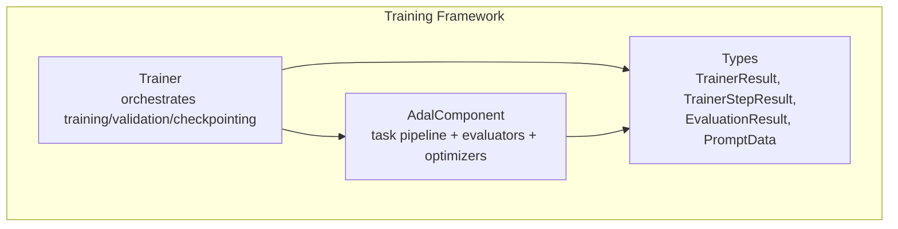
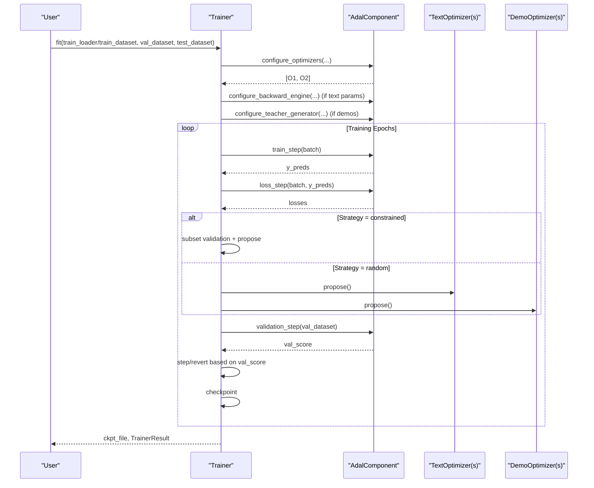
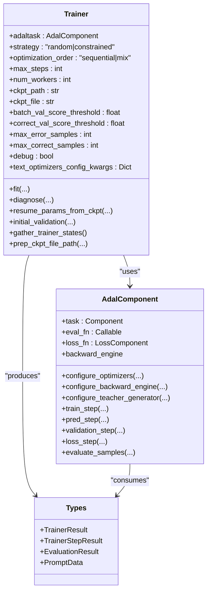
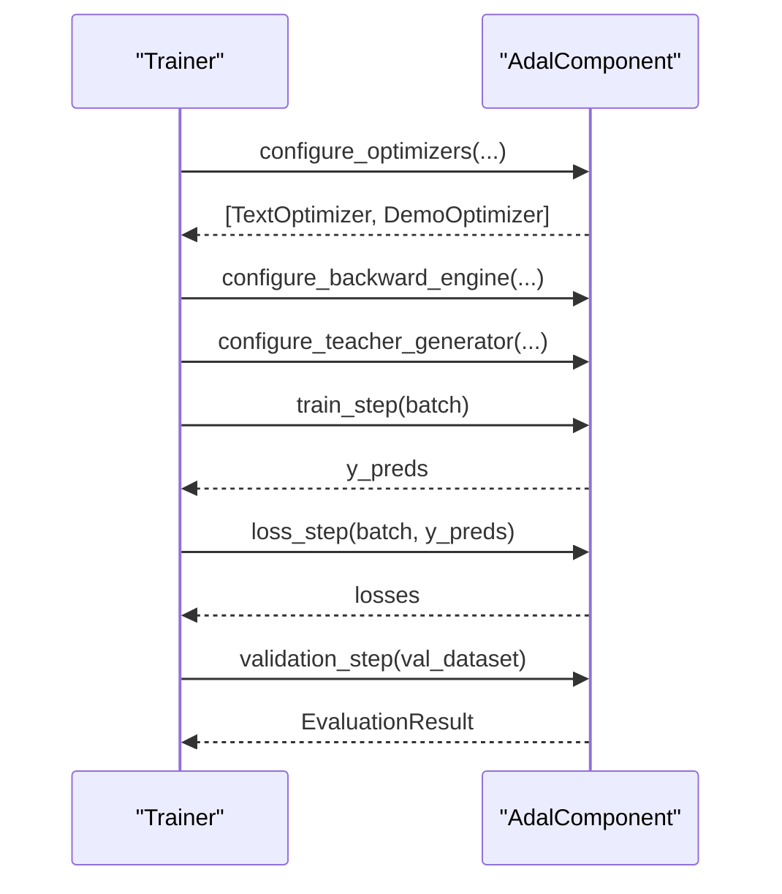
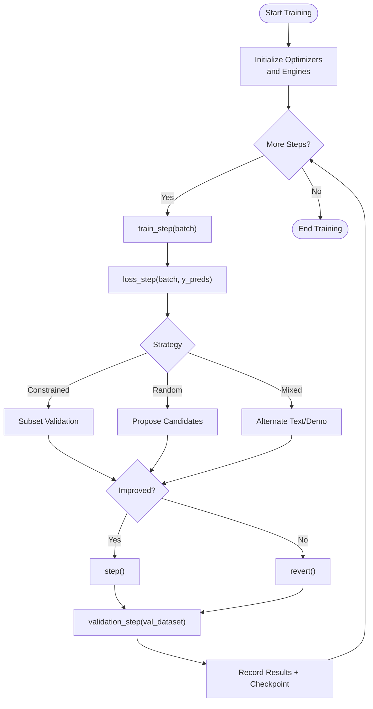
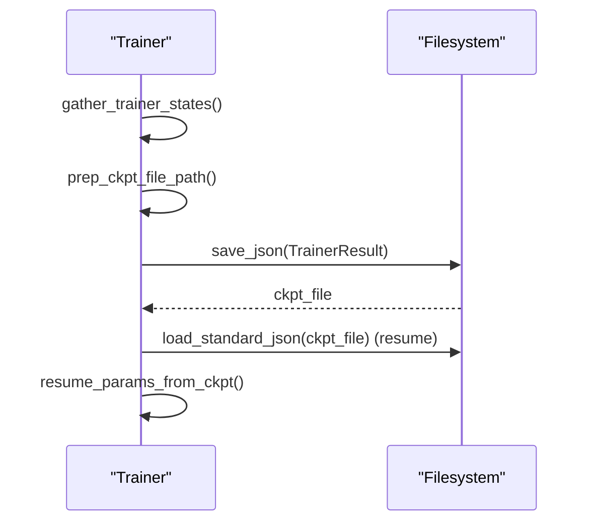
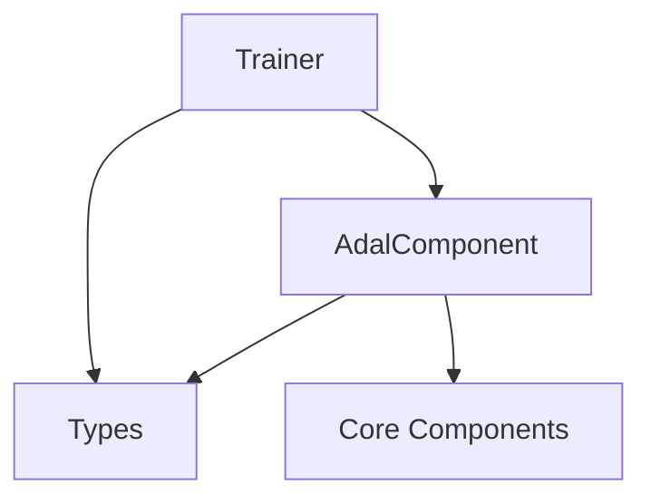

# Training Framework

<cite>
**Referenced Files in This Document**
- [trainer.py](file://adalflow/adalflow/optim/trainer/trainer.py)
- [adal.py](file://adalflow/adalflow/optim/trainer/adal.py)
- [types.py](file://adalflow/adalflow/optim/types.py)
- [test_trainer.py](file://adalflow/tests/test_trainer.py)
</cite>

## Table of Contents
1. [Introduction](#introduction)
2. [Project Structure](#project-structure)
3. [Core Components](#core-components)
4. [Architecture Overview](#architecture-overview)
5. [Detailed Component Analysis](#detailed-component-analysis)
6. [Dependency Analysis](#dependency-analysis)
7. [Performance Considerations](#performance-considerations)
8. [Troubleshooting Guide](#troubleshooting-guide)
9. [Conclusion](#conclusion)
10. [Appendices](#appendices)

## Introduction
This document explains the Training Framework built around the Trainer component and the AdalComponent system. It covers the ready-to-use training pipeline, optimization strategies (including textual gradient descent and demo-based few-shot optimization), automated hyperparameter tuning via configurable strategies, and robust checkpoint management. It also documents training loops, validation procedures, parameter tracking, evaluation metrics, best practices, convergence criteria, and operational guidance for scaling and resource management.

## Project Structure
The training framework resides under the optim/trainer module and integrates with the broader AdalFlow ecosystem:
- Trainer orchestrates training, validation, checkpointing, and optimization loops.
- AdalComponent defines the task pipeline, evaluation hooks, and optimizer configuration helpers.
- Types define shared data structures for training results, evaluation outcomes, and parameter metadata.

**Diagram sources**
- [trainer.py](file://adalflow/adalflow/optim/trainer/trainer.py#L42-L192)
- [adal.py](file://adalflow/adalflow/optim/trainer/adal.py#L30-L80)
- [types.py](file://adalflow/adalflow/optim/types.py#L70-L163)

**Section sources**
- [trainer.py](file://adalflow/adalflow/optim/trainer/trainer.py#L1-L120)
- [adal.py](file://adalflow/adalflow/optim/trainer/adal.py#L1-L40)
- [types.py](file://adalflow/adalflow/optim/types.py#L1-L40)

## Core Components
- Trainer: Central training controller supporting multiple strategies (random, constrained), sequential or mixed optimization orders, and checkpointing. It manages text and demo optimizers, validation, and result aggregation.
- AdalComponent: Task pipeline abstraction that encapsulates the model task, evaluation functions, loss computation, backward engine, and teacher generator configuration. It exposes training, validation, and prediction steps with parallel execution support.
- Types: Defines shared data structures for evaluation results, training step results, and trainer results, enabling structured reporting and checkpoint persistence.

Key responsibilities:
- Trainer: configure optimizers, run training/validation loops, manage checkpoints, track effectiveness, and orchestrate mixed or sequential optimization.
- AdalComponent: define prepare_task/prepare_loss/prepare_eval/prepare_loss_eval, run train/prediction/validation steps, and configure optimizers/backward engines/teacher generators.
- Types: provide consistent schemas for results, metrics, and parameter metadata.

**Section sources**
- [trainer.py](file://adalflow/adalflow/optim/trainer/trainer.py#L42-L192)
- [adal.py](file://adalflow/adalflow/optim/trainer/adal.py#L30-L190)
- [types.py](file://adalflow/adalflow/optim/types.py#L70-L163)

## Architecture Overview
The Trainer coordinates with AdalComponent to execute training and validation. AdalComponent provides hooks for task execution, evaluation, and loss computation, while Trainer handles optimization, validation thresholds, and checkpointing.

**Diagram sources**
- [trainer.py](file://adalflow/adalflow/optim/trainer/trainer.py#L418-L698)
- [trainer.py](file://adalflow/adalflow/optim/trainer/trainer.py#L1156-L1328)
- [trainer.py](file://adalflow/adalflow/optim/trainer/trainer.py#L1781-L1901)
- [trainer.py](file://adalflow/adalflow/optim/trainer/trainer.py#L2317-L2384)
- [adal.py](file://adalflow/adalflow/optim/trainer/adal.py#L175-L190)
- [adal.py](file://adalflow/adalflow/optim/trainer/adal.py#L618-L651)
- [adal.py](file://adalflow/adalflow/optim/trainer/adal.py#L632-L651)

## Detailed Component Analysis

### Trainer Class
The Trainer class is the central orchestrator for the training pipeline. It supports:
- Multiple strategies: random and constrained.
- Optimization orders: sequential (text then demos) or mixed.
- Checkpointing and resuming from checkpoints.
- Validation thresholds and moving batch sampling for efficiency.
- Effectiveness tracking across stages (subset, fullset, valset, demo_valset).
- Advanced modes: TSGD-M (Textual Gradient Descent with Momentum) and Gumbel-Top-K/Evaluate-Top-K workflows.

Key configuration fields:
- adaltask: AdalComponent instance.
- strategy: random or constrained.
- optimization_order: sequential or mix.
- max_steps, num_workers, train_batch_size.
- ckpt_path, ckpt_file.
- batch_val_score_threshold, correct_val_score_threshold.
- max_error_samples, max_correct_samples.
- debug, save_traces, sequential_order, skip_subset_val, disable_backward_gradients, disable_backward.
- text_optimizers_config_kwargs.

Core methods:
- fit(...): Main training entry point; validates inputs, configures optimizers/backward engine/teacher generator, and runs the chosen strategy.
- diagnose(...): Diagnostic mode to analyze errors and generate reports/logs.
- resume_params_from_ckpt(...): Resume from a checkpoint by restoring prompt values.
- Validation helpers: initial_validation, validation_step delegation via AdalComponent.
- Checkpoint helpers: gather_trainer_states, prep_ckpt_file_path, save/load JSON.

Training strategies:
- Constrained: Maintains a moving batch, downsamples to balance error/correct samples, proposes via textual gradients, validates on subset/fullset, and steps only if improvements are observed.
- Random: Proposes multiple candidate prompts per batch, validates on subset, steps if validation improves.
- Mixed: Alternates between text and demo optimizers using constrained or random strategies.
- TSGD-M: Samples K historical prompts based on validation scores, evaluates on a small validation mini-batch, selects the best, and proceeds with gradient-based proposal and caching.

**Diagram sources**
- [trainer.py](file://adalflow/adalflow/optim/trainer/trainer.py#L42-L192)
- [trainer.py](file://adalflow/adalflow/optim/trainer/trainer.py#L418-L698)
- [adal.py](file://adalflow/adalflow/optim/trainer/adal.py#L30-L190)
- [types.py](file://adalflow/adalflow/optim/types.py#L70-L163)

**Section sources**
- [trainer.py](file://adalflow/adalflow/optim/trainer/trainer.py#L42-L192)
- [trainer.py](file://adalflow/adalflow/optim/trainer/trainer.py#L418-L698)
- [trainer.py](file://adalflow/adalflow/optim/trainer/trainer.py#L831-L842)
- [trainer.py](file://adalflow/adalflow/optim/trainer/trainer.py#L1643-L1664)
- [trainer.py](file://adalflow/adalflow/optim/trainer/trainer.py#L2386-L2710)

### AdalComponent
AdalComponent encapsulates:
- Task composition and execution hooks (prepare_task, prepare_loss, prepare_eval, prepare_loss_eval).
- Training, prediction, and validation steps with parallel execution.
- Optimizer configuration helpers for text and demo parameters.
- Backward engine and teacher generator configuration.
- Callback registration for tracing generator calls.

Key methods:
- configure_optimizers(...): Returns configured text and demo optimizers.
- configure_backward_engine(...): Sets up backward engine for gradient-based components.
- configure_teacher_generator(...): Configures teacher generator for bootstrapping demonstrations.
- train_step, pred_step, validation_step, loss_step: Execution and evaluation routines.
- evaluate_samples: Parallel evaluation with progress tracking.

**Diagram sources**
- [adal.py](file://adalflow/adalflow/optim/trainer/adal.py#L175-L190)
- [adal.py](file://adalflow/adalflow/optim/trainer/adal.py#L192-L207)
- [adal.py](file://adalflow/adalflow/optim/trainer/adal.py#L618-L651)
- [adal.py](file://adalflow/adalflow/optim/trainer/adal.py#L336-L391)
- [adal.py](file://adalflow/adalflow/optim/trainer/adal.py#L508-L576)
- [adal.py](file://adalflow/adalflow/optim/trainer/adal.py#L578-L606)

**Section sources**
- [adal.py](file://adalflow/adalflow/optim/trainer/adal.py#L30-L190)
- [adal.py](file://adalflow/adalflow/optim/trainer/adal.py#L192-L207)
- [adal.py](file://adalflow/adalflow/optim/trainer/adal.py#L336-L391)
- [adal.py](file://adalflow/adalflow/optim/trainer/adal.py#L508-L576)
- [adal.py](file://adalflow/adalflow/optim/trainer/adal.py#L578-L606)
- [adal.py](file://adalflow/adalflow/optim/trainer/adal.py#L618-L651)

### Training Loops and Validation Procedures
- Constrained strategy maintains a moving batch, downsamples to balance error/correct samples, and validates on a subset before full validation. Proposals are accepted only if validation improves.
- Random strategy proposes multiple candidates per batch and steps if subset validation improves.
- Mixed strategy alternates between text and demo optimizers using either constrained or random logic.
- TSGD-M samples K historical prompts, evaluates on a small validation mini-batch, selects the best, and caches results for momentum-based updates.

**Diagram sources**
- [trainer.py](file://adalflow/adalflow/optim/trainer/trainer.py#L1156-L1328)
- [trainer.py](file://adalflow/adalflow/optim/trainer/trainer.py#L1330-L1467)
- [trainer.py](file://adalflow/adalflow/optim/trainer/trainer.py#L1665-L1780)
- [trainer.py](file://adalflow/adalflow/optim/trainer/trainer.py#L2317-L2384)
- [trainer.py](file://adalflow/adalflow/optim/trainer/trainer.py#L2530-L2710)

**Section sources**
- [trainer.py](file://adalflow/adalflow/optim/trainer/trainer.py#L1156-L1328)
- [trainer.py](file://adalflow/adalflow/optim/trainer/trainer.py#L1330-L1467)
- [trainer.py](file://adalflow/adalflow/optim/trainer/trainer.py#L1665-L1780)
- [trainer.py](file://adalflow/adalflow/optim/trainer/trainer.py#L2317-L2384)
- [trainer.py](file://adalflow/adalflow/optim/trainer/trainer.py#L2530-L2710)

### Checkpoint Management
- Trainer gathers trainer states, computes a hash key, and prepares a unique checkpoint file path under a default root directory.
- Checkpoints persist TrainerResult (steps, scores, step_results, validate_stats, timestamps, total_time, test_score, trainer_state).
- Resuming loads the latest checkpoint, restores prompt values, and continues training from the last step.

**Diagram sources**
- [trainer.py](file://adalflow/adalflow/optim/trainer/trainer.py#L734-L774)
- [trainer.py](file://adalflow/adalflow/optim/trainer/trainer.py#L776-L830)
- [trainer.py](file://adalflow/adalflow/optim/trainer/trainer.py#L391-L417)
- [trainer.py](file://adalflow/adalflow/optim/trainer/trainer.py#L196-L226)

**Section sources**
- [trainer.py](file://adalflow/adalflow/optim/trainer/trainer.py#L734-L830)
- [trainer.py](file://adalflow/adalflow/optim/trainer/trainer.py#L391-L417)
- [trainer.py](file://adalflow/adalflow/optim/trainer/trainer.py#L196-L226)

### Practical Examples and Workflows
- Setting up a training workflow:
  - Prepare datasets and a task pipeline as an AdalComponent.
  - Instantiate Trainer with strategy, max_steps, num_workers, and optional debug/save_traces.
  - Call fit with train_loader or train_dataset and val_dataset (and optionally test_dataset).
  - Optionally resume from a checkpoint using resume_from_ckpt.

- Configuring optimizers:
  - AdalComponent.configure_optimizers(...) returns configured text and demo optimizers.
  - Text optimizers require a model client and model kwargs; demo optimizers require dataset configuration and optional bootstrap shots.

- Monitoring training progress:
  - Use validation_step on val_dataset/test_dataset to compute scores.
  - Inspect TrainerResult.step_results and validate_stats for convergence diagnostics.
  - Enable save_traces to capture generator traces for debugging.

- Parameter tracking and evaluation metrics:
  - TrainerResult includes steps, val_scores, test_scores, step_results, validate_stats.
  - EvaluationResult provides avg_score and per_item_scores.

**Section sources**
- [trainer.py](file://adalflow/adalflow/optim/trainer/trainer.py#L418-L698)
- [trainer.py](file://adalflow/adalflow/optim/trainer/trainer.py#L502-L543)
- [trainer.py](file://adalflow/adalflow/optim/trainer/trainer.py#L705-L732)
- [types.py](file://adalflow/adalflow/optim/types.py#L95-L163)

## Dependency Analysis
The Trainer depends on AdalComponent for task execution and evaluation, and on the types module for structured results. AdalComponent depends on the core components for generators, backward engines, and parameter types.

**Diagram sources**
- [trainer.py](file://adalflow/adalflow/optim/trainer/trainer.py#L1-L36)
- [adal.py](file://adalflow/adalflow/optim/trainer/adal.py#L1-L27)
- [types.py](file://adalflow/adalflow/optim/types.py#L1-L10)

**Section sources**
- [trainer.py](file://adalflow/adalflow/optim/trainer/trainer.py#L1-L36)
- [adal.py](file://adalflow/adalflow/optim/trainer/adal.py#L1-L27)
- [types.py](file://adalflow/adalflow/optim/types.py#L1-L10)

## Performance Considerations
- Parallelism: Both AdalComponent and Trainer leverage ThreadPoolExecutor for parallel evaluation and training steps to reduce wall-clock time.
- Moving Batch Sampling: Downsample moving batches to balance error and correct samples, reducing unnecessary backward passes.
- Validation Thresholds: Use batch_val_score_threshold and correct_val_score_threshold to skip trivial batches and accelerate training.
- Worker Count: Tune num_workers to match dataset size and model latency.
- Checkpointing Frequency: Save checkpoints periodically to recover quickly from interruptions.
- TSGD-M and Gumbel-Top-K: These advanced strategies can improve convergence by leveraging historical prompts and stochastic selection.

[No sources needed since this section provides general guidance]

## Troubleshooting Guide
Common issues and resolutions:
- Missing datasets: Ensure train_dataset or train_loader and val_dataset are provided; otherwise, Trainer raises a ValueError.
- Incorrect loader format: train_loader, val_dataset, and test_dataset must not return tuples; use dicts or dataclasses.
- No trainable parameters: If no text or demo parameters are found, optimizers are not configured; verify ParameterType assignments.
- Backward engine conflicts: Disable backward engine when not needed to prevent unintended gradient computation.
- Debugging: Use diagnose to generate diagnostic reports and traces; enable debug mode to visualize computation graphs.

**Section sources**
- [trainer.py](file://adalflow/adalflow/optim/trainer/trainer.py#L462-L500)
- [trainer.py](file://adalflow/adalflow/optim/trainer/trainer.py#L541-L543)
- [trainer.py](file://adalflow/adalflow/optim/trainer/trainer.py#L526-L543)
- [trainer.py](file://adalflow/adalflow/optim/trainer/trainer.py#L196-L226)
- [test_trainer.py](file://adalflow/tests/test_trainer.py#L12-L24)

## Conclusion
The Training Framework provides a robust, extensible pipeline for optimizing prompts and demonstrations in LLM tasks. By combining AdalComponent’s modular task definition with Trainer’s flexible strategies and checkpointing, practitioners can efficiently train, validate, and tune their systems. Advanced features like TSGD-M and Gumbel-Top-K further enhance convergence and exploration. Proper configuration of datasets, optimizers, and validation thresholds, along with careful monitoring and checkpointing, ensures reliable and scalable training.

[No sources needed since this section summarizes without analyzing specific files]

## Appendices

### API and Configuration Reference
- Trainer.fit(...): Orchestrates training, validation, and checkpointing.
- Trainer.diagnose(...): Generates diagnostic reports and logs.
- AdalComponent.configure_optimizers(...): Returns configured optimizers.
- AdalComponent.validation_step(...): Computes evaluation scores.
- Types.TrainerResult, TrainerStepResult, EvaluationResult, PromptData: Structured outputs and metrics.

**Section sources**
- [trainer.py](file://adalflow/adalflow/optim/trainer/trainer.py#L418-L698)
- [trainer.py](file://adalflow/adalflow/optim/trainer/trainer.py#L196-L390)
- [adal.py](file://adalflow/adalflow/optim/trainer/adal.py#L175-L190)
- [adal.py](file://adalflow/adalflow/optim/trainer/adal.py#L508-L576)
- [types.py](file://adalflow/adalflow/optim/types.py#L70-L163)