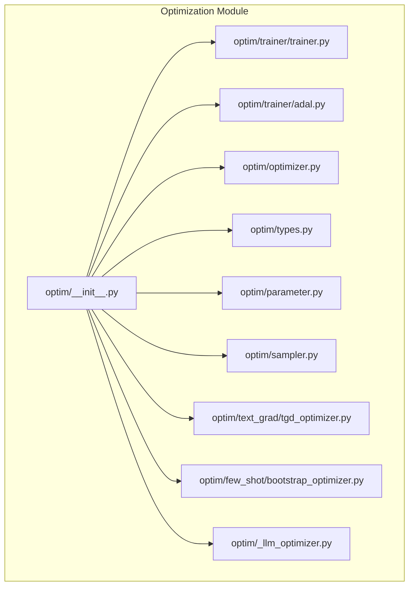
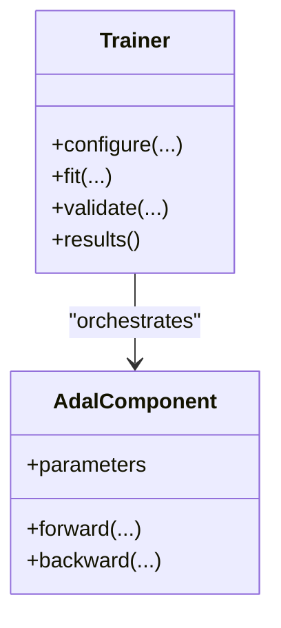
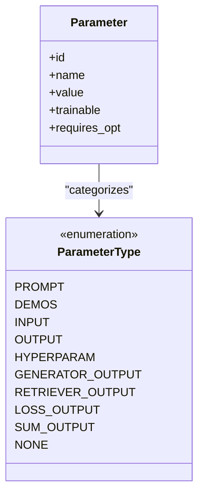
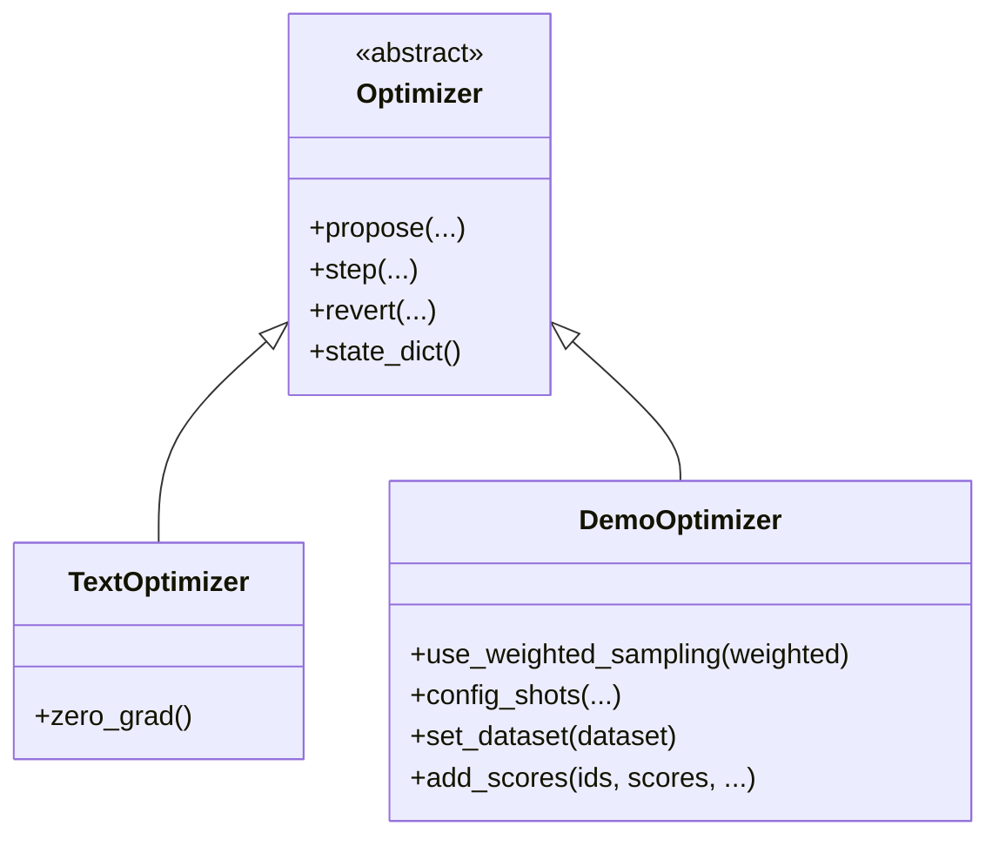
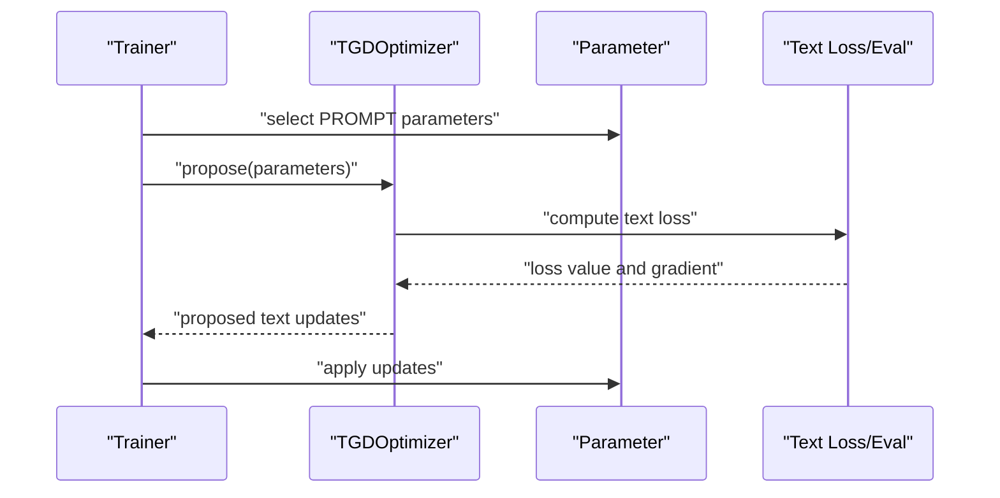
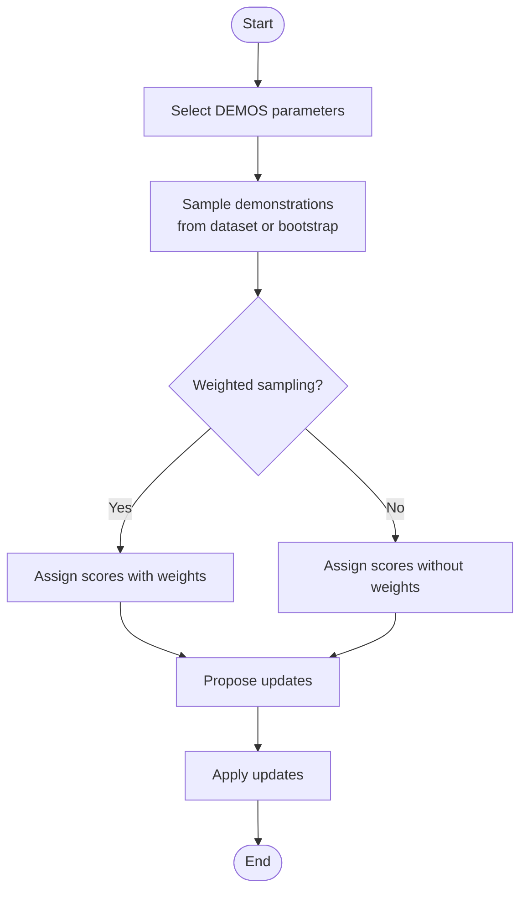
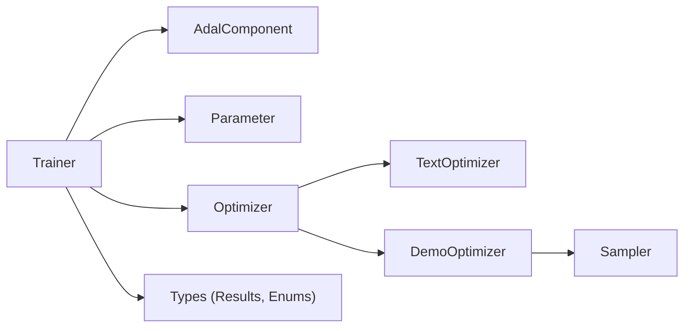

# Training Strategies and Algorithms

<cite>
**Referenced Files in This Document**
- [adalflow/adalflow/optim/__init__.py](file://adalflow/adalflow/optim/__init__.py)
- [adalflow/adalflow/optim/optimizer.py](file://adalflow/adalflow/optim/optimizer.py)
- [adalflow/adalflow/optim/types.py](file://adalflow/adalflow/optim/types.py)
- [adalflow/adalflow/optim/trainer/trainer.py](file://adalflow/adalflow/optim/trainer/trainer.py)
- [adalflow/adalflow/optim/trainer/adal.py](file://adalflow/adalflow/optim/trainer/adal.py)
- [adalflow/adalflow/optim/sampler.py](file://adalflow/adalflow/optim/sampler.py)
- [adalflow/adalflow/optim/parameter.py](file://adalflow/adalflow/optim/parameter.py)
- [adalflow/adalflow/optim/_llm_optimizer.py](file://adalflow/adalflow/optim/_llm_optimizer.py)
- [adalflow/adalflow/optim/text_grad/tgd_optimizer.py](file://adalflow/adalflow/optim/text_grad/tgd_optimizer.py)
- [adalflow/adalflow/optim/few_shot/bootstrap_optimizer.py](file://adalflow/adalflow/optim/few_shot/bootstrap_optimizer.py)
- [tests/test_trainer.py](file://tests/test_trainer.py)
</cite>

## Table of Contents
1. [Introduction](#introduction)
2. [Project Structure](#project-structure)
3. [Core Components](#core-components)
4. [Architecture Overview](#architecture-overview)
5. [Detailed Component Analysis](#detailed-component-analysis)
6. [Dependency Analysis](#dependency-analysis)
7. [Performance Considerations](#performance-considerations)
8. [Troubleshooting Guide](#troubleshooting-guide)
9. [Conclusion](#conclusion)
10. [Appendices](#appendices)

## Introduction
This document explains the training strategies and algorithms implemented in the Trainer system. It focuses on:
- Random versus constrained optimization strategies
- Sequential versus mixed optimization orders
- Parameter optimization workflows
- Algorithm-specific configurations
- Practical configuration examples
- Underlying optimization algorithms, convergence mechanisms, and stopping criteria
- Advanced techniques such as momentum-based optimization, adaptive learning rates, and hybrid optimization
- Guidance for strategy selection, parameter tuning, and performance optimization

## Project Structure
The Trainer system resides under the optimization module and integrates with parameterization, sampling, and text-gradient components. Key areas:
- Trainer and AdalComponent orchestrate training loops and parameter updates
- Parameter and Sampler define trainable units and sampling strategies
- Optimizer base classes and concrete optimizers (text-gradient and demo-based) implement update logic
- Types define shared data structures for training results and parameter categories



**Diagram sources**
- [adalflow/adalflow/optim/__init__.py](file://adalflow/adalflow/optim/__init__.py#L1-L39)
- [adalflow/adalflow/optim/trainer/trainer.py](file://adalflow/adalflow/optim/trainer/trainer.py)
- [adalflow/adalflow/optim/trainer/adal.py](file://adalflow/adalflow/optim/trainer/adal.py)
- [adalflow/adalflow/optim/optimizer.py](file://adalflow/adalflow/optim/optimizer.py#L1-L92)
- [adalflow/adalflow/optim/types.py](file://adalflow/adalflow/optim/types.py#L1-L163)
- [adalflow/adalflow/optim/parameter.py](file://adalflow/adalflow/optim/parameter.py)
- [adalflow/adalflow/optim/sampler.py](file://adalflow/adalflow/optim/sampler.py)
- [adalflow/adalflow/optim/_llm_optimizer.py](file://adalflow/adalflow/optim/_llm_optimizer.py)
- [adalflow/adalflow/optim/text_grad/tgd_optimizer.py](file://adalflow/adalflow/optim/text_grad/tgd_optimizer.py)
- [adalflow/adalflow/optim/few_shot/bootstrap_optimizer.py](file://adalflow/adalflow/optim/few_shot/bootstrap_optimizer.py)

**Section sources**
- [adalflow/adalflow/optim/__init__.py](file://adalflow/adalflow/optim/__init__.py#L1-L39)

## Core Components
- Trainer orchestrates training loops, manages validation/test scoring, and aggregates results into structured outputs.
- AdalComponent encapsulates trainable components and integrates with the Trainer.
- Parameter defines trainable and non-trainable units with categorization via ParameterType.
- Sampler supports random and class-based sampling strategies for demos.
- Optimizer base classes define the contract for propose/step/revert and specialized variants for text and demo-based optimization.
- Types define shared data structures for training steps, validation statistics, and trainer results.

Key responsibilities:
- Trainer: loop control, evaluation, result aggregation, and termination criteria
- AdalComponent: exposes parameters and handles updates
- Parameter: tracks trainable/non-trainable attributes and types
- Sampler: draws demonstrations for demo-based optimization
- Optimizer family: implements proposal and stepping logic for text and demos

**Section sources**
- [adalflow/adalflow/optim/trainer/trainer.py](file://adalflow/adalflow/optim/trainer/trainer.py)
- [adalflow/adalflow/optim/trainer/adal.py](file://adalflow/adalflow/optim/trainer/adal.py)
- [adalflow/adalflow/optim/parameter.py](file://adalflow/adalflow/optim/parameter.py)
- [adalflow/adalflow/optim/sampler.py](file://adalflow/adalflow/optim/sampler.py)
- [adalflow/adalflow/optim/optimizer.py](file://adalflow/adalflow/optim/optimizer.py#L1-L92)
- [adalflow/adalflow/optim/types.py](file://adalflow/adalflow/optim/types.py#L1-L163)

## Architecture Overview
The Trainer system composes components to optimize parameters using either:
- Text-gradient descent (direct text optimization)
- Few-shot/demo-based optimization (sampling demonstrations)

```mermaid
sequenceDiagram
participant User as "User"
participant Trainer as "Trainer"
participant Adal as "AdalComponent"
participant Param as "Parameter"
participant Opt as "Optimizer"
participant Sampler as "Sampler"
User->>Trainer : "configure(strategy, order, params)"
Trainer->>Adal : "initialize components"
loop "Training Loop"
Trainer->>Adal : "evaluate()"
Adal-->>Trainer : "scores"
Trainer->>Param : "select parameters by order"
Param-->>Trainer : "trainable parameters"
Trainer->>Opt : "propose(parameters)"
Opt-->>Trainer : "proposed updates"
Trainer->>Adal : "apply updates"
alt "Demo-based strategy"
Trainer->>Sampler : "sample demos"
Sampler-->>Trainer : "demonstrations"
end
Trainer->>Trainer : "check stopping criteria"
end
Trainer-->>User : "final results and metrics"
```

**Diagram sources**
- [adalflow/adalflow/optim/trainer/trainer.py](file://adalflow/adalflow/optim/trainer/trainer.py)
- [adalflow/adalflow/optim/trainer/adal.py](file://adalflow/adalflow/optim/trainer/adal.py)
- [adalflow/adalflow/optim/parameter.py](file://adalflow/adalflow/optim/parameter.py)
- [adalflow/adalflow/optim/optimizer.py](file://adalflow/adalflow/optim/optimizer.py#L1-L92)
- [adalflow/adalflow/optim/sampler.py](file://adalflow/adalflow/optim/sampler.py)

## Detailed Component Analysis

### Trainer and AdalComponent
- Trainer controls the training loop, collects validation/test scores, and aggregates per-step results into a structured report.
- AdalComponent wraps a trainable unit and coordinates parameter updates during training.



**Diagram sources**
- [adalflow/adalflow/optim/trainer/trainer.py](file://adalflow/adalflow/optim/trainer/trainer.py)
- [adalflow/adalflow/optim/trainer/adal.py](file://adalflow/adalflow/optim/trainer/adal.py)

**Section sources**
- [adalflow/adalflow/optim/trainer/trainer.py](file://adalflow/adalflow/optim/trainer/trainer.py)
- [adalflow/adalflow/optim/trainer/adal.py](file://adalflow/adalflow/optim/trainer/adal.py)

### Parameter and ParameterType
- Parameter models trainable and non-trainable units with categorization via ParameterType.
- ParameterType enumerates prompt, demos, input, output, hyperparameters, and specialized outputs (generator, retriever, loss, sum).



**Diagram sources**
- [adalflow/adalflow/optim/parameter.py](file://adalflow/adalflow/optim/parameter.py)
- [adalflow/adalflow/optim/types.py](file://adalflow/adalflow/optim/types.py#L13-L67)

**Section sources**
- [adalflow/adalflow/optim/parameter.py](file://adalflow/adalflow/optim/parameter.py)
- [adalflow/adalflow/optim/types.py](file://adalflow/adalflow/optim/types.py#L13-L67)

### Optimizer Base Classes and Strategies
- Optimizer defines the base contract: propose, step, revert, and state_dict.
- TextOptimizer specializes for textual gradient descent (optimizes text directly).
- DemoOptimizer specializes for few-shot/demo-based optimization (samples demonstrations and assigns scores).



**Diagram sources**
- [adalflow/adalflow/optim/optimizer.py](file://adalflow/adalflow/optim/optimizer.py#L12-L92)

**Section sources**
- [adalflow/adalflow/optim/optimizer.py](file://adalflow/adalflow/optim/optimizer.py#L12-L92)

### Text-Gradient Optimization (TGD)
- TGD optimizer performs textual gradient descent, enabling direct optimization of prompts and related text components.
- Integrates with text-loss computation and evaluation functions to drive updates.



**Diagram sources**
- [adalflow/adalflow/optim/text_grad/tgd_optimizer.py](file://adalflow/adalflow/optim/text_grad/tgd_optimizer.py)
- [adalflow/adalflow/optim/parameter.py](file://adalflow/adalflow/optim/parameter.py)
- [adalflow/adalflow/optim/types.py](file://adalflow/adalflow/optim/types.py#L27-L37)

**Section sources**
- [adalflow/adalflow/optim/text_grad/tgd_optimizer.py](file://adalflow/adalflow/optim/text_grad/tgd_optimizer.py)

### Demo-Based Optimization (BootstrapFewShot)
- DemoOptimizer samples demonstrations from a dataset or bootstraps examples from model outputs.
- Supports weighted sampling and optional exclusion of input fields from bootstrap demos.



**Diagram sources**
- [adalflow/adalflow/optim/few_shot/bootstrap_optimizer.py](file://adalflow/adalflow/optim/few_shot/bootstrap_optimizer.py)
- [adalflow/adalflow/optim/sampler.py](file://adalflow/adalflow/optim/sampler.py)
- [adalflow/adalflow/optim/optimizer.py](file://adalflow/adalflow/optim/optimizer.py#L49-L92)

**Section sources**
- [adalflow/adalflow/optim/few_shot/bootstrap_optimizer.py](file://adalflow/adalflow/optim/few_shot/bootstrap_optimizer.py)
- [adalflow/adalflow/optim/sampler.py](file://adalflow/adalflow/optim/sampler.py)
- [adalflow/adalflow/optim/optimizer.py](file://adalflow/adalflow/optim/optimizer.py#L49-L92)

### Sequential vs Mixed Optimization Orders
- Sequential order: optimize parameters in a fixed order (e.g., PROMPT first, then DEMOS).
- Mixed order: alternate or batch-update across parameter categories within a step.
- Order impacts convergence speed and stability; mixed order can accelerate learning by coordinating updates across modalities.

Practical guidance:
- Use sequential order for controlled experiments and interpretability
- Use mixed order for faster convergence when parameter categories are interdependent

[No sources needed since this section provides general guidance]

### Constrained vs Random Optimization Strategies
- Random strategy: samples demonstrations uniformly or via class-based sampling without explicit weighting or scoring.
- Constrained strategy: leverages scores and weights to focus on higher-quality demonstrations, potentially reducing variance and improving convergence.

Evidence from types and demo optimizer:
- ParameterType includes DEMOS as trainable, suitable for demo-based optimization
- DemoOptimizer supports weighted sampling and score assignment

**Section sources**
- [adalflow/adalflow/optim/types.py](file://adalflow/adalflow/optim/types.py#L33-L37)
- [adalflow/adalflow/optim/optimizer.py](file://adalflow/adalflow/optim/optimizer.py#L49-L92)

### Algorithm-Specific Configurations
- TextOptimizer
  - Zero gradients before each step
  - Uses textual loss and evaluation functions to compute gradients
- DemoOptimizer
  - Configure shots and dataset
  - Toggle weighted sampling
  - Add scores per demonstration ID

Integration points:
- Trainer selects optimizer based on ParameterType and strategy
- AdalComponent applies proposed updates atomically

**Section sources**
- [adalflow/adalflow/optim/optimizer.py](file://adalflow/adalflow/optim/optimizer.py#L31-L47)
- [adalflow/adalflow/optim/optimizer.py](file://adalflow/adalflow/optim/optimizer.py#L49-L92)
- [adalflow/adalflow/optim/trainer/trainer.py](file://adalflow/adalflow/optim/trainer/trainer.py)

### Underlying Optimization Algorithms, Convergence, and Stopping Criteria
- Textual gradient descent: iterative improvement guided by textual loss gradients; convergence depends on step size and gradient magnitude.
- Demo-based optimization: relies on demonstration quality and weighting; convergence improves with informative demos and proper scoring.
- Stopping criteria commonly include:
  - Maximum steps reached
  - Validation score plateau
  - Threshold on loss or score improvement

[No sources needed since this section provides general guidance]

### Advanced Techniques
- Momentum-based optimization: accumulate velocity across iterations to smooth updates and escape shallow local minima.
- Adaptive learning rates: scale step sizes per-parameter based on historical gradients (e.g., AdaGrad, RMSprop, Adam).
- Hybrid optimization: combine text-gradient and demo-based updates, alternating or batching by category.

[No sources needed since this section provides general guidance]

### Practical Examples and Strategy Selection
- Choose TGD when optimizing prompts or text templates directly
- Choose demo-based optimization when leveraging demonstrations or bootstrapping examples
- Prefer mixed order for interdependent parameters; sequential order for interpretability
- Use weighted sampling to emphasize high-quality demonstrations
- Tune step size and stopping criteria based on validation performance

[No sources needed since this section provides general guidance]

## Dependency Analysis
The Trainer system composes several modules with clear coupling and cohesion:
- Trainer depends on AdalComponent, Parameter, and Optimizer family
- Demo-based optimization depends on Sampler and Dataset
- Text-gradient optimization depends on text-loss and evaluation functions



**Diagram sources**
- [adalflow/adalflow/optim/trainer/trainer.py](file://adalflow/adalflow/optim/trainer/trainer.py)
- [adalflow/adalflow/optim/trainer/adal.py](file://adalflow/adalflow/optim/trainer/adal.py)
- [adalflow/adalflow/optim/parameter.py](file://adalflow/adalflow/optim/parameter.py)
- [adalflow/adalflow/optim/optimizer.py](file://adalflow/adalflow/optim/optimizer.py#L1-L92)
- [adalflow/adalflow/optim/sampler.py](file://adalflow/adalflow/optim/sampler.py)
- [adalflow/adalflow/optim/types.py](file://adalflow/adalflow/optim/types.py#L1-L163)

**Section sources**
- [adalflow/adalflow/optim/__init__.py](file://adalflow/adalflow/optim/__init__.py#L1-L39)
- [adalflow/adalflow/optim/optimizer.py](file://adalflow/adalflow/optim/optimizer.py#L1-L92)
- [adalflow/adalflow/optim/types.py](file://adalflow/adalflow/optim/types.py#L1-L163)

## Performance Considerations
- Sampling efficiency: weighted sampling reduces variance and accelerates convergence
- Step size scheduling: adaptive learning rates improve stability and speed
- Order selection: mixed order can reduce total steps when parameters interact strongly
- Early stopping: monitor validation score to avoid overfitting

[No sources needed since this section provides general guidance]

## Troubleshooting Guide
Common issues and remedies:
- Poor validation performance: switch to demo-based optimization with weighted sampling; increase shot quality
- Slow convergence: enable mixed order; adjust step size; consider adaptive learning rates
- Overfitting: implement early stopping; reduce model capacity or regularization
- Non-convergence in text optimization: check textual loss formulation; ensure meaningful feedback signals

[No sources needed since this section provides general guidance]

## Conclusion
The Trainer system offers flexible, modular training strategies:
- Text-gradient optimization for direct text manipulation
- Demo-based optimization for leveraging demonstrations or bootstrapped examples
- Configurable sequential or mixed optimization orders
- Extensible types and components for advanced techniques like momentum and adaptive rates

Select strategies based on task characteristics, data availability, and performance goals.

[No sources needed since this section summarizes without analyzing specific files]

## Appendices

### Appendix A: API Surface for Trainer and Related Types
- Trainer: configure, fit, validate, results
- AdalComponent: parameters, forward, backward
- ParameterType: categorization of parameters
- TrainerStepResult, TrainerValidateStats, TrainerResult: structured training outputs

**Section sources**
- [adalflow/adalflow/optim/trainer/trainer.py](file://adalflow/adalflow/optim/trainer/trainer.py)
- [adalflow/adalflow/optim/trainer/adal.py](file://adalflow/adalflow/optim/trainer/adal.py)
- [adalflow/adalflow/optim/types.py](file://adalflow/adalflow/optim/types.py#L96-L163)

### Appendix B: Example Workflows (paths only)
- Configure Trainer with strategy and order
  - [tests/test_trainer.py](file://tests/test_trainer.py)
- Use TGD optimizer for prompt optimization
  - [adalflow/adalflow/optim/text_grad/tgd_optimizer.py](file://adalflow/adalflow/optim/text_grad/tgd_optimizer.py)
- Use demo-based optimizer with weighted sampling
  - [adalflow/adalflow/optim/few_shot/bootstrap_optimizer.py](file://adalflow/adalflow/optim/few_shot/bootstrap_optimizer.py)
  - [adalflow/adalflow/optim/sampler.py](file://adalflow/adalflow/optim/sampler.py)