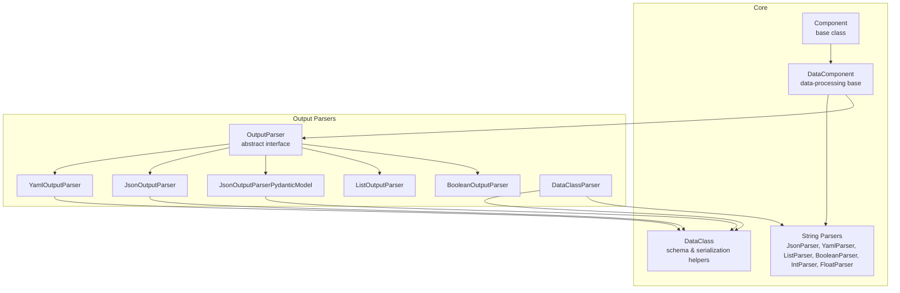
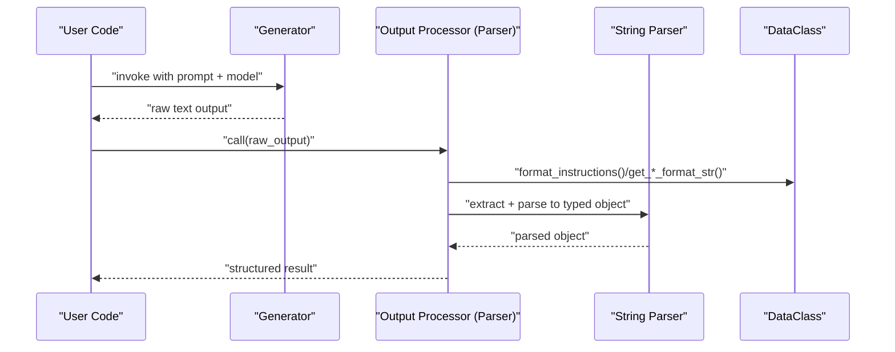
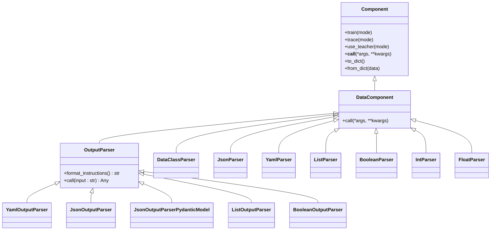
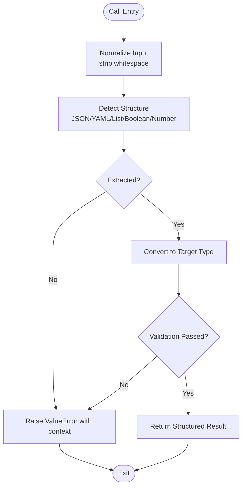
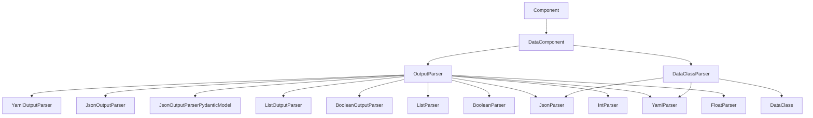

# Custom Parser Development

<cite>
**Referenced Files in This Document**
- [component.py](file://adalflow/adalflow/core/component.py)
- [string_parser.py](file://adalflow/adalflow/core/string_parser.py)
- [base_data_class.py](file://adalflow/adalflow/core/base_data_class.py)
- [outputs.py](file://adalflow/adalflow/components/output_parsers/outputs.py)
- [dataclass_parser.py](file://adalflow/adalflow/components/output_parsers/dataclass_parser.py)
- [__init__.py](file://adalflow/adalflow/components/output_parsers/__init__.py)
- [parser_note.py](file://tutorials/parser_note.py)
- [generator.py](file://adalflow/adalflow/core/generator.py)
</cite>

## Table of Contents
1. [Introduction](#introduction)
2. [Project Structure](#project-structure)
3. [Core Components](#core-components)
4. [Architecture Overview](#architecture-overview)
5. [Detailed Component Analysis](#detailed-component-analysis)
6. [Dependency Analysis](#dependency-analysis)
7. [Performance Considerations](#performance-considerations)
8. [Troubleshooting Guide](#troubleshooting-guide)
9. [Conclusion](#conclusion)
10. [Appendices](#appendices)

## Introduction
This document explains how to develop custom parsers in AdalFlow by extending the existing parsing infrastructure. It focuses on the parser interface requirements, inheritance patterns from the component system, and integration with generators and data classes. You will learn how to implement a custom parser’s call method, handle different output formats, and integrate parsers into existing workflows. Practical examples demonstrate advanced parsing logic and specialized use cases, alongside testing strategies, performance optimization tips, and best practices for maintaining compatibility with the framework.

## Project Structure
AdalFlow organizes parsing capabilities under the core component system and output parsers:
- Core component abstractions live in the core module and define the base classes for all components, including DataComponent and Component.
- String parsing utilities are provided by the string parser module, offering ready-to-use parsers for common types.
- Output parsers reside under components/output_parsers and include structured parsers for JSON/YAML and list/boolean outputs, plus a DataClass-based parser that leverages schema-driven instructions.

**Diagram sources**
- [component.py](file://adalflow/adalflow/core/component.py#L51-L120)
- [component.py](file://adalflow/adalflow/core/component.py#L960-L976)
- [string_parser.py](file://adalflow/adalflow/core/string_parser.py#L170-L254)
- [base_data_class.py](file://adalflow/adalflow/core/base_data_class.py#L97-L200)
- [outputs.py](file://adalflow/adalflow/components/output_parsers/outputs.py#L130-L545)
- [dataclass_parser.py](file://adalflow/adalflow/components/output_parsers/dataclass_parser.py#L56-L196)

**Section sources**
- [component.py](file://adalflow/adalflow/core/component.py#L51-L120)
- [string_parser.py](file://adalflow/adalflow/core/string_parser.py#L1-L254)
- [outputs.py](file://adalflow/adalflow/components/output_parsers/outputs.py#L1-L545)
- [dataclass_parser.py](file://adalflow/adalflow/components/output_parsers/dataclass_parser.py#L1-L196)
- [base_data_class.py](file://adalflow/adalflow/core/base_data_class.py#L1-L200)

## Core Components
This section outlines the foundational abstractions that custom parsers must satisfy to integrate seamlessly with AdalFlow.

- Component and DataComponent
  - Component defines the lifecycle and behavior for all components, including training, tracing, and serialization.
  - DataComponent specializes Component for data-processing tasks and removes training behavior, aligns call semantics, and integrates with the registry.

- String Parsers
  - JsonParser, YamlParser, ListParser, BooleanParser, IntParser, FloatParser provide robust extraction and conversion from raw strings to structured objects. They inherit from DataComponent and implement call to transform input strings into typed outputs.

- Output Parsers
  - OutputParser defines the abstract interface with format_instructions and call methods.
  - YamlOutputParser and JsonOutputParser use DataClass schemas to generate output instructions and parse responses accordingly.
  - JsonOutputParserPydanticModel offers Pydantic-based schema generation and validation.
  - ListOutputParser and BooleanOutputParser handle list and boolean outputs respectively.

- DataClass and Schema Utilities
  - DataClass provides schema, signature, and example formatting, enabling parsers to generate precise instructions and validate outputs.

**Section sources**
- [component.py](file://adalflow/adalflow/core/component.py#L51-L120)
- [component.py](file://adalflow/adalflow/core/component.py#L960-L976)
- [string_parser.py](file://adalflow/adalflow/core/string_parser.py#L33-L254)
- [outputs.py](file://adalflow/adalflow/components/output_parsers/outputs.py#L130-L545)
- [dataclass_parser.py](file://adalflow/adalflow/components/output_parsers/dataclass_parser.py#L56-L196)
- [base_data_class.py](file://adalflow/adalflow/core/base_data_class.py#L97-L200)

## Architecture Overview
Custom parsers integrate into the broader component architecture as follows:
- Generators accept output_processors, which are typically parser instances. During inference, the generator’s call invokes the parser’s call to convert raw LLM output into structured data.
- Parsers rely on DataClass schemas to generate precise output instructions and use string parsers to extract and convert raw text into typed objects.
- The component system ensures parsers can be serialized, traced, and composed within larger pipelines.

**Diagram sources**
- [generator.py](file://adalflow/adalflow/core/generator.py)
- [outputs.py](file://adalflow/adalflow/components/output_parsers/outputs.py#L130-L545)
- [dataclass_parser.py](file://adalflow/adalflow/components/output_parsers/dataclass_parser.py#L56-L196)
- [string_parser.py](file://adalflow/adalflow/core/string_parser.py#L170-L254)
- [base_data_class.py](file://adalflow/adalflow/core/base_data_class.py#L97-L200)

## Detailed Component Analysis

### Parser Interface Requirements
To implement a custom parser compatible with AdalFlow:
- Inherit from DataComponent (or OutputParser for structured parsers).
- Implement call(input: str) -> Any to convert raw LLM output into the desired structured type.
- Optionally implement format_instructions() to generate schema-based instructions for the LLM.
- Integrate with the registry and support serialization via to_dict/from_dict.

**Diagram sources**
- [component.py](file://adalflow/adalflow/core/component.py#L51-L120)
- [component.py](file://adalflow/adalflow/core/component.py#L960-L976)
- [outputs.py](file://adalflow/adalflow/components/output_parsers/outputs.py#L130-L545)
- [dataclass_parser.py](file://adalflow/adalflow/components/output_parsers/dataclass_parser.py#L56-L196)
- [string_parser.py](file://adalflow/adalflow/core/string_parser.py#L170-L254)

**Section sources**
- [component.py](file://adalflow/adalflow/core/component.py#L51-L120)
- [component.py](file://adalflow/adalflow/core/component.py#L960-L976)
- [outputs.py](file://adalflow/adalflow/components/output_parsers/outputs.py#L130-L545)
- [dataclass_parser.py](file://adalflow/adalflow/components/output_parsers/dataclass_parser.py#L56-L196)
- [string_parser.py](file://adalflow/adalflow/core/string_parser.py#L170-L254)

### Implementing the Call Method
The call method is the core of any parser. It should:
- Accept a raw string from the LLM.
- Extract and normalize the structured portion using appropriate string parsing utilities.
- Convert the extracted content into the intended type (e.g., dict, list, boolean, numeric).
- Raise clear exceptions on malformed input to enable robust error handling.

Common patterns:
- Use JsonParser or YamlParser to extract and parse JSON/YAML blocks.
- Use ListParser to extract list-like structures.
- Apply DataClass.from_dict for schema-driven reconstruction.

**Diagram sources**
- [string_parser.py](file://adalflow/adalflow/core/string_parser.py#L170-L254)
- [outputs.py](file://adalflow/adalflow/components/output_parsers/outputs.py#L271-L374)
- [dataclass_parser.py](file://adalflow/adalflow/components/output_parsers/dataclass_parser.py#L180-L190)

**Section sources**
- [string_parser.py](file://adalflow/adalflow/core/string_parser.py#L170-L254)
- [outputs.py](file://adalflow/adalflow/components/output_parsers/outputs.py#L271-L374)
- [dataclass_parser.py](file://adalflow/adalflow/components/output_parsers/dataclass_parser.py#L180-L190)

### Handling Different Output Formats
- JSON and YAML: Use dedicated parsers to extract fenced blocks and convert to dicts/lists. Prefer JSON for complex nested structures; YAML for simpler schemas.
- Lists: Use ListParser to extract list-like strings and convert to Python lists.
- Booleans and Numbers: Use BooleanParser, IntParser, FloatParser for robust extraction.
- DataClass-based outputs: Use DataClassParser to generate precise instructions and reconstruct DataClass instances.

Integration points:
- Output instructions are generated via DataClass signatures and examples.
- Parsers can optionally return DataClass instances or plain dicts depending on configuration.

**Section sources**
- [outputs.py](file://adalflow/adalflow/components/output_parsers/outputs.py#L35-L120)
- [dataclass_parser.py](file://adalflow/adalflow/components/output_parsers/dataclass_parser.py#L18-L54)
- [string_parser.py](file://adalflow/adalflow/core/string_parser.py#L33-L118)

### Practical Examples and Advanced Parsing Logic
- Tutorial demonstrations illustrate how to use built-in parsers and how to construct structured outputs with DataClass-based parsers.
- Example workflows include:
  - Converting free-form LLM outputs into strongly typed objects.
  - Generating and formatting examples to guide the LLM during output generation.
  - Switching between JSON and YAML output formats based on schema complexity.

These examples serve as templates for designing custom parsers tailored to domain-specific formats.

**Section sources**
- [parser_note.py](file://tutorials/parser_note.py#L1-L341)
- [outputs.py](file://adalflow/adalflow/components/output_parsers/outputs.py#L158-L378)
- [dataclass_parser.py](file://adalflow/adalflow/components/output_parsers/dataclass_parser.py#L56-L196)

### Relationship to the Broader Component Architecture
- Parsers are DataComponents, enabling them to participate in serialization, tracing, and composition.
- Generators accept output_processors, allowing seamless integration of any parser into a generation pipeline.
- DataClass-based parsers leverage schema and example formatting to improve accuracy and reduce ambiguity.

Compatibility considerations:
- Ensure parsers are registered and serializable.
- Maintain consistent call signatures and error handling.
- Align with the component lifecycle (training vs. inference) by inheriting from DataComponent.

**Section sources**
- [component.py](file://adalflow/adalflow/core/component.py#L51-L120)
- [component.py](file://adalflow/adalflow/core/component.py#L960-L976)
- [generator.py](file://adalflow/adalflow/core/generator.py)

## Dependency Analysis
The following diagram highlights key dependencies among parsers, DataClass utilities, and the component system.

**Diagram sources**
- [component.py](file://adalflow/adalflow/core/component.py#L51-L120)
- [component.py](file://adalflow/adalflow/core/component.py#L960-L976)
- [outputs.py](file://adalflow/adalflow/components/output_parsers/outputs.py#L130-L545)
- [dataclass_parser.py](file://adalflow/adalflow/components/output_parsers/dataclass_parser.py#L56-L196)
- [string_parser.py](file://adalflow/adalflow/core/string_parser.py#L170-L254)
- [base_data_class.py](file://adalflow/adalflow/core/base_data_class.py#L97-L200)

**Section sources**
- [outputs.py](file://adalflow/adalflow/components/output_parsers/outputs.py#L130-L545)
- [dataclass_parser.py](file://adalflow/adalflow/components/output_parsers/dataclass_parser.py#L56-L196)
- [string_parser.py](file://adalflow/adalflow/core/string_parser.py#L170-L254)
- [base_data_class.py](file://adalflow/adalflow/core/base_data_class.py#L97-L200)
- [component.py](file://adalflow/adalflow/core/component.py#L51-L120)

## Performance Considerations
- Prefer JSON for complex nested structures; YAML can be slower and less reliable.
- Use concise schema signatures (e.g., signature formats) to reduce token overhead.
- Minimize repeated parsing by caching frequently used instructions or schemas.
- Validate early and fail fast to avoid expensive retries.
- Keep extraction logic minimal and deterministic to reduce variability in parsing outcomes.

[No sources needed since this section provides general guidance]

## Troubleshooting Guide
Common issues and resolutions:
- Malformed JSON/YAML: Ensure fenced blocks are correctly formed and stripped before parsing. Use JsonParser/YamlParser to extract and normalize content.
- Ambiguous outputs: Provide explicit examples and clear schema instructions via DataClass-based parsers.
- Type mismatches: Validate parsed types against expected schema; raise descriptive errors when conversion fails.
- Serialization problems: Confirm parsers are registered and serializable via to_dict/from_dict.

**Section sources**
- [string_parser.py](file://adalflow/adalflow/core/string_parser.py#L170-L254)
- [outputs.py](file://adalflow/adalflow/components/output_parsers/outputs.py#L271-L374)
- [dataclass_parser.py](file://adalflow/adalflow/components/output_parsers/dataclass_parser.py#L180-L190)
- [component.py](file://adalflow/adalflow/core/component.py#L230-L352)

## Conclusion
Custom parsers in AdalFlow are built on a solid component foundation, leveraging DataComponent and OutputParser abstractions. By implementing a robust call method, integrating schema-driven instructions, and aligning with the component lifecycle, you can extend parsing capabilities for diverse output formats. The provided patterns and examples offer a clear path to designing, testing, and integrating custom parsers into existing workflows while maintaining compatibility and performance.

[No sources needed since this section summarizes without analyzing specific files]

## Appendices

### Best Practices for Parser Design
- Keep parsers stateless or explicitly manage state to ensure reproducibility.
- Provide clear error messages and logs to aid debugging.
- Support both dict and DataClass return types based on configuration.
- Reuse existing string parsers to minimize duplication and improve reliability.
- Document format requirements and constraints for consumers.

**Section sources**
- [outputs.py](file://adalflow/adalflow/components/output_parsers/outputs.py#L130-L545)
- [dataclass_parser.py](file://adalflow/adalflow/components/output_parsers/dataclass_parser.py#L56-L196)
- [string_parser.py](file://adalflow/adalflow/core/string_parser.py#L170-L254)

### Testing Strategies
- Unit tests should cover happy paths, malformed inputs, and edge cases for each parser.
- Use representative examples from DataClass schemas to validate instruction formatting and parsing accuracy.
- Integration tests should exercise the parser within a generator pipeline to ensure end-to-end correctness.

**Section sources**
- [parser_note.py](file://tutorials/parser_note.py#L1-L341)
- [outputs.py](file://adalflow/adalflow/components/output_parsers/outputs.py#L158-L378)
- [dataclass_parser.py](file://adalflow/adalflow/components/output_parsers/dataclass_parser.py#L56-L196)