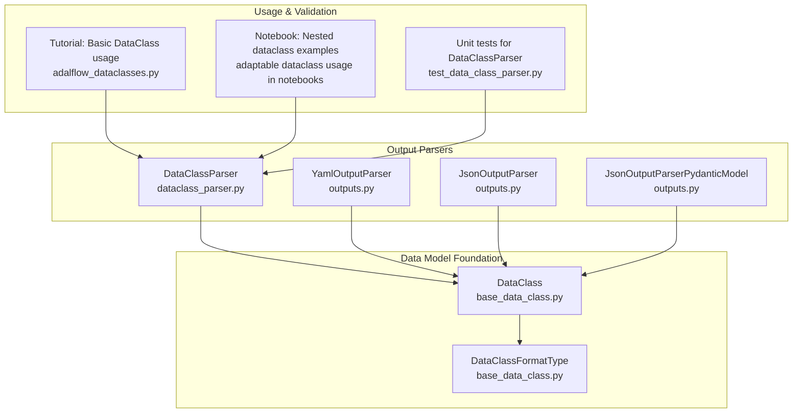
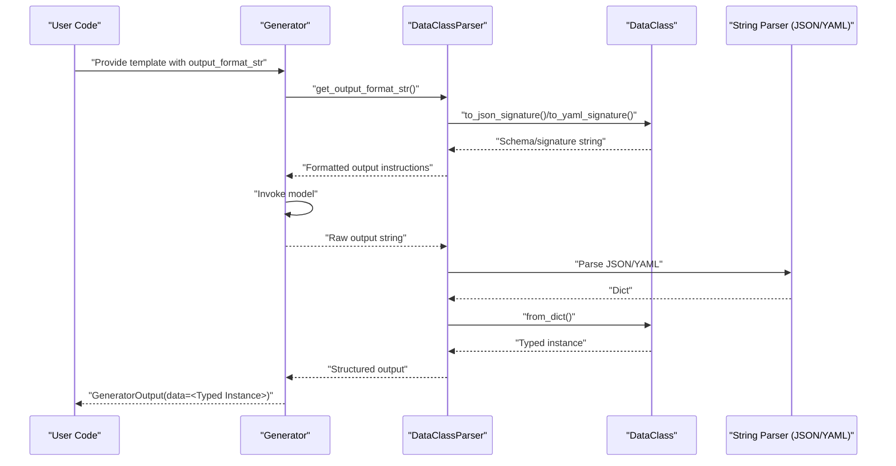
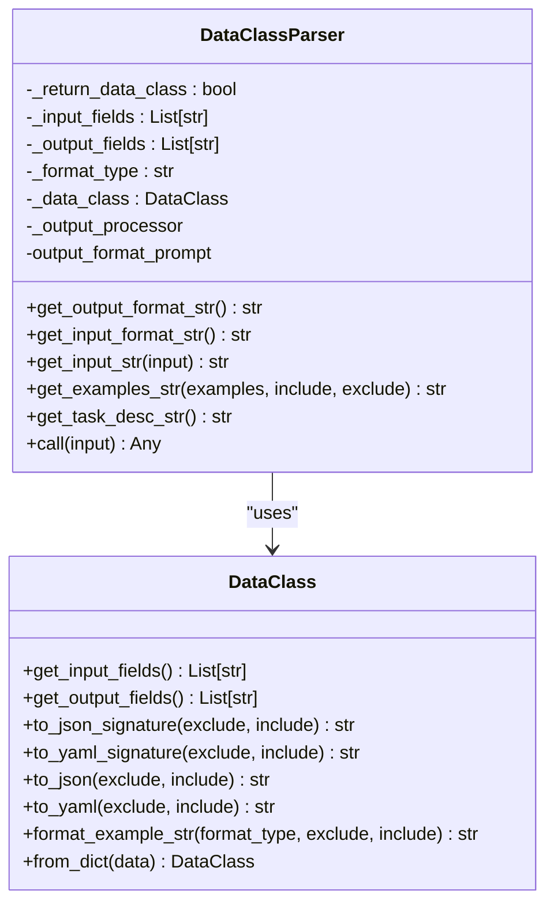
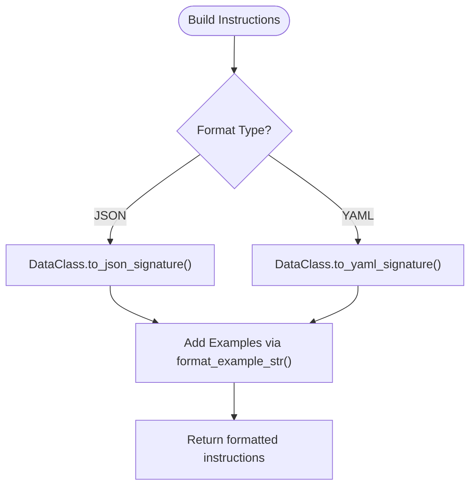
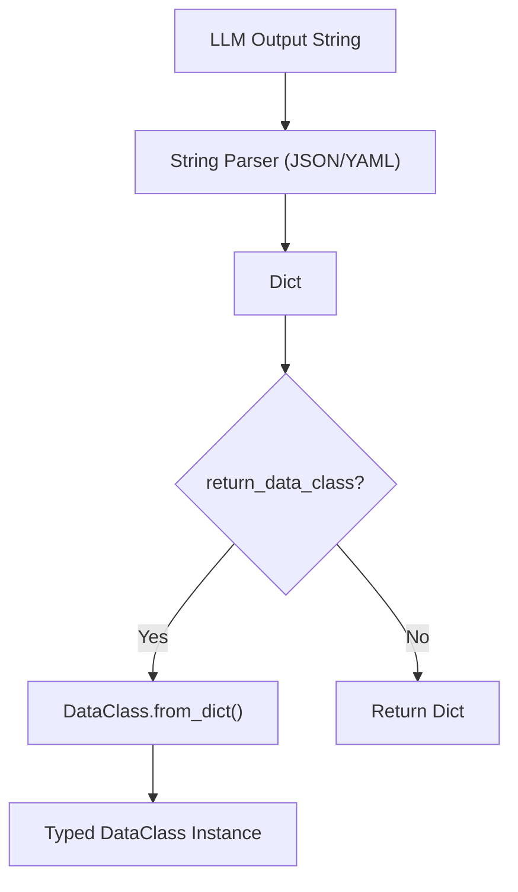
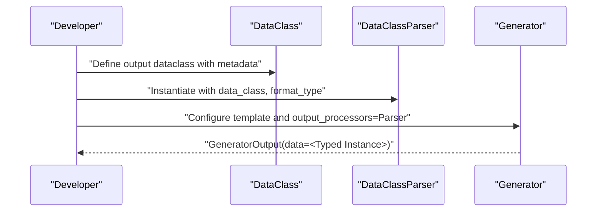
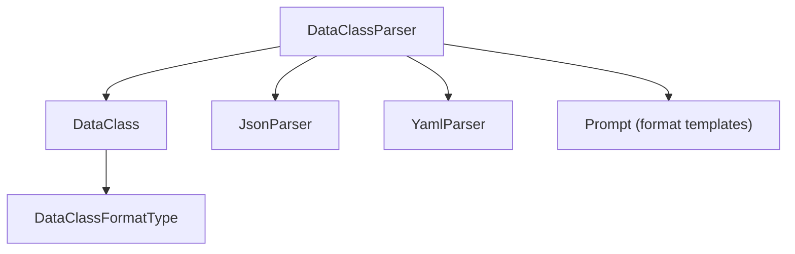

# Dataclass Parsers

<cite>
**Referenced Files in This Document**
- [dataclass_parser.py](file://adalflow/adalflow/components/output_parsers/dataclass_parser.py)
- [outputs.py](file://adalflow/adalflow/components/output_parsers/outputs.py)
- [base_data_class.py](file://adalflow/adalflow/core/base_data_class.py)
- [test_data_class_parser.py](file://adalflow/tests/test_data_class_parser.py)
- [adalflow_dataclasses.py](file://tutorials/adalflow_dataclasses.py)
- [adaptable dataclass usage in notebooks](file://notebooks/tutorials/adalflow_dataclasses.ipynb)
</cite>

## Table of Contents
1. [Introduction](#introduction)
2. [Project Structure](#project-structure)
3. [Core Components](#core-components)
4. [Architecture Overview](#architecture-overview)
5. [Detailed Component Analysis](#detailed-component-analysis)
6. [Dependency Analysis](#dependency-analysis)
7. [Performance Considerations](#performance-considerations)
8. [Troubleshooting Guide](#troubleshooting-guide)
9. [Conclusion](#conclusion)
10. [Appendices](#appendices)

## Introduction
This document explains AdalFlow’s Dataclass Parsers subsystem with a focus on structured output extraction using Pydantic dataclasses and AdalFlow’s native DataClass. It covers how DataClassParser integrates with DataClass objects, generates schema-based output instructions, enforces type safety, and performs automatic output formatting. Practical examples demonstrate schema definition, dataclass-based parsing, and structured output generation. It also clarifies the relationship between dataclass metadata, field descriptions, and prompt construction, and provides guidelines for designing robust dataclass schemas, handling validation errors, and optimizing parsing performance.

## Project Structure
The Dataclass Parsers feature spans three primary areas:
- Output parsers: DataClassParser and related parsers for structured output
- Data model foundation: AdalFlow’s DataClass with schema/signature/example generation
- Tests and tutorials: Behavioral validation and usage patterns

**Diagram sources**
- [dataclass_parser.py](file://adalflow/adalflow/components/output_parsers/dataclass_parser.py#L56-L196)
- [outputs.py](file://adalflow/adalflow/components/output_parsers/outputs.py#L158-L492)
- [base_data_class.py](file://adalflow/adalflow/core/base_data_class.py#L97-L761)
- [adalflow_dataclasses.py](file://tutorials/adalflow_dataclasses.py#L16-L46)
- [test_data_class_parser.py](file://adalflow/tests/test_data_class_parser.py#L8-L143)

**Section sources**
- [dataclass_parser.py](file://adalflow/adalflow/components/output_parsers/dataclass_parser.py#L1-L196)
- [outputs.py](file://adalflow/adalflow/components/output_parsers/outputs.py#L1-L545)
- [base_data_class.py](file://adalflow/adalflow/core/base_data_class.py#L1-L820)
- [adalflow_dataclasses.py](file://tutorials/adalflow_dataclasses.py#L1-L68)
- [test_data_class_parser.py](file://adalflow/tests/test_data_class_parser.py#L1-L143)

## Core Components
- DataClassParser: A specialized parser that leverages AdalFlow’s DataClass to generate output format instructions and parse LLM responses into strongly typed instances. It supports JSON and YAML output modes, input/output field selection, and example formatting.
- DataClass: The foundational data model that provides schema generation, signature rendering, example formatting, and conversion utilities. It also supports metadata-driven field descriptions and ordering via __input_fields__ and __output_fields__.
- Related parsers (YamlOutputParser, JsonOutputParser, JsonOutputParserPydanticModel): Alternative structured output parsers that complement DataClassParser, including a Pydantic-based variant for advanced schema generation and validation.

Key capabilities:
- Automatic schema generation from DataClass metadata
- Output format instructions tailored to JSON/YAML
- Input and output field scoping via include/exclude
- Example formatting for few-shot prompting
- Type-safe parsing into DataClass instances

**Section sources**
- [dataclass_parser.py](file://adalflow/adalflow/components/output_parsers/dataclass_parser.py#L56-L196)
- [base_data_class.py](file://adalflow/adalflow/core/base_data_class.py#L97-L761)
- [outputs.py](file://adalflow/adalflow/components/output_parsers/outputs.py#L158-L492)

## Architecture Overview
The DataClassParser sits within the Generator pipeline, working alongside prompt construction and output processors. It uses DataClass to produce schema/signature instructions and formats examples, then parses the LLM’s raw output into structured data.

**Diagram sources**
- [dataclass_parser.py](file://adalflow/adalflow/components/output_parsers/dataclass_parser.py#L125-L196)
- [base_data_class.py](file://adalflow/adalflow/core/base_data_class.py#L642-L761)
- [outputs.py](file://adalflow/adalflow/components/output_parsers/outputs.py#L288-L379)

## Detailed Component Analysis

### DataClassParser
DataClassParser encapsulates the logic to:
- Validate and configure the target DataClass
- Generate output format instructions (JSON/YAML) using DataClass schema/signatures
- Format examples for few-shot prompting
- Parse raw LLM output into either a dict or a typed DataClass instance

Implementation highlights:
- Constructor validates that the provided class is both a dataclass and a subclass of DataClass, selects format type, and prepares the appropriate string parser and prompt templates.
- get_output_format_str builds schema-based instructions using DataClass.to_json_signature or DataClass.to_yaml_signature.
- get_input_format_str and get_input_str render input data using DataClass.to_json or DataClass.to_yaml.
- get_examples_str formats example instances using DataClass.format_example_str with appropriate format types.
- call parses the raw string using the configured string parser and converts to a DataClass instance if requested.

**Diagram sources**
- [dataclass_parser.py](file://adalflow/adalflow/components/output_parsers/dataclass_parser.py#L56-L196)
- [base_data_class.py](file://adalflow/adalflow/core/base_data_class.py#L222-L761)

**Section sources**
- [dataclass_parser.py](file://adalflow/adalflow/components/output_parsers/dataclass_parser.py#L56-L196)

### DataClass Schema Generation and Prompt Construction
DataClass provides multiple ways to render schema and examples:
- to_json_signature and to_yaml_signature: Produce concise, metadata-driven descriptions suitable for prompting.
- to_json and to_yaml: Render instance examples for few-shot demonstrations.
- format_example_str: Formats individual instances according to the chosen format type.
- get_input_fields/get_output_fields: Enforce field ordering and scoping for both schema and examples.

These methods are used by DataClassParser to construct:
- Output format instructions that guide the LLM to produce valid JSON/YAML
- Input format instructions for any required fields
- Example blocks for few-shot learning

**Diagram sources**
- [base_data_class.py](file://adalflow/adalflow/core/base_data_class.py#L642-L761)
- [dataclass_parser.py](file://adalflow/adalflow/components/output_parsers/dataclass_parser.py#L125-L178)

**Section sources**
- [base_data_class.py](file://adalflow/adalflow/core/base_data_class.py#L42-L141)
- [base_data_class.py](file://adalflow/adalflow/core/base_data_class.py#L642-L761)
- [dataclass_parser.py](file://adalflow/adalflow/components/output_parsers/dataclass_parser.py#L125-L178)

### Integration with DataClass Objects, Field Validation, and Type Safety
- Field descriptions: Metadata keys (e.g., desc) are used to generate human-readable schema descriptions and improve prompt clarity.
- Required vs optional fields: Fields without defaults or with required_field factories are treated as required; others are optional.
- Ordering: __input_fields__ and __output_fields__ control serialization order and thus prompt presentation.
- Conversion: from_dict ensures type safety by reconstructing instances from parsed dicts, raising errors on missing required fields.

**Diagram sources**
- [dataclass_parser.py](file://adalflow/adalflow/components/output_parsers/dataclass_parser.py#L180-L196)
- [base_data_class.py](file://adalflow/adalflow/core/base_data_class.py#L364-L393)

**Section sources**
- [base_data_class.py](file://adalflow/adalflow/core/base_data_class.py#L194-L250)
- [base_data_class.py](file://adalflow/adalflow/core/base_data_class.py#L364-L393)
- [dataclass_parser.py](file://adalflow/adalflow/components/output_parsers/dataclass_parser.py#L180-L196)

### Relationship Between Dataclass Metadata, Field Descriptions, and Prompt Construction
- Metadata-driven descriptions: The presence of desc in field metadata is essential for generating clear, actionable schema descriptions.
- Task-level descriptions: get_task_desc allows attaching a docstring to the class for broader task context.
- Prompt templates: DataClassParser composes output instructions using pre-defined templates that emphasize schema interpretation and strict formatting rules.

Practical tips:
- Always provide desc in metadata for each field intended for LLM output.
- Use __output_fields__ to enforce deterministic field ordering in prompts and outputs.
- Use __input_fields__ to constrain which fields are included in input prompts.

**Section sources**
- [base_data_class.py](file://adalflow/adalflow/core/base_data_class.py#L194-L220)
- [base_data_class.py](file://adalflow/adalflow/core/base_data_class.py#L222-L249)
- [dataclass_parser.py](file://adalflow/adalflow/components/output_parsers/dataclass_parser.py#L18-L56)

### Dataclass Inheritance, Optional Fields, and Complex Nested Structures
- Inheritance: DataClass supports nested dataclasses transparently; recursive serialization and deserialization preserve structure.
- Optional fields: Default values and default_factory control optionality; required_field marks truly required fields.
- Nested structures: Complex nested objects are handled by to_json/to_yaml and format_example_str, enabling multi-level schemas.

Behavioral validation:
- Unit tests demonstrate successful parsing for basic and nested dataclasses in both JSON and YAML modes.
- A two-level nesting example shows mixed success depending on model capability; this is expected and informs prompt tuning and model selection.

**Section sources**
- [test_data_class_parser.py](file://adalflow/tests/test_data_class_parser.py#L8-L143)
- [base_data_class.py](file://adalflow/adalflow/core/base_data_class.py#L251-L467)
- [adaptable dataclass usage in notebooks](file://notebooks/tutorials/adalflow_dataclasses.ipynb#L396-L531)

### Practical Examples: Dataclass-Based Parsing and Structured Output
- Basic example: A minimal DataClass with two string fields demonstrates end-to-end parsing with DataClassParser and a Generator.
- Nested example: A composite dataclass containing nested dataclasses and lists showcases multi-level structured output.
- Tutorial integration: The tutorial script shows how to wire a DataClass-based parser into a Generator with Jinja-style templates.

**Diagram sources**
- [adalflow_dataclasses.py](file://tutorials/adalflow_dataclasses.py#L16-L46)
- [dataclass_parser.py](file://adalflow/adalflow/components/output_parsers/dataclass_parser.py#L98-L124)

**Section sources**
- [adalflow_dataclasses.py](file://tutorials/adalflow_dataclasses.py#L16-L68)
- [adaptable dataclass usage in notebooks](file://notebooks/tutorials/adalflow_dataclasses.ipynb#L201-L337)

## Dependency Analysis
DataClassParser depends on:
- DataClass for schema/signature/example generation and instance reconstruction
- String parsers (JSON/YAML) for raw output parsing
- Prompt templates for output formatting instructions

**Diagram sources**
- [dataclass_parser.py](file://adalflow/adalflow/components/output_parsers/dataclass_parser.py#L1-L196)
- [base_data_class.py](file://adalflow/adalflow/core/base_data_class.py#L42-L52)

**Section sources**
- [dataclass_parser.py](file://adalflow/adalflow/components/output_parsers/dataclass_parser.py#L1-L196)
- [base_data_class.py](file://adalflow/adalflow/core/base_data_class.py#L42-L52)

## Performance Considerations
- Prefer JSON for complex nested structures to reduce ambiguity and parsing overhead.
- Use signature-based instructions (SIGNATURE_JSON/SIGNATURE_YAML) to minimize token usage compared to full SCHEMA descriptions.
- Limit examples to representative cases to avoid bloating prompts unnecessarily.
- Keep field counts reasonable and leverage __output_fields__ to control serialization order and prompt length.
- Consider return_data_class=False when downstream processing prefers dicts to avoid redundant conversions.

## Troubleshooting Guide
Common issues and resolutions:
- Invalid dataclass type: Ensure the provided class is both a dataclass and a subclass of DataClass; otherwise, initialization raises a ValueError.
- Unsupported format type: Only "json" and "yaml" are supported; invalid values trigger a ValueError.
- Mismatched input type: Passing an input that is not an instance of the configured data_class raises a ValueError during get_input_str.
- Parsing failures: Errors during string parsing or dict-to-dataclass conversion are logged and surfaced as ValueError/ValidationError; inspect logs for details.
- Nested structure challenges: Some models struggle with deeper nesting; simplify schemas or adjust prompts accordingly.

Validation and usage references:
- Unit tests cover basic parsing, nested structures, and error conditions.
- Tutorial notebooks demonstrate end-to-end usage and highlight limitations with deeper nesting.

**Section sources**
- [dataclass_parser.py](file://adalflow/adalflow/components/output_parsers/dataclass_parser.py#L98-L118)
- [dataclass_parser.py](file://adalflow/adalflow/components/output_parsers/dataclass_parser.py#L180-L196)
- [test_data_class_parser.py](file://adalflow/tests/test_data_class_parser.py#L130-L143)
- [adaptable dataclass usage in notebooks](file://notebooks/tutorials/adalflow_dataclasses.ipynb#L562-L637)

## Conclusion
DataClassParser streamlines structured output extraction by combining AdalFlow’s DataClass schema/signature generation with robust parsing and type safety. By leveraging metadata-driven descriptions, controlled field ordering, and flexible output formats, it enables developers to build reliable, maintainable pipelines that produce strongly typed results from LLMs. For complex nested structures, careful schema design and prompt engineering remain key to achieving consistent parsing outcomes.

## Appendices

### Design Guidelines for Effective Dataclass Schemas
- Use metadata.desc for every field intended for LLM output to improve clarity.
- Define __output_fields__ to enforce deterministic ordering and reduce ambiguity.
- Use __input_fields__ to constrain input prompts when needed.
- Prefer default values for optional fields; use required_field for truly required fields.
- Keep schemas concise; favor signatures over full schemas for prompts.

### Handling Validation Errors
- Wrap parsing in try/except blocks to capture ValueError/ValidationError.
- Log raw outputs and parsed dicts for debugging.
- Validate examples and ensure they conform to the schema before inclusion.

### Optimizing Parsing Performance
- Choose JSON for complex nested structures; YAML for simpler schemas.
- Use signature-based instructions to reduce token overhead.
- Minimize example sets and ensure they are representative.