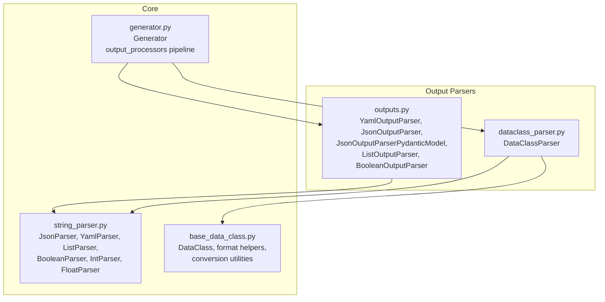
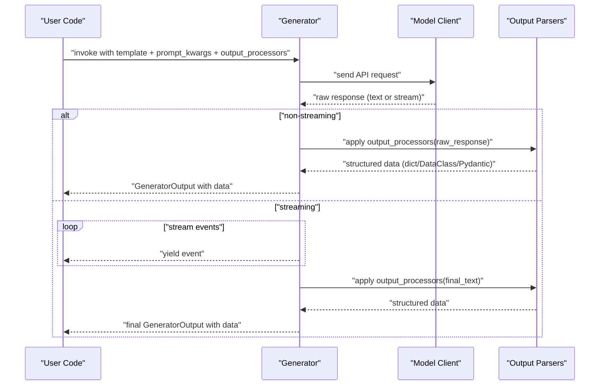
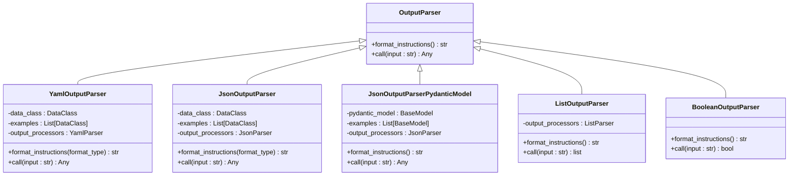
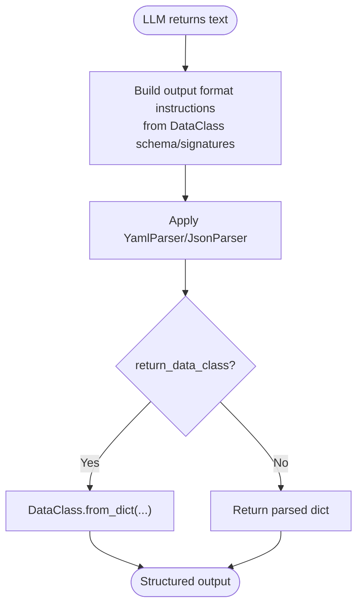
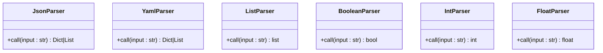
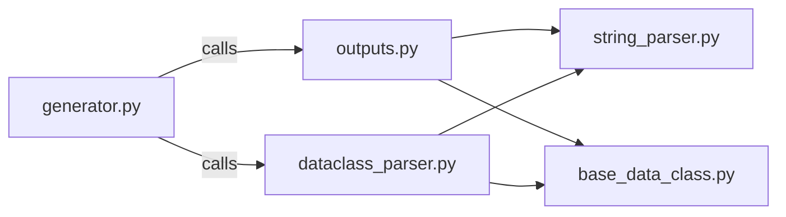

# Output Parsers

<cite>
**Referenced Files in This Document**
- [__init__.py](file://adalflow/adalflow/components/output_parsers/__init__.py)
- [outputs.py](file://adalflow/adalflow/components/output_parsers/outputs.py)
- [dataclass_parser.py](file://adalflow/adalflow/components/output_parsers/dataclass_parser.py)
- [string_parser.py](file://adalflow/adalflow/core/string_parser.py)
- [base_data_class.py](file://adalflow/adalflow/core/base_data_class.py)
- [generator.py](file://adalflow/adalflow/core/generator.py)
- [test_output_parser.py](file://adalflow/tests/test_output_parser.py)
- [test_data_class_parser.py](file://adalflow/tests/test_data_class_parser.py)
</cite>

## Table of Contents
1. [Introduction](#introduction)
2. [Project Structure](#project-structure)
3. [Core Components](#core-components)
4. [Architecture Overview](#architecture-overview)
5. [Detailed Component Analysis](#detailed-component-analysis)
6. [Dependency Analysis](#dependency-analysis)
7. [Performance Considerations](#performance-considerations)
8. [Troubleshooting Guide](#troubleshooting-guide)
9. [Conclusion](#conclusion)
10. [Appendices](#appendices)

## Introduction
This document explains AdalFlow’s Output Parsers subsystem, focusing on structured output extraction and validation from LLM responses. It covers:
- String parsing mechanisms for JSON, YAML, lists, and booleans
- Dataclass-based parsers that leverage schema-aware instructions and conversion
- Structured output validation using both AdalFlow DataClass and Pydantic models
- The integration between output parsers and the LLM response pipeline via the Generator
- Practical examples, error handling, performance tips, and guidelines for designing custom parsers

## Project Structure
The output parsing capability is centered around:
- Output Parsers module: reusable parsers for common structured formats
- Dataclass-based parser: a high-level wrapper that generates precise instructions and converts outputs to typed objects
- Core string parsers: robust extraction and parsing utilities for JSON, YAML, lists, and booleans
- DataClass base: schema/signature/example generation and conversion helpers
- Generator: orchestrates model calls and applies output processors to transform raw LLM text into structured data

**Diagram sources**
- [outputs.py](file://adalflow/adalflow/components/output_parsers/outputs.py#L158-L545)
- [dataclass_parser.py](file://adalflow/adalflow/components/output_parsers/dataclass_parser.py#L56-L196)
- [string_parser.py](file://adalflow/adalflow/core/string_parser.py#L33-L254)
- [base_data_class.py](file://adalflow/adalflow/core/base_data_class.py#L97-L761)
- [generator.py](file://adalflow/adalflow/core/generator.py#L82-L461)

**Section sources**
- [__init__.py](file://adalflow/adalflow/components/output_parsers/__init__.py#L1-L20)
- [outputs.py](file://adalflow/adalflow/components/output_parsers/outputs.py#L1-L545)
- [dataclass_parser.py](file://adalflow/adalflow/components/output_parsers/dataclass_parser.py#L1-L196)
- [string_parser.py](file://adalflow/adalflow/core/string_parser.py#L1-L254)
- [base_data_class.py](file://adalflow/adalflow/core/base_data_class.py#L1-L820)
- [generator.py](file://adalflow/adalflow/core/generator.py#L1-L600)

## Core Components
- OutputParser family:
  - YamlOutputParser: generates YAML-formatted instructions and parses YAML into dicts or DataClass instances
  - JsonOutputParser: generates JSON-formatted instructions and parses JSON into dicts or DataClass instances
  - JsonOutputParserPydanticModel: integrates Pydantic BaseModel for schema generation and validation
  - ListOutputParser: extracts Python lists from text
  - BooleanOutputParser: extracts boolean values from text
- DataClassParser: a convenience wrapper that:
  - Derives input/output field sets from DataClass
  - Generates precise output format instructions (YAML/JSON)
  - Converts raw LLM text to DataClass instances or dicts
- Core string parsers:
  - JsonParser/YamlParser/ListParser/BooleanParser: robust extraction and parsing utilities
- DataClass base:
  - Provides schema/signature/example generation and conversion helpers (to/from JSON/YAML/dict)

Key behaviors:
- All parsers derive from a common interface and are compatible with Generator’s output_processors pipeline
- DataClass-based parsers can return either dicts or typed DataClass instances
- Pydantic-backed parser adds validation on top of JSON parsing

**Section sources**
- [outputs.py](file://adalflow/adalflow/components/output_parsers/outputs.py#L130-L545)
- [dataclass_parser.py](file://adalflow/adalflow/components/output_parsers/dataclass_parser.py#L56-L196)
- [string_parser.py](file://adalflow/adalflow/core/string_parser.py#L33-L254)
- [base_data_class.py](file://adalflow/adalflow/core/base_data_class.py#L97-L761)

## Architecture Overview
The end-to-end flow from LLM completion to structured output:

**Diagram sources**
- [generator.py](file://adalflow/adalflow/core/generator.py#L357-L461)
- [outputs.py](file://adalflow/adalflow/components/output_parsers/outputs.py#L158-L545)
- [dataclass_parser.py](file://adalflow/adalflow/components/output_parsers/dataclass_parser.py#L56-L196)

## Detailed Component Analysis

### Output Parsers Family
- OutputParser: abstract base defining format_instructions and call
- YamlOutputParser:
  - Builds YAML instructions using DataClass schema/signatures
  - Parses YAML via YamlParser, optionally converts to DataClass
- JsonOutputParser:
  - Builds JSON instructions using DataClass schema/signatures
  - Parses JSON via JsonParser, optionally converts to DataClass
- JsonOutputParserPydanticModel:
  - Uses Pydantic model_json_schema for instructions
  - Validates parsed dict into a Pydantic object
- ListOutputParser:
  - Extracts list-like strings and parses to Python lists
- BooleanOutputParser:
  - Attempts eval and falls back to keyword-based detection

**Diagram sources**
- [outputs.py](file://adalflow/adalflow/components/output_parsers/outputs.py#L130-L545)

Practical configuration examples (paths only):
- Configure a JSON parser with examples and return a DataClass: [test_output_parser.py](file://adalflow/tests/test_output_parser.py#L57-L64)
- Configure a YAML parser with examples and return a DataClass: [test_output_parser.py](file://adalflow/tests/test_output_parser.py#L72-L79)
- Use Pydantic-backed JSON parser with validation: [test_output_parser.py](file://adalflow/tests/test_output_parser.py#L209-L231)
- Use Pydantic-backed parser with nested models and examples: [test_output_parser.py](file://adalflow/tests/test_output_parser.py#L250-L267)

**Section sources**
- [outputs.py](file://adalflow/adalflow/components/output_parsers/outputs.py#L130-L545)
- [test_output_parser.py](file://adalflow/tests/test_output_parser.py#L1-L331)

### DataClassParser
- Purpose: simplify structured output by deriving instructions and conversions from DataClass metadata
- Features:
  - Auto-detects input/output fields from DataClass
  - Generates YAML/JSON output format instructions
  - Formats examples using DataClass examples
  - Converts raw text to dict or DataClass instance
- Integration:
  - Works as an output_processor in Generator
  - Uses YamlParser/JsonParser internally

**Diagram sources**
- [dataclass_parser.py](file://adalflow/adalflow/components/output_parsers/dataclass_parser.py#L56-L196)

Practical configuration examples (paths only):
- Basic JSON DataClassParser usage: [test_data_class_parser.py](file://adalflow/tests/test_data_class_parser.py#L41-L57)
- Basic YAML DataClassParser usage: [test_data_class_parser.py](file://adalflow/tests/test_data_class_parser.py#L58-L79)
- Nested DataClass with YAML format: [test_data_class_parser.py](file://adalflow/tests/test_data_class_parser.py#L105-L128)

**Section sources**
- [dataclass_parser.py](file://adalflow/adalflow/components/output_parsers/dataclass_parser.py#L56-L196)
- [test_data_class_parser.py](file://adalflow/tests/test_data_class_parser.py#L1-L143)

### Core String Parsers
- JsonParser: robust extraction and parsing of JSON strings, including markdown-wrapped content
- YamlParser: extraction and parsing of YAML strings
- ListParser: extracts list-like strings and parses to Python lists
- Boolean/Int/Float parsers: extract scalar values from text

**Diagram sources**
- [string_parser.py](file://adalflow/adalflow/core/string_parser.py#L33-L254)

**Section sources**
- [string_parser.py](file://adalflow/adalflow/core/string_parser.py#L1-L254)

### DataClass Utilities
- Schema/signature/example generation:
  - to_schema/to_schema_str
  - to_json_signature/to_yaml_signature
  - to_json/to_yaml and format_class_str/format_example_str
- Conversion helpers:
  - from_dict/from_json/from_yaml
  - to_pydantic/pydantic_to_dataclass
- Required field helper and dynamic factory

These utilities power the instruction generation and conversion logic in the output parsers.

**Section sources**
- [base_data_class.py](file://adalflow/adalflow/core/base_data_class.py#L97-L761)

## Dependency Analysis
- Output parsers depend on:
  - Prompt templates for instructions
  - Core string parsers for extraction and parsing
  - DataClass utilities for schema/signature/example generation
- DataClassParser additionally depends on:
  - DataClass metadata for input/output fields
  - YamlParser/JsonParser for text parsing
- Generator integrates output processors:
  - Applies output_processors to raw_response after model completion
  - Handles both synchronous and streaming responses

**Diagram sources**
- [generator.py](file://adalflow/adalflow/core/generator.py#L357-L461)
- [outputs.py](file://adalflow/adalflow/components/output_parsers/outputs.py#L158-L545)
- [dataclass_parser.py](file://adalflow/adalflow/components/output_parsers/dataclass_parser.py#L56-L196)
- [string_parser.py](file://adalflow/adalflow/core/string_parser.py#L33-L254)
- [base_data_class.py](file://adalflow/adalflow/core/base_data_class.py#L97-L761)

**Section sources**
- [generator.py](file://adalflow/adalflow/core/generator.py#L357-L461)
- [outputs.py](file://adalflow/adalflow/components/output_parsers/outputs.py#L158-L545)
- [dataclass_parser.py](file://adalflow/adalflow/components/output_parsers/dataclass_parser.py#L56-L196)
- [string_parser.py](file://adalflow/adalflow/core/string_parser.py#L33-L254)
- [base_data_class.py](file://adalflow/adalflow/core/base_data_class.py#L97-L761)

## Performance Considerations
- Prefer concise instructions:
  - Use signature-based instructions (DataClassFormatType.SIGNATURE_JSON/SIGNATURE_YAML) to reduce token usage
- Minimize post-processing overhead:
  - Avoid streaming when using complex output_processors; otherwise, processors run after final text aggregation
- Robust extraction:
  - Core parsers handle markdown-wrapped JSON/YAML and malformed brackets/braces; still prefer clean LLM output to reduce retries
- Validation cost:
  - Pydantic validation adds CPU cost; use only when strict correctness is required

[No sources needed since this section provides general guidance]

## Troubleshooting Guide
Common issues and resolutions:
- Invalid JSON/YAML:
  - Symptom: exceptions during parsing
  - Resolution: ensure LLM returns clean JSON/YAML; use examples and explicit format instructions; verify closing delimiters
- Markdown-wrapped content:
  - Symptom: leading/trailing backticks
  - Resolution: core parsers support markdown blocks; ensure instructions specify expected format
- Validation errors (Pydantic):
  - Symptom: ValidationError raised
  - Resolution: adjust model schema or provide stricter examples; verify field types and constraints
- Streaming vs. non-streaming:
  - Symptom: output_processors not applied in streaming
  - Resolution: output_processors are applied after final text; do not expect immediate structured results during streaming
- DataClass conversion errors:
  - Symptom: ValueError when loading from dict
  - Resolution: ensure required fields are present; avoid excluding required fields when serializing

Relevant test coverage (paths only):
- Invalid JSON/YAML parsing raises exceptions: [test_output_parser.py](file://adalflow/tests/test_output_parser.py#L82-L93)
- Markdown-wrapped JSON/YAML parsing: [test_output_parser.py](file://adalflow/tests/test_output_parser.py#L94-L125)
- Pydantic validation errors: [test_output_parser.py](file://adalflow/tests/test_output_parser.py#L242-L248)
- DataClassParser invalid inputs: [test_data_class_parser.py](file://adalflow/tests/test_data_class_parser.py#L130-L139)

**Section sources**
- [test_output_parser.py](file://adalflow/tests/test_output_parser.py#L1-L331)
- [test_data_class_parser.py](file://adalflow/tests/test_data_class_parser.py#L1-L143)

## Conclusion
AdalFlow’s output parsers provide a cohesive, extensible system for transforming LLM responses into structured data:
- Use OutputParser family for schema-driven JSON/YAML/list/boolean extraction
- Use DataClassParser for strongly-typed outputs with minimal boilerplate
- Use JsonOutputParserPydanticModel for advanced validation and schema generation
- Integrate seamlessly with Generator’s output_processors pipeline for both streaming and non-streaming workflows

[No sources needed since this section summarizes without analyzing specific files]

## Appendices

### Practical Examples Index (Paths Only)
- Configure JSON parser with examples and return DataClass: [test_output_parser.py](file://adalflow/tests/test_output_parser.py#L57-L64)
- Configure YAML parser with examples and return DataClass: [test_output_parser.py](file://adalflow/tests/test_output_parser.py#L72-L79)
- Pydantic-backed JSON parser with validation: [test_output_parser.py](file://adalflow/tests/test_output_parser.py#L209-L231)
- DataClassParser basic JSON usage: [test_data_class_parser.py](file://adalflow/tests/test_data_class_parser.py#L41-L57)
- DataClassParser basic YAML usage: [test_data_class_parser.py](file://adalflow/tests/test_data_class_parser.py#L58-L79)

### Design Guidelines for Custom Parsers
- Follow OutputParser interface:
  - Implement format_instructions to generate precise instructions
  - Implement call to parse raw text into structured output
- Leverage DataClass utilities:
  - Use format_class_str and format_example_str for consistent instructions
- Integrate with Generator:
  - Ensure output_processors are DataComponent-compatible
  - Handle both synchronous and streaming responses if applicable

**Section sources**
- [outputs.py](file://adalflow/adalflow/components/output_parsers/outputs.py#L130-L156)
- [base_data_class.py](file://adalflow/adalflow/core/base_data_class.py#L705-L761)
- [generator.py](file://adalflow/adalflow/core/generator.py#L357-L461)