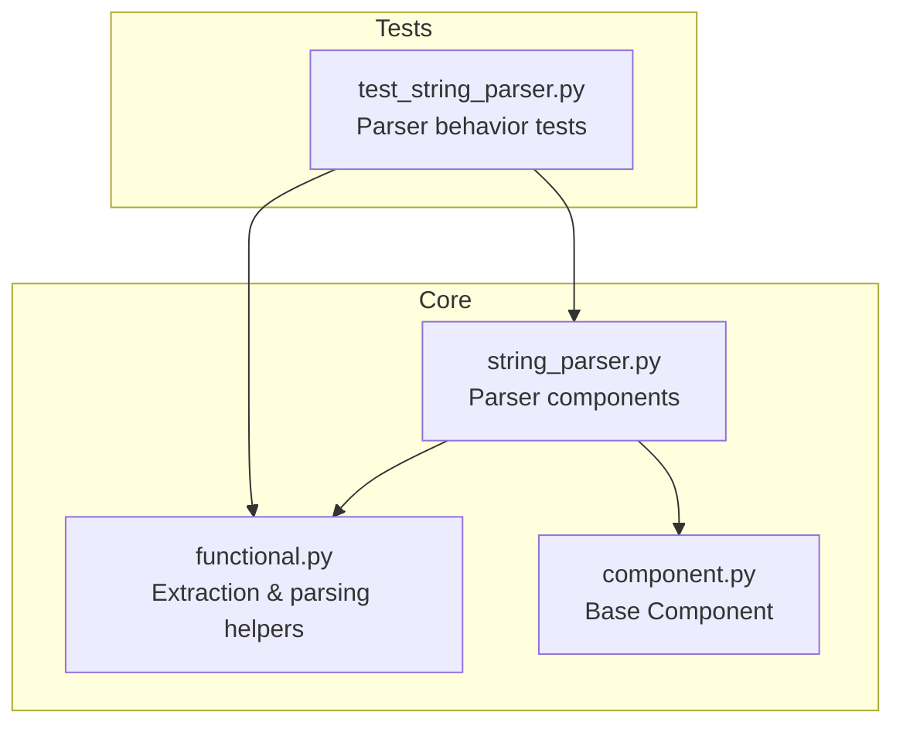
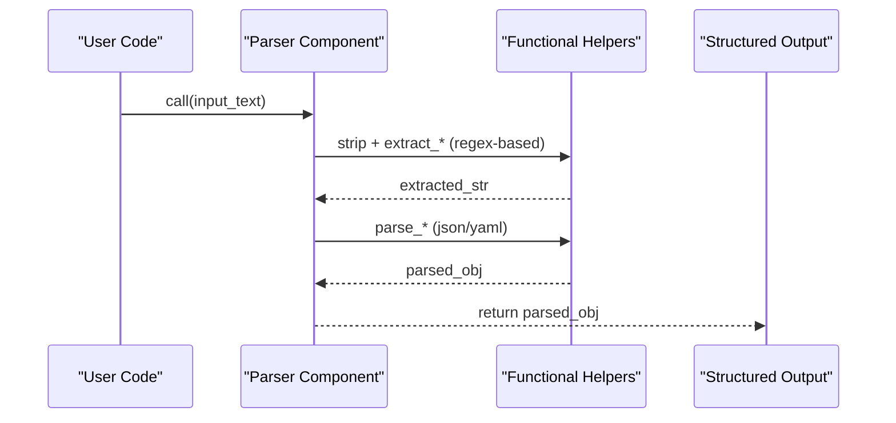
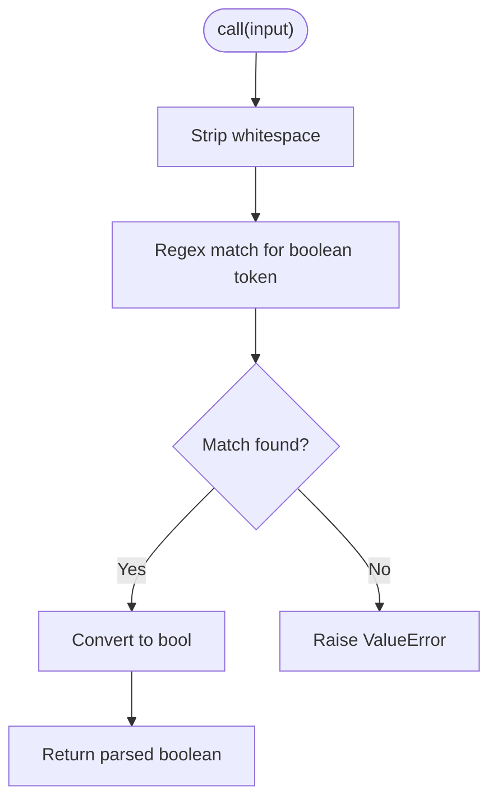
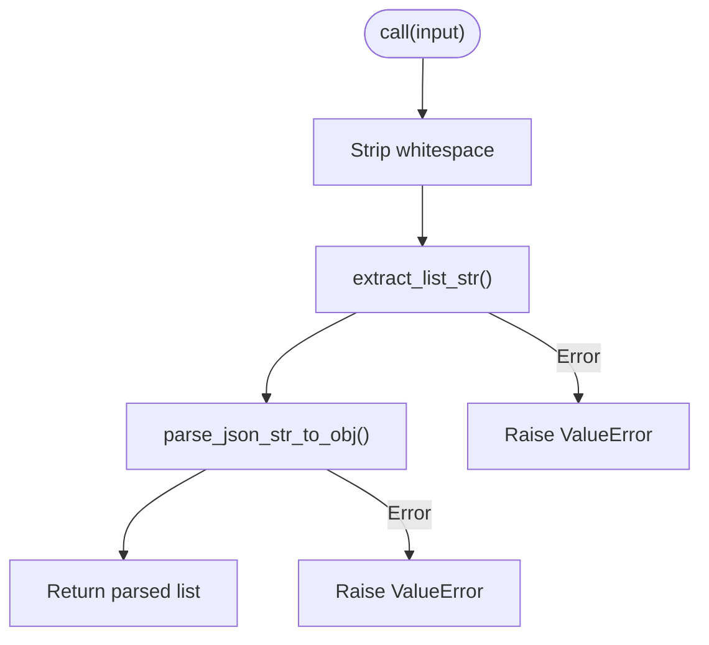
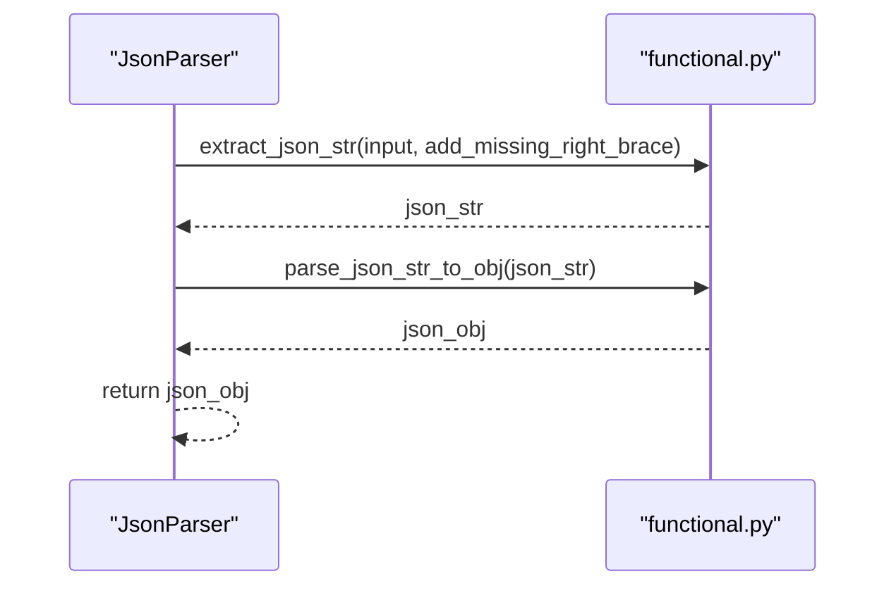
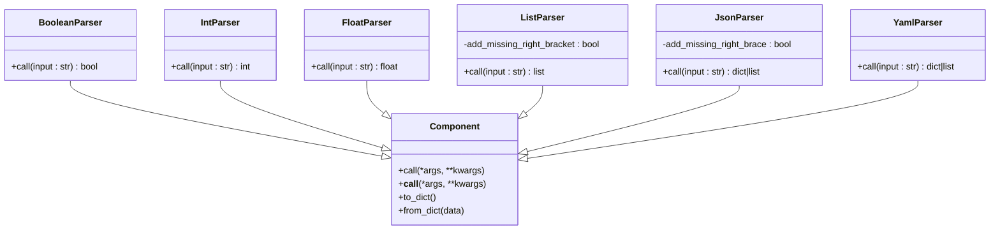

# String Parsers

<cite>
**Referenced Files in This Document**
- [string_parser.py](file://adalflow/adalflow/core/string_parser.py)
- [functional.py](file://adalflow/adalflow/core/functional.py)
- [component.py](file://adalflow/adalflow/core/component.py)
- [test_string_parser.py](file://adalflow/tests/test_string_parser.py)
</cite>

## Table of Contents
1. [Introduction](#introduction)
2. [Project Structure](#project-structure)
3. [Core Components](#core-components)
4. [Architecture Overview](#architecture-overview)
5. [Detailed Component Analysis](#detailed-component-analysis)
6. [Dependency Analysis](#dependency-analysis)
7. [Performance Considerations](#performance-considerations)
8. [Troubleshooting Guide](#troubleshooting-guide)
9. [Conclusion](#conclusion)

## Introduction
This document explains AdalFlow’s String Parsers subsystem, focusing on basic text extraction and parsing capabilities. It covers regex-based extraction, pattern matching, and text sanitization routines used to reliably extract structured data (booleans, integers, floats, lists, JSON, YAML) from unstructured LLM responses. It documents the built-in parsers (BooleanParser, IntParser, FloatParser, ListParser, JsonParser, YamlParser), how they integrate with prompt templates and output processors, and how to extend them safely. Practical examples illustrate extraction from LLM outputs, text cleaning, and robust parsing strategies. Guidance is also provided for implementing custom string parsers and optimizing performance.

## Project Structure
The String Parsers feature is centered around:
- A dedicated module that defines parser components
- A functional module that implements extraction and parsing helpers
- A base component class that all parsers inherit from
- Tests validating parser behavior

**Diagram sources**
- [string_parser.py](file://adalflow/adalflow/core/string_parser.py#L1-L254)
- [functional.py](file://adalflow/adalflow/core/functional.py#L950-L1324)
- [component.py](file://adalflow/adalflow/core/component.py#L51-L120)
- [test_string_parser.py](file://adalflow/tests/test_string_parser.py)

**Section sources**
- [string_parser.py](file://adalflow/adalflow/core/string_parser.py#L1-L254)
- [functional.py](file://adalflow/adalflow/core/functional.py#L950-L1324)
- [component.py](file://adalflow/adalflow/core/component.py#L51-L120)
- [test_string_parser.py](file://adalflow/tests/test_string_parser.py)

## Core Components
The String Parsers subsystem exposes six primary components:
- BooleanParser: extracts booleans from text
- IntParser: extracts integers from text
- FloatParser: extracts floats from text
- ListParser: extracts list-like strings and converts them to Python lists
- JsonParser: extracts JSON objects or arrays from text and parses them
- YamlParser: extracts YAML content and parses it to a Python object

Each parser inherits from the base Component class and implements a call method that accepts a string input and returns a parsed object. They rely on helper functions in the functional module for robust extraction and parsing.

Key behaviors:
- Inputs are stripped of leading/trailing whitespace before parsing
- Extraction helpers locate delimiters (braces, brackets, markdown fences) and balance nesting
- Parsing attempts are made with multiple strategies (strict JSON, fixes, and YAML fallback)
- Errors are surfaced as exceptions with descriptive messages

**Section sources**
- [string_parser.py](file://adalflow/adalflow/core/string_parser.py#L33-L254)
- [functional.py](file://adalflow/adalflow/core/functional.py#L950-L1324)
- [component.py](file://adalflow/adalflow/core/component.py#L51-L120)

## Architecture Overview
The parser architecture follows a layered design:
- Component layer: Each parser is a Component with a call method
- Functional layer: Extraction and parsing helpers implement robust regex and parsing logic
- Integration layer: Parsers are used downstream by prompt templates and output processors to convert raw LLM text into structured data

**Diagram sources**
- [string_parser.py](file://adalflow/adalflow/core/string_parser.py#L48-L216)
- [functional.py](file://adalflow/adalflow/core/functional.py#L950-L1324)

## Detailed Component Analysis

### BooleanParser
Purpose: Extract a boolean from arbitrary text using regex-based detection.

Behavior:
- Strips input
- Uses a helper to find the first boolean-like token
- Converts to Python bool or raises an error if none found

Common use cases:
- Extracting yes/no answers or flags from LLM responses
- Normalizing varied textual representations of truth values

**Diagram sources**
- [string_parser.py](file://adalflow/adalflow/core/string_parser.py#L48-L54)
- [functional.py](file://adalflow/adalflow/core/functional.py#L990-L1006)

**Section sources**
- [string_parser.py](file://adalflow/adalflow/core/string_parser.py#L33-L54)
- [functional.py](file://adalflow/adalflow/core/functional.py#L990-L1006)

### IntParser
Purpose: Extract the first integer from text.

Behavior:
- Strips input
- Uses a helper to find the first numeric token
- Converts to int or raises an error if none found

Common use cases:
- Extracting counts, IDs, or indices from LLM outputs

**Section sources**
- [string_parser.py](file://adalflow/adalflow/core/string_parser.py#L59-L86)
- [functional.py](file://adalflow/adalflow/core/functional.py#L953-L969)

### FloatParser
Purpose: Extract the first floating-point number from text.

Behavior:
- Strips input
- Uses a helper to find the first float-like token
- Converts to float or raises an error if none found

Common use cases:
- Extracting scores, ratios, or measurements

**Section sources**
- [string_parser.py](file://adalflow/adalflow/core/string_parser.py#L91-L118)
- [functional.py](file://adalflow/adalflow/core/functional.py#L971-L988)

### ListParser
Purpose: Extract a list-like string and parse it into a Python list.

Behavior:
- Strips input
- Extracts the first complete list-like string bounded by brackets
- Attempts JSON parsing; if that fails, logs and raises an error

Common use cases:
- Extracting enumerated lists or arrays from LLM responses

**Diagram sources**
- [string_parser.py](file://adalflow/adalflow/core/string_parser.py#L148-L165)
- [functional.py](file://adalflow/adalflow/core/functional.py#L1165-L1214)
- [functional.py](file://adalflow/adalflow/core/functional.py#L1286-L1324)

**Section sources**
- [string_parser.py](file://adalflow/adalflow/core/string_parser.py#L123-L165)
- [functional.py](file://adalflow/adalflow/core/functional.py#L1165-L1214)
- [functional.py](file://adalflow/adalflow/core/functional.py#L1286-L1324)

### JsonParser
Purpose: Extract JSON objects or arrays from text and parse them into Python objects.

Behavior:
- Strips input
- Extracts JSON via helper supporting markdown fences and partial content
- Parses with multiple strategies: strict JSON, fixes, and YAML fallback
- Adds a configurable safety to append a missing brace/bracket when enabled

Common use cases:
- Extracting structured JSON from LLM responses, including fenced code blocks

**Diagram sources**
- [string_parser.py](file://adalflow/adalflow/core/string_parser.py#L199-L216)
- [functional.py](file://adalflow/adalflow/core/functional.py#L1072-L1163)
- [functional.py](file://adalflow/adalflow/core/functional.py#L1286-L1324)

**Section sources**
- [string_parser.py](file://adalflow/adalflow/core/string_parser.py#L170-L216)
- [functional.py](file://adalflow/adalflow/core/functional.py#L1072-L1163)
- [functional.py](file://adalflow/adalflow/core/functional.py#L1286-L1324)

### YamlParser
Purpose: Extract YAML content and parse it into a Python object.

Behavior:
- Strips input
- Extracts YAML content, optionally bounded by YAML fences
- Parses with YAML loader; raises an error if invalid

Note: The implementation prioritizes JSON extraction and parsing for robustness, with YAML as a secondary path.

**Section sources**
- [string_parser.py](file://adalflow/adalflow/core/string_parser.py#L222-L254)
- [functional.py](file://adalflow/adalflow/core/functional.py#L1216-L1246)
- [functional.py](file://adalflow/adalflow/core/functional.py#L1267-L1284)

### Integration with Prompt Templates and Output Processors
- Prompt templates often instruct the LLM to format outputs as JSON/YAML or lists to improve extraction reliability.
- Output processors can chain parsers to convert raw text into strongly typed objects.
- Parsers can be composed with sanitization steps (e.g., removing extra whitespace, normalizing quotes) before extraction.

[No sources needed since this section provides general guidance]

## Dependency Analysis
The parsers depend on the functional helpers for extraction and parsing. The base Component class provides the interface and lifecycle for all components.

**Diagram sources**
- [component.py](file://adalflow/adalflow/core/component.py#L51-L120)
- [string_parser.py](file://adalflow/adalflow/core/string_parser.py#L33-L254)

**Section sources**
- [component.py](file://adalflow/adalflow/core/component.py#L51-L120)
- [string_parser.py](file://adalflow/adalflow/core/string_parser.py#L33-L254)

## Performance Considerations
- Prefer explicit delimiters and fenced code blocks to reduce ambiguity and regex backtracking.
- Disable automatic brace/bracket insertion when you can guarantee well-formed inputs to avoid unnecessary post-processing.
- For repeated parsing, reuse parser instances and avoid recompiling regex patterns.
- Consider pre-sanitization (e.g., removing extra whitespace) to minimize extraction retries.
- When parsing large volumes of LLM outputs, batch calls to parsers and avoid nested exception handling overhead.

[No sources needed since this section provides general guidance]

## Troubleshooting Guide
Common issues and resolutions:
- No match found: Ensure the LLM response includes the expected delimiter or fenced block. For JSON, include a code fence or ensure the content starts with an opening brace/array.
- Incomplete structure: Enable the “add missing” options for JSON and list parsing when appropriate, but validate outputs afterward.
- Invalid YAML/JSON: Use the JSON parser first; it includes a YAML fallback. If failures persist, sanitize the input (remove stray quotes, trailing commas) before parsing.
- Ambiguous boolean/int/float: Provide explicit instructions in the prompt to output canonical forms (e.g., lowercase booleans, plain numbers without units).

Validation and testing:
- Use the provided tests to validate expected behaviors and edge cases for each parser.

**Section sources**
- [test_string_parser.py](file://adalflow/tests/test_string_parser.py)
- [functional.py](file://adalflow/adalflow/core/functional.py#L1072-L1163)
- [functional.py](file://adalflow/adalflow/core/functional.py#L1286-L1324)

## Conclusion
AdalFlow’s String Parsers provide a robust foundation for converting unstructured LLM outputs into structured data. By combining regex-based extraction with resilient parsing strategies, the parsers handle real-world LLM responses reliably. Integrating them with prompt templates and output processors enables scalable, maintainable pipelines. Extending the system with custom parsers follows the established Component pattern and leverages the functional helpers for extraction and sanitization.