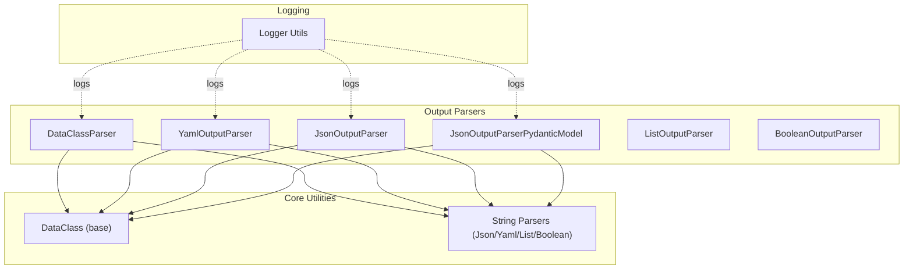
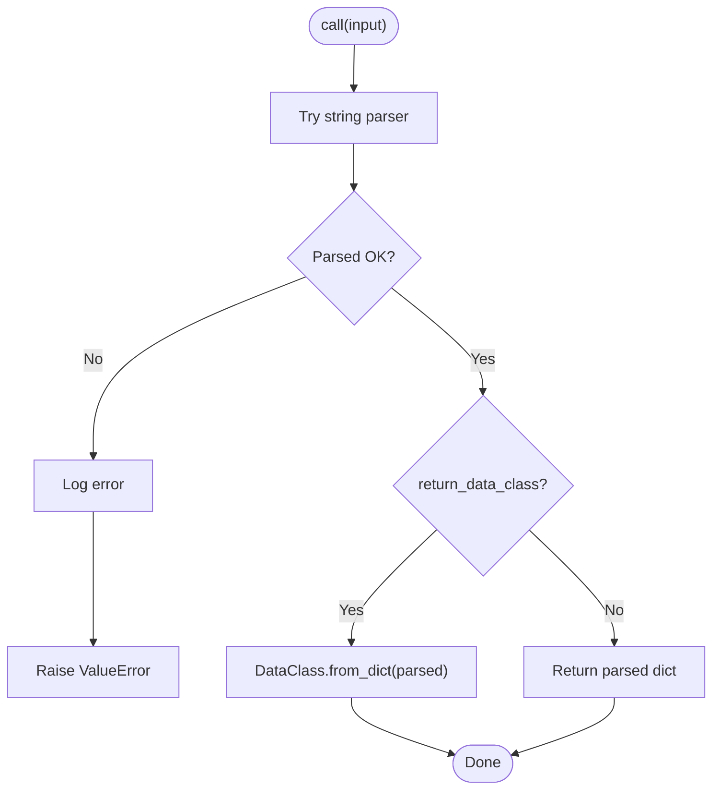
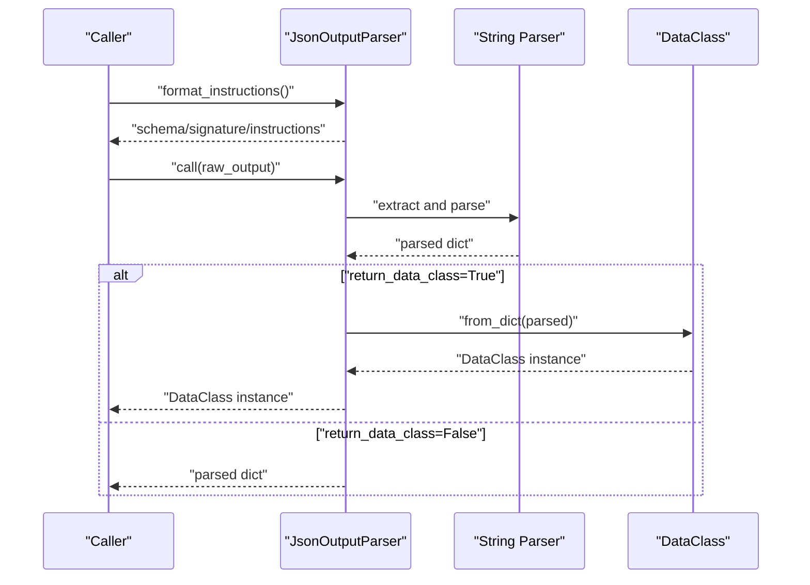
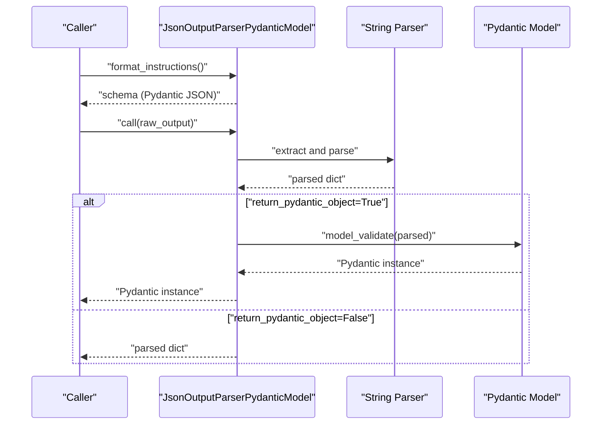
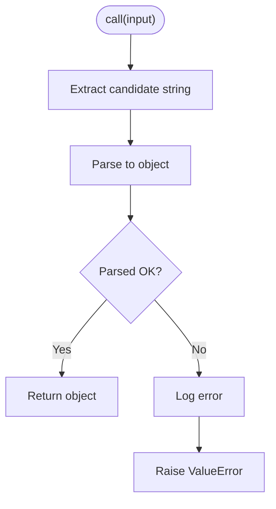
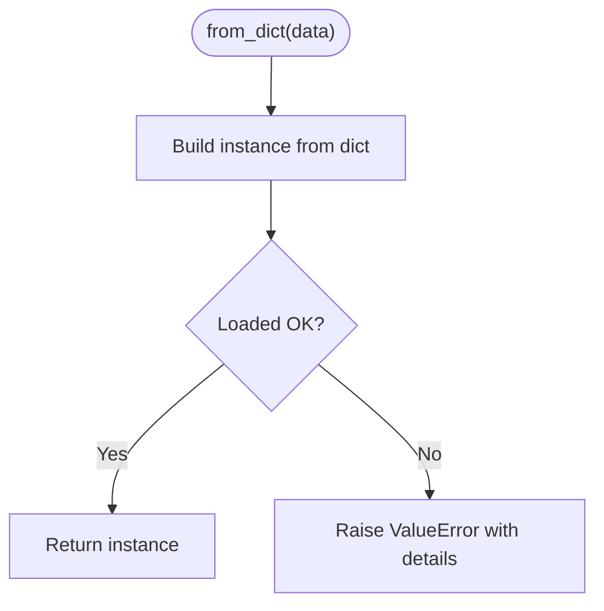
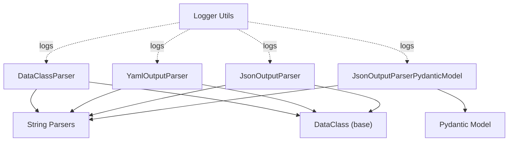

# Validation and Error Handling

<cite>
**Referenced Files in This Document**
- [dataclass_parser.py](file://adalflow/adalflow/components/output_parsers/dataclass_parser.py)
- [outputs.py](file://adalflow/adalflow/components/output_parsers/outputs.py)
- [base_data_class.py](file://adalflow/adalflow/core/base_data_class.py)
- [string_parser.py](file://adalflow/adalflow/core/string_parser.py)
- [logger.py](file://adalflow/adalflow/utils/logger.py)
- [test_data_class_parser.py](file://adalflow/tests/test_data_class_parser.py)
- [test_output_parser.py](file://adalflow/tests/test_output_parser.py)
</cite>

## Table of Contents
1. [Introduction](#introduction)
2. [Project Structure](#project-structure)
3. [Core Components](#core-components)
4. [Architecture Overview](#architecture-overview)
5. [Detailed Component Analysis](#detailed-component-analysis)
6. [Dependency Analysis](#dependency-analysis)
7. [Performance Considerations](#performance-considerations)
8. [Troubleshooting Guide](#troubleshooting-guide)
9. [Conclusion](#conclusion)

## Introduction
This document focuses on robust output parsing with strong validation and error handling strategies in the validation and error handling subsystem. It explains how structured output parsing is performed, how validation failures are surfaced, and how recovery strategies are applied. It also documents exception handling patterns, logging mechanisms, and debugging approaches for parsing failures. Practical examples demonstrate error detection, enforcement of validation rules, and graceful degradation strategies. Guidance is provided for integrating with logging systems, error reporting, and troubleshooting workflows, including customization of validation rules and extending error handling capabilities.

## Project Structure
The validation and error handling subsystem centers around three primary areas:
- Output parsers that transform raw LLM responses into structured data
- Dataclass utilities that enforce schema and validation semantics
- Logging utilities that capture errors and aid debugging



**Diagram sources**
- [dataclass_parser.py](file://adalflow/adalflow/components/output_parsers/dataclass_parser.py#L56-L196)
- [outputs.py](file://adalflow/adalflow/components/output_parsers/outputs.py#L130-L545)
- [base_data_class.py](file://adalflow/adalflow/core/base_data_class.py#L97-L800)
- [string_parser.py](file://adalflow/adalflow/core/string_parser.py#L1-L254)
- [logger.py](file://adalflow/adalflow/utils/logger.py#L1-L219)

**Section sources**
- [dataclass_parser.py](file://adalflow/adalflow/components/output_parsers/dataclass_parser.py#L1-L196)
- [outputs.py](file://adalflow/adalflow/components/output_parsers/outputs.py#L1-L545)
- [base_data_class.py](file://adalflow/adalflow/core/base_data_class.py#L1-L820)
- [string_parser.py](file://adalflow/adalflow/core/string_parser.py#L1-L254)
- [logger.py](file://adalflow/adalflow/utils/logger.py#L1-L219)

## Core Components
- DataClassParser: Parses raw LLM output into a strongly-typed dataclass instance or dictionary, depending on configuration. It validates format type and raises explicit errors for invalid inputs.
- YamlOutputParser and JsonOutputParser: Transform LLM responses into dictionaries or dataclass instances, with robust extraction from markdown blocks and error propagation.
- JsonOutputParserPydanticModel: Uses Pydantic for schema generation and validation, surfacing validation errors with rich diagnostics.
- String parsers (JsonParser, YamlParser, ListParser, BooleanParser): Provide extraction and parsing utilities with targeted error handling and logging.
- DataClass base utilities: Enforce schema correctness, field validation, and conversion from dict/json/yaml with explicit error messages.
- Logger utilities: Provide configurable logging with console and file handlers, timestamps, and module-level context.

Key validation and error handling characteristics:
- Explicit validation of dataclass types and subclassing
- Strict format type validation
- Extraction and parsing with targeted exceptions
- Logging of parsing attempts and failures
- Graceful degradation to raw dict when requested

**Section sources**
- [dataclass_parser.py](file://adalflow/adalflow/components/output_parsers/dataclass_parser.py#L98-L196)
- [outputs.py](file://adalflow/adalflow/components/output_parsers/outputs.py#L158-L545)
- [string_parser.py](file://adalflow/adalflow/core/string_parser.py#L170-L254)
- [base_data_class.py](file://adalflow/adalflow/core/base_data_class.py#L364-L467)
- [logger.py](file://adalflow/adalflow/utils/logger.py#L100-L169)

## Architecture Overview
The parsing pipeline integrates prompt formatting, output extraction, and structured conversion with explicit error handling and logging.

```mermaid
sequenceDiagram
participant Gen as "Generator"
participant Parser as "Output Parser"
participant Str as "String Parser"
participant DCls as "DataClass"
Gen->>Parser : "format_instructions()"
Parser-->>Gen : "Output format prompt"
Gen->>Parser : "call(raw_output)"
Parser->>Str : "extract and parse"
alt "JSON/YAML extraction"
Str-->>Parser : "parsed dict/list"
else "Error during extraction"
Str-->>Parser : "ValueError"
Parser-->>Gen : "ValueError"
end
opt "return_data_class=True"
Parser->>DCls : "from_dict(parsed)"
DCls-->>Parser : "DataClass instance"
else "return_data_class=False"
Parser-->>Gen : "parsed dict/list"
end
```

**Diagram sources**
- [outputs.py](file://adalflow/adalflow/components/output_parsers/outputs.py#L271-L374)
- [dataclass_parser.py](file://adalflow/adalflow/components/output_parsers/dataclass_parser.py#L180-L190)
- [string_parser.py](file://adalflow/adalflow/core/string_parser.py#L199-L217)
- [base_data_class.py](file://adalflow/adalflow/core/base_data_class.py#L364-L393)

## Detailed Component Analysis

### DataClassParser
- Purpose: Simplifies structured output parsing with automatic schema-aware formatting and conversion to dataclass instances.
- Validation:
  - Validates that the provided class is a dataclass and a subclass of DataClass.
  - Validates format type selection ("json" or "yaml").
- Parsing flow:
  - Delegates extraction to JsonParser or YamlParser based on format type.
  - Converts parsed dict to a dataclass instance if configured to do so.
- Error handling:
  - Catches parsing exceptions and logs them before raising a ValueError with a normalized message.



**Diagram sources**
- [dataclass_parser.py](file://adalflow/adalflow/components/output_parsers/dataclass_parser.py#L180-L190)
- [string_parser.py](file://adalflow/adalflow/core/string_parser.py#L199-L217)
- [base_data_class.py](file://adalflow/adalflow/core/base_data_class.py#L364-L393)

**Section sources**
- [dataclass_parser.py](file://adalflow/adalflow/components/output_parsers/dataclass_parser.py#L98-L196)

### YamlOutputParser and JsonOutputParser
- Purpose: Provide format-specific parsing with schema-aware instructions and example formatting.
- Validation:
  - Ensures the provided class is a dataclass and a subclass of DataClass.
  - Validates example instances against the dataclass type.
- Parsing flow:
  - Generates output format instructions using schema/signature/example templates.
  - Extracts and parses the raw output using YamlParser or JsonParser.
  - Optionally converts the parsed dict to a dataclass instance.
- Error handling:
  - Logs errors during example formatting and parsing.
  - Propagates exceptions to callers with minimal normalization.



**Diagram sources**
- [outputs.py](file://adalflow/adalflow/components/output_parsers/outputs.py#L288-L379)
- [string_parser.py](file://adalflow/adalflow/core/string_parser.py#L199-L217)
- [base_data_class.py](file://adalflow/adalflow/core/base_data_class.py#L364-L393)

**Section sources**
- [outputs.py](file://adalflow/adalflow/components/output_parsers/outputs.py#L158-L379)

### JsonOutputParserPydanticModel
- Purpose: Leverages Pydantic for robust schema generation and validation.
- Features:
  - Uses Pydantic’s native JSON schema generation.
  - Validates parsed dicts against the Pydantic model, raising detailed validation errors.
- Error handling:
  - Logs parsing errors and validation errors distinctly.
  - Propagates Pydantic ValidationError and other exceptions to callers.



**Diagram sources**
- [outputs.py](file://adalflow/adalflow/components/output_parsers/outputs.py#L381-L492)
- [string_parser.py](file://adalflow/adalflow/core/string_parser.py#L199-L217)

**Section sources**
- [outputs.py](file://adalflow/adalflow/components/output_parsers/outputs.py#L381-L492)

### String Parsers (JsonParser, YamlParser, ListParser, BooleanParser)
- JsonParser:
  - Extracts JSON from raw text (including markdown fenced code blocks).
  - Attempts parsing with multiple strategies and logs detailed errors.
- YamlParser:
  - Extracts YAML from raw text and parses safely.
- ListParser:
  - Extracts list strings and parses them into Python lists.
- BooleanParser:
  - Extracts boolean values with fallback parsing strategies.



**Diagram sources**
- [string_parser.py](file://adalflow/adalflow/core/string_parser.py#L170-L254)

**Section sources**
- [string_parser.py](file://adalflow/adalflow/core/string_parser.py#L33-L254)

### DataClass Utilities (from_dict, from_json, from_yaml, to_json, to_yaml)
- Purpose: Provide robust conversion between structured representations and dataclass instances.
- Validation and error handling:
  - Explicit checks for dataclass type and subclassing.
  - Detailed error messages for JSON and YAML decode errors.
  - Conversion from dict with strict type enforcement.



**Diagram sources**
- [base_data_class.py](file://adalflow/adalflow/core/base_data_class.py#L364-L393)

**Section sources**
- [base_data_class.py](file://adalflow/adalflow/core/base_data_class.py#L364-L467)

## Dependency Analysis
The output parsers depend on:
- DataClass base utilities for schema and conversion
- String parsers for extraction and parsing
- Logger utilities for error logging



**Diagram sources**
- [dataclass_parser.py](file://adalflow/adalflow/components/output_parsers/dataclass_parser.py#L1-L196)
- [outputs.py](file://adalflow/adalflow/components/output_parsers/outputs.py#L1-L545)
- [string_parser.py](file://adalflow/adalflow/core/string_parser.py#L1-L254)
- [base_data_class.py](file://adalflow/adalflow/core/base_data_class.py#L1-L820)
- [logger.py](file://adalflow/adalflow/utils/logger.py#L1-L219)

**Section sources**
- [dataclass_parser.py](file://adalflow/adalflow/components/output_parsers/dataclass_parser.py#L1-L196)
- [outputs.py](file://adalflow/adalflow/components/output_parsers/outputs.py#L1-L545)
- [string_parser.py](file://adalflow/adalflow/core/string_parser.py#L1-L254)
- [base_data_class.py](file://adalflow/adalflow/core/base_data_class.py#L1-L820)
- [logger.py](file://adalflow/adalflow/utils/logger.py#L1-L219)

## Performance Considerations
- Prefer JSON for complex nested structures due to robust extraction and parsing.
- Use signatures (schema-less) for smaller prompts when token usage matters.
- Avoid unnecessary conversions; return raw dicts when downstream processing can handle them.
- Minimize example formatting overhead by limiting example count and complexity.

## Troubleshooting Guide
Common parsing errors and recovery strategies:
- Invalid dataclass or subclass:
  - Symptom: Immediate ValueError during parser initialization.
  - Recovery: Ensure the provided class is a dataclass and a subclass of DataClass.
- Unsupported format type:
  - Symptom: ValueError for format_type not equal to "json" or "yaml".
  - Recovery: Choose a supported format or extend the parser to support additional formats.
- Malformed JSON/YAML:
  - Symptom: Exceptions raised during extraction or parsing.
  - Recovery: Use parsers designed to handle markdown fences; sanitize inputs; log raw output for inspection.
- Validation failures:
  - Symptom: DataClass conversion errors or Pydantic validation errors.
  - Recovery: Inspect field types and required fields; adjust schema or provide defaults; leverage example formatting to guide the LLM.

Debugging approaches:
- Enable detailed logging to capture parsing attempts and errors.
- Inspect raw LLM outputs and extracted strings to identify formatting issues.
- Use example formatting to guide the LLM toward correct output structure.
- Validate schema and field metadata completeness.

Practical examples from tests:
- DataClassParser with JSON and YAML formats
- JsonOutputParser and YamlOutputParser with and without dataclass conversion
- JsonOutputParserPydanticModel with validation errors and nested models
- Edge cases involving markdown fences and embedded code blocks

**Section sources**
- [test_data_class_parser.py](file://adalflow/tests/test_data_class_parser.py#L1-L143)
- [test_output_parser.py](file://adalflow/tests/test_output_parser.py#L1-L331)

## Conclusion
The validation and error handling subsystem provides a robust foundation for parsing structured outputs from LLMs. By combining schema-aware formatting, resilient extraction and parsing, strict validation, and comprehensive logging, it enables reliable downstream processing. The design supports graceful degradation, clear error signaling, and extensibility for custom validation logic and error handling strategies.