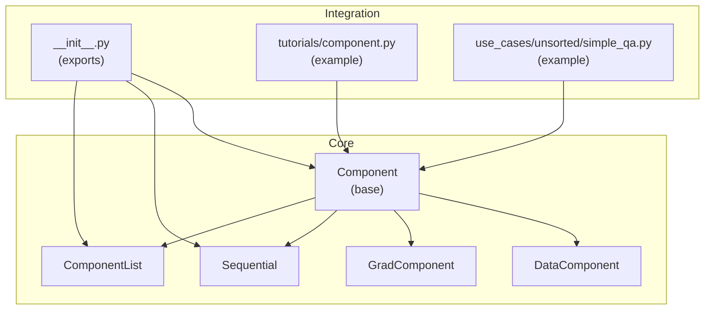
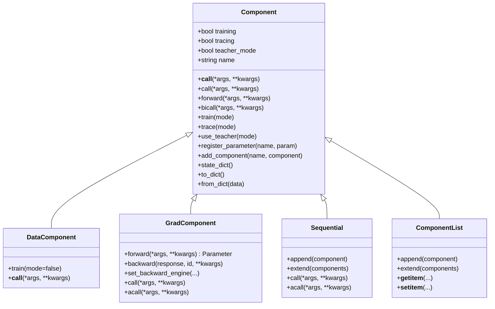
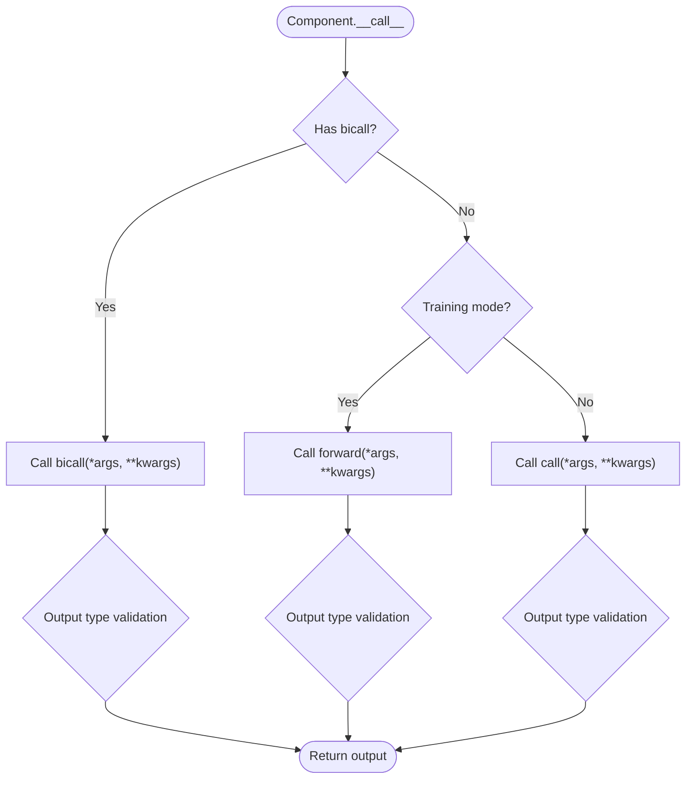
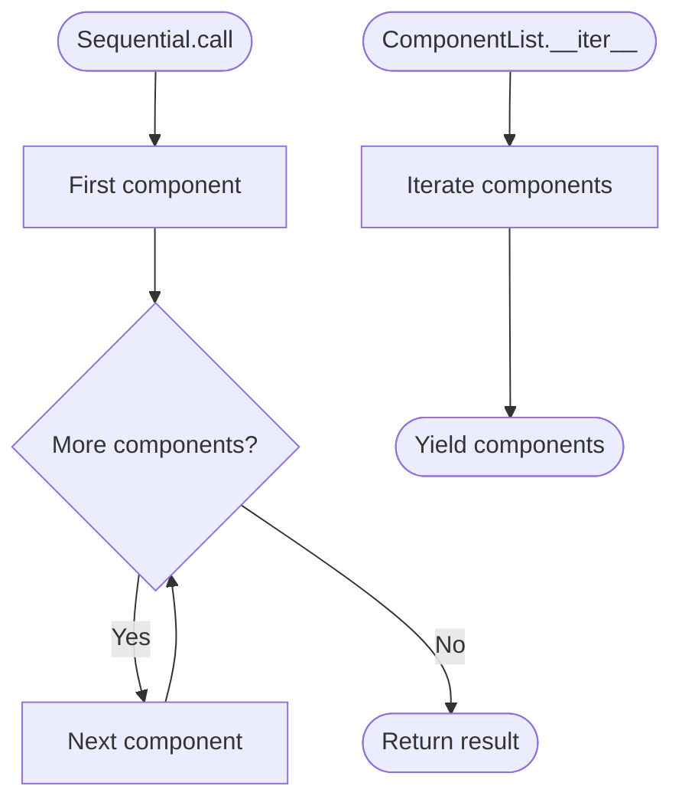
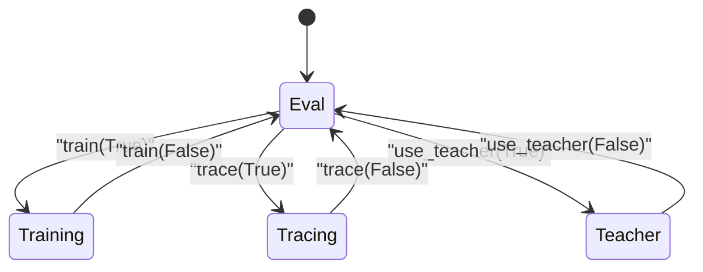
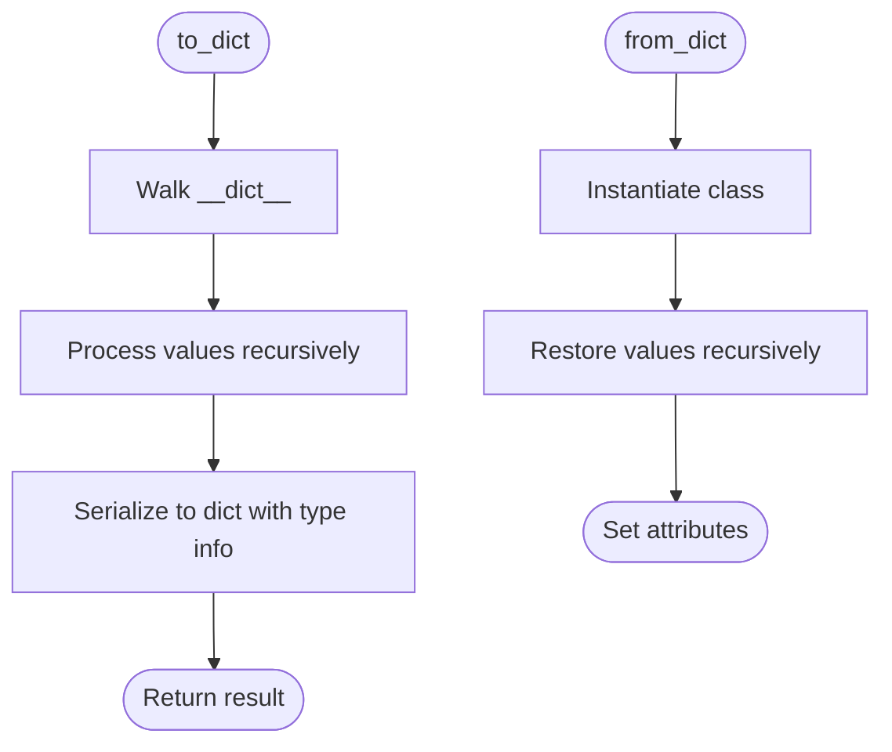
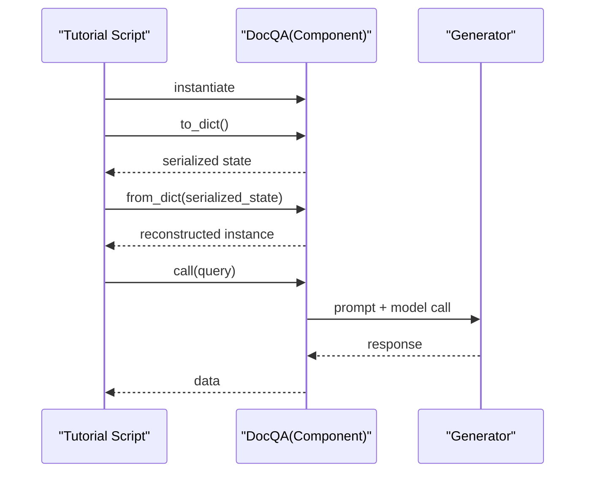
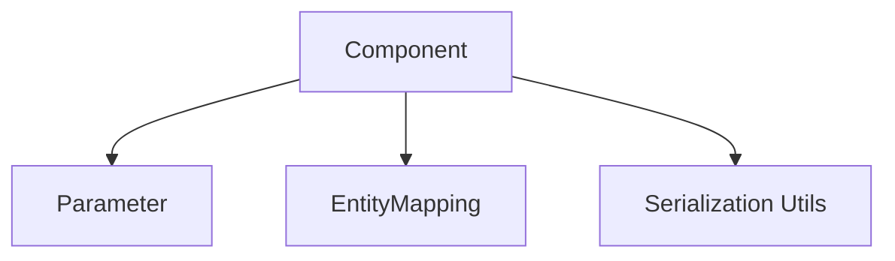

# Component Architecture

<cite>
**Referenced Files in This Document**
- [component.py](file://adalflow/adalflow/core/component.py)
- [container.py](file://adalflow/adalflow/core/container.py)
- [grad_component.py](file://adalflow/adalflow/optim/grad_component.py)
- [__init__.py](file://adalflow/adalflow/core/__init__.py)
- [component.py](file://tutorials/component.py)
- [simple_qa.py](file://use_cases/unsorted/simple_qa.py)
</cite>

## Table of Contents
1. [Introduction](#introduction)
2. [Project Structure](#project-structure)
3. [Core Components](#core-components)
4. [Architecture Overview](#architecture-overview)
5. [Detailed Component Analysis](#detailed-component-analysis)
6. [Dependency Analysis](#dependency-analysis)
7. [Performance Considerations](#performance-considerations)
8. [Troubleshooting Guide](#troubleshooting-guide)
9. [Conclusion](#conclusion)
10. [Appendices](#appendices)

## Introduction
This document explains AdalFlow’s Component Architecture, focusing on the Component base class that powers all pipeline elements in LLM workflows. Inspired by PyTorch’s nn.Module design, Component adapts the concept to heterogeneous data types and LLM-centric operations. It introduces a hierarchical composition model, three operational modes (training, tracing, teacher), robust state management (parameters and nested components), and unified call interfaces (__call__, call, bicall) to support both inference and training scenarios. Practical examples demonstrate composition patterns, state persistence, and mode switching.

## Project Structure
The Component Architecture is centered around the core Component class and supporting containers and gradient-aware components. The following diagram shows the primary modules involved in the architecture.



**Diagram sources**
- [component.py](file://adalflow/adalflow/core/component.py#L51-L1200)
- [container.py](file://adalflow/adalflow/core/container.py#L62-L537)
- [grad_component.py](file://adalflow/adalflow/optim/grad_component.py#L40-L628)
- [__init__.py](file://adalflow/adalflow/core/__init__.py#L1-L134)
- [component.py](file://tutorials/component.py#L1-L77)
- [simple_qa.py](file://use_cases/unsorted/simple_qa.py#L1-L74)

**Section sources**
- [component.py](file://adalflow/adalflow/core/component.py#L1-L1200)
- [container.py](file://adalflow/adalflow/core/container.py#L1-L537)
- [grad_component.py](file://adalflow/adalflow/optim/grad_component.py#L1-L628)
- [__init__.py](file://adalflow/adalflow/core/__init__.py#L1-L134)

## Core Components
- Component: Base class for all pipeline elements. Supports hierarchical composition, parameter registration, serialization/deserialization, and unified call interfaces. Provides training, tracing, and teacher modes.
- DataComponent: Non-trainable variant for data processing (e.g., prompts, parsers).
- GradComponent: Trainable variant with forward/backward interfaces and gradient computation via a backward engine.
- Sequential and ComponentList: Container components that compose multiple Component instances in a tree-like structure.

Key responsibilities:
- Hierarchical composition: Components can contain other Components, forming a tree. Discovery and traversal are supported via named_components and children.
- Modes: training, tracing, teacher enable different behaviors for in-context learning, observability, and demonstration-based learning.
- State management: Parameters and subcomponents are tracked and persisted via state_dict and to/from_dict.
- Unified call interfaces: __call__ dispatches to forward (training) or call (inference), with optional bicall for unified handling.

**Section sources**
- [component.py](file://adalflow/adalflow/core/component.py#L51-L1200)
- [container.py](file://adalflow/adalflow/core/container.py#L62-L537)
- [grad_component.py](file://adalflow/adalflow/optim/grad_component.py#L40-L628)

## Architecture Overview
The Component Architecture builds on a layered design:
- Base Layer: Component provides the foundation for composition, state, and modes.
- Extension Layers: DataComponent and GradComponent extend Component for specific use cases.
- Composition Containers: Sequential and ComponentList enable pipeline assembly and iteration.
- Integration Layer: Exports and examples show how to use Component in real-world scenarios.



**Diagram sources**
- [component.py](file://adalflow/adalflow/core/component.py#L51-L1200)
- [container.py](file://adalflow/adalflow/core/container.py#L62-L537)
- [grad_component.py](file://adalflow/adalflow/optim/grad_component.py#L40-L628)

## Detailed Component Analysis

### Component Base Class
Component is the foundational class for all pipeline elements. It:
- Defines operational modes: train, trace, use_teacher.
- Supports hierarchical composition via add_component and named_components.
- Manages parameters via register_parameter and named_parameters.
- Provides unified call semantics: __call__ dispatches to forward (training) or call (inference), with bicall as a unified handler.
- Implements serialization/deserialization via to_dict/from_dict and state_dict/load_state_dict.
- Handles dynamic attribute assignment for parameters and subcomponents.



**Diagram sources**
- [component.py](file://adalflow/adalflow/core/component.py#L475-L560)

**Section sources**
- [component.py](file://adalflow/adalflow/core/component.py#L51-L1200)

### DataComponent
DataComponent specializes Component for non-trainable data processing tasks. It overrides train to disable training mode and simplifies __call__ to delegate to call.

Key characteristics:
- Disables training mode by design.
- Suitable for prompt builders, parsers, and text processors.

**Section sources**
- [component.py](file://adalflow/adalflow/core/component.py#L961-L980)

### GradComponent
GradComponent extends Component for trainable operators with explicit forward/backward interfaces and gradient computation. It:
- Requires forward to return a Parameter for tracing and backpropagation.
- Implements backward to propagate gradients to predecessors.
- Integrates with a backward engine for LLM-based gradient computation.
- Supports disabling backward engine while retaining module context.

```mermaid
sequenceDiagram
participant User as "Caller"
participant GC as "GradComponent"
participant BE as "BackwardEngine"
User->>GC : train(); set teacher_mode
User->>GC : __call__(Parameter or data)
alt Training mode
GC->>GC : forward(*args, **kwargs)
GC->>GC : wrap outputs as OutputParameter
GC->>GC : set predecessors and trace
GC-->>User : Parameter
User->>GC : backward(response, id)
GC->>BE : compute gradient via backward engine
BE-->>GC : gradient value
GC->>GC : attach gradient to predecessors
else Evaluation mode
GC->>GC : call(*args, **kwargs)
GC-->>User : data output
end
```

**Diagram sources**
- [grad_component.py](file://adalflow/adalflow/optim/grad_component.py#L123-L480)
- [component.py](file://adalflow/adalflow/core/component.py#L511-L560)

**Section sources**
- [grad_component.py](file://adalflow/adalflow/optim/grad_component.py#L40-L628)
- [component.py](file://adalflow/adalflow/core/component.py#L511-L560)

### Containers: Sequential and ComponentList
Containers enable pipeline composition:
- Sequential: Ordered composition where output of one component becomes the input to the next. Supports chaining via call and acall.
- ComponentList: List-like composition with indexing and iteration.



**Diagram sources**
- [container.py](file://adalflow/adalflow/core/container.py#L288-L334)
- [container.py](file://adalflow/adalflow/core/container.py#L418-L450)

**Section sources**
- [container.py](file://adalflow/adalflow/core/container.py#L62-L537)

### Operational Modes
Component supports three operational modes:
- Training mode (train): Enables forward/backward for in-context learning. Outputs must be Parameters in training.
- Tracing mode (trace): Accumulates inputs/outputs and gradients for observability and demo scoring.
- Teacher mode (use_teacher): Routes demonstrations to teacher traces for demonstration-based learning.



**Diagram sources**
- [component.py](file://adalflow/adalflow/core/component.py#L164-L176)
- [component.py](file://adalflow/adalflow/core/component.py#L155-L162)
- [component.py](file://adalflow/adalflow/core/component.py#L145-L152)

**Section sources**
- [component.py](file://adalflow/adalflow/core/component.py#L61-L66)
- [component.py](file://adalflow/adalflow/core/component.py#L145-L176)

### State Management and Serialization
Component provides:
- Parameter registration via register_parameter and enumeration via named_parameters.
- Component composition via add_component and discovery via named_components.
- Serialization via to_dict (includes type and processed data) and deserialization via from_dict.
- State persistence via state_dict and load_state_dict for parameter-only snapshots.



**Diagram sources**
- [component.py](file://adalflow/adalflow/core/component.py#L230-L352)

**Section sources**
- [component.py](file://adalflow/adalflow/core/component.py#L230-L352)
- [component.py](file://adalflow/adalflow/core/component.py#L694-L831)

### Naming Conventions and Component Discovery
- Component names: Derived from class names or explicitly provided; used for identification and tracing.
- Parameter names: Must be non-empty, not contain ".", and must be registered via register_parameter.
- Component names: Must be non-empty, not contain ".", and must be added via add_component.
- Discovery: named_components traverses the tree and yields tuples of (name, component) with optional deduplication and filtering.

**Section sources**
- [component.py](file://adalflow/adalflow/core/component.py#L129-L141)
- [component.py](file://adalflow/adalflow/core/component.py#L359-L392)
- [component.py](file://adalflow/adalflow/core/component.py#L565-L592)
- [component.py](file://adalflow/adalflow/core/component.py#L625-L681)

### Practical Examples
- Component composition and persistence: Demonstrates creating a component with nested subcomponents, serializing to a dictionary, and reconstructing it.
- Provider-switching component: Shows how to dynamically select a model client and expose a unified call interface with async support.



**Diagram sources**
- [component.py](file://tutorials/component.py#L19-L44)

**Section sources**
- [component.py](file://tutorials/component.py#L1-L77)
- [simple_qa.py](file://use_cases/unsorted/simple_qa.py#L11-L39)

## Dependency Analysis
Component relies on:
- Optim types and utilities for parameters and gradients.
- Registry for entity mapping and dynamic reconstruction.
- Serialization utilities for safe persistence.



**Diagram sources**
- [component.py](file://adalflow/adalflow/core/component.py#L28-L31)
- [grad_component.py](file://adalflow/adalflow/optim/grad_component.py#L13-L26)

**Section sources**
- [component.py](file://adalflow/adalflow/core/component.py#L28-L31)
- [grad_component.py](file://adalflow/adalflow/optim/grad_component.py#L13-L26)

## Performance Considerations
- Prefer bicall when a single interface can handle both training and inference to reduce branching overhead.
- Use containers (Sequential, ComponentList) to minimize repeated mode toggles across subcomponents.
- Leverage async acall in containers for concurrent I/O-bound operations.
- Limit unnecessary serialization by using state_dict for parameter snapshots and to_dict only when full state is required.

## Troubleshooting Guide
Common issues and resolutions:
- Output type mismatch in training/inference: Ensure __call__ dispatch validates output types according to mode.
- Parameter registration errors: Verify parameter names meet naming constraints and are registered before Component initialization completes.
- Component name conflicts: Avoid names that conflict with existing attributes and ensure uniqueness within a component tree.
- Serialization failures: Confirm all nested objects implement to_dict or are serializable; fallbacks are handled but may degrade fidelity.

**Section sources**
- [component.py](file://adalflow/adalflow/core/component.py#L511-L560)
- [component.py](file://adalflow/adalflow/core/component.py#L359-L392)
- [component.py](file://adalflow/adalflow/core/component.py#L846-L898)
- [component.py](file://adalflow/adalflow/core/component.py#L230-L352)

## Conclusion
AdalFlow’s Component Architecture adapts the familiar PyTorch module pattern to LLM workflows, introducing flexible modes, hierarchical composition, and robust state management. By unifying call semantics and providing gradient-aware components, it enables expressive, maintainable pipelines for both inference and training scenarios.

## Appendices
- Exported symbols: Component, DataComponent, Sequential, ComponentList are exported from the core package for convenient usage.

**Section sources**
- [__init__.py](file://adalflow/adalflow/core/__init__.py#L67-L134)