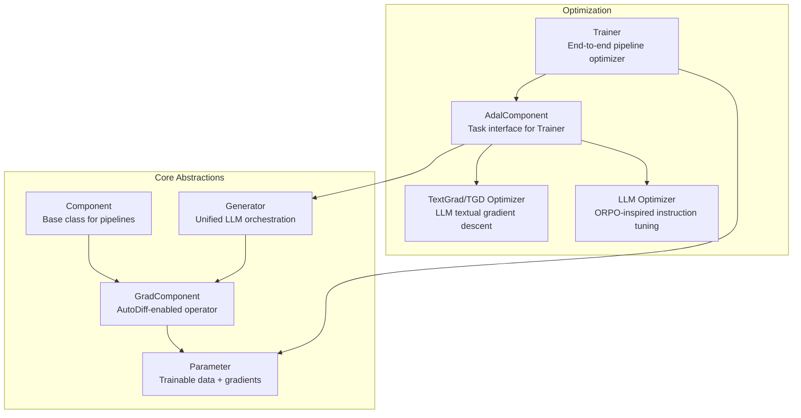
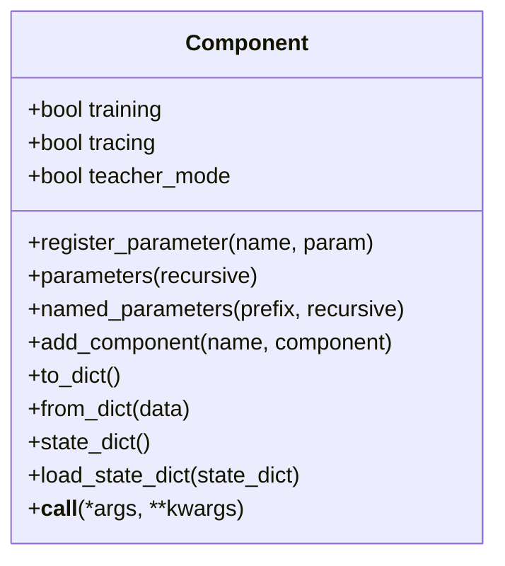
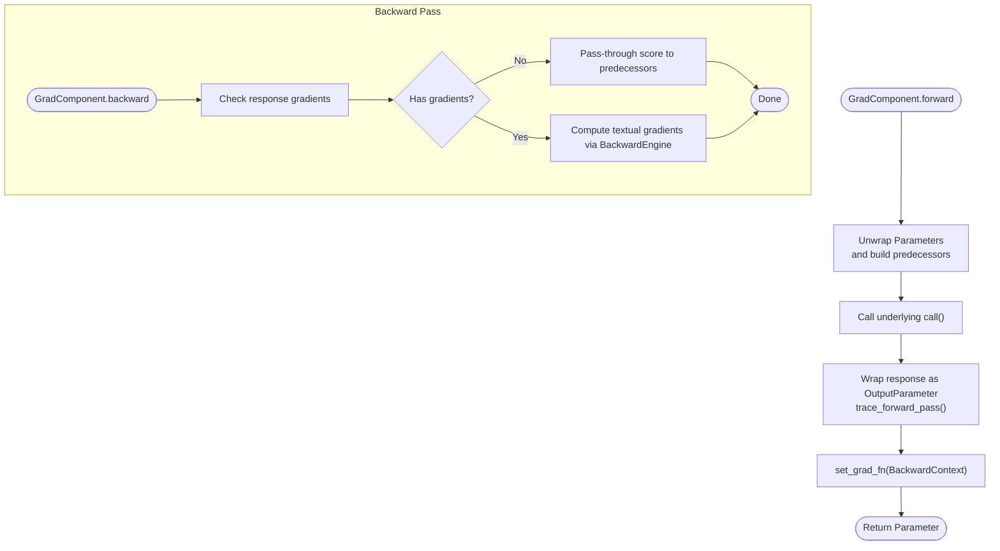
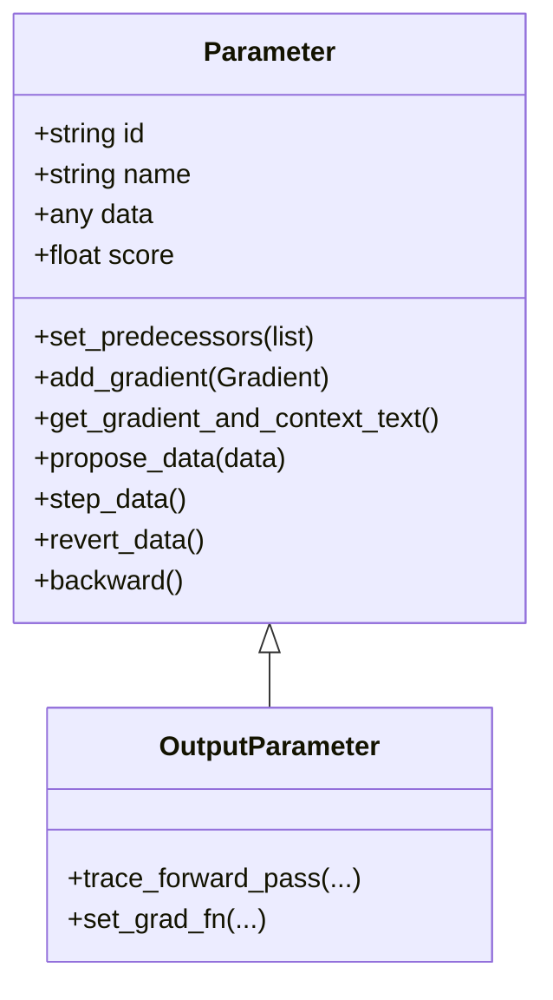
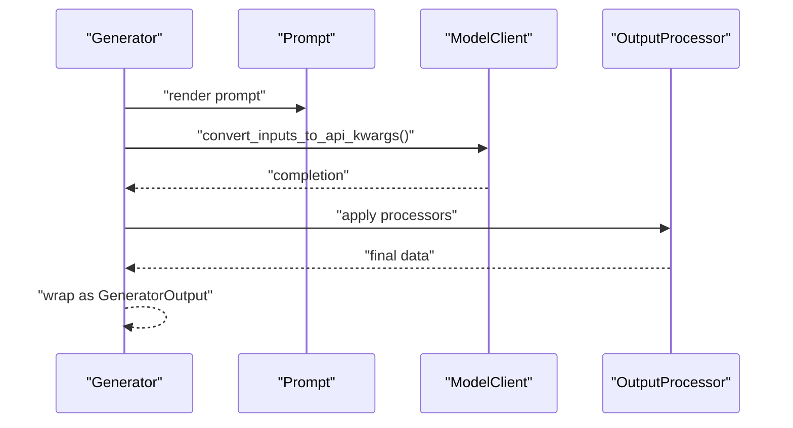
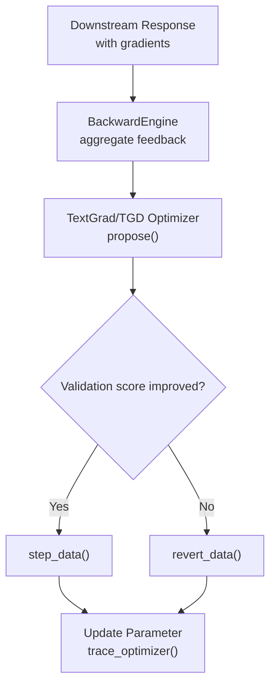
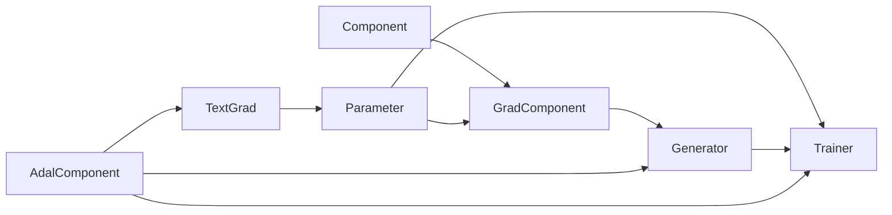

# Core Concepts

<cite>
**Referenced Files in This Document**
- [component.py](file://adalflow/adalflow/core/component.py)
- [generator.py](file://adalflow/adalflow/core/generator.py)
- [grad_component.py](file://adalflow/adalflow/optim/grad_component.py)
- [parameter.py](file://adalflow/adalflow/optim/parameter.py)
- [trainer.py](file://adalflow/adalflow/optim/trainer/trainer.py)
- [adal.py](file://adalflow/adalflow/optim/trainer/adal.py)
- [tgd_optimizer.py](file://adalflow/adalflow/optim/text_grad/tgd_optimizer.py)
- [_llm_optimizer.py](file://adalflow/adalflow/optim/_llm_optimizer.py)
</cite>

## Table of Contents
1. [Introduction](#introduction)
2. [Project Structure](#project-structure)
3. [Core Components](#core-components)
4. [Architecture Overview](#architecture-overview)
5. [Detailed Component Analysis](#detailed-component-analysis)
6. [Dependency Analysis](#dependency-analysis)
7. [Performance Considerations](#performance-considerations)
8. [Troubleshooting Guide](#troubleshooting-guide)
9. [Conclusion](#conclusion)

## Introduction
This document explains the core concepts of AdalFlow’s architecture and design principles with a focus on:
- Component-based pipeline construction inspired by PyTorch-style modularity
- Parameter system for trainable components and optimization tracking
- Generator orchestration layer unifying LLM interactions across providers
- Auto-differentiative framework enabling zero-shot and few-shot optimization via LLM-AutoDiff
- Trainer and AdalComponent for pipeline optimization and evaluation

The goal is to provide a beginner-friendly overview alongside technical implementation details for experienced developers.

## Project Structure
AdalFlow organizes functionality around a modular Component hierarchy, a Parameter-driven optimization system, and a Generator-centric orchestration layer. The Trainer and AdalComponent integrate these pieces for end-to-end pipeline optimization.



**Diagram sources**
- [component.py](file://adalflow/adalflow/core/component.py#L51-L125)
- [grad_component.py](file://adalflow/adalflow/optim/grad_component.py#L40-L91)
- [parameter.py](file://adalflow/adalflow/optim/parameter.py#L119-L254)
- [generator.py](file://adalflow/adalflow/core/generator.py#L82-L120)
- [trainer.py](file://adalflow/adalflow/optim/trainer/trainer.py#L42-L110)
- [adal.py](file://adalflow/adalflow/optim/trainer/adal.py#L30-L80)
- [tgd_optimizer.py](file://adalflow/adalflow/optim/text_grad/tgd_optimizer.py#L357-L424)
- [_llm_optimizer.py](file://adalflow/adalflow/optim/_llm_optimizer.py#L95-L137)

**Section sources**
- [component.py](file://adalflow/adalflow/core/component.py#L51-L125)
- [generator.py](file://adalflow/adalflow/core/generator.py#L82-L120)
- [grad_component.py](file://adalflow/adalflow/optim/grad_component.py#L40-L91)
- [parameter.py](file://adalflow/adalflow/optim/parameter.py#L119-L254)
- [trainer.py](file://adalflow/adalflow/optim/trainer/trainer.py#L42-L110)
- [adal.py](file://adalflow/adalflow/optim/trainer/adal.py#L30-L80)
- [tgd_optimizer.py](file://adalflow/adalflow/optim/text_grad/tgd_optimizer.py#L357-L424)
- [_llm_optimizer.py](file://adalflow/adalflow/optim/_llm_optimizer.py#L95-L137)

## Core Components
- Component: Base class for all pipeline elements. Supports nested composition, state serialization/deserialization, parameter registration, and training/inference modes. Mirrors PyTorch’s module concept but extends beyond tensors to arbitrary data types for LLM in-context learning.
- GradComponent: Extends Component to support automatic differentiation. Defines forward/backward interfaces and integrates a BackwardEngine for LLM-based gradient computation.
- Parameter: A typed container for trainable data with gradient tracking, predecessor/successor relationships, and traceable evaluation scores. Enables optimization across prompt, demo, hyperparameter, and input parameters.
- Generator: Orchestrates Prompt + ModelClient + Output processors into a unified LLM call interface. Supports caching, streaming, and tracing for backpropagation and few-shot demo accumulation.
- AdalComponent: Task-level interface that binds a Component pipeline with evaluation, loss computation, optimizers, and backward engine configuration for Trainer.
- Trainer: End-to-end training coordinator that manages optimization loops, validation, checkpointing, and mixed strategies for text and demo parameters.

**Section sources**
- [component.py](file://adalflow/adalflow/core/component.py#L51-L125)
- [grad_component.py](file://adalflow/adalflow/optim/grad_component.py#L40-L91)
- [parameter.py](file://adalflow/adalflow/optim/parameter.py#L119-L254)
- [generator.py](file://adalflow/adalflow/core/generator.py#L82-L120)
- [adal.py](file://adalflow/adalflow/optim/trainer/adal.py#L30-L80)
- [trainer.py](file://adalflow/adalflow/optim/trainer/trainer.py#L42-L110)

## Architecture Overview
The architecture centers on Component composition, Parameter-driven optimization, and Generator orchestration. GradComponent bridges forward computation with backward propagation using a BackwardEngine. Trainer coordinates end-to-end optimization with AdalComponent.

```mermaid
sequenceDiagram
participant User as "User Code"
participant Task as "AdalComponent.task"
participant Gen as "Generator"
participant Engine as "BackwardEngine"
participant Param as "Parameter"
participant Opt as "TextGrad/TGD Optimizer"
User->>Task : "prepare_task(sample)"
Task->>Gen : "call(prompt_kwargs, model_kwargs)"
Gen->>Gen : "compose inputs, render prompt"
Gen->>Engine : "optional : call for gradients"
Engine-->>Gen : "gradient feedback"
Gen-->>Param : "OutputParameter with predecessors"
User->>Task : "prepare_loss(sample, y_pred)"
Task->>Opt : "configure_optimizers()"
Opt->>Param : "propose_data(new_value)"
Param-->>Opt : "trace_optimizer(api_kwargs, response)"
Opt-->>Param : "step_data() or revert_data()"
```

**Diagram sources**
- [generator.py](file://adalflow/adalflow/core/generator.py#L621-L773)
- [grad_component.py](file://adalflow/adalflow/optim/grad_component.py#L422-L480)
- [parameter.py](file://adalflow/adalflow/optim/parameter.py#L610-L645)
- [tgd_optimizer.py](file://adalflow/adalflow/optim/text_grad/tgd_optimizer.py#L614-L712)
- [trainer.py](file://adalflow/adalflow/optim/trainer/trainer.py#L502-L540)

**Section sources**
- [generator.py](file://adalflow/adalflow/core/generator.py#L621-L773)
- [grad_component.py](file://adalflow/adalflow/optim/grad_component.py#L422-L480)
- [parameter.py](file://adalflow/adalflow/optim/parameter.py#L610-L645)
- [tgd_optimizer.py](file://adalflow/adalflow/optim/text_grad/tgd_optimizer.py#L614-L712)
- [trainer.py](file://adalflow/adalflow/optim/trainer/trainer.py#L502-L540)

## Detailed Component Analysis

### Component: Base class for pipelines
- Purpose: Provides a PyTorch-like module abstraction for LLM pipelines with nested composition, parameter registration, and serialization.
- Key capabilities:
  - Mode management: train(), eval(), trace(), use_teacher()
  - Parameter registry: register_parameter(), parameters(), named_parameters()
  - Component registry: add_component(), named_components(), children()
  - Serialization: to_dict(), from_dict(), state_dict(), load_state_dict()
  - Call dispatch: __call__(), call(), forward(), bicall(), acall()



**Diagram sources**
- [component.py](file://adalflow/adalflow/core/component.py#L51-L125)
- [component.py](file://adalflow/adalflow/core/component.py#L359-L473)
- [component.py](file://adalflow/adalflow/core/component.py#L565-L681)

**Section sources**
- [component.py](file://adalflow/adalflow/core/component.py#L51-L125)
- [component.py](file://adalflow/adalflow/core/component.py#L359-L473)
- [component.py](file://adalflow/adalflow/core/component.py#L565-L681)

### GradComponent: AutoDiff operator
- Purpose: Adds automatic differentiation to Component-based operators. Tracks predecessors, traces forward passes, and computes gradients via a BackwardEngine.
- Key capabilities:
  - forward(): unwraps Parameters, calls underlying call(), wraps outputs as OutputParameter, sets predecessors and gradient function
  - backward(): passes through scores or computes textual gradients using BackwardEngine
  - set_backward_engine(), disable_backward_engine()



**Diagram sources**
- [grad_component.py](file://adalflow/adalflow/optim/grad_component.py#L123-L238)
- [grad_component.py](file://adalflow/adalflow/optim/grad_component.py#L422-L480)

**Section sources**
- [grad_component.py](file://adalflow/adalflow/optim/grad_component.py#L40-L91)
- [grad_component.py](file://adalflow/adalflow/optim/grad_component.py#L123-L238)
- [grad_component.py](file://adalflow/adalflow/optim/grad_component.py#L422-L480)

### Parameter: Trainable data with gradients
- Purpose: Encapsulates any data type as a trainable entity with gradient tracking, predecessor/successor links, and traceable evaluation scores.
- Key capabilities:
  - Gradient aggregation: add_gradient(), get_gradients_str(), get_gradient_and_context_text()
  - Tracing: add_dataclass_to_trace(), add_score_to_trace(), set_score()
  - Optimization lifecycle: propose_data(), step_data(), revert_data()
  - Graph traversal: trace_graph(), backward()



**Diagram sources**
- [parameter.py](file://adalflow/adalflow/optim/parameter.py#L119-L254)
- [parameter.py](file://adalflow/adalflow/optim/parameter.py#L511-L547)
- [parameter.py](file://adalflow/adalflow/optim/parameter.py#L692-L709)

**Section sources**
- [parameter.py](file://adalflow/adalflow/optim/parameter.py#L119-L254)
- [parameter.py](file://adalflow/adalflow/optim/parameter.py#L511-L547)
- [parameter.py](file://adalflow/adalflow/optim/parameter.py#L692-L709)

### Generator: Unified LLM orchestration
- Purpose: Orchestrates Prompt + ModelClient + Output processors into a single call interface supporting caching, streaming, and tracing.
- Key capabilities:
  - Input composition: _pre_call(), _compose_model_kwargs()
  - Model client invocation: _model_client_call(), _async_model_client_call()
  - Post-processing: _post_call(), _async_post_call(), _output_processing()
  - Training integration: forward() builds OutputParameter, attaches BackwardContext, traces demos
  - Backward engine: set_backward_engine(), set_teacher_generator()



**Diagram sources**
- [generator.py](file://adalflow/adalflow/core/generator.py#L463-L494)
- [generator.py](file://adalflow/adalflow/core/generator.py#L496-L543)
- [generator.py](file://adalflow/adalflow/core/generator.py#L357-L379)
- [generator.py](file://adalflow/adalflow/core/generator.py#L420-L461)

**Section sources**
- [generator.py](file://adalflow/adalflow/core/generator.py#L463-L494)
- [generator.py](file://adalflow/adalflow/core/generator.py#L496-L543)
- [generator.py](file://adalflow/adalflow/core/generator.py#L357-L379)
- [generator.py](file://adalflow/adalflow/core/generator.py#L420-L461)

### AdalComponent and Trainer: Pipeline optimization
- AdalComponent: Defines prepare_task(), prepare_loss(), prepare_eval(), prepare_loss_eval(), configure_optimizers(), configure_backward_engine(), configure_teacher_generator(), and evaluation helpers.
- Trainer: Manages training/validation/test loops, optimizer configuration, checkpointing, and mixed strategies for text and demo parameters.

```mermaid
sequenceDiagram
participant T as "Trainer"
participant AC as "AdalComponent"
participant Opt as "Optimizers"
participant Val as "Validation"
T->>AC : "configure_optimizers()"
AC-->>T : "Text/Demo optimizers"
T->>Opt : "propose()"
Opt-->>AC : "propose_data()"
T->>AC : "validation_step()"
AC->>Val : "evaluate_samples()"
Val-->>AC : "EvaluationResult"
AC-->>T : "scores"
T->>Opt : "step() or revert()"
```

**Diagram sources**
- [trainer.py](file://adalflow/adalflow/optim/trainer/trainer.py#L502-L540)
- [trainer.py](file://adalflow/adalflow/optim/trainer/trainer.py#L626-L682)
- [adal.py](file://adalflow/adalflow/optim/trainer/adal.py#L175-L190)
- [adal.py](file://adalflow/adalflow/optim/trainer/adal.py#L618-L651)

**Section sources**
- [trainer.py](file://adalflow/adalflow/optim/trainer/trainer.py#L42-L110)
- [trainer.py](file://adalflow/adalflow/optim/trainer/trainer.py#L502-L540)
- [trainer.py](file://adalflow/adalflow/optim/trainer/trainer.py#L626-L682)
- [adal.py](file://adalflow/adalflow/optim/trainer/adal.py#L175-L190)
- [adal.py](file://adalflow/adalflow/optim/trainer/adal.py#L618-L651)

### Auto-differentiative framework and LLM-AutoDiff
- BackwardEngine: A Generator configured as a backward engine to compute textual gradients for parameters. It consumes aggregated feedback from downstream components and produces gradient updates.
- TextGrad/TGD Optimizer: Implements LLM-based textual gradient descent. It proposes improved parameter values guided by feedback, constraints, and historical performance, then steps or reverts based on validation scores.
- ORPO-style LLM Optimizer: Generates new instructions by leveraging past instruction histories and training samples.



**Diagram sources**
- [grad_component.py](file://adalflow/adalflow/optim/grad_component.py#L376-L421)
- [tgd_optimizer.py](file://adalflow/adalflow/optim/text_grad/tgd_optimizer.py#L614-L712)
- [_llm_optimizer.py](file://adalflow/adalflow/optim/_llm_optimizer.py#L144-L187)

**Section sources**
- [grad_component.py](file://adalflow/adalflow/optim/grad_component.py#L376-L421)
- [tgd_optimizer.py](file://adalflow/adalflow/optim/text_grad/tgd_optimizer.py#L357-L424)
- [tgd_optimizer.py](file://adalflow/adalflow/optim/text_grad/tgd_optimizer.py#L614-L712)
- [_llm_optimizer.py](file://adalflow/adalflow/optim/_llm_optimizer.py#L95-L137)
- [_llm_optimizer.py](file://adalflow/adalflow/optim/_llm_optimizer.py#L144-L187)

## Dependency Analysis
- Component is the foundation for GradComponent, which is used by Generator.
- Parameter is central to both GradComponent.forward() and Trainer’s optimization loop.
- AdalComponent orchestrates Generators, Optimizers, and BackwardEngine for Trainer.
- TextGrad/TGD Optimizer depends on Parameter gradient aggregation and Generator for feedback.



**Diagram sources**
- [component.py](file://adalflow/adalflow/core/component.py#L51-L125)
- [grad_component.py](file://adalflow/adalflow/optim/grad_component.py#L40-L91)
- [generator.py](file://adalflow/adalflow/core/generator.py#L82-L120)
- [parameter.py](file://adalflow/adalflow/optim/parameter.py#L119-L254)
- [trainer.py](file://adalflow/adalflow/optim/trainer/trainer.py#L42-L110)
- [adal.py](file://adalflow/adalflow/optim/trainer/adal.py#L30-L80)
- [tgd_optimizer.py](file://adalflow/adalflow/optim/text_grad/tgd_optimizer.py#L357-L424)

**Section sources**
- [component.py](file://adalflow/adalflow/core/component.py#L51-L125)
- [grad_component.py](file://adalflow/adalflow/optim/grad_component.py#L40-L91)
- [generator.py](file://adalflow/adalflow/core/generator.py#L82-L120)
- [parameter.py](file://adalflow/adalflow/optim/parameter.py#L119-L254)
- [trainer.py](file://adalflow/adalflow/optim/trainer/trainer.py#L42-L110)
- [adal.py](file://adalflow/adalflow/optim/trainer/adal.py#L30-L80)
- [tgd_optimizer.py](file://adalflow/adalflow/optim/text_grad/tgd_optimizer.py#L357-L424)

## Performance Considerations
- Caching: Generator supports caching for model calls to reduce latency and cost. Use cache_path and use_cache appropriately.
- Streaming: Generator supports async streaming; output processors run after final text is available to avoid blocking.
- Parallelism: AdalComponent and Trainer leverage ThreadPoolExecutor for evaluation and loss computation to improve throughput.
- Gradient computation: BackwardEngine is optional; disabling it reduces overhead when gradients are not needed.

[No sources needed since this section provides general guidance]

## Troubleshooting Guide
- Mode mismatches: Ensure Component is in training mode when expecting Parameter outputs and in eval mode when expecting raw outputs.
- Parameter type errors: Verify ParameterType alignment (PROMPT, DEMOS, HYPERPARAM, INPUT) and that requires_opt flags are set correctly.
- BackwardEngine configuration: Configure BackwardEngine via AdalComponent for text optimization; disable it when not needed.
- Serialization issues: Use Component.to_dict()/from_dict() and state_dict()/load_state_dict() for robust persistence.
- Validation early stopping: Use minimum_score thresholds in validation_step to skip poor batches efficiently.

**Section sources**
- [component.py](file://adalflow/adalflow/core/component.py#L164-L176)
- [parameter.py](file://adalflow/adalflow/optim/parameter.py#L179-L254)
- [grad_component.py](file://adalflow/adalflow/optim/grad_component.py#L112-L115)
- [trainer.py](file://adalflow/adalflow/optim/trainer/trainer.py#L508-L576)
- [generator.py](file://adalflow/adalflow/core/generator.py#L231-L248)

## Conclusion
AdalFlow’s architecture combines a flexible Component model with a Parameter-driven optimization system and a unified Generator layer. The GradComponent and BackwardEngine enable LLM-AutoDiff-style optimization, while AdalComponent and Trainer provide a practical framework for zero-shot and few-shot pipeline tuning. Beginners can start with simple Component composition and Generators, while advanced users can leverage Parameter tracing, textual gradients, and mixed optimization strategies.