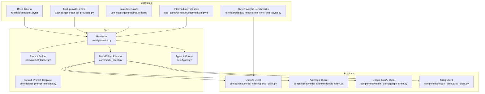
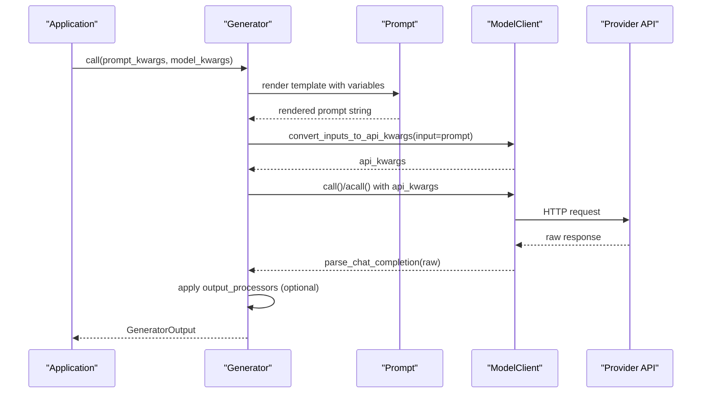
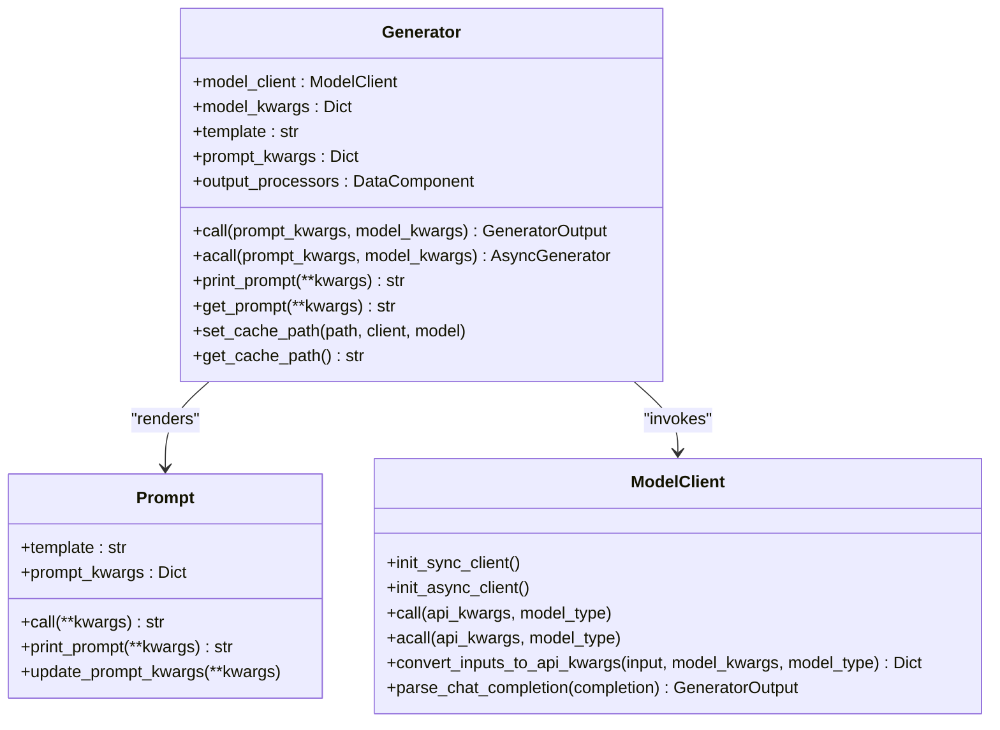
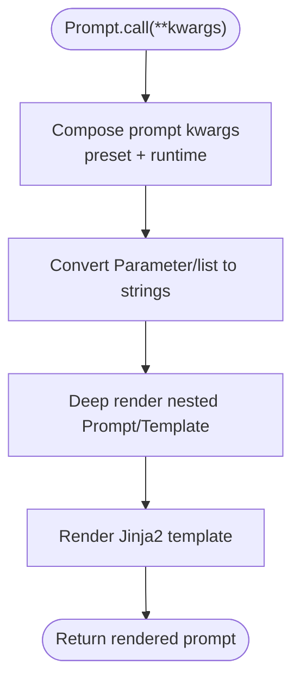
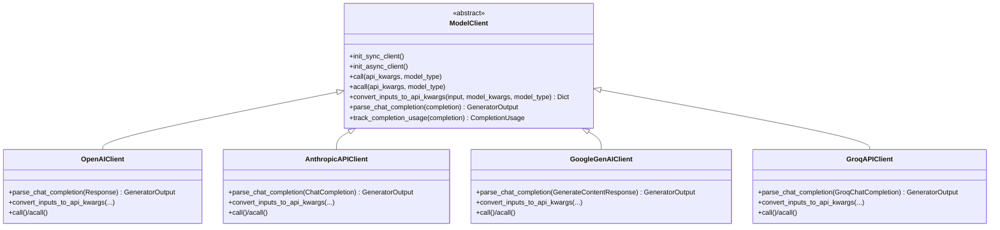
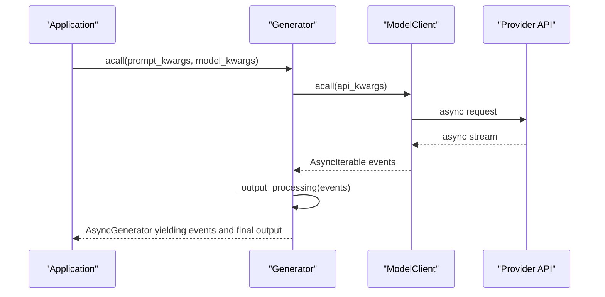
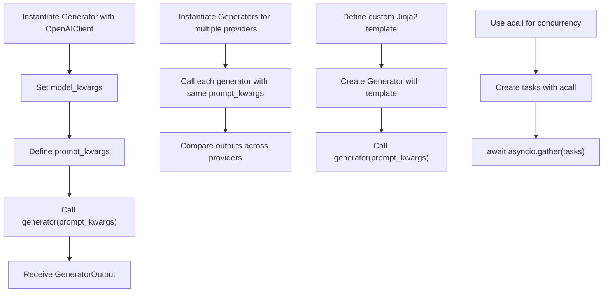
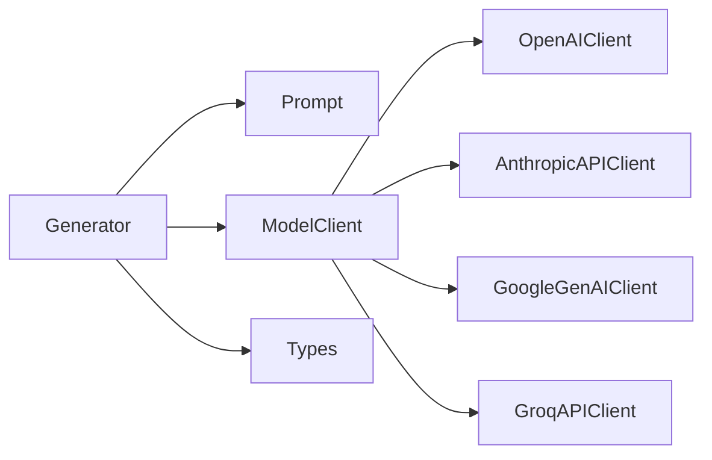

# Generator Orchestration

<cite>
**Referenced Files in This Document**
- [generator.py](file://adalflow/adalflow/core/generator.py)
- [prompt_builder.py](file://adalflow/adalflow/core/prompt_builder.py)
- [model_client.py](file://adalflow/adalflow/core/model_client.py)
- [openai_client.py](file://adalflow/adalflow/components/model_client/openai_client.py)
- [anthropic_client.py](file://adalflow/adalflow/components/model_client/anthropic_client.py)
- [google_client.py](file://adalflow/adalflow/components/model_client/google_client.py)
- [groq_client.py](file://adalflow/adalflow/components/model_client/groq_client.py)
- [default_prompt_template.py](file://adalflow/adalflow/core/default_prompt_template.py)
- [types.py](file://adalflow/adalflow/core/types.py)
- [generator.ipynb](file://tutorials/generator.ipynb)
- [generator_all_providers.py](file://tutorials/generator_all_providers.py)
- [basic.ipynb](file://use_cases/generator/basic.ipynb)
- [intermediate.ipynb](file://use_cases/generator/intermediate.ipynb)
- [adalflow_modelclient_sync_and_async.py](file://tutorials/adalflow_modelclient_sync_and_async.py)
</cite>

## Table of Contents
1. [Introduction](#introduction)
2. [Project Structure](#project-structure)
3. [Core Components](#core-components)
4. [Architecture Overview](#architecture-overview)
5. [Detailed Component Analysis](#detailed-component-analysis)
6. [Dependency Analysis](#dependency-analysis)
7. [Performance Considerations](#performance-considerations)
8. [Troubleshooting Guide](#troubleshooting-guide)
9. [Conclusion](#conclusion)
10. [Appendices](#appendices)

## Introduction
This document explains how AdalFlow orchestrates Large Language Model (LLM) interactions through the Generator class, which acts as a unified interface across multiple providers (OpenAI, Anthropic, Google, Groq, and others). It covers:
- How the Generator composes prompts, converts inputs to provider-specific API calls, and normalizes outputs.
- The prompt building system using Jinja2 templates and dynamic variable substitution.
- Synchronous and asynchronous call patterns, streaming support, and response processing.
- Integration with diverse model clients behind a common ModelClient protocol.
- Practical examples of instantiation, template usage, and response handling across providers.

## Project Structure
The Generator orchestration centers around three core modules:
- Core orchestration and types: generator, prompt_builder, model_client, types
- Provider integrations: openai_client, anthropic_client, google_client, groq_client
- Templates and examples: default_prompt_template, tutorials, and use cases

**Diagram sources**
- [generator.py](file://adalflow/adalflow/core/generator.py#L82-L210)
- [prompt_builder.py](file://adalflow/adalflow/core/prompt_builder.py#L20-L90)
- [model_client.py](file://adalflow/adalflow/core/model_client.py#L16-L128)
- [openai_client.py](file://adalflow/adalflow/components/model_client/openai_client.py#L1-L200)
- [anthropic_client.py](file://adalflow/adalflow/components/model_client/anthropic_client.py#L1-L200)
- [google_client.py](file://adalflow/adalflow/components/model_client/google_client.py#L1-L160)
- [groq_client.py](file://adalflow/adalflow/components/model_client/groq_client.py#L1-L179)
- [default_prompt_template.py](file://adalflow/adalflow/core/default_prompt_template.py#L1-L103)
- [generator.ipynb](file://tutorials/generator.ipynb#L1-L137)
- [generator_all_providers.py](file://tutorials/generator_all_providers.py#L1-L54)
- [basic.ipynb](file://use_cases/generator/basic.ipynb#L1-L316)
- [intermediate.ipynb](file://use_cases/generator/intermediate.ipynb#L1-L583)
- [adalflow_modelclient_sync_and_async.py](file://tutorials/adalflow_modelclient_sync_and_async.py#L1-L84)

**Section sources**
- [generator.py](file://adalflow/adalflow/core/generator.py#L1-L210)
- [prompt_builder.py](file://adalflow/adalflow/core/prompt_builder.py#L1-L120)
- [model_client.py](file://adalflow/adalflow/core/model_client.py#L1-L128)
- [openai_client.py](file://adalflow/adalflow/components/model_client/openai_client.py#L1-L200)
- [anthropic_client.py](file://adalflow/adalflow/components/model_client/anthropic_client.py#L1-L200)
- [google_client.py](file://adalflow/adalflow/components/model_client/google_client.py#L1-L160)
- [groq_client.py](file://adalflow/adalflow/components/model_client/groq_client.py#L1-L179)
- [default_prompt_template.py](file://adalflow/adalflow/core/default_prompt_template.py#L1-L103)
- [generator.ipynb](file://tutorials/generator.ipynb#L1-L137)
- [generator_all_providers.py](file://tutorials/generator_all_providers.py#L1-L54)
- [basic.ipynb](file://use_cases/generator/basic.ipynb#L1-L316)
- [intermediate.ipynb](file://use_cases/generator/intermediate.ipynb#L1-L583)
- [adalflow_modelclient_sync_and_async.py](file://tutorials/adalflow_modelclient_sync_and_async.py#L1-L84)

## Core Components
- Generator: Orchestrates prompt composition, model client invocation, and output processing. It supports both synchronous and asynchronous calls, caching, and optional streaming.
- Prompt: Renders Jinja2 templates with dynamic variables and nested template composition.
- ModelClient: Abstract protocol defining the interface for provider-specific clients.
- Provider Clients: OpenAI, Anthropic, Google, Groq, and more, each implementing the ModelClient contract.
- Types: Defines enums and data structures for model types, usage tracking, and standardized outputs.

Key responsibilities:
- Unified interface: Generator hides provider differences behind a consistent API.
- Prompt engineering: Prompt builds dynamic, composable prompts from templates and variables.
- Abstraction: ModelClient isolates provider-specific logic, enabling pluggable integrations.
- Standardization: Types and outputs normalize responses across providers.

**Section sources**
- [generator.py](file://adalflow/adalflow/core/generator.py#L82-L210)
- [prompt_builder.py](file://adalflow/adalflow/core/prompt_builder.py#L20-L120)
- [model_client.py](file://adalflow/adalflow/core/model_client.py#L16-L128)
- [types.py](file://adalflow/adalflow/core/types.py#L55-L135)

## Architecture Overview
The Generator sits at the center of the orchestration pipeline, coordinating:
- Prompt rendering via the Prompt component.
- Provider-specific API calls via ModelClient implementations.
- Output normalization and optional post-processing.

**Diagram sources**
- [generator.py](file://adalflow/adalflow/core/generator.py#L463-L544)
- [prompt_builder.py](file://adalflow/adalflow/core/prompt_builder.py#L181-L195)
- [model_client.py](file://adalflow/adalflow/core/model_client.py#L73-L97)
- [openai_client.py](file://adalflow/adalflow/components/model_client/openai_client.py#L113-L154)

## Detailed Component Analysis

### Generator Orchestration
The Generator is the central orchestrator that:
- Composes prompts from templates and variables.
- Converts inputs to provider-specific API arguments.
- Invokes the underlying ModelClient synchronously or asynchronously.
- Normalizes outputs and applies optional post-processing.
- Supports caching and token estimation for prompt length.

**Diagram sources**
- [generator.py](file://adalflow/adalflow/core/generator.py#L82-L210)
- [prompt_builder.py](file://adalflow/adalflow/core/prompt_builder.py#L20-L90)
- [model_client.py](file://adalflow/adalflow/core/model_client.py#L16-L128)

Key behaviors:
- Synchronous call flow: pre-call renders prompt, composes model kwargs, invokes ModelClient.call, parses response, and optionally applies output processors.
- Asynchronous call flow: similar to sync, but returns an async generator when the provider streams; yields raw events and final processed output.
- Caching: caches non-streaming responses keyed by serialized api_kwargs; cache path derived from client class and model name.
- Token estimation: counts tokens for the rendered prompt and stores an estimate for downstream use.

**Section sources**
- [generator.py](file://adalflow/adalflow/core/generator.py#L463-L544)
- [generator.py](file://adalflow/adalflow/core/generator.py#L520-L544)
- [generator.py](file://adalflow/adalflow/core/generator.py#L381-L462)
- [generator.py](file://adalflow/adalflow/core/generator.py#L231-L253)

### Prompt Building System
The Prompt component:
- Uses Jinja2 templates with strict undefined handling.
- Discovers template variables automatically.
- Composes runtime kwargs with preset prompt kwargs.
- Recursively renders nested Prompt and Template objects safely.
- Converts Parameter objects to strings and supports lists of parameters.

**Diagram sources**
- [prompt_builder.py](file://adalflow/adalflow/core/prompt_builder.py#L104-L195)
- [prompt_builder.py](file://adalflow/adalflow/core/prompt_builder.py#L230-L258)

Practical usage:
- Default template variables include task description, examples, context, chat history, steps, input, and output format.
- Users can override the default template or customize variables per call.

**Section sources**
- [prompt_builder.py](file://adalflow/adalflow/core/prompt_builder.py#L20-L120)
- [default_prompt_template.py](file://adalflow/adalflow/core/default_prompt_template.py#L13-L98)

### Model Client Integrations
All provider clients inherit from ModelClient and implement:
- Initialization of sync and async clients.
- convert_inputs_to_api_kwargs to transform standardized inputs into provider-specific arguments.
- call/acall to perform API requests.
- parse_chat_completion to normalize responses into GeneratorOutput.
- Usage tracking and error handling.

Representative clients:
- OpenAI: Parses Response API outputs, supports reasoning models, and extracts text/images/tool calls.
- Anthropic: Provides OpenAI SDK-compatible streaming and usage conversion.
- Google GenAI: Maps generation config and usage metadata to standardized types.
- Groq: Wraps Groq SDK chat completions and tracks usage.

**Diagram sources**
- [model_client.py](file://adalflow/adalflow/core/model_client.py#L16-L128)
- [openai_client.py](file://adalflow/adalflow/components/model_client/openai_client.py#L113-L154)
- [anthropic_client.py](file://adalflow/adalflow/components/model_client/anthropic_client.py#L100-L132)
- [google_client.py](file://adalflow/adalflow/components/model_client/google_client.py#L75-L125)
- [groq_client.py](file://adalflow/adalflow/components/model_client/groq_client.py#L68-L106)

**Section sources**
- [model_client.py](file://adalflow/adalflow/core/model_client.py#L16-L128)
- [openai_client.py](file://adalflow/adalflow/components/model_client/openai_client.py#L1-L200)
- [anthropic_client.py](file://adalflow/adalflow/components/model_client/anthropic_client.py#L1-L200)
- [google_client.py](file://adalflow/adalflow/components/model_client/google_client.py#L1-L160)
- [groq_client.py](file://adalflow/adalflow/components/model_client/groq_client.py#L1-L179)

### Synchronous and Asynchronous Patterns
- Synchronous: Generator.call constructs api_kwargs, invokes ModelClient.call, parses response, and returns a GeneratorOutput.
- Asynchronous: Generator.acall follows the same path but returns an async generator when the provider streams. The generator yields raw events and then yields the final processed output.
- Streaming support: Generator detects AsyncIterable raw responses and processes them through _output_processing, applying output processors only after the final text is available.

**Diagram sources**
- [generator.py](file://adalflow/adalflow/core/generator.py#L520-L544)
- [generator.py](file://adalflow/adalflow/core/generator.py#L381-L462)

**Section sources**
- [generator.py](file://adalflow/adalflow/core/generator.py#L381-L462)
- [generator.py](file://adalflow/adalflow/core/generator.py#L520-L544)
- [basic.ipynb](file://use_cases/generator/basic.ipynb#L208-L284)

### Response Processing and Output Normalization
- Non-streaming: GeneratorOutput contains raw_response and data (after optional output_processors).
- Streaming: Generator yields raw events and finalizes data after ResponseCompletedEvent.
- Usage tracking: Provider clients map provider-specific usage to standardized CompletionUsage.

**Section sources**
- [generator.py](file://adalflow/adalflow/core/generator.py#L357-L462)
- [openai_client.py](file://adalflow/adalflow/components/model_client/openai_client.py#L113-L154)
- [anthropic_client.py](file://adalflow/adalflow/components/model_client/anthropic_client.py#L100-L132)
- [google_client.py](file://adalflow/adalflow/components/model_client/google_client.py#L92-L125)
- [groq_client.py](file://adalflow/adalflow/components/model_client/groq_client.py#L83-L106)

### Prompt Builder Functionality and Template Management
- Automatic variable discovery and validation via Jinja2 environment.
- Safe recursive rendering of nested Prompt and Template objects.
- String conversion of Parameter and list elements for template rendering.
- Serialization support with to_dict/from_dict preserving template and variables.

**Section sources**
- [prompt_builder.py](file://adalflow/adalflow/core/prompt_builder.py#L261-L275)
- [prompt_builder.py](file://adalflow/adalflow/core/prompt_builder.py#L214-L229)

### Examples and Usage Patterns
- Single provider usage: Instantiate Generator with a specific ModelClient and call with prompt_kwargs.
- Multi-provider comparison: Instantiate multiple Generators with different clients and compare outputs.
- Custom templates: Override the default template with a Jinja2 template tailored to the task.
- Asynchronous pipelines: Use acall for concurrent requests to improve throughput.

**Diagram sources**
- [generator.ipynb](file://tutorials/generator.ipynb#L46-L66)
- [generator_all_providers.py](file://tutorials/generator_all_providers.py#L6-L54)
- [basic.ipynb](file://use_cases/generator/basic.ipynb#L169-L176)
- [basic.ipynb](file://use_cases/generator/basic.ipynb#L208-L284)

**Section sources**
- [generator.ipynb](file://tutorials/generator.ipynb#L1-L137)
- [generator_all_providers.py](file://tutorials/generator_all_providers.py#L1-L54)
- [basic.ipynb](file://use_cases/generator/basic.ipynb#L1-L316)
- [intermediate.ipynb](file://use_cases/generator/intermediate.ipynb#L1-L583)

## Dependency Analysis
Generator depends on:
- Prompt for template rendering.
- ModelClient for provider abstraction.
- Types for standardized enums and outputs.
- Provider clients for concrete implementations.

**Diagram sources**
- [generator.py](file://adalflow/adalflow/core/generator.py#L82-L210)
- [model_client.py](file://adalflow/adalflow/core/model_client.py#L16-L128)
- [types.py](file://adalflow/adalflow/core/types.py#L55-L135)
- [openai_client.py](file://adalflow/adalflow/components/model_client/openai_client.py#L1-L200)
- [anthropic_client.py](file://adalflow/adalflow/components/model_client/anthropic_client.py#L1-L200)
- [google_client.py](file://adalflow/adalflow/components/model_client/google_client.py#L1-L160)
- [groq_client.py](file://adalflow/adalflow/components/model_client/groq_client.py#L1-L179)

**Section sources**
- [generator.py](file://adalflow/adalflow/core/generator.py#L82-L210)
- [model_client.py](file://adalflow/adalflow/core/model_client.py#L16-L128)
- [types.py](file://adalflow/adalflow/core/types.py#L55-L135)

## Performance Considerations
- Asynchronous batching: Using acall with asyncio.gather can significantly reduce latency when issuing multiple requests concurrently.
- Caching: Enable caching for non-streaming calls to avoid repeated network requests; cache path is derived from client and model identifiers.
- Token estimation: Use estimated_token_count to inform truncation or prompt adjustments when max_tokens is constrained.
- Provider-specific optimizations: Some providers offer faster inference modes or specialized endpoints; configure model_kwargs accordingly.

**Section sources**
- [generator.py](file://adalflow/adalflow/core/generator.py#L231-L253)
- [generator.py](file://adalflow/adalflow/core/generator.py#L474-L486)
- [basic.ipynb](file://use_cases/generator/basic.ipynb#L208-L284)
- [adalflow_modelclient_sync_and_async.py](file://tutorials/adalflow_modelclient_sync_and_async.py#L1-L84)

## Troubleshooting Guide
Common issues and resolutions:
- Invalid Jinja2 template: Ensure template syntax is valid; the Prompt component raises explicit errors on invalid templates.
- Missing provider credentials: Provider clients require environment variables (e.g., OPENAI_API_KEY, GROQ_API_KEY); ensure setup_env is called.
- Streaming handling: When using streaming, ensure output processors are applied after final text is received; Generator handles this internally for async flows.
- Usage tracking: Provider clients map usage to standardized types; verify that track_completion_usage is implemented for the chosen client.

**Section sources**
- [prompt_builder.py](file://adalflow/adalflow/core/prompt_builder.py#L80-L86)
- [openai_client.py](file://adalflow/adalflow/components/model_client/openai_client.py#L60-L73)
- [anthropic_client.py](file://adalflow/adalflow/components/model_client/anthropic_client.py#L126-L135)
- [google_client.py](file://adalflow/adalflow/components/model_client/google_client.py#L126-L135)
- [groq_client.py](file://adalflow/adalflow/components/model_client/groq_client.py#L107-L136)

## Conclusion
AdalFlow’s Generator provides a robust, unified interface for interacting with multiple LLM providers. Through the Prompt builder and ModelClient abstraction, it standardizes prompt composition, API invocation, and response processing across providers. Developers can seamlessly switch providers, compose dynamic prompts, and leverage both synchronous and asynchronous patterns with built-in caching and usage tracking.

## Appendices

### Provider Client Quick Reference
- OpenAI: Supports Response API outputs, reasoning models, and usage extraction.
- Anthropic: Compatible with OpenAI SDK streaming and usage mapping.
- Google GenAI: Maps generation config and usage metadata to standardized types.
- Groq: Wraps Groq SDK chat completions with usage tracking.

**Section sources**
- [openai_client.py](file://adalflow/adalflow/components/model_client/openai_client.py#L1-L200)
- [anthropic_client.py](file://adalflow/adalflow/components/model_client/anthropic_client.py#L1-L200)
- [google_client.py](file://adalflow/adalflow/components/model_client/google_client.py#L1-L160)
- [groq_client.py](file://adalflow/adalflow/components/model_client/groq_client.py#L1-L179)