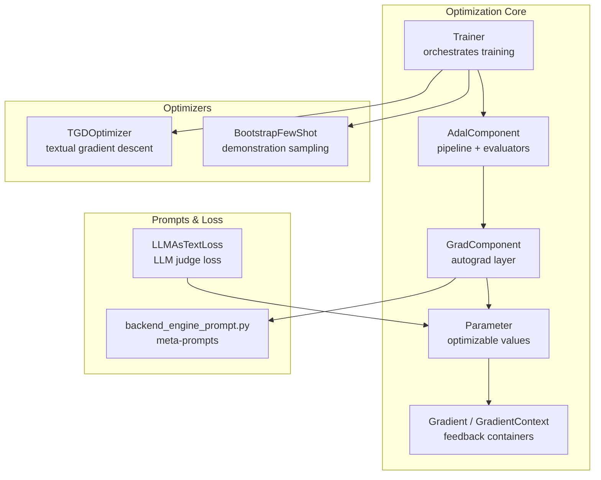
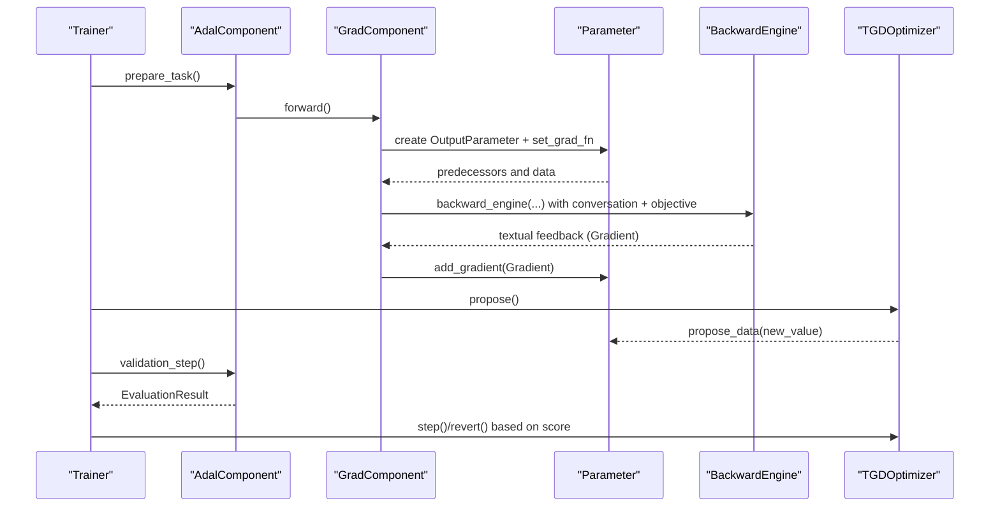
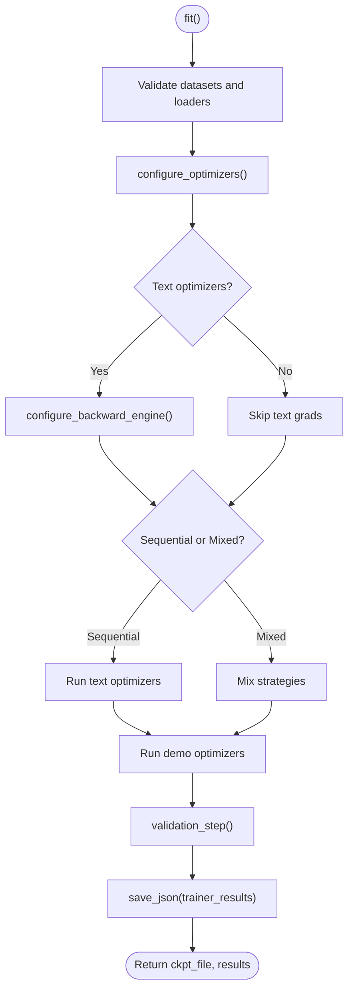
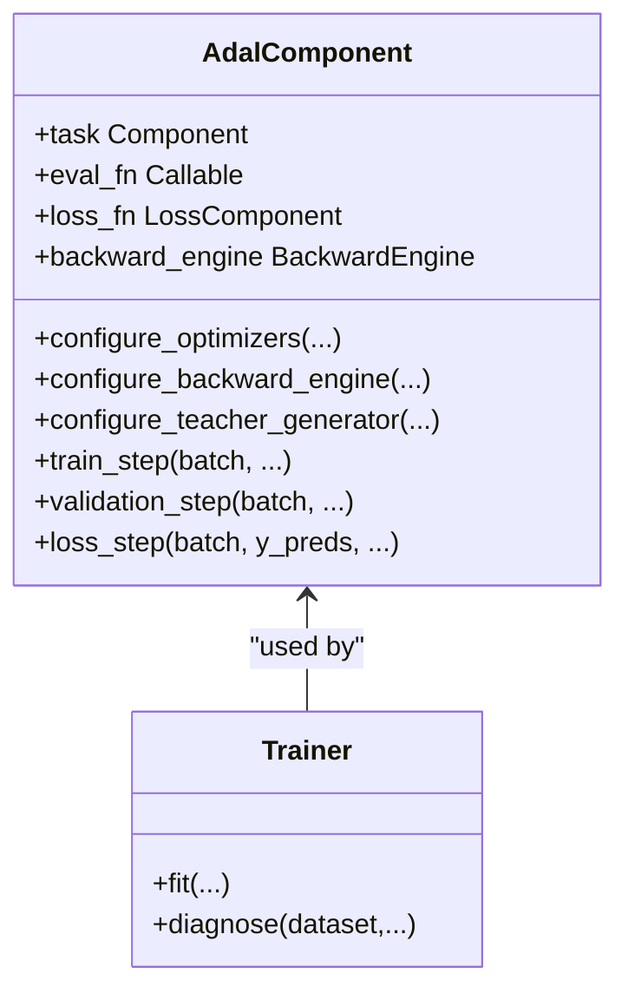
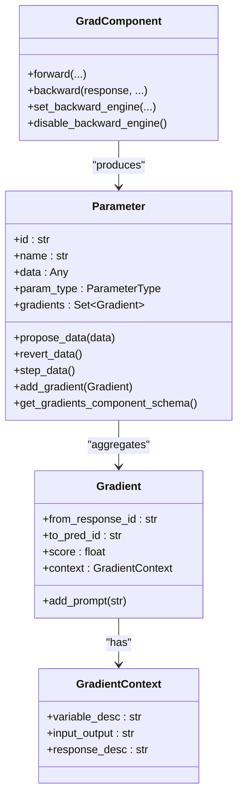
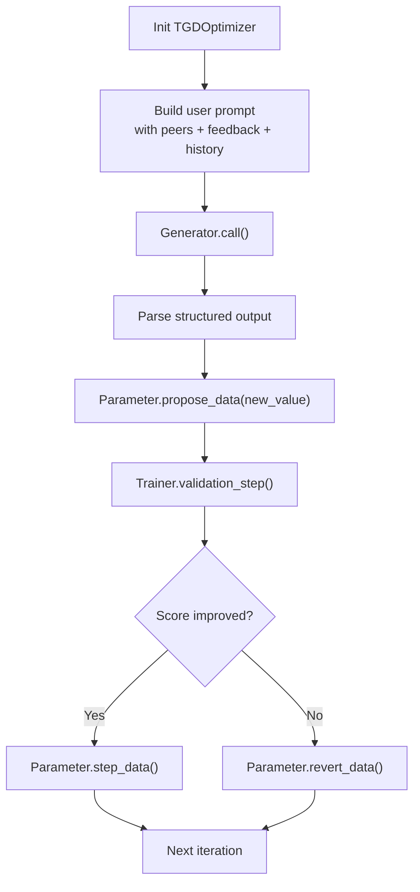
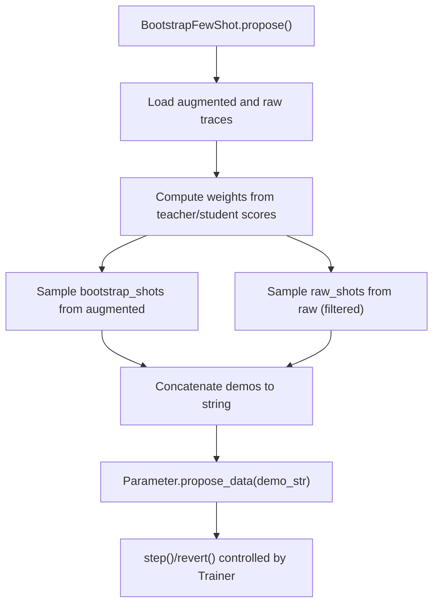
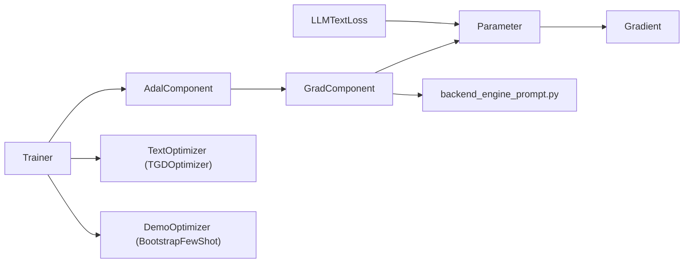

# Optimization Framework

<cite>
**Referenced Files in This Document**
- [optim/__init__.py](file://adalflow/adalflow/optim/__init__.py)
- [optim/README.md](file://adalflow/adalflow/optim/README.md)
- [optim/trainer/__init__.py](file://adalflow/adalflow/optim/trainer/__init__.py)
- [optim/trainer/trainer.py](file://adalflow/adalflow/optim/trainer/trainer.py)
- [optim/trainer/adal.py](file://adalflow/adalflow/optim/trainer/adal.py)
- [optim/gradient.py](file://adalflow/adalflow/optim/gradient.py)
- [optim/grad_component.py](file://adalflow/adalflow/optim/grad_component.py)
- [optim/text_grad/tgd_optimizer.py](file://adalflow/adalflow/optim/text_grad/tgd_optimizer.py)
- [optim/text_grad/backend_engine_prompt.py](file://adalflow/adalflow/optim/text_grad/backend_engine_prompt.py)
- [optim/text_grad/llm_text_loss.py](file://adalflow/adalflow/optim/text_grad/llm_text_loss.py)
- [optim/few_shot/bootstrap_optimizer.py](file://adalflow/adalflow/optim/few_shot/bootstrap_optimizer.py)
- [optim/parameter.py](file://adalflow/adalflow/optim/parameter.py)
- [optim/types.py](file://adalflow/adalflow/optim/types.py)
</cite>

## Table of Contents
1. [Introduction](#introduction)
2. [Project Structure](#project-structure)
3. [Core Components](#core-components)
4. [Architecture Overview](#architecture-overview)
5. [Detailed Component Analysis](#detailed-component-analysis)
6. [Dependency Analysis](#dependency-analysis)
7. [Performance Considerations](#performance-considerations)
8. [Troubleshooting Guide](#troubleshooting-guide)
9. [Conclusion](#conclusion)
10. [Appendices](#appendices)

## Introduction
This document explains AdalFlow’s Optimization Framework that enables automatic differentiation for large language model (LLM) pipelines without traditional gradient computation. It documents the Trainer component as the ready-to-use optimization framework for pipeline training and parameter optimization, the gradient component system extending components with automatic differentiation capabilities, and the text gradient descent (TGD) optimizer that optimizes prompts, demonstrations, and pipeline configurations through LLM feedback. It also covers the optimization workflow (loss computation, gradient estimation, parameter updates), the relationship between optimization components and the broader AdalFlow ecosystem, and practical scenarios such as prompt engineering, few-shot learning, and pipeline configuration optimization.

## Project Structure
The optimization subsystem is organized around:
- Trainer: orchestrates training loops, validation, and checkpointing.
- AdalComponent: composes task pipelines, evaluation functions, loss functions, and backward engines.
- Gradient system: Parameter, Gradient, GradientContext, and GradComponent.
- TextGrad: TGD optimizer and supporting prompts for textual gradient estimation.
- Few-shot: BootstrapFewShot optimizer for demonstration optimization.
- Types and utilities: ParameterType, TrainerResult, and related data structures.

**Diagram sources**
- [optim/trainer/trainer.py](file://adalflow/adalflow/optim/trainer/trainer.py#L42-L192)
- [optim/trainer/adal.py](file://adalflow/adalflow/optim/trainer/adal.py#L30-L208)
- [optim/grad_component.py](file://adalflow/adalflow/optim/grad_component.py#L40-L115)
- [optim/parameter.py](file://adalflow/adalflow/optim/parameter.py#L119-L253)
- [optim/gradient.py](file://adalflow/adalflow/optim/gradient.py#L14-L73)
- [optim/text_grad/tgd_optimizer.py](file://adalflow/adalflow/optim/text_grad/tgd_optimizer.py#L357-L424)
- [optim/few_shot/bootstrap_optimizer.py](file://adalflow/adalflow/optim/few_shot/bootstrap_optimizer.py#L22-L70)
- [optim/text_grad/backend_engine_prompt.py](file://adalflow/adalflow/optim/text_grad/backend_engine_prompt.py#L12-L44)
- [optim/text_grad/llm_text_loss.py](file://adalflow/adalflow/optim/text_grad/llm_text_loss.py#L29-L75)

**Section sources**
- [optim/__init__.py](file://adalflow/adalflow/optim/__init__.py#L1-L39)
- [optim/README.md](file://adalflow/adalflow/optim/README.md#L1-L122)

## Core Components
- Trainer: Provides ready-to-use training orchestration for LLM pipelines, supporting mixed or sequential optimization of text prompts and demonstrations, with validation, checkpointing, and debugging hooks.
- AdalComponent: Encapsulates a task pipeline with evaluation, loss computation, and backward engine configuration; exposes prepare_task, prepare_loss, prepare_eval, and prepare_loss_eval for Trainer.
- GradComponent: Base class for autograd-capable components; implements forward/backward passes and integrates with a backward engine to generate textual gradients.
- Parameter: Container for optimizable values (prompts, demonstrations, hyperparameters), with gradient aggregation, tracing, and proposal/revert/step semantics.
- Gradient and GradientContext: Data structures capturing feedback messages, contexts, and scores for backpropagation.
- TGDOptimizer: Textual gradient descent optimizer that proposes improved prompts using LLM feedback, history, and constraints.
- BootstrapFewShot: Demonstrates few-shot sampling with weighted selection and augmentation.
- Types: ParameterType, TrainerResult, PromptData, and related dataclasses for consistent typing and serialization.

**Section sources**
- [optim/trainer/trainer.py](file://adalflow/adalflow/optim/trainer/trainer.py#L42-L192)
- [optim/trainer/adal.py](file://adalflow/adalflow/optim/trainer/adal.py#L30-L208)
- [optim/grad_component.py](file://adalflow/adalflow/optim/grad_component.py#L40-L115)
- [optim/parameter.py](file://adalflow/adalflow/optim/parameter.py#L119-L253)
- [optim/gradient.py](file://adalflow/adalflow/optim/gradient.py#L14-L73)
- [optim/text_grad/tgd_optimizer.py](file://adalflow/adalflow/optim/text_grad/tgd_optimizer.py#L357-L424)
- [optim/few_shot/bootstrap_optimizer.py](file://adalflow/adalflow/optim/few_shot/bootstrap_optimizer.py#L22-L70)
- [optim/types.py](file://adalflow/adalflow/optim/types.py#L13-L67)

## Architecture Overview
The framework builds on LLM-AutoDiff to enable zero-shot and few-shot optimization without explicit numeric gradients. At a high level:
- AdalComponent defines the pipeline and evaluation criteria.
- GradComponent layers compute forward outputs and attach backward functions that query a backward engine to produce textual gradients.
- Parameter aggregates feedback across data points and maintains proposal/revert/step state.
- Trainer coordinates optimization steps, validation, and checkpointing.
- TGDOptimizer proposes improved prompts using LLM feedback, history, and constraints.
- BootstrapFewShot samples demonstrations with weighted strategies informed by scores.

**Diagram sources**
- [optim/trainer/trainer.py](file://adalflow/adalflow/optim/trainer/trainer.py#L418-L698)
- [optim/trainer/adal.py](file://adalflow/adalflow/optim/trainer/adal.py#L336-L576)
- [optim/grad_component.py](file://adalflow/adalflow/optim/grad_component.py#L422-L480)
- [optim/parameter.py](file://adalflow/adalflow/optim/parameter.py#L286-L320)
- [optim/text_grad/tgd_optimizer.py](file://adalflow/adalflow/optim/text_grad/tgd_optimizer.py#L614-L713)

## Detailed Component Analysis

### Trainer: Ready-to-use Optimization Framework
- Responsibilities:
  - Configure and run text and demonstration optimizers.
  - Manage training/validation/test loops, batching, and parallel evaluation.
  - Resume from checkpoints and manage histories for TGD.
  - Provide debugging hooks and diagnostic reports.
- Key behaviors:
  - Supports sequential or mixed optimization order for text and demos.
  - Integrates with backward engine for gradient computation when present.
  - Saves and loads checkpoints with detailed trainer state.

**Diagram sources**
- [optim/trainer/trainer.py](file://adalflow/adalflow/optim/trainer/trainer.py#L418-L698)

**Section sources**
- [optim/trainer/trainer.py](file://adalflow/adalflow/optim/trainer/trainer.py#L42-L192)
- [optim/trainer/trainer.py](file://adalflow/adalflow/optim/trainer/trainer.py#L418-L698)

### AdalComponent: Pipeline Composition and Evaluation
- Responsibilities:
  - Define prepare_task, prepare_loss, prepare_eval, and prepare_loss_eval.
  - Configure backward engine and teacher generator helpers.
  - Provide evaluation utilities with parallelism and metadata support.
- Integration points:
  - Works with Trainer to run training/validation/test steps.
  - Exposes parameters and named_parameters for optimizer targeting.

**Diagram sources**
- [optim/trainer/adal.py](file://adalflow/adalflow/optim/trainer/adal.py#L30-L208)
- [optim/trainer/trainer.py](file://adalflow/adalflow/optim/trainer/trainer.py#L42-L192)

**Section sources**
- [optim/trainer/adal.py](file://adalflow/adalflow/optim/trainer/adal.py#L30-L208)

### Gradient System: Parameter, Gradient, GradientContext, GradComponent
- Parameter:
  - Stores data, role description, type, and optimization state.
  - Aggregates gradients and contextual feedback across data points.
  - Supports propose/revert/step lifecycle for optimizer updates.
- Gradient and GradientContext:
  - Capture feedback messages, component context, and scores.
  - Enable grouping and sorting of feedback for downstream use.
- GradComponent:
  - Implements forward/backward with a backward engine.
  - Builds conversation context and objective instructions for the backward engine.
  - Passes through gradients or computes textual gradients depending on configuration.

**Diagram sources**
- [optim/parameter.py](file://adalflow/adalflow/optim/parameter.py#L119-L253)
- [optim/gradient.py](file://adalflow/adalflow/optim/gradient.py#L14-L73)
- [optim/grad_component.py](file://adalflow/adalflow/optim/grad_component.py#L40-L115)

**Section sources**
- [optim/parameter.py](file://adalflow/adalflow/optim/parameter.py#L119-L253)
- [optim/gradient.py](file://adalflow/adalflow/optim/gradient.py#L14-L73)
- [optim/grad_component.py](file://adalflow/adalflow/optim/grad_component.py#L40-L115)

### Text Gradient Descent (TGD) Optimizer
- Purpose:
  - Propose improved prompts using LLM feedback, historical performance, and constraints.
- Mechanisms:
  - Builds user prompts with variable/peer context, feedback, constraints, and examples.
  - Uses a Generator with a custom output parser to extract structured proposals.
  - Manages proposal lifecycle: propose, step (accept), revert (reject).
  - Maintains histories of past prompts and failed proposals for acquisition strategies.
- Advanced sampling:
  - Gumbel Top-k sampling for probabilistic prompt selection with temperature, noise scaling, and optional UCB bonuses.

**Diagram sources**
- [optim/text_grad/tgd_optimizer.py](file://adalflow/adalflow/optim/text_grad/tgd_optimizer.py#L357-L424)
- [optim/text_grad/tgd_optimizer.py](file://adalflow/adalflow/optim/text_grad/tgd_optimizer.py#L614-L713)

**Section sources**
- [optim/text_grad/tgd_optimizer.py](file://adalflow/adalflow/optim/text_grad/tgd_optimizer.py#L357-L424)
- [optim/text_grad/tgd_optimizer.py](file://adalflow/adalflow/optim/text_grad/tgd_optimizer.py#L714-L800)

### Few-Shot Bootstrap Optimizer
- Purpose:
  - Optimize demonstration parameters by sampling from raw and augmented datasets with weighted strategies.
- Mechanisms:
  - Maintains teacher and student scores to weight sampling favoring failed examples that succeed after augmentation.
  - Supports excluding input fields from bootstrap demonstrations to reduce token usage.
  - Converts samples to YAML strings and proposes concatenated demonstrations.

**Diagram sources**
- [optim/few_shot/bootstrap_optimizer.py](file://adalflow/adalflow/optim/few_shot/bootstrap_optimizer.py#L233-L300)

**Section sources**
- [optim/few_shot/bootstrap_optimizer.py](file://adalflow/adalflow/optim/few_shot/bootstrap_optimizer.py#L22-L70)
- [optim/few_shot/bootstrap_optimizer.py](file://adalflow/adalflow/optim/few_shot/bootstrap_optimizer.py#L233-L300)

### Loss Components and Backward Engine Prompts
- LLMAsTextLoss:
  - Wraps a Generator as a loss component to produce a Parameter carrying evaluation feedback.
- Backward Engine Prompts:
  - Templates for constructing conversation context and objective instructions for the backward engine.
  - Support chain/backpropagation awareness and peer variable scoping.

**Section sources**
- [optim/text_grad/llm_text_loss.py](file://adalflow/adalflow/optim/text_grad/llm_text_loss.py#L29-L75)
- [optim/text_grad/backend_engine_prompt.py](file://adalflow/adalflow/optim/text_grad/backend_engine_prompt.py#L12-L44)

## Dependency Analysis
- Trainer depends on AdalComponent for pipeline execution and on TextOptimizer/DemoOptimizer for parameter updates.
- AdalComponent depends on GradComponent layers and backward engine for gradient computation.
- GradComponent depends on Parameter and uses backward engine prompts to generate textual gradients.
- TGD and BootstrapFewShot depend on Parameter lifecycle and Trainer orchestration.
- Types define shared enums and dataclasses across components.

**Diagram sources**
- [optim/trainer/trainer.py](file://adalflow/adalflow/optim/trainer/trainer.py#L502-L540)
- [optim/trainer/adal.py](file://adalflow/adalflow/optim/trainer/adal.py#L175-L190)
- [optim/grad_component.py](file://adalflow/adalflow/optim/grad_component.py#L422-L480)
- [optim/text_grad/backend_engine_prompt.py](file://adalflow/adalflow/optim/text_grad/backend_engine_prompt.py#L12-L44)
- [optim/text_grad/llm_text_loss.py](file://adalflow/adalflow/optim/text_grad/llm_text_loss.py#L29-L75)

**Section sources**
- [optim/__init__.py](file://adalflow/adalflow/optim/__init__.py#L1-L39)
- [optim/trainer/trainer.py](file://adalflow/adalflow/optim/trainer/trainer.py#L502-L540)
- [optim/trainer/adal.py](file://adalflow/adalflow/optim/trainer/adal.py#L175-L190)

## Performance Considerations
- Batch-awareness: Use appropriate batch sizes to ensure sufficient error signals for gradient estimation.
- Parallel evaluation: Leverage Trainer’s parallel worker configuration for evaluation throughput.
- Backward engine caching: Disable cache during TGD propose to ensure fresh feedback; re-enable for deterministic reuse elsewhere.
- History pruning: Limit max_past_history and max_failed_proposals to control prompt template size and cost.
- Gumbel Top-k exploration: Tune temperature and noise scale for exploration/exploitation balance; optionally enable UCB bonus for diversity.

[No sources needed since this section provides general guidance]

## Troubleshooting Guide
- Validation score thresholds:
  - Use batch_val_score_threshold and correct_val_score_threshold to skip batches or samples based on performance.
- Debugging:
  - Enable debug mode in Trainer to inspect text grad and demo debug paths.
  - Use diagnose() to collect logs and error responses for diagnosis.
- Backward engine:
  - Ensure backward engine is configured for GradComponent layers; disable when not needed to avoid unnecessary calls.
- Checkpointing:
  - Resume from checkpoints to recover best prompts and histories; Trainer selects best validation score to restore.

**Section sources**
- [optim/trainer/trainer.py](file://adalflow/adalflow/optim/trainer/trainer.py#L197-L316)
- [optim/trainer/trainer.py](file://adalflow/adalflow/optim/trainer/trainer.py#L578-L598)
- [optim/trainer/adal.py](file://adalflow/adalflow/optim/trainer/adal.py#L653-L704)

## Conclusion
AdalFlow’s Optimization Framework leverages LLM-AutoDiff to enable zero-shot and few-shot optimization of prompts, demonstrations, and pipeline configurations without numeric gradients. The Trainer provides a cohesive training loop, while GradComponent and Parameter implement the autograd plumbing powered by textual feedback. The TGDOptimizer and BootstrapFewShot offer practical strategies for iterative improvement guided by LLM feedback and weighted sampling. Together, these components integrate seamlessly into the broader AdalFlow ecosystem to support advanced optimization scenarios.

[No sources needed since this section summarizes without analyzing specific files]

## Appendices

### Practical Workflows and Examples
- Prompt Engineering:
  - Configure AdalComponent with prepare_task and prepare_loss.
  - Use TGDOptimizer with constraints and examples; monitor histories and scores.
  - Iterate with propose/step/revert based on validation results.
- Few-Shot Learning:
  - Configure BootstrapFewShot with raw_shots and bootstrap_shots.
  - Provide teacher/student scores to weight sampling toward failed examples that succeed after augmentation.
- Pipeline Configuration Optimization:
  - Tag configuration parameters as HYPERPARAM or PROMPT and mark requires_opt accordingly.
  - Use Trainer’s sequential/mixed strategies to optimize prompts first, then demonstrations.

[No sources needed since this section provides general guidance]