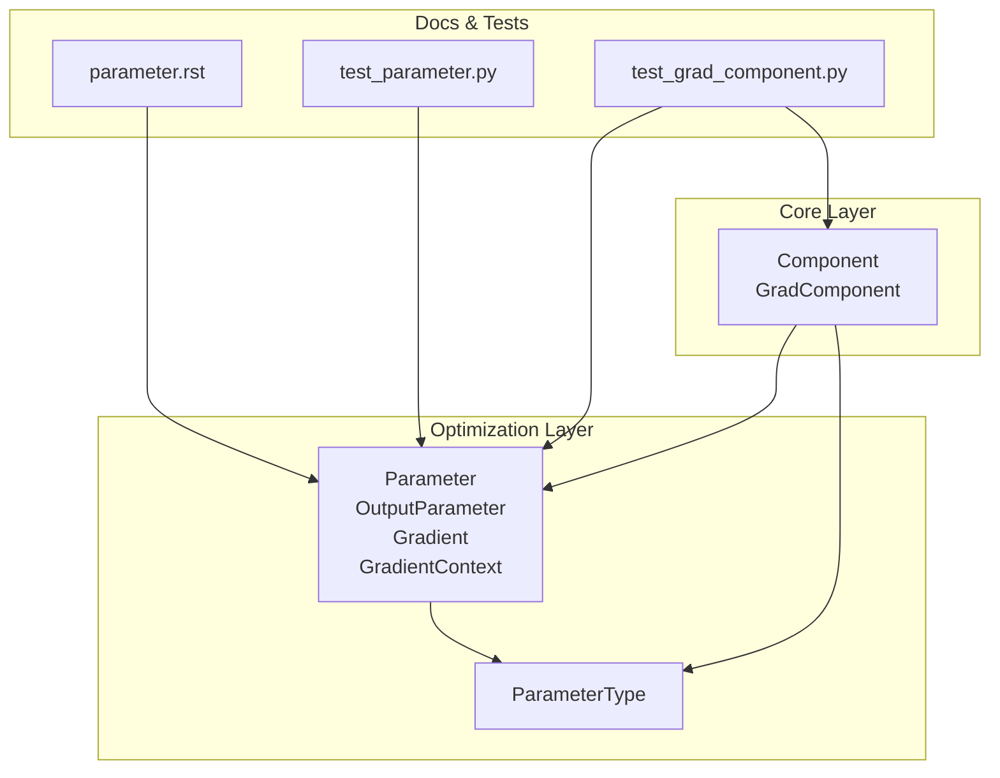
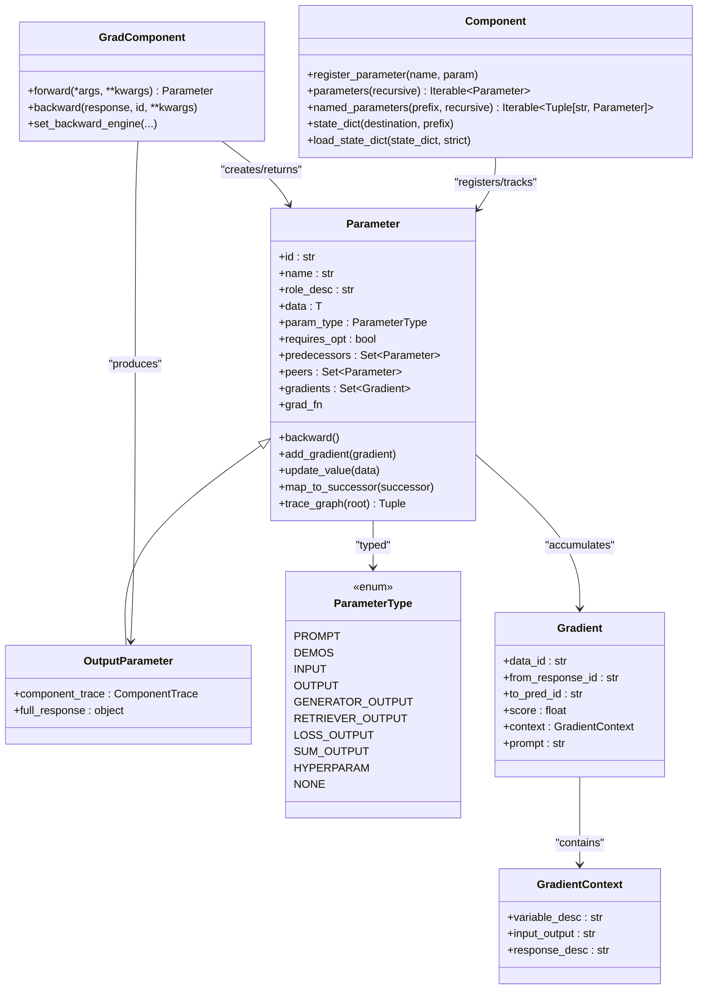
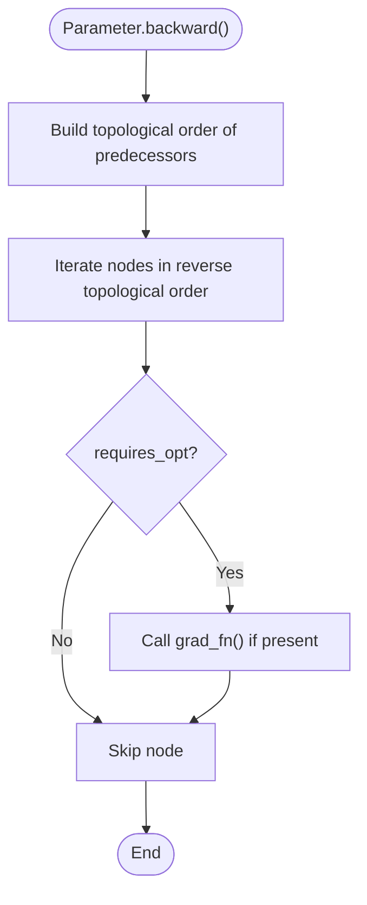
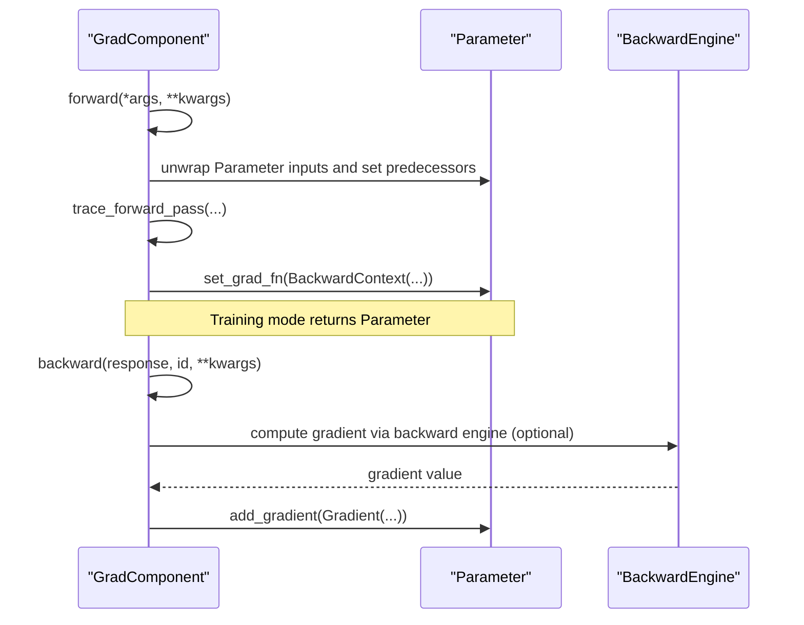
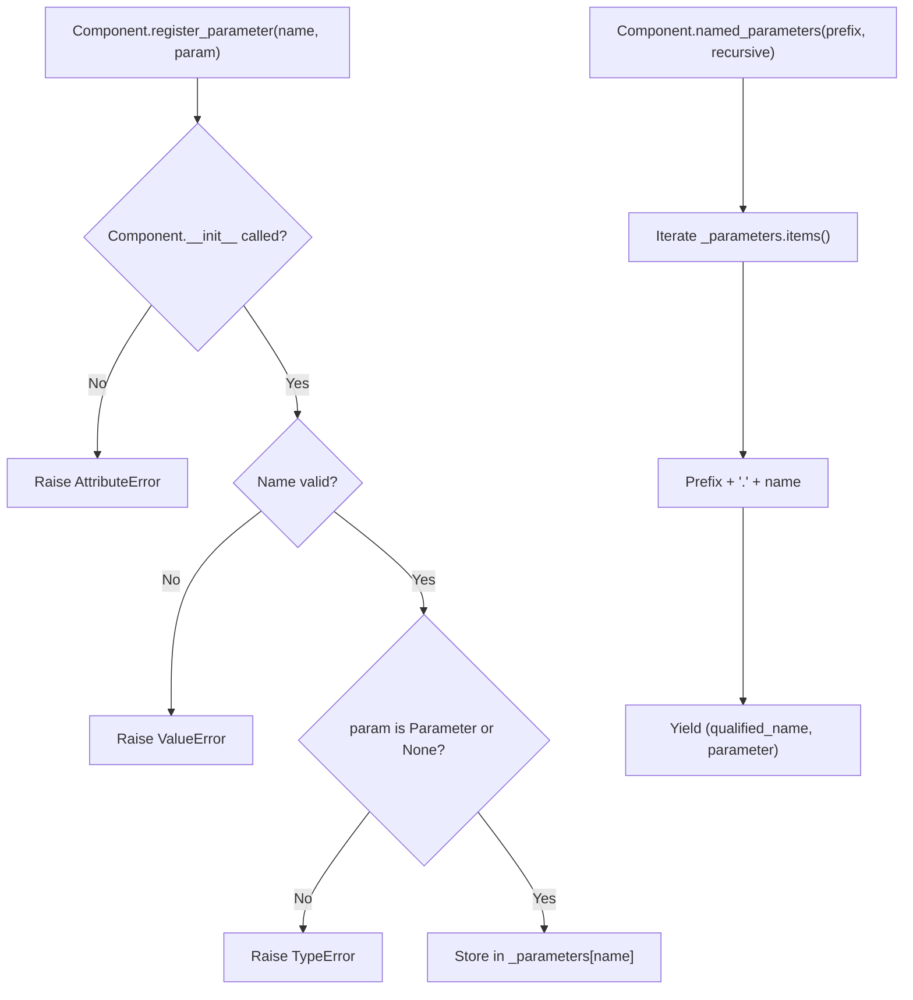
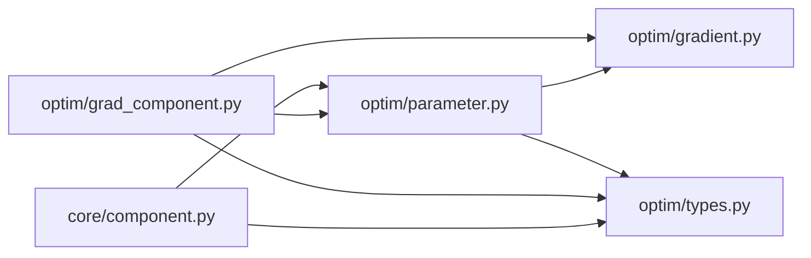

# Parameter System

<cite>
**Referenced Files in This Document**
- [parameter.py](file://adalflow/adalflow/optim/parameter.py)
- [grad_component.py](file://adalflow/adalflow/optim/grad_component.py)
- [component.py](file://adalflow/adalflow/core/component.py)
- [types.py](file://adalflow/adalflow/optim/types.py)
- [gradient.py](file://adalflow/adalflow/optim/gradient.py)
- [parameter.rst](file://docs/source/tutorials/parameter.rst)
- [test_parameter.py](file://adalflow/tests/test_parameter.py)
- [test_grad_component.py](file://adalflow/tests/test_grad_component.py)
</cite>

## Table of Contents
1. [Introduction](#introduction)
2. [Project Structure](#project-structure)
3. [Core Components](#core-components)
4. [Architecture Overview](#architecture-overview)
5. [Detailed Component Analysis](#detailed-component-analysis)
6. [Dependency Analysis](#dependency-analysis)
7. [Performance Considerations](#performance-considerations)
8. [Troubleshooting Guide](#troubleshooting-guide)
9. [Conclusion](#conclusion)

## Introduction
This document explains AdalFlow’s Parameter System, the foundational unit for trainable components in the optimization framework. It enables zero-shot and few-shot optimization via LLM-AutoDiff research by treating any data as a parameter, not just numeric tensors. The Parameter class encapsulates data, optimization intent, gradient tracking, and graph traversal for automatic differentiation. Components register parameters via a dedicated method, and parameters are tracked recursively through the component hierarchy. The system supports hierarchical naming, iteration, serialization, and flexible optimization strategies beyond traditional weight tensors.

## Project Structure
The Parameter System spans several modules:
- Parameter and related types live in the optimization module.
- Components manage parameter registration and iteration.
- Gradient and context types support backpropagation.
- Tutorials and tests demonstrate usage and behavior.

**Diagram sources**
- [parameter.py](file://adalflow/adalflow/optim/parameter.py#L119-L1712)
- [grad_component.py](file://adalflow/adalflow/optim/grad_component.py#L40-L628)
- [component.py](file://adalflow/adalflow/core/component.py#L51-L1200)
- [types.py](file://adalflow/adalflow/optim/types.py#L13-L163)
- [gradient.py](file://adalflow/adalflow/optim/gradient.py#L14-L133)
- [parameter.rst](file://docs/source/tutorials/parameter.rst#L1-L94)
- [test_parameter.py](file://adalflow/tests/test_parameter.py#L1-L90)
- [test_grad_component.py](file://adalflow/tests/test_grad_component.py#L1-L78)

**Section sources**
- [parameter.py](file://adalflow/adalflow/optim/parameter.py#L1-L1712)
- [grad_component.py](file://adalflow/adalflow/optim/grad_component.py#L1-L628)
- [component.py](file://adalflow/adalflow/core/component.py#L1-L1200)
- [types.py](file://adalflow/adalflow/optim/types.py#L1-L163)
- [gradient.py](file://adalflow/adalflow/optim/gradient.py#L1-L133)
- [parameter.rst](file://docs/source/tutorials/parameter.rst#L1-L94)
- [test_parameter.py](file://adalflow/tests/test_parameter.py#L1-L90)
- [test_grad_component.py](file://adalflow/tests/test_grad_component.py#L1-L78)

## Core Components
- Parameter: A generic container for any data used in optimization. It tracks predecessors, gradients, and supports backpropagation. It exposes methods to update values, attach successor-specific mapping functions, and aggregate gradient feedback.
- OutputParameter: A specialized parameter for component outputs; it carries component traces and gradient contexts.
- GradComponent: A component capable of forward/backward passes, connecting parameters in a computation graph and generating gradients via a backward engine.
- Component: Base class for all pipeline components. It registers parameters, iterates them recursively, and manages serialization and state loading.
- ParameterType: Enumerates parameter categories (prompt, demos, input, output, generator output, etc.) and default trainability.
- Gradient and GradientContext: Represent gradient feedback, context, and metadata for backpropagation.

Key capabilities:
- Hierarchical parameter naming and iteration across nested components.
- Recursive parameter tracking via predecessors and successors.
- Automatic differentiation through backward propagation and gradient aggregation.
- Serialization and state restoration for parameters and components.

**Section sources**
- [parameter.py](file://adalflow/adalflow/optim/parameter.py#L119-L1712)
- [grad_component.py](file://adalflow/adalflow/optim/grad_component.py#L40-L628)
- [component.py](file://adalflow/adalflow/core/component.py#L51-L1200)
- [types.py](file://adalflow/adalflow/optim/types.py#L13-L163)
- [gradient.py](file://adalflow/adalflow/optim/gradient.py#L14-L133)

## Architecture Overview
The Parameter System integrates components, parameters, and gradients into a computation graph supporting LLM-powered optimization.

**Diagram sources**
- [parameter.py](file://adalflow/adalflow/optim/parameter.py#L119-L1712)
- [grad_component.py](file://adalflow/adalflow/optim/grad_component.py#L40-L628)
- [component.py](file://adalflow/adalflow/core/component.py#L51-L1200)
- [types.py](file://adalflow/adalflow/optim/types.py#L13-L163)
- [gradient.py](file://adalflow/adalflow/optim/gradient.py#L14-L133)

## Detailed Component Analysis

### Parameter Class
The Parameter class is the core unit for optimization:
- Initialization supports id, name, role description, data, data_id, requires_opt, param_type, and optional callbacks for prompt formatting and backward engine instructions.
- It maintains predecessors (parents in the computation graph), optional peers (conflict-aware grouping), and a set of Gradients.
- Methods:
  - update_value: in-place update with type safety.
  - add_gradient/reset_gradients/get_gradients_*: manage gradient accumulation and aggregation.
  - map_to_successor/add_successor_map_fn: attach mapping functions to tailor successor consumption.
  - backward: topological backpropagation across predecessors.
  - trace_graph: collect nodes and edges for visualization and analysis.
  - to_dict/from_dict: serialization support for persistence.
  - propose_data/revert_data/step_data: proposal lifecycle for optimization steps.
  - get_prompt_data/get_short_value: utilities for prompt construction and token reduction.

**Diagram sources**
- [parameter.py](file://adalflow/adalflow/optim/parameter.py#L711-L750)

**Section sources**
- [parameter.py](file://adalflow/adalflow/optim/parameter.py#L119-L1712)
- [test_parameter.py](file://adalflow/tests/test_parameter.py#L1-L90)

### OutputParameter
OutputParameter extends Parameter for component outputs:
- Tracks component_trace and full_response.
- Allowed types include OUTPUT, LOSS_OUTPUT, GENERATOR_OUTPUT, SUM_OUTPUT.
- Integrates with GradComponent forward/backward to propagate gradients and scores.

**Section sources**
- [parameter.py](file://adalflow/adalflow/optim/parameter.py#L1585-L1600)
- [grad_component.py](file://adalflow/adalflow/optim/grad_component.py#L123-L238)

### GradComponent
GradComponent defines the training interface:
- forward unwraps Parameter inputs, sets predecessors, traces forward pass, and attaches a grad_fn.
- backward aggregates gradients from predecessors and optionally computes new gradients via a backward engine.
- Supports pass-through gradient distribution and per-predecessor gradient computation.

**Diagram sources**
- [grad_component.py](file://adalflow/adalflow/optim/grad_component.py#L123-L480)

**Section sources**
- [grad_component.py](file://adalflow/adalflow/optim/grad_component.py#L40-L628)
- [test_grad_component.py](file://adalflow/tests/test_grad_component.py#L1-L78)

### Component Parameter Management
Component manages parameter registration and iteration:
- register_parameter(name, param): validates and stores parameters under a unique key.
- parameters(named=False) and named_parameters(prefix, recursive): iterate parameters across the component tree.
- state_dict/load_state_dict: serialize and restore parameters’ values and structure.

**Diagram sources**
- [component.py](file://adalflow/adalflow/core/component.py#L359-L473)

**Section sources**
- [component.py](file://adalflow/adalflow/core/component.py#L359-L781)

### Parameter Types and Categories
ParameterType enumerates trainable and non-trainable categories:
- Trainable: PROMPT, DEMOS, OUTPUT, GENERATOR_OUTPUT, RETRIEVER_OUTPUT, LOSS_OUTPUT, SUM_OUTPUT.
- Non-trainable: INPUT, HYPERPARAM, NONE.
- Default trainability is exposed per type.

**Section sources**
- [types.py](file://adalflow/adalflow/optim/types.py#L13-L67)

### Gradient and Context
Gradient captures feedback with context and metadata:
- data_id/from_response_id/to_pred_id tie gradients to specific responses and parameters.
- context includes conversation-style input/output and response descriptions.
- GradientContext describes the variable and response roles and the input-output context.

**Section sources**
- [gradient.py](file://adalflow/adalflow/optim/gradient.py#L14-L133)

### Tutorial and Conceptual Overview
The tutorial highlights:
- Parameters as the foundation for LLM Auto-Diff.
- Two kinds: transient (per-run) and persistent (optimizable).
- Predecessors and peers to manage inter-parameter awareness.
- Few-shot demos and instruction tuning as trainable parameters.

**Section sources**
- [parameter.rst](file://docs/source/tutorials/parameter.rst#L1-L94)

## Dependency Analysis
The Parameter System exhibits clear module boundaries:
- Component depends on Parameter for registration and iteration.
- GradComponent depends on Parameter and OutputParameter for forward/backward.
- Parameter depends on Gradient and GradientContext for backpropagation.
- ParameterType provides shared semantics across modules.

**Diagram sources**
- [component.py](file://adalflow/adalflow/core/component.py#L51-L1200)
- [parameter.py](file://adalflow/adalflow/optim/parameter.py#L119-L1712)
- [grad_component.py](file://adalflow/adalflow/optim/grad_component.py#L40-L628)
- [gradient.py](file://adalflow/adalflow/optim/gradient.py#L14-L133)
- [types.py](file://adalflow/adalflow/optim/types.py#L13-L163)

**Section sources**
- [component.py](file://adalflow/adalflow/core/component.py#L51-L1200)
- [parameter.py](file://adalflow/adalflow/optim/parameter.py#L119-L1712)
- [grad_component.py](file://adalflow/adalflow/optim/grad_component.py#L40-L628)
- [gradient.py](file://adalflow/adalflow/optim/gradient.py#L14-L133)
- [types.py](file://adalflow/adalflow/optim/types.py#L13-L163)

## Performance Considerations
- Topological backward traversal ensures deterministic gradient propagation; avoid excessive fan-out in parameter graphs.
- Use get_short_value to reduce token usage during prompt assembly for long parameter values.
- Prefer pass-through gradients when multiple predecessors exist to minimize redundant computations.
- Leverage peers to coordinate conflicting updates and reduce unnecessary backpropagation.

## Troubleshooting Guide
Common issues and resolutions:
- Parameter type mismatch on update: ensure data type aligns with initialization; updates enforce type compatibility.
- Missing backward engine: backward computation requires a backward engine; ensure set_backward_engine is configured.
- Parameter not registered: call register_parameter during component initialization; avoid assigning parameters before Component.__init__.
- Serialization pitfalls: state_dict/load_state_dict copies parameter values; verify strictness and missing/unexpected keys.

**Section sources**
- [parameter.py](file://adalflow/adalflow/optim/parameter.py#L649-L662)
- [grad_component.py](file://adalflow/adalflow/optim/grad_component.py#L92-L111)
- [component.py](file://adalflow/adalflow/core/component.py#L359-L392)
- [component.py](file://adalflow/adalflow/core/component.py#L767-L800)

## Conclusion
AdalFlow’s Parameter System redefines optimization for LLM pipelines by treating arbitrary data as trainable parameters. Through recursive parameter registration, hierarchical naming, and gradient-aware computation graphs, it enables zero-shot and few-shot optimization grounded in LLM Auto-Diff. Components integrate seamlessly with parameters, while serialization and state management ensure persistence across runs. This foundation supports flexible optimization strategies beyond traditional weight tensors, opening new avenues for instruction tuning, few-shot demo optimization, and dynamic prompt engineering.