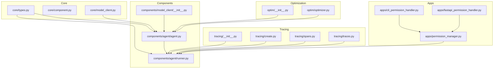
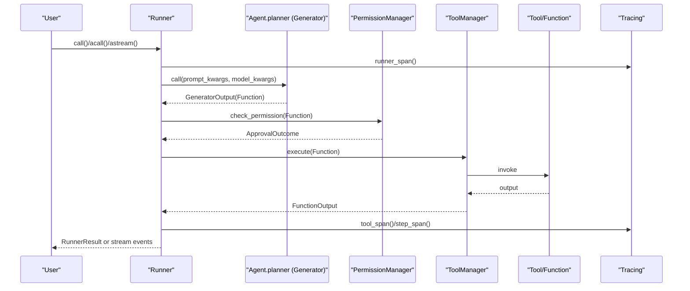
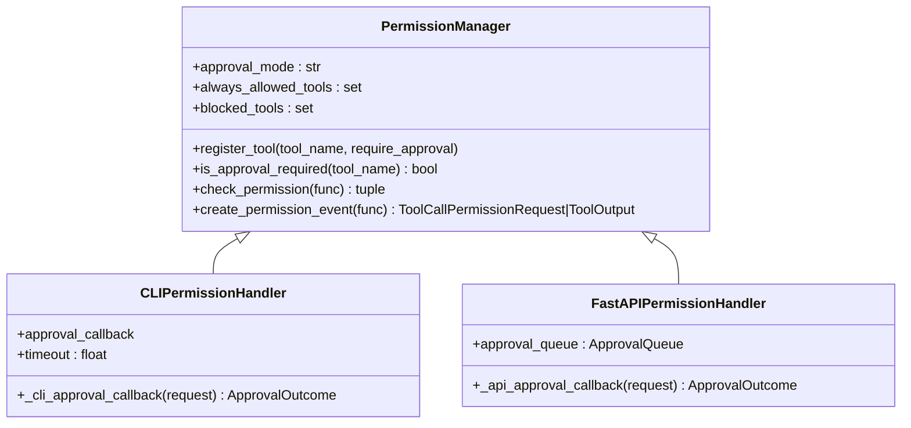
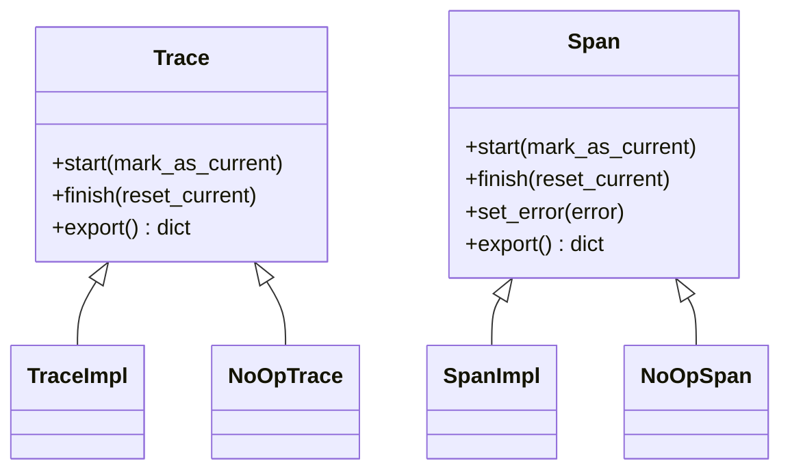
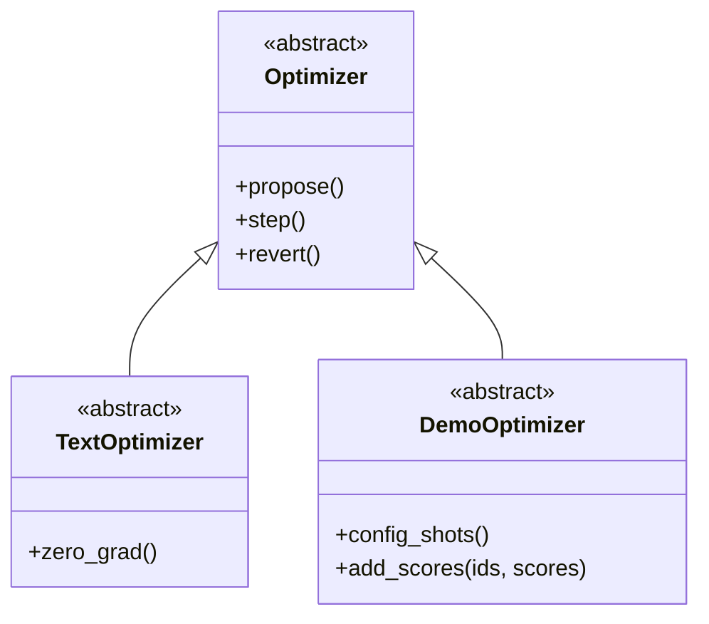
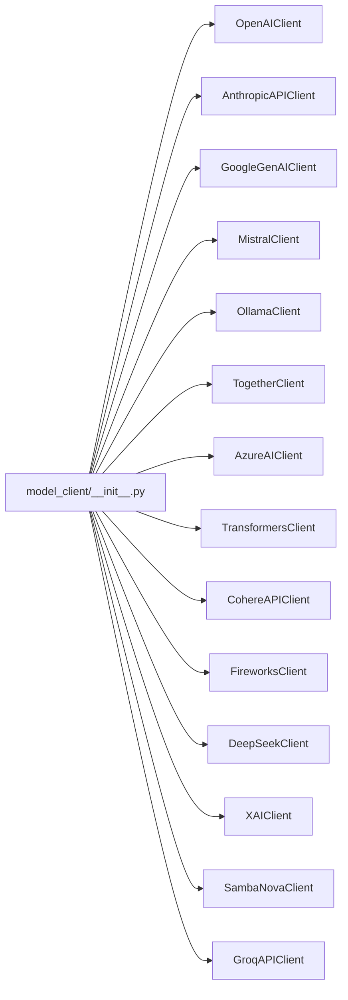
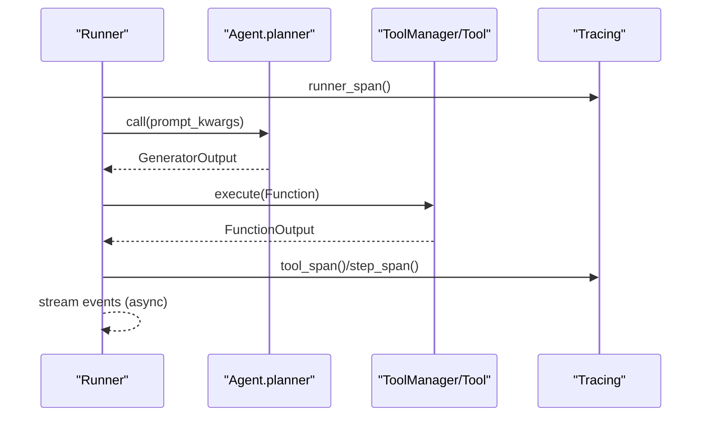
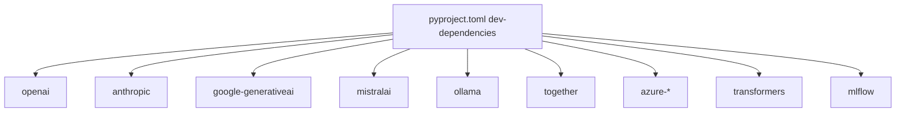

# Feature Highlights

<cite>
**Referenced Files in This Document**
- [README.md](file://README.md)
- [pyproject.toml](file://pyproject.toml)
- [__init__.py](file://adalflow/adalflow/apps/__init__.py)
- [cli_permission_handler.py](file://adalflow/adalflow/apps/cli_permission_handler.py)
- [fastapi_permission_handler.py](file://adalflow/adalflow/apps/fastapi_permission_handler.py)
- [permission_manager.py](file://adalflow/adalflow/apps/permission_manager.py)
- [__init__.py](file://adalflow/adalflow/tracing/__init__.py)
- [create.py](file://adalflow/adalflow/tracing/create.py)
- [spans.py](file://adalflow/adalflow/tracing/spans.py)
- [traces.py](file://adalflow/adalflow/tracing/traces.py)
- [__init__.py](file://adalflow/adalflow/optim/__init__.py)
- [optimizer.py](file://adalflow/adalflow/optim/optimizer.py)
- [__init__.py](file://adalflow/adalflow/components/model_client/__init__.py)
- [agent.py](file://adalflow/adalflow/components/agent/agent.py)
- [runner.py](file://adalflow/adalflow/components/agent/runner.py)
- [types.py](file://adalflow/adalflow/core/types.py)
- [README.md](file://benchmarks/README.md)
</cite>

## Table of Contents
1. [Introduction](#introduction)
2. [Project Structure](#project-structure)
3. [Core Components](#core-components)
4. [Architecture Overview](#architecture-overview)
5. [Detailed Component Analysis](#detailed-component-analysis)
6. [Dependency Analysis](#dependency-analysis)
7. [Performance Considerations](#performance-considerations)
8. [Troubleshooting Guide](#troubleshooting-guide)
9. [Conclusion](#conclusion)
10. [Appendices](#appendices)

## Introduction
AdalFlow is a PyTorch-inspired library designed to build and auto-optimize any Large Language Model (LLM) workflows—covering chatbots, Retrieval-Augmented Generation (RAG), and autonomous agents. Its feature highlights include:
- 100% open-source Agents SDK with lightweight Human-in-the-Loop and Tracing.
- Unified auto-differentiative framework for zero-shot and few-shot prompt optimization, leveraging LLM-AutoDiff and Learn-to-Reason In-Context Learning research.
- Model-agnostic building blocks for RAG, Agents, and classical NLP tasks.
- Three execution modes: sync, async, and streaming.
- Comprehensive tracing and monitoring with OpenAI Agents SDK-compatible interfaces.
- Multi-provider LLM integration via lazy-loading clients.
- Automated optimization capabilities powered by textual gradient descent and bootstrap few-shot optimization.

These capabilities are backed by research publications and documented in the project’s tutorials and design docs.

**Section sources**
- [README.md](file://README.md#L84-L108)

## Project Structure
At a high level, AdalFlow organizes functionality into cohesive modules:
- Core abstractions and types for components, data, and model clients.
- Agent orchestration with tool integration and execution runners.
- Optimization subsystems for textual gradients and few-shot demos.
- Tracing and observability aligned with OpenAI Agents SDK patterns.
- Apps for Human-in-the-Loop permission management via CLI and REST APIs.
- Benchmarks and documentation supporting reproducible performance evaluations.

**Diagram sources**
- [types.py](file://adalflow/adalflow/core/types.py#L55-L135)
- [agent.py](file://adalflow/adalflow/components/agent/agent.py#L216-L387)
- [runner.py](file://adalflow/adalflow/components/agent/runner.py#L107-L800)
- [__init__.py](file://adalflow/adalflow/components/model_client/__init__.py#L1-L135)
- [__init__.py](file://adalflow/adalflow/optim/__init__.py#L1-L39)
- [optimizer.py](file://adalflow/adalflow/optim/optimizer.py#L12-L92)
- [__init__.py](file://adalflow/adalflow/tracing/__init__.py#L1-L147)
- [create.py](file://adalflow/adalflow/tracing/create.py#L33-L388)
- [spans.py](file://adalflow/adalflow/tracing/spans.py#L35-L289)
- [traces.py](file://adalflow/adalflow/tracing/traces.py#L24-L215)
- [permission_manager.py](file://adalflow/adalflow/apps/permission_manager.py#L33-L248)
- [cli_permission_handler.py](file://adalflow/adalflow/apps/cli_permission_handler.py#L13-L209)
- [fastapi_permission_handler.py](file://adalflow/adalflow/apps/fastapi_permission_handler.py#L139-L330)

**Section sources**
- [README.md](file://README.md#L110-L244)

## Core Components
- Agent and Runner: Orchestrate multi-step planning and tool execution with optional Human-in-the-Loop and streaming.
- Optimization: Textual gradient descent and bootstrap few-shot optimization for prompts and demonstrations.
- Tracing: OpenAI Agents SDK-compatible spans and traces for observability and monitoring.
- Permission Management: CLI and REST-based approvals for safe tool execution.
- Model Clients: Lazy-imported multi-provider clients for seamless integration.

**Section sources**
- [agent.py](file://adalflow/adalflow/components/agent/agent.py#L216-L387)
- [runner.py](file://adalflow/adalflow/components/agent/runner.py#L107-L800)
- [__init__.py](file://adalflow/adalflow/optim/__init__.py#L1-L39)
- [optimizer.py](file://adalflow/adalflow/optim/optimizer.py#L12-L92)
- [__init__.py](file://adalflow/adalflow/tracing/__init__.py#L1-L147)
- [create.py](file://adalflow/adalflow/tracing/create.py#L33-L388)
- [spans.py](file://adalflow/adalflow/tracing/spans.py#L35-L289)
- [traces.py](file://adalflow/adalflow/tracing/traces.py#L24-L215)
- [permission_manager.py](file://adalflow/adalflow/apps/permission_manager.py#L33-L248)
- [cli_permission_handler.py](file://adalflow/adalflow/apps/cli_permission_handler.py#L13-L209)
- [fastapi_permission_handler.py](file://adalflow/adalflow/apps/fastapi_permission_handler.py#L139-L330)
- [__init__.py](file://adalflow/adalflow/components/model_client/__init__.py#L1-L135)

## Architecture Overview
The architecture centers around the Agent-Runner pattern with optional Human-in-the-Loop and comprehensive tracing. The Runner coordinates planning, tool execution, and streaming, while the Tracing subsystem records spans and traces for observability. Optimization components feed parameters into Generators to improve prompt quality and few-shot examples.

**Diagram sources**
- [runner.py](file://adalflow/adalflow/components/agent/runner.py#L529-L800)
- [agent.py](file://adalflow/adalflow/components/agent/agent.py#L216-L387)
- [permission_manager.py](file://adalflow/adalflow/apps/permission_manager.py#L123-L201)
- [create.py](file://adalflow/adalflow/tracing/create.py#L134-L388)

**Section sources**
- [runner.py](file://adalflow/adalflow/components/agent/runner.py#L107-L800)
- [agent.py](file://adalflow/adalflow/components/agent/agent.py#L216-L387)
- [create.py](file://adalflow/adalflow/tracing/create.py#L33-L388)

## Detailed Component Analysis

### Human-in-the-Loop and Permission Management
AdalFlow provides a PermissionManager with CLI and REST handlers to support safe tool execution:
- Centralized approval logic with modes: default, auto-approve, and “yolo.”
- CLI handler for interactive approvals and timeouts.
- REST API handler exposing endpoints to list, approve, or cancel pending requests.
- Permission events for streaming workflows.

**Diagram sources**
- [permission_manager.py](file://adalflow/adalflow/apps/permission_manager.py#L33-L248)
- [cli_permission_handler.py](file://adalflow/adalflow/apps/cli_permission_handler.py#L13-L209)
- [fastapi_permission_handler.py](file://adalflow/adalflow/apps/fastapi_permission_handler.py#L139-L330)

**Section sources**
- [permission_manager.py](file://adalflow/adalflow/apps/permission_manager.py#L33-L248)
- [cli_permission_handler.py](file://adalflow/adalflow/apps/cli_permission_handler.py#L13-L209)
- [fastapi_permission_handler.py](file://adalflow/adalflow/apps/fastapi_permission_handler.py#L139-L330)

### Tracing and Observability
AdalFlow offers an OpenAI Agents SDK-compatible tracing interface:
- Spans and traces with start/finish lifecycle and context management.
- Span data classes for runner, generator, tool, response, and step contexts.
- Convenience functions to create spans and traces with metadata.
- MLflow integration helpers for local and server-backed tracing.

**Diagram sources**
- [traces.py](file://adalflow/adalflow/tracing/traces.py#L24-L215)
- [spans.py](file://adalflow/adalflow/tracing/spans.py#L35-L289)
- [create.py](file://adalflow/adalflow/tracing/create.py#L33-L388)

**Section sources**
- [__init__.py](file://adalflow/adalflow/tracing/__init__.py#L1-L147)
- [create.py](file://adalflow/adalflow/tracing/create.py#L33-L388)
- [spans.py](file://adalflow/adalflow/tracing/spans.py#L35-L289)
- [traces.py](file://adalflow/adalflow/tracing/traces.py#L24-L215)

### Optimization Framework: Auto-Differentiative Prompt Tuning
AdalFlow’s optimization stack supports textual gradient descent and bootstrap few-shot learning:
- Base optimizer classes for textual and demonstration optimization.
- Parameter-based tuning of prompts and demonstrations.
- Trainer and AdalComponent for training loops and evaluation.

**Diagram sources**
- [optimizer.py](file://adalflow/adalflow/optim/optimizer.py#L12-L92)
- [__init__.py](file://adalflow/adalflow/optim/__init__.py#L1-L39)

**Section sources**
- [optimizer.py](file://adalflow/adalflow/optim/optimizer.py#L12-L92)
- [__init__.py](file://adalflow/adalflow/optim/__init__.py#L1-L39)

### Multi-Provider LLM Integration
AdalFlow provides a model-client registry with lazy imports to support multiple providers without hard dependencies:
- LazyImport wrappers for providers like OpenAI, Anthropic, Google, Mistral, Ollama, Together, Azure, and Transformers.
- Utility functions for response formatting and parsing.
- Standardized model types and argument requirements.

**Diagram sources**
- [__init__.py](file://adalflow/adalflow/components/model_client/__init__.py#L1-L135)
- [types.py](file://adalflow/adalflow/core/types.py#L55-L135)

**Section sources**
- [__init__.py](file://adalflow/adalflow/components/model_client/__init__.py#L1-L135)
- [types.py](file://adalflow/adalflow/core/types.py#L55-L135)

### Execution Modes: Sync, Async, and Streaming
The Runner supports three execution modes:
- Synchronous call returning a complete result with step history.
- Asynchronous call mirroring sync behavior.
- Streaming mode emitting real-time events for tool calls, activities, outputs, and final answers.

**Diagram sources**
- [runner.py](file://adalflow/adalflow/components/agent/runner.py#L529-L800)
- [create.py](file://adalflow/adalflow/tracing/create.py#L134-L388)

**Section sources**
- [runner.py](file://adalflow/adalflow/components/agent/runner.py#L529-L800)
- [types.py](file://adalflow/adalflow/core/types.py#L468-L774)

### Practical Feature Value Demonstrations
- Human-in-the-Loop: Use CLI or REST handlers to approve tool executions before they run, ensuring safety and transparency.
- Tracing: Wrap workflows with runner_span and tool_span to capture end-to-end execution metrics and errors.
- Optimization: Define Parameter objects and pass them to Generator to optimize prompts and demonstrations automatically.
- Multi-provider: Switch providers via lazy-imported clients with a consistent interface.

**Section sources**
- [cli_permission_handler.py](file://adalflow/adalflow/apps/cli_permission_handler.py#L73-L141)
- [fastapi_permission_handler.py](file://adalflow/adalflow/apps/fastapi_permission_handler.py#L283-L309)
- [create.py](file://adalflow/adalflow/tracing/create.py#L134-L388)
- [__init__.py](file://adalflow/adalflow/optim/__init__.py#L1-L39)
- [__init__.py](file://adalflow/adalflow/components/model_client/__init__.py#L1-L135)

## Dependency Analysis
AdalFlow’s dependencies emphasize modularity and optional integrations:
- Development dependencies include major providers (OpenAI, Anthropic, Google, Mistral, Ollama, Together, Azure, Transformers) and MLflow for tracing.
- Optional packages are lazily imported to avoid mandatory installs.

**Diagram sources**
- [pyproject.toml](file://pyproject.toml#L24-L67)

**Section sources**
- [pyproject.toml](file://pyproject.toml#L24-L67)

## Performance Considerations
- Token tracking: The Runner maintains cumulative and per-step token consumption for cost-aware execution.
- Streaming: Real-time event emission reduces latency and enables responsive UIs.
- Lazy loading: Multi-provider clients minimize startup overhead and memory footprint.
- Benchmarking: The project encourages contributors to add benchmarks alongside unit tests.

**Section sources**
- [runner.py](file://adalflow/adalflow/components/agent/runner.py#L239-L266)
- [README.md](file://benchmarks/README.md#L1-L4)

## Troubleshooting Guide
Common issues and resolutions:
- Unrecoverable errors: Certain HTTP errors and connection failures halt execution to prevent wasted resources.
- Permission denials: Approve or block tools via CLI or REST endpoints; timeouts cancel pending requests.
- Tracing disabled: Toggle tracing globally and manage processors programmatically.

**Section sources**
- [runner.py](file://adalflow/adalflow/components/agent/runner.py#L68-L96)
- [cli_permission_handler.py](file://adalflow/adalflow/apps/cli_permission_handler.py#L112-L140)
- [fastapi_permission_handler.py](file://adalflow/adalflow/apps/fastapi_permission_handler.py#L251-L261)
- [__init__.py](file://adalflow/adalflow/tracing/__init__.py#L79-L98)

## Conclusion
AdalFlow delivers a robust, open-source SDK for building and optimizing LLM workflows. Its unified auto-differentiative framework, Human-in-the-Loop support, comprehensive tracing, multi-provider integration, and three execution modes position it as a strong choice for production-grade agents and RAG systems. Benchmarks and research-backed optimization techniques further enhance its practical value.

[No sources needed since this section summarizes without analyzing specific files]

## Appendices

### Research Citations
- LAD-VF: LLM-Automatic Differentiation Enables Fine-Tuning-Free Robot Planning from Formal Methods Feedback
- Auto-Differentiating Any LLM Workflow: A Farewell to Manual Prompting
- Scaling Textual Gradients via Sampling-Based Momentum

**Section sources**
- [README.md](file://README.md#L247-L260)

### Comparative Notes
- The project emphasizes token efficiency and performance compared to related frameworks, with research publications backing its claims.
- Multi-provider support and lazy imports reduce friction across diverse deployment environments.

**Section sources**
- [README.md](file://README.md#L247-L260)
- [__init__.py](file://adalflow/adalflow/components/model_client/__init__.py#L1-L135)