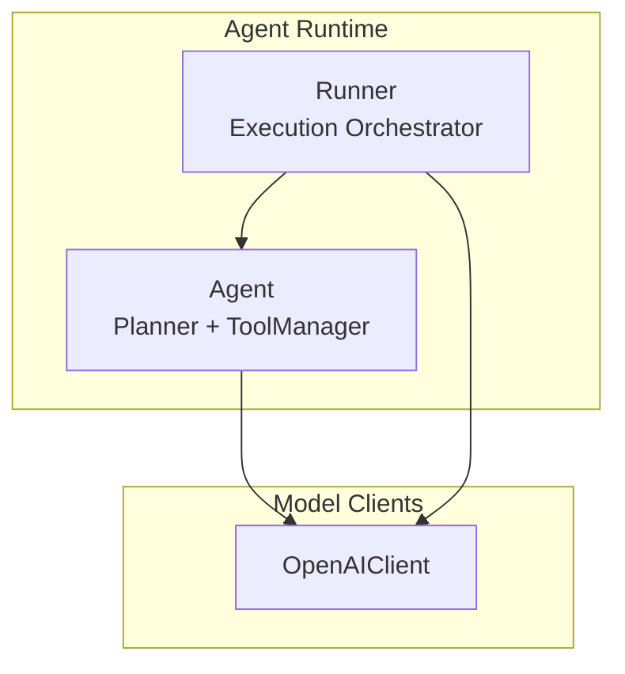
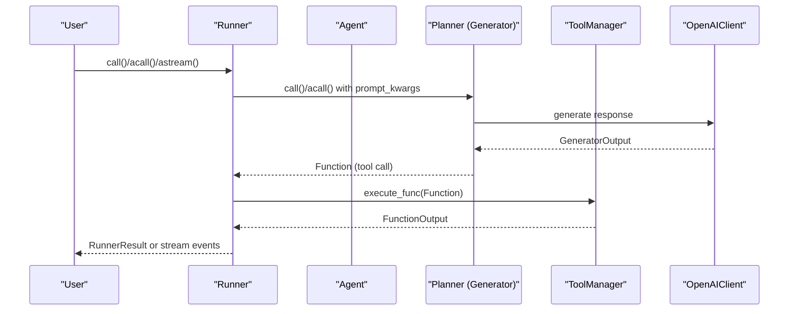
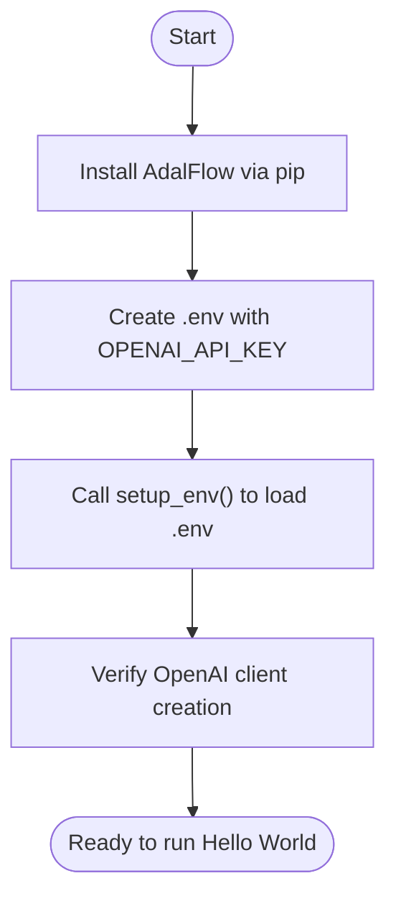
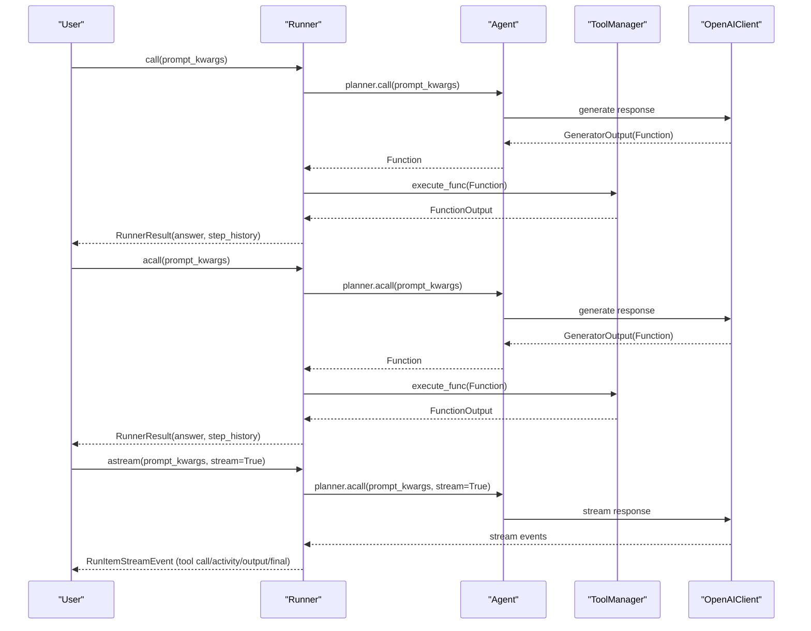
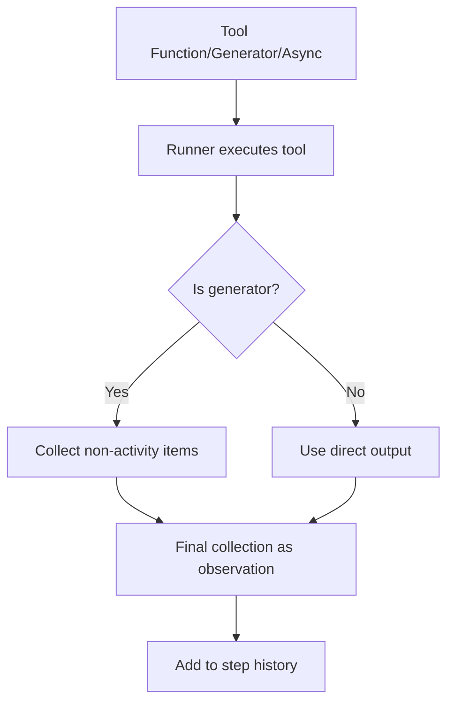
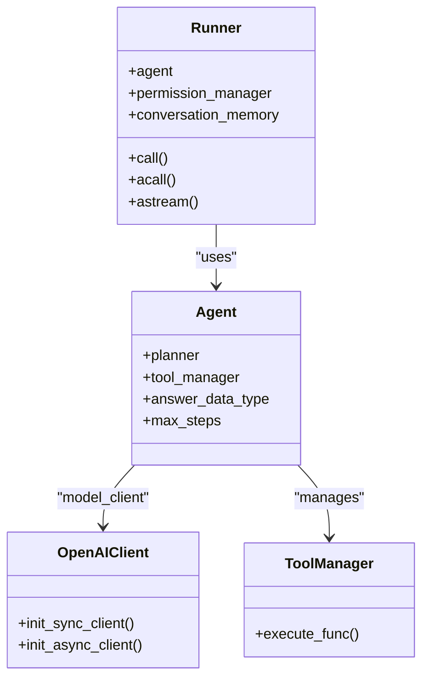
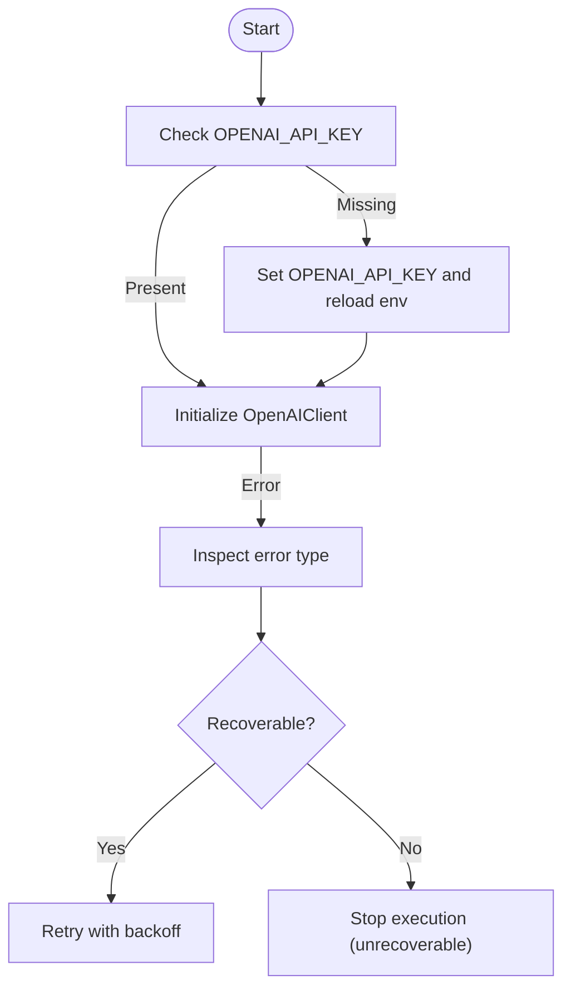

# Getting Started

<cite>
**Referenced Files in This Document**
- [README.md](file://README.md)
- [.env_example](file://.env_example)
- [setup_env.py](file://adalflow/adalflow/utils/setup_env.py)
- [tutorial_agent_basic.py](file://tutorials/agent/tutorial_agent_basic.py)
- [agent_demo.py](file://tutorials/agent/agent_demo.py)
- [agent.py](file://adalflow/adalflow/components/agent/agent.py)
- [runner.py](file://adalflow/adalflow/components/agent/runner.py)
- [openai_client.py](file://adalflow/adalflow/components/model_client/openai_client.py)
- [types.py](file://adalflow/adalflow/core/types.py)
</cite>

## Table of Contents
1. [Introduction](#introduction)
2. [Project Structure](#project-structure)
3. [Core Components](#core-components)
4. [Architecture Overview](#architecture-overview)
5. [Detailed Component Analysis](#detailed-component-analysis)
6. [Dependency Analysis](#dependency-analysis)
7. [Performance Considerations](#performance-considerations)
8. [Troubleshooting Guide](#troubleshooting-guide)
9. [Conclusion](#conclusion)

## Introduction
This guide helps you install AdalFlow, configure your environment, and run your first Hello World Agent. You will learn the three execution modes:
- Synchronous call for complete execution history
- Asynchronous call for concurrent processing
- Asynchronous streaming for real-time event processing

You will also integrate tools, use the Runner, interpret results, and troubleshoot common setup issues.

## Project Structure
AdalFlow organizes its agent and execution logic under the components/agent package. The core runtime is the Runner, which orchestrates an Agent’s planning and tool execution. The Agent composes a Generator-based planner and a ToolManager. Model clients (e.g., OpenAI) provide the LLM interface.

**Diagram sources**
- [agent.py](file://adalflow/adalflow/components/agent/agent.py#L216-L387)
- [runner.py](file://adalflow/adalflow/components/agent/runner.py#L107-L190)
- [openai_client.py](file://adalflow/adalflow/components/model_client/openai_client.py#L411-L777)

**Section sources**
- [agent.py](file://adalflow/adalflow/components/agent/agent.py#L216-L387)
- [runner.py](file://adalflow/adalflow/components/agent/runner.py#L107-L190)
- [openai_client.py](file://adalflow/adalflow/components/model_client/openai_client.py#L411-L777)

## Core Components
- Agent: Orchestrates planning and tool execution using a ReAct-style planner and a ToolManager.
- Runner: Executes the Agent synchronously, asynchronously, or streams events in real time.
- OpenAIClient: Provides the OpenAI model interface and handles environment configuration.

Key capabilities:
- Tool integration: Functions, async functions, generators, and async generators.
- Structured outputs: Pydantic models and AdalFlow dataclasses.
- Tracing and permissions: Optional tracing and tool approval workflows.

**Section sources**
- [agent.py](file://adalflow/adalflow/components/agent/agent.py#L216-L387)
- [runner.py](file://adalflow/adalflow/components/agent/runner.py#L107-L190)
- [openai_client.py](file://adalflow/adalflow/components/model_client/openai_client.py#L411-L777)

## Architecture Overview
The Runner coordinates planning and tool execution across three modes. The Agent delegates to a Generator (planner) and ToolManager. The model client abstracts provider-specific APIs.

**Diagram sources**
- [runner.py](file://adalflow/adalflow/components/agent/runner.py#L529-L825)
- [runner.py](file://adalflow/adalflow/components/agent/runner.py#L877-L1200)
- [agent.py](file://adalflow/adalflow/components/agent/agent.py#L216-L387)
- [openai_client.py](file://adalflow/adalflow/components/model_client/openai_client.py#L411-L777)

## Detailed Component Analysis

### Installation and Setup
- Install via pip as documented in the repository’s quick start.
- Configure environment variables. The Hello World example requires OPENAI_API_KEY.
- Use the environment setup helper to load variables from a .env file.

**Section sources**
- [README.md](file://README.md#L113-L117)
- [.env_example](file://.env_example#L1-L8)
- [setup_env.py](file://adalflow/adalflow/utils/setup_env.py#L8-L19)
- [tutorial_agent_basic.py](file://tutorials/agent/tutorial_agent_basic.py#L24-L46)

### Hello World Agent: Synchronous, Asynchronous, and Streaming Modes
The repository provides a complete Hello World example demonstrating all three execution modes. It defines tools (calculator, web search, counter), creates an Agent with an OpenAI model client, and runs:
- Synchronous call: returns a RunnerResult with the final answer and full step history
- Asynchronous call: similar output structure, suitable for concurrent workflows
- Asynchronous streaming: emits real-time events for tool calls, activities, outputs, and final answers

**Diagram sources**
- [README.md](file://README.md#L119-L231)
- [runner.py](file://adalflow/adalflow/components/agent/runner.py#L529-L825)
- [runner.py](file://adalflow/adalflow/components/agent/runner.py#L877-L1200)

**Section sources**
- [README.md](file://README.md#L119-L231)
- [agent_demo.py](file://tutorials/agent/agent_demo.py#L85-L164)

### Tool Integration Patterns
Tools can be:
- Plain functions
- Async functions
- Generators (yield ToolCallActivityRunItem plus a final collection)
- Async generators (yield ToolCallActivityRunItem plus a final collection)

Runner collects generator outputs and uses the last yielded collection as the tool’s observation. This enables streaming-like behavior even in synchronous and asynchronous calls.

**Diagram sources**
- [runner.py](file://adalflow/adalflow/components/agent/runner.py#L707-L736)
- [runner.py](file://adalflow/adalflow/components/agent/runner.py#L1076-L1100)

**Section sources**
- [agent_demo.py](file://tutorials/agent/agent_demo.py#L31-L83)
- [runner.py](file://adalflow/adalflow/components/agent/runner.py#L707-L736)
- [runner.py](file://adalflow/adalflow/components/agent/runner.py#L1076-L1100)

### Structured Outputs and Result Interpretation
RunnerResult contains:
- answer: The final processed answer (can be str, Pydantic model, or AdalFlow dataclass)
- step_history: List of StepOutput entries for each planning and tool-execution cycle
- error: Any error encountered during execution

Accessing step history lets you inspect each tool call, its arguments, and observations.

**Section sources**
- [runner.py](file://adalflow/adalflow/components/agent/runner.py#L331-L338)
- [runner.py](file://adalflow/adalflow/components/agent/runner.py#L529-L825)

## Dependency Analysis
The Agent depends on a ModelClient (e.g., OpenAIClient) and a ToolManager. The Runner depends on the Agent and optionally on a PermissionManager and ConversationMemory. The OpenAIClient enforces environment configuration and raises explicit errors if the API key is missing.

**Diagram sources**
- [agent.py](file://adalflow/adalflow/components/agent/agent.py#L216-L387)
- [runner.py](file://adalflow/adalflow/components/agent/runner.py#L107-L190)
- [openai_client.py](file://adalflow/adalflow/components/model_client/openai_client.py#L411-L777)

**Section sources**
- [agent.py](file://adalflow/adalflow/components/agent/agent.py#L216-L387)
- [runner.py](file://adalflow/adalflow/components/agent/runner.py#L107-L190)
- [openai_client.py](file://adalflow/adalflow/components/model_client/openai_client.py#L411-L777)

## Performance Considerations
- Token tracking: Runner tracks prompt tokens per step and cumulative totals to help monitor costs.
- Thinking model: When enabled, Runner preserves reasoning content from the model’s response.
- Streaming: Use streaming mode for real-time UX and incremental processing; it also emits events for observability.

**Section sources**
- [runner.py](file://adalflow/adalflow/components/agent/runner.py#L239-L266)
- [runner.py](file://adalflow/adalflow/components/agent/runner.py#L659-L663)

## Troubleshooting Guide
Common setup issues and resolutions:
- Missing OPENAI_API_KEY
  - Symptom: OpenAIClient raises an error during initialization.
  - Fix: Set OPENAI_API_KEY in your environment or .env file and call setup_env().
- Environment file not found
  - Symptom: setup_env raises FileNotFoundError.
  - Fix: Ensure .env exists and contains the required keys.
- Network or rate-limit errors
  - Symptom: Recoverable vs unrecoverable errors detected during execution.
  - Fix: Retry after backoff or adjust model parameters; unrecoverable errors halt execution.
- Permission denials
  - Symptom: Tool execution cancelled by user via permission manager.
  - Fix: Configure approvals or bypass as needed.

**Section sources**
- [openai_client.py](file://adalflow/adalflow/components/model_client/openai_client.py#L752-L776)
- [setup_env.py](file://adalflow/adalflow/utils/setup_env.py#L8-L19)
- [runner.py](file://adalflow/adalflow/components/agent/runner.py#L634-L646)

## Conclusion
You are ready to build agents with AdalFlow. Start with the Hello World example, integrate your own tools, and choose the execution mode that fits your needs. Use streaming for real-time feedback, synchronous for deterministic histories, and asynchronous for concurrency. Leverage structured outputs and tracing to scale and debug your workflows.