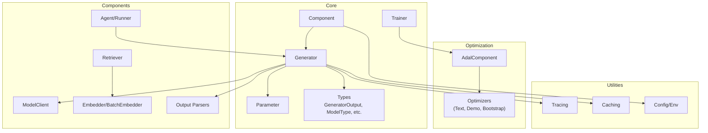
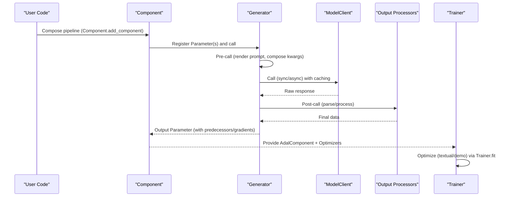
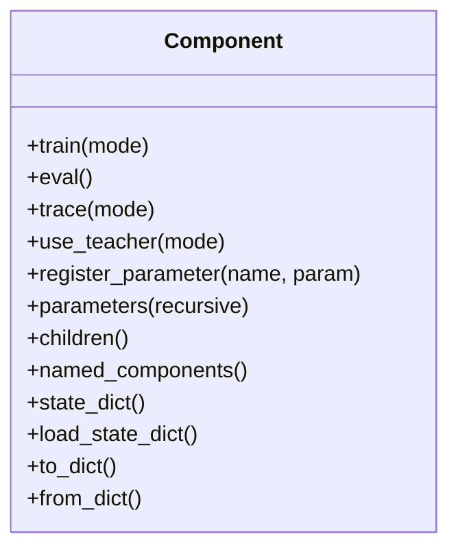
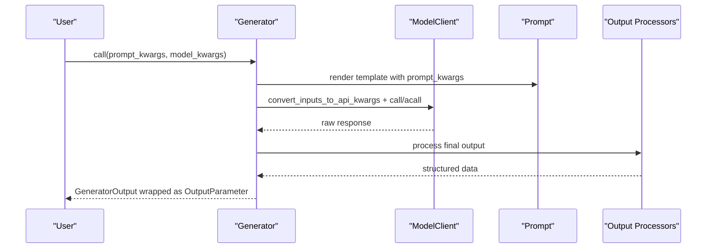
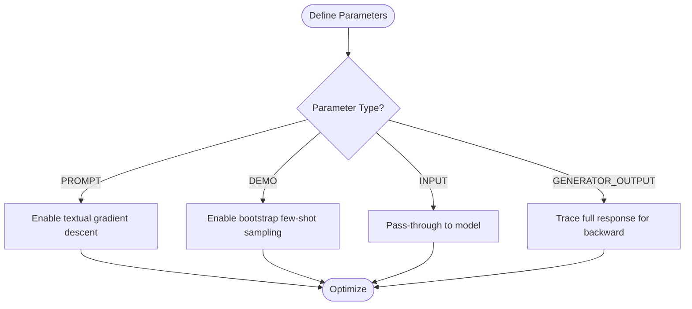
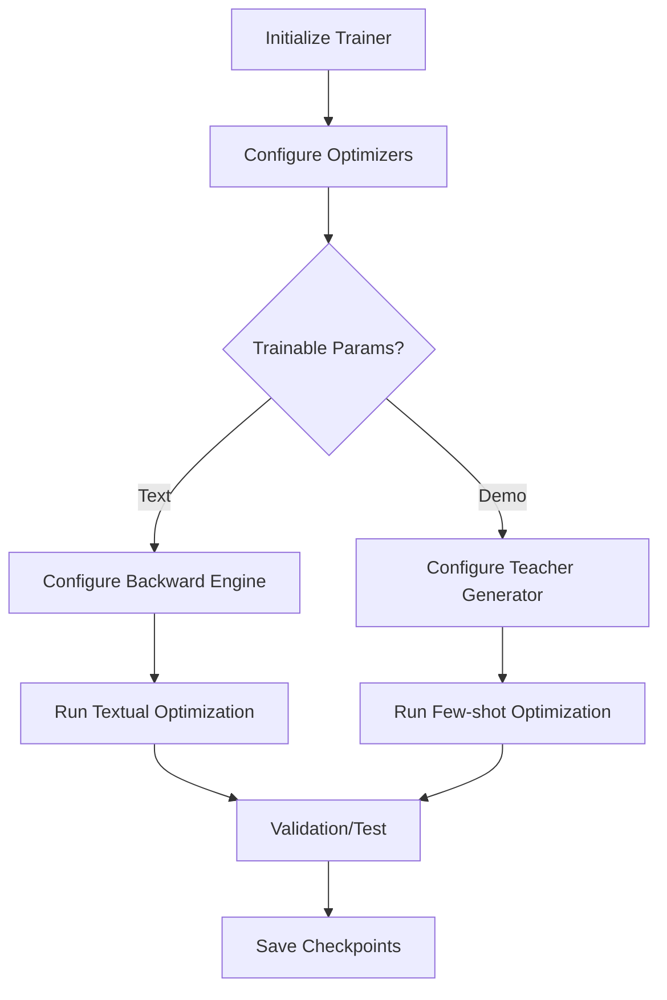
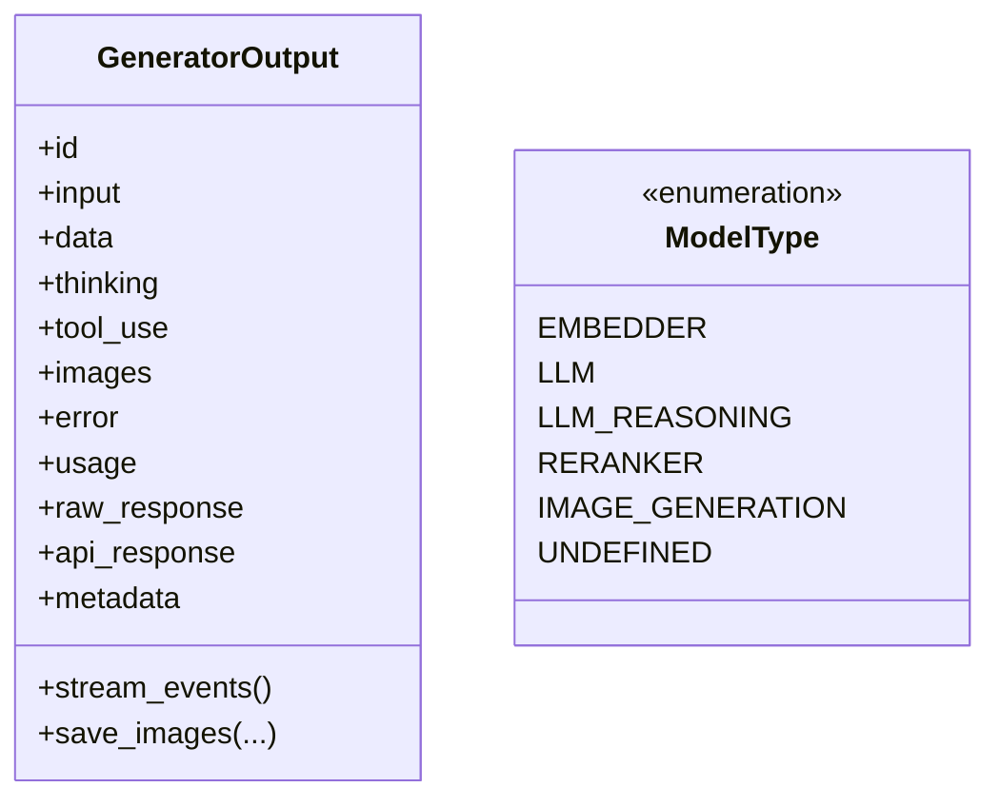
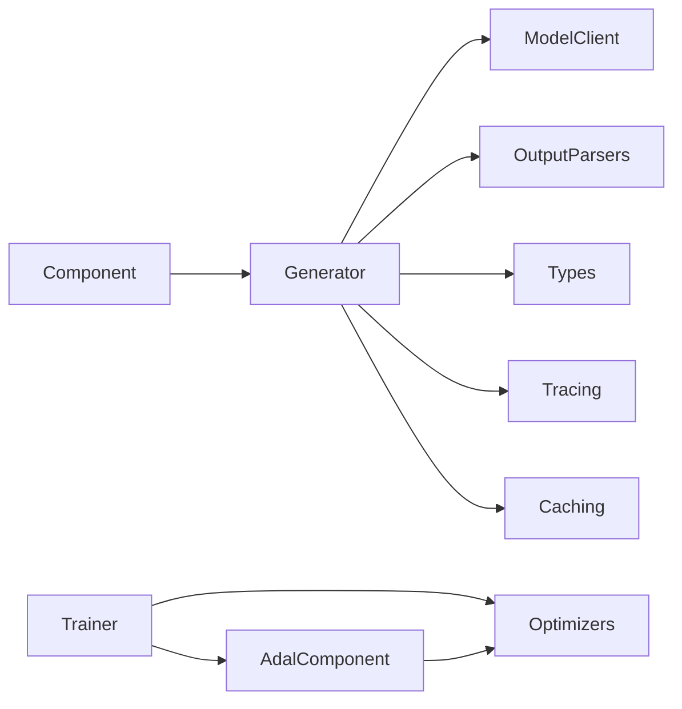

# Project Overview

<cite>
**Referenced Files in This Document**
- [README.md](file://README.md)
- [adalflow/adalflow/__init__.py](file://adalflow/adalflow/__init__.py)
- [adalflow/adalflow/core/component.py](file://adalflow/adalflow/core/component.py)
- [adalflow/adalflow/core/generator.py](file://adalflow/adalflow/core/generator.py)
- [adalflow/adalflow/core/types.py](file://adalflow/adalflow/core/types.py)
- [adalflow/adalflow/optim/trainer/trainer.py](file://adalflow/adalflow/optim/trainer/trainer.py)
</cite>

## Table of Contents
1. [Introduction](#introduction)
2. [Project Structure](#project-structure)
3. [Core Components](#core-components)
4. [Architecture Overview](#architecture-overview)
5. [Detailed Component Analysis](#detailed-component-analysis)
6. [Dependency Analysis](#dependency-analysis)
7. [Performance Considerations](#performance-considerations)
8. [Troubleshooting Guide](#troubleshooting-guide)
9. [Conclusion](#conclusion)

## Introduction
AdalFlow is a PyTorch-like library designed to build and auto-optimize any LLM workflow across Chatbots, Retrieval-Augmented Generation (RAG), and Agents. It introduces a unified auto-differentiable framework that enables both zero-shot and few-shot optimization, grounded in the LLM-AutoDiff research foundation. The library emphasizes model-agnostic building blocks and a consistent vocabulary of Component, Parameter, Generator, and Trainer concepts to orchestrate, trace, and train end-to-end LLM pipelines.

Key value propositions:
- Unified auto-differentiable framework for zero-shot and few-shot optimization.
- Model-agnostic components enabling seamless switching across providers and models.
- Practical orchestration via Generator and Component abstractions, plus a ready-to-use Trainer for optimization.
- Research-backed techniques such as textual gradient descent and bootstrap few-shot optimization.

These capabilities are demonstrated across the repository’s tutorials, notebooks, and benchmark suites, with a focus on reproducible, traceable, and trainable LLM workflows.

**Section sources**
- [README.md](file://README.md#L12-L16)
- [README.md](file://README.md#L84-L106)
- [README.md](file://README.md#L247-L260)

## Project Structure
At a high level, AdalFlow organizes functionality around:
- Core abstractions: Component, Generator, Parameter, and data types.
- Optimization: Optimizers, Trainer, and related utilities.
- Components: Model clients, retrievers, embedders, output parsers, and agents.
- Utilities: Tracing, caching, configuration, and evaluation helpers.

**Diagram sources**
- [adalflow/adalflow/__init__.py](file://adalflow/adalflow/__init__.py#L3-L58)
- [adalflow/adalflow/core/component.py](file://adalflow/adalflow/core/component.py#L51-L113)
- [adalflow/adalflow/core/generator.py](file://adalflow/adalflow/core/generator.py#L82-L106)
- [adalflow/adalflow/core/types.py](file://adalflow/adalflow/core/types.py#L55-L135)
- [adalflow/adalflow/optim/trainer/trainer.py](file://adalflow/adalflow/optim/trainer/trainer.py#L42-L77)

**Section sources**
- [adalflow/adalflow/__init__.py](file://adalflow/adalflow/__init__.py#L3-L153)

## Core Components
This section outlines the foundational building blocks that power AdalFlow’s workflows.

- Component: The base class for all pipeline elements. It supports nested composition, parameter registration, training/evaluation modes, tracing, and serialization. It follows a design pattern similar to PyTorch’s Module, but tailored for LLM in-context learning and arbitrary data types.
- Generator: Orchestrates Prompt + ModelClient + Output processors into a single, trainable unit. It supports sync and async calls, streaming, caching, and backward propagation for textual gradients.
- Parameter: Represents tunable data in the computation graph, including PROMPT, DEMO, INPUT, and GENERATOR_OUTPUT. Parameters carry predecessors and gradients for backpropagation.
- Types: Standardized data models for GeneratorOutput, EmbedderOutput, RetrieverOutput, ModelType, and more, ensuring interoperability across components.
- Trainer: A ready-to-use training loop that coordinates text and demo optimizers, manages validation/test splits, and persists checkpoints.

Practical example highlights:
- Building a Component that composes a Generator with a ModelClient and output processors.
- Defining Parameters for prompts and demonstrations and passing them to a Generator.
- Using Trainer to optimize prompts and demonstrations via textual gradient descent and bootstrap few-shot sampling.

**Section sources**
- [adalflow/adalflow/core/component.py](file://adalflow/adalflow/core/component.py#L51-L113)
- [adalflow/adalflow/core/generator.py](file://adalflow/adalflow/core/generator.py#L82-L106)
- [adalflow/adalflow/core/types.py](file://adalflow/adalflow/core/types.py#L486-L541)
- [adalflow/adalflow/optim/trainer/trainer.py](file://adalflow/adalflow/optim/trainer/trainer.py#L42-L77)

## Architecture Overview
AdalFlow’s architecture centers on a computation graph where Generators produce Parameters, which can be traced and optimized. The Trainer coordinates multiple optimizers (textual and demonstration-based) and integrates with tracing and caching utilities.

**Diagram sources**
- [adalflow/adalflow/core/component.py](file://adalflow/adalflow/core/component.py#L565-L624)
- [adalflow/adalflow/core/generator.py](file://adalflow/adalflow/core/generator.py#L463-L544)
- [adalflow/adalflow/optim/trainer/trainer.py](file://adalflow/adalflow/optim/trainer/trainer.py#L418-L496)

## Detailed Component Analysis

### Component: Base Abstraction for Pipelines
- Responsibilities: Nesting subcomponents, registering Parameters, managing training/eval/trace modes, serialization/deserialization, and state management.
- Design alignment: Mirrors PyTorch’s Module while extending to LLM in-context learning and arbitrary data types.
- Practical usage: Subclass Component to build domain-specific pipelines; register subcomponents and Parameters; toggle modes for training and tracing.

**Diagram sources**
- [adalflow/adalflow/core/component.py](file://adalflow/adalflow/core/component.py#L51-L113)

**Section sources**
- [adalflow/adalflow/core/component.py](file://adalflow/adalflow/core/component.py#L51-L113)

### Generator: Orchestration and Backpropagation
- Responsibilities: Prompt rendering, model client invocation, output processing, caching, and backward propagation for textual gradients.
- Features: Supports sync/async calls, streaming, token estimation, and integration with tracing and caching.
- Practical usage: Configure model client, template, and output processors; pass Parameters to enable optimization; use tracing to capture demos.

**Diagram sources**
- [adalflow/adalflow/core/generator.py](file://adalflow/adalflow/core/generator.py#L463-L544)
- [adalflow/adalflow/core/generator.py](file://adalflow/adalflow/core/generator.py#L550-L773)

**Section sources**
- [adalflow/adalflow/core/generator.py](file://adalflow/adalflow/core/generator.py#L82-L106)
- [adalflow/adalflow/core/generator.py](file://adalflow/adalflow/core/generator.py#L621-L773)

### Parameter: Tunable Data in the Graph
- Roles: PROMPT, DEMO, INPUT, GENERATOR_OUTPUT, and others.
- Behavior: Track predecessors, gradients, and full responses; support tracing of demonstrations and textual gradients.
- Practical usage: Wrap prompt variables and demonstrations as Parameters; pass them to Generator to enable optimization.

**Diagram sources**
- [adalflow/adalflow/core/generator.py](file://adalflow/adalflow/core/generator.py#L697-L773)

**Section sources**
- [adalflow/adalflow/core/generator.py](file://adalflow/adalflow/core/generator.py#L29-L34)
- [adalflow/adalflow/core/generator.py](file://adalflow/adalflow/core/generator.py#L697-L773)

### Trainer: Ready-to-Use Optimization Loop
- Responsibilities: Coordinate text and demo optimizers, manage datasets, run validation/test, and persist checkpoints.
- Modes: Random and constrained strategies; sequential or mixed optimization orders; debug and trace saving.
- Practical usage: Provide an AdalComponent, datasets, and configuration; call fit to optimize prompts and demonstrations.

**Diagram sources**
- [adalflow/adalflow/optim/trainer/trainer.py](file://adalflow/adalflow/optim/trainer/trainer.py#L501-L540)
- [adalflow/adalflow/optim/trainer/trainer.py](file://adalflow/adalflow/optim/trainer/trainer.py#L614-L682)

**Section sources**
- [adalflow/adalflow/optim/trainer/trainer.py](file://adalflow/adalflow/optim/trainer/trainer.py#L42-L77)
- [adalflow/adalflow/optim/trainer/trainer.py](file://adalflow/adalflow/optim/trainer/trainer.py#L418-L496)

### Types: Interoperable Data Contracts
- Purpose: Define standardized shapes for model outputs, usage metrics, function definitions, and streaming events.
- Impact: Ensures consistent parsing and processing across components, especially for GeneratorOutput and RetrieverOutput.

**Diagram sources**
- [adalflow/adalflow/core/types.py](file://adalflow/adalflow/core/types.py#L486-L541)
- [adalflow/adalflow/core/types.py](file://adalflow/adalflow/core/types.py#L55-L64)

**Section sources**
- [adalflow/adalflow/core/types.py](file://adalflow/adalflow/core/types.py#L486-L541)
- [adalflow/adalflow/core/types.py](file://adalflow/adalflow/core/types.py#L55-L64)

## Dependency Analysis
High-level dependencies:
- Component is the base for Generator and other building blocks.
- Generator depends on ModelClient, Prompt, and Output Processors; integrates with tracing and caching.
- Trainer depends on AdalComponent and Optimizers; coordinates datasets and evaluation.
- Types provide shared data contracts across components.

**Diagram sources**
- [adalflow/adalflow/core/component.py](file://adalflow/adalflow/core/component.py#L51-L113)
- [adalflow/adalflow/core/generator.py](file://adalflow/adalflow/core/generator.py#L82-L106)
- [adalflow/adalflow/optim/trainer/trainer.py](file://adalflow/adalflow/optim/trainer/trainer.py#L42-L77)

**Section sources**
- [adalflow/adalflow/__init__.py](file://adalflow/adalflow/__init__.py#L3-L58)

## Performance Considerations
- Caching: Generator supports caching of non-streaming model responses to reduce latency and cost.
- Streaming: Asynchronous streaming is supported for real-time processing; output processors are applied after final aggregation.
- Token estimation: Generator estimates prompt token usage to proactively manage model limits.
- Parallelism: Trainer supports configurable workers and batch sizes for efficient optimization loops.

[No sources needed since this section provides general guidance]

## Troubleshooting Guide
Common issues and resolutions:
- Parameter misuse in training vs. inference: Ensure Generator outputs a Parameter during training and plain data during inference.
- Missing teacher generator: When tracing demos in teacher mode, ensure a teacher Generator is configured.
- Serialization problems: Use Component’s to_dict/from_dict for robust persistence; verify registered components and Parameters.
- Streaming consumption: When consuming raw streaming events, ensure proper iteration and final data extraction.

**Section sources**
- [adalflow/adalflow/core/generator.py](file://adalflow/adalflow/core/generator.py#L660-L691)
- [adalflow/adalflow/core/generator.py](file://adalflow/adalflow/core/generator.py#L594-L598)
- [adalflow/adalflow/core/component.py](file://adalflow/adalflow/core/component.py#L230-L351)

## Conclusion
AdalFlow delivers a cohesive, research-backed approach to building and optimizing LLM workflows. Its Component-centric design, Parameter-driven optimization, and ready-to-use Trainer enable practitioners to rapidly prototype, trace, and improve Chatbots, RAG systems, and Agents. By combining textual gradient descent and bootstrap few-shot techniques with model-agnostic components, AdalFlow lowers the barrier to high-performance, trainable LLM applications.

[No sources needed since this section summarizes without analyzing specific files]