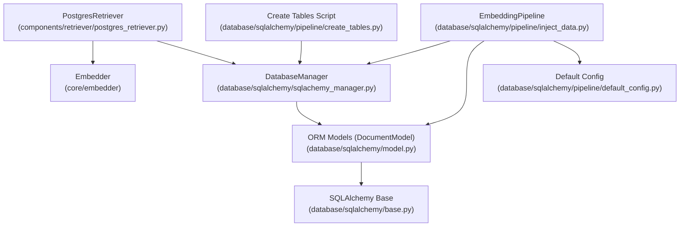
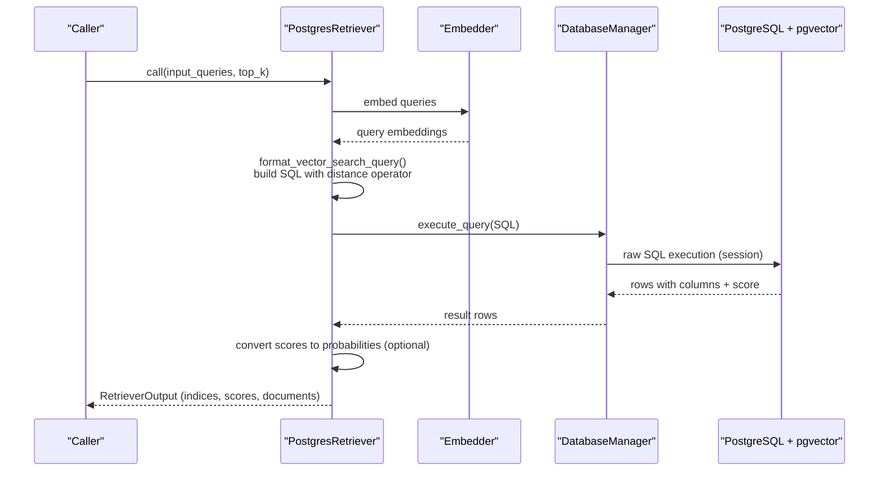
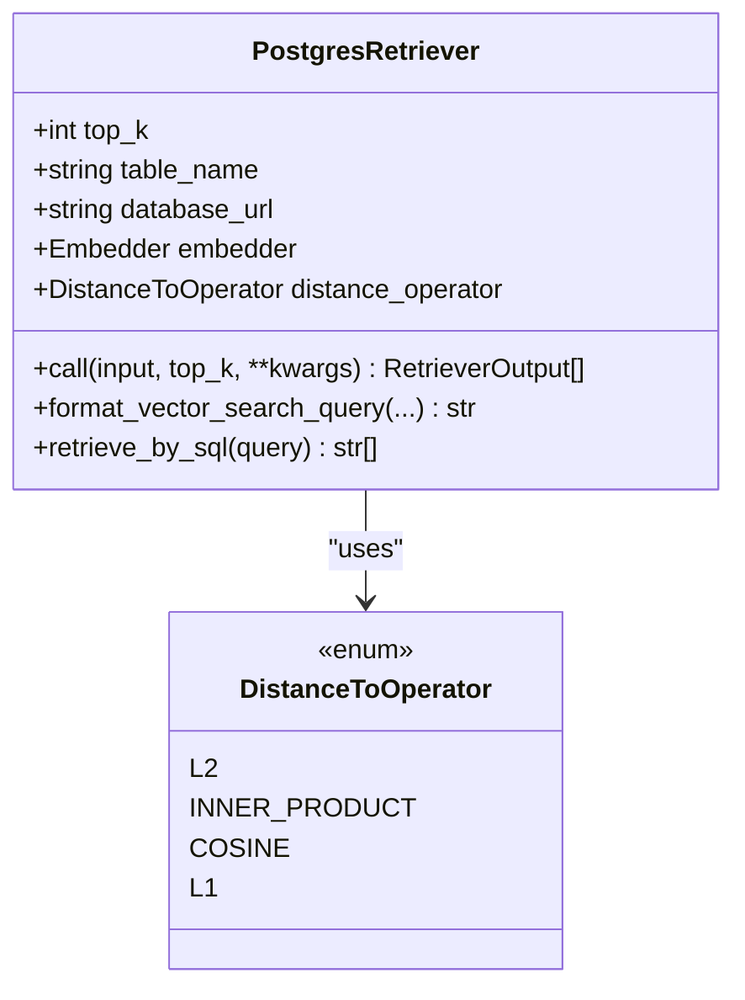
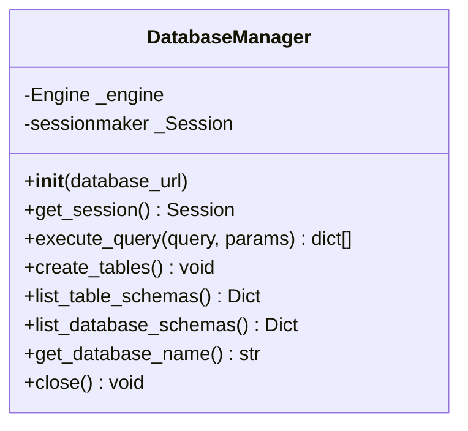
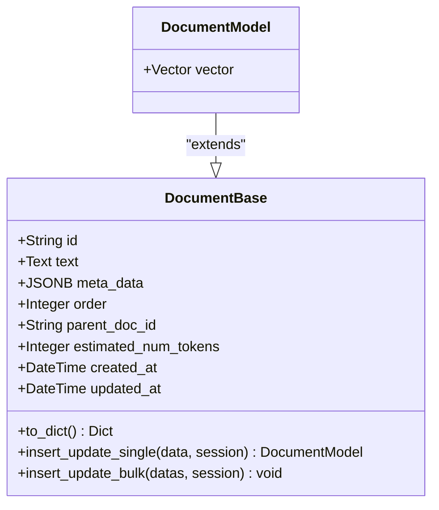
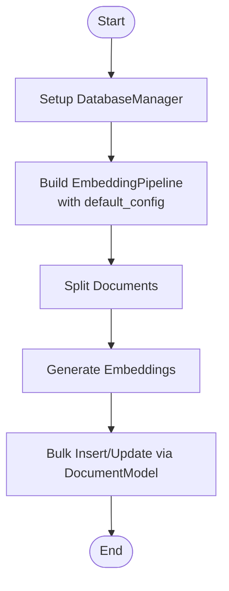
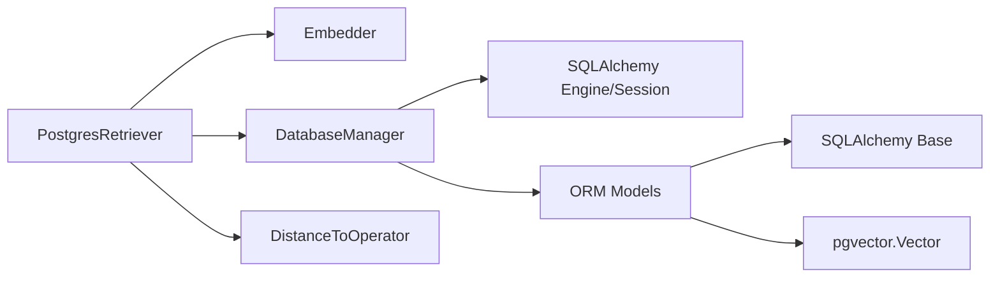

# Database Retrievers

<cite>
**Referenced Files in This Document**
- [postgres_retriever.py](file://adalflow/adalflow/components/retriever/postgres_retriever.py)
- [sqlachemy_manager.py](file://adalflow/adalflow/database/sqlalchemy/sqlachemy_manager.py)
- [model.py](file://adalflow/adalflow/database/sqlalchemy/model.py)
- [base.py](file://adalflow/adalflow/database/sqlalchemy/base.py)
- [retriever.py](file://adalflow/adalflow/core/retriever.py)
- [default_config.py](file://adalflow/adalflow/database/sqlalchemy/pipeline/default_config.py)
- [inject_data.py](file://adalflow/adalflow/database/sqlalchemy/pipeline/inject_data.py)
- [create_tables.py](file://adalflow/adalflow/database/sqlalchemy/pipeline/create_tables.py)
- [postgres.sql](file://tutorials/postgres.sql)
</cite>

## Table of Contents
1. [Introduction](#introduction)
2. [Project Structure](#project-structure)
3. [Core Components](#core-components)
4. [Architecture Overview](#architecture-overview)
5. [Detailed Component Analysis](#detailed-component-analysis)
6. [Dependency Analysis](#dependency-analysis)
7. [Performance Considerations](#performance-considerations)
8. [Troubleshooting Guide](#troubleshooting-guide)
9. [Conclusion](#conclusion)
10. [Appendices](#appendices)

## Introduction
This document explains AdalFlow’s SQL-based retrieval capabilities powered by PostgreSQL and the pgvector extension. It focuses on how the PostgresRetriever constructs and executes vector similarity queries, how embeddings are produced and stored, and how the underlying SQLAlchemy-based DatabaseManager manages connections and sessions. You will learn connection management, query construction patterns, result processing, and practical steps to set up PostgreSQL, create tables, inject data, and run retrievals. Guidance is provided for beginners and advanced users alike, covering indexing strategies, performance tuning, scaling, and troubleshooting.

## Project Structure
The PostgreSQL retrieval stack is composed of:
- A retriever component that embeds queries and runs vector similarity searches
- An SQLAlchemy-based DatabaseManager that handles connections, sessions, and raw SQL execution
- ORM models that define the schema and enable pgvector-enabled storage
- Pipeline utilities to create tables, inject data, and configure embeddings

**Diagram sources**
- [postgres_retriever.py](file://adalflow/adalflow/components/retriever/postgres_retriever.py#L39-L205)
- [sqlachemy_manager.py](file://adalflow/adalflow/database/sqlalchemy/sqlachemy_manager.py#L12-L94)
- [model.py](file://adalflow/adalflow/database/sqlalchemy/model.py#L64-L201)
- [base.py](file://adalflow/adalflow/database/sqlalchemy/base.py#L1-L4)
- [inject_data.py](file://adalflow/adalflow/database/sqlalchemy/pipeline/inject_data.py#L13-L90)
- [default_config.py](file://adalflow/adalflow/database/sqlalchemy/pipeline/default_config.py#L1-L31)
- [create_tables.py](file://adalflow/adalflow/database/sqlalchemy/pipeline/create_tables.py#L1-L15)

**Section sources**
- [postgres_retriever.py](file://adalflow/adalflow/components/retriever/postgres_retriever.py#L1-L244)
- [sqlachemy_manager.py](file://adalflow/adalflow/database/sqlalchemy/sqlachemy_manager.py#L1-L94)
- [model.py](file://adalflow/adalflow/database/sqlalchemy/model.py#L1-L325)
- [base.py](file://adalflow/adalflow/database/sqlalchemy/base.py#L1-L4)
- [default_config.py](file://adalflow/adalflow/database/sqlalchemy/pipeline/default_config.py#L1-L31)
- [inject_data.py](file://adalflow/adalflow/database/sqlalchemy/pipeline/inject_data.py#L1-L137)
- [create_tables.py](file://adalflow/adalflow/database/sqlalchemy/pipeline/create_tables.py#L1-L15)

## Core Components
- PostgresRetriever: Implements vector similarity retrieval using PostgreSQL and pgvector. It embeds queries, builds SQL queries with distance operators, executes them via DatabaseManager, and converts scores to probabilities when requested.
- DatabaseManager: Provides connection/session lifecycle, raw SQL execution, schema introspection, and table creation using SQLAlchemy.
- ORM Models: Define the document schema with pgvector support and include helpers for insert/update operations.
- EmbeddingPipeline and default_config: Configure document splitting and embedding generation for ingestion.

Key responsibilities:
- SQL query construction and ordering by similarity/distance
- Probability conversion for different distance operators
- Session-based execution and transaction safety
- Bulk ingestion and schema initialization

**Section sources**
- [postgres_retriever.py](file://adalflow/adalflow/components/retriever/postgres_retriever.py#L39-L205)
- [sqlachemy_manager.py](file://adalflow/adalflow/database/sqlalchemy/sqlachemy_manager.py#L12-L94)
- [model.py](file://adalflow/adalflow/database/sqlalchemy/model.py#L64-L201)
- [default_config.py](file://adalflow/adalflow/database/sqlalchemy/pipeline/default_config.py#L1-L31)
- [inject_data.py](file://adalflow/adalflow/database/sqlalchemy/pipeline/inject_data.py#L13-L90)

## Architecture Overview
The retrieval flow integrates embedding generation, SQL query construction, and result post-processing.

**Diagram sources**
- [postgres_retriever.py](file://adalflow/adalflow/components/retriever/postgres_retriever.py#L161-L205)
- [sqlachemy_manager.py](file://adalflow/adalflow/database/sqlalchemy/sqlachemy_manager.py#L74-L84)

## Detailed Component Analysis

### PostgresRetriever
- Purpose: Perform vector similarity retrieval using PostgreSQL/pgvector.
- Key behaviors:
  - Embeds queries via an injected Embedder
  - Builds SQL with a configurable distance operator
  - Executes via DatabaseManager and returns structured results
  - Converts scores to probabilities based on the chosen operator

Important methods and concepts:
- DistanceToOperator: Enum mapping to PostgreSQL operators for vector distance/similarity
- format_vector_search_query: Builds a SQL string selecting all columns, computing a score, ordering by score, and limiting results
- retrieve_by_sql: Delegates raw SQL execution to DatabaseManager
- Score conversion functions: cosine similarity, cosine distance, and L2 distance to probabilities

**Diagram sources**
- [postgres_retriever.py](file://adalflow/adalflow/components/retriever/postgres_retriever.py#L39-L205)

**Section sources**
- [postgres_retriever.py](file://adalflow/adalflow/components/retriever/postgres_retriever.py#L24-L205)

### DatabaseManager
- Purpose: Centralizes connection/session management and raw SQL execution.
- Capabilities:
  - Engine creation from a database URL
  - Session factory for scoped sessions
  - Raw SQL execution returning row lists keyed by column names
  - Schema introspection (tables, columns, indexes, foreign keys)
  - Table creation using SQLAlchemy Base metadata
  - Graceful closing of engine and sessions

**Diagram sources**
- [sqlachemy_manager.py](file://adalflow/adalflow/database/sqlalchemy/sqlachemy_manager.py#L12-L94)

**Section sources**
- [sqlachemy_manager.py](file://adalflow/adalflow/database/sqlalchemy/sqlachemy_manager.py#L12-L94)

### ORM Models and pgvector
- DocumentBase: Abstract base with common fields (id, text, meta_data, timestamps)
- DocumentModel: Extends DocumentBase with a pgvector-enabled vector column
- DocumentWithoutVector: Alternative model without vector column
- Helpers: Insert/update single/bulk operations with transaction safety and rollback on errors

**Diagram sources**
- [model.py](file://adalflow/adalflow/database/sqlalchemy/model.py#L64-L201)

**Section sources**
- [model.py](file://adalflow/adalflow/database/sqlalchemy/model.py#L64-L201)

### Embedding Pipeline and Ingestion
- EmbeddingPipeline composes a document splitter and an embedding component, then persists transformed documents to the database using DocumentModel.insert_update_bulk
- default_config defines the document splitter and embedding configuration used by the pipeline
- create_tables.py initializes tables for vector storage
- inject_data.py demonstrates building a pipeline, setting up the database manager, and executing a retrieval query

**Diagram sources**
- [inject_data.py](file://adalflow/adalflow/database/sqlalchemy/pipeline/inject_data.py#L13-L90)
- [default_config.py](file://adalflow/adalflow/database/sqlalchemy/pipeline/default_config.py#L1-L31)
- [create_tables.py](file://adalflow/adalflow/database/sqlalchemy/pipeline/create_tables.py#L1-L15)

**Section sources**
- [inject_data.py](file://adalflow/adalflow/database/sqlalchemy/pipeline/inject_data.py#L13-L90)
- [default_config.py](file://adalflow/adalflow/database/sqlalchemy/pipeline/default_config.py#L1-L31)
- [create_tables.py](file://adalflow/adalflow/database/sqlalchemy/pipeline/create_tables.py#L1-L15)

## Dependency Analysis
- PostgresRetriever depends on:
  - Embedder for query embeddings
  - DatabaseManager for SQL execution
  - DistanceToOperator for operator selection
- DatabaseManager depends on:
  - SQLAlchemy engine/sessionmaker
  - ORM models (imported for table creation)
- ORM models depend on:
  - SQLAlchemy Base and pgvector Vector type

**Diagram sources**
- [postgres_retriever.py](file://adalflow/adalflow/components/retriever/postgres_retriever.py#L39-L205)
- [sqlachemy_manager.py](file://adalflow/adalflow/database/sqlalchemy/sqlachemy_manager.py#L12-L94)
- [model.py](file://adalflow/adalflow/database/sqlalchemy/model.py#L64-L201)
- [base.py](file://adalflow/adalflow/database/sqlalchemy/base.py#L1-L4)

**Section sources**
- [postgres_retriever.py](file://adalflow/adalflow/components/retriever/postgres_retriever.py#L39-L205)
- [sqlachemy_manager.py](file://adalflow/adalflow/database/sqlalchemy/sqlachemy_manager.py#L12-L94)
- [model.py](file://adalflow/adalflow/database/sqlalchemy/model.py#L64-L201)
- [base.py](file://adalflow/adalflow/database/sqlalchemy/base.py#L1-L4)

## Performance Considerations
- Vector index and operator selection:
  - Use appropriate distance operators per your embedding normalization and similarity goals
  - Ensure vectors are normalized when using cosine-based operators for fair scoring
- Top-k and ordering:
  - Adjust top_k to balance recall and latency
  - Order direction depends on operator semantics (e.g., similarity vs distance)
- Connection and session management:
  - DatabaseManager creates a session per query execution; reuse sessions when batching to reduce overhead
- Bulk ingestion:
  - Use insert_update_bulk for efficient writes
- Query construction:
  - Keep SQL minimal; select only needed columns
  - Leverage LIMIT to cap result sets
- Database-specific tuning:
  - Ensure pgvector extension is installed and tables are created
  - Consider adding GIN or other indexes if mixing vector and text search in the future

[No sources needed since this section provides general guidance]

## Troubleshooting Guide
Common issues and resolutions:
- Extension not installed:
  - Ensure the pgvector extension exists in the target database before running retrievals
  - Verify table existence and schema via DatabaseManager introspection
- Connection failures:
  - Confirm database_url correctness and network accessibility
  - Use DatabaseManager.close() to dispose engines and clean up sessions
- Transaction errors:
  - DocumentModel insert/update operations include rollback on exceptions; re-run with corrected data
- Unexpected scores:
  - Verify embedding normalization and operator choice
  - Review score-to-probability conversions for correctness
- Schema mismatches:
  - Recreate tables using create_tables.py and confirm table schemas via list_table_schemas()

Concrete references:
- Creating tables and listing schemas
  - [create_tables.py](file://adalflow/adalflow/database/sqlalchemy/pipeline/create_tables.py#L7-L14)
  - [sqlachemy_manager.py](file://adalflow/adalflow/database/sqlalchemy/sqlachemy_manager.py#L38-L69)
- Executing raw queries and inspecting results
  - [sqlachemy_manager.py](file://adalflow/adalflow/database/sqlalchemy/sqlachemy_manager.py#L74-L84)
- Insert/update with transaction safety
  - [model.py](file://adalflow/adalflow/database/sqlalchemy/model.py#L97-L146)

**Section sources**
- [create_tables.py](file://adalflow/adalflow/database/sqlalchemy/pipeline/create_tables.py#L7-L14)
- [sqlachemy_manager.py](file://adalflow/adalflow/database/sqlalchemy/sqlachemy_manager.py#L38-L84)
- [model.py](file://adalflow/adalflow/database/sqlalchemy/model.py#L97-L146)

## Conclusion
AdalFlow’s PostgreSQL-based retriever combines a clean separation of concerns: embedding generation, SQL query construction, and robust session management. By leveraging pgvector and SQLAlchemy, it supports scalable vector similarity search with explicit control over operators, scoring, and ingestion. Following the setup steps, using the provided pipeline utilities, and adhering to the performance and troubleshooting guidance will help you deploy reliable SQL-based retrieval systems.

[No sources needed since this section summarizes without analyzing specific files]

## Appendices

### A. PostgreSQL Setup and Retrieval Walkthrough
- Create tables and verify schema
  - Run the table creation script to initialize the document table with pgvector support
  - Reference: [create_tables.py](file://adalflow/adalflow/database/sqlalchemy/pipeline/create_tables.py#L7-L14)
- Inject sample data
  - Use the embedding pipeline to split and embed documents, then persist via bulk insert/update
  - Reference: [inject_data.py](file://adalflow/adalflow/database/sqlalchemy/pipeline/inject_data.py#L13-L90)
- Execute a retrieval query
  - Build a query string using the chosen distance operator and execute via DatabaseManager
  - Reference: [inject_data.py](file://adalflow/adalflow/database/sqlalchemy/pipeline/inject_data.py#L128-L136)
- Inspect tables and data
  - List table schemas and examine sample rows
  - Reference: [postgres.sql](file://tutorials/postgres.sql#L1-L8)

**Section sources**
- [create_tables.py](file://adalflow/adalflow/database/sqlalchemy/pipeline/create_tables.py#L7-L14)
- [inject_data.py](file://adalflow/adalflow/database/sqlalchemy/pipeline/inject_data.py#L128-L136)
- [postgres.sql](file://tutorials/postgres.sql#L1-L8)

### B. SQL Query Construction Patterns
- Distance operators and ordering:
  - Choose operator based on embedding normalization and desired ranking semantics
  - Reference: [postgres_retriever.py](file://adalflow/adalflow/components/retriever/postgres_retriever.py#L82-L124)
- Probability conversion:
  - Convert scores to probabilities for downstream use when needed
  - Reference: [postgres_retriever.py](file://adalflow/adalflow/components/retriever/postgres_retriever.py#L133-L159)

**Section sources**
- [postgres_retriever.py](file://adalflow/adalflow/components/retriever/postgres_retriever.py#L82-L159)

### C. Connection Management and Sessions
- Session lifecycle:
  - DatabaseManager creates a session per execution; ensure proper commit/rollback and cleanup
  - Reference: [sqlachemy_manager.py](file://adalflow/adalflow/database/sqlalchemy/sqlachemy_manager.py#L74-L84)
- Closing connections:
  - Dispose engine and close all sessions when shutting down
  - Reference: [sqlachemy_manager.py](file://adalflow/adalflow/database/sqlalchemy/sqlachemy_manager.py#L91-L94)

**Section sources**
- [sqlachemy_manager.py](file://adalflow/adalflow/database/sqlalchemy/sqlachemy_manager.py#L74-L94)