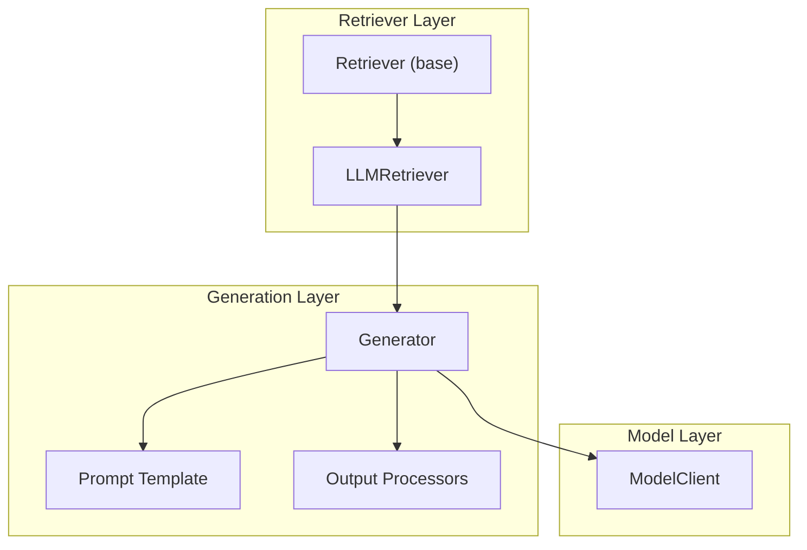
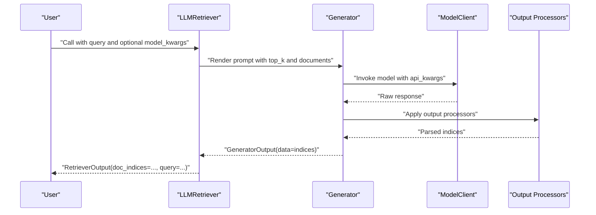
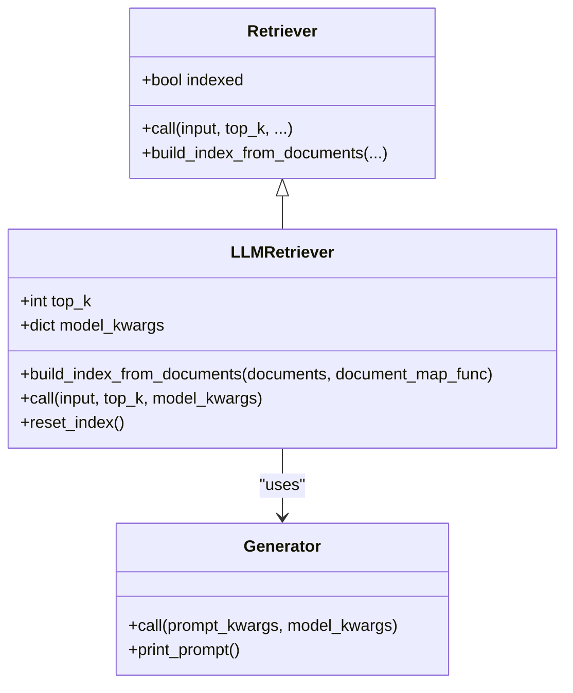
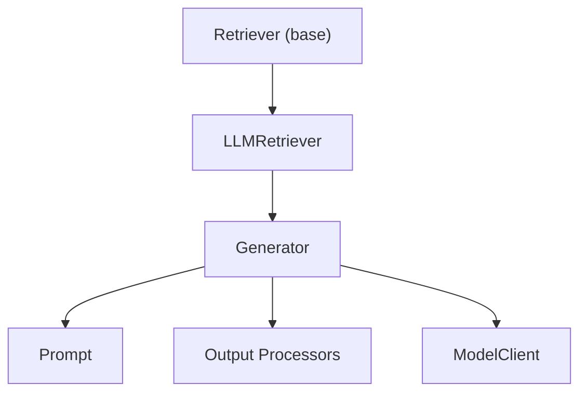

# LLM Retrievers

<cite>
**Referenced Files in This Document**
- [llm_retriever.py](file://adalflow/adalflow/components/retriever/llm_retriever.py)
- [retriever.py](file://adalflow/adalflow/core/retriever.py)
- [generator.py](file://adalflow/adalflow/core/generator.py)
- [default_prompt_template.py](file://adalflow/adalflow/core/default_prompt_template.py)
- [retriever_recall.py](file://adalflow/adalflow/eval/retriever_recall.py)
- [llm_as_retriever.py](file://use_cases/unsorted/llm_as_retriever.py)
- [retriever_llm.py](file://use_cases/unsorted/retriever_llm.py)
- [retriever.ipynb](file://tutorials/retriever.ipynb)
</cite>

## Table of Contents
1. [Introduction](#introduction)
2. [Project Structure](#project-structure)
3. [Core Components](#core-components)
4. [Architecture Overview](#architecture-overview)
5. [Detailed Component Analysis](#detailed-component-analysis)
6. [Dependency Analysis](#dependency-analysis)
7. [Performance Considerations](#performance-considerations)
8. [Troubleshooting Guide](#troubleshooting-guide)
9. [Conclusion](#conclusion)
10. [Appendices](#appendices)

## Introduction
This document explains AdalFlow’s LLM Retrievers with a focus on intelligent query reformulation, document filtering, and iterative refinement strategies. It covers how the LLM-powered retriever transforms user queries, ranks candidate documents, and returns top-k results. We also provide guidance on prompt engineering, confidence scoring, multi-stage filtering workflows, model selection, and practical troubleshooting. The goal is to make advanced retrieval techniques accessible to beginners while offering sufficient technical depth for experienced practitioners.

## Project Structure
The LLM retriever is implemented as a specialized retriever that composes a Generator with a prompt template and output processors. It inherits from the base Retriever class and integrates with model clients to execute LLM calls. Evaluation utilities are available to measure recall and precision for retrieval quality.

**Diagram sources**
- [llm_retriever.py](file://adalflow/adalflow/components/retriever/llm_retriever.py#L39-L148)
- [retriever.py](file://adalflow/adalflow/core/retriever.py#L22-L143)
- [generator.py](file://adalflow/adalflow/core/generator.py#L82-L774)

**Section sources**
- [llm_retriever.py](file://adalflow/adalflow/components/retriever/llm_retriever.py#L1-L148)
- [retriever.py](file://adalflow/adalflow/core/retriever.py#L1-L143)
- [generator.py](file://adalflow/adalflow/core/generator.py#L1-L200)

## Core Components
- LLMRetriever: Orchestrates LLM-based retrieval by building a prompt with candidate documents and asking the model to return top-k indices. It supports dynamic model switching per call and integrates output parsing.
- Retriever (base): Defines the common interface for all retrievers, including indexing, retrieval, and persistence hooks.
- Generator: Provides a unified pipeline for prompting, model invocation, and output processing. It manages caching, token estimation, and streaming.
- Prompt Templates: Default and customizable templates enable precise instruction of the LLM for retrieval tasks.
- Evaluation: Built-in metrics compute recall and precision to assess retrieval effectiveness.

**Section sources**
- [llm_retriever.py](file://adalflow/adalflow/components/retriever/llm_retriever.py#L39-L148)
- [retriever.py](file://adalflow/adalflow/core/retriever.py#L22-L143)
- [generator.py](file://adalflow/adalflow/core/generator.py#L82-L210)
- [default_prompt_template.py](file://adalflow/adalflow/core/default_prompt_template.py#L1-L103)
- [retriever_recall.py](file://adalflow/adalflow/eval/retriever_recall.py#L9-L148)

## Architecture Overview
The LLM retriever pipeline follows a deterministic flow:
- Indexing: Documents are prepared and embedded into a prompt template with placeholders for top-k and document lists.
- Query Processing: For each query, a prompt is rendered with the current top-k and the document list.
- Generation: The Generator invokes the selected ModelClient with composed model kwargs.
- Parsing: Output processors transform the raw LLM response into structured indices.
- Output: Results are wrapped as RetrieverOutput for downstream use.

**Diagram sources**
- [llm_retriever.py](file://adalflow/adalflow/components/retriever/llm_retriever.py#L97-L143)
- [generator.py](file://adalflow/adalflow/core/generator.py#L496-L543)

## Detailed Component Analysis

### LLMRetriever: Intelligent Query Reformulation and Filtering
- Purpose: Use an LLM to select the most relevant document indices for a given query from a fixed document pool.
- Indexing: Documents are mapped to strings and injected into the prompt template; top-k is preset for the entire index.
- Query Execution: For each query, the retriever composes prompt kwargs and model kwargs, then calls the Generator. Output is parsed into indices.
- Dynamic Model Switching: Per-call model kwargs override defaults without reinitialization.
- Error Handling: Failures return empty indices with logs; callers should validate results.

**Diagram sources**
- [retriever.py](file://adalflow/adalflow/core/retriever.py#L22-L143)
- [llm_retriever.py](file://adalflow/adalflow/components/retriever/llm_retriever.py#L39-L148)

**Section sources**
- [llm_retriever.py](file://adalflow/adalflow/components/retriever/llm_retriever.py#L39-L148)
- [retriever.py](file://adalflow/adalflow/core/retriever.py#L22-L143)

### Prompt Engineering for Retrieval Tasks
- Default Template: The retriever ships with a retrieval-focused prompt that instructs the model to output a list of indices for the top-k most relevant documents.
- Customization: Users can supply a custom template and preset prompt kwargs to tailor the LLM’s reasoning and output format.
- Best Practices:
  - Clearly separate the document list and query in the prompt.
  - Specify top-k and include examples of desired index formatting.
  - Keep the prompt concise to reduce token usage and latency.

**Section sources**
- [llm_retriever.py](file://adalflow/adalflow/components/retriever/llm_retriever.py#L24-L36)
- [default_prompt_template.py](file://adalflow/adalflow/core/default_prompt_template.py#L30-L98)

### Confidence Scoring and Relevance Assessment
- Native Scores: The LLM retriever does not return per-document scores by default; it returns indices only.
- Workaround Strategies:
  - Extend the prompt to output both indices and scores, then parse into a structured format using output processors.
  - Post-process with a reranker to refine scores after initial retrieval.
  - Use a two-stage pipeline: LLMRetriever for coarse filtering, followed by a cross-encoder or dense scorer for fine-grained ranking.
- Evaluation: Use recall and precision metrics to quantify retrieval quality.

**Section sources**
- [llm_retriever.py](file://adalflow/adalflow/components/retriever/llm_retriever.py#L112-L114)
- [retriever_recall.py](file://adalflow/adalflow/eval/retriever_recall.py#L9-L148)

### Iterative Refinement Strategies
- Multi-Round Prompting: Ask the LLM to refine the query or expand keywords based on the current top-k results.
- Candidate Expansion: Increase top-k temporarily, then apply a reranker or a second LLM call to prune irrelevant candidates.
- Feedback Loops: Use previous retrieval outcomes to adjust prompt instructions or add constraints.

[No sources needed since this section provides general guidance]

### Concrete Examples from the Codebase
- Basic Setup and Indexing:
  - Demonstrates initializing an LLMRetriever with a model client, building an index from documents, printing the prompt, and issuing a query.
- Splitting and Indexing:
  - Shows splitting long documents, configuring a model, building an index from split documents, and retrieving indices for multiple queries.

**Section sources**
- [llm_as_retriever.py](file://use_cases/unsorted/llm_as_retriever.py#L7-L26)
- [retriever_llm.py](file://use_cases/unsorted/retriever_llm.py#L47-L82)

### When to Use LLM Retrievers vs Traditional Methods
- Use LLM Retrievers when:
  - Queries are ambiguous or require contextual interpretation beyond lexical matching.
  - You need a flexible, instruction-driven approach that can adapt to domain-specific nuances.
  - You want a single-module solution without external vector databases or rerankers.
- Prefer Traditional Methods when:
  - Latency and cost are primary constraints.
  - You have strong lexical signals and established BM25/TF-IDF pipelines.
  - You already operate a scalable vector store and benefit from efficient ANN search.

[No sources needed since this section provides general guidance]

### Cost Considerations and Performance Trade-offs
- Costs:
  - LLM retrievers incur per-query inference costs; batching queries reduces overhead.
  - Output parsing adds minimal overhead compared to model calls.
- Latency:
  - Indexing is O(n_documents); retrieval is O(1) per query plus model latency.
  - Streaming is supported by the Generator for long-form outputs.
- Throughput:
  - Tune top-k to balance quality and cost; higher top-k increases prompt length and token usage.
  - Use caching and consistent model kwargs to improve throughput.

**Section sources**
- [generator.py](file://adalflow/adalflow/core/generator.py#L213-L253)
- [llm_retriever.py](file://adalflow/adalflow/components/retriever/llm_retriever.py#L97-L143)

## Dependency Analysis
The LLMRetriever depends on the base Retriever interface and the Generator pipeline. The Generator composes a Prompt, a ModelClient, and Output Processors. Evaluation utilities consume retrieval outputs to compute recall and precision.

**Diagram sources**
- [llm_retriever.py](file://adalflow/adalflow/components/retriever/llm_retriever.py#L39-L148)
- [retriever.py](file://adalflow/adalflow/core/retriever.py#L22-L143)
- [generator.py](file://adalflow/adalflow/core/generator.py#L82-L210)

**Section sources**
- [llm_retriever.py](file://adalflow/adalflow/components/retriever/llm_retriever.py#L39-L148)
- [retriever.py](file://adalflow/adalflow/core/retriever.py#L22-L143)
- [generator.py](file://adalflow/adalflow/core/generator.py#L82-L210)

## Performance Considerations
- Prompt Length: Keep the document list concise; consider chunking or sampling long documents.
- Top-k Tuning: Start small for cost-sensitive scenarios; increase for accuracy.
- Model Selection: Prefer faster, cheaper models for indexing and filtering; reserve stronger models for final refinement.
- Caching: Enable caching in the Generator to avoid repeated identical calls.
- Token Estimation: Monitor estimated token counts to preempt truncation and ensure prompt fits within limits.

[No sources needed since this section provides general guidance]

## Troubleshooting Guide
Common issues and remedies:
- Empty or Missing Indices:
  - Verify indexing was performed and documents were properly mapped.
  - Check for model errors in the Generator output; inspect raw responses and errors.
- Prompt Too Long:
  - Reduce top-k or shorten document texts; the Generator warns and truncates when prompt exceeds max tokens.
- Output Parsing Failures:
  - Ensure output processors match the expected format; adjust prompt to enforce consistent output syntax.
- Inconsistent Results Across Calls:
  - Use consistent model kwargs; avoid frequent model switches unless intentional.

**Section sources**
- [llm_retriever.py](file://adalflow/adalflow/components/retriever/llm_retriever.py#L120-L142)
- [generator.py](file://adalflow/adalflow/core/generator.py#L474-L486)

## Conclusion
AdalFlow’s LLMRetriever offers a flexible, instruction-driven approach to retrieval that complements traditional methods. By combining a reusable prompt template, a robust Generator pipeline, and pluggable model clients, it enables intelligent query reformulation and document filtering. While it introduces inference costs, it provides strong adaptability and simplicity. For production deployments, pair it with evaluation metrics, careful prompt engineering, and iterative refinement strategies to achieve high-quality, cost-efficient retrieval.

## Appendices

### Prompt Engineering Tips
- Explicitly instruct the model to output only indices in a list format.
- Include examples of index formatting to guide the model.
- Separate the document list and query clearly; keep the query concise.

**Section sources**
- [llm_retriever.py](file://adalflow/adalflow/components/retriever/llm_retriever.py#L24-L36)
- [default_prompt_template.py](file://adalflow/adalflow/core/default_prompt_template.py#L30-L98)

### Example Workflows
- Single-shot retrieval with indices only.
- Two-stage retrieval with LLM filtering followed by a reranker.
- Iterative refinement by expanding queries based on top-k results.

**Section sources**
- [llm_as_retriever.py](file://use_cases/unsorted/llm_as_retriever.py#L7-L26)
- [retriever_llm.py](file://use_cases/unsorted/retriever_llm.py#L47-L82)
- [retriever.ipynb](file://tutorials/retriever.ipynb#L581-L702)