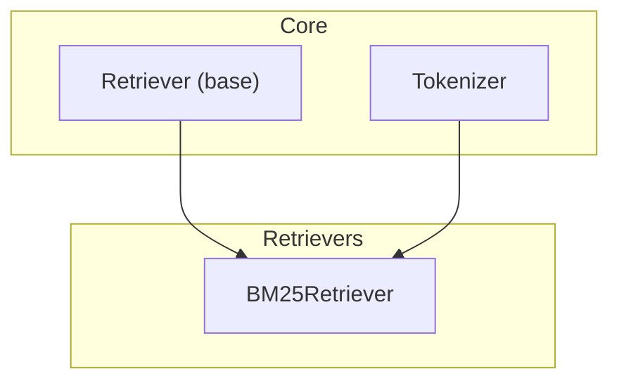
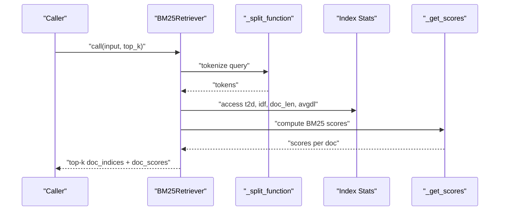
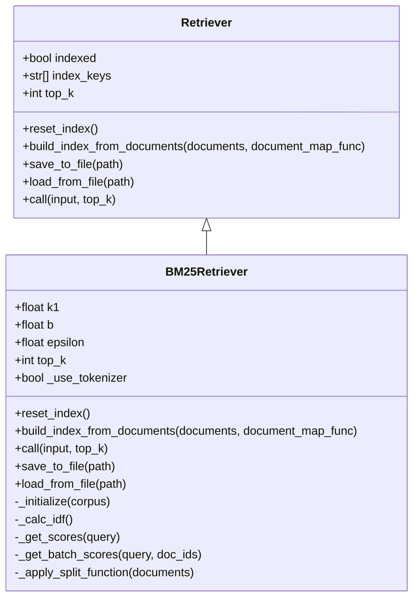
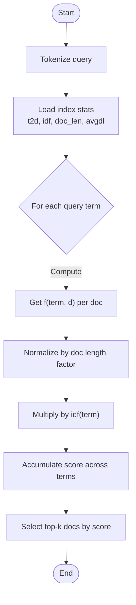
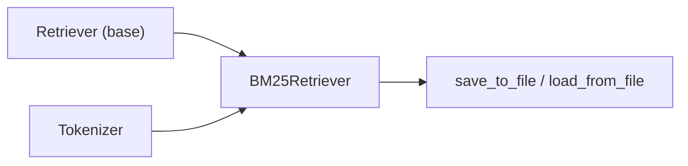

# Lexical Retrievers

<cite>
**Referenced Files in This Document**
- [bm25_retriever.py](file://adalflow/adalflow/components/retriever/bm25_retriever.py)
- [retriever.py](file://adalflow/adalflow/core/retriever.py)
- [tokenizer.py](file://adalflow/adalflow/core/tokenizer.py)
- [simple_rag_bm_25.py](file://use_cases/unsorted/simple_rag_bm_25.py)
- [retriever.ipynb](file://tutorials/retriever.ipynb)
</cite>

## Table of Contents
1. [Introduction](#introduction)
2. [Project Structure](#project-structure)
3. [Core Components](#core-components)
4. [Architecture Overview](#architecture-overview)
5. [Detailed Component Analysis](#detailed-component-analysis)
6. [Dependency Analysis](#dependency-analysis)
7. [Performance Considerations](#performance-considerations)
8. [Troubleshooting Guide](#troubleshooting-guide)
9. [Conclusion](#conclusion)
10. [Appendices](#appendices)

## Introduction
This document explains AdalFlow’s lexical term-based retrieval using BM25. It covers the BM25 ranking function, term frequency-inverse document frequency (TF-IDF) mechanics, tokenization and preprocessing choices, and practical usage patterns. You will learn how to configure tokenizers, handle stopword-like effects, and tune BM25 parameters for robust, fast lexical search. The guide includes concrete examples from the codebase and highlights trade-offs versus semantic retrieval.

## Project Structure
The lexical retrieval capability centers on:
- A BM25 retriever implementation that builds an in-memory index from text and ranks documents by BM25 scores.
- A shared base retriever interface that defines the contract for building indexes, persisting/restoring state, and retrieving results.
- A tokenizer wrapper that integrates with the retriever to optionally split text into tokens before lexical matching.

**Diagram sources**
- [bm25_retriever.py](file://adalflow/adalflow/components/retriever/bm25_retriever.py#L58-L381)
- [retriever.py](file://adalflow/adalflow/core/retriever.py#L22-L143)
- [tokenizer.py](file://adalflow/adalflow/core/tokenizer.py#L11-L57)

**Section sources**
- [bm25_retriever.py](file://adalflow/adalflow/components/retriever/bm25_retriever.py#L1-L381)
- [retriever.py](file://adalflow/adalflow/core/retriever.py#L1-L143)
- [tokenizer.py](file://adalflow/adalflow/core/tokenizer.py#L1-L57)

## Core Components
- BM25Retriever: Implements Okapi BM25 ranking over tokenized documents. It supports configurable k1, b, epsilon, top_k, and tokenizer usage. It exposes methods to build an index from documents, compute BM25 scores, and retrieve top-k matches.
- Retriever (base): Defines the common interface for retrievers, including index lifecycle, persistence, and retrieval semantics.
- Tokenizer: Wraps tiktoken to encode/decode tokens and optionally remove stop words when configured.

Key BM25 parameters:
- k1: Controls term frequency saturation; typical ranges suggested by documentation cited in the code.
- b: Controls the influence of document length normalization relative to average document length.
- epsilon: Adjusts negative IDF handling by scaling with average IDF.

Tokenization and preprocessing:
- Two split strategies are provided: a simple word-level split and a tokenizer-aware split that encodes and decodes tokens. The latter can improve matching for subword units.

**Section sources**
- [bm25_retriever.py](file://adalflow/adalflow/components/retriever/bm25_retriever.py#L58-L181)
- [retriever.py](file://adalflow/adalflow/core/retriever.py#L22-L143)
- [tokenizer.py](file://adalflow/adalflow/core/tokenizer.py#L11-L57)

## Architecture Overview
The BM25 retriever builds an index from a corpus of documents, computing per-term statistics and document lengths. Queries are tokenized and scored against the index using the BM25 formula. Results are returned as top-k document indices and scores.

**Diagram sources**
- [bm25_retriever.py](file://adalflow/adalflow/components/retriever/bm25_retriever.py#L314-L346)
- [bm25_retriever.py](file://adalflow/adalflow/components/retriever/bm25_retriever.py#L253-L268)

## Detailed Component Analysis

### BM25Retriever Class
- Purpose: Fast lexical ranking via BM25 over tokenized documents.
- Index fields:
  - t2d: Term-to-document term frequencies per document.
  - nd: Number of documents containing each term.
  - idf: Inverse document frequency per term.
  - doc_len: Document lengths.
  - avgdl: Average document length.
  - total_documents: Corpus size.
- Methods:
  - build_index_from_documents: Applies mapping function to documents, tokenizes, initializes term stats, computes IDF, marks indexed.
  - call: Tokenizes query, computes BM25 scores, selects top-k.
  - save_to_file/load_from_file: Persist and restore retriever state.
  - Internal helpers: _initialize, _calc_idf, _get_scores, _get_batch_scores, _apply_split_function.

**Diagram sources**
- [retriever.py](file://adalflow/adalflow/core/retriever.py#L22-L143)
- [bm25_retriever.py](file://adalflow/adalflow/components/retriever/bm25_retriever.py#L58-L381)

**Section sources**
- [bm25_retriever.py](file://adalflow/adalflow/components/retriever/bm25_retriever.py#L138-L381)
- [retriever.py](file://adalflow/adalflow/core/retriever.py#L22-L143)

### BM25 Ranking Workflow
- Term frequency (f(q_i, d)): Count of term occurrence in document d.
- Document length normalization: Scales by (1 - b + b * |d| / avgdl).
- IDF(q_i): log((N - n(q_i) + 0.5) / (n(q_i) + 0.5)).
- Negative IDF mitigation: Terms with negative IDF are replaced with epsilon * average IDF.
- Final score: Sum over query terms of idf(q_i) times the normalized term frequency fraction.

**Diagram sources**
- [bm25_retriever.py](file://adalflow/adalflow/components/retriever/bm25_retriever.py#L253-L268)
- [bm25_retriever.py](file://adalflow/adalflow/components/retriever/bm25_retriever.py#L233-L252)

**Section sources**
- [bm25_retriever.py](file://adalflow/adalflow/components/retriever/bm25_retriever.py#L24-L82)

### Tokenization and Preprocessing
- Word-level split: Lowercases and splits by spaces.
- Tokenizer-aware split: Uses Tokenizer to encode/decode tokens for subword-aware matching.
- Stopwords: The Tokenizer supports removing a small fixed set when enabled; otherwise stopwords are not removed by default.

Practical implications:
- Using the tokenizer can improve recall for morphologically varied texts.
- Disabling the tokenizer falls back to simple whitespace splitting.

**Section sources**
- [bm25_retriever.py](file://adalflow/adalflow/components/retriever/bm25_retriever.py#L30-L56)
- [tokenizer.py](file://adalflow/adalflow/core/tokenizer.py#L22-L30)

### Phrase Matching and Multi-term Queries
- The retriever treats queries as multi-term sequences and accumulates BM25 scores across terms.
- There is no explicit phrase or proximity operator in the implementation; matching is based on individual term occurrences weighted by BM25.

**Section sources**
- [bm25_retriever.py](file://adalflow/adalflow/components/retriever/bm25_retriever.py#L253-L268)

### Usage Examples from the Codebase
- Basic BM25 setup and retrieval with a document map function:
  - See notebook usage of BM25Retriever with document_map_func and short queries.
- End-to-end RAG with BM25:
  - A simple RAG pipeline demonstrates building an index from documents and retrieving top-k matches to construct a context string.

**Section sources**
- [retriever.ipynb](file://tutorials/retriever.ipynb#L214-L289)
- [simple_rag_bm_25.py](file://use_cases/unsorted/simple_rag_bm_25.py#L18-L86)

## Dependency Analysis
- BM25Retriever extends the base Retriever interface, inheriting index lifecycle and persistence hooks.
- Tokenizer is optional; when enabled, BM25Retriever uses a tokenizer-aware split function; otherwise it uses a simple word split.
- Persistence relies on the base class serialization mechanism to save/load retriever state.

**Diagram sources**
- [retriever.py](file://adalflow/adalflow/core/retriever.py#L22-L143)
- [bm25_retriever.py](file://adalflow/adalflow/components/retriever/bm25_retriever.py#L348-L376)
- [tokenizer.py](file://adalflow/adalflow/core/tokenizer.py#L11-L57)

**Section sources**
- [bm25_retriever.py](file://adalflow/adalflow/components/retriever/bm25_retriever.py#L138-L181)
- [retriever.py](file://adalflow/adalflow/core/retriever.py#L64-L78)

## Performance Considerations
- Complexity:
  - Indexing: O(C * V) where C is corpus size and V is average vocabulary per document (term counting and nd aggregation).
  - Scoring per query: O(Q * C) where Q is query term count and C is corpus size (per-term frequency lookup and BM25 computation).
- Memory:
  - Stores t2d per document, nd counts, idf map, doc lengths, and average length.
- Tuning:
  - k1: Higher values increase saturation; useful for noisy corpora.
  - b: Higher values penalize long documents more; useful when long documents dominate.
  - epsilon: Mitigates negative IDF; tune if many frequent terms dominate.
- Practical tips:
  - Prefer shorter, focused queries for BM25 to reduce noise.
  - Enable tokenizer for subword coverage when documents vary in morphology.
  - Use top_k appropriate to downstream generation capacity.

[No sources needed since this section provides general guidance]

## Troubleshooting Guide
Common issues and resolutions:
- Index not built:
  - Symptom: Error indicating index is not built.
  - Resolution: Call build_index_from_documents with documents or pass documents at initialization.
- Empty or missing documents:
  - Symptom: Warning about no documents to split or empty index.
  - Resolution: Ensure document_map_func returns strings and documents are non-empty.
- Unexpected negative IDF:
  - Behavior: Some terms may receive negative IDF; the implementation replaces them with epsilon * average IDF.
  - Resolution: Adjust epsilon or review corpus for extremely frequent terms.
- Tokenizer mismatch:
  - Symptom: Poor tokenization for multilingual or specialized vocabularies.
  - Resolution: Configure Tokenizer with a suitable encoding name and consider enabling stopword removal if desired.
- Phrase expectations:
  - Note: BM25 does not enforce phrase boundaries; use exact phrase queries only if your documents consistently match the exact form.

**Section sources**
- [bm25_retriever.py](file://adalflow/adalflow/components/retriever/bm25_retriever.py#L200-L208)
- [bm25_retriever.py](file://adalflow/adalflow/components/retriever/bm25_retriever.py#L233-L252)
- [bm25_retriever.py](file://adalflow/adalflow/components/retriever/bm25_retriever.py#L324-L326)
- [tokenizer.py](file://adalflow/adalflow/core/tokenizer.py#L22-L30)

## Conclusion
AdalFlow’s BM25 retriever delivers efficient, interpretable lexical search by combining TF-IDF weighting with document-length normalization and robust negative IDF handling. With configurable tokenization and straightforward persistence, it fits well into pipelines requiring fast, rule-based matching. For scenarios needing semantic equivalence, consider combining BM25 with reranking or semantic retrievers.

[No sources needed since this section summarizes without analyzing specific files]

## Appendices

### BM25 Parameter Tuning Guide
- k1:
  - Typical range: 1.2–2.0; higher values reduce impact of very frequent terms.
- b:
  - Typical range: 0.5–0.8; higher values penalize long documents more.
- epsilon:
  - Typical: around 0.25 * average IDF; increases stability when many terms are very frequent.

**Section sources**
- [bm25_retriever.py](file://adalflow/adalflow/components/retriever/bm25_retriever.py#L83-L94)

### Lexical vs Semantic Trade-offs
- Lexical (BM25):
  - Pros: Fast, deterministic, interpretable, strong for exact matches and keyword-heavy domains.
  - Cons: Lacks paraphrase or synonym matching; sensitive to spelling and tokenization.
- Semantic (embeddings-based):
  - Pros: Captures meaning and paraphrases; robust to synonyms and polysemy.
  - Cons: Slower, requires embedding model, less deterministic.

**Section sources**
- [retriever.ipynb](file://tutorials/retriever.ipynb#L14-L18)

### Practical Setup Recipes
- Minimal BM25 setup with document mapping:
  - Initialize BM25Retriever with top_k and a document_map_func that extracts text from your document objects.
  - Build index from documents; then call with queries.
- RAG with BM25:
  - Build index from a document store.
  - Retrieve top-k documents, map indices to full documents, and assemble a context string for generation.

**Section sources**
- [retriever.ipynb](file://tutorials/retriever.ipynb#L214-L289)
- [simple_rag_bm_25.py](file://use_cases/unsorted/simple_rag_bm_25.py#L59-L86)