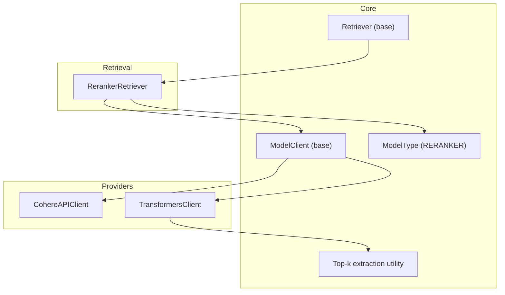
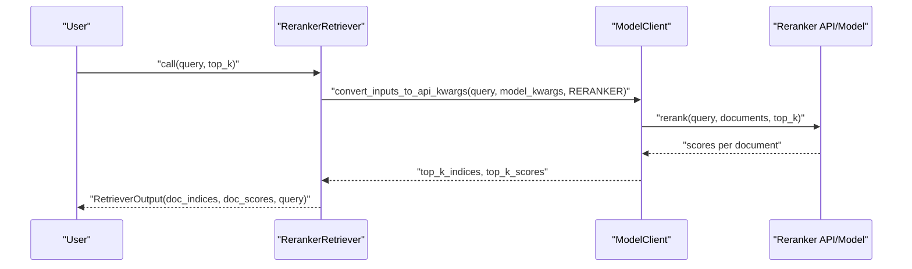
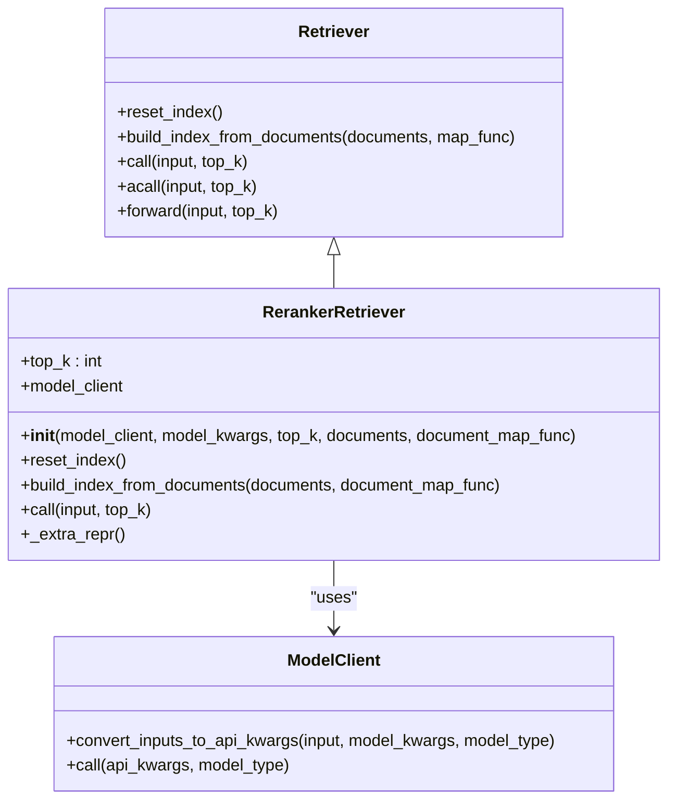
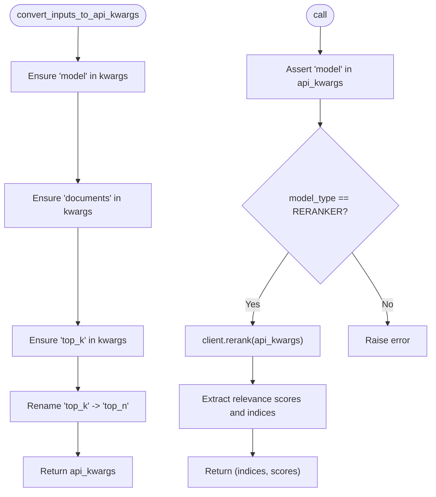
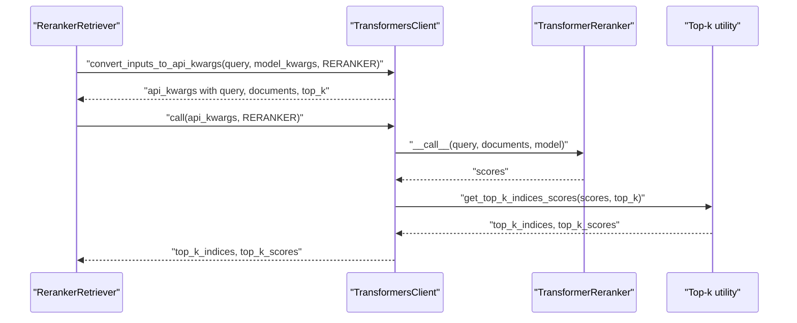
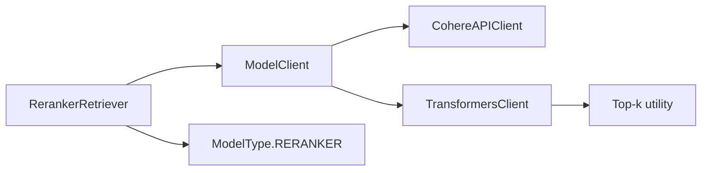

# Re-Rankers

<cite>
**Referenced Files in This Document**
- [reranker_retriever.py](file://adalflow/adalflow/components/retriever/reranker_retriever.py)
- [model_client.py](file://adalflow/adalflow/core/model_client.py)
- [types.py](file://adalflow/adalflow/core/types.py)
- [transformers_client.py](file://adalflow/adalflow/components/model_client/transformers_client.py)
- [cohere_client.py](file://adalflow/adalflow/components/model_client/cohere_client.py)
- [retriever.py](file://adalflow/adalflow/core/retriever.py)
- [functional.py](file://adalflow/adalflow/core/functional.py)
</cite>

## Table of Contents
1. [Introduction](#introduction)
2. [Project Structure](#project-structure)
3. [Core Components](#core-components)
4. [Architecture Overview](#architecture-overview)
5. [Detailed Component Analysis](#detailed-component-analysis)
6. [Dependency Analysis](#dependency-analysis)
7. [Performance Considerations](#performance-considerations)
8. [Troubleshooting Guide](#troubleshooting-guide)
9. [Conclusion](#conclusion)
10. [Appendices](#appendices)

## Introduction
This document explains AdalFlow’s re-ranking capabilities with a focus on cross-encoder models, pairwise similarity scoring, and document ordering optimization. It covers how to configure and use re-rankers, how ranking works end-to-end, and how to optimize performance. It also provides practical examples from the codebase, guidance on model selection, batching strategies, and troubleshooting common issues.

## Project Structure
The re-ranking system in AdalFlow is composed of:
- A generic retriever interface and a concrete re-ranking retriever
- A unified model client abstraction that bridges API providers and local models
- Provider-specific clients for reranking (Cohere and Transformers)
- Shared types and utilities for model types, inputs, and top-k extraction

**Diagram sources**
- [retriever.py](file://adalflow/adalflow/core/retriever.py#L21-L143)
- [model_client.py](file://adalflow/adalflow/core/model_client.py#L16-L128)
- [types.py](file://adalflow/adalflow/core/types.py#L55-L135)
- [reranker_retriever.py](file://adalflow/adalflow/components/retriever/reranker_retriever.py#L21-L116)
- [transformers_client.py](file://adalflow/adalflow/components/model_client/transformers_client.py#L506-L688)
- [cohere_client.py](file://adalflow/adalflow/components/model_client/cohere_client.py#L19-L138)
- [functional.py](file://adalflow/adalflow/core/functional.py#L1-L800)

**Section sources**
- [retriever.py](file://adalflow/adalflow/core/retriever.py#L21-L143)
- [model_client.py](file://adalflow/adalflow/core/model_client.py#L16-L128)
- [types.py](file://adalflow/adalflow/core/types.py#L55-L135)
- [reranker_retriever.py](file://adalflow/adalflow/components/retriever/reranker_retriever.py#L21-L116)
- [transformers_client.py](file://adalflow/adalflow/components/model_client/transformers_client.py#L506-L688)
- [cohere_client.py](file://adalflow/adalflow/components/model_client/cohere_client.py#L19-L138)
- [functional.py](file://adalflow/adalflow/core/functional.py#L1-L800)

## Core Components
- RerankerRetriever: A retriever that uses a reranker model client to reorder candidate documents per query and return top-k results.
- ModelClient: Base class that defines the contract for model providers, including input conversion, API calls, and response parsing.
- ModelType.RERANKER: A model type flag used to route calls to reranking-specific logic.
- TransformersClient: Local reranker client using Transformers (e.g., BAAI/bge-reranker-base) with top-k extraction.
- CohereAPIClient: Cloud reranker client using Cohere’s rerank API with top-k extraction.
- Top-k extraction utility: Extracts top-k indices and scores from raw scores.

Key responsibilities:
- Build an index from documents (strings) and store them in the retriever.
- For each query, convert inputs to provider-specific API kwargs, call the reranker, and return ranked indices and scores.

**Section sources**
- [reranker_retriever.py](file://adalflow/adalflow/components/retriever/reranker_retriever.py#L21-L116)
- [model_client.py](file://adalflow/adalflow/core/model_client.py#L16-L128)
- [types.py](file://adalflow/adalflow/core/types.py#L55-L135)
- [transformers_client.py](file://adalflow/adalflow/components/model_client/transformers_client.py#L506-L688)
- [cohere_client.py](file://adalflow/adalflow/components/model_client/cohere_client.py#L19-L138)
- [functional.py](file://adalflow/adalflow/core/functional.py#L1-L800)

## Architecture Overview
End-to-end re-ranking workflow:
- The RerankerRetriever builds an internal index from documents.
- For each query, it converts inputs to API kwargs for the chosen model client.
- The model client calls the reranker (either local Transformers or remote Cohere).
- Scores are post-processed to extract top-k indices and scores.
- Results are returned as structured retriever outputs.

**Diagram sources**
- [reranker_retriever.py](file://adalflow/adalflow/components/retriever/reranker_retriever.py#L84-L111)
- [model_client.py](file://adalflow/adalflow/core/model_client.py#L73-L91)
- [cohere_client.py](file://adalflow/adalflow/components/model_client/cohere_client.py#L64-L114)
- [transformers_client.py](file://adalflow/adalflow/components/model_client/transformers_client.py#L665-L688)

## Detailed Component Analysis

### RerankerRetriever
- Purpose: Wraps a ModelClient to rerank candidate documents against a query and return top-k matches.
- Indexing: Accepts documents during initialization or later via a builder method. Documents are stored and passed to the model client.
- Inputs: Query string(s), top_k, and model kwargs including model name and documents.
- Outputs: Per-query ranked indices and scores.

Implementation highlights:
- Validates model kwargs presence and type.
- Converts inputs to API kwargs using the model client’s converter.
- Calls the model client with ModelType.RERANKER.
- Aggregates results into RetrieverOutput entries.

**Diagram sources**
- [retriever.py](file://adalflow/adalflow/core/retriever.py#L21-L143)
- [reranker_retriever.py](file://adalflow/adalflow/components/retriever/reranker_retriever.py#L21-L116)
- [model_client.py](file://adalflow/adalflow/core/model_client.py#L16-L128)

**Section sources**
- [reranker_retriever.py](file://adalflow/adalflow/components/retriever/reranker_retriever.py#L21-L116)
- [retriever.py](file://adalflow/adalflow/core/retriever.py#L21-L143)

### ModelClient Abstraction
- Defines the contract for all model providers: initialization, input conversion, API calls, and response parsing.
- Provides a unified interface for reranking regardless of provider (cloud or local).

Key methods:
- convert_inputs_to_api_kwargs: Translates standard inputs and model kwargs into provider-specific API kwargs.
- call/acall: Executes the model call and returns provider-specific outputs.

Provider-specific behavior is implemented in subclasses.

**Section sources**
- [model_client.py](file://adalflow/adalflow/core/model_client.py#L16-L128)

### CohereAPIClient (Cloud Reranker)
- Initializes a sync client using an API key.
- Converts inputs for reranking: ensures model, documents, and top_k are present; renames top_k to top_n for the API.
- Calls the rerank endpoint and extracts top_k_indices and top_k_scores from results.

**Diagram sources**
- [cohere_client.py](file://adalflow/adalflow/components/model_client/cohere_client.py#L64-L114)

**Section sources**
- [cohere_client.py](file://adalflow/adalflow/components/model_client/cohere_client.py#L19-L138)

### TransformersClient (Local Reranker)
- Supports a local reranker model (e.g., BAAI/bge-reranker-base).
- Converts inputs for reranking: sets query and ensures documents and top_k are present.
- Calls the local reranker to compute scores and uses a top-k utility to select indices and scores.

**Diagram sources**
- [transformers_client.py](file://adalflow/adalflow/components/model_client/transformers_client.py#L665-L688)
- [transformers_client.py](file://adalflow/adalflow/components/model_client/transformers_client.py#L153-L246)
- [functional.py](file://adalflow/adalflow/core/functional.py#L1-L800)

**Section sources**
- [transformers_client.py](file://adalflow/adalflow/components/model_client/transformers_client.py#L506-L688)
- [transformers_client.py](file://adalflow/adalflow/components/model_client/transformers_client.py#L153-L246)
- [functional.py](file://adalflow/adalflow/core/functional.py#L1-L800)

### Cross-Encoder Models and Pairwise Scoring
- Cross-encoder rerankers score each query-document pair jointly, producing a relevance score per candidate.
- The TransformersClient computes scores by pairing the query with each document and passing them through the model.
- Scores are then transformed (e.g., sigmoid) and top-k indices/scores are extracted.

Practical notes:
- Pairwise scoring scales with the number of candidates; consider batching and top-k early filtering to reduce cost.
- Local models require GPU/CPU resources; cloud APIs offer scalability and reduced latency for large batches.

**Section sources**
- [transformers_client.py](file://adalflow/adalflow/components/model_client/transformers_client.py#L189-L246)
- [transformers_client.py](file://adalflow/adalflow/components/model_client/transformers_client.py#L645-L656)

### Document Ordering Optimization
- After computing pairwise scores, the retriever selects top-k documents by index and sorts them by score.
- The RetrieverOutput encapsulates indices, scores, and the original query for downstream use.

**Section sources**
- [reranker_retriever.py](file://adalflow/adalflow/components/retriever/reranker_retriever.py#L104-L110)
- [types.py](file://adalflow/adalflow/core/types.py#L291-L316)

## Dependency Analysis
- RerankerRetriever depends on:
  - ModelClient for provider-agnostic reranking
  - ModelType.RERANKER to route calls
  - Top-k extraction utility for ranking
- ModelClient subclasses (CohereAPIClient, TransformersClient) implement provider-specific logic.
- Types define the shared contracts for model kwargs and outputs.

**Diagram sources**
- [reranker_retriever.py](file://adalflow/adalflow/components/retriever/reranker_retriever.py#L21-L116)
- [model_client.py](file://adalflow/adalflow/core/model_client.py#L16-L128)
- [types.py](file://adalflow/adalflow/core/types.py#L55-L135)
- [cohere_client.py](file://adalflow/adalflow/components/model_client/cohere_client.py#L19-L138)
- [transformers_client.py](file://adalflow/adalflow/components/model_client/transformers_client.py#L506-L688)
- [functional.py](file://adalflow/adalflow/core/functional.py#L1-L800)

**Section sources**
- [reranker_retriever.py](file://adalflow/adalflow/components/retriever/reranker_retriever.py#L21-L116)
- [model_client.py](file://adalflow/adalflow/core/model_client.py#L16-L128)
- [types.py](file://adalflow/adalflow/core/types.py#L55-L135)
- [cohere_client.py](file://adalflow/adalflow/components/model_client/cohere_client.py#L19-L138)
- [transformers_client.py](file://adalflow/adalflow/components/model_client/transformers_client.py#L506-L688)
- [functional.py](file://adalflow/adalflow/core/functional.py#L1-L800)

## Performance Considerations
- When to apply re-ranking:
  - Use after lexical or semantic retrieval to refine order.
  - Apply when precise relevance matters more than speed.
- Computational overhead:
  - Cross-encoder scoring is quadratic in the number of candidates; consider pre-filtering to a manageable pool.
  - Prefer batching when the provider supports it; adjust top_k to limit work.
- Hybrid retrieval strategies:
  - Combine BM25-like lexical retrieval with vector retrieval, then rerank the top-N combined candidates.
  - Use a small top_k for initial retrieval and increase for reranking to balance quality and latency.
- Model selection:
  - Local Transformers models: lower latency for small-scale workloads, higher resource usage.
  - Cloud rerankers: scalable throughput, consistent quality, controlled latency.
- Batch sizing optimization:
  - Keep batch sizes aligned with provider limits and device capacity.
  - Use top_k conservatively during reranking to reduce scoring overhead.
- Device and memory:
  - Local rerankers benefit from GPU acceleration; ensure adequate VRAM and consider MPS for Apple Silicon.

[No sources needed since this section provides general guidance]

## Troubleshooting Guide
Common issues and resolutions:
- Missing model kwargs:
  - Ensure model, documents, and top_k are provided for reranking.
  - CohereAPIClient expects top_k mapped to top_n; TransformersClient expects top_k.
- Incorrect model type:
  - Verify model_type is ModelType.RERANKER when calling the reranker.
- Provider credentials:
  - CohereAPIClient requires a valid API key; ensure environment variables are set.
- Local model initialization:
  - TransformersClient initializes the reranker model lazily; ensure model names match supported ones.
- Top-k extraction:
  - Confirm scores are computed and passed to the top-k utility to avoid empty results.

**Section sources**
- [types.py](file://adalflow/adalflow/core/types.py#L115-L135)
- [cohere_client.py](file://adalflow/adalflow/components/model_client/cohere_client.py#L64-L91)
- [transformers_client.py](file://adalflow/adalflow/components/model_client/transformers_client.py#L665-L688)
- [reranker_retriever.py](file://adalflow/adalflow/components/retriever/reranker_retriever.py#L49-L58)

## Conclusion
AdalFlow’s re-ranking system provides a consistent, provider-agnostic path to improve document ordering using cross-encoder models. By leveraging RerankerRetriever with ModelClient abstractions, you can easily switch between local Transformers and cloud providers like Cohere. Proper batching, top-k tuning, and hybrid retrieval strategies help balance accuracy and performance.

[No sources needed since this section summarizes without analyzing specific files]

## Appendices

### Practical Setup Examples (paths only)
- Initialize a local reranker with Transformers:
  - [TransformersClient](file://adalflow/adalflow/components/model_client/transformers_client.py#L506-L688)
- Initialize a cloud reranker with Cohere:
  - [CohereAPIClient](file://adalflow/adalflow/components/model_client/cohere_client.py#L19-L138)
- Configure RerankerRetriever:
  - [RerankerRetriever](file://adalflow/adalflow/components/retriever/reranker_retriever.py#L21-L116)
- Retrieve top-k results:
  - [RerankerRetriever.call](file://adalflow/adalflow/components/retriever/reranker_retriever.py#L84-L111)
- Provider input conversion:
  - [CohereAPIClient.convert_inputs_to_api_kwargs](file://adalflow/adalflow/components/model_client/cohere_client.py#L64-L91)
  - [TransformersClient.convert_inputs_to_api_kwargs](file://adalflow/adalflow/components/model_client/transformers_client.py#L665-L688)
- Top-k extraction:
  - [TransformersClient.call (reranker path)](file://adalflow/adalflow/components/model_client/transformers_client.py#L645-L656)
  - [functional utilities](file://adalflow/adalflow/core/functional.py#L1-L800)