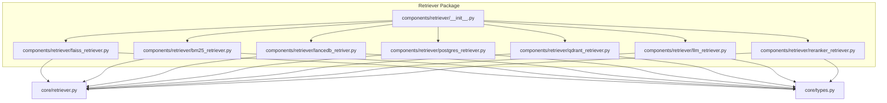
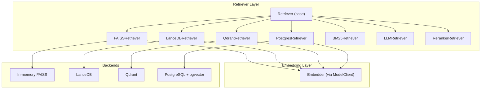
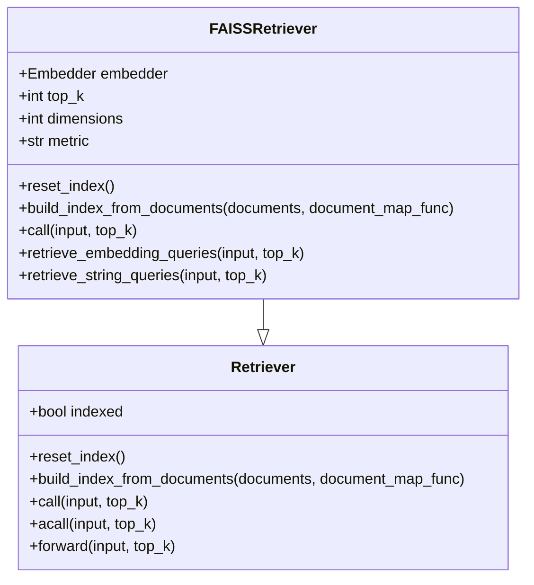
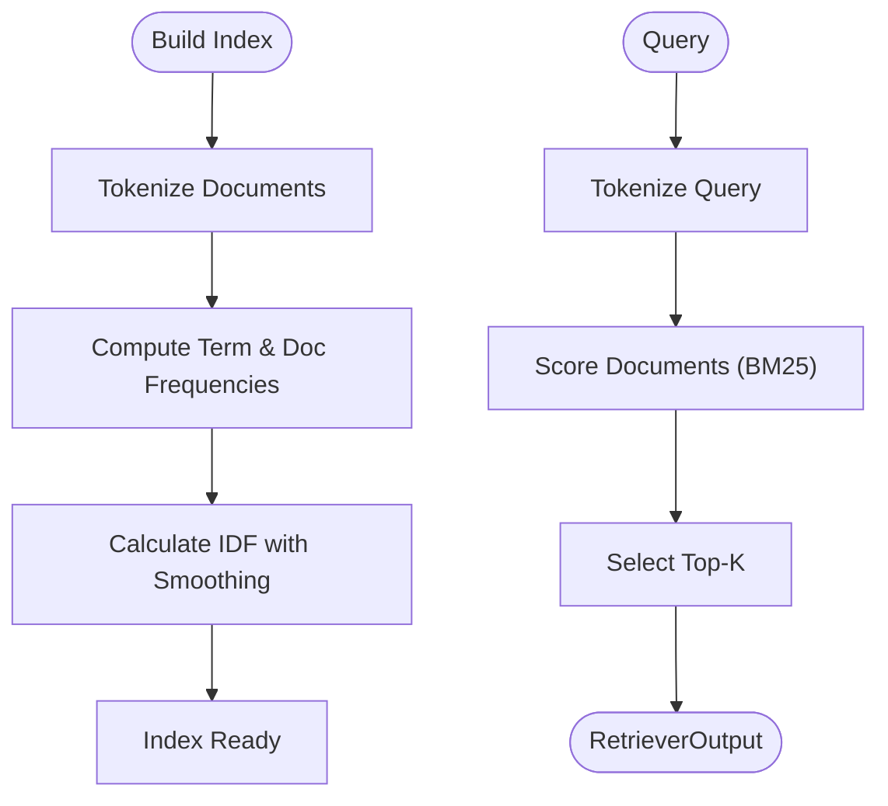
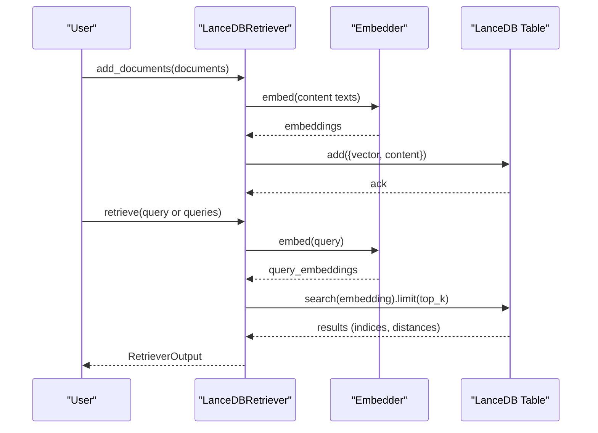
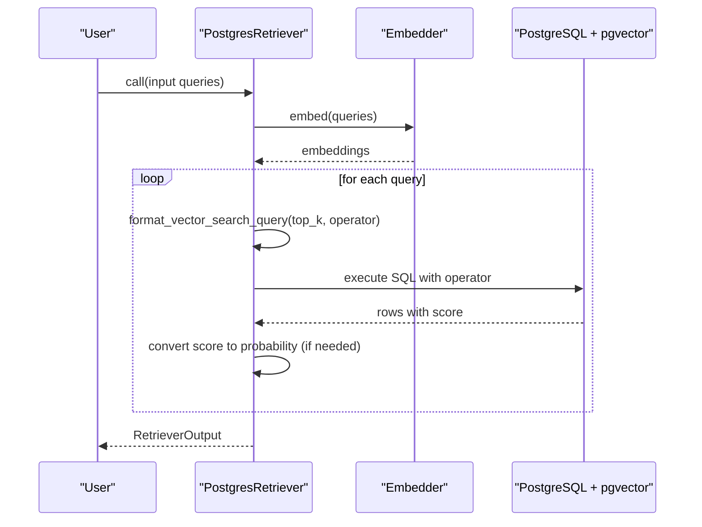
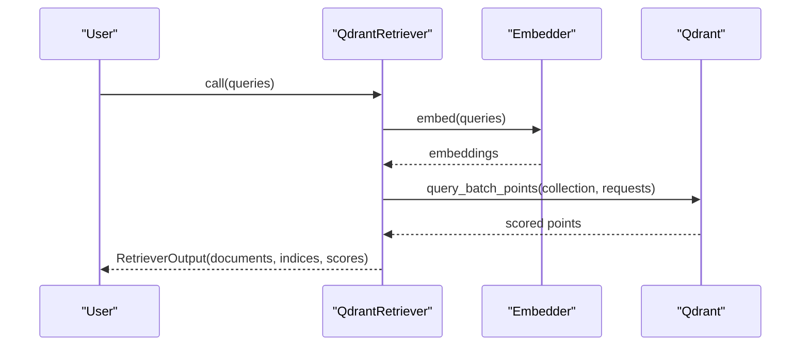
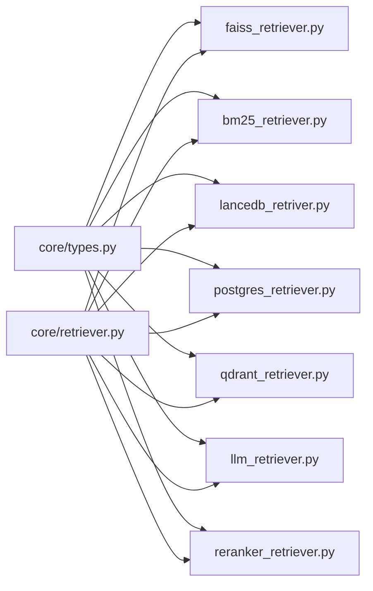

# Retrievers

<cite>
**Referenced Files in This Document**
- [__init__.py](file://adalflow/adalflow/components/retriever/__init__.py)
- [retriever.py](file://adalflow/adalflow/core/retriever.py)
- [types.py](file://adalflow/adalflow/core/types.py)
- [faiss_retriever.py](file://adalflow/adalflow/components/retriever/faiss_retriever.py)
- [bm25_retriever.py](file://adalflow/adalflow/components/retriever/bm25_retriever.py)
- [lancedb_retriver.py](file://adalflow/adalflow/components/retriever/lancedb_retriver.py)
- [postgres_retriever.py](file://adalflow/adalflow/components/retriever/postgres_retriever.py)
- [qdrant_retriever.py](file://adalflow/adalflow/components/retriever/qdrant_retriever.py)
- [llm_retriever.py](file://adalflow/adalflow/components/retriever/llm_retriever.py)
- [reranker_retriever.py](file://adalflow/adalflow/components/retriever/reranker_retriever.py)
- [retriever.ipynb](file://tutorials/retriever.ipynb)
</cite>

## Table of Contents
1. [Introduction](#introduction)
2. [Project Structure](#project-structure)
3. [Core Components](#core-components)
4. [Architecture Overview](#architecture-overview)
5. [Detailed Component Analysis](#detailed-component-analysis)
6. [Dependency Analysis](#dependency-analysis)
7. [Performance Considerations](#performance-considerations)
8. [Troubleshooting Guide](#troubleshooting-guide)
9. [Conclusion](#conclusion)
10. [Appendices](#appendices)

## Introduction
This document explains AdalFlow’s Retrievers: the Retriever interface, embedding integration, and similarity search algorithms. It covers vector retrievers (FAISS, LanceDB, Qdrant), lexical retrievers (BM25), and database retrievers (PostgreSQL), alongside hybrid strategies, evaluation, and operational guidance. The goal is to help both beginners and experienced developers configure, optimize, and troubleshoot retrieval systems using AdalFlow’s modular retriever components.

## Project Structure
AdalFlow organizes retrievers under a single package with a shared base class and specialized implementations. The package exports a unified interface and registers retrievers for dynamic usage. The core types define standardized data contracts for embeddings, outputs, and model types.

**Diagram sources**
- [__init__.py](file://adalflow/adalflow/components/retriever/__init__.py#L1-L50)
- [retriever.py](file://adalflow/adalflow/core/retriever.py#L22-L143)
- [types.py](file://adalflow/adalflow/core/types.py#L55-L135)
- [faiss_retriever.py](file://adalflow/adalflow/components/retriever/faiss_retriever.py#L51-L369)
- [bm25_retriever.py](file://adalflow/adalflow/components/retriever/bm25_retriever.py#L58-L381)
- [lancedb_retriver.py](file://adalflow/adalflow/components/retriever/lancedb_retriver.py#L17-L132)
- [postgres_retriever.py](file://adalflow/adalflow/components/retriever/postgres_retriever.py#L39-L244)
- [qdrant_retriever.py](file://adalflow/adalflow/components/retriever/qdrant_retriever.py#L19-L160)
- [llm_retriever.py](file://adalflow/adalflow/components/retriever/llm_retriever.py#L39-L148)
- [reranker_retriever.py](file://adalflow/adalflow/components/retriever/reranker_retriever.py#L21-L116)

**Section sources**
- [__init__.py](file://adalflow/adalflow/components/retriever/__init__.py#L1-L50)
- [retriever.py](file://adalflow/adalflow/core/retriever.py#L22-L143)
- [types.py](file://adalflow/adalflow/core/types.py#L55-L135)

## Core Components
- Retriever base class defines the contract for building indexes, retrieving, and persisting state. It integrates with gradient-aware components and supports both sync and async retrieval.
- Types define standardized containers for embeddings, outputs, and model roles (Embedder, LLM, Reranker), ensuring interoperability across retrievers and other components.

Key responsibilities:
- Index lifecycle: reset, build from documents, persistence helpers.
- Retrieval: call and acall with top_k control and tracing.
- Forward pass: parameterized inputs and outputs for optimization.

**Section sources**
- [retriever.py](file://adalflow/adalflow/core/retriever.py#L22-L143)
- [types.py](file://adalflow/adalflow/core/types.py#L55-L135)

## Architecture Overview
The retriever ecosystem follows a layered design:
- Base interface: Retriever
- Embedding integration: Embedder via model clients
- Backends: FAISS in-memory, LanceDB, Qdrant, PostgreSQL/pgvector
- Lexical: BM25
- Generative and reranking: LLMRetriever and RerankerRetriever

**Diagram sources**
- [retriever.py](file://adalflow/adalflow/core/retriever.py#L22-L143)
- [faiss_retriever.py](file://adalflow/adalflow/components/retriever/faiss_retriever.py#L51-L369)
- [lancedb_retriver.py](file://adalflow/adalflow/components/retriever/lancedb_retriver.py#L17-L132)
- [qdrant_retriever.py](file://adalflow/adalflow/components/retriever/qdrant_retriever.py#L19-L160)
- [postgres_retriever.py](file://adalflow/adalflow/components/retriever/postgres_retriever.py#L39-L244)
- [bm25_retriever.py](file://adalflow/adalflow/components/retriever/bm25_retriever.py#L58-L381)
- [llm_retriever.py](file://adalflow/adalflow/components/retriever/llm_retriever.py#L39-L148)
- [reranker_retriever.py](file://adalflow/adalflow/components/retriever/reranker_retriever.py#L21-L116)

## Detailed Component Analysis

### Retriever Interface and Embedding Contracts
- The base Retriever enforces a uniform API for building indexes, retrieving, and persistence. It tracks hyperparameters (e.g., top_k) as parameters for optimization.
- Embedding and output types standardize how embeddings and retrieval results are represented across backends.

Implementation highlights:
- Index lifecycle: reset_index, build_index_from_documents, save_to_file/load_from_file.
- Retrieval: call and acall accept queries and top_k; forward wraps inputs as parameters for gradient tracking.

**Section sources**
- [retriever.py](file://adalflow/adalflow/core/retriever.py#L22-L143)
- [types.py](file://adalflow/adalflow/core/types.py#L140-L200)

### FAISS Vector Retriever
FAISSRetriever performs semantic search using FAISS indexes with configurable metrics and automatic normalization.

Key behaviors:
- Accepts pre-built embeddings or builds index from provided documents.
- Supports cosine similarity (converted to probability) and L2/Euclidean metrics.
- Normalizes embeddings when needed and validates dimensions.
- Converts FAISS search results to RetrieverOutput with indices and scores.

**Diagram sources**
- [retriever.py](file://adalflow/adalflow/core/retriever.py#L22-L143)
- [faiss_retriever.py](file://adalflow/adalflow/components/retriever/faiss_retriever.py#L51-L369)

**Section sources**
- [faiss_retriever.py](file://adalflow/adalflow/components/retriever/faiss_retriever.py#L51-L369)

### BM25 Lexical Retriever
BM25Retriever implements Okapi BM25 scoring over tokenized documents with configurable smoothing and tokenization.

Highlights:
- Tokenization via a configurable split function (with or without tokenizer).
- IDF smoothing with epsilon adaptation for negative IDF terms.
- Efficient top-k scoring using heap-based selection.

**Diagram sources**
- [bm25_retriever.py](file://adalflow/adalflow/components/retriever/bm25_retriever.py#L210-L287)

**Section sources**
- [bm25_retriever.py](file://adalflow/adalflow/components/retriever/bm25_retriever.py#L58-L381)

### LanceDB Vector Retriever
LanceDBRetriever stores and retrieves embeddings using LanceDB tables, supporting schema creation and batch embedding ingestion.

Highlights:
- Creates a table with vector and content fields.
- Adds documents by embedding content and inserting records.
- Searches by embedding queries and returns indices/scores.

**Diagram sources**
- [lancedb_retriver.py](file://adalflow/adalflow/components/retriever/lancedb_retriver.py#L61-L132)

**Section sources**
- [lancedb_retriver.py](file://adalflow/adalflow/components/retriever/lancedb_retriver.py#L17-L132)

### PostgreSQL (pgvector) Retriever
PostgresRetriever leverages PostgreSQL with pgvector to store and query embeddings using SQL operators.

Highlights:
- Configurable distance operators (L2, inner product, cosine, L1).
- Automatic conversion of scores to probabilities depending on operator.
- SQL query formatting and execution via a database manager.

**Diagram sources**
- [postgres_retriever.py](file://adalflow/adalflow/components/retriever/postgres_retriever.py#L82-L205)

**Section sources**
- [postgres_retriever.py](file://adalflow/adalflow/components/retriever/postgres_retriever.py#L39-L244)

### Qdrant Vector Retriever
QdrantRetriever uses Qdrant collections to perform vector similarity search with filters and payload extraction.

Highlights:
- Initializes with a client, collection, and embedder.
- Queries with optional filters and returns documents with text and metadata.

**Diagram sources**
- [qdrant_retriever.py](file://adalflow/adalflow/components/retriever/qdrant_retriever.py#L63-L103)

**Section sources**
- [qdrant_retriever.py](file://adalflow/adalflow/components/retriever/qdrant_retriever.py#L19-L160)

### LLM as Retriever
LLMRetriever uses an LLM to rank candidate documents by returning indices, optionally with structured parsing.

Highlights:
- Builds a prompt with a fixed template and documents.
- Uses a generator with a list parser to extract indices.

**Section sources**
- [llm_retriever.py](file://adalflow/adalflow/components/retriever/llm_retriever.py#L39-L148)

### Reranker Retriever
RerankerRetriever applies a reranking model to reorder initial candidates.

Highlights:
- Accepts a model client configured for reranking.
- Converts inputs to API kwargs and returns ranked indices and scores.

**Section sources**
- [reranker_retriever.py](file://adalflow/adalflow/components/retriever/reranker_retriever.py#L21-L116)

## Dependency Analysis
- All retrievers inherit from the base Retriever and integrate with Embedder via ModelClient.
- FAISS relies on FAISS library and NumPy arrays; BM25 is pure Python with tokenization; LanceDB, Qdrant, and PostgreSQL require their respective clients and servers.
- Types define the contracts for embeddings and outputs, enabling consistent interoperation.

**Diagram sources**
- [types.py](file://adalflow/adalflow/core/types.py#L55-L135)
- [retriever.py](file://adalflow/adalflow/core/retriever.py#L22-L143)
- [faiss_retriever.py](file://adalflow/adalflow/components/retriever/faiss_retriever.py#L51-L369)
- [bm25_retriever.py](file://adalflow/adalflow/components/retriever/bm25_retriever.py#L58-L381)
- [lancedb_retriver.py](file://adalflow/adalflow/components/retriever/lancedb_retriver.py#L17-L132)
- [postgres_retriever.py](file://adalflow/adalflow/components/retriever/postgres_retriever.py#L39-L244)
- [qdrant_retriever.py](file://adalflow/adalflow/components/retriever/qdrant_retriever.py#L19-L160)
- [llm_retriever.py](file://adalflow/adalflow/components/retriever/llm_retriever.py#L39-L148)
- [reranker_retriever.py](file://adalflow/adalflow/components/retriever/reranker_retriever.py#L21-L116)

**Section sources**
- [__init__.py](file://adalflow/adalflow/components/retriever/__init__.py#L1-L50)
- [types.py](file://adalflow/adalflow/core/types.py#L55-L135)

## Performance Considerations
- FAISS
  - Metric choice: cosine with probability conversion or L2/Euclidean; normalize when using cosine/IP.
  - Dimensions: ensure consistent embedding dimensions; FAISS requires float32 arrays.
  - Memory: in-memory index; scale by batching or offloading to disk-backed backends when needed.
- BM25
  - Tokenization: enable tokenizer for better matching; tune k1, b, epsilon for domain characteristics.
  - Preprocessing: consider lowercasing and tokenization for robustness.
- LanceDB
  - Schema alignment: ensure vector dimension matches embedder output.
  - Batch ingestion: add documents in batches to reduce overhead.
- PostgreSQL (pgvector)
  - Operators: choose operator aligned with embedding normalization; convert scores to probabilities when needed.
  - Indexes: rely on pgvector indexes; ensure proper configuration for large datasets.
- Qdrant
  - Filters: use filters to reduce search space; consider payload size and vector names.
- Hybrid strategies
  - Combine lexical and vector results (e.g., BM25 + FAISS) using weighted fusion or reciprocal rank fusion.
  - Use rerankers to refine top-K results from fast vector search.
- Evaluation
  - Use recall-based metrics (e.g., retriever recall) and downstream task accuracy to guide tuning.

[No sources needed since this section provides general guidance]

## Troubleshooting Guide
Common issues and resolutions:
- FAISSRetriever
  - Empty documents list: resets index; ensure non-empty inputs.
  - Dimension mismatch: assert dimensions match; normalize if needed.
  - Index empty: ensure build_index_from_documents was called or documents passed at init.
- BM25Retriever
  - No index built: call build_index_from_documents before retrieval.
  - Negative IDF smoothing: epsilon adaptation mitigates; adjust epsilon for small corpora.
- LanceDBRetriever
  - Missing table or uninitialized: ensure table creation and embedding steps are executed.
  - Empty query: guard against empty strings.
- PostgresRetriever
  - SQL formatting errors: verify operator and embedding string formatting.
  - Score conversion: confirm operator-specific conversion is applied.
- QdrantRetriever
  - Collection existence: reset or recreate collection if needed.
  - Filters: ensure filters match payload schema.
- LLMRetriever
  - Empty responses: handle empty indices gracefully; check model kwargs and prompt.
- RerankerRetriever
  - Model kwargs: ensure required keys (model, top_k, documents, query) are present.

**Section sources**
- [faiss_retriever.py](file://adalflow/adalflow/components/retriever/faiss_retriever.py#L164-L202)
- [bm25_retriever.py](file://adalflow/adalflow/components/retriever/bm25_retriever.py#L324-L326)
- [lancedb_retriver.py](file://adalflow/adalflow/components/retriever/lancedb_retriver.py#L100-L106)
- [postgres_retriever.py](file://adalflow/adalflow/components/retriever/postgres_retriever.py#L178-L187)
- [qdrant_retriever.py](file://adalflow/adalflow/components/retriever/qdrant_retriever.py#L60-L62)
- [llm_retriever.py](file://adalflow/adalflow/components/retriever/llm_retriever.py#L130-L136)
- [reranker_retriever.py](file://adalflow/adalflow/components/retriever/reranker_retriever.py#L94-L111)

## Conclusion
AdalFlow’s retrievers provide a cohesive, extensible framework for semantic, lexical, and database-backed retrieval. By standardizing embeddings and outputs, and offering flexible backends, developers can rapidly prototype and optimize retrieval pipelines. Use FAISS for speed, BM25 for lexical precision, and database backends for persistent, scalable vector storage. Combine strategies with rerankers and hybrid fusion for robust downstream performance.

[No sources needed since this section summarizes without analyzing specific files]

## Appendices

### Example Workflows and Configuration Pointers
- FAISSRetriever
  - Build index from embeddings or via documents; retrieve with string or embedding queries.
  - Reference: [faiss_retriever.py](file://adalflow/adalflow/components/retriever/faiss_retriever.py#L150-L358)
- BM25Retriever
  - Initialize with documents or call build_index_from_documents; retrieve top-k by BM25 scores.
  - Reference: [bm25_retriever.py](file://adalflow/adalflow/components/retriever/bm25_retriever.py#L289-L346)
- LanceDBRetriever
  - Add documents with embeddings; retrieve with query embeddings.
  - Reference: [lancedb_retriver.py](file://adalflow/adalflow/components/retriever/lancedb_retriver.py#L61-L132)
- PostgresRetriever
  - Configure embedder and distance operator; format and execute vector search queries.
  - Reference: [postgres_retriever.py](file://adalflow/adalflow/components/retriever/postgres_retriever.py#L161-L205)
- QdrantRetriever
  - Initialize with client, collection, and embedder; query with optional filters.
  - Reference: [qdrant_retriever.py](file://adalflow/adalflow/components/retriever/qdrant_retriever.py#L63-L103)
- LLMRetriever
  - Prepare prompt with documents; parse indices with ListParser.
  - Reference: [llm_retriever.py](file://adalflow/adalflow/components/retriever/llm_retriever.py#L76-L143)
- RerankerRetriever
  - Provide model client and model kwargs; call with queries to get ranked results.
  - Reference: [reranker_retriever.py](file://adalflow/adalflow/components/retriever/reranker_retriever.py#L84-L111)

**Section sources**
- [faiss_retriever.py](file://adalflow/adalflow/components/retriever/faiss_retriever.py#L150-L358)
- [bm25_retriever.py](file://adalflow/adalflow/components/retriever/bm25_retriever.py#L289-L346)
- [lancedb_retriver.py](file://adalflow/adalflow/components/retriever/lancedb_retriver.py#L61-L132)
- [postgres_retriever.py](file://adalflow/adalflow/components/retriever/postgres_retriever.py#L161-L205)
- [qdrant_retriever.py](file://adalflow/adalflow/components/retriever/qdrant_retriever.py#L63-L103)
- [llm_retriever.py](file://adalflow/adalflow/components/retriever/llm_retriever.py#L76-L143)
- [reranker_retriever.py](file://adalflow/adalflow/components/retriever/reranker_retriever.py#L84-L111)