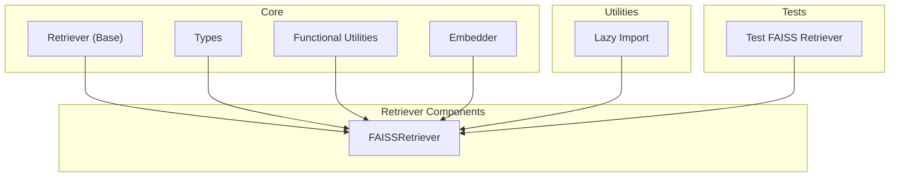
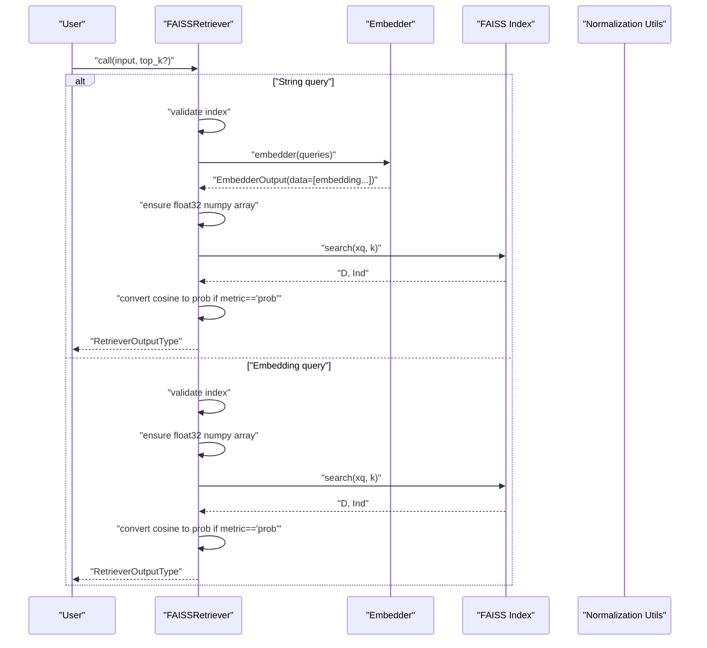
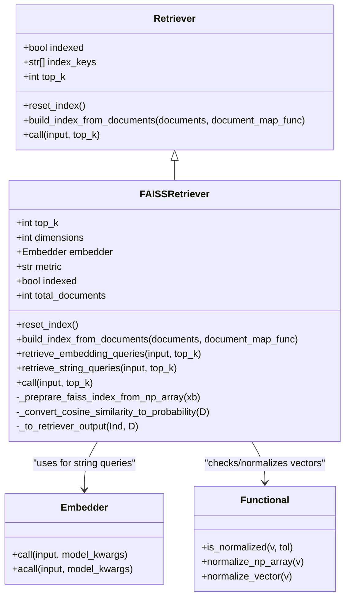
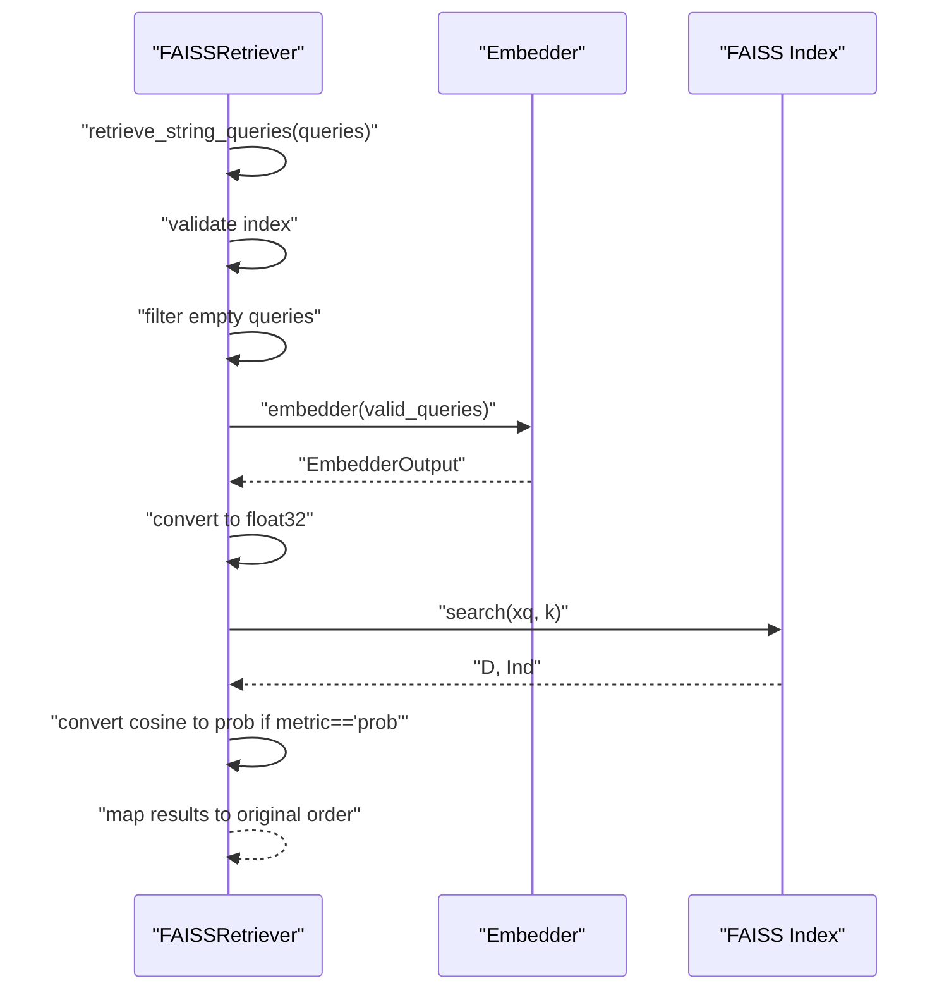
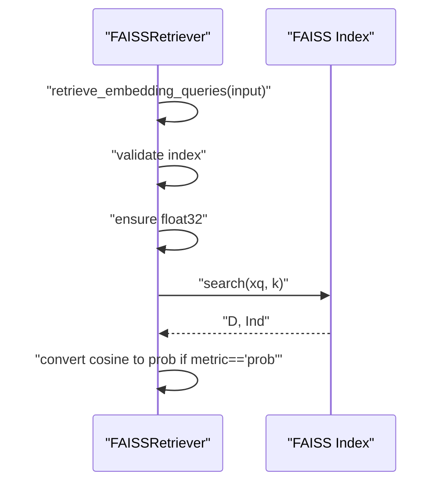
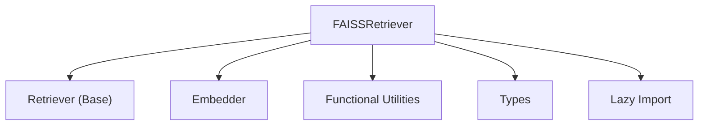

# FAISS Retriever

<cite>
**Referenced Files in This Document**
- [faiss_retriever.py](file://adalflow/adalflow/components/retriever/faiss_retriever.py)
- [retriever.py](file://adalflow/adalflow/core/retriever.py)
- [types.py](file://adalflow/adalflow/core/types.py)
- [functional.py](file://adalflow/adalflow/core/functional.py)
- [embedder.py](file://adalflow/adalflow/core/embedder.py)
- [lazy_import.py](file://adalflow/adalflow/utils/lazy_import.py)
- [test_faiss_retriever.py](file://adalflow/tests/test_faiss_retriever.py)
</cite>

## Table of Contents
1. [Introduction](#introduction)
2. [Project Structure](#project-structure)
3. [Core Components](#core-components)
4. [Architecture Overview](#architecture-overview)
5. [Detailed Component Analysis](#detailed-component-analysis)
6. [Dependency Analysis](#dependency-analysis)
7. [Performance Considerations](#performance-considerations)
8. [Troubleshooting Guide](#troubleshooting-guide)
9. [Conclusion](#conclusion)

## Introduction
This document explains the FAISS Retriever component that integrates Facebook AI Similarity Search (FAISS) for vector similarity search. It covers the FAISSRetriever class implementation, including embedding-based retrieval, index building from document embeddings, and query processing workflows. It documents configuration options (metric types, dimension settings, top_k parameters), FAISS index types (IndexFlatIP for cosine similarity, IndexFlatL2 for Euclidean distance), and their mathematical foundations. It also provides concrete examples of index creation from pre-computed embeddings, string query processing through embedder components, and similarity search operations. Performance optimization techniques, memory management considerations, and troubleshooting common FAISS integration issues are included, along with guidance on embedding normalization requirements and the probability conversion mechanism for cosine similarity scoring.

## Project Structure
The FAISS Retriever resides in the retriever components and builds upon the core retriever abstraction, embedder orchestration, and functional utilities for normalization and data types.

**Diagram sources**
- [faiss_retriever.py](file://adalflow/adalflow/components/retriever/faiss_retriever.py#L51-L369)
- [retriever.py](file://adalflow/adalflow/core/retriever.py#L22-L143)
- [types.py](file://adalflow/adalflow/core/types.py#L278-L317)
- [functional.py](file://adalflow/adalflow/core/functional.py#L902-L929)
- [embedder.py](file://adalflow/adalflow/core/embedder.py#L23-L236)
- [lazy_import.py](file://adalflow/adalflow/utils/lazy_import.py#L81-L84)
- [test_faiss_retriever.py](file://adalflow/tests/test_faiss_retriever.py#L22-L122)

**Section sources**
- [faiss_retriever.py](file://adalflow/adalflow/components/retriever/faiss_retriever.py#L1-L369)
- [retriever.py](file://adalflow/adalflow/core/retriever.py#L1-L143)
- [types.py](file://adalflow/adalflow/core/types.py#L278-L317)
- [functional.py](file://adalflow/adalflow/core/functional.py#L902-L929)
- [embedder.py](file://adalflow/adalflow/core/embedder.py#L23-L236)
- [lazy_import.py](file://adalflow/adalflow/utils/lazy_import.py#L13-L84)
- [test_faiss_retriever.py](file://adalflow/tests/test_faiss_retriever.py#L22-L122)

## Core Components
- FAISSRetriever: Implements embedding-based retrieval using FAISS. It supports building an in-memory index from pre-computed embeddings, retrieving top-k results for both embedding and string queries, and converting cosine similarity scores to a probability-like range [0, 1].
- Retriever (Base): Defines the abstract interface for retrievers, including index lifecycle and retrieval methods.
- Types: Provides data structures for retriever outputs and typed query/document sequences.
- Functional Utilities: Offers vector normalization helpers and checks for unit vectors.
- Embedder: Orchestrates model clients to produce embeddings for string queries.
- Lazy Import: Safely imports FAISS when needed, raising helpful installation messages if unavailable.

Key responsibilities:
- Index management: Build from documents, reset, and maintain metadata (dimensions, total documents).
- Query processing: Accept string or embedding queries, embed strings if needed, and perform similarity search.
- Metric handling: Choose FAISS index type based on metric (cosine -> IndexFlatIP, euclidean -> IndexFlatL2), and convert cosine similarity to probability when configured.

**Section sources**
- [faiss_retriever.py](file://adalflow/adalflow/components/retriever/faiss_retriever.py#L51-L369)
- [retriever.py](file://adalflow/adalflow/core/retriever.py#L22-L143)
- [types.py](file://adalflow/adalflow/core/types.py#L278-L317)
- [functional.py](file://adalflow/adalflow/core/functional.py#L902-L929)
- [embedder.py](file://adalflow/adalflow/core/embedder.py#L23-L236)
- [lazy_import.py](file://adalflow/adalflow/utils/lazy_import.py#L81-L84)

## Architecture Overview
The FAISS Retriever sits atop the Retriever base class and uses an embedder to transform string queries into embeddings. It maintains an in-memory FAISS index and performs similarity search using FAISS’s IndexFlatIP (cosine similarity) or IndexFlatL2 (Euclidean distance). Cosine similarity scores are optionally converted to a [0, 1] probability-like scale.

**Diagram sources**
- [faiss_retriever.py](file://adalflow/adalflow/components/retriever/faiss_retriever.py#L236-L358)
- [embedder.py](file://adalflow/adalflow/core/embedder.py#L133-L160)
- [functional.py](file://adalflow/adalflow/core/functional.py#L902-L929)

## Detailed Component Analysis

### FAISSRetriever Class
The FAISSRetriever extends the Retriever base class and encapsulates FAISS index management and retrieval logic.

- Initialization and configuration:
  - embedder: Optional embedder for string-to-vector conversion.
  - top_k: Default number of results to return.
  - dimensions: Vector dimensionality; inferred if not provided.
  - documents: Optional pre-built embeddings to initialize the index.
  - metric: One of "cosine", "euclidean", or "prob". "prob" converts cosine similarity to [0, 1].

- Index building:
  - build_index_from_documents(documents, document_map_func): Converts documents to float32 numpy arrays, validates uniform dimensionality, and normalizes embeddings when needed. Creates FAISS index (IndexFlatIP for cosine, IndexFlatL2 for euclidean) and adds vectors.

- Query processing:
  - retrieve_embedding_queries(input, top_k?): Accepts precomputed embeddings, ensures float32 dtype, performs FAISS search, and converts scores when metric is "prob".
  - retrieve_string_queries(input, top_k?): Validates index, filters empty queries, embeds queries via embedder, converts to float32, performs FAISS search, and converts scores when metric is "prob".
  - call(input, top_k?): Overloaded entry point that dispatches to the appropriate retrieval method based on input type.

- Probability conversion:
  - _convert_cosine_similarity_to_probability(D): Clips cosine similarity to [-1, 1], shifts and scales to [0, 1], and rounds to three decimals.

- Output formatting:
  - _to_retriever_output(Ind, D): Filters out padded -1 entries, converts indices and distances to RetrieverOutputType.

- Index lifecycle:
  - reset_index(): Clears index state and resets counters.
  - _preprare_faiss_index_from_np_array(xb): Infers dimensions if needed, asserts dimension consistency, creates FAISS index, and adds vectors.

- Mathematical foundations:
  - IndexFlatIP: Inner product of normalized vectors equals cosine similarity in [-1, 1]; FAISS returns negative inner products, so higher scores indicate more similar vectors.
  - IndexFlatL2: Euclidean distance in [0, inf); smaller distances indicate more similar vectors.

- Embedding normalization:
  - When metric is "cosine" or "prob", the retriever checks if the first vector is normalized and normalizes the entire array if not, ensuring cosine similarity semantics.

- Optional FAISS installation:
  - Uses safe_import with OptionalPackages.FAISS to lazily import FAISS and provide clear installation guidance.

**Diagram sources**
- [faiss_retriever.py](file://adalflow/adalflow/components/retriever/faiss_retriever.py#L51-L369)
- [retriever.py](file://adalflow/adalflow/core/retriever.py#L22-L143)
- [embedder.py](file://adalflow/adalflow/core/embedder.py#L23-L236)
- [functional.py](file://adalflow/adalflow/core/functional.py#L902-L929)

**Section sources**
- [faiss_retriever.py](file://adalflow/adalflow/components/retriever/faiss_retriever.py#L51-L369)
- [retriever.py](file://adalflow/adalflow/core/retriever.py#L22-L143)
- [functional.py](file://adalflow/adalflow/core/functional.py#L902-L929)

### Retrieval Workflows

#### String Query Workflow
- Validate that the index is built.
- Filter out empty queries and maintain a mapping from valid positions to original indices.
- Embed queries using the provided embedder, handling wrapper objects and raw list formats.
- Convert embeddings to float32 numpy arrays.
- Perform FAISS search and convert cosine similarity to probability if configured.
- Map results back to the original query order.

**Diagram sources**
- [faiss_retriever.py](file://adalflow/adalflow/components/retriever/faiss_retriever.py#L261-L323)
- [embedder.py](file://adalflow/adalflow/core/embedder.py#L133-L160)

#### Embedding Query Workflow
- Validate that the index is built.
- Convert input to float32 numpy arrays.
- Perform FAISS search and convert cosine similarity to probability if configured.

**Diagram sources**
- [faiss_retriever.py](file://adalflow/adalflow/components/retriever/faiss_retriever.py#L236-L259)

### Configuration Options
- embedder: Optional embedder used for string queries. Required when passing string queries.
- top_k: Number of top results to return. Defaults to 5.
- dimensions: Vector dimensionality. If not provided, inferred from the first document.
- documents: Optional pre-computed embeddings to initialize the index.
- metric: One of "cosine", "euclidean", or "prob". Determines FAISS index type and score conversion.

Behavioral notes:
- For "cosine" and "prob", FAISS uses IndexFlatIP and vectors are normalized if not already unit vectors.
- For "euclidean", FAISS uses IndexFlatL2; normalization is not enforced.
- "prob" converts cosine similarity to [0, 1] by clipping to [-1, 1], shifting by 1, dividing by 2, and rounding to three decimals.

**Section sources**
- [faiss_retriever.py](file://adalflow/adalflow/components/retriever/faiss_retriever.py#L96-L127)
- [faiss_retriever.py](file://adalflow/adalflow/components/retriever/faiss_retriever.py#L204-L208)

### FAISS Index Types and Mathematical Foundations
- IndexFlatIP (Inner Product):
  - Used for cosine similarity when vectors are normalized. FAISS returns negative inner products; higher scores indicate more similar vectors.
  - Suitable for "cosine" and "prob" metrics.
- IndexFlatL2 (Euclidean Distance):
  - Used for Euclidean distance. Smaller distances indicate more similar vectors.
  - Suitable for "euclidean" metric.

Notes:
- FAISS requires float32 dtype for vectors.
- When metric is "cosine" or "prob", the retriever normalizes embeddings to unit vectors if not already normalized.

**Section sources**
- [faiss_retriever.py](file://adalflow/adalflow/components/retriever/faiss_retriever.py#L77-L81)
- [faiss_retriever.py](file://adalflow/adalflow/components/retriever/faiss_retriever.py#L115-L122)
- [functional.py](file://adalflow/adalflow/core/functional.py#L902-L929)

### Concrete Examples

#### Example: Building an Index from Pre-computed Embeddings
- Create FAISSRetriever with dimensions and optional embedder.
- Call build_index_from_documents with a sequence of embeddings (List[List[float]] or List[np.ndarray]).
- The method converts to float32, validates uniform dimensionality, and normalizes if needed for cosine-based metrics.

**Section sources**
- [faiss_retriever.py](file://adalflow/adalflow/components/retriever/faiss_retriever.py#L150-L202)
- [test_faiss_retriever.py](file://adalflow/tests/test_faiss_retriever.py#L48-L52)

#### Example: String Query Processing Through Embedder
- Initialize FAISSRetriever with an embedder.
- Call retrieve_string_queries with a string or list of strings.
- The embedder produces EmbedderOutput; the retriever extracts embeddings, ensures float32, performs FAISS search, and converts scores if configured.

**Section sources**
- [faiss_retriever.py](file://adalflow/adalflow/components/retriever/faiss_retriever.py#L261-L323)
- [embedder.py](file://adalflow/adalflow/core/embedder.py#L133-L160)
- [test_faiss_retriever.py](file://adalflow/tests/test_faiss_retriever.py#L61-L67)

#### Example: Similarity Search Operations
- For embedding queries, call retrieve_embedding_queries with a single embedding or batch of embeddings.
- For string queries, call retrieve_string_queries with a single string or list of strings.
- Results are returned as RetrieverOutputType with doc_indices and doc_scores.

**Section sources**
- [faiss_retriever.py](file://adalflow/adalflow/components/retriever/faiss_retriever.py#L236-L323)
- [types.py](file://adalflow/adalflow/core/types.py#L291-L317)

## Dependency Analysis
The FAISSRetriever depends on:
- Retriever base class for the retrieval interface.
- Embedder for transforming string queries into embeddings.
- Functional utilities for normalization and checks.
- FAISS (via lazy import) for index creation and similarity search.
- Types for standardized data structures.

**Diagram sources**
- [faiss_retriever.py](file://adalflow/adalflow/components/retriever/faiss_retriever.py#L20-L34)
- [retriever.py](file://adalflow/adalflow/core/retriever.py#L22-L143)
- [embedder.py](file://adalflow/adalflow/core/embedder.py#L23-L236)
- [functional.py](file://adalflow/adalflow/core/functional.py#L902-L929)
- [types.py](file://adalflow/adalflow/core/types.py#L278-L317)
- [lazy_import.py](file://adalflow/adalflow/utils/lazy_import.py#L81-L84)

**Section sources**
- [faiss_retriever.py](file://adalflow/adalflow/components/retriever/faiss_retriever.py#L20-L34)
- [lazy_import.py](file://adalflow/adalflow/utils/lazy_import.py#L81-L84)

## Performance Considerations
- Memory management:
  - FAISS index is in-memory; ensure embeddings are float32 and normalized for cosine similarity to reduce memory overhead.
  - Large-scale indexing may require external libraries or persistent storage solutions beyond the in-memory FAISS index.
- Batch processing:
  - For string queries, the embedder supports batch processing; ensure the embedder can accommodate the batch size.
- Top-k tuning:
  - Adjust top_k to balance recall and latency; larger top_k increases computation time.
- Normalization:
  - For cosine similarity, normalization is automatic when metric is "cosine" or "prob". Avoid redundant normalization to prevent unnecessary overhead.
- FAISS installation:
  - Prefer faiss-cpu for CPU-only environments; use faiss-gpu for GPU acceleration if supported by your deployment.

[No sources needed since this section provides general guidance]

## Troubleshooting Guide
Common issues and resolutions:
- Empty documents list during index building:
  - The retriever logs a warning and resets the index. Ensure documents are non-empty before building the index.
- Index is empty during retrieval:
  - The retriever raises a ValueError when attempting to retrieve from an empty index. Build the index first using build_index_from_documents.
- Invalid metric:
  - Only "cosine", "euclidean", or "prob" are supported. Providing an invalid metric raises a ValueError.
- FAISS not installed:
  - The retriever uses lazy import and raises an ImportError with installation guidance when FAISS is not available.
- Embedding dimension mismatch:
  - The retriever asserts that all embeddings have the same dimension as the first vector. Ensure consistent dimensions across documents.
- Normalization expectations:
  - For "cosine" or "prob", embeddings are normalized if not already unit vectors. If you supply pre-normalized embeddings, ensure they are truly unit vectors to avoid unexpected behavior.

**Section sources**
- [faiss_retriever.py](file://adalflow/adalflow/components/retriever/faiss_retriever.py#L168-L202)
- [faiss_retriever.py](file://adalflow/adalflow/components/retriever/faiss_retriever.py#L241-L244)
- [faiss_retriever.py](file://adalflow/adalflow/components/retriever/faiss_retriever.py#L121-L122)
- [lazy_import.py](file://adalflow/adalflow/utils/lazy_import.py#L81-L84)
- [test_faiss_retriever.py](file://adalflow/tests/test_faiss_retriever.py#L69-L75)

## Conclusion
The FAISS Retriever provides a robust, configurable embedding-based retrieval solution leveraging FAISS for vector similarity search. It supports both embedding and string queries, integrates seamlessly with embedder components, and offers flexible metric selection with automatic normalization for cosine similarity. By following the configuration guidelines, performance recommendations, and troubleshooting tips outlined above, you can effectively deploy the FAISS Retriever for scalable retrieval tasks.