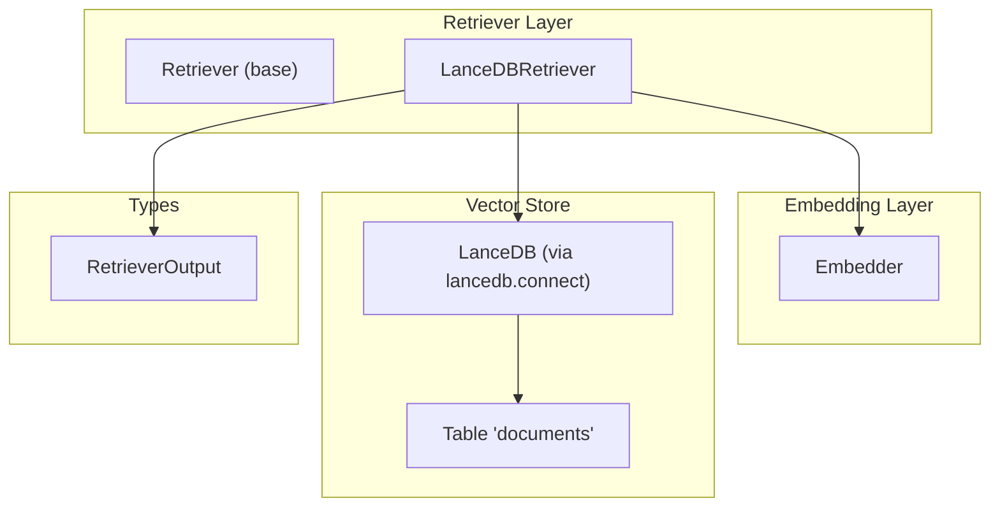
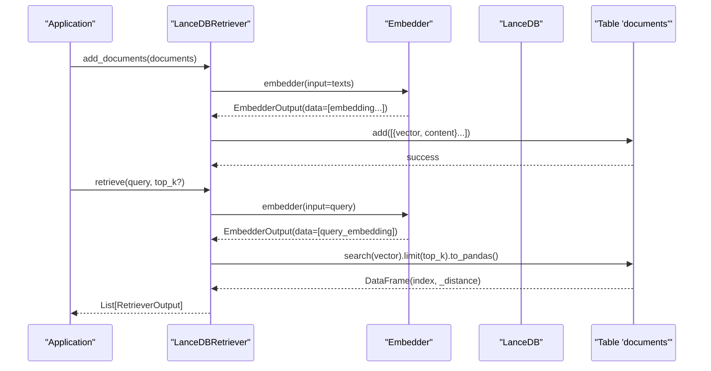
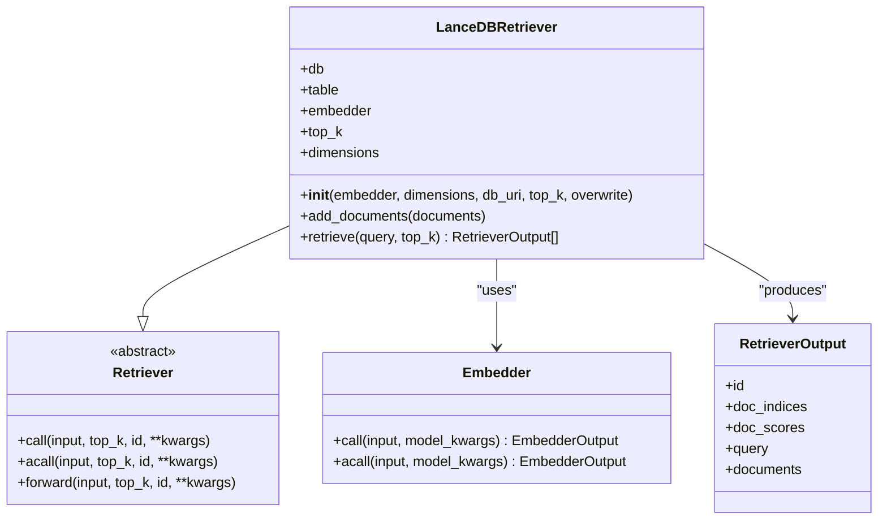
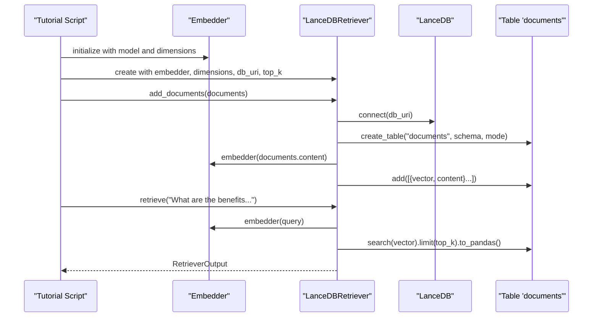
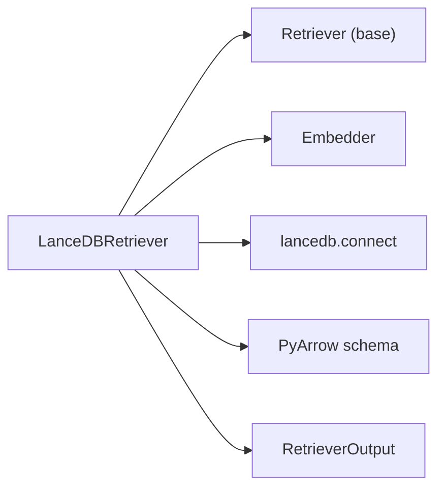

# LanceDB Retriever

<cite>
**Referenced Files in This Document**
- [lancedb_retriver.py](file://adalflow/adalflow/components/retriever/lancedb_retriver.py)
- [retriever.py](file://adalflow/adalflow/core/retriever.py)
- [types.py](file://adalflow/adalflow/core/types.py)
- [embedder.py](file://adalflow/adalflow/core/embedder.py)
- [adalflow_lancedb.py](file://tutorials/retriever/adalflow_lancedb.py)
</cite>

## Table of Contents
1. [Introduction](#introduction)
2. [Project Structure](#project-structure)
3. [Core Components](#core-components)
4. [Architecture Overview](#architecture-overview)
5. [Detailed Component Analysis](#detailed-component-analysis)
6. [Dependency Analysis](#dependency-analysis)
7. [Performance Considerations](#performance-considerations)
8. [Troubleshooting Guide](#troubleshooting-guide)
9. [Conclusion](#conclusion)
10. [Appendices](#appendices)

## Introduction
This document explains the LanceDB Retriever component that integrates a cloud-native vector database for scalable similarity search. It covers the LanceDBRetriever class implementation, vector storage and indexing strategies, query optimization, configuration options, connection management, schema requirements, and practical examples from the codebase. It also provides guidance on performance, cost optimization, integration patterns with embedding models, troubleshooting, and migration strategies.

## Project Structure
The LanceDB Retriever is implemented as a specialized retriever that extends the generic retriever interface and uses LanceDB for vector storage and similarity search. Supporting components include the base Retriever interface, the Embedder component for generating embeddings, and shared types for standardized outputs.

**Diagram sources**
- [lancedb_retriver.py](file://adalflow/adalflow/components/retriever/lancedb_retriver.py#L17-L132)
- [retriever.py](file://adalflow/adalflow/core/retriever.py#L22-L143)
- [embedder.py](file://adalflow/adalflow/core/embedder.py#L23-L236)
- [types.py](file://adalflow/adalflow/core/types.py#L291-L316)

**Section sources**
- [lancedb_retriver.py](file://adalflow/adalflow/components/retriever/lancedb_retriver.py#L1-L132)
- [retriever.py](file://adalflow/adalflow/core/retriever.py#L1-L143)
- [embedder.py](file://adalflow/adalflow/core/embedder.py#L1-L236)
- [types.py](file://adalflow/adalflow/core/types.py#L280-L316)

## Core Components
- LanceDBRetriever: Implements vector ingestion and similarity search using LanceDB. It manages a LanceDB connection, defines a table schema, ingests embeddings, and performs kNN search.
- Retriever (base): Defines the retriever interface contract, including lifecycle and output types.
- Embedder: Orchestrates model clients to produce embeddings for text inputs.
- RetrieverOutput: Standardized output structure for retrieval results.

Key capabilities:
- Vector storage with PyArrow-backed schema and LanceDB table creation.
- Batch embedding ingestion via an Embedder.
- Similarity search with configurable top_k and distance metrics.
- Logging and error handling for robust operation.

**Section sources**
- [lancedb_retriver.py](file://adalflow/adalflow/components/retriever/lancedb_retriver.py#L17-L132)
- [retriever.py](file://adalflow/adalflow/core/retriever.py#L22-L143)
- [embedder.py](file://adalflow/adalflow/core/embedder.py#L23-L236)
- [types.py](file://adalflow/adalflow/core/types.py#L291-L316)

## Architecture Overview
The LanceDB Retriever sits between the Embedder and LanceDB. Documents are embedded and stored as vectors with associated content. Queries are embedded and searched against the LanceDB table to return top-k nearest neighbors.

**Diagram sources**
- [lancedb_retriver.py](file://adalflow/adalflow/components/retriever/lancedb_retriver.py#L61-L131)
- [embedder.py](file://adalflow/adalflow/core/embedder.py#L133-L188)
- [types.py](file://adalflow/adalflow/core/types.py#L291-L316)

## Detailed Component Analysis

### LanceDBRetriever Class
Implements vector ingestion and similarity search:
- Initialization:
  - Connects to LanceDB using a URI.
  - Creates a table named "documents" with a PyArrow schema: vector column (fixed-length float32 list sized by dimensions), content column (string).
  - Supports overwrite or append modes when creating the table.
- add_documents:
  - Extracts content fields from input documents.
  - Uses the Embedder to compute embeddings.
  - Inserts records with vector and content into the table.
- retrieve:
  - Accepts a single query or a list of queries.
  - Embeds queries via the Embedder.
  - Performs a vector similarity search per query, limits results to top_k, and converts results to a pandas DataFrame.
  - Builds RetrieverOutput with indices and distances.

**Diagram sources**
- [lancedb_retriver.py](file://adalflow/adalflow/components/retriever/lancedb_retriver.py#L17-L132)
- [retriever.py](file://adalflow/adalflow/core/retriever.py#L22-L143)
- [embedder.py](file://adalflow/adalflow/core/embedder.py#L23-L236)
- [types.py](file://adalflow/adalflow/core/types.py#L291-L316)

Implementation highlights:
- Schema and table creation:
  - Vector type is a fixed-size list of float32 matching the configured dimensions.
  - Content is stored as a string.
  - Mode is overwrite or append depending on the overwrite flag.
- Ingestion:
  - Documents are batched by extracting content, embedding, and inserting into the table.
- Retrieval:
  - Embeds queries and runs vector search with limit(top_k).
  - Converts results to indices and distances for output.

**Section sources**
- [lancedb_retriver.py](file://adalflow/adalflow/components/retriever/lancedb_retriver.py#L35-L84)
- [lancedb_retriver.py](file://adalflow/adalflow/components/retriever/lancedb_retriver.py#L85-L131)

### Base Retriever Interface
Defines the retriever contract:
- Methods for building indices, saving/loading state, and performing synchronous/asynchronous retrieval.
- Forward pass integrates with gradient-aware components and tracks inputs and hyperparameters like top_k.

**Section sources**
- [retriever.py](file://adalflow/adalflow/core/retriever.py#L22-L143)

### Embedder Component
Handles model client orchestration and embedding output processing:
- Composes model kwargs, converts inputs to API kwargs, calls the model client, parses responses, and applies optional output processors.
- Provides both synchronous and asynchronous call methods.

**Section sources**
- [embedder.py](file://adalflow/adalflow/core/embedder.py#L23-L236)

### RetrieverOutput Data Structure
Standardized output for retrieval:
- Includes identifiers, document indices, scores, the query used, and optionally the retrieved documents.

**Section sources**
- [types.py](file://adalflow/adalflow/core/types.py#L291-L316)

### Example: LanceDB Vector Store Setup and Search
A tutorial demonstrates:
- Creating an Embedder with a specific model and dimensions.
- Initializing LanceDBRetriever with the Embedder, dimensions, URI, and top_k.
- Adding documents to the retriever’s index.
- Executing a similarity search and printing results.

**Diagram sources**
- [adalflow_lancedb.py](file://tutorials/retriever/adalflow_lancedb.py#L32-L50)
- [lancedb_retriver.py](file://adalflow/adalflow/components/retriever/lancedb_retriver.py#L61-L131)
- [embedder.py](file://adalflow/adalflow/core/embedder.py#L133-L188)

**Section sources**
- [adalflow_lancedb.py](file://tutorials/retriever/adalflow_lancedb.py#L1-L51)

## Dependency Analysis
- LanceDBRetriever depends on:
  - Retriever base class for interface compliance.
  - Embedder for vector generation.
  - LanceDB Python driver for connection and table operations.
  - PyArrow for schema definition.
  - RetrieverOutput for standardized results.

**Diagram sources**
- [lancedb_retriver.py](file://adalflow/adalflow/components/retriever/lancedb_retriver.py#L1-L14)
- [retriever.py](file://adalflow/adalflow/core/retriever.py#L22-L44)
- [embedder.py](file://adalflow/adalflow/core/embedder.py#L23-L64)
- [types.py](file://adalflow/adalflow/core/types.py#L291-L316)

**Section sources**
- [lancedb_retriver.py](file://adalflow/adalflow/components/retriever/lancedb_retriver.py#L1-L14)
- [retriever.py](file://adalflow/adalflow/core/retriever.py#L22-L44)
- [embedder.py](file://adalflow/adalflow/core/embedder.py#L23-L64)
- [types.py](file://adalflow/adalflow/core/types.py#L291-L316)

## Performance Considerations
- Indexing and storage:
  - LanceDB provides automatic indexing for vector columns, minimizing manual index management overhead.
  - Efficient storage formats reduce I/O and improve latency.
- Query optimization:
  - Limit results to top_k to reduce downstream processing.
  - Batch embedding for large document sets to amortize API costs and latency.
- Cost optimization:
  - Choose appropriate embedding dimensions to balance quality and cost.
  - Use incremental ingestion with append mode for ongoing updates.
- Scalability:
  - Leverage LanceDB’s vector search capabilities for large-scale similarity retrieval.
  - Consider partitioning or sharding strategies at the application level for very large corpora.

[No sources needed since this section provides general guidance]

## Troubleshooting Guide
Common issues and resolutions:
- Empty or invalid query:
  - The retriever raises an error for empty queries. Ensure queries are non-empty strings or non-empty lists.
- Missing or uninitialized table:
  - If the table is missing or not initialized, the retriever raises an error. Verify the db_uri and table creation logic.
- Connectivity problems:
  - Confirm LanceDB is reachable at the provided URI. Check permissions and network access.
- Index rebuilding:
  - To rebuild the index, recreate the table with overwrite enabled during initialization.
- Query performance tuning:
  - Adjust top_k to balance recall and latency.
  - Ensure embedding dimensions match the schema and model configuration.

**Section sources**
- [lancedb_retriver.py](file://adalflow/adalflow/components/retriever/lancedb_retriver.py#L100-L106)
- [lancedb_retriver.py](file://adalflow/adalflow/components/retriever/lancedb_retriver.py#L85-L131)

## Conclusion
The LanceDB Retriever provides a streamlined, cloud-native solution for scalable similarity search. By combining LanceDB’s automatic indexing and efficient storage with a flexible embedding pipeline, it enables fast, reliable retrieval with minimal operational overhead. Proper configuration of embedding dimensions, ingestion workflows, and query parameters ensures strong performance and cost efficiency.

[No sources needed since this section summarizes without analyzing specific files]

## Appendices

### Configuration Options and Parameters
- db_uri: Path or URI to the LanceDB storage location.
- dimensions: Dimensionality of the embeddings used for vector schema.
- top_k: Number of top results to return for each query.
- overwrite: Whether to overwrite the existing table or append new records.
- Embedder model configuration: Model name, dimensions, encoding format, and other model-specific parameters.

**Section sources**
- [lancedb_retriver.py](file://adalflow/adalflow/components/retriever/lancedb_retriver.py#L35-L59)
- [adalflow_lancedb.py](file://tutorials/retriever/adalflow_lancedb.py#L6-L10)

### Database Schema Requirements
- Table name: "documents".
- Columns:
  - vector: Fixed-length list of float32 with size equal to dimensions.
  - content: String representing the document text.

**Section sources**
- [lancedb_retriver.py](file://adalflow/adalflow/components/retriever/lancedb_retriver.py#L50-L59)

### Integration Patterns with Embedding Models
- Use the Embedder component to generate embeddings for ingestion and querying.
- Supported model clients are accessible via the ModelClientType abstraction.
- Configure model kwargs (e.g., model name, dimensions) to align with the chosen embedding model.

**Section sources**
- [embedder.py](file://adalflow/adalflow/core/embedder.py#L66-L90)
- [types.py](file://adalflow/adalflow/core/types.py#L66-L111)

### Migration Strategies from Local Stores
- Export existing vectors and metadata from the local store.
- Initialize LanceDBRetriever with the same embedding dimensions.
- Re-ingest documents using the Embedder and add_documents.
- Validate retrieval quality and adjust top_k or model parameters as needed.

[No sources needed since this section provides general guidance]