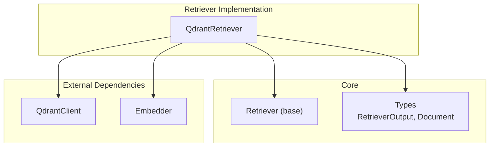
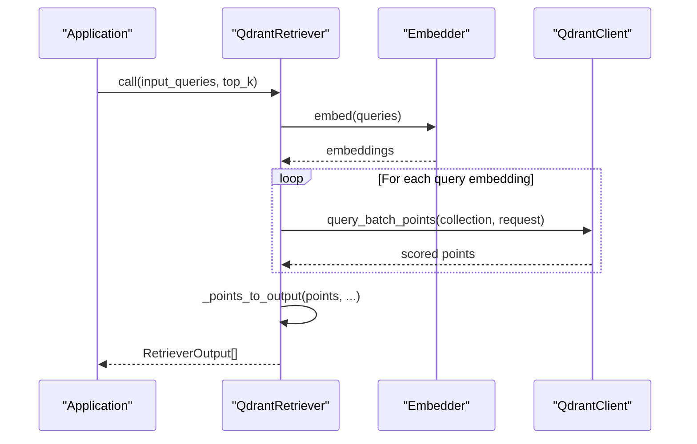
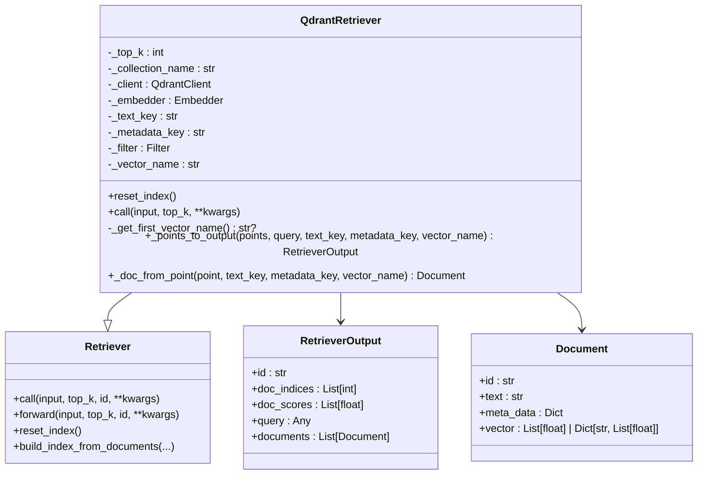
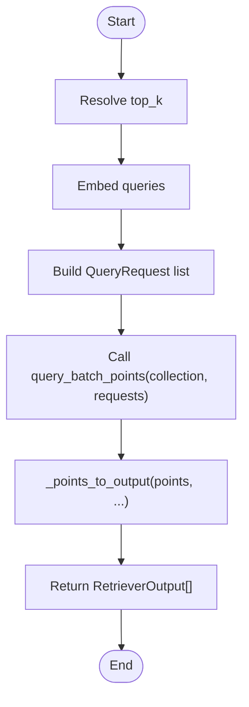
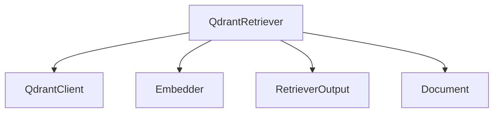

# Qdrant Retriever

<cite>
**Referenced Files in This Document**
- [qdrant_retriever.py](file://adalflow/adalflow/components/retriever/qdrant_retriever.py)
- [retriever.py](file://adalflow/adalflow/core/retriever.py)
- [types.py](file://adalflow/adalflow/core/types.py)
- [test_qdrant_retriever.py](file://adalflow/tests/test_qdrant_retriever.py)
</cite>

## Table of Contents
1. [Introduction](#introduction)
2. [Project Structure](#project-structure)
3. [Core Components](#core-components)
4. [Architecture Overview](#architecture-overview)
5. [Detailed Component Analysis](#detailed-component-analysis)
6. [Dependency Analysis](#dependency-analysis)
7. [Performance Considerations](#performance-considerations)
8. [Troubleshooting Guide](#troubleshooting-guide)
9. [Conclusion](#conclusion)
10. [Appendices](#appendices)

## Introduction
This document explains the Qdrant Retriever component that integrates a Qdrant vector search engine for enterprise-scale similarity search. It covers the QdrantRetriever class implementation, including collection management, vector indexing, and advanced filtering. It also documents Qdrant-specific configuration aspects such as collection settings, vector size requirements, and distance metrics (cosine, Euclidean, dot). Practical examples are provided for creating Qdrant collections, inserting batch embeddings, and performing complex similarity queries with metadata filters. Enterprise features such as sharding, replication, and backup strategies are outlined conceptually, along with performance optimization techniques, cluster management, and scaling considerations. Guidance is included for troubleshooting connectivity, collection operations, and query performance. Deployment considerations for Qdrant Cloud versus self-hosted environments and Kubernetes integration are summarized, alongside migration strategies and best practices for production deployments.

## Project Structure
The Qdrant Retriever is implemented as a specialized retriever that extends the generic Retriever base class. It relies on an external Qdrant client and an embedder to transform queries into vectors and retrieve nearest neighbors from a Qdrant collection.

**Diagram sources**
- [qdrant_retriever.py](file://adalflow/adalflow/components/retriever/qdrant_retriever.py#L19-L160)
- [retriever.py](file://adalflow/adalflow/core/retriever.py#L22-L143)
- [types.py](file://adalflow/adalflow/core/types.py#L291-L316)

**Section sources**
- [qdrant_retriever.py](file://adalflow/adalflow/components/retriever/qdrant_retriever.py#L1-L160)
- [retriever.py](file://adalflow/adalflow/core/retriever.py#L1-L143)
- [types.py](file://adalflow/adalflow/core/types.py#L278-L316)

## Core Components
- QdrantRetriever: A retriever that transforms queries to vectors via an embedder and performs similarity search against a Qdrant collection using batched queries. It supports configurable top-k results, vector naming, and payload field mapping.
- Retriever (base): Defines the interface for retrievers, including the call signature and forward tracing behavior.
- Types: Provides data structures for retriever outputs and documents, including RetrieverOutput and Document.

Key responsibilities:
- Vectorization: Uses an Embedder to produce query embeddings.
- Collection interaction: Uses QdrantClient to query a named collection with optional filters and vector names.
- Output formatting: Converts Qdrant points to standardized Document objects and wraps results in RetrieverOutput.

**Section sources**
- [qdrant_retriever.py](file://adalflow/adalflow/components/retriever/qdrant_retriever.py#L19-L160)
- [retriever.py](file://adalflow/adalflow/core/retriever.py#L22-L143)
- [types.py](file://adalflow/adalflow/core/types.py#L291-L316)

## Architecture Overview
The Qdrant Retriever sits between the application’s query input and the Qdrant vector database. It delegates vectorization to an embedder and delegates retrieval to QdrantClient. Results are normalized into a standard output format.

**Diagram sources**
- [qdrant_retriever.py](file://adalflow/adalflow/components/retriever/qdrant_retriever.py#L63-L103)
- [types.py](file://adalflow/adalflow/core/types.py#L291-L316)

## Detailed Component Analysis

### QdrantRetriever Class
The QdrantRetriever class encapsulates:
- Initialization parameters: collection name, QdrantClient instance, Embedder instance, top_k, vector_name, text_key, metadata_key, and a default filter.
- Index lifecycle: reset_index deletes an existing collection if present.
- Query execution: call embeds queries, constructs QueryRequest objects per query, executes batched queries, and converts results to RetrieverOutput.
- Vector selection: _get_first_vector_name resolves the vector name for single or multi-vector collections.
- Output conversion: _points_to_output and _doc_from_point map Qdrant points to standardized Document objects.

**Diagram sources**
- [qdrant_retriever.py](file://adalflow/adalflow/components/retriever/qdrant_retriever.py#L19-L160)
- [retriever.py](file://adalflow/adalflow/core/retriever.py#L22-L143)
- [types.py](file://adalflow/adalflow/core/types.py#L291-L316)

Implementation highlights:
- Vector indexing and collection management:
  - reset_index deletes an existing collection by name.
  - _get_first_vector_name inspects collection config to select the appropriate vector field for multi-vector setups.
- Advanced filtering:
  - A default filter can be supplied during initialization and is applied to each QueryRequest.
- Output normalization:
  - _points_to_output aggregates indices, scores, and documents into a RetrieverOutput.
  - _doc_from_point extracts text and metadata from payload and selects the correct vector when multiple vectors are present.

**Section sources**
- [qdrant_retriever.py](file://adalflow/adalflow/components/retriever/qdrant_retriever.py#L37-L160)
- [types.py](file://adalflow/adalflow/core/types.py#L291-L316)

### Retrieval Workflow Details
The retrieval process involves:
- Embedding queries using the provided embedder.
- Constructing QueryRequest objects with limit, vector name, payload inclusion, vector inclusion, and optional filter.
- Executing batched queries against the target collection.
- Converting scored points to standardized documents and outputs.

**Diagram sources**
- [qdrant_retriever.py](file://adalflow/adalflow/components/retriever/qdrant_retriever.py#L63-L103)

**Section sources**
- [qdrant_retriever.py](file://adalflow/adalflow/components/retriever/qdrant_retriever.py#L63-L103)

### Configuration and Data Model Notes
- RetrieverOutput: Holds doc_indices, doc_scores, query, and documents for a single query.
- Document: Captures id, text, meta_data, and vector data returned from Qdrant.
- Payload mapping: text_key and metadata_key define how to extract text and metadata from the Qdrant payload.

These types are used by QdrantRetriever to normalize results consistently.

**Section sources**
- [types.py](file://adalflow/adalflow/core/types.py#L291-L316)

## Dependency Analysis
QdrantRetriever depends on:
- QdrantClient for collection existence checks, deletion, and querying.
- Embedder for converting text queries into vectors.
- Standardized types for output and document representation.

**Diagram sources**
- [qdrant_retriever.py](file://adalflow/adalflow/components/retriever/qdrant_retriever.py#L19-L160)
- [types.py](file://adalflow/adalflow/core/types.py#L291-L316)

**Section sources**
- [qdrant_retriever.py](file://adalflow/adalflow/components/retriever/qdrant_retriever.py#L19-L160)
- [types.py](file://adalflow/adalflow/core/types.py#L291-L316)

## Performance Considerations
- Batched queries: The implementation uses query_batch_points to reduce round-trips when retrieving for multiple queries.
- Vector selection: Using vector_name ensures the correct vector field is queried, especially in multi-vector collections.
- Payload and vector inclusion: Including with_payload and with_vector can increase response sizes; tune based on downstream needs.
- Top-k tuning: Adjust top_k to balance recall and latency.
- Embedding dimensionality: Ensure embeddings align with the collection’s vector size and distance metric configuration.
- Filtering: Complex filters can impact query performance; keep filters selective and indexed via Qdrant’s filtering capabilities.

[No sources needed since this section provides general guidance]

## Troubleshooting Guide
Common issues and resolutions:
- Connectivity failures:
  - Verify QdrantClient connection parameters and network reachability.
  - Confirm collection existence before querying.
- Collection operations:
  - Use reset_index to delete an existing collection prior to recreation.
- Query performance:
  - Reduce top_k or refine filters to improve latency.
  - Ensure vector_name matches the collection’s configured vector field.
- Output shape mismatches:
  - Validate text_key and metadata_key against payload structure.
  - For multi-vector collections, confirm vector_name selection via _get_first_vector_name.

Validation and behavior are covered by tests:
- reset_index triggers delete_collection when the collection exists.
- call produces RetrieverOutput with expected fields for single and multi-query inputs.
- _points_to_output and _doc_from_point correctly map Qdrant points to standardized types.
- Vector name resolution works for both unnamed and named vectors.

**Section sources**
- [test_qdrant_retriever.py](file://adalflow/tests/test_qdrant_retriever.py#L32-L187)
- [qdrant_retriever.py](file://adalflow/adalflow/components/retriever/qdrant_retriever.py#L59-L117)

## Conclusion
The Qdrant Retriever provides a streamlined integration with Qdrant for scalable similarity search. It handles vectorization, collection management, and output normalization while supporting advanced filtering and multi-vector collections. By tuning top_k, filters, and vector selection, teams can optimize for performance and accuracy. The component’s design aligns with the broader AdalFlow retriever ecosystem, enabling consistent retrieval workflows across diverse vector databases.

[No sources needed since this section summarizes without analyzing specific files]

## Appendices

### Practical Usage Patterns
- Creating a Qdrant collection and inserting embeddings:
  - Use QdrantClient to create a collection with appropriate vector size and distance metric.
  - Insert points with payload fields aligned to text_key and metadata_key.
- Performing similarity search:
  - Initialize QdrantRetriever with collection_name, QdrantClient, and Embedder.
  - Call with queries and optional top_k; supply a filter to restrict results by metadata.
- Multi-vector collections:
  - Configure multiple vectors in the collection and let _get_first_vector_name resolve the vector name, or explicitly set vector_name.

[No sources needed since this section provides general guidance]

### Enterprise Features and Deployment Notes
- Sharding, replication, and backups:
  - Configure these at the Qdrant cluster level; ensure client connectivity and credentials are properly managed.
- Scaling:
  - Distribute load across shards and replicas; monitor latency and throughput; adjust top_k and filters accordingly.
- Security:
  - Use secure connections and access controls; manage secrets for client credentials.
- Kubernetes:
  - Deploy Qdrant as a stateful service; configure persistent volumes and headless services; expose via ingress or service mesh.

[No sources needed since this section provides general guidance]

### Migration Strategies
- From other vector databases:
  - Export data and re-index into Qdrant using compatible vector sizes and distance metrics.
  - Align payload fields with text_key and metadata_key to preserve retrieval semantics.
- Production readiness:
  - Validate performance under realistic workloads; establish monitoring and alerting; plan capacity and backup strategies.

[No sources needed since this section provides general guidance]