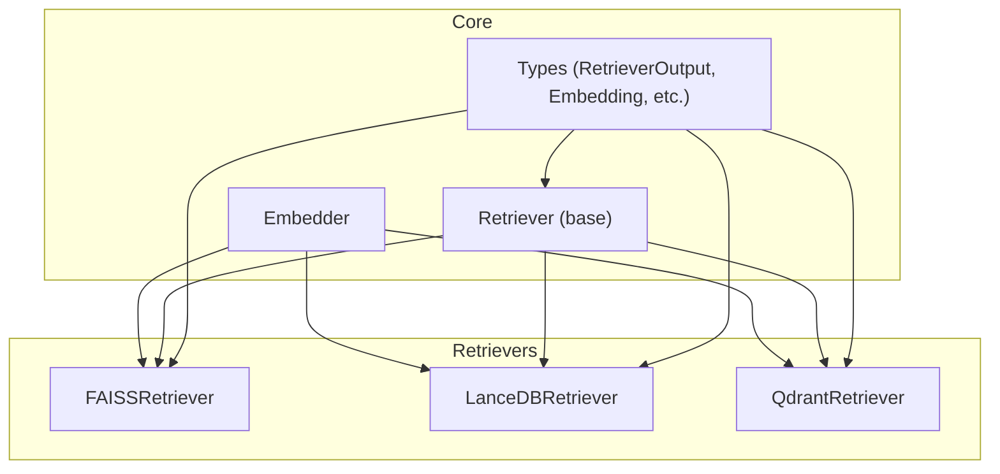
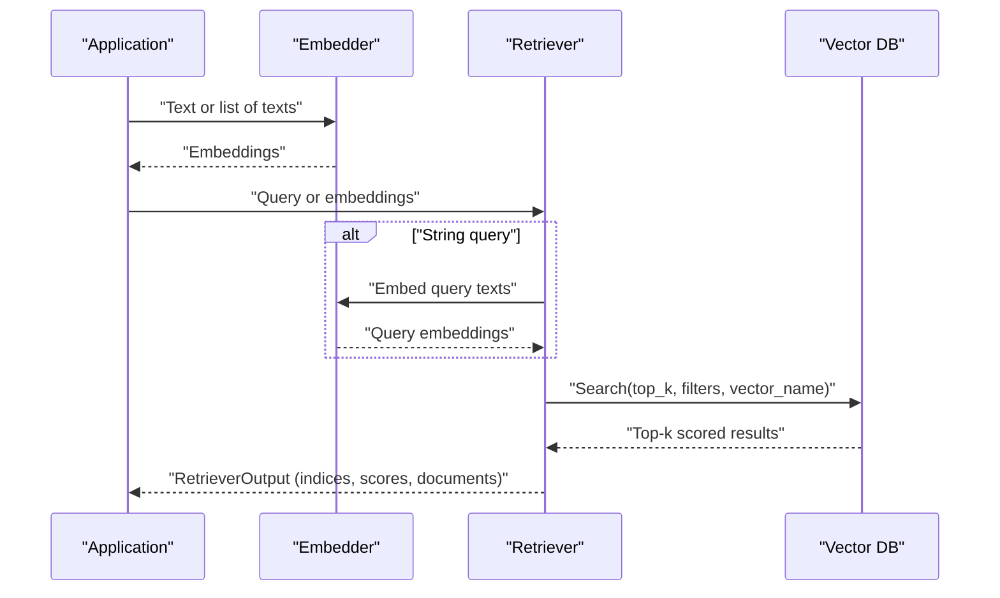
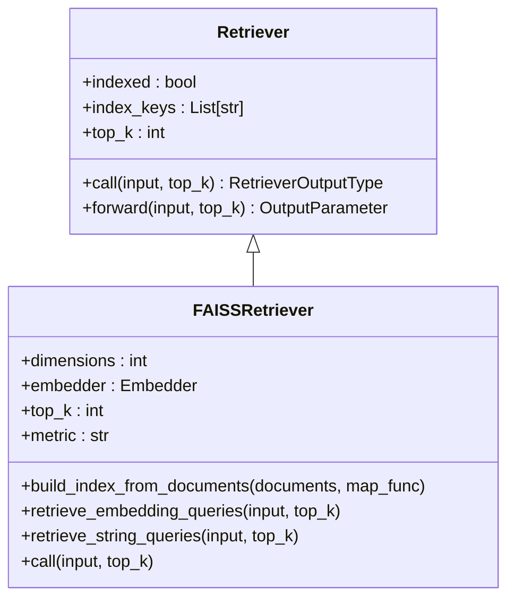
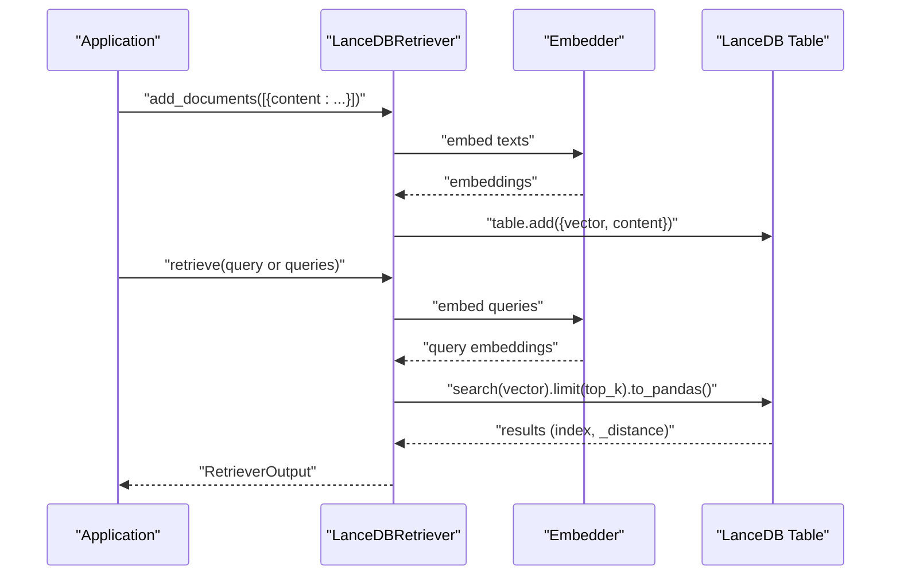
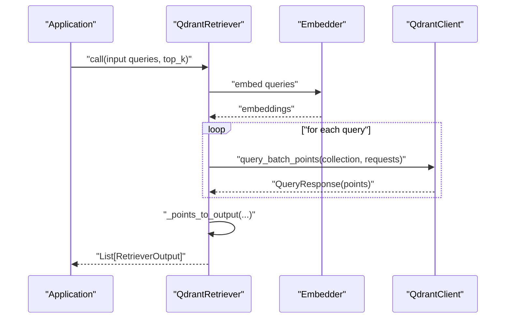
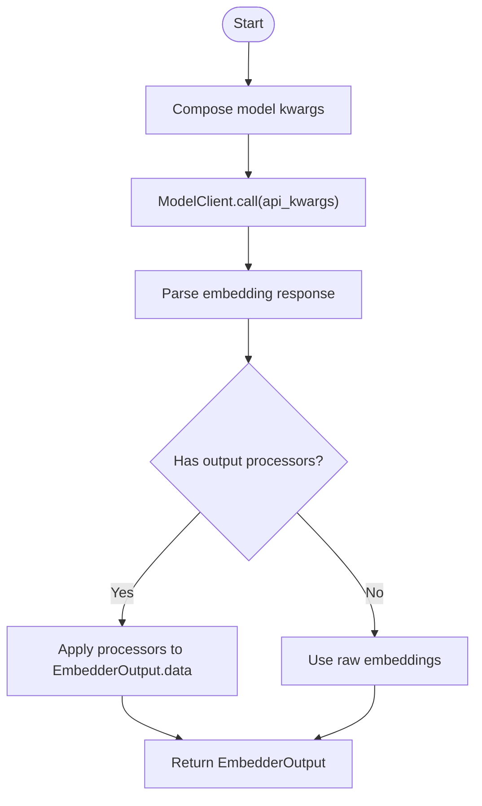
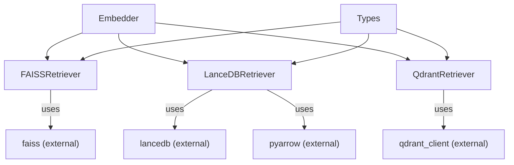

# Vector Retrievers

<cite>
**Referenced Files in This Document**
- [faiss_retriever.py](file://adalflow/adalflow/components/retriever/faiss_retriever.py)
- [lancedb_retriver.py](file://adalflow/adalflow/components/retriever/lancedb_retriver.py)
- [qdrant_retriever.py](file://adalflow/adalflow/components/retriever/qdrant_retriever.py)
- [retriever.py](file://adalflow/adalflow/core/retriever.py)
- [embedder.py](file://adalflow/adalflow/core/embedder.py)
- [types.py](file://adalflow/adalflow/core/types.py)
- [test_faiss_retriever.py](file://adalflow/tests/test_faiss_retriever.py)
- [test_lancedb_retriver.py](file://adalflow/tests/test_lancedb_retriver.py)
- [test_qdrant_retriever.py](file://adalflow/tests/test_qdrant_retriever.py)
- [adalflow_lancedb.py](file://tutorials/retriever/adalflow_lancedb.py)
- [data.py](file://tutorials/retriever/data.py)
</cite>

## Table of Contents
1. [Introduction](#introduction)
2. [Project Structure](#project-structure)
3. [Core Components](#core-components)
4. [Architecture Overview](#architecture-overview)
5. [Detailed Component Analysis](#detailed-component-analysis)
6. [Dependency Analysis](#dependency-analysis)
7. [Performance Considerations](#performance-considerations)
8. [Troubleshooting Guide](#troubleshooting-guide)
9. [Conclusion](#conclusion)
10. [Appendices](#appendices)

## Introduction
This document explains AdalFlow’s vector retrieval capabilities with a focus on embedding-based similarity search. It covers three vector database integrations:
- FAISS: in-memory, CPU/GPU-accelerated similarity search
- LanceDB: embedded, Arrow-native vector storage
- Qdrant: cloud-native vector search with advanced filtering and multi-vector support

It also documents embedding model integration, vector dimension configuration, similarity scoring, indexing strategies, performance optimization, scaling, and troubleshooting.

## Project Structure
The vector retrieval system is organized around a shared base retriever interface and three specialized retrievers. Embeddings are produced by the embedder component and consumed by the retrievers.

**Diagram sources**
- [retriever.py](file://adalflow/adalflow/core/retriever.py#L22-L143)
- [embedder.py](file://adalflow/adalflow/core/embedder.py#L23-L236)
- [types.py](file://adalflow/adalflow/core/types.py#L291-L317)
- [faiss_retriever.py](file://adalflow/adalflow/components/retriever/faiss_retriever.py#L51-L369)
- [lancedb_retriver.py](file://adalflow/adalflow/components/retriever/lancedb_retriver.py#L17-L132)
- [qdrant_retriever.py](file://adalflow/adalflow/components/retriever/qdrant_retriever.py#L19-L160)

**Section sources**
- [retriever.py](file://adalflow/adalflow/core/retriever.py#L22-L143)
- [embedder.py](file://adalflow/adalflow/core/embedder.py#L23-L236)
- [types.py](file://adalflow/adalflow/core/types.py#L291-L317)

## Core Components
- Base Retriever: defines the contract for building indexes, saving/loading state, and performing retrieval with a unified output format.
- Embedder: orchestrates model clients to produce embeddings for text and batches them for efficient processing.
- Types: standardizes data structures for embeddings, usage metrics, and retriever outputs.

Key responsibilities:
- Embedder handles model client communication, input preparation, response parsing, and optional post-processing.
- Retriever base class enforces consistent behavior across implementations and integrates with tracing/optimization components.

**Section sources**
- [retriever.py](file://adalflow/adalflow/core/retriever.py#L22-L143)
- [embedder.py](file://adalflow/adalflow/core/embedder.py#L23-L236)
- [types.py](file://adalflow/adalflow/core/types.py#L140-L215)
- [types.py](file://adalflow/adalflow/core/types.py#L291-L317)

## Architecture Overview
The retrieval pipeline follows a consistent flow: embedder produces vectors, retrievers index or query against vector databases, and outputs are standardized.

**Diagram sources**
- [embedder.py](file://adalflow/adalflow/core/embedder.py#L133-L160)
- [faiss_retriever.py](file://adalflow/adalflow/components/retriever/faiss_retriever.py#L236-L323)
- [lancedb_retriver.py](file://adalflow/adalflow/components/retriever/lancedb_retriver.py#L85-L131)
- [qdrant_retriever.py](file://adalflow/adalflow/components/retriever/qdrant_retriever.py#L63-L103)

## Detailed Component Analysis

### FAISS Retriever
FAISSRetriever provides in-memory similarity search with configurable metrics and automatic normalization for cosine-based inner product indexes.

Key behaviors:
- Index construction from precomputed embeddings; supports float32 arrays and optional normalization.
- Metrics:
  - cosine: uses inner product index; converts cosine similarity to probability-like scores in [0, 1].
  - euclidean: uses L2 index; no normalization enforced.
  - prob: cosine similarity mapped to [0, 1] for probabilistic interpretation.
- Input handling:
  - Accepts string queries (embed via embedder) or direct embedding arrays.
  - Normalizes embeddings when needed for cosine similarity.
- Output:
  - Standardized RetrieverOutput with indices and scores; filters padded -1 entries.

**Diagram sources**
- [retriever.py](file://adalflow/adalflow/core/retriever.py#L22-L143)
- [faiss_retriever.py](file://adalflow/adalflow/components/retriever/faiss_retriever.py#L51-L369)

Implementation highlights:
- Index creation validates dimensions and asserts consistent sizes.
- Supports document mapping function for flexible input formats.
- Converts cosine similarity to probability when metric is set to prob.

Usage example references:
- Building an index from embeddings and querying:
  - [faiss_retriever.py](file://adalflow/adalflow/components/retriever/faiss_retriever.py#L150-L202)
  - [faiss_retriever.py](file://adalflow/adalflow/components/retriever/faiss_retriever.py#L236-L323)
- Tests validating behavior:
  - [test_faiss_retriever.py](file://adalflow/tests/test_faiss_retriever.py#L48-L117)

**Section sources**
- [faiss_retriever.py](file://adalflow/adalflow/components/retriever/faiss_retriever.py#L51-L369)
- [test_faiss_retriever.py](file://adalflow/tests/test_faiss_retriever.py#L22-L122)

### LanceDB Retriever
LanceDBRetriever stores and retrieves embeddings using LanceDB’s Arrow-backed tables. It manages schema, adds documents with computed embeddings, and performs vector similarity search.

Key behaviors:
- Schema enforces fixed-size float32 vectors and content fields.
- Adds documents by embedding content and appending rows.
- Search returns indices and distances; wraps results into RetrieverOutput.

**Diagram sources**
- [lancedb_retriver.py](file://adalflow/adalflow/components/retriever/lancedb_retriver.py#L35-L83)
- [lancedb_retriver.py](file://adalflow/adalflow/components/retriever/lancedb_retriver.py#L85-L131)

Usage example references:
- Tutorial initializing and using LanceDB retriever:
  - [adalflow_lancedb.py](file://tutorials/retriever/adalflow_lancedb.py#L32-L50)
  - [data.py](file://tutorials/retriever/data.py#L1-L22)
- Tests validating add and retrieve:
  - [test_lancedb_retriver.py](file://adalflow/tests/test_lancedb_retriver.py#L48-L108)

**Section sources**
- [lancedb_retriver.py](file://adalflow/adalflow/components/retriever/lancedb_retriver.py#L17-L132)
- [adalflow_lancedb.py](file://tutorials/retriever/adalflow_lancedb.py#L32-L50)
- [test_lancedb_retriver.py](file://adalflow/tests/test_lancedb_retriver.py#L16-L142)

### Qdrant Retriever
QdrantRetriever integrates with Qdrant collections to perform vector similarity search with optional filters and multi-vector support.

Key behaviors:
- Initializes with a collection name, client, embedder, and optional vector name.
- Embeds queries and issues batched search requests.
- Converts scored points to RetrieverOutput and constructs Document objects with text, metadata, and vector fields.

**Diagram sources**
- [qdrant_retriever.py](file://adalflow/adalflow/components/retriever/qdrant_retriever.py#L37-L103)
- [qdrant_retriever.py](file://adalflow/adalflow/components/retriever/qdrant_retriever.py#L120-L159)

Usage example references:
- Tests covering single/multi-query, vector name resolution, and output conversion:
  - [test_qdrant_retriever.py](file://adalflow/tests/test_qdrant_retriever.py#L38-L187)

**Section sources**
- [qdrant_retriever.py](file://adalflow/adalflow/components/retriever/qdrant_retriever.py#L19-L160)
- [test_qdrant_retriever.py](file://adalflow/tests/test_qdrant_retriever.py#L17-L187)

### Embedding Model Integration and Vector Dimensions
- Embedder composes model kwargs, sends inputs to the model client, parses responses, and applies optional output processors.
- Embedding dimension is configured via model kwargs (e.g., dimensions parameter) and must match the vector database schema or index configuration.
- BatchEmbedder enables large-scale embedding with configurable batch size.

**Diagram sources**
- [embedder.py](file://adalflow/adalflow/core/embedder.py#L92-L160)

**Section sources**
- [embedder.py](file://adalflow/adalflow/core/embedder.py#L23-L236)
- [types.py](file://adalflow/adalflow/core/types.py#L140-L215)

### Similarity Scoring Algorithms
- FAISS cosine: inner product of normalized vectors; optionally mapped to [0, 1] for probabilistic interpretation.
- FAISS Euclidean: L2 distance; lower is better.
- LanceDB/Qdrant: distances/scores returned by the underlying vector DB; FAISS prob metric converts cosine to [0, 1].

**Section sources**
- [faiss_retriever.py](file://adalflow/adalflow/components/retriever/faiss_retriever.py#L204-L208)
- [faiss_retriever.py](file://adalflow/adalflow/components/retriever/faiss_retriever.py#L115-L122)

## Dependency Analysis
The retrievers depend on the embedder and share a common output type. FAISS relies on FAISS library internals, LanceDB on LanceDB connectivity and Arrow schema, and Qdrant on the Qdrant client.

**Diagram sources**
- [faiss_retriever.py](file://adalflow/adalflow/components/retriever/faiss_retriever.py#L3-L34)
- [lancedb_retriver.py](file://adalflow/adalflow/components/retriever/lancedb_retriver.py#L1-L14)
- [qdrant_retriever.py](file://adalflow/adalflow/components/retriever/qdrant_retriever.py#L3-L16)

**Section sources**
- [faiss_retriever.py](file://adalflow/adalflow/components/retriever/faiss_retriever.py#L3-L34)
- [lancedb_retriver.py](file://adalflow/adalflow/components/retriever/lancedb_retriver.py#L1-L14)
- [qdrant_retriever.py](file://adalflow/adalflow/components/retriever/qdrant_retriever.py#L3-L16)

## Performance Considerations
- FAISS
  - Prefer normalized embeddings for cosine inner product to avoid recomputation.
  - Use float32 arrays and ensure consistent dimensionality.
  - Metric choice affects index type and scoring semantics; cosine with prob mapping simplifies thresholding.
- LanceDB
  - Fixed vector schema size; ensure dimensions match model kwargs.
  - Batch add for bulk ingestion; consider overwrite vs append modes.
- Qdrant
  - Multi-vector collections supported; resolve vector name if multiple vectors exist.
  - Use filters to reduce candidate sets and improve latency.
- Embedding
  - Use BatchEmbedder for large corpora to amortize overhead.
  - Tune batch size to balance throughput and memory.

[No sources needed since this section provides general guidance]

## Troubleshooting Guide
Common issues and resolutions:
- FAISS
  - Empty index: ensure documents were added before querying; reset and rebuild if needed.
  - Dimension mismatch: verify that all embeddings have the same dimension as configured.
  - Non-normalized embeddings with cosine: FAISSRetriever normalizes automatically for cosine; for L2, normalization is not enforced.
- LanceDB
  - No documents added: add_documents must be called prior to retrieval.
  - Missing table: initialize with proper db_uri and overwrite mode.
- Qdrant
  - Collection does not exist: ensure collection is created before querying.
  - Vector name ambiguity: resolve vector name when multiple vectors are present.
- Embedding
  - Incorrect dimensions: confirm model kwargs include the correct dimensions.
  - Large input batching: use BatchEmbedder for long lists of texts.

Concrete references:
- FAISS index and query validations:
  - [faiss_retriever.py](file://adalflow/adalflow/components/retriever/faiss_retriever.py#L241-L244)
  - [faiss_retriever.py](file://adalflow/adalflow/components/retriever/faiss_retriever.py#L138-L144)
- LanceDB table and query checks:
  - [lancedb_retriver.py](file://adalflow/adalflow/components/retriever/lancedb_retriver.py#L103-L106)
  - [lancedb_retriver.py](file://adalflow/adalflow/components/retriever/lancedb_retriver.py#L68-L70)
- Qdrant collection existence and vector name resolution:
  - [qdrant_retriever.py](file://adalflow/adalflow/components/retriever/qdrant_retriever.py#L60-L62)
  - [qdrant_retriever.py](file://adalflow/adalflow/components/retriever/qdrant_retriever.py#L105-L117)

**Section sources**
- [faiss_retriever.py](file://adalflow/adalflow/components/retriever/faiss_retriever.py#L138-L144)
- [faiss_retriever.py](file://adalflow/adalflow/components/retriever/faiss_retriever.py#L241-L244)
- [lancedb_retriver.py](file://adalflow/adalflow/components/retriever/lancedb_retriver.py#L68-L70)
- [lancedb_retriver.py](file://adalflow/adalflow/components/retriever/lancedb_retriver.py#L103-L106)
- [qdrant_retriever.py](file://adalflow/adalflow/components/retriever/qdrant_retriever.py#L60-L62)
- [qdrant_retriever.py](file://adalflow/adalflow/components/retriever/qdrant_retriever.py#L105-L117)

## Conclusion
AdalFlow’s vector retrieval stack provides a cohesive, extensible framework:
- A unified embedder produces standardized embeddings.
- Three retrievers target different deployment needs: FAISS for in-memory speed, LanceDB for embedded simplicity, and Qdrant for cloud-native features.
- Consistent output types and shared base classes enable easy swapping and composition.

Choose the retriever based on your environment, scale, and feature requirements, and configure embedding dimensions and metrics accordingly.

[No sources needed since this section summarizes without analyzing specific files]

## Appendices

### Vector Database Selection Criteria
- FAISS
  - Pros: fast in-memory search, GPU support, simple setup.
  - Cons: ephemeral index; not suitable for persistent or distributed workloads.
- LanceDB
  - Pros: embedded, Arrow-native, schema enforcement, easy persistence.
  - Cons: limited to local/embedded deployments; less mature filtering compared to cloud-native solutions.
- Qdrant
  - Pros: cloud-native, advanced filtering, multi-vector support, robust APIs.
  - Cons: requires external service; network latency considerations.

[No sources needed since this section provides general guidance]

### Memory Management and Scaling Tips
- FAISS
  - Keep embeddings float32; normalize only when using cosine inner product.
  - Monitor index size; rebuild when adding large batches.
- LanceDB
  - Use overwrite mode for fresh datasets; append for incremental updates.
  - Ensure disk space for persisted tables.
- Qdrant
  - Use filters to constrain search space.
  - Consider sharding and replicas for high availability.

[No sources needed since this section provides general guidance]