# Testing Framework

<cite>
**Referenced Files in This Document**
- [tests/README.md](file://adalflow/tests/README.md)
- [pyproject.toml](file://pyproject.toml)
- [tests/test_component.py](file://adalflow/tests/test_component.py)
- [tests/test_base_data_class.py](file://adalflow/tests/test_base_data_class.py)
- [tests/test_generator.py](file://adalflow/tests/test_generator.py)
- [tests/test_model_client.py](file://adalflow/tests/test_model_client.py)
- [tests/test_memory.py](file://adalflow/tests/test_memory.py)
- [tests/test_data.py](file://adalflow/tests/test_data.py)
- [tests/test_text_splitter.py](file://adalflow/tests/test_text_splitter.py)
- [tests/test_output_parser.py](file://adalflow/tests/test_output_parser.py)
- [tests/test_trainer.py](file://adalflow/tests/test_trainer.py)
- [tests/test_agent.py](file://adalflow/tests/test_agent.py)
- [tests/test_runner.py](file://adalflow/tests/test_runner.py)
- [tests/test_tracing.py](file://adalflow/tests/test_tracing.py)
- [tests/test_generator_call_logger.py](file://adalflow/tests/test_generator_call_logger.py)
- [tests/test_lazy_import.py](file://adalflow/tests/test_lazy_import.py)
</cite>

## Table of Contents
1. [Introduction](#introduction)
2. [Project Structure](#project-structure)
3. [Core Components](#core-components)
4. [Architecture Overview](#architecture-overview)
5. [Detailed Component Analysis](#detailed-component-analysis)
6. [Dependency Analysis](#dependency-analysis)
7. [Performance Considerations](#performance-considerations)
8. [Troubleshooting Guide](#troubleshooting-guide)
9. [Conclusion](#conclusion)
10. [Appendices](#appendices)

## Introduction
This document describes AdalFlow’s testing framework and quality assurance practices. It explains the testing architecture, unit and integration testing strategies, test organization, mocking and environment management, and test data handling. It also covers practical examples for component, integration, and tracing-related testing, and outlines how testing integrates with development workflows, automation, and best practices.

## Project Structure
The testing suite resides under the adalflow/tests directory and follows a file-per-feature pattern. Tests leverage pytest for discovery and execution, with a dedicated README that documents installation and common invocation patterns. The project’s dev dependencies (including model clients, vector databases, and ML libraries) support realistic integration-style tests.

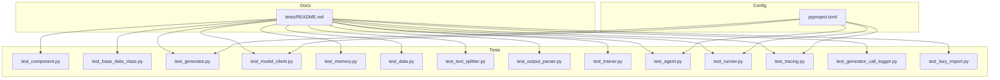

**Diagram sources**
- [tests/README.md](file://adalflow/tests/README.md#L1-L34)
- [pyproject.toml](file://pyproject.toml#L17-L67)

**Section sources**
- [tests/README.md](file://adalflow/tests/README.md#L1-L34)
- [pyproject.toml](file://pyproject.toml#L17-L67)

## Core Components
- Test runner and discovery: pytest is used for test discovery and execution. The tests README documents common commands and flags for running subsets of tests and capturing output.
- Unit and integration patterns: Tests commonly use unittest.TestCase or IsolatedAsyncioTestCase, with extensive mocking via unittest.mock.patch and Mock to isolate external dependencies (API clients, file systems, environment variables).
- Environment and secrets: Tests avoid real API keys by mocking environment variables and API responses. The tests README indicates that CI workflows supply secrets for live API tests.
- Coverage of core domains: Tests cover components such as Generators, Model Clients, Agents, Runners, Memory, Data loaders, Text Splitters, Output Parsers, Trainers, Tracing, and Lazy Imports.

Practical examples (paths only):
- Component lifecycle and parameter registration: [tests/test_component.py](file://adalflow/tests/test_component.py#L43-L98)
- Base data class serialization and schema generation: [tests/test_base_data_class.py](file://adalflow/tests/test_base_data_class.py#L64-L135)
- Generator call, caching, and tracing integration: [tests/test_generator.py](file://adalflow/tests/test_generator.py#L20-L198)
- Model client lazy subclassing and parsing: [tests/test_model_client.py](file://adalflow/tests/test_model_client.py#L10-L53)
- Conversation memory operations and metadata filtering: [tests/test_memory.py](file://adalflow/tests/test_memory.py#L6-L321)
- Dataset, Subset, and DataLoader usage: [tests/test_data.py](file://adalflow/tests/test_data.py#L32-L87)
- Text splitting with overlap and document handling: [tests/test_text_splitter.py](file://adalflow/tests/test_text_splitter.py#L6-L67)
- Output parsers for JSON/YAML and Pydantic models: [tests/test_output_parser.py](file://adalflow/tests/test_output_parser.py#L44-L331)
- Trainer validation for datasets: [tests/test_trainer.py](file://adalflow/tests/test_trainer.py#L8-L29)
- Agent planner/tool manager wiring and integration: [tests/test_agent.py](file://adalflow/tests/test_agent.py#L51-L384)
- Runner call/acall/astream behavior and conversation memory: [tests/test_runner.py](file://adalflow/tests/test_runner.py#L162-L800)
- Tracing provider, spans, and processors: [tests/test_tracing.py](file://adalflow/tests/test_tracing.py#L62-L786)
- Generator call logging to JSONL: [tests/test_generator_call_logger.py](file://adalflow/tests/test_generator_call_logger.py#L10-L81)
- Safe import and optional packages: [tests/test_lazy_import.py](file://adalflow/tests/test_lazy_import.py#L8-L140)

**Section sources**
- [tests/README.md](file://adalflow/tests/README.md#L1-L34)
- [tests/test_component.py](file://adalflow/tests/test_component.py#L43-L98)
- [tests/test_base_data_class.py](file://adalflow/tests/test_base_data_class.py#L64-L135)
- [tests/test_generator.py](file://adalflow/tests/test_generator.py#L20-L198)
- [tests/test_model_client.py](file://adalflow/tests/test_model_client.py#L10-L53)
- [tests/test_memory.py](file://adalflow/tests/test_memory.py#L6-L321)
- [tests/test_data.py](file://adalflow/tests/test_data.py#L32-L87)
- [tests/test_text_splitter.py](file://adalflow/tests/test_text_splitter.py#L6-L67)
- [tests/test_output_parser.py](file://adalflow/tests/test_output_parser.py#L44-L331)
- [tests/test_trainer.py](file://adalflow/tests/test_trainer.py#L8-L29)
- [tests/test_agent.py](file://adalflow/tests/test_agent.py#L51-L384)
- [tests/test_runner.py](file://adalflow/tests/test_runner.py#L162-L800)
- [tests/test_tracing.py](file://adalflow/tests/test_tracing.py#L62-L786)
- [tests/test_generator_call_logger.py](file://adalflow/tests/test_generator_call_logger.py#L10-L81)
- [tests/test_lazy_import.py](file://adalflow/tests/test_lazy_import.py#L8-L140)

## Architecture Overview
The testing architecture centers on:
- Isolation: Extensive use of patch and Mock to replace external services (LLM providers, file system, environment variables).
- Determinism: Controlled inputs and deterministic outputs for predictable assertions.
- Integration boundaries: Tests exercise integration points (Agent-Runner, Generator-ModelClient, Tracing-Generators) while keeping external systems virtualized.
- Async-first: Many components (Runner, Generator) support async execution; tests include both sync and async scenarios.

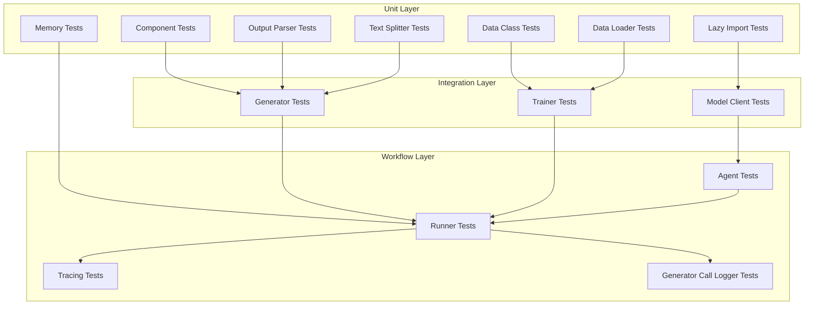

**Diagram sources**
- [tests/test_component.py](file://adalflow/tests/test_component.py#L43-L98)
- [tests/test_base_data_class.py](file://adalflow/tests/test_base_data_class.py#L64-L135)
- [tests/test_output_parser.py](file://adalflow/tests/test_output_parser.py#L44-L331)
- [tests/test_memory.py](file://adalflow/tests/test_memory.py#L6-L321)
- [tests/test_text_splitter.py](file://adalflow/tests/test_text_splitter.py#L6-L67)
- [tests/test_data.py](file://adalflow/tests/test_data.py#L32-L87)
- [tests/test_lazy_import.py](file://adalflow/tests/test_lazy_import.py#L8-L140)
- [tests/test_generator.py](file://adalflow/tests/test_generator.py#L20-L198)
- [tests/test_model_client.py](file://adalflow/tests/test_model_client.py#L10-L53)
- [tests/test_trainer.py](file://adalflow/tests/test_trainer.py#L8-L29)
- [tests/test_agent.py](file://adalflow/tests/test_agent.py#L51-L384)
- [tests/test_runner.py](file://adalflow/tests/test_runner.py#L162-L800)
- [tests/test_tracing.py](file://adalflow/tests/test_tracing.py#L62-L786)
- [tests/test_generator_call_logger.py](file://adalflow/tests/test_generator_call_logger.py#L10-L81)

## Detailed Component Analysis

### Component Lifecycle and Parameter Registration
- Purpose: Validates Component initialization, parameter registration, and subcomponent management.
- Patterns:
  - Missing super().__init__() raises AttributeError.
  - Parameters and subcomponents are discoverable via named_parameters/named_components.
  - Mocks are used to simulate Prompt and Generator inside Component subclasses.
- Practical example path: [tests/test_component.py](file://adalflow/tests/test_component.py#L43-L98)

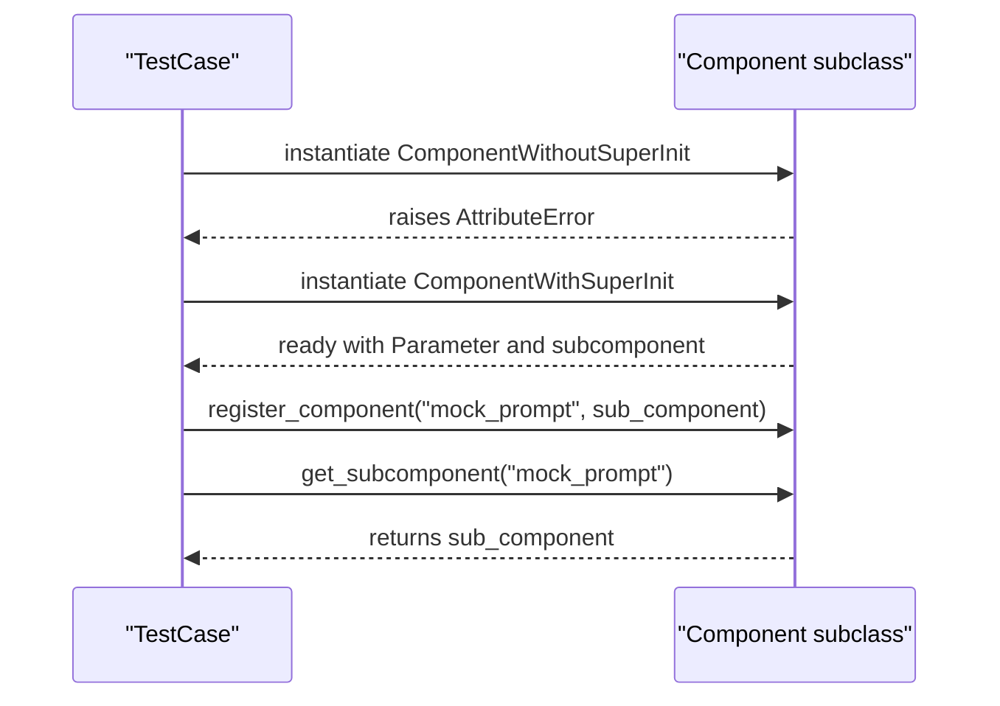

**Diagram sources**
- [tests/test_component.py](file://adalflow/tests/test_component.py#L12-L98)

**Section sources**
- [tests/test_component.py](file://adalflow/tests/test_component.py#L43-L98)

### Base Data Class Serialization and Schema
- Purpose: Ensures to_dict/from_dict round-trips, schema generation, and nested dataclass handling.
- Patterns:
  - setUp creates complex nested instances.
  - Assertions validate dict representation and reconstruction.
  - Exclusions and includes are tested per class and per instance.
- Practical example path: [tests/test_base_data_class.py](file://adalflow/tests/test_base_data_class.py#L64-L135)

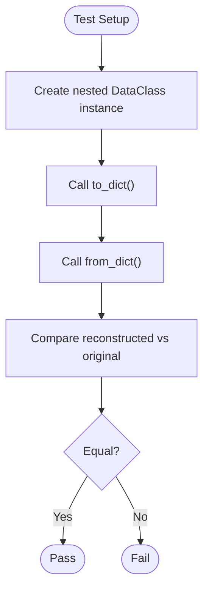

**Diagram sources**
- [tests/test_base_data_class.py](file://adalflow/tests/test_base_data_class.py#L64-L135)

**Section sources**
- [tests/test_base_data_class.py](file://adalflow/tests/test_base_data_class.py#L64-L135)

### Generator: Call, Cache, and Tracing Integration
- Purpose: Validates Generator call semantics, caching path sanitization, prompt logging, and async capabilities.
- Patterns:
  - patch(ModelClient) to return deterministic responses.
  - patch(os.getenv) to supply fake API keys.
  - GeneratorStateLogger writes prompt logs to JSON.
  - Async acall and training flags are exercised.
- Practical example paths:
  - [tests/test_generator.py](file://adalflow/tests/test_generator.py#L20-L198)
  - [tests/test_generator_call_logger.py](file://adalflow/tests/test_generator_call_logger.py#L10-L81)

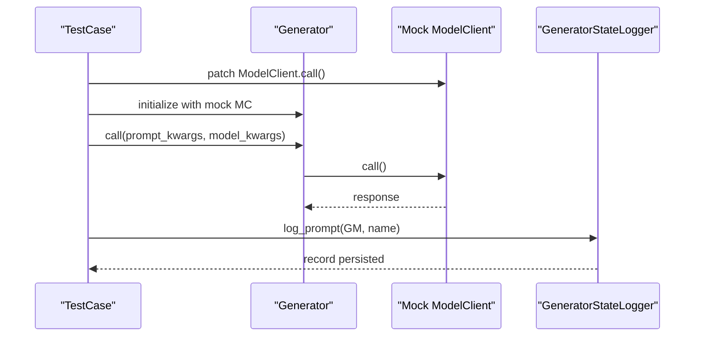

**Diagram sources**
- [tests/test_generator.py](file://adalflow/tests/test_generator.py#L20-L198)
- [tests/test_generator_call_logger.py](file://adalflow/tests/test_generator_call_logger.py#L10-L81)

**Section sources**
- [tests/test_generator.py](file://adalflow/tests/test_generator.py#L20-L198)
- [tests/test_generator_call_logger.py](file://adalflow/tests/test_generator_call_logger.py#L10-L81)

### Model Client: Lazy Subclassing and Parsing
- Purpose: Validates correct subclassing of lazy-imported clients and parse_chat_completion behavior.
- Patterns:
  - patch.dict for environment variables.
  - patch.object for method-level mocks.
  - Type errors are asserted for incorrect subclassing.
- Practical example path: [tests/test_model_client.py](file://adalflow/tests/test_model_client.py#L10-L53)

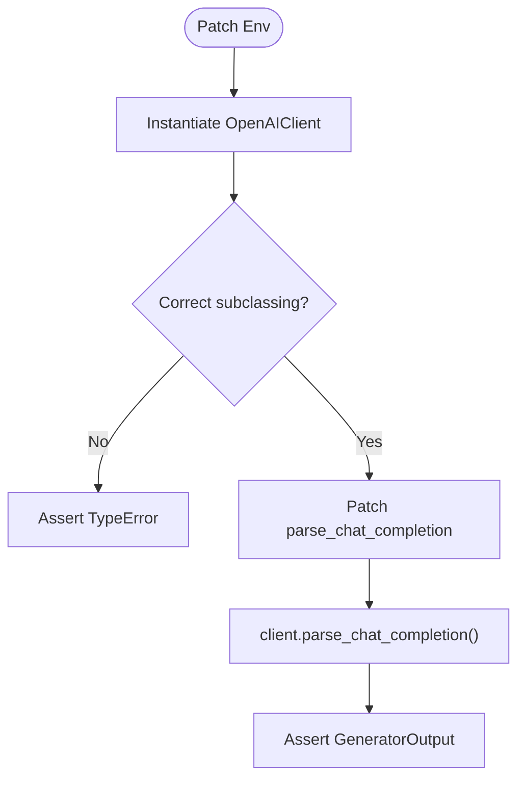

**Diagram sources**
- [tests/test_model_client.py](file://adalflow/tests/test_model_client.py#L10-L53)

**Section sources**
- [tests/test_model_client.py](file://adalflow/tests/test_model_client.py#L10-L53)

### Memory: Conversation and Metadata Filtering
- Purpose: Validates conversation turns, ordering, turn IDs, clearing, and metadata filtering.
- Patterns:
  - UserQuery and AssistantResponse objects are used.
  - Errors are raised for invalid transitions.
  - LocalDB-backed storage is verified.
- Practical example path: [tests/test_memory.py](file://adalflow/tests/test_memory.py#L6-L321)

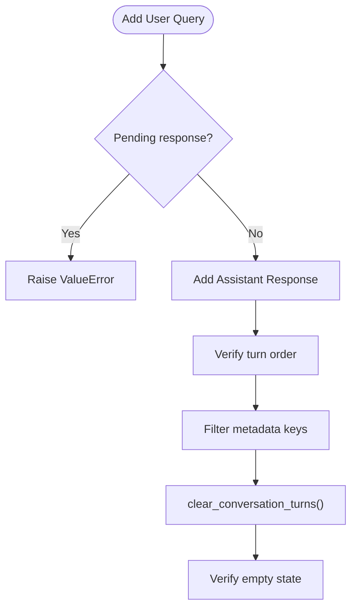

**Diagram sources**
- [tests/test_memory.py](file://adalflow/tests/test_memory.py#L88-L321)

**Section sources**
- [tests/test_memory.py](file://adalflow/tests/test_memory.py#L6-L321)

### Data Pipeline: Dataset, Subset, DataLoader
- Purpose: Validates Dataset protocol, Subset slicing, and DataLoader batching.
- Patterns:
  - Custom Dataset and DataLoader usage.
  - Iteration and batch composition checked.
- Practical example path: [tests/test_data.py](file://adalflow/tests/test_data.py#L32-L87)

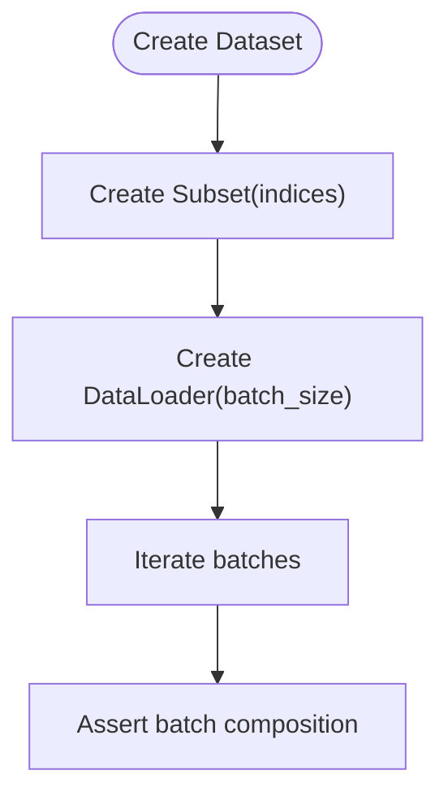

**Diagram sources**
- [tests/test_data.py](file://adalflow/tests/test_data.py#L32-L87)

**Section sources**
- [tests/test_data.py](file://adalflow/tests/test_data.py#L32-L87)

### Text Splitter: Overlap and Documents
- Purpose: Validates splitting by word/sentence, overlap handling, and document list processing.
- Patterns:
  - ValueError raised for invalid inputs.
  - Overlap boundary conditions tested.
- Practical example path: [tests/test_text_splitter.py](file://adalflow/tests/test_text_splitter.py#L6-L67)

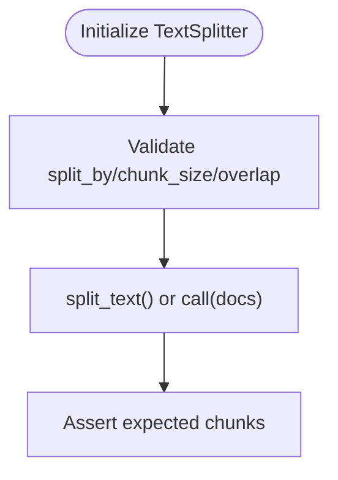

**Diagram sources**
- [tests/test_text_splitter.py](file://adalflow/tests/test_text_splitter.py#L6-L67)

**Section sources**
- [tests/test_text_splitter.py](file://adalflow/tests/test_text_splitter.py#L6-L67)

### Output Parsers: JSON/YAML and Pydantic
- Purpose: Validates JSON/YAML parsing, markdown-wrapped JSON, and Pydantic model parsing with examples and schema.
- Patterns:
  - ValidationError is raised for invalid inputs.
  - Nested structures and complex JSON are handled robustly.
- Practical example path: [tests/test_output_parser.py](file://adalflow/tests/test_output_parser.py#L44-L331)

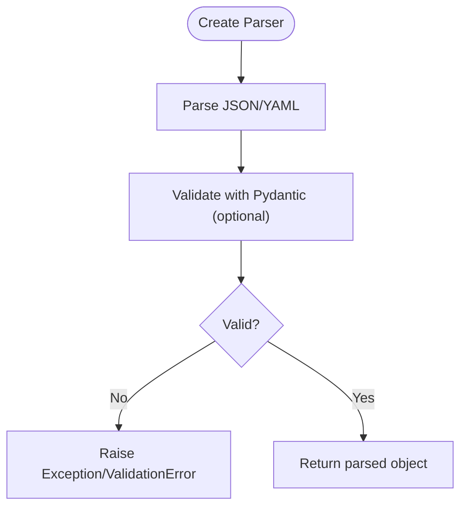

**Diagram sources**
- [tests/test_output_parser.py](file://adalflow/tests/test_output_parser.py#L44-L331)

**Section sources**
- [tests/test_output_parser.py](file://adalflow/tests/test_output_parser.py#L44-L331)

### Trainer: Dataset Validation
- Purpose: Ensures Trainer rejects missing train or validation datasets.
- Patterns:
  - MagicMock for AdalComponent.
  - ValueError assertions for None datasets.
- Practical example path: [tests/test_trainer.py](file://adalflow/tests/test_trainer.py#L8-L29)

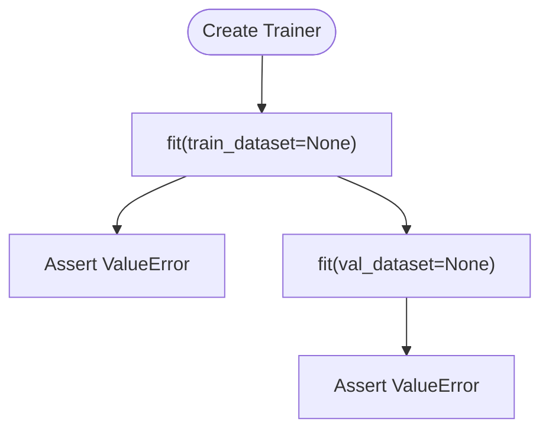

**Diagram sources**
- [tests/test_trainer.py](file://adalflow/tests/test_trainer.py#L8-L29)

**Section sources**
- [tests/test_trainer.py](file://adalflow/tests/test_trainer.py#L8-L29)

### Agent: Planner, Tools, and Integration
- Purpose: Validates Agent planner/tool wiring, context variables, model kwargs propagation, and training state.
- Patterns:
  - patch("Generator") with a DummyGenerator to stub LLM calls.
  - fun_to_grad_component decorator patched to allow tool registration.
  - flip_thinking_model recreates planner and preserves attributes.
- Practical example path: [tests/test_agent.py](file://adalflow/tests/test_agent.py#L51-L384)

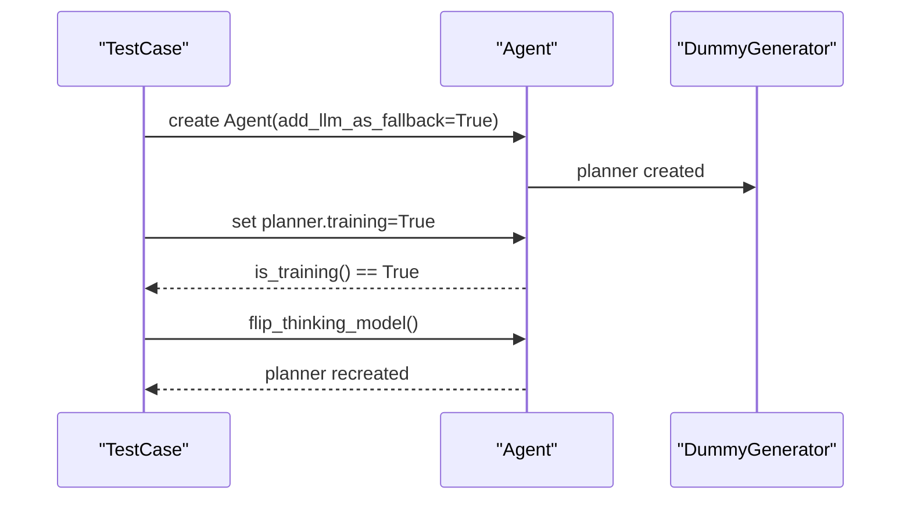

**Diagram sources**
- [tests/test_agent.py](file://adalflow/tests/test_agent.py#L51-L384)

**Section sources**
- [tests/test_agent.py](file://adalflow/tests/test_agent.py#L51-L384)

### Runner: Call, Acalls, Streaming, and Conversation Memory
- Purpose: Validates Runner call/acall/astream behavior, max_steps enforcement, and conversation memory integration.
- Patterns:
  - FakePlanner/FakeStreamingPlanner return GeneratorOutput sequences.
  - MockToolManager simulates tool execution.
  - ConversationMemory clears and propagates chat_history_str across calls.
- Practical example paths:
  - [tests/test_runner.py](file://adalflow/tests/test_runner.py#L162-L800)

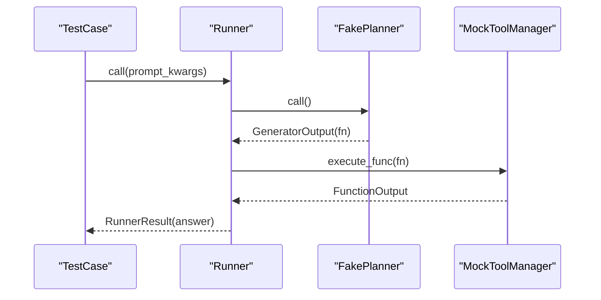

**Diagram sources**
- [tests/test_runner.py](file://adalflow/tests/test_runner.py#L162-L800)

**Section sources**
- [tests/test_runner.py](file://adalflow/tests/test_runner.py#L162-L800)

### Tracing: Provider, Spans, and Processors
- Purpose: Validates tracing provider behavior, span creation, environment variable toggles, and processor lifecycle.
- Patterns:
  - set_tracing_disabled and environment variable ADALFLOW_DISABLE_TRACING.
  - MockTracingProcessor tracks trace/span lifecycle.
  - NoOpTrace/NoOpSpan returned when disabled.
- Practical example path: [tests/test_tracing.py](file://adalflow/tests/test_tracing.py#L62-L786)

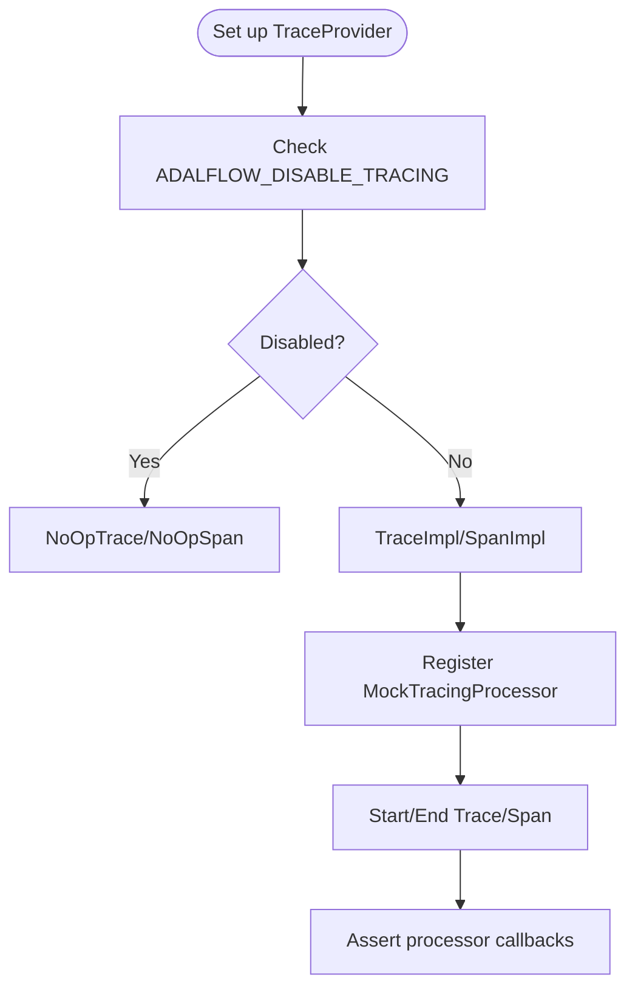

**Diagram sources**
- [tests/test_tracing.py](file://adalflow/tests/test_tracing.py#L62-L786)

**Section sources**
- [tests/test_tracing.py](file://adalflow/tests/test_tracing.py#L62-L786)

### Generator Call Logger: JSONL Persistence
- Purpose: Validates generator registration, call logging, and loading persisted records.
- Patterns:
  - patch("os.makedirs") and "builtins.open" to avoid filesystem writes.
  - load() reads persisted records from JSONL.
- Practical example path: [tests/test_generator_call_logger.py](file://adalflow/tests/test_generator_call_logger.py#L10-L81)

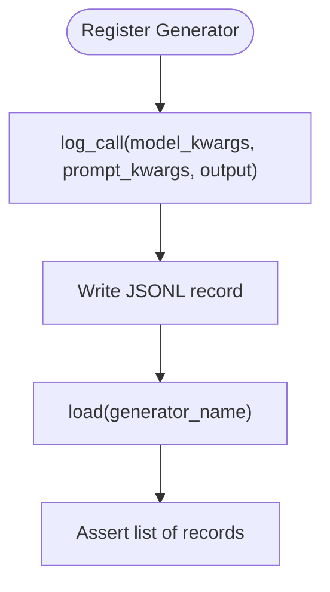

**Diagram sources**
- [tests/test_generator_call_logger.py](file://adalflow/tests/test_generator_call_logger.py#L10-L81)

**Section sources**
- [tests/test_generator_call_logger.py](file://adalflow/tests/test_generator_call_logger.py#L10-L81)

### Lazy Import: Optional Packages
- Purpose: Validates safe_import behavior for optional packages and grouped optional sets (e.g., AWS/Azure).
- Patterns:
  - patch("importlib.import_module") to simulate success/failure.
  - ImportError raised with custom messages when packages are missing.
- Practical example path: [tests/test_lazy_import.py](file://adalflow/tests/test_lazy_import.py#L8-L140)

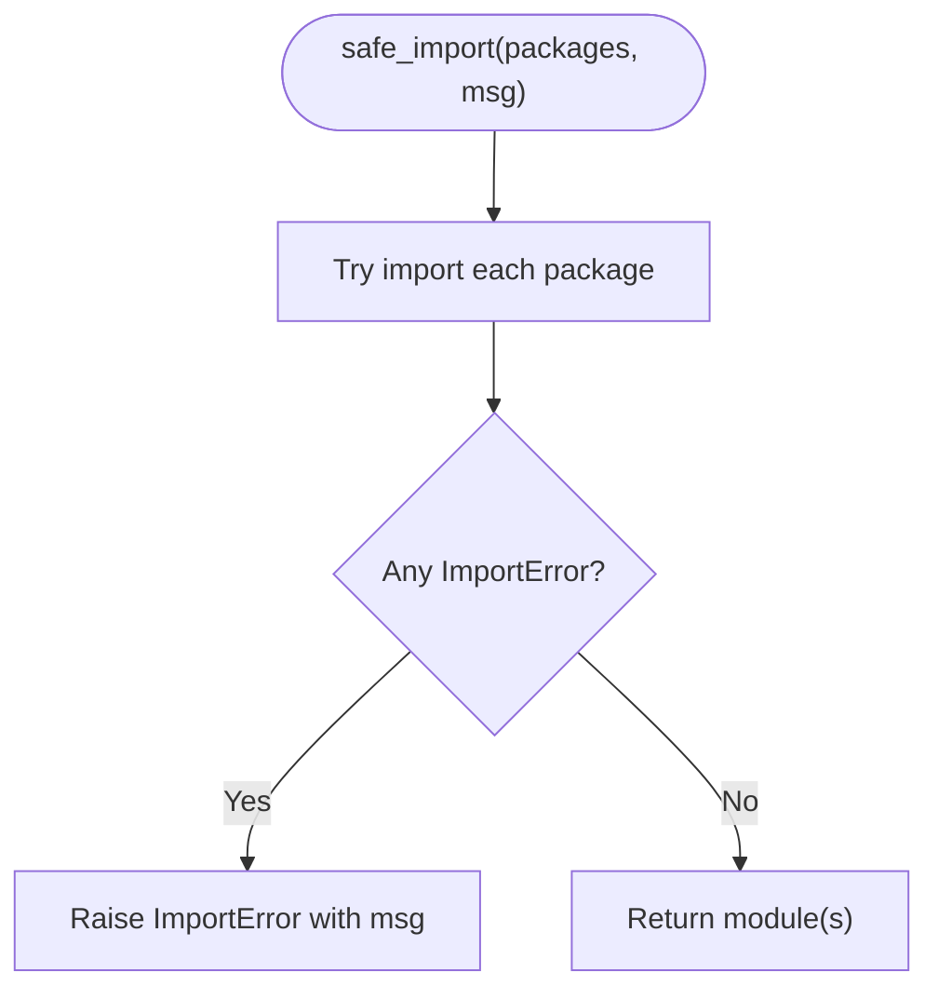

**Diagram sources**
- [tests/test_lazy_import.py](file://adalflow/tests/test_lazy_import.py#L8-L140)

**Section sources**
- [tests/test_lazy_import.py](file://adalflow/tests/test_lazy_import.py#L8-L140)

## Dependency Analysis
- External dependencies for testing include model clients (OpenAI, Anthropic, Groq, Azure, AWS, Google, Mistral, Ollama, Together), vector databases (FAISS, LanceDB, Qdrant), and ML libraries (PyTorch, Transformers, RAGAS). These are declared in pyproject.toml under dev dependencies and enable realistic integration tests without requiring live credentials in local runs.
- Tests isolate these dependencies using patch and Mock, ensuring deterministic behavior and fast execution.

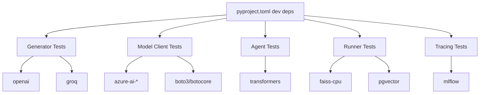

**Diagram sources**
- [pyproject.toml](file://pyproject.toml#L17-L67)

**Section sources**
- [pyproject.toml](file://pyproject.toml#L17-L67)

## Performance Considerations
- Prefer patching expensive external calls (LLM APIs, file IO) to avoid latency and flakiness.
- Use IsolatedAsyncioTestCase for async-heavy components to minimize cross-test interference.
- Keep test fixtures minimal; reuse setUp/tearDown to reduce object creation overhead.
- Avoid real network calls in unit tests; rely on Mock and patch to simulate responses.
- For tracing-heavy tests, disable tracing via environment variable or provider controls when measuring performance.

## Troubleshooting Guide
Common issues and resolutions:
- Missing API keys in tests:
  - Use patch.dict for environment variables or patch os.getenv to supply fake keys.
  - References: [tests/test_generator.py](file://adalflow/tests/test_generator.py#L141-L174), [tests/test_model_client.py](file://adalflow/tests/test_model_client.py#L28-L41)
- Generator call logger file operations:
  - Patch builtins.open and os.makedirs to avoid filesystem writes.
  - References: [tests/test_generator_call_logger.py](file://adalflow/tests/test_generator_call_logger.py#L10-L81)
- Tracing disabled unexpectedly:
  - Check ADALFLOW_DISABLE_TRACING environment variable and provider state.
  - References: [tests/test_tracing.py](file://adalflow/tests/test_tracing.py#L102-L259)
- Lazy import failures:
  - Ensure optional packages are installed or adjust safe_import expectations.
  - References: [tests/test_lazy_import.py](file://adalflow/tests/test_lazy_import.py#L8-L140)

**Section sources**
- [tests/test_generator.py](file://adalflow/tests/test_generator.py#L141-L174)
- [tests/test_model_client.py](file://adalflow/tests/test_model_client.py#L28-L41)
- [tests/test_generator_call_logger.py](file://adalflow/tests/test_generator_call_logger.py#L10-L81)
- [tests/test_tracing.py](file://adalflow/tests/test_tracing.py#L102-L259)
- [tests/test_lazy_import.py](file://adalflow/tests/test_lazy_import.py#L8-L140)

## Conclusion
AdalFlow’s testing framework emphasizes isolation, determinism, and comprehensive coverage across components, integrations, and workflows. By leveraging patching, mocking, and controlled environments, tests remain fast, reliable, and maintainable. The suite demonstrates strong patterns for unit, integration, and tracing-related testing, and provides a solid foundation for extending coverage and maintaining quality.

## Appendices
- Running tests:
  - Install test dependencies and run pytest as documented in the tests README.
  - References: [tests/README.md](file://adalflow/tests/README.md#L1-L34)
- Test organization tips:
  - Group related tests in files mirroring module names.
  - Use setUp/tearDown to manage shared mocks and temporary resources.
  - Prefer small, focused assertions and descriptive test names.

**Section sources**
- [tests/README.md](file://adalflow/tests/README.md#L1-L34)